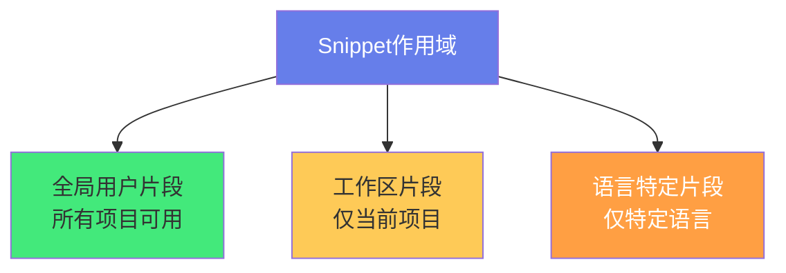

# ⌨️ VSCode 自定义 Snippet 与快捷键

> **文档说明**：系统讲解 VSCode 中自定义代码片段（Snippet）和快捷键（Keybindings）的完整配置方法与高效实践，涵盖 Snippet 的三种作用域（全局用户片段/工作区片段/语言特定片段）、Snippet 语法详解（Tab Stop `$1`/`$2`、占位符 `${1:default}`、变量 `$TM_FILENAME`、选中文本 `${TM_SELECTED_TEXT}`、变量转换 `${TM_FILENAME/(.*)/${1:/upcase}/}`、多光标 `$0` 最终位置）、各语言常用 Snippet 实战模板（Python/Java/JavaScript/TypeScript/Vue/React/Markdown/Shell）、Snippet 最佳实践与管理技巧、快捷键自定义完整指南（keybindings.json 结构/快捷键冲突排查/when 上下文子句/多命令串联 chord 组合键/条件快捷键）、VSCode 内置高频快捷键速查表（编辑/导航/多光标/搜索替换/终端/调试/视图切换）、快捷键与 Snippet 结合的高效工作流、通过 settings.json 优化编辑体验、常用效率插件推荐、跨平台快捷键差异（Windows/macOS/Linux）、常见问题与最佳实践。
>
> **适用人群**：使用 VSCode 的开发者、希望提升编码效率的工程师、技术团队效率建设者
>
> **前置知识**：[[VSCode-核心配置与插件]] · [[Markdown语法详解]]

---

## 一、概述

### 1.1 为什么自定义 Snippet 和快捷键

VSCode 开箱即用的功能已经很强大，但**自定义 Snippet 和快捷键**能将效率再提升一个量级：

| 能力 | 价值 |
|------|------|
| **Snippet** | 将重复代码模板化，输入几个字符生成几十行代码 |
| **快捷键** | 脱离鼠标，双手不离开键盘，操作速度提升 3-5 倍 |
| **两者结合** | 快捷键触发 Snippet，一键生成复杂模板 |

> 核心原则：**任何重复输入超过 3 次的内容，都应该考虑做成 Snippet；任何重复操作超过 3 次的动作，都应该考虑绑定快捷键。**

### 1.2 配置文件位置

| 配置 | Windows 路径 | macOS 路径 |
|------|-------------|-----------|
| **用户 Snippet** | `%APPDATA%\Code\User\snippets\` | `~/Library/Application Support/Code/User/snippets/` |
| **快捷键** | `%APPDATA%\Code\User\keybindings.json` | `~/Library/Application Support/Code/User/keybindings.json` |
| **设置** | `%APPDATA%\Code\User\settings.json` | `~/Library/Application Support/Code/User/settings.json` |

**快速打开方式**：
- `Ctrl+Shift+P` → 输入 `Snippets` → 选择 `Configure User Snippets`
- `Ctrl+Shift+P` → 输入 `Open Keyboard Shortcuts (JSON)`
- `Ctrl+,` → 打开设置界面

---

## 二、Snippet 详解

### 2.1 Snippet 的三种作用域



| 类型 | 文件位置 | 适用场景 |
|------|---------|---------|
| **全局用户片段** | `snippets/全局片段.code-snippets` | 通用模板（如注释头、console.log） |
| **工作区片段** | `.vscode/项目名.code-snippets` | 项目特定模板（团队共享） |
| **语言特定片段** | `snippets/python.json` 等 | 特定语言的代码模板 |

### 2.2 Snippet 基本结构

```json
{
  "Snippet名称": {
    "prefix": "触发词",
    "body": [
      "代码行1",
      "代码行2$1",
      "代码行3$2"
    ],
    "description": "描述说明"
  }
}
```

| 字段 | 说明 |
|------|------|
| `prefix` | 触发词，输入后按 Tab 展开（可配多个：`["trigger1", "trigger2"]`） |
| `body` | 代码内容，数组每行一个字符串 |
| `description` | 智能提示中显示的描述 |
| `scope` | （全局片段用）指定语言，如 `"python, javascript"` |

### 2.3 Snippet 语法

#### Tab Stop（制表位）

```text
$1, $2, $3 ...  → 光标依次跳转的位置
$0              → 最终光标位置（默认在末尾）
```

```json
{
  "for循环": {
    "prefix": "fori",
    "body": [
      "for (let ${1:i} = 0; ${1:i} < ${2:array}.length; ${1:i}++) {",
      "  $0",
      "}"
    ]
  }
}
```

> 相同编号的 Tab Stop 是**多光标**同时编辑。上例中 `$1` 出现三次，修改一个其他同步变化。

#### 占位符（Placeholder）

```text
${1:默认值}  → 带默认值的 Tab Stop，可直接覆盖
```

```json
{
  "函数定义": {
    "prefix": "func",
    "body": [
      "function ${1:functionName}(${2:params}) {",
      "  $0",
      "}"
    ]
  }
}
```

#### 变量（Variables）

| 变量 | 说明 | 示例 |
|------|------|------|
| `$TM_FILENAME` | 当前文件名 | `app.py` |
| `$TM_FILENAME_BASE` | 无扩展名的文件名 | `app` |
| `$TM_DIRECTORY` | 文件目录路径 | `/src/utils` |
| `$TM_FILEPATH` | 完整文件路径 | `/src/utils/app.py` |
| `$TM_SELECTED_TEXT` | 选中文本 | （选中的内容） |
| `$TM_CURRENT_LINE` | 当前行内容 | - |
| `$TM_CURRENT_WORD` | 当前光标下的词 | - |
| `$TM_LINE_INDEX` | 行号（0开始） | `41` |
| `$TM_LINE_NUMBER` | 行号（1开始） | `42` |
| `$CURRENT_YEAR` | 当前年 | `2026` |
| `$CURRENT_MONTH` | 当前月 | `08` |
| `$CURRENT_DATE` | 当前日 | `28` |
| `$CURRENT_TIME` | 当前时间 | `14:30:00` |
| `$CLIPBOARD` | 剪贴板内容 | - |
| `$WORKSPACE_NAME` | 工作区名称 | - |

#### 变量转换（Transform）

```text
${变量/正则/替换/标志}
```

| 转换标志 | 说明 |
|---------|------|
| `/upcase` | 转大写 |
| `/downcase` | 转小写 |
| `/capitalize` | 首字母大写 |
| `/pascalcase` | 帕斯卡命名 |
| `/camelcase` | 驼峰命名 |

```json
{
  "React组件": {
    "prefix": "rcomp",
    "body": [
      "import React from 'react';",
      "",
      "export const ${1:${TM_FILENAME_BASE/(.*)/${1:/pascalcase}/}} = () => {",
      "  return (",
      "    <div>",
      "      $0",
      "    </div>",
      "  );",
      "};",
      "",
      "export default ${1:${TM_FILENAME_BASE/(.*)/${1:/pascalcase}/}};"
    ],
    "description": "React函数组件（文件名自动转PascalCase）"
  }
}
```

> 上例中 `TM_FILENAME_BASE` 是 `my-component`，通过 `/pascalcase` 转换为 `MyComponent`。

### 2.4 各语言常用 Snippet

#### Python

```json
{
  "Python函数": {
    "prefix": "defn",
    "body": [
      "def ${1:function_name}(${2:params}) -> ${3:return_type}:",
      "    \"\"\"${4:函数文档字符串}\"\"\"",
      "    $0",
      "    return ${5:result}"
    ],
    "description": "Python函数定义（含类型注解和docstring）"
  },
  "Python类": {
    "prefix": "cls",
    "body": [
      "class ${1:ClassName}:",
      "    \"\"\"${2:类文档字符串}\"\"\"",
      "",
      "    def __init__(self, ${3:params}):",
      "        ${4:self.param = param}",
      "        $0"
    ],
    "description": "Python类定义"
  },
  "if __name__ == __main__": {
    "prefix": "main",
    "body": [
      "if __name__ == \"__main__\":",
      "    ${0:main()}"
    ]
  }
}
```

#### JavaScript/TypeScript

```json
{
  "console.log": {
    "prefix": "clg",
    "body": ["console.log('${1:label}', ${2:variable});"],
    "description": "console.log带标签"
  },
  "箭头函数": {
    "prefix": "af",
    "body": ["const ${1:name} = (${2:params}) => {", "  $0", "};"]
  },
  "async函数": {
    "prefix": "asf",
    "body": [
      "const ${1:name} = async (${2:params}) => {",
      "  try {",
      "    $0",
      "  } catch (error) {",
      "    console.error(error);",
      "  }",
      "};"
    ]
  },
  "TS接口": {
    "prefix": "inter",
    "body": ["interface ${1:InterfaceName} {", "  ${2:key}: ${3:type};", "  $0", "}"]
  }
}
```

#### Vue 3

```json
{
  "Vue3组合式组件": {
    "prefix": "v3setup",
    "body": [
      "<template>",
      "  <div class=\"${1:component-name}\">",
      "    $0",
      "  </div>",
      "</template>",
      "",
      "<script setup lang=\"ts\">",
      "import { ref, computed } from 'vue';",
      "",
      "// Props",
      "const props = defineProps<{",
      "  ${2:propName}: ${3:string};",
      "}>();",
      "",
      "// Emits",
      "const emit = defineEmits<{",
      "  (e: '${4:event}', value: ${5:type}): void;",
      "}>();",
      "</script>",
      "",
      "<style scoped>",
      ".${1:component-name} {",
      "}",
      "</style>"
    ],
    "description": "Vue3 <script setup> 组件模板"
  }
}
```

#### Markdown

```json
{
  "Frontmatter": {
    "prefix": "fm",
    "body": [
      "---",
      "title: ${1:标题}",
      "tags: [${2:标签}]",
      "date: ${CURRENT_YEAR}-${CURRENT_MONTH}-${CURRENT_DATE}",
      "---",
      "",
      "# ${1:标题}",
      "",
      "$0"
    ],
    "description": "Markdown Frontmatter模板"
  },
  "代码块": {
    "prefix": "code",
    "body": ["```${1:language}", "$0", "```"]
  },
  "表格": {
    "prefix": "table",
    "body": [
      "| ${1:列1} | ${2:列2} | ${3:列3} |",
      "| --- | --- | --- |",
      "| ${4:内容} | ${5:内容} | ${6:内容} |",
      "$0"
    ]
  }
}
```

#### Java

```json
{
  "Java方法": {
    "prefix": "pubm",
    "body": [
      "public ${1:void} ${2:methodName}(${3:params}) {",
      "    $0",
      "}"
    ]
  },
  "System.out.println": {
    "prefix": "sout",
    "body": ["System.out.println(${1:message});"]
  },
  "SpringBoot控制器": {
    "prefix": "sbc",
    "body": [
      "@RestController",
      "@RequestMapping(\"/${1:api}\")",
      "public class ${2:ClassName}Controller {",
      "",
      "    @GetMapping(\"/${3:endpoint}\")",
      "    public ${4:Result} ${5:methodName}() {",
      "        $0",
      "        return ${6:result};",
      "    }",
      "}"
    ]
  }
}
```

### 2.5 Snippet 最佳实践

1. **触发词简短有意义**：如 `clg`（console.log）、`fori`（for循环）、`af`（箭头函数）
2. **多光标同步编辑**：相同 `$1` 出现在多处，修改一处全部同步
3. **用变量自动填充**：文件名、日期、选中文本等，减少手动输入
4. **按语言组织**：语言特定片段放对应文件，通用片段放全局
5. **团队共享**：工作区片段提交到 Git，团队统一使用
6. **不要过度**：太复杂的 Snippet 反而记不住触发词，保持精简
7. **描述清晰**：description 写清楚用途，智能提示时一目了然

---

## 三、快捷键自定义

### 3.1 keybindings.json 结构

```json
[
  {
    "key": "ctrl+shift+l",
    "command": "editor.action.insertSnippet",
    "args": {
      "snippet": "console.log('${TM_SELECTED_TEXT}', ${TM_SELECTED_TEXT});"
    },
    "when": "editorTextFocus && editorHasSelection"
  },
  {
    "key": "ctrl+d",
    "command": "-editor.action.addSelectionToNextFindMatch",
    "when": "editorFocus"
  }
]
```

| 字段 | 说明 |
|------|------|
| `key` | 快捷键组合（用 `+` 连接） |
| `command` | 要执行的命令 ID |
| `args` | 命令参数（可选） |
| `when` | 上下文条件（可选） |
| `-command` | 前缀 `-` 表示**移除**该快捷键 |

### 3.2 常用快捷键配置示例

#### 用快捷键触发 Snippet

```json
[
  {
    "key": "ctrl+alt+f",
    "command": "editor.action.insertSnippet",
    "args": { "name": "for循环" },
    "when": "editorTextFocus"
  }
]
```

#### 多命令串联（需 macros 插件）

```json
// 需安装 multi-command 或 macros 插件
{
  "key": "ctrl+shift+t",
  "command": "extension.multiCommand.execute",
  "args": {
    "sequence": [
      "editor.action.selectAll",
      "editor.action.formatDocument"
    ]
  }
}
```

#### 自定义终端命令

```json
{
  "key": "ctrl+alt+r",
  "command": "workbench.action.terminal.sendSequence",
  "args": { "text": "npm run dev\u000D" },
  "when": "terminalFocus"
}
```

#### 关闭标签页（覆盖默认）

```json
{
  "key": "ctrl+w",
  "command": "workbench.action.closeActiveEditor"
}
```

### 3.3 when 上下文子句

`when` 决定快捷键在什么条件下生效：

| 上下文 | 说明 |
|--------|------|
| `editorTextFocus` | 编辑器有焦点 |
| `editorHasSelection` | 有选中文本 |
| `editorLangId == python` | 当前是 Python 文件 |
| `terminalFocus` | 终端有焦点 |
| `resourceExtname == .md` | 文件扩展名是 .md |
| `isMac` / `isWindows` / `isLinux` | 操作系统 |
| `inQuickOpen` | 在快速打开面板 |
| `config.editor.minimap.enabled` | 配置项是否开启 |

**组合条件**：
```json
"when": "editorTextFocus && editorLangId == markdown && !editorHasSelection"
```

### 3.4 快捷键冲突排查

1. `Ctrl+K Ctrl+S` → 打开快捷键设置界面
2. 搜索快捷键组合，查看绑定的命令
3. 冲突的快捷键会有警告标识
4. 右键 → `Remove Keybinding` 移除冲突
5. 或在 keybindings.json 中用 `-command` 移除

---

## 四、VSCode 高频内置快捷键

### 4.1 通用

| 功能 | Windows/Linux | macOS |
|------|--------------|-------|
| 命令面板 | `Ctrl+Shift+P` | `Cmd+Shift+P` |
| 快速打开文件 | `Ctrl+P` | `Cmd+P` |
| 切换侧边栏 | `Ctrl+B` | `Cmd+B` |
| 切换终端 | `Ctrl+`` | `Cmd+`` |
| 关闭编辑器 | `Ctrl+W` | `Cmd+W` |
| 保存 | `Ctrl+S` | `Cmd+S` |
| 全部保存 | `Ctrl+K S` | `Cmd+Option+S` |

### 4.2 编辑

| 功能 | Windows/Linux | macOS |
|------|--------------|-------|
| 复制当前行 | `Ctrl+Shift+D` / `Alt+Shift+↓` | `Cmd+Shift+D` |
| 删除当前行 | `Ctrl+Shift+K` | `Cmd+Shift+K` |
| 移动当前行 | `Alt+↑/↓` | `Option+↑/↓` |
| 多光标（点击） | `Alt+Click` | `Option+Click` |
| 选中下一个相同词 | `Ctrl+D` | `Cmd+D` |
| 选中所有相同词 | `Ctrl+Shift+L` | `Cmd+Shift+L` |
| 行首/行尾 | `Home / End` | `Cmd+← / Cmd+→` |
| 单词跳转 | `Ctrl+←/→` | `Option+←/→` |
| 格式化文档 | `Shift+Alt+F` | `Shift+Option+F` |
| 注释/取消注释 | `Ctrl+/` | `Cmd+/` |
| 块注释 | `Shift+Alt+A` | `Shift+Option+A` |

### 4.3 导航

| 功能 | Windows/Linux | macOS |
|------|--------------|-------|
| 转到定义 | `F12` | `F12` |
| 查看定义（悬浮） | `Alt+F12` | `Option+F12` |
| 转到符号 | `Ctrl+Shift+O` | `Cmd+Shift+O` |
| 转到行 | `Ctrl+G` | `Ctrl+G` |
| 返回/前进 | `Alt+←/→` | `Ctrl+- / Ctrl+Shift+-` |
| 切换标签页 | `Ctrl+Tab` | `Ctrl+Tab` |

### 4.4 搜索

| 功能 | Windows/Linux | macOS |
|------|--------------|-------|
| 文件内搜索 | `Ctrl+F` | `Cmd+F` |
| 全局搜索 | `Ctrl+Shift+F` | `Cmd+Shift+F` |
| 替换 | `Ctrl+H` | `Cmd+Option+F` |
| 全局替换 | `Ctrl+Shift+H` | `Cmd+Shift+Option+F` |

### 4.5 终端

| 功能 | Windows/Linux | macOS |
|------|--------------|-------|
| 新建终端 | `Ctrl+Shift+`` | `Cmd+Shift+`` |
| 切换终端 | `Ctrl+`` | `Ctrl+`` |
| 终端清屏 | `Ctrl+L` | `Ctrl+L` |
| 终止命令 | `Ctrl+C` | `Ctrl+C` |

---

## 五、高效工作流组合

### 5.1 Snippet + 快捷键 + 选中

**场景**：选中一个变量，一键生成 `console.log('变量名', 变量)`

```json
// keybindings.json
[
  {
    "key": "ctrl+shift+l",
    "command": "editor.action.insertSnippet",
    "args": {
      "snippet": "console.log('${TM_SELECTED_TEXT}', ${TM_SELECTED_TEXT});"
    },
    "when": "editorTextFocus && editorHasSelection && editorLangId =~ /javascript|typescript/"
  }
]
```

### 5.2 快速生成文件头注释

```json
{
  "文件头注释": {
    "prefix": "header",
    "body": [
      "/**",
      " * @file ${TM_FILENAME}",
      " * @description ${1:文件描述}",
      " * @author ${2:Your Name}",
      " * @created ${CURRENT_YEAR}-${CURRENT_MONTH}-${CURRENT_DATE}",
      " */",
      "$0"
    ]
  }
}
```

### 5.3 快速切换主题/字体

绑定快捷键切换配色主题：
```json
{
  "key": "ctrl+alt+t",
  "command": "workbench.action.selectTheme"
}
```

---

## 六、常用效率插件

| 插件 | 功能 |
|------|------|
| **Snippets** | 各语言的 Snippet 集合（Python/JS/React/Vue） |
| **ES7+ React Snippets** | React 常用 Snippet |
| **Vue 3 Snippets** | Vue 3 常用 Snippet |
| **Project Snippets** | 项目级 Snippet 管理 |
| **multi-command** | 多命令串联为一个快捷键 |
| **macros** | 宏录制和回放 |
| **Settings Sync** | 同步配置到 GitHub Gist |
| **Vim** | Vim 模式（终极键盘流） |

---

## 七、常见问题

| 问题 | 解决方案 |
|------|---------|
| **Snippet 不触发** | 检查 prefix 拼写、文件语言是否匹配、是否在 Snippet 作用域内 |
| **快捷键不生效** | 检查 when 条件、是否有冲突、命令 ID 是否正确 |
| **变量不解析** | 变量名拼写错误（区分大小写），转换语法是否正确 |
| **Tab 不展开 Snippet** | `Ctrl+,` → 搜索 `tabCompletion` → 设为 `on` |
| **Snippet 太多记不住** | 只保留常用的，触发词要有规律，用描述辅助记忆 |
| **团队共享 Snippet** | 用工作区片段（`.vscode/*.code-snippets`）提交到 Git |
| **macOS 快捷键不同** | `Cmd` 替代 `Ctrl`，`Option` 替代 `Alt`，注意功能键映射 |
| **多光标 Snippet** | 相同编号的 Tab Stop 自动多光标同步 |

---

## 八、最佳实践

1. **建立自己的 Snippet 库**：把重复输入的代码逐步做成 Snippet
2. **快捷键肌肉记忆**：每天练几个，逐步脱离鼠标
3. **配置版本控制**：将 settings.json/keybindings.json/snippets 用 Git 或 Settings Sync 备份
4. **团队统一**：工作区 Snippet + 推荐插件列表（`.vscode/extensions.json`）
5. **定期清理**：删除不用的 Snippet 和快捷键，保持精简
6. **从内置开始**：先掌握 VSCode 内置快捷键，再自定义补充
7. **Snippet 命名规范**：触发词统一前缀（如 `py-`/`js-`/`md-`），避免冲突

---

## 九、关联笔记

### 编辑器与工具
- [[VSCode-核心配置与插件]] · [[Cursor-AI编辑器深度使用]] · [[Markdown语法详解]]
- [[Git-高级命令与底层原理]] · [[WindowsTerminal与PowerShell]]

### 开发效率
- [[Python脚本-批量文件处理]] · [[Postman-高级用法与团队协作]] · [[GitHub-Actions流水线设计]]

### 导航
- [[MOC-通用工具]] · [[Home]] · [[学习路线总览]]

> 🔍 **知识点深度解析**
>
> **作用**：VSCode 自定义 Snippet 与快捷键解决的是「如何将重复性的编码操作自动化，减少机械输入，让双手不离开键盘，大幅提升编码效率」的问题——大多数开发者只用 VSCode 的基础功能，通过自定义 Snippet（代码模板）和快捷键（操作绑定），可以将重复输入减少 50% 以上，编码速度提升 3-5 倍。
>
> **底层原理**：①Snippet 的本质是「文本模板 + 占位符 + 变量替换」——VSCode 的 Snippet 引擎解析 JSON 格式的模板，将 `$1`/`${1:default}` 等占位符转换为可跳转的光标位置，将 `$TM_FILENAME` 等变量替换为实际值，将 `${var/regex/replace/flags}` 转换为正则替换结果。展开 Snippet 后，VSCode 通过「多光标」机制让相同编号的 Tab Stop 同步编辑，这是 Snippet 强大的核心。②快捷键系统的本质是「按键组合 → 命令 ID → 执行动作」的映射——VSCode 的每个操作都有一个唯一的命令 ID（如 `editor.action.insertSnippet`），keybindings.json 将按键组合映射到命令 ID，并通过 `when` 子句控制生效条件。`-command` 前缀可以移除默认绑定，这让用户可以完全自定义快捷键而不被默认设置限制。③`when` 上下文子句是 VSCode 快捷键系统的精髓——它让同一个快捷键在不同上下文（编辑器/终端/不同语言/有无选中文本）执行不同动作。这是通过 VSCode 的「上下文键值（context key）」机制实现的：编辑器维护一个上下文状态对象，快捷键绑定时评估 `when` 表达式，匹配则执行。这种设计让快捷键系统极其灵活。④变量转换（Transform）的本质是「正则替换」——`${TM_FILENAME_BASE/(.*)/${1:/pascalcase}/}` 将文件名通过正则捕获组 `(.*)` 捕获，然后用 `/pascalcase` 标志转换为帕斯卡命名。这让 Snippet 可以根据上下文自动生成合适的代码（如从文件名生成组件名），极大减少了手动修改。⑤多光标（Multi-Cursor）是 VSCode 编辑效率的核心——通过 `Ctrl+D`（选中下一个相同词）、`Alt+Click`（点击添加光标）、Snippet 中相同 Tab Stop 等方式，可以同时编辑多处。多光标本质是「多个独立的光标位置共享同一个输入流」，这让批量修改变量名、同时编辑多行等操作变得极其高效。
>
> **用法要点**：① Snippet三种作用域：全局用户片段(所有项目)/工作区片段(项目共享)/语言特定片段(仅某语言) ② Snippet语法：$1/$2 Tab Stop，${1:default} 占位符，$TM_FILENAME/$CURRENT_YEAR/$TM_SELECTED_TEXT 变量，${var/regex/replace/flags} 转换，$0 最终光标，相同编号多光标同步 ③ 常用Snippet：Python(defn/cls/main)、JS(clg/af/asf/inter)、Vue(v3setup)、Markdown(fm/code/table)、Java(pubm/sout/sbc) ④ 快捷键：keybindings.json，key+command+args+when，-command移除默认，when上下文(editorTextFocus/editorLangId/terminalFocus/isWindows等) ⑤ 快捷键触发Snippet：command=editor.action.insertSnippet, args={name或snippet} ⑥ 高频内置快捷键：Ctrl+Shift+P命令面板/Ctrl+P快速打开/Ctrl+B侧边栏/Ctrl+`终端/Ctrl+D选中下一个/Ctrl+Shift+L选中所有/Alt+↑↓移动行/Ctrl+/注释/F12转到定义 ⑦ 冲突排查：Ctrl+K Ctrl+S打开快捷键界面，搜索查看冲突 ⑧ 最佳实践：重复3次以上就做Snippet/绑快捷键，触发词简短有意义，配置Git备份或Settings Sync同步，团队用工作区片段共享 ⑨ 跨平台：Windows Ctrl=macOS Cmd，Alt=Option，注意功能键。

> 💡 **深度讲解**：VSCode 自定义 Snippet 与快捷键最核心的智慧是「将重复性操作从『手动执行』升级为『一键触发』，把节省下来的认知资源投入到真正需要思考的地方」——很多开发者觉得「自定义配置太麻烦，不如直接写」，但这是典型的「短期方便，长期低效」。一个 Snippet 可能花 5 分钟配置，但如果每天用 10 次，每次节省 10 秒，一年就是 50 小时——这还不算减少机械输入带来的疲劳和错误。更重要的是，Snippet 和快捷键不只是「省时间」，更是「改变工作方式」——当你不需要反复输入 `console.log()`、`for` 循环、组件模板时，你的大脑可以专注于「逻辑和架构」，而不是「语法和拼写」。这种「让工具处理机械，让人处理思考」的分工，是效率提升的本质。VSCode 的 Snippet 系统尤其强大——变量转换（`/pascalcase`）让你可以从文件名自动生成组件名，多光标让你可以同时编辑多处，选中变量让你可以一键包裹代码。这些功能组合起来，可以实现非常复杂的自动化。快捷键系统的 `when` 子句更是精妙——它让同一个按键在不同上下文做不同的事，比如 `Ctrl+L` 在编辑器选中行，在终端清屏，在搜索框选中全部。这种「上下文感知」的设计让快捷键数量大大减少，记忆负担降低。在 AI 编程时代（Cursor/Copilot），Snippet 和快捷键的价值不是降低了，而是变化了——AI 可以生成代码，但 Snippet 可以标准化团队的代码风格和模板，快捷键可以让你更快地操作 AI 生成的代码。工具在变，但「减少重复、提升效率」的核心不变。掌握 VSCode 的自定义能力，就是掌握了「让编辑器为你工作」的钥匙——而不是「你为编辑器工作」。

> 📝 **精简总结**：VSCode自定义Snippet与快捷键=将重复编码操作自动化。Snippet：三种作用域(全局/工作区/语言特定)，语法$1占位符/${1:default}默认值/$TM_FILENAME变量/${var/regex/replace}转换/$0最终光标/相同编号多光标。常用模板：Python(defn/cls)/JS(clg/af/asf)/Vue(v3setup)/Markdown(fm/code)/Java(pubm/sout)。快捷键：keybindings.json(key+command+args+when)，-command移除默认，when上下文控制生效条件，可触发Snippet。高频内置：Ctrl+Shift+P命令面板/Ctrl+P快速打开/Ctrl+B侧边栏/Ctrl+`终端/Ctrl+D选中下一个/Ctrl+Shift+L全选相同/Alt+↑↓移动行/Ctrl+/注释/F12定义。最佳实践：重复3次以上就自动化，触发词简短，配置Git备份，团队工作区共享，定期清理。核心：工具处理机械，人处理思考。

> **学习路径建议**：先学习 [[VSCode-核心配置与插件]] 掌握基础配置 → 学习本文档的 Snippet 和快捷键语法 → 实践：为你最常用的 5 种代码模式创建 Snippet → 实践：自定义 5 个高频快捷键（如终端、格式化、注释） → 探索变量转换和多光标 Snippet → 学习 `when` 上下文子句实现高级快捷键 → 将配置同步到 GitHub Gist（Settings Sync） → 团队协作：创建工作区 Snippet 和推荐插件列表 → 进阶：学习 multi-command 插件实现多命令串联 → 形成自己的「效率配置库」。

---

> **VSCode 自定义 Snippet 与快捷键的本质是「将重复性的机械操作交给工具，把宝贵的认知资源留给真正需要思考的问题」——我们每天写代码时，有大量时间花在「重复输入」上：输入 `console.log()`、写 `for` 循环、创建组件模板、敲注释头、移动行、选中变量……这些操作不需要思考，但消耗时间和注意力。VSCode 的 Snippet 和快捷键系统就是为了消除这些「无认知价值的重复」——Snippet 让你输入几个字符就能生成几十行模板代码，快捷键让你按一个组合键就能完成复杂操作。更精妙的是，VSCode 的设计不是「简单的文本替换」，而是「智能模板系统」：变量自动填充文件名和日期，多光标同步编辑多处，正则转换自动处理命名风格，`when` 子句让快捷键上下文感知。这些功能组合起来，可以实现非常强大的自动化。很多开发者不愿意花时间配置，觉得「直接写更快」——但这是典型的「短期视角」。一个 Snippet 配置 5 分钟，每天用 10 次，每次省 10 秒，一年就是 50 小时。更重要的是，减少机械输入意味着减少疲劳和错误，让大脑始终保持在「思考模式」而非「打字模式」。在 AI 编程时代，这种能力更加重要——AI 可以生成代码，但你需要用快捷键快速操作和修改 AI 的输出，用 Snippet 标准化团队的代码风格。工具在进化，但「效率 = 减少重复 + 专注思考」的公式永远不变。从今天开始，花 10 分钟配置你的第一个 Snippet 和快捷键——一周后你会发现，回不去了。**

---

## 🔗 关联笔记

- [[MOC-通用工具]] — 返回本分类知识地图，查看更多相关文档

## 📖 前置知识

- 无特殊前置知识要求，具备基础编程概念即可

## 🏷️ 相关标签

`#VSCode` `#Snippet` `#代码片段` `#快捷键` `#效率工具` `#编辑器`

[[Home|🏠 返回首页]] · [[MOC-通用工具|📚 返回分类]]
