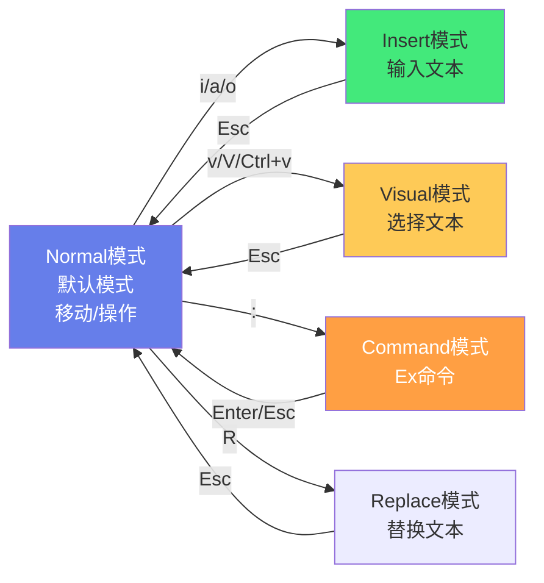

# 📝 Vim / Neovim 入门与配置

> **文档说明**：系统讲解 Vim 与 Neovim 编辑器的完整知识体系，涵盖 Vim/Neovim 简介与历史、安装与启动、模态编辑系统（Normal/Insert/Visual/Command/Replace/Ex 模式）、基本移动（字符/单词/行/句子/段落/屏幕/文档级移动）、编辑操作（插入/删除/修改/复制/粘贴/撤销/重做）、文本对象（word/WORD/sentence/paragraph/block/tag/quote）、寄存器（无名/数字/字母/特殊寄存器）、宏录制与回放、标记（mark）与跳转、搜索与替换（/ ? * # :s :g :v）、多文件编辑（buffer/arglist）、窗口管理（split/vsplit/tab）、插件管理（Vim-Plug/Pathogen/Vundle/Packer.nvim/Lazy.nvim）、init.vim/init.lua 配置详解、常用插件推荐（文件浏览/补全/LSP/语法高亮/状态栏/启动页/Git/调试）、配色方案、Neovim 新特性（Lua 配置/Treesitter/内置 LSP/虚拟文本/浮动窗口）、高效编辑技巧与思维、各 IDE 的 Vim 模式插件（VSCodeVim/IdeaVim）、常见问题与最佳实践。
>
> **适用人群**：开发者、运维工程师、追求编辑效率的程序员、Vim 初学者和进阶用户
>
> **前置知识**：[[VSCode-核心配置与插件]] · [[JetBrains-IDEA高效配置]] · [[Linux-运维常用命令手册]]

---

## 一、概述

### 1.1 Vim 与 Neovim 简介

**Vim（Vi IMproved）** 是从 vi 发展而来的高度可配置的文本编辑器，以**模态编辑**和**键盘驱动**著称，是 Unix/Linux 系统的标配编辑器。

**Neovim** 是 Vim 的社区分支（2014年创建），目标是**激进地重构和现代化 Vim**，提供更好的可扩展性、异步支持、Lua 集成、内置 LSP 等。

| 特性 | Vim | Neovim |
|------|-----|--------|
| **首次发布** | 1991 | 2014 |
| **配置语言** | Vimscript（VimL） | Vimscript + Lua（一等公民） |
| **异步支持** | 较晚（Vim 8） | 原生支持，更完善 |
| **内置 LSP** | ❌ | ✅（Neovim 0.5+） |
| **Treesitter** | ❌（插件） | ✅（内置，0.5+） |
| **浮动窗口** | 有限 | ✅ 完善 |
| **虚拟文本** | ❌ | ✅ |
| **终端模拟器** | :terminal | :terminal（更完善） |
| **默认配置** | 无 | init.lua / init.vim |
| **插件生态** | 最丰富 | 快速增长，现代插件优先支持 |
| **社区活跃度** | 稳定维护 | 活跃开发 |

> **选择建议**：初学者可以从 Vim 开始（资料多、兼容性好），追求现代特性和 Lua 配置选 Neovim。两者的核心编辑操作完全一致，学会一个就能无缝切换。

### 1.2 Vim 的核心理念

**模态编辑（Modal Editing）**：Vim 不同于普通编辑器（始终处于输入模式），它有多种模式，不同模式下键盘按键有不同含义。



| 模式 | 进入方式 | 用途 | 退出 |
|------|---------|------|------|
| **Normal（普通）** | 默认 / Esc | 移动光标、删除/复制/修改文本、执行命令 | - |
| **Insert（插入）** | i/a/o/I/A/O/s/S/C | 输入文本 | Esc |
| **Visual（可视）** | v（字符）/V（行）/Ctrl+v（块） | 选择文本区域 | Esc |
| **Command（命令）** | : | 执行 Ex 命令（保存/退出/搜索/替换等） | Enter/Esc |
| **Replace（替换）** | R | 覆盖式输入（替换已有字符） | Esc |
| **Ex** | Q | 逐行 Ex 命令模式（少用） | :vi |

> **核心思维**：Normal 模式是「默认状态」——你大部分时间应该在 Normal 模式下思考和操作，Insert 模式只是「短暂输入文本」的状态，输入完立即按 Esc 回到 Normal。这是 Vim 效率的关键。

**操作符 + 动作 = 命令**：Vim 的编辑命令遵循「操作符（Operator）+ 动作（Motion）」的语法，这是 Vim 强大的根源。

```text
操作符（做什么） + 动作（对哪里做） = 完整命令

d（删除） + w（单词） = dw（删除一个单词）
d（删除） + $（行尾） = d$（删除到行尾）
y（复制） + w（单词） = yw（复制一个单词）
c（修改） + iw（内部单词） = ciw（修改单词）
>（缩进） + %（匹配括号） = >%（缩进代码块）
gU（转大写） + ap（段落） = gUap（段落转大写）
```

> **这种「操作符+动作」的组合语法意味着：你学会一个新动作，就能和所有操作符组合；学会一个新操作符，就能和所有动作组合。这是 Vim 学习曲线陡峭但上限极高的原因——组合爆炸式的表达能力。**

---

## 二、安装与启动

### 2.1 安装

```bash
# Vim 安装
# Ubuntu/Debian
sudo apt install vim

# CentOS/RHEL
sudo yum install vim

# macOS（系统自带vi，安装完整版vim）
brew install vim

# Windows
# 从 https://www.vim.org/download.php 下载 gVim
# 或用 Chocolatey: choco install vim

# Neovim 安装
# Ubuntu/Debian
sudo apt install neovim

# macOS
brew install neovim

# Windows
# 从 GitHub Releases 下载 nvim-win64.zip
# 或 Chocolatey: choco install neovim

# 验证安装
vim --version
nvim --version
```

### 2.2 启动与退出

```bash
# 启动
vim                    # 打开 Vim（无文件）
vim filename.txt       # 打开指定文件
vim +10 filename.txt   # 打开并跳到第10行
vim +/pattern filename.txt  # 打开并跳到第一个匹配行
vim -o file1 file2     # 水平分屏打开多个文件
vim -O file1 file2     # 垂直分屏
vim -p file1 file2     # 标签页打开
vim -R filename.txt     # 只读模式
vim -x filename.txt     # 加密模式

# Neovim
nvim
nvim filename.txt

# 退出（Normal模式下）
:q          # 退出（未修改时）
:q!         # 强制退出（不保存修改）
:w          # 保存
:wq         # 保存并退出（等价 :x）
:x          # 保存并退出（有修改才保存）
:qa         # 退出所有窗口
:qa!        # 强制退出所有
ZZ          # 保存并退出（Normal模式，无需冒号）
ZQ          # 不保存退出
```

> **新手最常见问题**：不知道怎么退出 Vim。记住 `:q!`（不保存强制退出）是救命键。

---

## 三、Normal 模式：移动

### 3.1 基础移动（字符级）

| 按键 | 功能 | 说明 |
|------|------|------|
| `h` | 左移 | 左手食指 |
| `j` | 下移 | 左手食指 |
| `k` | 上移 | 左手中指 |
| `l` | 右移 | 右手无名指 |
| `0` | 行首 | 第一个字符 |
| `^` | 行首非空字符 | 第一个非空白字符 |
| `$` | 行尾 | 最后一个字符 |
| `g_` | 行尾非空字符 | 最后一个非空白字符 |
| `gj` | 屏幕行下移 | 长行折行时按屏幕行移动 |
| `gk` | 屏幕行上移 | 同上 |

> **为什么用 hjkl 而不是方向键？** 因为 hjkl 在主键盘区，手不需要离开打字位置，大大提高效率。初期可能不习惯，坚持一周就能形成肌肉记忆。

### 3.2 单词级移动

| 按键 | 功能 |
|------|------|
| `w` | 下一个单词开头（word，标点算分隔） |
| `W` | 下一个 WORD 开头（仅空格分隔） |
| `b` | 上一个单词开头 |
| `B` | 上一个 WORD 开头 |
| `e` | 下一个单词结尾 |
| `E` | 下一个 WORD 结尾 |
| `ge` | 上一个单词结尾 |

**word vs WORD**：
- `word`：以非字母数字下划线为分隔（`hello-world` 是两个 word）
- `WORD`：仅以空白为分隔（`hello-world` 是一个 WORD）

### 3.3 行/句子/段落级移动

| 按键 | 功能 |
|------|------|
| `+` / `Enter` | 下一行行首 |
| `-` | 上一行行首 |
| `(` | 上一个句子开头 |
| `)` | 下一个句子开头 |
| `{` | 上一个段落开头 |
| `}` | 下一个段落开头 |
| `]]` | 下一个节/函数开头 |
| `[[` | 上一个节/函数开头 |
| `][` | 下一个节/函数结尾 |
| `[]` | 上一个节/函数结尾 |

### 3.4 屏幕级移动

| 按键 | 功能 |
|------|------|
| `H` | 屏幕顶部（High） |
| `M` | 屏幕中间（Middle） |
| `L` | 屏幕底部（Low） |
| `Ctrl+e` | 屏幕向下滚动一行 |
| `Ctrl+y` | 屏幕向上滚动一行 |
| `Ctrl+d` | 向下翻半屏（Down） |
| `Ctrl+u` | 向上翻半屏（Up） |
| `Ctrl+f` | 向下翻一屏（Forward） |
| `Ctrl+b` | 向上翻一屏（Backward） |
| `zz` | 当前行居中 |
| `zt` | 当前行置顶（Top） |
| `zb` | 当前行置底（Bottom） |

### 3.5 文档级移动

| 按键 | 功能 |
|------|------|
| `gg` | 文档开头 |
| `G` | 文档结尾 |
| `:n` / `nG` | 跳到第 n 行 |
| `%` | 跳到匹配的括号（() [] {}） |
| `gd` | 跳到局部变量定义 |
| `gD` | 跳到全局变量定义 |
| `gf` | 打开光标下的文件名 |
| `gx` | 打开光标下的 URL |

### 3.6 搜索移动

| 按键 | 功能 |
|------|------|
| `/pattern` | 向下搜索 |
| `?pattern` | 向上搜索 |
| `n` | 下一个匹配 |
| `N` | 上一个匹配 |
| `*` | 向下搜索光标下的单词 |
| `#` | 向上搜索光标下的单词 |
| `g*` | 向下搜索（部分匹配） |
| `g#` | 向上搜索（部分匹配） |
| `f{char}` | 向后找到字符 char（行内） |
| `F{char}` | 向前找到字符 char |
| `t{char}` | 向后到字符 char 前一个位置 |
| `T{char}` | 向前到字符 char 后一个位置 |
| `;` | 重复上次 f/F/t/T |
| `,` | 反向重复上次 f/F/t/T |

> **数字前缀**：几乎所有移动命令都可以加数字前缀，如 `3w`（下3个单词）、`5j`（下5行）、`2f;`（找到第2个分号）。

---

## 四、Normal 模式：编辑

### 4.1 进入 Insert 模式

| 按键 | 功能 |
|------|------|
| `i` | 在光标前插入（Insert） |
| `I` | 在行首非空字符前插入 |
| `a` | 在光标后插入（Append） |
| `A` | 在行尾插入 |
| `o` | 在下方新开一行插入 |
| `O` | 在上方新开一行插入 |
| `s` | 删除光标字符并插入 |
| `S` | 删除整行并插入（等价 `cc`） |
| `C` | 删除到行尾并插入（等价 `c$`） |
| `gi` | 回到上次 Insert 模式的位置 |

### 4.2 删除（Delete）

| 按键 | 功能 |
|------|------|
| `x` | 删除光标字符 |
| `X` | 删除光标前一个字符 |
| `dd` | 删除整行 |
| `D` | 删除到行尾（等价 `d$`） |
| `dw` | 删除一个单词 |
| `daw` | 删除一个单词（含周围空格） |
| `diw` | 删除单词内部（不含空格） |
| `d$` | 删除到行尾 |
| `d0` | 删除到行首 |
| `dG` | 删除到文档末尾 |
| `dgg` | 删除到文档开头 |
| `d}` | 删除到段落末尾 |
| `d%` | 删除到匹配括号 |
| `dt{char}` | 删除到字符 char 前 |
| `df{char}` | 删除到字符 char（含） |

### 4.3 修改（Change）

修改 = 删除 + 进入 Insert 模式

| 按键 | 功能 |
|------|------|
| `cc` | 修改整行 |
| `C` | 修改到行尾 |
| `cw` | 修改单词 |
| `ciw` | 修改单词内部 |
| `c$` | 修改到行尾 |
| `c0` | 修改到行首 |
| `ci"` | 修改双引号内部 |
| `ci(` / `ci)` | 修改括号内部 |
| `ci{` / `ci}` | 修改花括号内部 |
| `ct{char}` | 修改到字符 char 前 |
| `~` | 切换光标字符大小写 |
| `g~w` | 切换单词大小写 |
| `guw` | 单词转小写 |
| `gUw` | 单词转大写 |

### 4.4 复制与粘贴（Yank & Put）

| 按键 | 功能 |
|------|------|
| `yy` / `Y` | 复制整行 |
| `yw` | 复制单词 |
| `y$` | 复制到行尾 |
| `y0` | 复制到行首 |
| `yG` | 复制到文档末尾 |
| `yip` | 复制段落内部 |
| `p` | 在光标后粘贴（小写） |
| `P` | 在光标前粘贴（大写） |
| `gp` | 粘贴并移动到粘贴内容后 |
| `gP` | 粘贴并移动到粘贴内容后（光标前） |
| `"ayy` | 复制到寄存器 a |
| `"ap` | 从寄存器 a 粘贴 |
| `"+y` | 复制到系统剪贴板 |
| `"+p` | 从系统剪贴板粘贴 |

### 4.5 撤销与重做

| 按键 | 功能 |
|------|------|
| `u` | 撤销（Undo） |
| `Ctrl+r` | 重做（Redo） |
| `U` | 撤销整行的所有修改（恢复行到原始状态） |
| `:earlier 5m` | 回到5分钟前的状态 |
| `:later 5m` | 前进到5分钟后 |

> **Vim 的撤销树**：Vim 的撤销不是线性的，而是树状的——如果你撤销后做了新修改，原来的修改分支不会丢失，可以用 `:undo` 命令或 `g-`/`g+` 在撤销树中导航。

### 4.6 缩进与格式化

| 按键 | 功能 |
|------|------|
| `>>` | 行向右缩进一个 shiftwidth |
| `<<` | 行向左缩进 |
| `>}` | 缩进一个段落 |
| `>%` | 缩进匹配括号内的代码 |
| `==` | 自动缩进当前行 |
| `=G` | 自动缩进到文档末尾 |
| `gg=G` | 全文自动缩进 |
| `gq` | 格式化文本（按 textwidth 折行） |
| `gqip` | 格式化段落 |
| `J` | 合并下一行到当前行 |
| `gJ` | 合并行（不加空格） |

---

## 五、文本对象（Text Objects）

文本对象是 Vim 最强大的概念之一，允许你对「语义单元」（单词/句子/段落/引号/括号/标签）进行操作，而不是手动选择。

**格式**：`操作符 + i/a + 文本对象`
- `i` = inner（内部，不含边界）
- `a` = around（周围，含边界）

| 文本对象 | `i`（内部） | `a`（周围） |
|---------|-----------|-----------|
| `w` word | `ciw` 修改单词 | `caw` 修改单词含空格 |
| `W` WORD | `ciW` | `caW` |
| `s` sentence | `dis` 删除句子 | `das` |
| `p` paragraph | `dip` 删除段落 | `dap` |
| `b` / `(` | `ci(` 修改括号内 | `ca(` 修改括号含括号 |
| `B` / `{` | `ci{` 修改花括号内 | `ca{` |
| `[` | `ci[` | `ca[` |
| `<` | `ci<` 修改尖括号内 | `ca<` |
| `t` tag（HTML/XML标签） | `cit` 修改标签内容 | `cat` 修改标签含标签 |
| `"` | `ci"` 修改双引号内 | `ca"` |
| `'` | `ci'` | `ca'` |
| `` ` `` | `ci`` | `ca`` |

> **文本对象的威力**：`ci"` 一键修改引号内的内容，`ci{` 一键修改花括号内的代码，`cit` 一键修改 HTML 标签内容——不需要手动选择，不需要数行数，语义化操作。这是 Vim 编辑效率远超普通编辑器的核心原因之一。

---

## 六、Visual 模式

### 6.1 进入 Visual 模式

| 按键 | 模式 | 说明 |
|------|------|------|
| `v` | 字符可视模式 | 按字符选择 |
| `V` | 行可视模式 | 按行选择 |
| `Ctrl+v` | 块可视模式 | 按矩形块选择（列选择） |

### 6.2 Visual 模式操作

| 按键 | 功能 |
|------|------|
| `o` | 切换选择区域的活动端点 |
| `O` | 切换选择区域的角（块模式） |
| `d` / `x` | 删除选中内容 |
| `c` | 修改选中内容 |
| `y` | 复制选中内容 |
| `>` | 向右缩进 |
| `<` | 向左缩进 |
| `=` | 自动缩进 |
| `gU` | 转大写 |
| `gu` | 转小写 |
| `~` | 切换大小写 |
| `J` | 合并行 |
| `gq` | 格式化 |
| `:s/old/new/g` | 对选中区域替换 |
| `:'<,'>normal .` | 对选中每行重复上次操作 |
| `I` | 块模式：在每行行首插入 |
| `A` | 块模式：在每行行尾插入 |
| `c` | 块模式：修改每列 |

**块可视模式的典型用法**：
1. `Ctrl+v` 进入块模式
2. 移动选择一列或多列
3. `I` 输入文本，按 Esc → 在每行相同位置插入相同文本
4. 或 `c` 修改选中列的内容
5. 或 `d` 删除选中列

> **块模式是 Vim 的杀手级功能之一**：批量在多行相同位置插入/修改/删除，普通编辑器需要多光标或插件，Vim 原生支持。

---

## 七、寄存器（Registers）

Vim 的寄存器是「剪贴板」的超集，有多个独立的寄存器，可以同时保存多份内容。

| 寄存器 | 名称 | 说明 |
|--------|------|------|
| `""` | 无名寄存器 | 默认的删除/复制内容存在这里 |
| `"0` | 复制寄存器 | 最近一次 yank 的内容 |
| `"1`-`"9` | 数字寄存器 | 最近9次删除（大段删除），1是最近的 |
| `"a`-`"z` / `"A`-`"Z` | 字母寄存器 | 用户自定义，大写=追加 |
| `"-` | 小删除寄存器 | 小于一行的删除 |
| `".` | 上次插入文本 | 上次 Insert 模式输入的内容 |
| `":` | 命令寄存器 | 最近执行的 Ex 命令 |
| `"/` | 搜索寄存器 | 最近的搜索模式 |
| `"+` | 系统剪贴板 | 操作系统剪贴板（需 +clipboard） |
| `"*` | 选择寄存器 | X11 选择（Linux），Windows 同 + |
| `"=` | 表达式寄存器 | 计算表达式结果 |
| `"%` | 当前文件名 | 当前文件的路径 |
| `"#` | 交替文件名 | 上一个编辑的文件 |

**使用寄存器**：
```json
"ayy     复制当前行到寄存器 a
"ap      从寄存器 a 粘贴
"Ayy     追加当前行到寄存器 a（大写=追加）
:reg     查看所有寄存器内容
:reg a   查看寄存器 a
Ctrl+r a 在 Insert 模式插入寄存器 a 的内容
Ctrl+r =  在 Insert 模式计算表达式（如 2+3*4）
```

---

## 八、宏（Macros）

宏是「录制一系列操作，然后重复播放」，是 Vim 批量处理的利器。

| 按键 | 功能 |
|------|------|
| `q{register}` | 开始录制宏到指定寄存器（如 `qa`） |
| `q` | 停止录制（再次按 q） |
| `@{register}` | 播放宏（如 `@a`） |
| `@@` | 重复播放上次的宏 |
| `100@a` | 播放宏 100 次 |

**宏使用步骤**：
1. `qa` 开始录制到寄存器 a
2. 执行一系列操作（移动、编辑、搜索等）
3. `q` 停止录制
4. `@a` 播放，`100@a` 播放100次

**宏的最佳实践**：
- 录制前将光标放在正确的起始位置
- 录制的操作应该是「可重复的」——结束时光标应该在下一次操作的起始位置
- 用 `0` 或 `^` 回到行首，用 `j` 移到下一行，确保每次操作位置一致
- 用搜索 `/pattern` 定位，而不是相对移动（更可靠）
- 宏录制出错可以重新录制覆盖，或编辑寄存器内容

**编辑宏**：
```json
:put a     将寄存器 a 的内容粘贴到当前行（可编辑）
"add       删除编辑后的行并存回寄存器 a
```

---

## 九、标记与跳转列表

### 9.1 标记（Marks）

| 按键 | 功能 |
|------|------|
| `m{a-z}` | 在当前位置设置小写标记（文件内） |
| `m{A-Z}` | 设置大写标记（全局，跨文件） |
| `` `{mark} `` | 跳到标记位置（精确到列） |
| `'{mark}` | 跳到标记行首 |
| `:marks` | 查看所有标记 |
| `:delmarks a` | 删除标记 a |
| `:delmarks!` | 删除所有小写标记 |

**自动标记**：
| 标记 | 位置 |
|------|------|
| `` `. `` | 上次修改的位置 |
| `` `" `` | 上次退出文件时的位置 |
| `` `[ `` | 上次复制/修改的起始位置 |
| `` `] `` | 上次复制/修改的结束位置 |
| `` `< `` | 上次 Visual 选择的起始 |
| `` `> `` | 上次 Visual 选择的结束 |
| `` `0 ``-`` `9 `` | 最近10个文件退出时的位置 |

### 9.2 跳转列表（Jump List）

| 按键 | 功能 |
|------|------|
| `Ctrl+o` | 跳回上一个位置（older） |
| `Ctrl+i` / `Tab` | 跳到下一个位置（newer） |
| `:jumps` | 查看跳转列表 |

> **跳转列表记录了「大跳转」**（如 `gg`/`G`/`/pattern`/`n`/`%`/`gf`/跳标记等），不记录 `hjkl` 这种小移动。`Ctrl+o`/`Ctrl+i` 是 Vim 的「前进/后退」，类似浏览器的前进后退。

### 9.3 变更列表（Change List）

| 按键 | 功能 |
|------|------|
| `g;` | 跳到上一个修改位置 |
| `g,` | 跳到下一个修改位置 |
| `:changes` | 查看变更列表 |

---

## 十、搜索与替换

### 10.1 搜索

```css
/pattern       向下搜索
?pattern       向上搜索
n              下一个匹配
N              上一个匹配
*              搜索光标下的单词（向下）
#              搜索光标下的单词（向上）
```

**搜索选项**：
```text
:set hlsearch     高亮搜索结果
:set incsearch    输入时增量搜索
:set ignorecase   忽略大小写
:set smartcase    智能大小写（有大写时区分大小写）
:nohlsearch       取消当前高亮（下次搜索恢复）
```

**正则表达式元字符**：
| 元字符 | 含义 |
|--------|------|
| `.` | 任意单个字符 |
| `*` | 前一个字符0次或多次 |
| `\+` | 前一个字符1次或多次 |
| `\?` | 前一个字符0次或1次 |
| `\{n,m}` | 前一个字符n到m次 |
| `^` | 行首 |
| `$` | 行尾 |
| `\<` | 单词开头 |
| `\>` | 单词结尾 |
| `[abc]` | 字符集 |
| `[^abc]` | 排除字符集 |
| `\d` | 数字 |
| `\w` | 单词字符（字母数字下划线） |
| `\s` | 空白字符 |
| `\|` | 或 |
| `\(` `\)` | 分组 |
| `\1` `\2` | 反向引用 |

### 10.2 替换（:substitute）

```text
:[范围]s/旧/新/[标志]
```

**范围**：
| 范围 | 含义 |
|------|------|
| （无） | 当前行 |
| `%` | 所有行 |
| `1,10` | 第1到10行 |
| `.,$` | 当前行到末尾 |
| `'<,'>` | Visual 选中区域 |
| `g/pattern/` | 匹配 pattern 的行 |

**标志**：
| 标志 | 含义 |
|------|------|
| `g` | 全局替换（每行所有匹配，默认只替换第一个） |
| `c` | 确认每次替换（y/n/a/q/l/^E/^Y） |
| `i` | 忽略大小写 |
| `I` | 区分大小写 |
| `n` | 只报告匹配数，不实际替换 |
| `e` | 不显示错误 |

**示例**：
```text
:s/foo/bar/g           当前行所有 foo 替换为 bar
:%s/foo/bar/g          全文替换
:%s/foo/bar/gc         全文替换，每次确认
:1,10s/foo/bar/g       第1-10行替换
:%s/\<foo\>/bar/g      只替换单词 foo（不是 foobar 中的 foo）
:%s/^#//g              删除行首的 #
:%s/\s\+$//g           删除行尾空白
:%s/\n/\r/g            换行符替换（注意用 \r 表示换行）
:%s/\(foo\)\(bar\)/\2\1/g  交换 foo 和 bar（反向引用）
:g/^$/d                 删除所有空行
:v/^$/d                 删除所有非空行（保留空行）
:g/pattern/norm @a      对匹配行执行宏 a
```

> **替换中的特殊字符**：替换部分中 `&` 表示整个匹配，`\1`-`\9` 表示分组，`\r` 表示换行，`\t` 表示制表符。

### 10.3 全局命令（:global）

```text
:g/pattern/命令        对匹配 pattern 的行执行命令
:v/pattern/命令        对不匹配 pattern 的行执行命令（v = invert）
```

**示例**：
```text
:g/^$/d                删除空行
:g/^#/d                删除注释行
:g/pattern/y A         将匹配行追加到寄存器 a
:g/pattern/t$          复制匹配行到文件末尾
:g/^/m0                反转所有行
:g/^/normal >>         所有行缩进
:v/./d                 删除空行（. 匹配非空）
```

---

## 十一、多文件与窗口

### 11.1 Buffer（缓冲区）

| 命令 | 功能 |
|------|------|
| `:e filename` | 打开文件（编辑） |
| `:bnext` / `:bn` | 下一个 buffer |
| `:bprev` / `:bp` | 上一个 buffer |
| `:bfirst` / `:bf` | 第一个 buffer |
| `:blast` / `:bl` | 最后一个 buffer |
| `:bdelete` / `:bd` | 关闭当前 buffer |
| `:bdelete N` | 关闭第 N 个 buffer |
| `:b N` | 跳到第 N 个 buffer |
| `:b name` | 跳到名称匹配的 buffer |
| `:ls` / `:buffers` | 列出所有 buffer |
| `:wn` | 保存并下一个 |
| `Ctrl+^` | 在当前和上一个 buffer 间切换 |

**Buffer 状态标记**：
| 标记 | 含义 |
|------|------|
| `%a` | 当前活动 buffer |
| `#` | 交替 buffer（Ctrl+^ 切换的） |
| `h` | 隐藏的 buffer（已加载但未显示） |
| `+` | 已修改未保存 |
| `=` | 只读 |

### 11.2 窗口（Window / Split）

| 命令 | 功能 |
|------|------|
| `:split` / `:sp` | 水平分屏 |
| `:vsplit` / `:vsp` | 垂直分屏 |
| `:sp filename` | 水平分屏打开文件 |
| `:vsp filename` | 垂直分屏打开文件 |
| `Ctrl+w s` | 水平分屏（Normal模式） |
| `Ctrl+w v` | 垂直分屏 |
| `Ctrl+w q` | 关闭当前窗口 |
| `Ctrl+w c` | 关闭当前窗口 |
| `Ctrl+w o` | 只保留当前窗口，关闭其他 |
| `Ctrl+w w` | 切换到下一个窗口 |
| `Ctrl+w p` | 切换到上一个窗口 |
| `Ctrl+w h/j/k/l` | 移动到左/下/上/右窗口 |
| `Ctrl+w H/J/K/L` | 移动窗口到左/下/上/右 |
| `Ctrl+w =` | 窗口等大小 |
| `Ctrl+w _` | 当前窗口最大化高度 |
| `Ctrl+w |` | 当前窗口最大化宽度 |
| `Ctrl+w +` | 增加窗口高度 |
| `Ctrl+w -` | 减少窗口高度 |
| `Ctrl+w >` | 增加窗口宽度 |
| `Ctrl+w <` | 减少窗口宽度 |
| `:resize N` | 设置窗口高度为 N |
| `:vertical resize N` | 设置窗口宽度为 N |

### 11.3 标签页（Tab Page）

| 命令 | 功能 |
|------|------|
| `:tabnew` / `:tabe` | 新建标签页 |
| `:tabe filename` | 新标签页打开文件 |
| `:tabclose` / `:tabc` | 关闭当前标签页 |
| `:tabonly` / `:tabo` | 只保留当前标签页 |
| `:tabnext` / `:tabn` | 下一个标签页 |
| `:tabprev` / `:tabp` | 上一个标签页 |
| `:tabfirst` / `:tabfir` | 第一个标签页 |
| `:tablast` / `:tabl` | 最后一个标签页 |
| `:tabm N` | 移动标签页到第 N 位 |
| `gt` | 下一个标签页（Normal模式） |
| `gT` | 上一个标签页 |
| `{N}gt` | 跳到第 N 个标签页 |

> **Vim 的窗口层级**：Tab Page（标签页）→ Window（窗口/分屏）→ Buffer（缓冲区/文件）。一个 Tab 可以有多个 Window，一个 Window 显示一个 Buffer，一个 Buffer 可以在多个 Window 中显示。

---

## 十二、插件管理

### 12.1 Vim 插件管理器

| 管理器 | 说明 | 配置文件 |
|--------|------|---------|
| **Vim-Plug** | 最流行，简洁，并行安装 | `~/.vimrc` |
| **Vundle** | 老牌，功能完整 | `~/.vimrc` |
| **Pathogen** | 最早，手动管理 | `~/.vim/bundle/` |
| **dein.vim** | 高性能，延迟加载 | `~/.vimrc` |

**Vim-Plug 安装与使用**：
```bash
# 安装 Vim-Plug（Vim）
curl -fLo ~/.vim/autoload/plug.vim --create-dirs \
    https://raw.githubusercontent.com/junegunn/vim-plug/master/plug.vim

# Neovim
sh -c 'curl -fLo "${XDG_DATA_HOME:-$HOME/.local/share}"/nvim/site/autoload/plug.vim --create-dirs \
    https://raw.githubusercontent.com/junegunn/vim-plug/master/plug.vim'
```

```vim
" ~/.vimrc 中配置
call plug#begin('~/.vim/plugged')

" 插件列表
Plug 'preservim/nerdtree'           " 文件浏览器
Plug 'vim-airline/vim-airline'       " 状态栏
Plug 'junegunn/fzf', { 'do': { -> fzf#install() } }  " 模糊搜索
Plug 'junegunn/fzf.vim'

call plug#end()
```

```text
:PlugInstall     安装插件
:PlugUpdate      更新插件
:PlugUpgrade     升级 Vim-Plug 自身
:PlugClean       删除未列出的插件
:PlugStatus      查看插件状态
```

### 12.2 Neovim 插件管理器（Lua）

| 管理器 | 说明 |
|--------|------|
| **Packer.nvim** | 流行，Lua 编写，支持懒加载 |
| **Lazy.nvim** | 新一代，性能极佳，启动快（推荐） |
| **vim-plug** | 也可在 Neovim 中使用 |

**Lazy.nvim 配置示例**（`~/.config/nvim/init.lua`）：
```lua
-- 安装 Lazy.nvim
local lazypath = vim.fn.stdpath("data") .. "/lazy/lazy.nvim"
if not vim.loop.fs_stat(lazypath) then
  vim.fn.system({
    "git", "clone", "--filter=blob:none",
    "https://github.com/folke/lazy.nvim.git",
    "--branch=stable", lazypath,
  })
end
vim.opt.rtp:prepend(lazypath)

-- 插件列表
require("lazy").setup({
  -- 配色
  { "folke/tokyonight.nvim", priority = 1000 },

  -- 文件浏览器
  { "nvim-tree/nvim-tree.lua", dependencies = { "nvim-tree/nvim-web-devicons" } },

  -- 模糊搜索
  { "nvim-telescope/telescope.nvim", dependencies = { "nvim-lua/plenary.nvim" } },

  -- Treesitter
  { "nvim-treesitter/nvim-treesitter", build = ":TSUpdate" },

  -- LSP
  { "neovim/nvim-lspconfig" },
  { "williamboman/mason.nvim" },
  { "williamboman/mason-lspconfig.nvim" },

  -- 补全
  { "hrsh7th/nvim-cmp" },
  { "hrsh7th/cmp-nvim-lsp" },
  { "L3MON4D3/LuaSnip" },

  -- 状态栏
  { "nvim-lualine/lualine.nvim" },

  -- Git
  { "lewis6991/gitsigns.nvim" },
  { "tpope/vim-fugitive" },
})
```

---

## 十三、配置文件详解

### 13.1 Vim 配置（~/.vimrc）

```vim
" ============================================================
" 基础设置
" ============================================================
set nocompatible              " 不兼容 Vi（必须第一行）
filetype plugin indent on     " 启用文件类型检测、插件、缩进
syntax enable                 " 语法高亮
set encoding=utf-8            " 编码

" ============================================================
" 界面设置
" ============================================================
set number                    " 显示行号
set relativenumber            " 相对行号
set cursorline                " 高亮当前行
set cursorcolumn              " 高亮当前列
set showmatch                 " 高亮匹配括号
set matchtime=2               " 匹配括号闪烁时间（0.1秒）
set laststatus=2              " 总是显示状态栏
set showmode                  " 显示当前模式
set showcmd                   " 显示未完成的命令
set ruler                     " 显示光标位置
set wildmenu                  " 命令行补全菜单
set wildmode=longest:full,full  " 补全模式
set scrolloff=8               " 光标上下保留8行
set sidescrolloff=8           " 光标左右保留8列
set signcolumn=yes            " 总是显示标记列（LSP/ Git）

" ============================================================
" 编辑设置
" ============================================================
set tabstop=4                 " Tab 显示为4空格
set shiftwidth=4              " 缩进宽度4
set softtabstop=4             " 编辑时Tab宽度4
set expandtab                 " Tab 转换为空格
set autoindent                " 自动缩进
set smartindent               " 智能缩进
set cindent                   " C风格缩进
set wrap                      " 自动折行
set linebreak                 " 在单词边界折行
set textwidth=80              " 文本宽度80（gq格式化用）
set backspace=indent,eol,start  " 退格键可删除缩进/换行/开始
set whichwrap+=<,>,h,l       " 行首行尾可跨行移动
set virtualedit=block         " 块模式可在空白处移动
set hidden                    " 允许切换未保存的buffer
set autochdir                 " 自动切换到当前文件目录
set confirm                   " 退出未保存文件时确认

" ============================================================
" 搜索设置
" ============================================================
set hlsearch                  " 高亮搜索结果
set incsearch                 " 增量搜索
set ignorecase                " 忽略大小写
set smartcase                 " 智能大小写（有大写时区分）
set gdefault                  " 替换默认全局（g标志）

" ============================================================
" 折叠设置
" ============================================================
set foldmethod=syntax         " 语法折叠
set foldlevel=99              " 默认展开所有折叠
set foldcolumn=1              " 折叠标记列宽度

" ============================================================
" 性能设置
" ============================================================
set updatetime=300            " 写入交换文件间隔（毫秒）
set timeoutlen=500            " 映射超时时间
set ttimeoutlen=10            " 键码超时
set lazyredraw                " 宏执行时不重绘
set synmaxcol=200             " 语法高亮最大列数

" ============================================================
" 文件设置
" ============================================================
set backup                    " 备份文件
set backupdir=~/.vim/backup// " 备份目录
set undofile                  " 持久化撤销
set undodir=~/.vim/undo//    " 撤销文件目录
set directory=~/.vim/swap//   " 交换文件目录
set viewdir=~/.vim/view//     " 视图文件目录

" ============================================================
" 快捷键映射
" ============================================================
let mapleader = " "           " 领导者键为空格
let maplocalleader = ","      " 本地领导者键

" 保存/退出
nnoremap <leader>w :w<CR>
nnoremap <leader>q :q<CR>
nnoremap <leader>x :x<CR>

" 分屏
nnoremap <leader>s :split<CR>
nnoremap <leader>v :vsplit<CR>

" 窗口移动（Ctrl+hjkl）
nnoremap <C-h> <C-w>h
nnoremap <C-j> <C-w>j
nnoremap <C-k> <C-w>k
nnoremap <C-l> <C-w>l

" 取消搜索高亮
nnoremap <leader><space> :nohlsearch<CR>

" 快速打开/重载 vimrc
nnoremap <leader>ev :edit $MYVIMRC<CR>
nnoremap <leader>sv :source $MYVIMRC<CR>

" ============================================================
" 自动命令
" ============================================================
augroup MyAutoCmd
  autocmd!
  " 保存时删除行尾空白
  autocmd BufWritePre * :%s/\s\+$//e
  " 打开文件时回到上次位置
  autocmd BufReadPost * if line("'\"") > 1 && line("'\"") <= line("$") | exe "normal! g'\"" | endif
  " 文件类型特定设置
  autocmd FileType python setlocal tabstop=4 shiftwidth=4 expandtab
  autocmd FileType javascript setlocal tabstop=2 shiftwidth=2 expandtab
  autocmd FileType html setlocal tabstop=2 shiftwidth=2 expandtab
augroup END
```

### 13.2 Neovim Lua 配置（init.lua）

```lua
-- ============================================================
-- 基础选项
-- ============================================================
local opt = vim.opt

opt.nocompatible = true
opt.encoding = "utf-8"
opt.fileencoding = "utf-8"

-- 界面
opt.number = true
opt.relativenumber = true
opt.cursorline = true
opt.showmatch = true
opt.laststatus = 3           -- 全局状态栏
opt.showmode = false         -- 状态栏插件会显示
opt.showcmd = true
opt.ruler = true
opt.wildmenu = true
opt.scrolloff = 8
opt.sidescrolloff = 8
opt.signcolumn = "yes"
opt.termguicolors = true     -- 24位真彩色

-- 编辑
opt.tabstop = 4
opt.shiftwidth = 4
opt.softtabstop = 4
opt.expandtab = true
opt.autoindent = true
opt.smartindent = true
opt.cindent = true
opt.wrap = true
opt.linebreak = true
opt.backspace = "indent,eol,start"
opt.whichwrap:append("<,>,h,l")
opt.hidden = true
opt.confirm = true

-- 搜索
opt.hlsearch = true
opt.incsearch = true
opt.ignorecase = true
opt.smartcase = true

-- 折叠
opt.foldmethod = "syntax"
opt.foldlevel = 99

-- 性能
opt.updatetime = 300
opt.timeoutlen = 500

-- 文件
opt.backup = false
opt.undofile = true
opt.swapfile = false

-- ============================================================
-- 快捷键映射
-- ============================================================
local map = vim.keymap.set
local opts = { noremap = true, silent = true }

vim.g.mapleader = " "
vim.g.maplocalleader = ","

-- 保存/退出
map("n", "<leader>w", ":w<CR>", opts)
map("n", "<leader>q", ":q<CR>", opts)
map("n", "<leader>x", ":x<CR>", opts)

-- 分屏
map("n", "<leader>s", ":split<CR>", opts)
map("n", "<leader>v", ":vsplit<CR>", opts)

-- 窗口移动
map("n", "<C-h>", "<C-w>h", opts)
map("n", "<C-j>", "<C-w>j", opts)
map("n", "<C-k>", "<C-w>k", opts)
map("n", "<C-l>", "<C-w>l", opts)

-- 取消高亮
map("n", "<leader><space>", ":nohlsearch<CR>", opts)

-- 配置文件
map("n", "<leader>ev", ":edit $MYVIMRC<CR>", opts)
map("n", "<leader>sv", ":source $MYVIMRC<CR>", opts)

-- ============================================================
-- 自动命令
-- ============================================================
local augroup = vim.api.nvim_create_augroup
local autocmd = vim.api.nvim_create_autocmd

local MyAutoCmd = augroup("MyAutoCmd", { clear = true })

-- 保存时删除行尾空白
autocmd("BufWritePre", {
  group = MyAutoCmd,
  pattern = "*",
  command = ":%s/\\s\\+$//e",
})

-- 打开文件回到上次位置
autocmd("BufReadPost", {
  group = MyAutoCmd,
  pattern = "*",
  callback = function()
    local mark = vim.api.nvim_buf_get_mark(0, '"')
    local lcount = vim.api.nvim_buf_line_count(0)
    if mark[1] > 0 and mark[1] <= lcount then
      pcall(vim.api.nvim_win_set_cursor, 0, mark)
    end
  end,
})

-- 文件类型设置
autocmd("FileType", {
  group = MyAutoCmd,
  pattern = { "python" },
  command = "setlocal tabstop=4 shiftwidth=4 expandtab",
})
autocmd("FileType", {
  group = MyAutoCmd,
  pattern = { "javascript", "typescript", "html", "css" },
  command = "setlocal tabstop=2 shiftwidth=2 expandtab",
})
```

---

## 十四、常用插件推荐

### 14.1 必备插件

| 插件 | 功能 | Vim/Neovim |
|------|------|------------|
| **nerdtree** / **nvim-tree.lua** | 文件浏览器 | 两者 |
| **ctrlp.vim** / **telescope.nvim** | 模糊搜索（文件/buffer/符号） | 两者 |
| **vim-airline** / **lualine.nvim** | 美化状态栏 | 两者 |
| **vim-fugitive** | Git 集成（:Git） | 两者 |
| **vim-surround** |  surround 操作（cs"'/ysiw]） | 两者 |
| **vim-commentary** | 快速注释（gcc/gc） | 两者 |
| **vim-repeat** | 重复插件操作（.） | 两者 |
| **nerdcommenter** | 强大的注释插件 | 两者 |
| **ack.vim** / **nvim-spectre** | 全局搜索替换 | 两者 |

### 14.2 Neovim 现代插件

| 插件 | 功能 |
|------|------|
| **nvim-treesitter** | 基于 Treesitter 的语法高亮/增量选择/折叠 |
| **nvim-lspconfig** | 内置 LSP 配置 |
| **mason.nvim** | LSP/Formatter/Linter 安装管理 |
| **nvim-cmp** | 补全引擎 |
| **LuaSnip** | 代码片段 |
| **null-ls.nvim** | 格式化/诊断（非 LSP 源） |
| **gitsigns.nvim** | Git 行号标记 |
| **trouble.nvim** | 诊断/快速修复列表 |
| **which-key.nvim** | 快捷键提示 |
| **bufferline.nvim** | Buffer 标签栏 |
| **toggleterm.nvim** | 浮动终端 |
| **nvim-autopairs** | 自动配对括号 |
| **indent-blankline.nvim** | 缩进参考线 |
| **todo-comments.nvim** | TODO 注释高亮和搜索 |

### 14.3 配色方案

| 配色 | 风格 |
|------|------|
| **tokyonight.nvim** | 东京之夜（蓝紫色调，热门） |
| **gruvbox** | 复古暖色调（经典） |
| **nord** | 北欧冷色调（蓝灰色） |
| **catppuccin** | 柔和暖色调（多 flavor） |
| **dracula** | 德古拉紫黑色调 |
| **onedark** | Atom One Dark |
| **solarized** | 经典明暗双主题 |
| **kanagawa.nvim** | 日本传统色调 |

```vim
" Vim 应用配色
colorscheme gruvbox
set background=dark  " 或 light
```

```lua
-- Neovim Lua
vim.cmd("colorscheme tokyonight")
-- 或
require("tokyonight").setup({ style = "storm" })
vim.cmd.colorscheme("tokyonight")
```

---

## 十五、高效编辑技巧

### 15.1 思维转变

1. **Normal 模式是默认状态**：不要一直待在 Insert 模式，输入完立即 Esc 回 Normal
2. **用操作符+动作思考**：不是「按删除键10次」，而是「d10w 删除10个单词」
3. **尽量不重复按键**：能用数字前缀、文本对象、宏、点命令就不要手动重复
4. **离开 hjkl**：熟练后用 w/b/}/f/搜索等更高效的移动，减少逐字符移动
5. **录制宏处理重复任务**：任何需要重复3次以上的操作，都应该考虑用宏

### 15.2 点命令（.）的威力

`.` 重复上次的修改操作（Insert 模式输入、删除、修改等），是 Vim 最强大的单键命令。

**典型用法**：
1. 在一个位置做修改（如 `ciw` 修改单词）
2. 移动到下一个位置（如 `n` 下一个搜索匹配）
3. 按 `.` 重复修改
4. 重复 2-3 步

> **点命令公式**：一次修改 + 可重复的移动 = 高效批量编辑。选择可重复的移动方式（n/;/f）是关键。

### 15.3 数字前缀

几乎所有命令都可以加数字前缀：
- `3w` = 下3个单词
- `5dd` = 删除5行
- `2y}` = 复制2个段落
- `100@a` = 播放宏100次
- `3>j` = 缩进当前行和下2行

### 15.4 组合技巧

| 技巧 | 说明 |
|------|------|
| `diw` | 删除单词（不需要先选择） |
| `ci"` | 修改引号内容（光标在引号内任意位置） |
| `da{` | 删除花括号含括号 |
| `yip` | 复制段落 |
| `gUU` | 当前行转大写 |
| `g~iw` | 切换单词大小写 |
| `vap` | 选择段落 |
| `vit` | 选择 HTML 标签内容 |
| `:%s/old/new/gc` | 全文确认替换 |
| `:g/pattern/norm @a` | 对匹配行执行宏 |
| `qa...q100@a` | 录制宏并播放100次 |
| `Ctrl+vjjjI// Esc` | 块模式批量注释4行 |
| `maggVG'y` | 标记a，全选，复制到标记a（全文复制） |

---

## 十六、IDE 中的 Vim 模式

如果你不想完全切换到 Vim/Neovim，可以在常用 IDE 中使用 Vim 模式插件：

| IDE | 插件 | 说明 |
|-----|------|------|
| **VSCode** | **VSCodeVim** | 最完善的 Vim 模拟，支持大部分 Vim 功能和 .vimrc 配置 |
| **JetBrains IDEA** | **IdeaVim** | 官方 Vim 插件，支持 Vim 脚本、宏、文本对象 |
| **Visual Studio** | **VsVim** | Vim 模拟插件 |
| **Eclipse** | **vrapper** | Vim 模拟插件 |
| **Sublime Text** | **Vintageous** | Vim 模拟 |
| **Obsidian** | **Vim 编辑器** | 内置 Vim 模式开关 |

> **建议**：在 IDE 中使用 Vim 模式是「最佳折中」——既享受 IDE 的智能补全、调试、重构，又享受 Vim 的高效编辑。很多资深开发者都是「IDE + Vim 模式」的组合。

---

## 十七、常见问题

| 问题 | 解决方案 |
|------|---------|
| **不知道怎么退出** | `:q!` 强制退出，`:wq` 保存退出，`ZZ` 保存退出 |
| **方向键在 Insert 模式变成 ABCD** | 终端问题，用 `:set nocompatible` 或检查终端类型 |
| **Backspace 不能删除** | `:set backspace=indent,eol,start` |
| **中文乱码** | `:set encoding=utf-8 fileencoding=utf-8` |
| **粘贴代码缩进错乱** | `:set paste` 进入粘贴模式，粘贴完 `:set nopaste` |
| **撤销不了** | Vim 的撤销是树状的，用 `g-`/`g+` 或 `:earlier`/`:later` |
| **宏录制错了** | 重新录制覆盖，或 `:put a` 编辑寄存器内容 |
| **系统剪贴板不工作** | 检查 `vim --version | grep clipboard`，需要 +clipboard；用 `"+y`/`"+p` |
| **Neovim 找不到 init.lua** | 配置路径：`~/.config/nvim/init.lua`（Linux/macOS）或 `~/AppData/Local/nvim/init.lua`（Windows） |
| **Vim 启动慢** | 用 `--startuptime` 分析启动时间，禁用不必要插件，用懒加载 |
| **Esc 太远按起来累** | 映射 `jj` 或 `jk` 为 Esc：`inoremap jj <Esc>`，或把 CapsLock 映射为 Esc |

---

## 十八、关联笔记

### 开发工具
- [[VSCode-核心配置与插件]] · [[JetBrains-IDEA高效配置]] · [[PowerShell脚本自动化]]
- [[Linux-运维常用命令手册]] · [[Git 版本控制知识点系统梳理_优化版]]

### 效率与知识管理
- [[Obsidian高效使用]] · [[笔记标题命名策略]] · [[LYT-链接你的思维]]

### 导航
- [[MOC-通用工具]] · [[MOC-开发效率]] · [[MOC-综合导航]] · [[Home]]

> 🔍 **知识点深度解析**
>
> **作用**：Vim/Neovim 解决的是「文本编辑效率的问题」——普通编辑器是「模型ess」的，始终处于输入模式，编辑操作依赖鼠标和快捷键组合，大量时间花在「移动光标、选择文本、重复操作」上。Vim 通过「模态编辑」将编辑过程分解为「Normal 模式（思考和操作）+ Insert 模式（输入）」，通过「操作符+动作」的组合语法实现语义化编辑，通过「文本对象/寄存器/宏/块选择」等高级功能实现批量和重复操作的自动化。学习 Vim 的本质是学习「一种更高效的编辑思维」——不是记住更多快捷键，而是学会用「操作+范围」的方式思考编辑，用「宏和点命令」消除重复劳动，最终达到「手指不离开主键盘区、编辑操作像说话一样自然」的境界。
>
> **底层原理**：①模态编辑的核心是「状态机」——Vim 是一个有限状态机，不同模式下相同的按键有不同的含义。Normal 模式下 `d` 是删除操作符，Insert 模式下 `d` 就是输入字母 d。这种状态分离使得 Normal 模式可以用单键触发复杂操作（不需要 Ctrl/Alt 组合），大大提高了操作效率。②操作符+动作的组合语法基于「正交设计」——操作符（d删除/c修改/y复制/>缩进/gU转大写）和动作（w单词/p段落/}段落/$行尾/f字符）是两个正交的维度，任意操作符可以和任意动作组合，产生 N×M 种命令。这种设计使得 Vim 的学习曲线是「先陡后平」——学会基础的操作符和动作后，组合能力爆炸式增长。③文本对象基于「语法语义」——Vim 不仅理解字符和行，还理解「单词/句子/段落/引号/括号/标签」等语义单元。`ci"` 不是「选择引号内的文本然后删除然后进入插入模式」三个步骤，而是「修改引号内部」一个语义化命令。这种语义化操作是 Vim 编辑效率远超普通编辑器的核心。④宏是「操作录制与回放」——Vim 将你的按键序列录制到寄存器，然后可以任意次数回放。因为 Vim 的所有操作都是按键驱动的（没有鼠标操作），所以宏可以录制几乎任何编辑序列，这是 Vim 批量处理的利器。⑤Neovim 的现代化基于「Lua + 异步 + LSP」——传统 Vim 用 Vimscript 配置，性能差且语言老旧。Neovim 将 Lua 作为一等配置语言（快、易学、生态好），原生支持异步操作（插件不会阻塞编辑器），内置 LSP 客户端（不需要插件就能获得智能补全/跳转/诊断），内置 Treesitter（增量语法解析，比正则高亮更准确）。这些改进使得 Neovim 可以媲美现代 IDE，同时保留 Vim 的编辑效率。
>
> **用法要点**：① 模式：Normal（默认，移动/操作）、Insert（i/a/o/I/A/O输入）、Visual（v/V/Ctrl+v选择）、Command（:命令）、Replace（R替换）；Esc 回 Normal ② 移动：hjkl（左下上右）、w/W b/B e/E（单词）、0 ^ $（行首尾）、()（句子）、{}（段落）、gg G（文档首尾）、Ctrl+d/u/f/b（翻屏）、f/F/t/T（行内找字符）、/ ? n N（搜索）、* #（搜索单词）、%（匹配括号） ③ 编辑：i/a/o进入插入、x/X删除字符、dd删除行、dw删除单词、D删除到行尾、cc修改行、cw修改单词、C修改到行尾、yy复制行、yw复制单词、p/P粘贴、u撤销、Ctrl+r重做、>>/<<缩进、==自动缩进、J合并行、~切换大小写 ④ 文本对象：操作符+i/a+对象（w/W/s/p/b/B/t/引号）；ciw修改单词、ci"修改引号内、ci{修改花括号内、cit修改标签内容、dap删除段落 ⑤ Visual：v字符/V行/Ctrl+v块；o切换端点；d删除/c修改/y复制/>缩进/=自动缩进；块模式I/A批量插入 ⑥ 寄存器："ayy复制到a、"ap粘贴a、:reg查看、"+y复制到系统剪贴板、Ctrl+r a插入模式粘贴 ⑦ 宏：qa录制到a、q停止、@a播放、100@a播放100次、@@重复上次 ⑧ 标记：ma设置标记a、`a跳到标记、:marks查看、`.上次修改位置 ⑨ 跳转：Ctrl+o后退、Ctrl+i前进、g;上一个修改位置 ⑩ 搜索替换：/pattern搜索、n/N下一个/上一个、:%s/old/new/g全文替换、:s/old/new/gc确认替换、:g/pattern/d删除匹配行 ⑪ 多文件：:e打开、:bn/:bp下一个/上一个buffer、:ls列出、Ctrl+^切换、:sp/:vsp分屏、Ctrl+w w切换窗口、:tabnew标签页、gt/gT切换标签 ⑫ 配置：~/.vimrc（Vim）/ ~/.config/nvim/init.lua（Neovim）；set number/relativenumber/tabstop/shiftwidth/expandtab/hlsearch/incsearch/ignorecase/smartcase/scrolloff；let mapleader=" "；nnoremap映射 ⑬ 插件：Vim-Plug（Vim）/Lazy.nvim（Neovim）；必备nerdtree/nvim-tree、telescope/ctrlp、airline/lualine、fugitive、surround、commentary；Neovim现代treesitter/lspconfig/mason/cmp ⑭ 效率：Normal是默认状态、操作符+动作思考、数字前缀、点命令.重复、宏批量、文本对象语义化、块选择列编辑、尽量不用鼠标。

> 💡 **深度讲解**：Vim 最核心的智慧是「将编辑从『输入』升级为『语言』」——普通编辑器的编辑是「输入式」的：你输入文字，用方向键移动光标，用鼠标选择，用快捷键删除。这种模式下，编辑是「线性的、逐字符的」——要删除一个单词，你需要先移动到单词开头，然后按删除键 N 次；要修改引号内的内容，你需要先用鼠标选择引号内的文本，然后输入新内容。Vim 将编辑升级为「语言式」的：你有「动词」（操作符 d删除/c修改/y复制）、「名词」（动作 w单词/p段落/$行尾）、「形容词」（文本对象 i内部/a周围），你可以用「动词+形容词+名词」组成「句子」（ciw = 修改内部单词 = change inner word）。这种语言式的编辑使得复杂操作可以用几个键表达，而且是「可组合的」——学会一个新动词就能和所有名词组合，学会一个新名词就能和所有动词组合。这就是为什么 Vim 老用户编辑速度快到「手指在飞」——他们不是在按快捷键，而是在用编辑语言「说话」。「模态编辑是反直觉但高效的设计」——很多初学者反感 Vim 的模态设计，觉得「为什么不能直接输入？为什么要按 Esc？」。但模态设计恰恰是 Vim 效率的根源：在 Normal 模式下，每个键都是一个命令（不需要 Ctrl/Alt/Shift 组合），这意味着你可以用单键触发复杂操作（dd删除行、yy复制行、>>缩进），而普通编辑器需要 Ctrl+Shift+D 这样的组合键。更重要的是，模态设计强制你「在 Normal 模式下思考」——你不是一直在输入，而是大部分时间在 Normal 模式下移动、选择、操作，只在需要输入文字时短暂进入 Insert 模式。这种「思考-输入-思考」的节奏，使得编辑过程更有目的性，减少了无意识的逐字符操作。很多 Vim 用户回到普通编辑器后会觉得「效率下降」，不是因为快捷键少了，而是因为失去了「在 Normal 模式下思考编辑」的习惯。「Neovim 是 Vim 的现代化重生」——Vim 由 Bram Moolenaar 单人维护，发展缓慢，很多现代特性（异步、Lua、LSP）迟迟不加入或实现不完善。Neovim 作为社区分支，激进地重构了 Vim 的核心，将 Lua 作为一等配置语言（比 Vimscript 快 10 倍以上，且是通用语言），原生支持异步操作（插件不会卡死编辑器），内置 LSP 客户端和 Treesitter 解析器。这些改进使得 Neovim 从「一个古老的终端编辑器」变成了「一个可以媲美 VSCode 的现代 IDE」——你可以在 Neovim 中获得智能补全、跳转定义、重构、调试、Git 集成、文件浏览器等所有现代 IDE 功能，同时保留 Vim 的高效编辑。这就是为什么近年来大量开发者从 VSCode/IDEA 转向 Neovim——他们想要「Vim 的编辑效率 + 现代 IDE 的智能」，而 Neovim 恰好提供了这两者。Neovim 的成功也证明了「古老的设计理念（模态编辑）+ 现代的技术实现（Lua/LSP/Treesitter）= 最好的编辑器」。

> 📝 **精简总结**：Vim/Neovim=模态编辑器，Normal默认+Insert输入+Visual选择+Command命令。核心是操作符+动作组合语法（d删除/c修改/y复制 + w单词/p段落/$行尾），文本对象（ciw/ci"/ci{/cit），寄存器（"a/"+系统剪贴板），宏（qa录制@a播放），标记（ma/`a），块选择（Ctrl+v批量列编辑）。移动：hjkl/wb/0$/{}ggG/Ctrl+dufb/f搜索。搜索替换：/pattern/%s/old/new/g/:g/pattern/d。多文件：buffer/split/tab。配置：~/.vimrc或init.lua，set number/tabstop/expandtab/hlsearch，mapleader空格。插件：Vim-Plug/Lazy.nvim，nerdtree/telescope/airline/fugitive/surround，Neovim现代treesitter/lspconfig/mason/cmp。效率：Normal默认状态、操作符+动作思考、数字前缀、点命令.、宏批量、文本对象、块选择。IDE中可用VSCodeVim/IdeaVim插件。

> **学习路径建议**：先运行 `vimtutor`（Vim 内置教程，30分钟掌握基础）→ 学习本文档的 Normal 模式移动和编辑 → 在日常编辑中强制使用 Vim（IDE 中装 VSCodeVim/IdeaVim，或直接用 Vim 编辑配置文件/笔记）→ 学习文本对象和操作符组合（这是效率飞跃的关键）→ 学习宏、寄存器、块选择等高级功能 → 配置自己的 .vimrc/init.lua（从简单配置开始，逐步添加）→ 安装常用插件（文件浏览器/模糊搜索/状态栏/Git）→ 考虑切换到 Neovim 体验 Lua/LSP/Treesitter 现代特性 → 持续优化配置和工作流，形成自己的编辑风格。关键是「不要试图一次学会所有功能」，先掌握 20% 的核心功能（移动/编辑/文本对象/搜索替换），它们能覆盖 80% 的编辑场景，然后在实际使用中逐步学习高级功能。

---

> **Vim 的本质是「一种关于编辑的思维方式，而不仅仅是一个编辑器」——很多人以为 Vim 是「一个需要记住很多快捷键的古老编辑器」，但真正理解 Vim 的人知道，Vim 是「一种将编辑操作语言化、组合化、自动化的思维方式」。在 Vim 的世界里，编辑不是「按删除键 N 次」，而是「dNw 删除 N 个单词」；不是「用鼠标选择引号内的文本然后输入」，而是「ci" 修改引号内部」；不是「手动在 100 行做同样的修改」，而是「qa...q100@a 录制宏并播放 100 次」。这种思维方式的核心是「语义化、组合化、自动化」——用语义单元（单词/句子/段落/引号/括号）思考编辑范围，用操作符+动作的组合表达编辑操作，用宏和点命令消除重复劳动。当你真正掌握了这种思维方式，你会发现它不仅适用于 Vim，也适用于任何编辑器——你会在 VSCode 中装 Vim 模式，在 IDEA 中装 IdeaVim，在 Obsidian 中开启 Vim 模式，因为你已经无法忍受「逐字符编辑」的低效。这就是 Vim 的真正价值：它不是一个编辑器，而是一种「高效编辑的思维方式」，一旦学会，终身受益。**

---

## 🔗 关联笔记

- [[MOC-通用工具]] — 返回本分类知识地图，查看更多相关文档

## 📖 前置知识

- 无特殊前置知识要求，具备基础编程概念即可

## 🏷️ 相关标签

`#Vim` `#Neovim` `#编辑器` `#效率工具` `#模态编辑` `#插件`

[[Home|🏠 返回首页]] · [[MOC-通用工具|📚 返回分类]]
