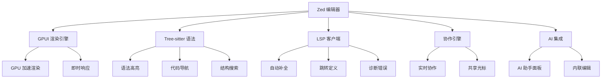

# Zed-高性能编辑器

> **文档说明**：系统讲解 Zed 高性能代码编辑器的安装配置、界面操作、自定义设置、语言支持、AI 协作、扩展主题，以及与 VSCode 的对比和最佳实践。
>
> **适用人群**：全栈开发者、追求编辑器性能的开发者、需要 AI 协作和多人协作的开发者
>
> **前置知识**：[[浏览器开发者工具进阶]]、[[Git版本控制核心命令]]、[[Starship-跨平台提示符]]

---

## 一、概述

### 1. 什么是 Zed

**Zed** 是由 Atom 原班团队打造的高性能代码编辑器，使用 Rust 编写，主打高性能、AI 原生协作和多人实时协作。

| 特性 | 说明 |
|------|------|
| **极致性能** | Rust 编写，GPU 渲染，启动毫秒级，大文件不卡顿 |
| **AI 原生** | 内置 AI 助手，支持 Claude、GPT、本地模型 |
| **实时协作** | 内置多人协作，类似 Google Docs |
| **多光标** | 强大的多光标编辑 |
| **Tree-sitter** | 基于 Tree-sitter 的语法解析和代码导航 |
| **LSP 支持** | 内置 Language Server Protocol 支持 |
| **Vim 模式** | 内置 Vim 模式，无需插件 |
| **跨平台** | macOS（原生）、Linux、Windows（开发中） |

### 2. Zed vs VSCode

| 维度 | Zed | VSCode |
|------|-----|--------|
| **语言** | Rust | TypeScript/Electron |
| **启动速度** | 极快（<100ms） | 较慢（1-3秒） |
| **内存占用** | 低 | 较高 |
| **大文件** | 流畅 | 可能卡顿 |
| **扩展生态** | 较少（增长中） | 极其丰富 |
| **AI 集成** | 原生内置 | 需插件（Copilot 等） |
| **协作** | 原生内置 | 需插件（Live Share） |
| **Vim 模式** | 内置 | 需插件 |
| **自定义** | JSON 配置 | JSON + UI 设置 |
| **平台** | macOS/Linux/Win（开发中） | 全平台 |
| **成熟度** | 较新（1.0 发布） | 非常成熟 |

### 3. 核心架构



---

## 二、安装

### 1. 下载安装

```bash
# macOS（推荐）
# 从官网下载：https://zed.dev
# 或使用 Homebrew
brew install --cask zed

# Linux
# 从官网下载 AppImage 或使用包管理器
# Arch Linux
yay -S zed-editor

# Windows（预览版）
# 从 GitHub Releases 下载
# https://github.com/zed-industries/zed/releases
```

### 2. 命令行启动

```bash
# 安装命令行工具（Zed 内操作）
# Zed 菜单 → Install CLI

# 命令行启动
zed .                    # 打开当前目录
zed file.txt             # 打开文件
zed . --new-window       # 新窗口打开
zed . --reuse-window     # 复用窗口
```

---

## 三、界面与基本操作

### 1. 界面布局

```text
┌─────────────────────────────────────────────────┐
│  标题栏: 文件路径 | 分支 | 协作 | AI 助手        │
├──────────┬──────────────────┬───────────────────┤
│          │                  │                   │
│ 项目树   │   编辑器区域     │   AI 助手面板     │
│          │   (多标签/分屏)  │   (可折叠)        │
│          │                  │                   │
│          │                  │                   │
├──────────┴──────────────────┴───────────────────┤
│  状态栏: 行号 | 列号 | 语言 | LSP状态 | 编码     │
└─────────────────────────────────────────────────┘
```

### 2. 基本操作

```text
打开命令面板：Cmd+Shift+P (macOS) / Ctrl+Shift+P
快速打开文件：Cmd+P / Ctrl+P
切换项目：Cmd+Shift+O
打开设置：Cmd+, / Ctrl+,
打开快捷键：Cmd+K Cmd+S
切换终端：Ctrl+`
切换侧边栏：Cmd+B / Ctrl+B
切换 AI 助手：Cmd+Enter / Ctrl+Enter
```

### 3. 多光标与选择

```text
多光标：
- Alt+Click（macOS: Option+Click）添加光标
- Cmd+D（macOS）/ Ctrl+D 选中下一个相同词
- Cmd+U（macOS）/ Ctrl+U 撤销上一个光标
- Cmd+Shift+L 选中所有相同词

列选择：
- Shift+Alt+拖动 列选择
- Cmd+Shift+L 选中所有行尾

多光标操作：
- 所有光标同步输入
- 支持多光标复制粘贴
```

---

## 四、配置

### 1. 设置文件

```json
// ~/.config/zed/settings.json (Linux)
// ~/Library/Application Support/Zed/settings.json (macOS)
// %APPDATA%\Zed\settings.json (Windows)

{
  // 基础设置
  "theme": "One Dark",
  "font_size": 14,
  "font_family": "JetBrains Mono",
  "line_height": 1.5,
  "tab_size": 2,
  "use_tabs": false,
  "format_on_save": "on",
  "autosave": "on_focus_change",

  // 界面
  "ui_font_size": 14,
  "buffer_font_size": 14,
  "show_whitespaces": "none",
  "show_wrap_guides": true,
  "relative_line_numbers": true,
  "scrollbar": "visible",

  // 编辑器行为
  "word_wrap": "off",
  "cursor_blink": true,
  "cursor_shape": "bar",
  "scroll_sensitivity": 1.0,
  "hover_popover_enabled": true,

  // 终端
  "terminal": {
    "font_size": 13,
    "font_family": "JetBrains Mono",
    "working_directory": "current_project_directory",
    "blinking": "terminal_controlled"
  },

  // Git
  "git": {
    "inline_blame": "edits",
    "gutters": "tracked_files"
  },

  // 语言特定设置
  "languages": {
    "Python": {
      "tab_size": 4,
      "format_on_save": "on",
      "language_servers": ["pyright", "ruff"]
    },
    "TypeScript": {
      "tab_size": 2,
      "format_on_save": "on",
      "language_servers": ["typescript-language-server", "eslint"]
    },
    "Rust": {
      "format_on_save": "on",
      "language_servers": ["rust-analyzer"]
    }
  }
}
```

### 2. 快捷键配置

```json
// ~/.config/zed/keymap.json
[
  {
    "context": "Editor",
    "bindings": {
      "cmd-d": "editor::SelectNext",
      "cmd-shift-l": "editor::SelectAllMatches",
      "cmd-/": "editor::ToggleComments",
      "alt-shift-down": "editor::DuplicateLineDown",
      "cmd-shift-k": "editor::DeleteLine"
    }
  },
  {
    "context": "Workspace",
    "bindings": {
      "cmd-p": "file_finder::Toggle",
      "cmd-shift-p": "command_palette::Toggle",
      "cmd-b": "workspace::ToggleLeftDock",
      "cmd-j": "workspace::ToggleBottomDock",
      "ctrl-`": "workspace::ToggleTerminal"
    }
  },
  {
    "context": "Terminal",
    "bindings": {
      "ctrl-c": "workspace::TerminalCopy",
      "ctrl-v": "workspace::TerminalPaste"
    }
  }
]
```

### 3. 项目级配置

```json
// 项目根目录 .zed/settings.json
{
  "tab_size": 4,
  "languages": {
    "Python": {
      "language_servers": ["pyright"]
    }
  },
  "formatter": {
    "external": {
      "command": "black",
      "arguments": ["-"]
    }
  }
}
```

---

## 五、语言支持与 LSP

### 1. 内置语言支持

```text
Zed 内置支持的语言（语法高亮）：
- JavaScript / TypeScript / JSX / TSX
- Python / Rust / Go / Java / C / C++
- HTML / CSS / SCSS / JSON / YAML / TOML
- Markdown / Bash / SQL / Dockerfile
- 等等（100+ 语言）
```

### 2. LSP 配置

```json
// settings.json 中配置 LSP
{
  "languages": {
    "Python": {
      "language_servers": ["pyright", "ruff"]
    },
    "TypeScript": {
      "language_servers": ["typescript-language-server", "eslint", "vtsls"]
    },
    "Rust": {
      "language_servers": ["rust-analyzer"]
    },
    "Go": {
      "language_servers": ["gopls"]
    },
    "Lua": {
      "language_servers": ["lua-language-server"]
    }
  }
}
```

### 3. 安装 LSP

```bash
# Zed 会自动提示安装常用 LSP
# 或手动安装：

# Python
npm install -g pyright
pip install ruff

# TypeScript
npm install -g typescript-language-server
npm install -g vscode-langservers-extracted  # eslint

# Rust
rustup component add rust-analyzer

# Go
go install golang.org/x/tools/gopls@latest

# Lua
# 下载 lua-language-server
```

---

## 六、AI 协作

### 1. AI 助手面板

```text
打开 AI 助手：Cmd+Enter (macOS) / Ctrl+Enter

功能：
- 对话式问答
- 代码解释
- 代码生成
- 代码重构建议
- Bug 修复建议
- 内联编辑（选中代码后 AI 修改）
- 支持多模型：Claude、GPT-4、本地模型
```

### 2. AI 模型配置

```json
// settings.json
{
  "ai": {
    "provider": "anthropic",  // anthropic / openai / ollama
    "model": "claude-3-5-sonnet",
    "api_key": "sk-xxx"  // 或使用环境变量
  }
}

// 本地模型（Ollama）
{
  "ai": {
    "provider": "ollama",
    "model": "codellama:7b",
    "api_url": "http://localhost:11434"
  }
}
```

### 3. AI 操作

```text
选中代码后：
- Cmd+Enter 打开 AI 对话（自动包含选中代码）
- 输入指令如 "优化这段代码"、"添加注释"、"修复 bug"
- AI 建议可一键应用或拒绝

内联 AI：
- 在代码中输入 // AI: 你的需求
- 按 Tab 接受建议
```

---

## 七、多人协作

### 1. 协作功能

```text
Zed 内置实时协作：
- 共享项目链接邀请他人
- 多人同时编辑（类似 Google Docs）
- 看到他人光标和选择
- 语音/视频通话（集成）
- 共享终端
- 协作历史记录

使用方式：
1. 点击标题栏协作按钮
2. 生成邀请链接
3. 分享链接给协作者
4. 协作者打开链接即可加入
```

### 2. 协作权限

```text
权限级别：
- 只读：只能查看
- 编辑：可以编辑代码
- 管理员：可以管理权限和共享终端
```

---

## 八、扩展与主题

### 1. 主题

```text
内置主题：
- One Dark / One Light
- Dracula
- Solarized Dark / Light
- Tokyo Night
- Gruvbox
- Nord
- 等等

安装主题：
1. 打开主题选择器：Cmd+K Cmd+T
2. 浏览和预览主题
3. 点击应用

自定义主题：
- 编辑 settings.json 中的 theme
- 或创建自定义主题文件
```

### 2. 扩展

```text
Zed 扩展系统（较新）：
- 语言扩展
- 主题扩展
- 工具集成扩展

安装扩展：
- 命令面板 → Install Extensions
- 或从 zed.dev 扩展市场安装

注意：Zed 扩展生态不如 VSCode 丰富，但核心功能内置
```

---

## 九、常用快捷键

### 1. 通用

| 功能 | macOS | Windows/Linux |
|------|-------|---------------|
| 命令面板 | Cmd+Shift+P | Ctrl+Shift+P |
| 快速打开 | Cmd+P | Ctrl+P |
| 设置 | Cmd+, | Ctrl+, |
| 切换侧边栏 | Cmd+B | Ctrl+B |
| 切换终端 | Ctrl+` | Ctrl+` |
| 新建窗口 | Cmd+Shift+N | Ctrl+Shift+N |
| 关闭标签 | Cmd+W | Ctrl+W |

### 2. 编辑器

| 功能 | macOS | Windows/Linux |
|------|-------|---------------|
| 多光标选中下一个 | Cmd+D | Ctrl+D |
| 选中所有匹配 | Cmd+Shift+L | Ctrl+Shift+L |
| 注释切换 | Cmd+/ | Ctrl+/ |
| 复制行 | Alt+Shift+↓ | Shift+Alt+↓ |
| 删除行 | Cmd+Shift+K | Ctrl+Shift+K |
| 移动行 | Alt+↑/↓ | Alt+↑/↓ |
| 格式化 | Cmd+Shift+I | Ctrl+Shift+I |
| 跳转定义 | Cmd+Click / F12 | Ctrl+Click / F12 |
| 查找引用 | Shift+F12 | Shift+F12 |

### 3. 分屏

| 功能 | macOS | Windows/Linux |
|------|-------|---------------|
| 垂直分屏 | Cmd+K → | Ctrl+K → |
| 水平分屏 | Cmd+K ↓ | Ctrl+K ↓ |
| 关闭分屏 | Cmd+K W | Ctrl+K W |
| 切换分屏 | Cmd+K Cmd+←/→ | Ctrl+K Ctrl+←/→ |

---

## 十、最佳实践

### 1. 性能优化

- [ ] **使用 SSD**：Zed 在 SSD 上性能最佳
- [ ] **排除大目录**：在设置中排除 node_modules、.git 等
- [ ] **合理 LSP**：只启用需要的 LSP，避免资源浪费
- [ ] **GPU 加速**：确保 GPU 渲染开启（默认）
- [ ] **定期更新**：Zed 更新频繁，性能持续优化

### 2. 效率提升

- [ ] **熟练快捷键**：学习核心快捷键，减少鼠标操作
- [ ] **使用 Vim 模式**：Vim 用户开启内置 Vim 模式
- [ ] **配置 AI 助手**：配置常用 AI 模型，提升编码效率
- [ ] **项目配置**：为不同项目设置独立配置
- [ ] **利用协作**：代码审查、结对编程用内置协作

### 3. 配置同步

```text
配置同步方案：
- 将 ~/.config/zed 纳入 Git 管理（dotfiles）
- 或使用 Zed 账号同步（登录后自动同步）
- 跨设备统一配置
```

---

## 十一、常见问题与排查

| 问题 | 原因 | 解决方案 |
|------|------|---------|
| **启动慢** | 插件过多 / 大项目 | 禁用不用的 LSP、排除大目录 |
| **LSP 不工作** | 未安装 / 路径错误 | 手动安装 LSP、检查 PATH |
| **中文输入问题** | 输入法兼容 | 更新 Zed 到最新版、切换输入法 |
| **AI 助手不可用** | 未配置 API Key | 在 settings.json 配置 ai.provider 和 api_key |
| **协作连接失败** | 网络问题 / 防火墙 | 检查网络、确认端口未被屏蔽 |
| **主题不生效** | 配置格式错误 | 检查 settings.json JSON 语法 |
| **快捷键冲突** | 系统快捷键占用 | 修改 keymap.json 或系统快捷键 |
| **终端不显示** | 配置问题 | 检查 terminal.shell 配置 |
| **大文件卡顿** | 文件过大 | Zed 对大文件优化好，仍卡检查磁盘速度 |
| **Git 集成异常** | 非 Git 仓库 / 权限 | 确认在 Git 仓库、检查权限 |
| **扩展安装失败** | 网络问题 | 检查网络、手动下载扩展 |
| **Vim 模式不熟悉** | 未学习 Vim | 开启 Vim 教程、逐步学习 |
| **跨平台配置不同** | 路径差异 | 使用条件配置或 dotfiles 管理 |
| **自动补全慢** | LSP 响应慢 | 换更快的 LSP、增加 LSP 内存 |
| **格式化不生效** | 未配置 formatter | 配置 formatter 或安装格式化工具 |

---

## 十二、关联笔记

### 开发工具
- [[浏览器开发者工具进阶]] · [[Git版本控制核心命令]] · [[Git-Worktree多工作树]]
- [[kubectl命令速查表]]

### 效率工具
- [[Starship-跨平台提示符]] · [[atuin-命令历史增强]] · [[密码管理器-Bitwarden]]

### 导航
- [[MOC-通用工具]] · [[全栈+AI工程双轨融合学习路线图]]

> **学习路径建议**：先掌握 [[浏览器开发者工具进阶]] 浏览器调试 → 熟练本文 Zed 编辑器配置 → 学习 [[Starship-跨平台提示符]] 终端美化 → 实践 [[Git版本控制核心命令]] 版本控制 → 构建完整的高效开发环境。

---

## 🔗 关联笔记

- [[MOC-通用工具]] — 返回本分类知识地图，查看更多相关文档

## 📖 前置知识

- [[浏览器开发者工具进阶]]
- [[Git版本控制核心命令]]
- [[Starship-跨平台提示符]]

## 🏷️ 相关标签

`#效率工具` `#代码编辑器` `#Rust` `#AI协作` `#原子笔记`

[[Home|🏠 返回首页]] · [[MOC-通用工具|📚 返回分类]]
