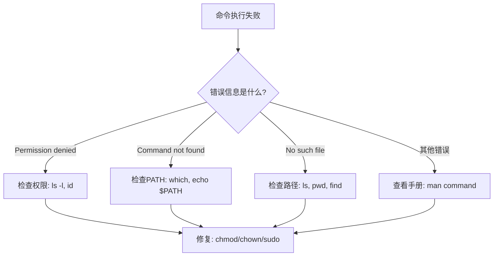

# Linux命令速查表

> **文档说明**：Linux常用命令速查表，按功能分类，覆盖文件操作、系统管理、网络、文本处理、进程管理等高频命令。
>
> **适用人群**：开发者、运维工程师
>
> **使用方式**：快速查阅命令用法，面试前突击复习

---

## 一、文件与目录

| 命令 | 说明 | 示例 |
|------|------|------|
| `ls` | 列出目录内容 | `ls -la`（详细+隐藏） |
| `cd` | 切换目录 | `cd ~` `cd ..` `cd -` |
| `pwd` | 显示当前路径 | `pwd` |
| `mkdir` | 创建目录 | `mkdir -p a/b/c`（递归） |
| `rmdir` | 删除空目录 | `rmdir dir` |
| `cp` | 复制 | `cp -r src dst`（递归） |
| `mv` | 移动/重命名 | `mv old new` |
| `rm` | 删除 | `rm -rf dir`（递归强制）⚠️ |
| `touch` | 创建空文件/更新时间 | `touch file.txt` |
| `ln` | 链接 | `ln -s target link`（软链接） |
| `find` | 查找文件 | `find . -name "*.log" -mtime +7` |
| `tree` | 树形显示目录 | `tree -L 2` |
| `chmod` | 修改权限 | `chmod 755 file` `chmod +x script.sh` |
| `chown` | 修改所有者 | `chown user:group file` |
| `stat` | 文件详细信息 | `stat file.txt` |

### 权限数字含义

```text
r=4, w=2, x=1
755 = rwxr-xr-x (所有者全部，组和其他读+执行)
644 = rw-r--r-- (所有者读写，其他只读)
777 = rwxrwxrwx (全部权限，慎用)
```

---

## 二、文件查看与编辑

| 命令 | 说明 | 示例 |
|------|------|------|
| `cat` | 查看文件内容 | `cat file.txt` |
| `tac` | 反向查看 | `tac file.txt` |
| `more` | 分页查看 | `more file.txt` |
| `less` | 分页查看（增强） | `less file.log`（q退出，/搜索） |
| `head` | 查看前N行 | `head -20 file.log` |
| `tail` | 查看后N行 | `tail -f app.log`（实时跟踪） |
| `wc` | 统计行数/字数/字节 | `wc -l file.txt` |
| `grep` | 文本搜索 | `grep -rn "error" .`（递归+行号） |
| `sed` | 流编辑器 | `sed -i 's/old/new/g' file` |
| `awk` | 文本处理 | `awk '{print $1}' file` |
| `sort` | 排序 | `sort -n file`（数字排序） |
| `uniq` | 去重 | `sort file \| uniq -c`（计数） |
| `cut` | 切割列 | `cut -d: -f1 /etc/passwd` |
| `diff` | 比较文件 | `diff file1 file2` |
| `vim` | 编辑器 | `vim file.txt` |

### grep常用参数

```text
-i  忽略大小写
-v  反向匹配
-n  显示行号
-r  递归搜索
-c  统计匹配数
-E  扩展正则
--color  高亮显示
```

---

## 三、系统信息

| 命令 | 说明 |
|------|------|
| `uname -a` | 系统内核信息 |
| `hostname` | 主机名 |
| `cat /etc/os-release` | 系统版本 |
| `uptime` | 运行时间+负载 |
| `date` | 日期时间 |
| `cal` | 日历 |
| `free -h` | 内存使用（人类可读） |
| `df -h` | 磁盘使用 |
| `du -sh *` | 目录大小 |
| `top` | 实时进程监控 |
| `htop` | 增强版top（需安装） |
| `vmstat` | 虚拟内存统计 |
| `iostat` | IO统计 |
| `lscpu` | CPU信息 |
| `lsblk` | 块设备信息 |
| `ip addr` | 网络接口信息 |

---

## 四、进程管理

| 命令 | 说明 | 示例 |
|------|------|------|
| `ps` | 进程快照 | `ps aux` `ps -ef \| grep java` |
| `top` | 实时进程 | `top -p PID`（指定进程） |
| `kill` | 终止进程 | `kill -9 PID`（强制） `kill -15 PID`（优雅） |
| `killall` | 按名称杀进程 | `killall nginx` |
| `pkill` | 按模式杀进程 | `pkill -f "python app.py"` |
| `jobs` | 后台任务 | `jobs` |
| `bg` | 后台运行 | `bg %1` |
| `fg` | 前台运行 | `fg %1` |
| `nohup` | 不挂断运行 | `nohup ./app &` |
| `systemctl` | 服务管理 | `systemctl start/stop/restart/status nginx` |
| `journalctl` | 系统日志 | `journalctl -u nginx -f` |

### 信号

```text
1 (HUP)  挂起/重载配置
9 (KILL) 强制终止
15 (TERM) 优雅终止（默认）
18 (CONT) 继续
19 (STOP) 暂停
```

---

## 五、网络

| 命令 | 说明 | 示例 |
|------|------|------|
| `ping` | 测试连通性 | `ping google.com` |
| `curl` | HTTP请求 | `curl -X POST -d "data" url` |
| `wget` | 下载文件 | `wget url` |
| `ss` | 套接字统计 | `ss -tlnp`（监听端口） |
| `netstat` | 网络连接（旧） | `netstat -tlnp` |
| `ip` | 网络配置 | `ip addr` `ip route` |
| `ifconfig` | 网络接口（旧） | `ifconfig` |
| `traceroute` | 路由追踪 | `traceroute google.com` |
| `dig` | DNS查询 | `dig google.com` |
| `nslookup` | DNS查询 | `nslookup google.com` |
| `tcpdump` | 抓包 | `tcpdump -i any port 80` |
| `telnet` | 端口测试 | `telnet host 8080` |
| `nc` | 网络工具 | `nc -zv host 80`（端口扫描） |

### curl常用参数

```text
-X  指定方法(GET/POST/PUT/DELETE)
-H  设置Header
-d  POST数据
-o  保存到文件
-O  用URL文件名保存
-L  跟随重定向
-v  详细输出
-k  忽略SSL证书
-u  认证 user:password
```

---

## 六、压缩与归档

| 命令 | 说明 | 示例 |
|------|------|------|
| `tar` | 归档 | `tar -czvf archive.tar.gz dir/` |
| `tar` | 解压 | `tar -xzvf archive.tar.gz` |
| `zip` | 压缩 | `zip -r archive.zip dir/` |
| `unzip` | 解压 | `unzip archive.zip` |
| `gzip` | gzip压缩 | `gzip file` |
| `gunzip` | gzip解压 | `gunzip file.gz` |
| `bzip2` | bzip2压缩 | `bzip2 file` |
| `xz` | xz压缩 | `xz -z file` |

### tar参数速记

```text
-c  创建归档
-x  解压
-z  gzip格式
-j  bzip2格式
-v  显示过程
-f  指定文件名
-t  列出内容
-C  指定解压目录
```

---

## 七、用户与权限

| 命令 | 说明 |
|------|------|
| `useradd` | 创建用户 |
| `userdel` | 删除用户 |
| `passwd` | 修改密码 |
| `groupadd` | 创建组 |
| `su` | 切换用户 |
| `sudo` | 以管理员执行 |
| `whoami` | 当前用户 |
| `id` | 用户ID和组 |
| `last` | 登录历史 |
| `w` | 在线用户 |

---

## 八、实用组合命令

```bash
# 查找大文件
find / -type f -size +100M -exec ls -lh {} \;

# 查找并删除7天前的日志
find /var/log -name "*.log" -mtime +7 -delete

# 统计代码行数
find . -name "*.java" | xargs wc -l | tail -1

# 查看端口占用
ss -tlnp | grep 8080

# 实时查看日志
tail -f /var/log/app.log | grep ERROR

# 批量替换
find . -name "*.txt" -exec sed -i 's/old/new/g' {} \;

# 查看进程树
ps auxf

# 磁盘IO监控
iostat -x 1

# 内存占用排序
ps aux --sort=-%mem | head -10

# CPU占用排序
ps aux --sort=-%cpu | head -10
```

---

## 九、Vim常用操作

```css
# 模式切换
i    插入模式
Esc  正常模式
:    命令模式
v    可视模式

# 正常模式
yy   复制行
p    粘贴
dd   删除行
u    撤销
Ctrl+r 重做
/    搜索
:noh 取消高亮
:w   保存
:q   退出
:wq  保存退出
:q!  强制退出
```

---

## 关联文档

- [[Linux-运维常用命令手册]] — Linux命令详解
- [[WindowsTerminal与PowerShell]] — Windows终端
- [[WSL2-开发环境配置]] — WSL2配置
- [[终端与命令行知识点系统梳理]] — 终端工具

---

> 💡 **使用建议**：将此文档设为快速访问，日常开发中高频查阅。重点掌握：文件操作、grep/sed/awk文本处理三剑客、ps/top/ss进程网络、tar压缩、curl网络请求。


## 补充：概述

Linux 命令行是开发者和运维工程师的核心生产力工具。与图形界面相比，命令行具有**速度快、可脚本化、可远程操作、资源占用低**等优势。掌握常用 Linux 命令不仅能提升日常开发效率，更是服务器运维、容器管理、CI/CD 流水线等场景的必备技能。

| 命令类别 | 代表命令 | 典型用途 |
|---------|---------|---------|
| 文件操作 | ls/cp/mv/rm/find | 文件浏览、复制、移动、删除、查找 |
| 文本处理 | cat/grep/sed/awk/less | 查看、搜索、替换、分析文本内容 |
| 系统管理 | ps/top/kill/systemctl | 进程管理、服务管理、系统监控 |
| 网络工具 | curl/wget/netstat/ss/ping | 网络请求、端口查看、连通性测试 |
| 权限管理 | chmod/chown/sudo | 文件权限、所有者、提权操作 |
| 压缩归档 | tar/zip/gzip | 文件打包、压缩、解压 |
| 磁盘管理 | df/du/mount/fdisk | 磁盘空间、挂载、分区 |

**学习建议**：不要试图一次性记住所有命令。先掌握 20 个最高频命令（ls/cd/pwd/cp/mv/rm/grep/find/cat/less/ps/kill/chmod/chown/top/df/du/tar/curl/ssh），在日常使用中逐步扩展。

---

## 补充：底层原理

### Shell 与命令执行流程

当你在终端输入一条命令时，Shell（如 Bash/Zsh）会执行以下流程：

```text
用户输入 → Shell 解析（分词/变量展开/通配符）→ 查找命令（内置命令/PATH搜索）→ fork 创建子进程 → exec 执行命令 → 等待返回 → 输出结果
```

| 阶段 | 说明 | 示例 |
|------|------|------|
| **词法分析** | 将输入拆分为 token | `ls -la *.txt` → `ls`, `-la`, `*.txt` |
| **展开** | 变量/通配符/命令替换 | `$HOME` → `/root`, `*.txt` → `a.txt b.txt` |
| **命令查找** | 先查内置命令，再查 PATH | `cd` 是内置命令，`ls` 在 `/bin/ls` |
| **进程创建** | fork + exec | 创建子进程执行命令 |
| **重定向** | stdin/stdout/stderr 重定向 | `> file`, `2>&1`, `< input` |
| **管道** | 前一个命令的输出作为后一个的输入 | `grep error log.txt | wc -l` |

### 一切皆文件

Linux 的核心设计哲学是"一切皆文件"（Everything is a file）：

| 类型 | 表示 | 示例 |
|------|------|------|
| 普通文件 | `-` | 文本、二进制、图片 |
| 目录 | `d` | 文件夹 |
| 符号链接 | `l` | 软链接 |
| 字符设备 | `c` | `/dev/null`, `/dev/tty` |
| 块设备 | `b` | `/dev/sda`（硬盘） |
| 套接字 | `s` | 进程间通信 |
| 命名管道 | `p` | FIFO |

这种设计使得对设备、网络、进程的操作都可以用统一的文件 API（open/read/write/close）来完成。

### 管道与重定向的原理

管道（`|`）的本质是**内核缓冲区**：前一个进程的 stdout 写入缓冲区，后一个进程的 stdin 从缓冲区读取。缓冲区大小通常为 64KB，读写是同步阻塞的。

重定向（`>`/`<`）的本质是**文件描述符重定向**：进程启动时默认有 3 个文件描述符——0(stdin)、1(stdout)、2(stderr)。重定向就是将这些描述符指向不同的文件。

---

## 补充：常见问题与排查

| 问题 | 原因 | 解决方案 |
|------|------|---------|
| `Permission denied` | 没有执行/读取权限 | `chmod +x file` 或 `sudo` 提权 |
| `Command not found` | 命令不在 PATH 中 | 检查拼写，或用绝对路径 `/usr/bin/xxx` |
| `No such file or directory` | 文件路径错误 | 用 `ls` 确认路径，注意大小写和空格 |
| 终端输出乱码 | 编码不匹配 | `export LANG=en_US.UTF-8` 或 `locale` 检查 |
| `grep` 结果太多 | 没有精确匹配 | 加 `-i`(忽略大小写) `-A/-B/-C`(上下文) `-r`(递归) |
| `find` 太慢 | 搜索范围太大 | 指定目录深度 `-maxdepth`，用 `locate` 替代 |
| 进程杀不死 | 进程忽略 SIGTERM | 先用 `kill -15`，不行再 `kill -9`（SIGKILL） |
| 磁盘满但找不到大文件 | 有已删除但被进程占用的文件 | `lsof | grep deleted` 找到占用进程 |
| `ssh` 连接慢 | DNS 反向解析 | 服务端 `UseDNS no`，客户端 `GSSAPIAuthentication no` |

### 排查方法论



---

## 补充：进阶与最佳实践

### 1. 命令行效率提升

| 技巧 | 说明 | 示例 |
|------|------|------|
| **历史命令** | `Ctrl+R` 反向搜索历史 | 输入关键词快速找到之前的命令 |
| **别名** | `alias` 简化常用命令 | `alias ll='ls -la --color=auto'` |
| **Tab 补全** | 自动补全命令/路径/参数 | 输入 `git ch` 按 Tab → `git checkout` |
| ** Brace 扩展** | 批量生成参数 | `mkdir -p project/{src,test,docs}` |
| **命令替换** | `$(cmd)` 嵌入结果 | `echo "Today is $(date +%Y-%m-%d)"` |
| **后台运行** | `&` 和 `nohup` | `nohup python app.py &` |
| **屏幕复用** | `tmux`/`screen` | 断开 SSH 后进程继续运行 |
| **文件比较** | `diff`/`vimdiff` | `diff file1 file2` 逐行比较 |

### 2. 常用组合命令（一行流）

```bash
# 查找并删除 7 天前的日志文件
find /var/log -name "*.log" -mtime +7 -delete

# 统计代码行数（按文件类型）
find . -name "*.py" | xargs wc -l | tail -1

# 查看占用 CPU 最高的 5 个进程
ps aux --sort=-%cpu | head -6

# 实时查看日志中的错误
tail -f /var/log/app.log | grep --line-buffered "ERROR"

# 批量重命名文件（加前缀）
for f in *.txt; do mv "$f" "backup_$f"; done

# 查看端口被哪个进程占用
ss -tlnp | grep :8080

# 压缩并排除目录
tar --exclude='node_modules' --exclude='.git' -czf project.tar.gz .
```

### 3. Shell 脚本最佳实践

```bash
#!/bin/bash
set -euo pipefail  # 严格模式：出错即停、未定义变量报错、管道失败传播

# 1. 使用变量而非硬编码
LOG_DIR="/var/log/myapp"
RETENTION_DAYS=7

# 2. 函数封装重复逻辑
cleanup_logs() {
    local dir="$1"
    local days="$2"
    find "$dir" -name "*.log" -mtime "+$days" -delete
    echo "Cleaned logs older than $days days in $dir"
}

# 3. 日志输出
log() {
    echo "[$(date '+%Y-%m-%d %H:%M:%S')] $*"
}

# 4. 参数校验
if [ $# -lt 1 ]; then
    echo "Usage: $0 <environment>"
    exit 1
fi

# 5. 主逻辑
log "Starting cleanup..."
cleanup_logs "$LOG_DIR" "$RETENTION_DAYS"
log "Done."
```

### 4. 现代 Shell 工具推荐

| 传统命令 | 现代替代 | 优势 |
|---------|---------|------|
| `cat` | `bat` | 语法高亮、Git 集成、行号 |
| `ls` | `eza`/`lsd` | 图标、Git 状态、树状视图 |
| `grep` | `ripgrep(rg)` | 更快、自动忽略 .gitignore |
| `find` | `fd` | 更简单的语法、更快、彩色输出 |
| `cd` | `zoxide(z)` | 智能跳转，基于访问频率 |
| `top` | `btop`/`htop` | 更美观的界面、更多信息 |
| `diff` | `delta` | 语法高亮的 diff 查看器 |
| `man` | `tldr` | 简洁的命令示例，而非完整手册 |
| `curl` | `httpie`/`xh` | 更友好的 HTTP 客户端 |

---

## 🔗 关联笔记

- [[MOC-通用工具]] — 返回本分类知识地图，查看更多相关文档

## 📖 前置知识

- 无特殊前置知识要求，具备基础编程概念即可

## 🏷️ 相关标签

`#速查表` `#Linux` `#命令行` `#DevOps` `#效率工具`

[[Home|🏠 返回首页]] · [[MOC-通用工具|📚 返回分类]]
