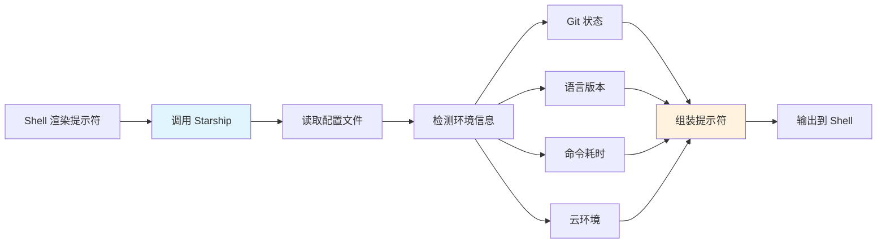

# Starship-跨平台提示符

> **文档说明**：系统讲解 Starship 跨平台 Shell 提示符的安装配置、模块系统、自定义样式、主题预设，以及与各种 Shell 的集成和最佳实践。
>
> **适用人群**：全栈开发者、运维工程师、命令行用户、追求终端美观和效率的开发者
>
> **前置知识**：[[atuin-命令历史增强]]、[[浏览器开发者工具进阶]]、[[Git版本控制核心命令]]

---

## 一、概述

### 1. 什么是 Starship

**Starship** 是一个用 Rust 编写的跨平台、高性能、高度可定制的 Shell 提示符，支持所有主流 Shell。

| 特性 | 说明 |
|------|------|
| **跨平台** | Windows/macOS/Linux 全支持 |
| **跨 Shell** | bash/zsh/fish/powershell/ion/nu/cmd |
| **高性能** | Rust 编写，毫秒级响应 |
| **模块化** | 每个信息段是独立模块，可自由组合 |
| **智能显示** | 只在相关目录显示对应模块（如 Python 项目显示 Python 版本） |
| **Git 集成** | 显示分支、状态、增减行数 |
| **丰富模块** | 支持 50+ 编程语言和工具的状态显示 |

### 2. 提示符结构

```text
示例提示符：
~/projects/my-app on  main [!+?] via 🐍 v3.11.4 took 2s
❯

各部分说明：
- ~/projects/my-app   当前目录
- on  main           Git 分支
- [!+?]               Git 状态（!修改 +暂存 ?未跟踪）
- via 🐍 v3.11.4      Python 版本
- took 2s             上一条命令耗时
- ❯                   提示符符号
```

### 3. 工作原理



---

## 二、安装

### 1. 各平台安装

```bash
# macOS（Homebrew）
brew install starship

# Ubuntu/Debian
curl -sS https://starship.rs/install.sh | sh

# 或使用 apt
sudo apt install starship

# Windows（Scoop）
scoop install starship

# Windows（Chocolatey）
choco install starship

# Cargo（Rust 开发者）
cargo install starship --locked

# 验证安装
starship --version
```

### 2. 安装 Nerd Font（必需）

```bash
# Starship 需要 Nerd Font 才能显示图标
# macOS
brew install --cask font-fira-code-nerd-font
brew install --cask font-jetbrains-mono-nerd-font

# Windows
# 从 https://www.nerdfonts.com/font-downloads 下载
# 推荐：FiraCode Nerd Font、JetBrainsMono Nerd Font、MesloLGS Nerd Font

# 安装后在终端设置字体为 Nerd Font
```

### 3. Shell 集成

```bash
# zsh（在 ~/.zshrc 末尾添加）
eval "$(starship init zsh)"

# bash（在 ~/.bashrc 末尾添加）
eval "$(starship init bash)"

# fish（在 ~/.config/fish/config.fish 添加）
starship init fish | source

# PowerShell（在 $PROFILE 添加）
Invoke-Expression (&starship init powershell)

# nushell
# 在 config.nu 中添加
use ~/.cache/starship/init.nu *
```

---

## 三、配置文件

### 1. 配置文件位置

```bash
# 默认配置文件位置
# Linux/macOS: ~/.config/starship.toml
# Windows: %APPDATA%\starship.toml

# 创建默认配置
mkdir -p ~/.config && touch ~/.config/starship.toml

# 打印当前配置
starship config

# 打印默认配置（完整参考）
starship config --default

# 编辑配置
starship config <key> <value>
```

### 2. 基础配置

```toml
# ~/.config/starship.toml

# 提示符格式（自定义各模块顺序和分隔符）
format = """
$directory\
$git_branch\
$git_status\
$python\
$nodejs\
$rust\
$golang\
$java\
$docker_context\
$kubernetes\
$aws\
$cmd_duration\
$line_break\
$character"""

# 右侧提示符（可选）
right_format = "$time"

# 命令持续时间显示阈值（毫秒）
[command_timeout]
min_time = 2000  # 超过2秒才显示

# 目录模块
[directory]
truncation_length = 3          # 路径截断长度
truncate_to_repo = true        # 在 Git 仓库中截断到仓库根目录
style = "blue bold"
read_only = " 🔒"

# 提示符字符
[character]
success_symbol = "[❯](green)"    # 成功时
error_symbol = "[❯](red)"        # 失败时
vicmd_symbol = "[❮](green)"      # Vim 普通模式
```

### 3. 颜色和样式

```toml
# 颜色格式：
# - 颜色名：red, green, blue, yellow, purple, cyan, white, black
# - 256色：color:42
# - RGB："#FF00FF"
# - 样式：bold, italic, underline, dimmed, reversed
# - 组合："bold green"、"underline #FF00FF"

# 示例
[directory]
style = "bold cyan"

[git_branch]
style = "bold purple"

[git_status]
style = "bold red"

[python]
style = "bold yellow"
symbol = "🐍 "
```

---

## 四、常用模块配置

### 1. Git 模块

```toml
# Git 分支
[git_branch]
symbol = " "
style = "bold purple"
format = "on [$symbol$branch]($style) "

# Git 状态
[git_status]
format = '([$all_status$ahead_behind]($style)) '
style = "bold red"
conflicted = "⚡"
ahead = "⇡${count}"
behind = "⇣${count}"
diverged = "⇕⇡${ahead_count}⇣${behind_count}"
untracked = "?"
stashed = "💰"
modified = "!"
staged = "+"
renamed = "»"
deleted = "✘"

# Git 提交（detached HEAD 时）
[git_commit]
commit_hash_length = 7
style = "bold green"
```

### 2. 编程语言模块

```toml
# Python
[python]
symbol = "🐍 "
style = "bold yellow"
format = "via [$symbol($version )]($style)"
pyenv_version_name = false
python_binary = "python3"

# Node.js
[nodejs]
symbol = "🟢 "
style = "bold green"
format = "via [$symbol($version )]($style)"

# Rust
[rust]
symbol = "🦀 "
style = "bold orange"
format = "via [$symbol($version )]($style)"

# Go
[golang]
symbol = "🐹 "
style = "bold cyan"
format = "via [$symbol($version )]($style)"

# Java
[java]
symbol = "☕ "
style = "bold red"
format = "via [$symbol($version )]($style)"

# PHP
[php]
symbol = "🐘 "
style = "bold purple"

# Ruby
[ruby]
symbol = "💎 "
style = "bold red"

# .NET
[dotnet]
symbol = "NET "
style = "bold blue"
```

### 3. 云与容器模块

```toml
# Kubernetes
[kubernetes]
symbol = "☸ "
style = "bold blue"
format = "[$symbol$context( \\($namespace\\))]($style) in "
disabled = false  # 默认禁用，需要时开启

# Docker
[docker_context]
symbol = "🐳 "
style = "bold blue"
format = "via [$symbol$context]($style) "

# AWS
[aws]
symbol = "☁️ "
style = "bold yellow"
format = "[$symbol$profile]($style) "

# Azure
[azure]
symbol = "🔷 "
style = "bold blue"

# GCP
[gcloud]
symbol = "☁️ "
style = "bold blue"

# Terraform
[terraform]
symbol = "🏎 "
style = "bold purple"
```

### 4. 其他实用模块

```toml
# 命令耗时
[cmd_duration]
min_time = 2000
format = "took [$duration]($style) "
style = "bold yellow"

# 当前时间
[time]
disabled = false
format = "at [$time]($style) "
time_format = "%H:%M:%S"
style = "bold white"

# 电池
[battery]
full_symbol = "🔋"
charging_symbol = "⚡"
discharging_symbol = "🔋"
display = [{ threshold = 30, style = "bold red" }]

# 包管理器版本
[package]
symbol = "📦 "
style = "bold bold"

# 内存使用
[memory_usage]
symbol = "🖥 "
style = "bold dimmed white"
threshold = 70  # 超过70%才显示

# 执行状态
[status]
symbol = "🔴"
success_symbol = "🟢"
format = "[$symbol]($style)"
disabled = false

# SSH 会话
[hostname]
ssh_only = true
format = "on [$hostname]($style) "
style = "bold dimmed green"

# 用户名
[username]
show_always = false
style_user = "bold yellow"
style_root = "bold red"
```

---

## 五、主题与预设

### 1. 预设主题

```bash
# 浏览预设主题
starship preset --list

# 应用预设主题
starship preset nerd-font-symbols > ~/.config/starship.toml
starship preset pastel-powerline > ~/.config/starship.toml
starship preset no-nerd-font > ~/.config/starship.toml
starship preset tokyo-night > ~/.config/starship.toml
starship preset gruvbox-rainbow > ~/.config/starship.toml
```

### 2. 推荐主题配置

```toml
# Tokyo Night 风格
format = "$directory$git_branch$git_status$python$nodejs$cmd_duration$line_break$character"

[directory]
style = "bold #7aa2f7"

[git_branch]
style = "bold #bb9af7"

[git_status]
style = "bold #f7768e"

[character]
success_symbol = "[❯](bold #9ece6a)"
error_symbol = "[❯](bold #f7768e)"

[cmd_duration]
style = "bold #e0af68"
```

### 3. 无 Nerd Font 配置

```toml
# 如果不使用 Nerd Font，用纯文本符号
[git_branch]
symbol = "git:"

[python]
symbol = "python "

[nodejs]
symbol = "node "

[character]
success_symbol = ">"
error_symbol = ">"
```

---

## 六、高级配置

### 1. 自定义模块

```toml
# 自定义命令模块（执行任意命令并显示输出）
[custom.example]
command = "echo 'hello'"
when = "true"  # 显示条件
shell = "bash"
description = "示例自定义模块"
symbol = "🔧 "
style = "bold green"
format = "[$symbol($output )]($style)"

# 显示当前 Kubernetes 命名空间（自定义）
[custom.k8s-ns]
command = "kubectl config view --minify -o jsonpath='{..namespace}'"
when = "test -f ~/.kube/config"
shell = "bash"
symbol = "☸ "
style = "bold blue"
```

### 2. 条件显示

```toml
# 只在特定目录显示模块
[python]
disabled = false
# 检测到 .python-version、pyproject.toml、requirements.txt 等文件时显示

# 自定义检测文件
[python]
detect_files = [".python-version", "pyproject.toml", "requirements.txt", "Pipfile"]
detect_extensions = ["py"]
detect_folders = [".venv", "venv", "__pycache__"]
```

### 3. 换行与布局

```toml
# 两行提示符（推荐，信息更清晰）
format = """
$directory$git_branch$git_status$python$nodejs$cmd_duration
$character"""

# 添加空行
add_newline = true  # 提示符前加空行

# 右侧提示符
right_format = "$time$status"
```

---

## 七、最佳实践

### 1. 性能优化

- [ ] **禁用不用的模块**：减少模块数量提升速度
- [ ] **设置检测阈值**：命令耗时模块设置 min_time
- [ ] **避免自定义命令**：自定义模块执行外部命令会拖慢提示符
- [ ] **使用缓存**：Starship 内部有缓存机制
- [ ] **定期更新**：新版本通常有性能改进

### 2. 配置规范

- [ ] **使用 Nerd Font**：获得最佳图标显示效果
- [ ] **统一配色**：各模块颜色协调，不过于花哨
- [ ] **信息精简**：只显示当前需要的信息
- [ ] **版本控制**：将 starship.toml 纳入 dotfiles 管理
- [ ] **跨设备同步**：配置文件同步到所有设备

### 3. 团队协作

- [ ] **团队统一配置**：团队共享 starship.toml 模板
- [ ] **项目特定配置**：在项目根目录放 `.starship` 配置
- [ ] **文档说明**：在 README 中说明终端配置要求

---

## 八、常见问题与排查

| 问题 | 原因 | 解决方案 |
|------|------|---------|
| **图标显示为方框** | 未安装 Nerd Font / 终端字体未设置 | 安装 Nerd Font 并在终端设置 |
| **提示符显示慢** | 模块太多 / 自定义命令慢 | 禁用不用模块、优化自定义命令 |
| **Git 状态不显示** | 不在 Git 仓库 / 模块禁用 | 检查 git_status 模块配置 |
| **Python 版本不显示** | 不在 Python 项目目录 | 检查 detect_files 配置 |
| **配置不生效** | 配置文件路径错误 / 语法错误 | 检查路径、`starship config` 验证 |
| **换行异常** | format 配置问题 | 检查 format 中的换行和转义 |
| **PowerShell 乱码** | 编码问题 | 设置终端为 UTF-8、使用 Windows Terminal |
| **颜色不对** | 终端不支持 24 位色 | 使用颜色名或 256 色 |
| **SSH 远程不显示** | 远程未安装 Starship | 在远程服务器也安装 Starship |
| **模块顺序不对** | format 配置顺序 | 调整 format 中模块顺序 |
| **命令耗时一直显示** | min_time 设置太低 | 调高 min_time（如 5000） |
| **自定义模块不执行** | when 条件不满足 / 命令错误 | 检查 when 条件和命令 |
| **升级后配置失效** | 配置格式变更 | 查看更新日志、调整配置 |
| **fish 兼容问题** | fish 版本过旧 | 升级 fish 到 3.0+ |

---

## 九、关联笔记

### 效率工具
- [[atuin-命令历史增强]] · [[浏览器开发者工具进阶]] · [[Zed-高性能编辑器]]
- [[密码管理器-Bitwarden]]

### 开发工具
- [[Git版本控制核心命令]] · [[Git-Worktree多工作树]] · [[kubectl命令速查表]]

### 导航
- [[MOC-通用工具]] · [[全栈+AI工程双轨融合学习路线图]]

> **学习路径建议**：先掌握 [[atuin-命令历史增强]] 命令历史 → 深入本文 Starship 提示符美化 → 实践 [[浏览器开发者工具进阶]] 开发工具 → 研究 [[Zed-高性能编辑器]] 编辑器 → 构建完整的高效开发环境。

---

## 🔗 关联笔记

- [[MOC-通用工具]] — 返回本分类知识地图，查看更多相关文档

## 📖 前置知识

- [[atuin-命令历史增强]]
- [[浏览器开发者工具进阶]]
- [[Git版本控制核心命令]]

## 🏷️ 相关标签

`#效率工具` `#Shell提示符` `#终端美化` `#原子笔记`

[[Home|🏠 返回首页]] · [[MOC-通用工具|📚 返回分类]]
