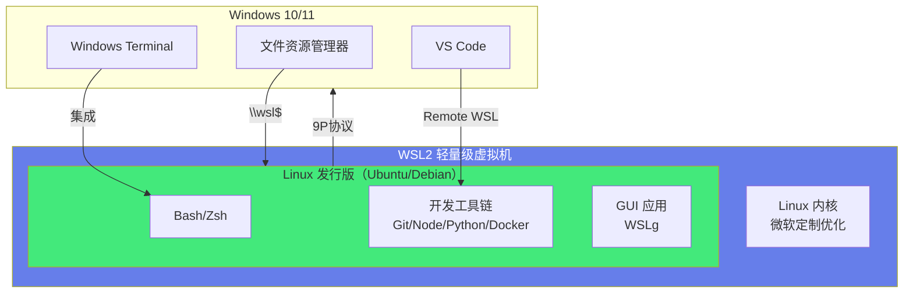

# 🪟 WSL2 开发环境配置

> **文档说明**：系统讲解 WSL2（Windows Subsystem for Linux 2）开发环境的完整配置指南，涵盖 WSL1 vs WSL2 对比与原理、安装与启用、发行版管理（Ubuntu/Debian/Kali）、Windows Terminal 配置与美化、Zsh + Oh My Zsh + Powerlevel10k 主题、常用开发工具链（Git/Node/Python/Java/Go/Docker）、VSCode Remote WSL 集成、文件系统互操作与性能优化、网络配置与端口转发、GUI 应用支持（WSLg）、系统配置（.wslconfig/wsl.conf）、备份与迁移、常见问题排查与最佳实践。
>
> **适用人群**：Windows 开发者、需要 Linux 开发环境的全栈工程师、从 Mac/Linux 切换到 Windows 的开发者
>
> **前置知识**：[[终端与命令行基础]] · [[Shell脚本编程]]

---

## 一、概述

### 1.1 什么是 WSL

WSL（Windows Subsystem for Linux）是 Windows 10/11 内置的 Linux 子系统，允许开发者在 Windows 上直接运行 Linux 环境，不需要虚拟机或双系统。

**WSL 解决的问题**：
- Windows 上开发 Linux 应用需要虚拟机（笨重、慢、资源占用高）
- 双系统切换麻烦，无法同时使用 Windows 和 Linux 应用
- Docker 在 Windows 上需要 Hyper-V 虚拟机，性能差
- 很多开发工具（Node/Python/Go）在 Linux 上体验更好



### 1.2 WSL1 vs WSL2

| 维度 | WSL1 | WSL2 |
|------|------|------|
| **架构** | 翻译层（将 Linux 系统调用翻译为 Windows 系统调用） | 轻量级虚拟机（完整 Linux 内核） |
| **Linux 内核** | 无（翻译层模拟） | 有（微软定制的真实 Linux 内核） |
| **系统调用兼容性** | 部分（不支持的系统调用会失败） | 完整（100% 系统调用兼容） |
| **文件系统性能** | 快（直接访问 Windows 文件系统） | Linux 文件系统快，Windows 文件系统慢（跨 VM 9P 协议） |
| **IO 性能** | 中等 | 高（特别是 Linux 文件系统内的 IO） |
| **Docker 支持** | 不支持（需要 Docker Desktop） | 原生支持（Docker Desktop 基于 WSL2） |
| **内存占用** | 低（共享 Windows 内存） | 较高（VM 有独立内存，但动态分配） |
| **启动速度** | 快（几乎瞬时） | 较快（几秒启动 VM） |
| **网络** | 共享 Windows 网络栈 | 独立虚拟网卡 + NAT |
| **GUI 应用** | 不支持 | 支持（WSLg，Windows 11 内置） |
| **推荐** | 简单命令行工具、主要操作 Windows 文件 | 全功能 Linux 开发环境、Docker、GUI 应用 |

> **结论**：绝大多数场景推荐 WSL2，只有在需要频繁操作 Windows 文件系统且不需要完整 Linux 兼容性时才考虑 WSL1。

### 1.3 WSL2 的核心优势

| 优势 | 说明 |
|------|------|
| **原生 Linux 体验** | 完整 Linux 内核，支持所有 Linux 工具和系统调用 |
| **轻量快速** | 比传统虚拟机快，启动秒级，资源占用低 |
| **与 Windows 深度集成** | 文件互访、剪贴板共享、Windows Terminal 集成、VSCode Remote |
| **Docker 原生支持** | Docker Desktop 基于 WSL2，性能接近原生 Linux |
| **GUI 应用** | WSLg 支持运行 Linux GUI 应用（VSCode、Firefox、GIMP 等） |
| **多发行版** | 可同时安装 Ubuntu/Debian/Kali/Arch 等多个发行版 |
| **免费内置** | Windows 10/11 专业版/家庭版都支持，无需额外授权 |

---

## 二、安装与配置

### 2.1 系统要求

| 要求 | 说明 |
|------|------|
| **操作系统** | Windows 10 版本 2004+（内部版本 19041+）或 Windows 11 |
| **架构** | x64 或 ARM64 |
| **虚拟化** | BIOS 中启用虚拟化（Intel VT-x / AMD-V） |
| **磁盘空间** | 至少 4GB（推荐 20GB+，每个发行版约 1-5GB） |
| **内存** | 至少 4GB（推荐 8GB+，WSL2 动态分配内存） |

### 2.2 安装 WSL2

**方法一：一键安装（推荐，Windows 10 2004+ / Windows 11）**

```powershell
# 以管理员身份打开 PowerShell，执行：
wsl --install

# 这会自动：
# 1. 启用"适用于 Linux 的 Windows 子系统"功能
# 2. 启用"虚拟机平台"功能
# 3. 下载并安装 WSL2 Linux 内核更新
# 4. 设置 WSL2 为默认版本
# 5. 安装 Ubuntu（默认发行版）

# 安装完成后重启电脑
```

**方法二：手动安装**

```powershell
# 1. 以管理员身份打开 PowerShell
# 2. 启用 WSL 功能
dism.exe /online /enable-feature /featurename:Microsoft-Windows-Subsystem-Linux /all /norestart

# 3. 启用虚拟机平台
dism.exe /online /enable-feature /featurename:VirtualMachinePlatform /all /norestart

# 4. 重启电脑
Restart-Computer

# 5. 下载并安装 WSL2 Linux 内核更新包
# https://wslstorestorage.blob.core.windows.net/wslblob/wsl_update_x64.msi

# 6. 设置 WSL2 为默认版本
wsl --set-default-version 2

# 7. 从 Microsoft Store 安装 Linux 发行版（Ubuntu 等）
```

### 2.3 管理发行版

```powershell
# 查看可用的在线发行版
wsl --list --online
# 或 wsl -l -o

# 安装指定发行版
wsl --install -d Ubuntu
wsl --install -d Debian
wsl --install -d kali-linux
wsl --install -d Ubuntu-22.04

# 查看已安装的发行版和状态
wsl --list --verbose
# 或 wsl -l -v
# 输出：
#   NAME            STATE           VERSION
# * Ubuntu          Running         2
#   Debian          Stopped         2

# 设置默认发行版
wsl --set-default Ubuntu

# 转换发行版版本（WSL1 ↔ WSL2）
wsl --set-version Ubuntu 2
wsl --set-version Ubuntu 1

# 启动指定发行版
wsl -d Ubuntu
wsl -d Debian

# 以特定用户启动
wsl -d Ubuntu -u root

# 停止发行版
wsl --terminate Ubuntu
# 或 wsl -t Ubuntu

# 停止所有运行中的发行版
wsl --shutdown

# 注销（删除）发行版（危险！会删除所有数据）
wsl --unregister Ubuntu

# 导出发行版为 tar 文件（备份）
wsl --export Ubuntu D:\backup\ubuntu.tar

# 从 tar 文件导入发行版（恢复/迁移）
wsl --import Ubuntu D:\WSL\Ubuntu D:\backup\ubuntu.tar
```

### 2.4 .wslconfig 全局配置

在 Windows 用户目录下创建 `%UserProfile%\.wslconfig`（即 `C:\Users\你的用户名\.wslconfig`），配置所有 WSL2 发行版的全局设置。

```ini
# C:\Users\你的用户名\.wslconfig

[wsl2]
# 内存限制（默认 Windows 总内存的 50% 或 8GB，取较小值）
memory=8GB

# 处理器核心数（默认所有逻辑核心）
processors=4

# 交换空间大小（默认 25% 的内存大小）
swap=4GB

# 交换文件位置（默认 %USERPROFILE%\AppData\Local\Temp\swap.vhdx）
swapFile=D:\WSL\swap.vhdx

# 本地主机回环（WSL2 可以通过 localhost 访问 Windows 服务）
localhostForwarding=true

# WSL2 虚拟机的 IPv6 支持
ipv6=true

# 实验特性（Windows 11 22H2+）
[experimental]
# 自动释放缓存内存到 Windows
autoMemoryReclaim=gradual  # disabled / gradual / dropcache

# 稀疏 VHD（虚拟磁盘自动回收空间）
sparseVhd=true

# 网络镜像模式（WSL2 与 Windows 共享网络栈，解决网络问题）
networkingMode=mirrored  # NAT / mirrored

# DNS 隧道（mirrored 模式下可用）
dnsTunneling=true

# 防火墙（mirrored 模式下可用）
firewall=true

# 自动代理（继承 Windows 代理设置）
autoProxy=true
```

> 修改 `.wslconfig` 后需要执行 `wsl --shutdown` 重启 WSL 才能生效。

### 2.5 wsl.conf 发行版配置

在 Linux 发行版内部创建 `/etc/wsl.conf`，配置单个发行版的设置。

```ini
# /etc/wsl.conf（在 WSL Linux 内部编辑）

[automount]
# 自动挂载 Windows 驱动器（C盘、D盘等）到 /mnt/c、/mnt/d
enabled=true

# 挂载点前缀（默认 /mnt）
root=/mnt

# 挂载选项（文件权限、属主）
options="metadata,umask=22,fmask=11"

# 自动挂载固定驱动器
mountFsTab=true

[network]
# 生成 /etc/hosts（自动包含 Windows 主机名映射）
generateHosts=true

# 生成 /etc/resolv.conf（DNS 配置）
generateResolvConf=true

# WSL 实例的主机名（默认 Windows 主机名）
hostname=wsl-dev

[user]
# 默认登录用户
default=your_username

[boot]
# 启动时执行的命令（如启动服务）
# systemd 支持（Windows 11 22H2+ / Windows 10 21H2+）
systemd=true

# 启动命令（systemd 启用后不建议使用）
# command="service docker start"

[interop]
# 允许在 WSL 中运行 Windows 可执行文件
enabled=true

# 自动将 Windows 路径添加到 WSL 的 PATH
appendWindowsPath=true
```

> 修改 `/etc/wsl.conf` 后需要执行 `wsl --shutdown` 重启 WSL 才能生效。

---

## 三、终端配置与美化

### 3.1 Windows Terminal

Windows Terminal 是微软官方的现代终端，支持多标签、多面板、GPU 加速、自定义主题，是 WSL 的最佳搭档。

**安装**：
- Microsoft Store 搜索 "Windows Terminal" 安装
- 或 `winget install Microsoft.WindowsTerminal`

**配置 WSL 为默认终端**：
1. 打开 Windows Terminal 设置（Ctrl+,）
2. 启动 → 默认配置文件 → 选择 Ubuntu
3. 保存

**常用快捷键**：
| 快捷键 | 功能 |
|--------|------|
| `Ctrl+Shift+T` | 新建标签页 |
| `Ctrl+Shift+W` | 关闭标签页/面板 |
| `Ctrl+Shift+D` | 垂直拆分面板 |
| `Alt+Shift+-` | 水平拆分面板 |
| `Ctrl+Tab` | 切换标签页 |
| `Ctrl+Shift+F` | 搜索 |
| `Ctrl+=` / `Ctrl+-` | 放大/缩小字体 |
| `Ctrl+Shift+Space` | 命令面板 |

### 3.2 安装 Zsh + Oh My Zsh

```bash
# 在 WSL Ubuntu 中执行

# 1. 安装 Zsh
sudo apt update
sudo apt install -y zsh

# 2. 设置 Zsh 为默认 Shell
chsh -s $(which zsh)

# 3. 安装 Oh My Zsh
sh -c "$(curl -fsSL https://raw.githubusercontent.com/ohmyzsh/ohmyzsh/master/tools/install.sh)"

# 4. 重启终端或执行
source ~/.zshrc
```

### 3.3 Powerlevel10k 主题

```bash
# 1. 安装 Powerlevel10k
git clone --depth=1 https://github.com/romkatv/powerlevel10k.git ${ZSH_CUSTOM:-$HOME/.oh-my-zsh/custom}/themes/powerlevel10k

# 2. 在 ~/.zshrc 中设置主题
# ZSH_THEME="powerlevel10k/powerlevel10k"
sed -i 's/ZSH_THEME=".*"/ZSH_THEME="powerlevel10k\/powerlevel10k"/' ~/.zshrc

# 3. 安装 Nerd Font 字体（必须，否则图标显示为方框）
# 在 Windows 上安装 MesloLGS NF 字体：
# https://github.com/romkatv/powerlevel10k#manual-font-installation
# 下载四个字体文件，右键安装

# 4. Windows Terminal 设置字体为 MesloLGS NF
# 设置 → 配置文件 → Ubuntu → 外观 → 字体 → MesloLGS NF

# 5. 重启终端，自动启动配置向导
p10k configure
```

### 3.4 Oh My Zsh 插件

```bash
# 编辑 ~/.zshrc，找到 plugins=() 添加插件
plugins=(
    git
    zsh-autosuggestions      # 命令自动建议（灰色提示，→ 接受）
    zsh-syntax-highlighting  # 语法高亮
    zsh-completions          # 额外补全
    docker                   # Docker 补全
    kubectl                  # K8s 补全
    npm                      # npm 补全
    yarn                     # yarn 补全
    python                   # Python 补全
    pip                      # pip 补全
    extract                  # 万能解压命令 x
    sudo                     # 按 Esc 两次在命令前加 sudo
    history                  # 历史搜索
    colored-man-pages        # 彩色 man 手册
)

# 需要额外安装的插件：
# zsh-autosuggestions
git clone https://github.com/zsh-users/zsh-autosuggestions ${ZSH_CUSTOM:-~/.oh-my-zsh/custom}/plugins/zsh-autosuggestions

# zsh-syntax-highlighting
git clone https://github.com/zsh-users/zsh-syntax-highlighting.git ${ZSH_CUSTOM:-~/.oh-my-zsh/custom}/plugins/zsh-syntax-highlighting

# zsh-completions
git clone https://github.com/zsh-users/zsh-completions ${ZSH_CUSTOM:-${ZSH:-~/.oh-my-zsh}/custom}/plugins/zsh-completions
```

### 3.5 ~/.zshrc 常用配置

```bash
# ~/.zshrc 追加

# ===== 别名 =====
alias ll='ls -alF'
alias la='ls -A'
alias l='ls -CF'
alias ..='cd ..'
alias ...='cd ../..'
alias grep='grep --color=auto'
alias df='df -h'
alias du='du -sh'
alias free='free -h'
alias ports='netstat -tulanp'
alias update='sudo apt update && sudo apt upgrade -y'
alias c='clear'
alias mkdir='mkdir -pv'

# Git 别名
alias gs='git status'
alias ga='git add'
alias gc='git commit'
alias gp='git push'
alias gl='git pull'
alias gd='git diff'
alias glog='git log --oneline --graph --decorate --all'

# Docker 别名
alias d='docker'
alias dc='docker compose'
alias dps='docker ps'
alias dimg='docker images'

# ===== 环境变量 =====
export EDITOR=vim
export VISUAL=vim
export LANG=en_US.UTF-8
export LC_ALL=en_US.UTF-8

# ===== 历史记录 =====
HISTSIZE=10000
SAVEHIST=10000
HISTFILE=~/.zsh_history
setopt HIST_IGNORE_DUPS       # 忽略重复命令
setopt HIST_IGNORE_SPACE      # 以空格开头的命令不记录
setopt SHARE_HISTORY          # 共享历史（多终端实时同步）

# ===== 补全 =====
autoload -Uz compinit && compinit
zstyle ':completion:*' menu select
zstyle ':completion:*' matcher-list 'm:{a-z}={A-Za-z}'  # 大小写不敏感

# ===== fzf 集成（如果安装了 fzf）=====
# source /usr/share/doc/fzf/examples/key-bindings.zsh
# source /usr/share/doc/fzf/examples/completion.zsh
```

---

## 四、开发工具链配置

### 4.1 基础工具

```bash
# 更新系统
sudo apt update && sudo apt upgrade -y

# 安装基础开发工具
sudo apt install -y \
    build-essential \       # gcc/g++/make
    git \                   # 版本控制
    curl \                  # 网络请求
    wget \                  # 下载
    vim \                   # 编辑器
    tmux \                  # 终端复用
    htop \                  # 系统监控
    tree \                  # 目录树
    jq \                    # JSON 处理
    ripgrep \               # 快速搜索（rg）
    fd-find \               # 快速 find（fdfind）
    fzf \                   # 模糊搜索
    bat \                   # 带语法高亮的 cat
    exa \                   # 现代 ls
    zip unzip \             # 压缩解压
    software-properties-common \
    apt-transport-https \
    ca-certificates \
    gnupg \
    lsb-release

# 创建 fd 别名（Ubuntu 下叫 fdfind）
echo 'alias fd=fdfind' >> ~/.zshrc
```

### 4.2 Git 配置

```bash
# 基本配置
git config --global user.name "Your Name"
git config --global user.email "your@email.com"
git config --global init.defaultBranch main

# 别名
git config --global alias.st status
git config --global alias.co checkout
git config --global alias.br branch
git config --global alias.ci commit
git config --global alias.lg "log --oneline --graph --decorate --all"

# 凭证管理（使用 Windows 凭证管理器，避免重复输入密码）
git config --global credential.helper "/mnt/c/Program\ Files/Git/mingw64/bin/git-credential-manager.exe"

# 或使用 GCM Core
# git config --global credential.helper manager-core

# 行尾符（Linux 环境用 LF）
git config --global core.autocrlf input
git config --global core.eol lf
```

### 4.3 Node.js（nvm）

```bash
# 安装 nvm（Node Version Manager）
curl -o- https://raw.githubusercontent.com/nvm-sh/nvm/v0.39.7/install.sh | bash

# 重启终端或 source
source ~/.zshrc

# 安装最新 LTS 版本
nvm install --lts

# 安装指定版本
nvm install 20
nvm install 18

# 切换版本
nvm use 20
nvm alias default 20

# 查看已安装版本
nvm ls

# 全局安装常用工具
npm install -g \
    pnpm \
    yarn \
    typescript \
    ts-node \
    @vue/cli \
    @angular/cli \
    create-next-app \
    eslint \
    prettier
```

### 4.4 Python（pyenv + poetry）

```bash
# 安装 pyenv 依赖
sudo apt install -y make build-essential libssl-dev zlib1g-dev \
    libbz2-dev libreadline-dev libsqlite3-dev wget curl llvm \
    libncursesw5-dev xz-utils tk-dev libxml2-dev libxmlsec1-dev \
    libffi-dev liblzma-dev

# 安装 pyenv
curl https://pyenv.run | bash

# 添加到 ~/.zshrc
echo 'export PYENV_ROOT="$HOME/.pyenv"' >> ~/.zshrc
echo '[[bin]] && export PATH="$PYENV_ROOT/bin:$PATH"' >> ~/.zshrc
echo 'eval "$(pyenv init -)"' >> ~/.zshrc

# 安装 Python
pyenv install 3.12.0
pyenv global 3.12.0

# 安装 poetry（Python 包管理）
curl -sSL https://install.python-poetry.org | python3 -

# 添加到 PATH
echo 'export PATH="$HOME/.local/bin:$PATH"' >> ~/.zshrc
```

### 4.5 Java（sdkman）

```bash
# 安装 SDKMAN
curl -s "https://get.sdkman.io" | bash
source "$HOME/.sdkman/bin/sdkman-init.sh"

# 安装 Java
sdk install java 17.0.9-tem
sdk install java 21.0.1-tem
sdk default java 17.0.9-tem

# 安装 Maven/Gradle
sdk install maven
sdk install gradle

# 安装 Spring Boot CLI
sdk install springboot
```

### 4.6 Go

```bash
# 下载安装 Go
wget https://go.dev/dl/go1.22.0.linux-amd64.tar.gz
sudo rm -rf /usr/local/go
sudo tar -C /usr/local -xzf go1.22.0.linux-amd64.tar.gz
rm go1.22.0.linux-amd64.tar.gz

# 添加到 PATH
echo 'export PATH=$PATH:/usr/local/go/bin' >> ~/.zshrc
echo 'export GOPATH=$HOME/go' >> ~/.zshrc
echo 'export PATH=$PATH:$GOPATH/bin' >> ~/.zshrc

# 国内代理
go env -w GOPROXY=https://goproxy.cn,direct
go env -w GO111MODULE=on
```

### 4.7 Docker（Docker Desktop + WSL2）

**方式一：Docker Desktop（推荐，简单）**
1. 在 Windows 安装 Docker Desktop
2. 设置 → General → 勾选 "Use the WSL 2 based engine"
3. 设置 → Resources → WSL Integration → 启用 Ubuntu 集成
4. 在 WSL 中直接使用 `docker` 和 `docker compose` 命令

**方式二：WSL2 内原生安装 Docker（不依赖 Docker Desktop）**

```bash
# 安装 Docker
curl -fsSL https://get.docker.com | sh

# 将用户加入 docker 组
sudo usermod -aG docker $USER

# 启用 systemd（/etc/wsl.conf 中设置 systemd=true）
# 然后启动 Docker
sudo systemctl enable docker
sudo systemctl start docker

# 验证
docker run hello-world
```

### 4.8 数据库客户端

```bash
# MySQL 客户端
sudo apt install -y mysql-client

# PostgreSQL 客户端
sudo apt install -y postgresql-client

# Redis 客户端
sudo apt install -y redis-tools

# MongoDB Shell（mongosh）
# 下载安装：https://www.mongodb.com/try/download/shell
```

---

## 五、VSCode Remote WSL

### 5.1 配置

1. 在 Windows 安装 VSCode
2. 安装 "WSL" 扩展（Microsoft 官方）
3. 在 WSL 终端中进入项目目录，执行 `code .`
4. VSCode 会自动在 WSL 中安装 Server 并连接
5. 左下角显示 "WSL: Ubuntu" 表示连接成功

### 5.2 优势

- **原生 Linux 开发体验**：终端、Git、Node/Python 等工具都在 Linux 环境运行
- **Windows 编辑体验**：VSCode GUI 在 Windows 运行，响应快，字体渲染好
- **扩展分离**：WSL 端安装的扩展（语言服务器、Linter）运行在 Linux，Windows 端扩展（主题、快捷键）运行在 Windows
- **调试**：直接在 WSL 中调试 Linux 程序
- **端口转发**：WSL 中运行的服务（如 localhost:3000）自动转发到 Windows，可直接用 Windows 浏览器访问

### 5.3 常用操作

```bash
# 在 WSL 中用 VSCode 打开目录
code .

# 打开指定文件
code filename.py

# 安装 WSL 端扩展
code --install-extension ms-python.python

# 从 Windows 命令行打开 WSL 项目
code --remote wsl+Ubuntu /home/user/project
```

---

## 六、文件系统与性能

### 6.1 文件系统互操作

| 访问方式 | 路径 | 说明 |
|---------|------|------|
| WSL 访问 Windows C 盘 | `/mnt/c/` | 通过 9P 协议挂载，性能较慢 |
| WSL 访问 Windows D 盘 | `/mnt/d/` | 同上 |
| Windows 访问 WSL 文件 | `\\wsl$\Ubuntu\home\user` | 资源管理器地址栏输入 |
| Windows 访问 WSL 文件 | `\\wsl.localhost\Ubuntu\` | Windows 11 新格式 |
| 资源管理器打开 WSL | 在 WSL 执行 `explorer.exe .` | 用 Windows 资源管理器打开当前目录 |

### 6.2 性能优化（关键！）

> **最重要的性能规则：项目文件放在 WSL 的 Linux 文件系统中（如 ~/projects），不要放在 /mnt/c/ 或 /mnt/d/！**

| 文件位置 | 性能 | 说明 |
|---------|------|------|
| `~/projects/`（Linux ext4） | ⭐⭐⭐⭐⭐ 极快 | WSL2 原生文件系统，IO 接近原生 Linux |
| `/mnt/c/Users/...`（Windows NTFS） | ⭐⭐ 慢 | 跨 VM 通过 9P 协议访问，IO 慢 5-10 倍 |
| `/mnt/d/projects/`（Windows NTFS） | ⭐⭐ 慢 | 同上 |

**为什么 /mnt/c 慢**：WSL2 运行在轻量级虚拟机中，访问 Windows 文件系统需要通过 9P 网络文件系统协议跨 VM 访问，每次 IO 都有 VM 边界开销。而 Linux 文件系统（ext4）在 VM 内部的 VHDX 虚拟磁盘中，IO 几乎没有额外开销。

**最佳实践**：
```bash
# ✅ 推荐：项目放在 Linux 文件系统
mkdir -p ~/projects
cd ~/projects
git clone https://github.com/your/project.git
code .

# ❌ 不推荐：项目放在 Windows 文件系统
cd /mnt/c/Users/yourname/projects  # 慢！
```

**其他性能优化**：
```ini
# .wslconfig 中启用实验特性（Windows 11 22H2+）
[experimental]
autoMemoryReclaim=gradual  # 自动释放 WSL 未使用的内存到 Windows
sparseVhd=true              # 稀疏 VHD，虚拟磁盘自动回收空间
networkingMode=mirrored      # 镜像网络模式，解决网络和端口问题
```

### 6.3 跨文件系统操作注意事项

- **Git 仓库**：不要在 /mnt/c 和 ~/ 之间跨文件系统操作 Git，文件权限和行尾符可能出问题
- **文件权限**：/mnt/c 下的文件权限由 Windows 控制，chmod 可能不生效
- **符号链接**：Linux 符号链接在 /mnt/c 下可能不工作
- **inotify**：/mnt/c 下的文件变更可能无法触发 Linux 的 inotify（影响热重载），需要配置 `WATCHPACK_POLLING=true` 等环境变量

---

## 七、网络配置

### 7.1 WSL2 网络模型

**NAT 模式（默认）**：
- WSL2 有独立的虚拟网卡，IP 由 Windows 自动分配（如 172.x.x.x）
- WSL2 通过 Windows NAT 访问外部网络
- Windows 可以通过 localhost 访问 WSL2 中的服务（localhostForwarding）
- WSL2 重启后 IP 可能变化

**镜像模式（mirrored，Windows 11 22H2+）**：
- WSL2 与 Windows 共享网络栈和 IP 地址
- 解决了 NAT 模式下的很多网络问题（VPN、IPv6、端口转发等）
- WSL2 中监听的端口直接在 Windows 可用
- 配置：`.wslconfig` 中 `networkingMode=mirrored`

### 7.2 常见网络操作

```bash
# 查看 WSL IP 地址
ip addr show eth0
# 或
hostname -I

# 测试网络连通性
ping 8.8.8.8
ping google.com

# 查看 DNS 配置
cat /etc/resolv.conf

# 如果 DNS 不工作，手动配置
sudo rm /etc/resolv.conf
sudo bash -c 'echo "nameserver 8.8.8.8" > /etc/resolv.conf'
sudo bash -c 'echo "nameserver 114.114.114.114" >> /etc/resolv.conf'
# 禁止 WSL 自动生成 resolv.conf（/etc/wsl.conf 中 generateResolvConf=false）

# 端口转发（NAT 模式下，外部设备访问 WSL 服务需要转发）
# 在 Windows PowerShell（管理员）中执行：
# netsh interface portproxy add v4tov4 listenport=3000 listenaddress=0.0.0.0 connectport=3000 connectaddress=$(wsl hostname -I)

# 查看端口转发
# netsh interface portproxy show all

# 删除端口转发
# netsh interface portproxy delete v4tov4 listenport=3000 listenaddress=0.0.0.0
```

### 7.3 代理配置

```bash
# 在 WSL 中使用 Windows 代理（Clash/V2Ray 等）
# Windows 代理监听地址通常是 127.0.0.1:7890

# 获取 Windows 主机 IP（NAT 模式下，WSL 的默认网关就是 Windows IP）
WIN_HOST=$(ip route show | grep -i default | awk '{ print $3}')

# 临时设置代理
export http_proxy="http://$WIN_HOST:7890"
export https_proxy="http://$WIN_HOST:7890"
export all_proxy="socks5://$WIN_HOST:7890"

# 取消代理
unset http_proxy https_proxy all_proxy

# 永久配置（添加到 ~/.zshrc）
cat >> ~/.zshrc << 'EOF'

# WSL 代理配置
export WIN_HOST=$(ip route show | grep -i default | awk '{ print $3}')
proxy_on() {
    export http_proxy="http://$WIN_HOST:7890"
    export https_proxy="http://$WIN_HOST:7890"
    export all_proxy="socks5://$WIN_HOST:7890"
    echo "Proxy ON: $WIN_HOST:7890"
}
proxy_off() {
    unset http_proxy https_proxy all_proxy
    echo "Proxy OFF"
}
EOF

# 使用
proxy_on   # 开启代理
proxy_off  # 关闭代理

# Git 代理
git config --global http.proxy "http://$WIN_HOST:7890"
git config --global https.proxy "http://$WIN_HOST:7890"
# 取消
git config --global --unset http.proxy
git config --global --unset https.proxy

# Docker 代理（在 /etc/systemd/system/docker.service.d/proxy.conf 中配置）
```

> Windows 11 22H2+ 的镜像网络模式（`networkingMode=mirrored`）+ `autoProxy=true` 可以自动继承 Windows 代理，不需要手动配置。

---

## 八、GUI 应用（WSLg）

### 8.1 WSLg 简介

WSLg（WSL Graphics）是 Windows 11 内置的 Linux GUI 应用支持，允许在 WSL 中运行 Linux GUI 应用，窗口直接显示在 Windows 桌面上，与 Windows 应用无缝协作。

**系统要求**：
- Windows 11（所有版本）或 Windows 10 21H2+（部分支持）
- WSL2
- 显卡驱动（Windows 侧，支持 GPU 加速）

### 8.2 运行 GUI 应用

```bash
# 安装 GUI 应用后直接运行即可，无需额外配置

# 安装 Firefox
sudo apt install -y firefox
firefox &

# 安装 GIMP（图像编辑）
sudo apt install -y gimp
gimp &

# 安装 VSCode（Linux 版，与 Windows 版独立）
sudo apt install -y code
code &

# 安装文件管理器
sudo apt install -y nautilus
nautilus &

# 安装终端
sudo apt install -y gnome-terminal
gnome-terminal &

# 安装中文输入法（可选）
sudo apt install -y fcitx5 fcitx5-chinese-addons
```

**WSLg 特性**：
- 音频支持（麦克风和扬声器）
- GPU 加速（OpenGL/Vulkan）
- 与 Windows 共享剪贴板
- 中文输入需要额外配置输入法
- 应用图标显示在 Windows 任务栏

---

## 九、备份与迁移

### 9.1 备份发行版

```powershell
# 在 Windows PowerShell 中执行

# 停止 WSL
wsl --shutdown

# 导出发行版为 tar 文件（备份）
wsl --export Ubuntu D:\Backup\wsl-ubuntu-$(Get-Date -Format 'yyyyMMdd').tar

# 导出为 VHD（虚拟磁盘，Windows 11 22H2+，更快）
wsl --export --vhd Ubuntu D:\Backup\wsl-ubuntu.vhdx
```

### 9.2 恢复/迁移发行版

```powershell
# 从 tar 文件导入（恢复到指定目录）
wsl --import Ubuntu D:\WSL\Ubuntu D:\Backup\wsl-ubuntu-20240101.tar

# 从 VHD 导入
wsl --import --vhd Ubuntu D:\WSL\Ubuntu D:\Backup\wsl-ubuntu.vhdx

# 设置默认用户（导入后默认是 root，需要配置）
# 在 WSL 中创建 /etc/wsl.conf，设置 default=你的用户名
```

### 9.3 迁移 WSL 到其他盘（C 盘空间不足）

```powershell
# 1. 导出发行版
wsl --export Ubuntu D:\Temp\ubuntu.tar

# 2. 注销原发行版（删除 C 盘数据）
wsl --unregister Ubuntu

# 3. 导入到 D 盘
wsl --import Ubuntu D:\WSL\Ubuntu D:\Temp\ubuntu.tar

# 4. 设置默认用户
# 在 WSL 中编辑 /etc/wsl.conf：
# [user]
# default=your_username

# 5. 删除临时文件
Remove-Item D:\Temp\ubuntu.tar
```

### 9.4 配置文件备份清单

需要备份的配置文件：
- `%UserProfile%\.wslconfig` — WSL 全局配置
- `~/.zshrc` — Zsh 配置
- `~/.gitconfig` — Git 配置
- `~/.ssh/` — SSH 密钥
- `~/.npmrc` / `~/.config/pip/` — 包管理器配置
- `/etc/wsl.conf` — 发行版配置
- Windows Terminal 设置（`%LocalAppData%\Packages\Microsoft.WindowsTerminal_8wekyb3d8bbwe\LocalState\settings.json`）

---

## 十、常见问题排查

| 问题 | 原因 | 解决方案 |
|------|------|---------|
| **WSL 启动报错 "参考的对象类型不支持尝试的操作"** | 第三方安全软件/代理拦截 LSP | `netsh winsock reset` 重置网络，或卸载冲突软件 |
| **WSL2 安装失败，提示需要虚拟化** | BIOS 未启用虚拟化 | 进入 BIOS 启用 Intel VT-x / AMD-V |
| **文件操作很慢** | 项目在 /mnt/c（Windows 文件系统） | 将项目移到 ~/projects（Linux 文件系统） |
| **localhost 无法访问 WSL 服务** | localhostForwarding 未启用或防火墙 | 检查 `.wslconfig` 中 `localhostForwarding=true`，或用 WSL IP 访问 |
| **DNS 解析失败** | resolv.conf 配置错误或被覆盖 | 手动配置 nameserver，`/etc/wsl.conf` 中 `generateResolvConf=false` |
| **内存占用过高** | WSL2 VM 内存未释放 | `.wslconfig` 中设置 `memory=8GB` 限制，或 `autoMemoryReclaim=gradual` |
| **磁盘空间占用大** | VHD 虚拟磁盘不会自动缩小 | `wsl --shutdown` 后用 `Optimize-VHD` 压缩，或启用 `sparseVhd=true` |
| **中文显示乱码** |  locale 未配置为 UTF-8 | `sudo locale-gen en_US.UTF-8 zh_CN.UTF-8`，`export LANG=en_US.UTF-8` |
| **Git 每次都要输入密码** | 凭证管理器未配置 | 配置 `credential.helper` 指向 Windows Git Credential Manager |
| **Docker 命令找不到** | Docker Desktop WSL 集成未启用 | Docker Desktop 设置 → Resources → WSL Integration 启用 |
| **VSCode Remote 连接失败** | WSL 中 VSCode Server 损坏 | 删除 `~/.vscode-server` 重新连接 |
| **端口被占用** | Windows 端口被其他进程占用 | `netstat -ano | findstr :端口` 查找进程，或换端口 |
| **systemctl 命令不工作** | systemd 未启用 | `/etc/wsl.conf` 中设置 `systemd=true`，`wsl --shutdown` 重启 |
| **GUI 应用无法启动** | WSLg 未启用或 Windows 版本不支持 | 升级到 Windows 11，更新 WSL（`wsl --update`） |
| **WSL 网络不通（VPN 环境）** | VPN 软件与 WSL NAT 冲突 | 使用镜像网络模式 `networkingMode=mirrored`，或配置 VPN 分流 |

**常用排查命令**：
```bash
# WSL 状态
wsl --status
wsl --list --verbose
wsl --version

# 系统信息
uname -a
cat /etc/os-release
free -h
df -h
ip addr

# 网络
ping -c 3 8.8.8.8
cat /etc/resolv.conf
ip route

# 日志
dmesg | tail
journalctl -xe（如果启用 systemd）

# 重启 WSL（解决大部分问题）
wsl --shutdown

# 更新 WSL
wsl --update
```

---

## 十一、关联笔记

### 终端与工具
- [[终端与命令行基础]] · [[Shell脚本编程]] · [[Vim高效编辑]]
- [[Tmux终端复用]] · [[fzf-模糊搜索神器]]

### 开发环境
- [[VSCode高效配置]] · [[Git进阶技巧]] · [[Docker-核心原理与镜像优化]]
- [[Docker-Compose编排]]

### 操作系统
- [[Linux系统管理与常用命令]] · [[Linux性能调优]] · [[Linux内核基础概念]]

### 导航
- [[MOC-通用工具]] · [[MOC-终端与命令行]] · [[MOC-综合导航]] · [[Home]]

> 🔍 **知识点深度解析**
>
> **作用**：WSL2 解决的是「Windows 上原生 Linux 开发环境」问题——传统方案（虚拟机笨重慢、双系统切换麻烦、Cygwin 兼容性差）都有明显缺点，WSL2 通过轻量级虚拟机 + 完整 Linux 内核 + 与 Windows 深度集成，提供了接近原生 Linux 的开发体验，同时保留了 Windows 桌面应用的便利性。它让开发者可以在 Windows 上使用 Linux 工具链（Git/Node/Python/Docker）、运行 Linux 服务、甚至运行 Linux GUI 应用，而不需要离开 Windows 环境。
>
> **底层原理**：WSL1 采用系统调用翻译层（将 Linux 系统调用翻译为 Windows 系统调用），兼容性差且不支持 Docker；WSL2 改用轻量级虚拟机架构，运行一个微软定制优化的真实 Linux 内核，提供 100% 系统调用兼容性。WSL2 的 VM 不是传统的 Hyper-V 虚拟机，而是基于"实用虚拟机"（Utility VM）技术，启动快（秒级）、内存动态分配（按需从 Windows 分配和回收）、与 Windows 集成度高。文件系统方面，WSL2 内部使用 ext4 文件系统（存储在 VHDX 虚拟磁盘中），IO 性能接近原生 Linux；Windows 文件系统（C/D 盘）通过 9P 网络文件系统协议挂载到 /mnt/c、/mnt/d，跨 VM 访问有性能开销。网络方面，默认 NAT 模式下 WSL2 有独立虚拟网卡，通过 Windows NAT 访问外部，Windows 通过 localhost 转发访问 WSL 服务；Windows 11 22H2+ 新增镜像网络模式（mirrored），WSL2 与 Windows 共享网络栈，解决了很多网络兼容性问题。WSLg 通过 Wayland + PulseAudio + RDP 技术实现 Linux GUI 应用的窗口和音频在 Windows 上显示。
>
> **用法要点**：① 安装：`wsl --install` 一键安装（Windows 10 2004+/Windows 11），自动启用功能和安装 Ubuntu ② 版本选择：绝大多数场景用 WSL2，`wsl --set-default-version 2` 设置默认 ③ 发行版管理：`wsl -l -v` 查看，`wsl --install -d Debian` 安装，`wsl --export/--import` 备份迁移 ④ 配置文件：`.wslconfig`（Windows 用户目录，全局配置内存/CPU/网络）和 `/etc/wsl.conf`（Linux 内部，单发行版配置用户/挂载/systemd） ⑤ 性能关键：项目文件必须放在 Linux 文件系统（~/projects），不要放在 /mnt/c（慢 5-10 倍） ⑥ 终端：Windows Terminal + Zsh + Oh My Zsh + Powerlevel10k + Nerd Font 是标准美化方案 ⑦ 开发工具：用 nvm/pyenv/sdkman 管理多版本语言，Docker Desktop 启用 WSL2 集成，VSCode 安装 WSL 扩展用 `code .` 打开项目 ⑧ 网络：默认 localhost 可访问 WSL 服务；DNS 问题手动配置 nameserver；代理用 Windows 主机 IP（`ip route | grep default`）；Windows 11 用镜像网络模式+autoProxy 简化 ⑨ GUI：Windows 11 内置 WSLg，直接 `sudo apt install firefox && firefox &` 即可运行 ⑩ 备份迁移：`wsl --export` 导出 tar，`wsl --import` 导入，可用于备份和迁移到其他盘 ⑪ 常见问题：慢→检查文件位置；DNS→检查 resolv.conf；内存高→.wslconfig 限制 memory；端口冲突→netstat 查进程；大部分问题 `wsl --shutdown` 重启可解决。

> 💡 **深度讲解**：WSL2 最容易踩的坑是「文件系统性能」——很多人把项目放在 C 盘的用户目录下（/mnt/c/Users/xxx/projects），然后抱怨 WSL 很慢。实际上 WSL2 的 Linux 文件系统（ext4，在 ~/ 目录下）IO 性能接近原生 Linux，而访问 /mnt/c 下的 Windows 文件需要通过 9P 协议跨虚拟机访问，每次 IO 都有 VM 边界开销，性能慢 5-10 倍，特别是小文件密集操作（npm install、git status、编译）差异巨大。所以正确的做法是：所有开发项目都放在 WSL 的 ~/projects 目录下，用 VSCode Remote WSL 编辑（`code .`），用 Windows 浏览器访问 localhost 服务，这样既有 Linux 的开发环境性能，又有 Windows 的桌面体验。另一个关键点是「WSL2 不是虚拟机」——它虽然基于虚拟化技术，但和传统的 Hyper-V/VirtualBox 虚拟机有本质区别：它的内核是微软定制的，启动只需要几秒（传统 VM 需要几十秒），内存是动态分配的（用多少分配多少，不用时可以回收，传统 VM 启动时就固定分配内存），与 Windows 的集成度极高（文件互访、剪贴板共享、localhost 转发、GUI 应用）。这种"实用虚拟机"设计是 WSL2 既轻量又功能完整的关键。网络配置是另一个容易困惑的地方——默认 NAT 模式下 WSL2 有自己的 IP（172.x.x.x），每次重启可能变化，Windows 通过 localhost 转发访问 WSL 服务，但外部设备（如手机测试）无法直接访问 WSL 服务，需要用 `netsh interface portproxy` 做端口转发。Windows 11 22H2+ 的镜像网络模式（mirrored）解决了这个问题——WSL2 与 Windows 共享 IP 和网络栈，WSL 中监听的端口直接在 Windows 可用，还支持 IPv6 和 VPN 兼容，推荐 Windows 11 用户启用。

> 📝 **精简总结**：WSL2 = Windows 内置轻量级 Linux 虚拟机，完整 Linux 内核，与 Windows 深度集成。安装：`wsl --install`。配置：`.wslconfig`（全局，内存/CPU/网络）+ `/etc/wsl.conf`（单发行版，用户/systemd）。性能关键：项目放 Linux 文件系统（~/projects），不要放 /mnt/c。终端：Windows Terminal + Zsh + Oh My Zsh + Powerlevel10k。工具：nvm/pyenv/sdkman 管理语言版本，Docker Desktop WSL2 集成，VSCode Remote WSL。网络：默认 localhost 可访问，DNS 手动配 nameserver，代理用 Windows 主机 IP，Win11 用 mirrored 模式。GUI：Win11 内置 WSLg，直接装 Linux GUI 应用。备份：`wsl --export/--import`。常见问题：慢→检查文件位置，内存高→限制 memory，DNS→resolv.conf，大部分问题 `wsl --shutdown` 解决。

> **学习路径建议**：先安装 WSL2 + Ubuntu → 配置 Windows Terminal + Zsh + 主题 → 安装基础工具链（Git/Node/Python） → 配置 VSCode Remote WSL → 实践项目开发（项目放 ~/projects） → 学习 Docker in WSL2 → 探索 GUI 应用（WSLg） → 优化配置（.wslconfig/wsl.conf） → 掌握备份迁移和问题排查。

---

> **WSL2 的本质是「在 Windows 中嵌入一个真正的 Linux」——不是模拟，不是翻译，而是一个完整的 Linux 内核在轻量级虚拟机中运行。它的伟大之处不在于技术多么先进，而在于「恰到好处」——足够完整（支持 Docker、systemd、GUI），足够轻量（秒级启动、动态内存），足够集成（文件互访、剪贴板共享、localhost 转发）。对于 Windows 开发者来说，WSL2 终结了「在 Windows 上做 Linux 开发很痛苦」的历史，让你可以同时拥有 Windows 的桌面生态和 Linux 的开发工具链。理解了 WSL2 的设计哲学，你就理解了为什么它是近年来 Windows 上最重要的开发者功能。**

---

## 🔗 关联笔记

- [[MOC-通用工具]] — 返回本分类知识地图，查看更多相关文档

## 📖 前置知识

- [[终端与命令行基础]]

## 🏷️ 相关标签

`#WSL` `#WSL2` `#Windows` `#Linux` `#开发环境` `#配置`

[[Home|🏠 返回首页]] · [[MOC-通用工具|📚 返回分类]]
