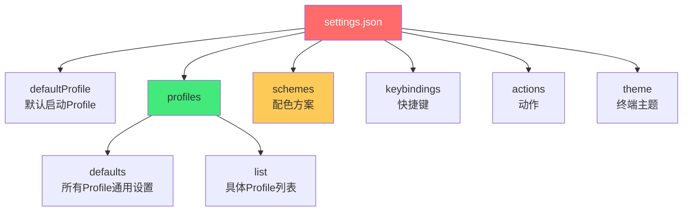
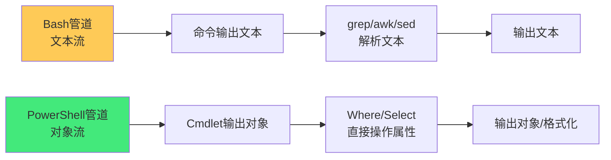

# 🖥️ Windows Terminal 与 PowerShell

> **文档说明**：系统讲解 Windows Terminal 终端模拟器与 PowerShell 命令行 Shell 的核心概念、配置方法、实用技巧与生产实践，涵盖 Windows Terminal 的核心特性（多标签/分屏/GPU 渲染/Unicode/Emoji/自定义主题）、安装方式（Microsoft Store/winget/GitHub）、配置文件 settings.json 完整结构（globalDefaults/profiles.list/schemes/keybindings/actions）、外观深度定制（配色方案/字体 CaskaydiaCove/背景图/亚克力 Acrylic/毛玻璃 Mica/透明度/圆角）、PowerShell 的发展历程（Windows PowerShell 5.1  vs PowerShell 7+ 跨平台）、PowerShell 核心概念（Cmdlet/管道/对象模型/Provider/模块/脚本块）、PowerShell 基础语法（变量/条件/循环/函数/参数/异常处理/正则）、高频实用 Cmdlet（Get-ChildItem/Select-String/Where-Object/ForEach-Object/Invoke-WebRequest/ConvertTo-Json 等）、PowerShell 配置文件 `$PROFILE` 深度定制（自定义函数/别名/Prompt 提示/模块自动加载/常用快捷命令）、Oh My Posh 主题美化与字体配置、PSReadLine 智能提示与历史预测、Windows Terminal 快捷键体系（分屏/标签/搜索/复制粘贴/字体缩放）、WSL 与 Git Bash 集成（在 Windows Terminal 中统一管理多 Shell）、posh-git Git 状态集成、Windows 包管理（winget/Chocolatey/Scoop 对比与使用）、PowerShell 与 CMD/Bash 的核心差异对比、性能优化（启动速度/模块懒加载/配置精简）、脚本编写规范（严格模式/错误处理/参数化/注释/跨平台兼容）、常见问题排查（编码乱码/执行策略/权限/启动慢）、生产级 PowerShell 脚本模板。
>
> **适用人群**：Windows 开发者、运维工程师、全栈开发者、技术爱好者、从 Linux/Mac 迁移到 Windows 的开发者
>
> **前置知识**：[[Linux基础命令]] · [[Shell脚本基础]] · [[Vim-Neovim入门与配置]]

---

## 一、概述

### 1.1 为什么需要 Windows Terminal + PowerShell

长期以来，Windows 的命令行体验远逊于 Linux/macOS——老旧的 `cmd.exe` 窗口不支持标签、分屏、Unicode、GPU 加速，PowerShell 5.1 启动慢、配色丑、跨平台差。**Windows Terminal + PowerShell 7** 的组合彻底改变了这一局面：

```mermaid
graph TB
    A[现代 Windows 命令行体验] --> B[Windows Terminal<br/>终端模拟器]
    A --> C[PowerShell 7+<br/>命令行Shell]
    
    B --> B1[多标签/分屏]
    B --> B2[GPU加速渲染]
    B --> B3[Unicode/Emoji]
    B --> B4[主题/背景/亚克力]
    B --> B5[多Shell统一管理]
    
    C --> C1[跨平台(Win/Linux/Mac)]
    C --> C2[面向对象管道]
    C --> C3[高性能启动]
    C --> C4[丰富模块生态]
    C --> C5[Oh My Posh美化]
    
    style B fill:#667eea,color:#fff
    style C fill:#43e97b,color:#333
```

**核心价值**：
- **统一入口**：在一个终端中管理 PowerShell、CMD、WSL Linux、Git Bash、Azure Cloud Shell
- **美观高效**：GPU 加速、多标签分屏、自定义主题、智能提示
- **强大脚本**：PowerShell 的对象管道比文本管道更强大，适合 Windows 系统管理
- **跨平台**：PowerShell 7 可在 Linux/macOS 运行，脚本可复用

### 1.2 Windows Terminal vs 传统控制台

| 维度 | 传统控制台（conhost） | Windows Terminal |
|------|---------------------|-----------------|
| **多标签** | ❌ 不支持 | ✅ 支持 |
| **分屏** | ❌ 不支持 | ✅ 支持（垂直/水平） |
| **GPU 渲染** | ❌ CPU 渲染 | ✅ DirectWrite/Direct3D |
| **Unicode/Emoji** | ⚠️ 部分支持 | ✅ 完整支持 |
| **自定义主题** | ⚠️ 有限 | ✅ 完全自定义（JSON配置） |
| **背景图/亚克力** | ❌ 不支持 | ✅ 支持 |
| **搜索** | ❌ 不支持 | ✅ 支持（Ctrl+Shift+F） |
| **多 Shell** | ⚠️ 每个窗口一个 | ✅ 标签/分屏多 Shell |
| **开源** | ❌ 闭源 | ✅ MIT 开源 |

### 1.3 PowerShell 版本选择

| 版本 | 全称 | 平台 | 状态 | 推荐 |
|------|------|------|------|------|
| **5.1** | Windows PowerShell | 仅 Windows | 系统内置，维护模式 | 兼容旧脚本时用 |
| **7.x** | PowerShell | Windows/Linux/macOS | 活跃开发， LTS 版本 | ✅ 日常使用首选 |

> **关键区别**：Windows PowerShell 5.1 基于 .NET Framework，仅 Windows；PowerShell 7 基于 .NET（原 .NET Core），跨平台，性能更好，是未来方向。两者可共存，命令分别为 `powershell`（5.1）和 `pwsh`（7+）。

---

## 二、Windows Terminal 配置

### 2.1 安装

```powershell
# 方式1：winget（推荐）
winget install Microsoft.WindowsTerminal

# 方式2：Microsoft Store 搜索 "Windows Terminal"

# 方式3：GitHub Releases 下载 .msixbundle
# https://github.com/microsoft/terminal/releases
```

### 2.2 配置文件结构

配置文件路径：`%LOCALAPPDATA%\Packages\Microsoft.WindowsTerminal_8wekyb3d8bbwe\LocalState\settings.json`



### 2.3 完整配置示例

```json
{
    "$help": "https://aka.ms/terminal-documentation",
    "$schema": "https://aka.ms/terminal-profiles-schema",
    
    "defaultProfile": "{574e775e-4f2a-5b96-ac1e-a2962a402336}",
    "copyOnSelect": true,
    "copyFormatting": "none",
    "initialCols": 120,
    "initialRows": 32,
    "showTabsInTitlebar": true,
    "tabWidthMode": "equal",
    "theme": "dark",
    
    "profiles": {
        "defaults": {
            "font": {
                "face": "CaskaydiaCove Nerd Font",
                "size": 12,
                "weight": "normal"
            },
            "colorScheme": "One Half Dark",
            "opacity": 85,
            "useAcrylic": true,
            "acrylicOpacity": 0.85,
            "padding": "12, 8, 12, 8",
            "antialiasingMode": "cleartype",
            "cursorShape": "bar",
            "cursorColor": "#ffffff",
            "scrollbarState": "hidden"
        },
        "list": [
            {
                "guid": "{574e775e-4f2a-5b96-ac1e-a2962a402336}",
                "name": "PowerShell 7",
                "commandline": "pwsh.exe -NoLogo",
                "icon": "ms-appx:///ProfileIcons/{574e775e-4f2a-5b96-ac1e-a2962a402336}.png",
                "startingDirectory": "%USERPROFILE%",
                "hidden": false
            },
            {
                "guid": "{61c54bbd-c2c6-5271-96e7-009a87ff44bf}",
                "name": "Windows PowerShell 5.1",
                "commandline": "powershell.exe -NoLogo",
                "hidden": false
            },
            {
                "guid": "{0caa0dad-35be-5f56-a8ff-afceeeaa6101}",
                "name": "CMD",
                "commandline": "cmd.exe",
                "hidden": false
            },
            {
                "guid": "{2c4de342-38b7-51cf-b940-2309a097f518}",
                "name": "Ubuntu (WSL)",
                "commandline": "wsl.exe -d Ubuntu",
                "icon": "ms-appx:///ProfileIcons/{9acb9455-ca41-5af7-950f-6bca1bc9722f}.png",
                "hidden": false
            },
            {
                "guid": "{b453ae62-4e3d-5e58-b989-0a998ec441b8}",
                "name": "Git Bash",
                "commandline": "\"C:\\Program Files\\Git\\bin\\bash.exe\"",
                "icon": "C:\\Program Files\\Git\\mingw64\\share\\git\\git-for-windows.ico",
                "hidden": false
            }
        ]
    },
    
    "schemes": [
        {
            "name": "One Half Dark",
            "background": "#282C34",
            "foreground": "#DCDFE4",
            "cursorColor": "#FFFFFF",
            "black": "#282C34",
            "red": "#E06C75",
            "green": "#98C379",
            "yellow": "#E5C07B",
            "blue": "#61AFEF",
            "purple": "#C678DD",
            "cyan": "#56B6C2",
            "white": "#DCDFE4"
        }
    ],
    
    "keybindings": [
        { "keys": "ctrl+shift+t", "action": "newTab" },
        { "keys": "ctrl+shift+w", "action": "closeTab" },
        { "keys": "ctrl+shift+f", "action": "find" },
        { "keys": "alt+shift+d", "action": "splitPane", "split": "auto", "splitMode": "duplicate" },
        { "keys": "alt+shift+plus", "action": "splitPane", "split": "vertical" },
        { "keys": "alt+shift+-", "action": "splitPane", "split": "horizontal" },
        { "keys": "ctrl+=", "action": "adjustFontSize", "delta": 1 },
        { "keys": "ctrl+-", "action": "adjustFontSize", "delta": -1 },
        { "keys": "ctrl+0", "action": "resetFontSize" }
    ]
}
```

### 2.4 外观定制要点

| 配置项 | 说明 | 推荐值 |
|--------|------|--------|
| `font.face` | 字体（需支持 Nerd Font 图标） | CaskaydiaCove Nerd Font / MesloLGS NF |
| `font.size` | 字号 | 11-13 |
| `colorScheme` | 配色方案 | One Half Dark / Dracula / Solarized Dark |
| `useAcrylic` | 亚克力半透明效果 | true（Win10）/ false（Win11用Mica） |
| `opacity` | 不透明度（0-100） | 80-90 |
| `backgroundImage` | 背景图路径 | 可选，建议深色低透明度 |
| `padding` | 内边距 | "12, 8, 12, 8" |
| `cursorShape` | 光标形状 | bar（竖线）/ vintage（方块）/ underscore |
| `scrollbarState` | 滚动条 | hidden（隐藏更美观） |

**Nerd Font 安装**：
```powershell
# 方式1：Oh My Posh 安装字体
oh-my-posh font install CascadiaCode

# 方式2：手动下载
# https://www.nerdfonts.com/font-downloads
# 下载 Caskaydia Cove Nerd Font，解压后右键安装
```

---

## 三、PowerShell 核心概念

### 3.1 Cmdlet（命令）

PowerShell 的命令称为 **Cmdlet**（读作 command-let），命名规范为「动词-名词」（Verb-Noun）：

| 动词 | 含义 | 示例 |
|------|------|------|
| `Get-` | 获取/查询 | `Get-ChildItem`（列目录）、`Get-Process`（列进程） |
| `Set-` | 设置/修改 | `Set-Location`（切换目录）、`Set-ItemProperty` |
| `New-` | 创建 | `New-Item`（新建文件/目录）、`New-Object` |
| `Remove-` | 删除 | `Remove-Item`（删除文件） |
| `Copy-` | 复制 | `Copy-Item` |
| `Move-` | 移动 | `Move-Item` |
| `Invoke-` | 执行 | `Invoke-WebRequest`（HTTP请求）、`Invoke-Command` |
| `Select-` | 选择/过滤 | `Select-Object`、`Select-String`（grep） |
| `Where-` | 条件过滤 | `Where-Object`（过滤对象） |
| `ForEach-` | 遍历 | `ForEach-Object`（遍历处理） |
| `Sort-` | 排序 | `Sort-Object` |
| `Measure-` | 统计 | `Measure-Object` |

> **别名系统**：PowerShell 为常用 Cmdlet 提供了别名，兼容 CMD 和 Bash 习惯：
> - `ls` / `dir` → `Get-ChildItem`
> - `cd` → `Set-Location`
> - `cat` / `type` → `Get-Content`
> - `cp` / `copy` → `Copy-Item`
> - `mv` / `move` → `Move-Item`
> - `rm` / `del` → `Remove-Item`
> - `grep` → `Select-String`
> - `curl` / `wget` → `Invoke-WebRequest`

### 3.2 管道：对象而非文本

PowerShell 最核心的创新是**管道传递对象而非文本**：



**对比示例**：
```bash
# Bash：用文本工具解析进程
ps aux | grep node | awk '{print $2}' | xargs kill
```

```powershell
# PowerShell：直接操作对象属性
Get-Process node | Stop-Process
# 或更精确
Get-Process | Where-Object { $_.Name -eq 'node' -and $_.CPU -gt 100 } | Stop-Process
```

**对象管道的优势**：
- 不需要解析文本（避免格式变化导致解析失败）
- 直接访问属性（`$_.Name`、`$_.Id`、`$_.CPU`）
- 类型安全（对象有明确的类型和方法）
- 可链式调用（`Get-Process | Sort CPU -Desc | Select -First 5`）

### 3.3 Provider（提供程序）

PowerShell Provider 将各种数据存储抽象为「文件系统」，用统一的命令访问：

| Provider | 前缀 | 访问的资源 |
|----------|------|-----------|
| FileSystem | `C:\` `D:\` | 文件系统 |
| Registry | `HKLM:\` `HKCU:\` | 注册表 |
| Certificate | `Cert:\` | 证书存储 |
| Environment | `Env:\` | 环境变量 |
| Variable | `Variable:\` | PowerShell 变量 |
| Function | `Function:\` | 函数 |
| Alias | `Alias:\` | 别名 |

```powershell
# 访问环境变量（像访问文件一样）
Get-ChildItem Env:
Get-Content Env:PATH

# 访问注册表
Get-ChildItem HKLM:\SOFTWARE\Microsoft\Windows\CurrentVersion

# 访问证书
Get-ChildItem Cert:\CurrentUser\My
```

### 3.4 模块（Module）

模块是 PowerShell 的扩展包，包含一组 Cmdlet、函数和提供者：

```powershell
# 查看已安装模块
Get-Module -ListAvailable

# 安装模块（需先安装 PowerShellGet）
Install-Module -Name posh-git -Scope CurrentUser

# 导入模块
Import-Module posh-git

# 查看模块中的命令
Get-Command -Module posh-git

# 卸载模块
Uninstall-Module posh-git
```

**常用模块**：

| 模块 | 用途 |
|------|------|
| `posh-git` | Git 状态集成到 Prompt |
| `PSReadLine` | 命令行编辑、智能提示、历史预测（内置） |
| `Terminal-Icons` | 文件/目录图标 |
| `oh-my-posh` | 主题引擎（独立程序，非PS模块） |
| `PowerShellGet` | 模块管理 |
| `PSScriptAnalyzer` | 脚本静态分析 |
| `Pester` | 测试框架 |

---

## 四、PowerShell 基础语法

### 4.1 变量

```powershell
# 定义变量（$开头）
$name = "PowerShell"
$version = 7.4
$isActive = $true
$numbers = @(1, 2, 3, 4, 5)
$person = @{ Name = "张三"; Age = 25; Role = "Developer" }

# 变量类型
[string]$text = "hello"
[int]$count = 42
[datetime]$today = Get-Date

# 环境变量
$env:PATH
$env:NODE_ENV = "production"
```

### 4.2 条件与循环

```powershell
# if/elseif/else
if ($score -ge 90) {
    "优秀"
} elseif ($score -ge 60) {
    "及格"
} else {
    "不及格"
}

# switch（强大的模式匹配）
switch ($day) {
    { $_ -in 1..5 } { "工作日" }
    { $_ -in 6,7 } { "周末" }
    default { "无效" }
}

# for 循环
for ($i = 0; $i -lt 10; $i++) {
    Write-Host $i
}

# foreach（遍历集合）
foreach ($item in $items) {
    Write-Host $item
}

# ForEach-Object（管道中遍历）
$items | ForEach-Object { Write-Host $_ }

# while
while ($condition) { }
```

### 4.3 函数

```powershell
function Get-Greeting {
    param(
        [Parameter(Mandatory=$true)]
        [string]$Name,
        
        [ValidateSet("zh", "en")]
        [string]$Language = "zh"
    )
    
    if ($Language -eq "zh") {
        return "你好，$Name！"
    } else {
        return "Hello, $Name!"
    }
}

# 调用
Get-Greeting -Name "张三"
Get-Greeting -Name "John" -Language en
```

### 4.4 异常处理

```powershell
try {
    $result = Invoke-WebRequest -Uri "https://api.example.com" -UseBasicParsing
    $result.Content
}
catch [System.Net.WebException] {
    Write-Error "网络请求失败: $_"
}
catch {
    Write-Error "未知错误: $_"
}
finally {
    # 总是执行（清理资源）
}
```

### 4.5 正则与字符串

```powershell
# 匹配
"hello123" -match '\d+'    # $true，$matches[0] = "123"

# 替换
"hello world" -replace 'world', 'powershell'    # "hello powershell"

# 分割
"a,b,c" -split ','    # @("a","b","c")

# 格式化
"{0:N2}" -f 3.14159    # "3.14"
"{0:yyyy-MM-dd}" -f (Get-Date)    # "2026-08-28"
```

---

## 五、高频实用 Cmdlet

### 5.1 文件与目录

```powershell
# 列目录（含隐藏文件，详细信息）
Get-ChildItem -Force | Format-Table Mode, LastWriteTime, Length, Name

# 递归查找文件
Get-ChildItem -Path . -Recurse -Filter "*.md" | Where-Object { $_.Length -gt 10KB }

# 读取文件内容
Get-Content -Path "config.json" -Raw    # 一次性读取
Get-Content -Path "log.txt" -Tail 50    # 最后50行（类似tail）
Get-Content -Path "log.txt" -Wait       # 实时跟踪（类似tail -f）

# 搜索文本（类似grep）
Select-String -Path "*.md" -Pattern "Nginx" -CaseSensitive

# 复制/移动/删除
Copy-Item -Path "src/" -Destination "dist/" -Recurse -Force
Move-Item -Path "old.txt" -Destination "new.txt"
Remove-Item -Path "temp/" -Recurse -Force

# 创建目录/文件
New-Item -ItemType Directory -Path "logs" -Force
New-Item -ItemType File -Path "readme.md" -Force
```

### 5.2 进程与系统

```powershell
# 进程管理
Get-Process | Sort-Object CPU -Descending | Select-Object -First 10
Stop-Process -Name "node" -Force
Start-Process "code"    # 启动VSCode

# 服务管理
Get-Service | Where-Object { $_.Status -eq "Running" }
Restart-Service -Name "W3SVC"

# 网络
Test-NetConnection -ComputerName "example.com" -Port 443
Resolve-DnsName -Name "example.com"

# 系统信息
Get-CimInstance Win32_OperatingSystem | Select-Object Caption, Version, LastBootUpTime
```

### 5.3 Web 与 JSON

```powershell
# HTTP 请求（类似curl）
$response = Invoke-WebRequest -Uri "https://api.github.com/users/octocat" -UseBasicParsing
$response.Content

# REST API + JSON
$user = Invoke-RestMethod -Uri "https://api.github.com/users/octocat"
$user.name
$user.public_repos

# JSON 处理
$config = Get-Content "config.json" -Raw | ConvertFrom-Json
$config.version = "2.0"
$config | ConvertTo-Json -Depth 10 | Set-Content "config.json"
```

### 5.4 日期与时间

```powershell
Get-Date -Format "yyyy-MM-dd HH:mm:ss"
(Get-Date).AddDays(-7)    # 7天前
(Get-Date).ToString("yyyyMMdd")
```

---

## 六、PowerShell 配置文件 $PROFILE

### 6.1 配置文件路径

```powershell
# 查看配置文件路径
$PROFILE
# C:\Users\<用户名>\Documents\PowerShell\Microsoft.PowerShell_profile.ps1

# 编辑配置文件
notepad $PROFILE
code $PROFILE

# 如果不存在则创建
if (!(Test-Path $PROFILE)) {
    New-Item -ItemType File -Path $PROFILE -Force
}
```

### 6.2 实用配置示例

```powershell
# ============================================
# PowerShell 配置文件
# ============================================

# --- 模块导入 ---
Import-Module posh-git
Import-Module Terminal-Icons

# --- Oh My Posh 主题 ---
oh-my-posh init pwsh --config "$env:POSH_THEMES_PATH\jandedobbeleer.omp.json" | Invoke-Expression

# --- PSReadLine 配置 ---
Set-PSReadLineOption -PredictionSource HistoryAndPlugin
Set-PSReadLineOption -PredictionViewStyle ListView
Set-PSReadLineOption -EditMode Windows
Set-PSReadLineKeyHandler -Key Tab -Function MenuComplete
Set-PSReadLineKeyHandler -Key UpArrow -Function HistorySearchBackward
Set-PSReadLineKeyHandler -Key DownArrow -Function HistorySearchForward

# --- 自定义别名 ---
Set-Alias -Name ll -Value Get-ChildItem
Set-Alias -Name grep -Value Select-String
Set-Alias -Name which -Value Get-Command
Set-Alias -Name open -Value Invoke-Item
Set-Alias -Name .. -Value Set-LocationParent -Option AllScope
function Set-LocationParent { Set-Location .. }

# --- 常用函数 ---
function Touch {
    param([string]$Path)
    if (!(Test-Path $Path)) {
        New-Item -ItemType File -Path $Path | Out-Null
    } else {
        (Get-Item $Path).LastWriteTime = Get-Date
    }
}

function Get-PubIP {
    (Invoke-RestMethod -Uri "https://api.ipify.org?format=json").ip
}

function Get-Weather {
    param([string]$City = "Suzhou")
    Invoke-RestMethod -Uri "https://wttr.in/$City`?format=3"
}

function Edit-Profile {
    code $PROFILE
}

function Reload-Profile {
    . $PROFILE
    Write-Host "Profile reloaded!" -ForegroundColor Green
}

# --- Git 快捷函数 ---
function Git-Status { git status }
function Git-Log { git log --oneline --graph --all -20 }
Set-Alias gs Git-Status
Set-Alias gl Git-Log

# --- 启动信息 ---
Write-Host "`n🚀 PowerShell $($PSVersionTable.PSVersion) loaded!" -ForegroundColor Cyan
Write-Host "📂 当前目录: $(Get-Location)`n" -ForegroundColor Gray
```

---

## 七、Oh My Posh 主题美化

### 7.1 安装

```powershell
# 安装 Oh My Posh
winget install JanDeDobbeleer.OhMyPosh

# 安装 Nerd Font（必须，否则图标乱码）
oh-my-posh font install CascadiaCode
# 然后在 Windows Terminal 设置中字体改为 "CaskaydiaCove Nerd Font"
```

### 7.2 配置主题

```powershell
# 在 $PROFILE 中添加
oh-my-posh init pwsh --config "$env:POSH_THEMES_PATH\jandedobbeleer.omp.json" | Invoke-Expression

# 查看所有可用主题
Get-PoshThemes

# 切换主题（修改配置文件中的主题名）
# 常用主题：jandedobbeleer / powerlevel10k_rainbow / atomic / marcduiker / slim
```

### 7.3 效果

Oh My Posh 会在命令行提示符显示：
- 当前目录（含 Git 分支和状态）
- 执行时间（上一条命令耗时）
- 语言版本（Node/Python/Go 等）
- 错误码（上一条命令是否成功）
- 电池/时间等信息

---

## 八、Windows Terminal 快捷键

### 8.1 标签管理

| 快捷键 | 功能 |
|--------|------|
| `Ctrl+Shift+T` | 新建标签 |
| `Ctrl+Shift+W` | 关闭标签 |
| `Ctrl+Tab` | 下一个标签 |
| `Ctrl+Shift+Tab` | 上一个标签 |
| `Ctrl+Alt+数字` | 跳转到第N个标签 |

### 8.2 分屏管理

| 快捷键 | 功能 |
|--------|------|
| `Alt+Shift+D` | 自动分屏（复制当前Shell） |
| `Alt+Shift++` | 垂直分屏 |
| `Alt+Shift+-` | 水平分屏 |
| `Alt+方向键` | 切换分屏焦点 |
| `Ctrl+Shift+W` | 关闭当前分屏 |

### 8.3 其他

| 快捷键 | 功能 |
|--------|------|
| `Ctrl+Shift+F` | 搜索 |
| `Ctrl+Shift+C` / `Ctrl+C` | 复制（选中文本时） |
| `Ctrl+Shift+V` / `Ctrl+V` | 粘贴 |
| `Ctrl+=` / `Ctrl+-` | 放大/缩小字体 |
| `Ctrl+0` | 重置字体大小 |
| `Ctrl+Shift+P` | 命令面板 |
| `F11` | 全屏 |

---

## 九、包管理工具

### 9.1 winget（推荐，Windows 11 内置）

```powershell
# 搜索软件
winget search "Visual Studio Code"

# 安装
winget install Microsoft.VisualStudioCode
winget install Git.Git
winget install OpenJS.NodeJS.LTS
winget install Python.Python.3.12

# 查看已安装
winget list

# 更新所有软件
winget upgrade --all

# 卸载
winget uninstall Microsoft.VisualStudioCode
```

### 9.2 三大包管理器对比

| 工具 | 来源 | 特点 | 适用 |
|------|------|------|------|
| **winget** | 微软官方 | 系统级、稳定、软件全 | ✅ 日常首选 |
| **Chocolatey** | 社区 | 软件最多、历史久 | 需要冷门软件时 |
| **Scoop** | 社区 | 便携安装、不污染系统、开发工具多 | 开发者工具 |

---

## 十、PowerShell vs CMD vs Bash

| 维度 | PowerShell | CMD | Bash (Linux) |
|------|-----------|-----|-------------|
| **管道** | 对象管道 | 文本管道 | 文本管道 |
| **脚本语言** | 完整编程语言 | 简单批处理 | 完整脚本语言 |
| **跨平台** | ✅ 7+ 跨平台 | ❌ 仅Windows | ✅ 跨平台 |
| **远程管理** | ✅ PowerShell Remoting/WinRM | ❌ | ✅ SSH |
| **系统管理** | ✅ 深度集成Windows | ⚠️ 有限 | ⚠️ Windows上有限 |
| **学习曲线** | 中等（概念多） | 低 | 中等 |
| **性能** | 启动稍慢（7+已优化） | 极快 | 快 |
| **推荐场景** | Windows系统管理/自动化 | 简单批处理 | Linux/macOS/WSL |

> **最佳实践**：Windows 上用 PowerShell 做系统管理和自动化，WSL 中用 Bash 做 Linux 开发，Windows Terminal 统一管理两者。

---

## 十一、性能优化

### 11.1 启动速度优化

```powershell
# 测量启动时间
Measure-Command { pwsh -NoProfile -Command "exit" }
Measure-Command { pwsh -Command "exit" }    # 含配置文件

# 优化方法：
# 1. 减少 $PROFILE 中 Import-Module 的数量
# 2. 用懒加载（使用时才导入模块）
# 3. 禁用不需要的 PSReadLine 功能
# 4. 使用 PowerShell 7 而非 5.1（启动快3-5倍）
```

### 11.2 模块懒加载

```powershell
# 不直接 Import-Module，而是在函数中按需导入
function Use-Git {
    if (-not (Get-Module posh-git)) {
        Import-Module posh-git
    }
    git @args
}
```

### 11.3 其他优化

- 使用 `-NoLogo` 参数启动（隐藏版权信息）
- 减少 Oh My Posh 主题的复杂度（简单主题更快）
- 定期清理 `$env:TEMP` 和 PowerShell 历史记录

---

## 十二、脚本编写规范

### 12.1 脚本头部模板

```powershell
<#
.SYNOPSIS
    脚本功能简述

.DESCRIPTION
    详细描述脚本功能、使用场景

.PARAMETER Path
    参数说明

.EXAMPLE
    .\Script.ps1 -Path "C:\data"

.NOTES
    作者: 你的名字
    创建日期: 2026-08-28
    版本: 1.0
#>

[CmdletBinding()]
param(
    [Parameter(Mandatory=$true, HelpMessage="输入路径")]
    [ValidateScript({ Test-Path $_ })]
    [string]$Path,
    
    [Parameter()]
    [ValidateSet("Low", "Medium", "High")]
    [string]$Level = "Medium"
)

# 严格模式（捕获常见错误）
Set-StrictMode -Version Latest
$ErrorActionPreference = "Stop"

try {
    # 脚本逻辑
    Write-Host "Processing $Path with level $Level" -ForegroundColor Cyan
}
catch {
    Write-Error "脚本执行失败: $_"
    exit 1
}
```

### 12.2 规范要点

| 规范 | 说明 |
|------|------|
| `Set-StrictMode -Version Latest` | 启用严格模式，捕获未定义变量等错误 |
| `$ErrorActionPreference = "Stop"` | 错误时停止（而非继续） |
| `[CmdletBinding()]` | 支持通用参数（-Verbose/-Debug/-WhatIf） |
| 参数验证 | `[ValidateSet]`/`[ValidateScript]`/`[Parameter(Mandatory)]` |
| 注释帮助 | `<# .SYNOPSIS .DESCRIPTION .PARAMETER .EXAMPLE #>` |
| 错误处理 | try/catch/finally，非零退出码 |
| 命名规范 | 函数用 Verb-Noun，变量用 camelCase |
| 跨平台兼容 | 用 `Join-Path` 而非硬编码路径分隔符 |

---

## 十三、常见问题排查

| 问题 | 原因 | 解决方案 |
|------|------|---------|
| **执行策略禁止运行脚本** | 默认 Restricted 策略 | `Set-ExecutionPolicy RemoteSigned -Scope CurrentUser` |
| **中文乱码** | 编码不匹配 | `chcp 65001`（UTF-8）/ 设置 `$OutputEncoding = [System.Text.Encoding]::UTF8` |
| **Oh My Posh 图标乱码** | 未安装 Nerd Font | 安装 Nerd Font 并在 Terminal 设置中选用 |
| **启动慢** | 配置文件加载模块太多 | 懒加载模块、精简 $PROFILE、用 PS7 |
| **权限不足** | 非管理员运行 | 右键「以管理员身份运行」或 `Start-Process pwsh -Verb RunAs` |
| **别名冲突** | 自定义别名覆盖内置 | 用 `Get-Alias` 检查，避免冲突命名 |
| **WSL 中文乱码** | WSL 区域设置 | 在 WSL 中 `sudo locale-gen zh_CN.UTF-8` |
| **复制粘贴格式混乱** | 复制了富文本 | 设置 `"copyFormatting": "none"` |

---

## 十四、关联笔记

### 终端与命令行
- [[Linux基础命令]] · [[Shell脚本基础]] · [[Vim-Neovim入门与配置]]
- [[定时任务与Cron表达式]] · [[Git-高级命令与底层原理]]

### 开发工具
- [[VSCode-核心配置与插件]] · [[Cursor-AI编辑器深度使用]]
- [[JetBrains-IDEA高效配置]] · [[Docker容器化]]

### 导航
- [[MOC-通用工具]] · [[Home]] · [[学习路线总览]]

> 🔍 **知识点深度解析**
>
> **作用**：Windows Terminal 与 PowerShell 解决的是「如何在 Windows 平台上获得现代、高效、美观、强大的命令行开发与系统管理体验」的问题——传统 Windows 的 cmd.exe 功能简陋、外观丑陋、不支持多标签分屏和 Unicode，Windows PowerShell 5.1 启动慢、跨平台差。Windows Terminal（现代终端模拟器）+ PowerShell 7（跨平台命令行 Shell）的组合，让 Windows 开发者终于拥有了不逊于 macOS/Linux 的命令行体验，同时保留了 Windows 系统深度集成和对象管道的独特优势。
>
> **底层原理**：①Windows Terminal 的核心是「基于 DirectX/DirectWrite 的 GPU 加速终端渲染器」——传统控制台 conhost 用 GDI CPU 渲染，性能差、不支持现代特性；Windows Terminal 用 DirectWrite（文本渲染）+ Direct3D（图形加速），支持 GPU 加速、亚像素抗锯齿、Unicode/Emoji、背景图和亚克力效果，同时保留了对传统控制台 API 的兼容（通过 conpty 中间层）。它本质是一个「UWP 应用」，通过 XAML 构建 UI，用 JSON 配置文件实现完全自定义。②PowerShell 的核心创新是「面向对象的管道」——传统 Shell（Bash/CMD）的管道传递的是「文本流」，需要用 grep/awk/sed 解析文本，脆弱且易错；PowerShell 的管道传递的是「.NET 对象」，可以直接访问属性和调用方法，类型安全且表达力强。例如 `Get-Process | Where-Object { $_.CPU -gt 100 } | Stop-Process` 不需要任何文本解析，直接操作进程对象。这是 PowerShell 与其他 Shell 最本质的区别。③PowerShell Provider 的核心是「统一数据访问抽象」——将文件系统、注册表、环境变量、证书、变量等不同类型的数据存储，统一抽象为「层级式命名空间」，用相同的 Cmdlet（Get-ChildItem/Get-Content/Set-Content）访问。这让学习者只需掌握一套命令就能管理多种系统资源，极大降低了 Windows 系统管理的学习曲线。④$PROFILE 配置文件的本质是「启动时自动执行的 PowerShell 脚本」——每次 PowerShell 启动时会自动执行 $PROFILE 路径下的脚本，用于导入模块、定义函数和别名、设置环境变量、配置 Prompt 等。这类似于 Bash 的 .bashrc，但 PowerShell 的 $PROFILE 有四个层级（当前用户当前主机/当前用户所有主机/所有用户当前主机/所有用户所有主机），更灵活。⑤Oh My Posh 的原理是「通过 ANSI 转义序列在 Prompt 中渲染富文本和图标」——它在每次命令执行后重新生成 Prompt 字符串，包含当前目录、Git 状态、语言版本、执行时间等信息，用 ANSI 颜色码和 Nerd Font 图标渲染。终端模拟器（Windows Terminal）需要支持 ANSI 转义和 Nerd Font 字体才能正确显示。⑥执行策略（Execution Policy）是 PowerShell 的安全机制——默认 Restricted 禁止运行脚本，RemoteSigned 允许本地脚本运行但远程下载的脚本需要签名，AllSigned 要求所有脚本签名。这不是安全边界（绕过很容易），而是「防止用户无意运行危险脚本」的护栏。
>
> **用法要点**：① 安装：winget install Microsoft.WindowsTerminal + winget install JanDeDobbeleer.OhMyPosh + oh-my-posh font install CascadiaCode ② Terminal配置：settings.json中defaultProfile设为PowerShell7的GUID，profiles.defaults设置字体(CaskaydiaCove Nerd Font)/配色(One Half Dark)/亚克力(opacity 85)/padding，profiles.list添加PowerShell7/CMD/WSL/Git Bash ③ PowerShell版本：日常用pwsh(PowerShell 7+)，兼容旧脚本用powershell(5.1) ④ 核心概念：Cmdlet(Verb-Noun如Get-ChildItem)/对象管道(传递.NET对象非文本)/Provider(统一访问文件/注册表/环境变量)/模块(扩展包如posh-git) ⑤ 常用Cmdlet：Get-ChildItem(列目录)/Select-String(grep)/Where-Object(过滤)/ForEach-Object(遍历)/Invoke-WebRequest/Invoke-RestMethod(JSON API)/ConvertTo-Json/ConvertFrom-Json ⑥ 配置文件：编辑$PROFILE，导入模块(oh-my-posh/posh-git/Terminal-Icons)，配置PSReadLine(智能提示/历史预测/Tab补全)，定义别名(ll/grep/which/open)和常用函数(Touch/Get-PubIP/Edit-Profile) ⑦ Oh My Posh：在$PROFILE中oh-my-posh init pwsh --config 主题路径 | Invoke-Expression，Get-PoshThemes查看主题 ⑧ 快捷键：Ctrl+Shift+T新标签/Alt+Shift+D分屏/Ctrl+Shift+F搜索/Ctrl+=缩放 ⑨ 包管理：winget install/search/upgrade --all（推荐），Chocolatey/Scoop按需 ⑩ 脚本规范：[CmdletBinding()]+param参数验证+Set-StrictMode+$ErrorActionPreference=Stop+try/catch+注释帮助 ⑪ 常见问题：执行策略Set-ExecutionPolicy RemoteSigned/中文乱码chcp 65001/图标乱码装Nerd Font/启动慢懒加载模块 ⑫ 性能：用PS7/精简$PROFILE/模块懒加载/简单Oh My Posh主题。

> 💡 **深度讲解**：Windows Terminal + PowerShell 最核心的智慧是「微软终于认真对待了 Windows 的命令行体验，用现代终端模拟器 + 跨平台 Shell 的组合，让 Windows 开发者不再羡慕 macOS/Linux 的命令行」——长期以来，Windows 的命令行是开发者的痛点：cmd.exe 从 1987 年诞生以来几乎没有本质改进，不支持标签、分屏、Unicode、GPU 加速，配色丑陋；PowerShell 虽然强大但 5.1 版本启动慢、仅 Windows、学习曲线陡。这种局面让很多开发者要么忍受糟糕的命令行体验，要么安装第三方终端（如 ConEmu、Cmder）凑合使用。2019 年微软开源 Windows Terminal、2020 年发布跨平台的 PowerShell 7，彻底改变了这一局面。Windows Terminal 用现代技术栈（UWP + DirectX + XAML）重新实现了终端模拟器，支持多标签、分屏、GPU 加速、Unicode/Emoji、完全自定义主题，且开源免费；PowerShell 7 基于 .NET Core 实现了真正的跨平台（Windows/Linux/macOS），启动速度大幅提升，性能更好。这对组合的意义不仅是「更好用的命令行」，更是「Windows 作为开发平台的诚意」——微软终于承认开发者需要强大的命令行，并投入资源打造一流体验。PowerShell 的「对象管道」是被低估的创新——大多数人用 PowerShell 时还在用「文本思维」（把它当更好的 CMD），但真正的威力在于「对象思维」：管道里流动的不是字符串，而是有属性和方法的 .NET 对象。这意味着你不需要用正则解析 `ps` 的输出，直接 `Get-Process | Where-Object { $_.WorkingSet64 -gt 1GB } | Stop-Process`；不需要用 awk 提取 JSON 字段，直接 `Invoke-RestMethod | Select-Object -ExpandProperty data`。这种「面向对象的 Shell」在系统管理场景中比文本 Shell 强大得多，尤其是在 Windows 这种「一切皆对象」（WMI/CIM/注册表/AD）的系统中。理解了「对象管道」，你才能真正发挥 PowerShell 的威力，而不是把它当「语法奇怪的 CMD」。对于全栈开发者，最佳实践是「Windows Terminal 统一管理多 Shell」：PowerShell 用于 Windows 系统管理和自动化，WSL 中的 Bash 用于 Linux 开发（Docker、Node、Python 等），Git Bash 用于简单的 Git 操作，所有这些都在 Windows Terminal 的标签和分屏中统一管理，既享受 Windows 的桌面体验，又拥有 Linux 的开发工具链。

> 📝 **精简总结**：Windows Terminal+PowerShell=现代Windows命令行黄金组合。Windows Terminal：GPU加速/多标签分屏/Unicode/自定义主题，配置文件settings.json(defaultProfile/profiles.defaults/profiles.list/schemes/keybindings)，推荐字体CaskaydiaCove Nerd Font+配色One Half Dark+亚克力85%。PowerShell：7+跨平台(pwsh)，5.1系统内置(powershell)。核心：Cmdlet(Verb-Noun)/对象管道(传递.NET对象非文本)/Provider(统一访问文件/注册表/环境变量)/模块。常用：Get-ChildItem/Select-String/Where-Object/ForEach-Object/Invoke-RestMethod/ConvertFrom-Json。配置$PROFILE：导入oh-my-posh+posh-git+Terminal-Icons，PSReadLine智能提示，自定义别名(ll/grep/open)和函数。Oh My Posh：主题引擎+Nerd Font，显示Git状态/执行时间/语言版本。快捷键：Ctrl+Shift+T标签/Alt+Shift+D分屏/Ctrl+Shift+F搜索。包管理：winget(推荐)/Chocolatey/Scoop。脚本规范：CmdletBinding+参数验证+StrictMode+ErrorActionPreference+try/catch。常见问题：执行策略RemoteSigned/中文UTF8/图标Nerd Font/启动慢懒加载。对比CMD(简单)/Bash(文本管道Linux)，PowerShell对象管道更适合Windows管理。

> **学习路径建议**：先安装 Windows Terminal + PowerShell 7 + Oh My Posh + Nerd Font → 配置 Terminal 外观（字体/配色/亚克力/分屏快捷键） → 学习 PowerShell 基础（变量/条件/循环/函数/Cmdlet/对象管道） → 配置 $PROFILE（模块/别名/函数/PSReadLine） → 学习常用 Cmdlet（文件/进程/网络/JSON） → 学习 PowerShell 脚本编写（参数/错误处理/严格模式/注释帮助） → 学习 Provider（注册表/环境变量/证书） → 学习模块开发和 Pester 测试 → 实践：用 PowerShell 自动化日常任务（备份/部署/系统监控） → 学习 DSC（Desired State Configuration）做配置管理 → 学习 PowerShell Remoting 做远程批量管理。

---

> **Windows Terminal 与 PowerShell 的本质是「让 Windows 终于拥有了现代、强大、美观的命令行体验，将开发者从老旧的 cmd.exe 中解放出来」——命令行是开发者与计算机对话的最直接方式，它的效率和体验直接影响开发效率。长期以来，Windows 的命令行体验是开发者的痛点：cmd.exe 简陋丑陋，PowerShell 5.1 慢且封闭，很多开发者不得不安装第三方终端凑合使用，甚至因此转向 macOS/Linux。Windows Terminal + PowerShell 7 的组合彻底改变了这一局面：Windows Terminal 用现代技术实现了不逊于 iTerm2/Alacritty 的终端体验，PowerShell 7 用跨平台和高性能证明了微软的诚意。更重要的是，PowerShell 的「对象管道」是一种被低估的创新——它让系统管理从「脆弱的文本解析」升级为「类型安全的对象操作」，在 Windows 这种「一切皆对象」的系统中威力无穷。对于全栈开发者，掌握 Windows Terminal + PowerShell 意味着你可以在 Windows 上同时拥有「桌面级的用户体验」和「专业级的命令行能力」，用 WSL 补充 Linux 工具链，形成完整高效的开发环境。命令行不是「过时的技术」，而是「最高效的人机交互方式」——GUI 适合探索和可视化，命令行适合自动化和批量操作。掌握了 Windows Terminal + PowerShell，你就掌握了 Windows 平台上最高效的开发和系统管理工具，能将大量重复性工作自动化，让开发更流畅、更专业、更有乐趣。**

---

## 🔗 关联笔记

- [[MOC-通用工具]] — 返回本分类知识地图，查看更多相关文档

## 📖 前置知识

- 无特殊前置知识要求，具备基础编程概念即可

## 🏷️ 相关标签

`#Windows` `#Terminal` `#PowerShell` `#命令行` `#终端` `#效率工具`

[[Home|🏠 返回首页]] · [[MOC-通用工具|📚 返回分类]]
