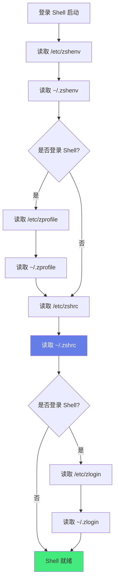
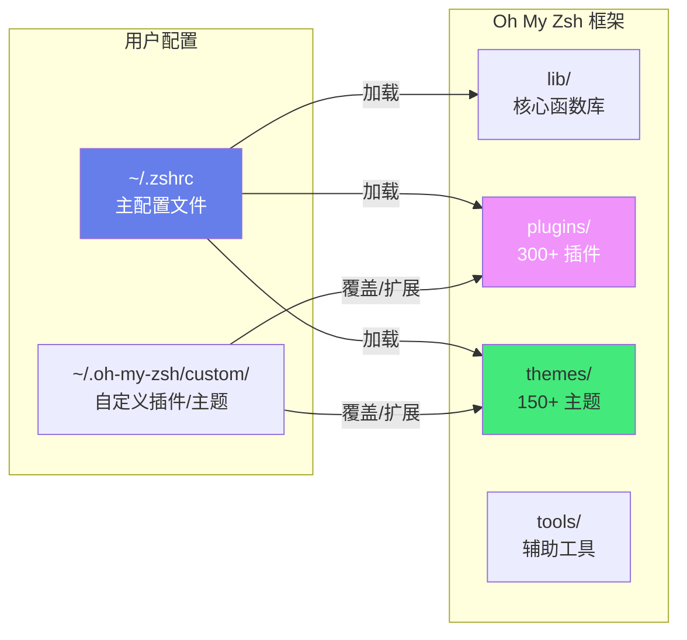

# 🐚 Zsh 与 Oh My Zsh

> **文档说明**：系统讲解 Zsh（Z Shell）和 Oh My Zsh 框架的完整知识体系，涵盖 Zsh 核心特性（自动补全、 globbing、别名、历史记录、提示符）、Oh My Zsh 安装与配置、主题管理（Powerlevel10k 等）、插件体系（git/zsh-autosuggestions/zsh-syntax-highlighting/fzf 等）、.zshrc 配置详解、自定义函数与别名、性能优化、常见问题与最佳实践。Zsh + Oh My Zsh 是提升终端效率的标配组合。
>
> **适用人群**：开发者、运维工程师、任何频繁使用终端的人
>
> **前置知识**：[[Linux系统管理与常用命令]] · [[Shell脚本编程]]

---

## 一、概述

### 1.1 什么是 Zsh

Zsh（Z Shell）是一款功能强大的 Unix Shell，是 Bash 的增强替代品。它在兼容 Bash 的基础上，提供了更强大的自动补全、更灵活的 globbing（文件名通配）、更丰富的提示符定制、更好的历史记录管理等特性。

**Zsh vs Bash 核心差异**：

| 特性 | Bash | Zsh |
|------|------|-----|
| **自动补全** | 基础补全 | 强大的智能补全（命令选项、路径、Git 分支等） |
| **Globbing** | 基础通配符 | 高级通配（递归 `**`、限定符 `*(.)` 等） |
| **历史记录** | 基础 | 共享历史、增量搜索、历史扩展 |
| **别名** | 简单别名 | 支持全局别名、后缀别名 |
| **提示符** | 基础 | 高度可定制，支持右侧提示符 |
| **拼写纠正** | 不支持 | 自动纠正命令拼写错误 |
| **兼容性** | 标准 | 高度兼容 Bash（大部分脚本可直接运行） |
| **插件生态** | 有限 | Oh My Zsh 等框架提供丰富插件 |
| **启动速度** | 快 | 稍慢（可优化） |

### 1.2 什么是 Oh My Zsh

Oh My Zsh 是一个 **Zsh 配置管理框架**，提供了一套开箱即用的配置、数百个插件和主题，让你无需手动配置就能获得强大的 Zsh 体验。

**核心功能**：
- 🎨 **150+ 主题**：包括流行的 Powerlevel10k、agnoster、robbyrussell 等
- 🔌 **300+ 插件**：git、docker、kubectl、npm、yarn、python 等常用工具插件
- ⚡ **开箱即用**：安装后自动配置好补全、别名、历史记录等
- 🔧 **易于扩展**：自定义插件和主题，活跃社区维护

### 1.3 解决的问题

| 问题 | 说明 |
|------|------|
| **Bash 补全弱** | Bash 只能补全命令和文件名，无法补全选项、Git 分支等 |
| **配置繁琐** | 手动配置 Zsh 需要大量时间和知识 |
| **主题单一** | Bash 提示符单调，缺乏信息展示 |
| **效率低** | 缺少常用工具的别名和快捷操作 |
| **历史难用** | Bash 历史搜索和管理不够智能 |

### 1.4 核心应用场景

- ✅ **智能补全**：命令选项、路径、Git 分支、Docker 容器名等自动补全
- ✅ **快捷别名**：git、docker、kubectl 等常用命令的缩写别名
- ✅ **美观提示符**：显示 Git 分支、执行状态、时间、目录、Python 虚拟环境等
- ✅ **语法高亮**：输入命令时实时高亮（正确绿色、错误红色）
- ✅ **自动建议**：根据历史记录自动建议命令（灰色显示，→ 接受）
- ✅ **模糊搜索**：配合 fzf 实现历史命令、文件、进程的模糊搜索

---

## 二、底层原理

### 2.1 Zsh 启动流程



| 配置文件 | 作用 | 加载时机 |
|---------|------|---------|
| `~/.zshenv` | 环境变量（始终加载） | 每次启动，包括脚本 |
| `~/.zprofile` | 登录时执行的命令 | 登录 Shell 启动时 |
| `~/.zshrc` | 交互式 Shell 配置（主要配置文件） | 交互式 Shell 启动时 |
| `~/.zlogin` | 登录时执行（在 .zshrc 之后） | 登录 Shell 启动时 |
| `~/.zlogout` | 退出时执行 | 登录 Shell 退出时 |

> **日常配置主要写在 `~/.zshrc`**，它是交互式 Shell 的主要配置文件。

### 2.2 Oh My Zsh 架构



Oh My Zsh 的工作原理：
1. `~/.zshrc` 中设置 `ZSH` 变量指向 Oh My Zsh 安装目录
2. 设置 `ZSH_THEME` 主题和 `plugins` 插件列表
3. `source $ZSH/oh-my-zsh.sh` 加载框架
4. 框架依次加载 lib 核心函数、指定的插件、主题
5. 自定义配置在 `custom/` 目录中，不会被框架更新覆盖

### 2.3 自动补全原理

Zsh 的自动补全系统（compsys）是其最强大的特性之一：

```text
用户输入命令 → 按 Tab → Zsh 调用对应的补全函数 → 展示候选列表
                                    ↓
                        补全函数定义在 /usr/share/zsh/functions/
                        或 Oh My Zsh 插件中
```

**补全类型**：
- **命令补全**：输入命令名时补全（如 `git ch` → `git checkout`）
- **选项补全**：补全命令的选项（如 `git --` → 列出所有选项）
- **路径补全**：补全文件路径（支持递归 `**`）
- **上下文补全**：根据上下文补全（如 `git checkout ` → 列出分支名）
- **参数补全**：补全命令参数（如 `kubectl get ` → 列出资源类型）

---

## 三、实操示例

### 3.1 安装 Zsh 和 Oh My Zsh

```bash
# ===== 1. 安装 Zsh =====

# macOS（系统自带，可 brew 安装最新版）
brew install zsh

# Ubuntu/Debian
sudo apt update && sudo apt install -y zsh

# CentOS/RHEL
sudo yum install -y zsh

# 验证安装
zsh --version

# 将 Zsh 设为默认 Shell
chsh -s $(which zsh)
# 重新登录后生效，验证：
echo $SHELL  # 应输出 /bin/zsh 或 /usr/local/bin/zsh

# ===== 2. 安装 Oh My Zsh =====

# 官方安装脚本（推荐）
sh -c "$(curl -fsSL https://raw.githubusercontent.com/ohmyzsh/ohmyzsh/master/tools/install.sh)"

# 或用 wget
sh -c "$(wget -O- https://raw.githubusercontent.com/ohmyzsh/ohmyzsh/master/tools/install.sh)"

# 国内镜像（加速安装）
REMOTE=https://gitee.com/mirrors/oh-my-zsh sh -c "$(curl -fsSL https://gitee.com/mirrors/oh-my-zsh/raw/master/tools/install.sh)"
```

### 3.2 .zshrc 核心配置

```bash
# ~/.zshrc — Oh My Zsh 主配置文件

# ===== Oh My Zsh 路径 =====
export ZSH="$HOME/.oh-my-zsh"

# ===== 主题设置 =====
ZSH_THEME="robbyrussell"          # 默认主题
# ZSH_THEME="agnoster"             # 流行主题（需要 Powerline 字体）
# ZSH_THEME="powerlevel10k/powerlevel10k"  # 最强主题（需单独安装）
# ZSH_THEME="random"               # 随机主题（每次启动换一个）

# 随机主题白名单（只在这些主题中随机）
# ZSH_THEME_RANDOM_CANDIDATES=("robbyrussell" "agnoster" "af-magic")

# ===== 插件列表 =====
# 格式：plugins=(插件1 插件2 插件3)
# 注意：插件不是越多越好，每个插件都会增加启动时间
plugins=(
  git                    # Git 别名和补全（必装）
  zsh-autosuggestions    # 自动建议（需手动安装，见下文）
  zsh-syntax-highlighting # 语法高亮（需手动安装，见下文）
  # docker                # Docker 别名和补全
  # docker-compose        # Docker Compose 别名
  # kubectl               # kubectl 别名和补全
  # helm                  # Helm 补全
  # npm                   # npm 别名
  # yarn                  # yarn 别名
  # node                  # Node.js 别名
  # python                # Python 别名
  # pip                   # pip 别名
  # conda                 # Conda 环境
  # vscode                # VSCode 快捷命令
  # tmux                  # tmux 别名
  # fzf                   # fzf 集成（需安装 fzf）
  # ripgrep               # rg 别名
  # jsontools             # JSON 处理工具
  # urltools              # URL 编码/解码
  # copypath              # 复制当前路径
  # copyfile              # 复制文件内容
  # history               # 历史命令搜索
  # sudo                  # 按 Esc 两次加 sudo
  # colored-man-pages     # 彩色 man 手册
  # z                     # 快速跳转（类似 autojump）
)

# ===== 加载 Oh My Zsh =====
source $ZSH/oh-my-zsh.sh

# ===== 以下是自定义配置（在 source 之后） =====

# ===== 环境变量 =====
export EDITOR="vim"                 # 默认编辑器
export VISUAL="vim"
export LANG="zh_CN.UTF-8"          # 中文语言
export LC_ALL="zh_CN.UTF-8"
export TERM="xterm-256color"       # 256 色终端

# PATH 配置
export PATH="$HOME/.local/bin:$PATH"
export PATH="$HOME/bin:$PATH"

# ===== 历史记录 =====
HISTSIZE=10000                      # 内存中历史记录数
SAVEHIST=10000                      # 保存到文件的历史记录数
HISTFILE=~/.zsh_history             # 历史记录文件
setopt HIST_IGNORE_DUPS             # 忽略连续重复命令
setopt HIST_IGNORE_SPACE            # 以空格开头的命令不记录
setopt HIST_REDUCE_BLANKS           # 去除多余空格
setopt SHARE_HISTORY                # 多终端共享历史
setopt APPEND_HISTORY               # 追加而非覆盖历史
setopt INC_APPEND_HISTORY           # 实时写入历史

# ===== 补全设置 =====
setopt AUTO_CD                      # 输入目录名直接 cd
setopt AUTO_LIST                    # 模糊匹配时自动列出
setopt AUTO_MENU                    # 补全菜单
setopt AUTO_PARAM_SLASH             # 目录补全后加 /
setopt COMPLETE_IN_WORD             # 在单词中间也能补全
setopt CORRECT                      # 命令拼写纠正
setopt CORRECT_ALL                  # 参数拼写纠正
setopt MENU_COMPLETE                # 直接补全第一个候选项

# ===== 别名 =====
# 常用命令别名
alias ll="ls -alF"
alias la="ls -A"
alias l="ls -CF"
alias ..="cd .."
alias ...="cd ../.."
alias ....="cd ../../.."
alias mkdir="mkdir -pv"            # 自动创建父目录
alias cp="cp -i"                    # 覆盖前确认
alias mv="mv -i"
alias rm="rm -i"
alias df="df -h"                    # 人类可读格式
alias du="du -sh"
alias free="free -h"
alias grep="grep --color=auto"     # 彩色 grep
alias fgrep="fgrep --color=auto"
alias egrep="egrep --color=auto"

# Git 别名（Oh My Zsh git 插件已提供大量别名，这里是补充）
alias gs="git status"
alias ga="git add"
alias gc="git commit"
alias gp="git push"
alias gl="git pull"
alias gd="git diff"
alias gb="git branch"
alias gco="git checkout"
alias glog="git log --oneline --graph --decorate --all"

# 自定义函数
mkcd() { mkdir -p "$1" && cd "$1"; }  # 创建目录并进入

# ===== 其他 =====
# 禁用自动更新提示（或设置自动更新）
# zstyle ':omz:update' mode disabled   # 禁用更新
# zstyle ':omz:update' mode auto       # 自动更新
zstyle ':omz:update' mode reminder     # 提醒更新（默认）
zstyle ':omz:update' frequency 14      # 每 14 天检查一次

# 补全样式
zstyle ':completion:*' menu select                    # 菜单选择（方向键）
zstyle ':completion:*' list-colors "${(s.:.)LS_COLORS}"  # 补全列表彩色
zstyle ':completion:*' matcher-list 'm:{a-z}={A-Z}'      # 大小写不敏感
zstyle ':completion:*:descriptions' format '%F{yellow}-- %d --%f'
zstyle ':completion:*:messages' format '%F{purple}-- %d --%f'
zstyle ':completion:*:warnings' format '%F{red}-- no matches --%f'
```

### 3.3 安装推荐插件

```bash
# ===== zsh-autosuggestions（自动建议）=====
# 根据历史记录自动建议命令，灰色显示，按 → 或 End 接受
git clone https://github.com/zsh-users/zsh-autosuggestions ${ZSH_CUSTOM:-~/.oh-my-zsh/custom}/plugins/zsh-autosuggestions

# 国内镜像
git clone https://gitee.com/zsh-users/zsh-autosuggestions ${ZSH_CUSTOM:-~/.oh-my-zsh/custom}/plugins/zsh-autosuggestions

# 在 .zshrc 的 plugins 中添加：zsh-autosuggestions

# 配置建议颜色
ZSH_AUTOSUGGEST_HIGHLIGHT_STYLE="fg=#6272a4"  # 灰色（ Dracula 主题）
# ZSH_AUTOSUGGEST_HIGHLIGHT_STYLE="fg=8"       # 终端灰色

# ===== zsh-syntax-highlighting（语法高亮）=====
# 输入命令时实时高亮：有效命令绿色，无效命令红色，选项黄色
git clone https://github.com/zsh-users/zsh-syntax-highlighting.git ${ZSH_CUSTOM:-~/.oh-my-zsh/custom}/plugins/zsh-syntax-highlighting

# 国内镜像
git clone https://gitee.com/zsh-users/zsh-syntax-highlighting.git ${ZSH_CUSTOM:-~/.oh-my-zsh/custom}/plugins/zsh-syntax-highlighting

# 在 .zshrc 的 plugins 中添加：zsh-syntax-highlighting
# 注意：这个插件必须放在 plugins 列表的最后！

# ===== z（快速跳转）=====
# Oh My Zsh 内置，记录访问频率，输入 z 关键词 跳转到最匹配的目录
# 直接在 plugins 中添加：z
# 使用：z foo    → 跳转到最常访问的包含 foo 的目录
#       z -l foo → 列出匹配的目录
#       z -b foo → 跳转到父目录匹配的

# ===== fzf（模糊搜索）=====
# 安装 fzf
brew install fzf                        # macOS
sudo apt install fzf                    # Ubuntu
# 或 git 安装
git clone --depth 1 https://github.com/junegunn/fzf.git ~/.fzf
~/.fzf/install

# 在 plugins 中添加：fzf
# 快捷键：
#   Ctrl+R  → 模糊搜索历史命令
#   Ctrl+T  → 模糊搜索文件
#   Alt+C   → 模糊搜索目录并 cd
```

### 3.4 Powerlevel10k 主题配置

Powerlevel10k 是目前最流行、最强大的 Zsh 主题，速度快、可定制性极高。

```bash
# 安装 Powerlevel10k
git clone --depth=1 https://github.com/romkatv/powerlevel10k.git ${ZSH_CUSTOM:-$HOME/.oh-my-zsh/custom}/themes/powerlevel10k

# 国内镜像
git clone --depth=1 https://gitee.com/romkatv/powerlevel10k.git ${ZSH_CUSTOM:-$HOME/.oh-my-zsh/custom}/themes/powerlevel10k

# 在 .zshrc 中设置主题
ZSH_THEME="powerlevel10k/powerlevel10k"

# 安装 Nerd Font（必装，否则图标显示为方框）
# macOS：
brew install --cask font-meslo-lg-nerd-font
# 或手动下载：https://www.nerdfonts.com/font-downloads
# 推荐：MesloLGS Nerd Font（Powerlevel10k 推荐）

# 终端设置：将字体改为 MesloLGS Nerd Font

# 首次启动会进入配置向导，按提示选择：
#   1. 是否显示菱形图标？→ y
#   2. 是否显示锁图标？→ y
#   3. 是否显示上下箭头？→ y
#   4. 提示符样式 → 选择喜欢的（推荐 Lean 或 Classic）
#   5. 字符集 → Unicode
#   6. 显示时间 → 24h 或 12h
#   7. 提示符分隔符 → 选择喜欢的
#   8. 提示符头部 → 选择喜欢的
#   9. 提示符尾部 → 选择喜欢的
#   10. 高度 → 一行或两行
#   11. 间距 → 紧凑或宽松
#   12. 图标 → 许多图标或简洁
#   13. 确认 → y

# 重新配置
p10k configure

# 配置文件在 ~/.p10k.zsh，可手动编辑
```

Powerlevel10k 提示符显示的信息：
- ✅ 当前目录（可缩短长路径）
- ✅ Git 分支和状态（dirty/clean、 ahead/behind）
- ✅ Python 虚拟环境名
- ✅ Node.js 版本
- ✅ Go/Rust 版本
- ✅ 上一条命令的执行状态（✓/✗）
- ✅ 上一条命令的执行时间
- ✅ 当前时间
- ✅ 后台任务数
- ✅ 电池电量（笔记本）
- ✅ Kubernetes 上下文和命名空间

### 3.5 Zsh 高级特性

```bash
# ===== 1. 智能补全 =====
# 按 Tab 补全，再次 Tab 进入菜单选择（方向键选择）
git ch<Tab>          # → checkout cherry-pick
git checkout <Tab>   # → 列出所有分支
cd ~/pro<Tab>        # → ~/projects/
kill <Tab>           # → 列出进程名
curl --<Tab>          # → 列出 curl 所有选项

# ===== 2. 高级 Globbing =====
ls **/*.py            # 递归查找所有 .py 文件（** = 任意层级目录）
ls *(.)               # 只列出文件（不包括目录）
ls *(/)               # 只列出目录
ls *(.x)              # 只列出可执行文件
ls *(.Lm+10)          # 只列出大于 10MB 的文件
ls *(om[1,5])         # 最近修改的 5 个文件
ls ^*.log             # 除了 .log 以外的所有文件
ls *.(py|sh|js)       # .py 或 .sh 或 .js 文件

# ===== 3. 自动 cd =====
# 输入目录名直接进入，不需要 cd
Documents             # → cd Documents
..                    # → cd ..
~                     # → cd ~

# ===== 4. 拼写纠正 =====
setopt CORRECT
gti status            # → zsh: correct 'gti' to 'git' [nyae]?
# 输入 y 接受纠正，n 不纠正，a 中止，e 编辑

# ===== 5. 历史记录 =====
# Ctrl+R 反向搜索历史（输入关键词过滤）
# !! 执行上一条命令
# !$ 上一条命令的最后一个参数
# !* 上一条命令的所有参数
# !-n 倒数第 n 条命令
# !?keyword? 包含 keyword 的最近命令

# 示例：
ls -la /etc/nginx
cd !$                 # → cd /etc/nginx
sudo !!               # 用 sudo 重新执行上一条命令

# ===== 6. 全局别名 =====
alias -g G="| grep"   # 全局别名，可在任何位置使用
ls -la G nginx        # → ls -la | grep nginx
alias -g L="| less"
alias -g H="| head"
alias -g T="| tail"

# ===== 7. 后缀别名 =====
alias -s py=python    # 直接输入 .py 文件名用 python 执行
script.py             # → python script.py
alias -s js=node
alias -s {txt,md,log}=less  # 多个后缀

# ===== 8. 命名目录 =====
hash -d proj=~/projects
hash -d docs=~/Documents
cd ~proj              # → cd ~/projects
cd ~docs              # → cd ~/Documents
# 提示符中会显示 ~proj 而非完整路径

# ===== 9. 自动推送目录 =====
setopt AUTO_PUSHD     # cd 时自动将当前目录入栈
cd /etc
cd /var
dirs -v               # 查看目录栈
cd -2                 # 跳转到目录栈中第 2 个
popd                  # 弹出目录栈
```

### 3.6 自定义函数和插件

```bash
# ===== 在 .zshrc 中定义函数 =====

# 提取各种压缩文件
extract() {
  if [ -f "$1" ]; then
    case "$1" in
      *.tar.bz2) tar xjf "$1" ;;
      *.tar.gz)  tar xzf "$1" ;;
      *.tar.xz)  tar xJf "$1" ;;
      *.bz2)     bunzip2 "$1" ;;
      *.rar)     unrar x "$1" ;;
      *.gz)      gunzip "$1" ;;
      *.tar)     tar xf "$1" ;;
      *.tbz2)    tar xjf "$1" ;;
      *.tgz)     tar xzf "$1" ;;
      *.zip)     unzip "$1" ;;
      *.Z)       uncompress "$1" ;;
      *.7z)      7z x "$1" ;;
      *)         echo "'$1' 无法识别的压缩格式" ;;
    esac
  else
    echo "'$1' 不是有效文件"
  fi
}

# 创建目录并进入
mkcd() { mkdir -p "$@" && cd "${@:$#}"; }

# 查看端口占用
port() { lsof -i :"$1" 2>/dev/null || netstat -tlnp 2>/dev/null | grep "$1"; }

# 快速进入项目目录
proj() { cd ~/projects/"$1" 2>/dev/null || echo "项目不存在: $1"; }

# Git 快捷提交
gacp() {
  git add .
  git commit -m "$1"
  git push
}

# ===== 自定义插件 =====
# 在 ~/.oh-my-zsh/custom/plugins/ 下创建插件目录
# mkdir -p ~/.oh-my-zsh/custom/plugins/myplugin
# 在其中创建 myplugin.plugin.zsh
# 内容就是上面的函数和别名
# 然后在 .zshrc 的 plugins 中添加 myplugin
```

---

## 四、常见问题与排查

| 问题现象 | 可能原因 | 解决方案 |
|---------|---------|---------|
| **启动慢** | 插件太多；主题复杂；nvm/rbenv 等工具加载慢 | 减少插件；用 Powerlevel10k（比 agnoster 快）；延迟加载 nvm；用 `zsh -i -c exit` 计时 |
| **中文乱码** | locale 未设置；终端编码不对 | 设置 `LANG=zh_CN.UTF-8`；终端编码设为 UTF-8；安装中文字体 |
| **图标显示方框** | 未安装 Nerd Font；终端字体未设置 | 安装 MesloLGS Nerd Font；终端字体改为 Nerd Font |
| **补全不工作** | 未启用补全系统；插件未加载 | 确保 `plugins` 中有对应插件；运行 `autoload -Uz compinit && compinit` |
| **自动建议不显示** | 插件未安装或未启用；颜色与背景相同 | 确认 zsh-autosuggestions 在 plugins 中；设置 `ZSH_AUTOSUGGEST_HIGHLIGHT_STYLE` |
| **语法高亮不工作** | 插件未放在最后；版本不兼容 | zsh-syntax-highlighting 必须在 plugins 列表最后；更新插件 |
| **Bash 脚本不兼容** | Zsh 与 Bash 有细微差异 | 脚本开头用 `#!/bin/bash` 指定 Bash；或用 `emulate bash` 模拟 Bash |
| **历史记录丢失** | HISTFILE 路径不对；权限问题 | 检查 `HISTFILE=~/.zsh_history`；确保文件可写 |
| **主题不生效** | ZSH_THEME 拼写错误；主题文件缺失 | 检查主题名；确认主题文件在 `~/.oh-my-zsh/themes/` 或 custom/themes/ |
| **Oh My Zsh 更新失败** | 网络问题；Git 配置问题 | 用国内镜像；检查 Git 代理；手动 `git -C $ZSH pull` |
| **权限错误** | .zshrc 或目录权限不对 | `chmod 644 ~/.zshrc`；`chmod 755 ~` |
| **conda 环境不显示** | 主题未配置 conda 段；conda 未初始化 | Powerlevel10k 启用 conda 段；运行 `conda init zsh` |
| **Git 分支不显示** | 主题不支持；不在 Git 仓库 | 用支持 Git 的主题（Powerlevel10k/agnoster）；确认在 Git 仓库内 |
| **补全大小写敏感** | 默认大小写敏感 | 配置 `zstyle ':completion:*' matcher-list 'm:{a-z}={A-Z}'` |

---

## 五、进阶与最佳实践

### 5.1 启动速度优化

```bash
# 测量启动时间
for i in $(seq 1 10); do /usr/bin/time zsh -i -c exit; done

# 优化方法：

# 1. 减少插件数量（每个插件都增加启动时间）
# 只保留真正用到的插件

# 2. 延迟加载重型工具（nvm/rbenv/pyenv 等）
# 在 .zshrc 中用函数延迟加载 nvm
load_nvm() {
  unset -f nvm
  export NVM_DIR="$HOME/.nvm"
  [ -s "$NVM_DIR/nvm.sh" ] && . "$NVM_DIR/nvm.sh"
  [ -s "$NVM_DIR/bash_completion" ] && . "$NVM_DIR/bash_completion"
  nvm "$@"
}
nvm() { load_nvm "$@"; }

# 3. 用 Powerlevel10k 替代其他主题（启动快 10-100 倍）
# Powerlevel10k 有即时提示符模式，启动时不阻塞

# 4. 禁用不需要的补全
# zstyle ':completion:*' 只启用需要的补全

# 5. 使用 zcompile 编译 .zshrc（减少解析时间）
zcompile ~/.zshrc
# 注意：修改 .zshrc 后需要重新编译

# 6. 用 zsh-bench 基准测试
# git clone https://github.com/romkatv/zsh-bench.git
# cd zsh-bench && ./zsh-bench
```

### 5.2 配置管理最佳实践

```text
Zsh 配置管理最佳实践：

✅ 配置文件纳入 Git 管理（dotfiles 仓库）
   ~/.zshrc → ~/dotfiles/zsh/.zshrc → 软链接
   方便多台机器同步和版本回滚

✅ 自定义配置放在 custom/ 目录
   ~/.oh-my-zsh/custom/ 不会被 Oh My Zsh 更新覆盖
   自定义插件：custom/plugins/myplugin/
   自定义主题：custom/themes/mytheme/

✅ 插件精简原则
   只安装真正用到的插件，每个插件都增加启动时间
   定期审查 plugins 列表，移除不用的

✅ 主题选择
   推荐 Powerlevel10k（功能强、速度快、可定制）
   需要安装 Nerd Font 字体

✅ 别名管理
   常用命令缩写（gs/gc/gp 等）
   全局别名（G=|grep, L=|less）
   后缀别名（.py=python）
   别名不要太多，记不住反而降低效率

✅ 函数封装
   复杂操作封装为函数（extract/mkcd/port 等）
   函数放在 custom 插件中管理

✅ 跨平台兼容
   用 case "$(uname)" 区分 macOS/Linux
   不同系统的 PATH 和工具路径不同

✅ 敏感信息不入 Git
   API Key、密码等用环境变量文件（.env），加入 .gitignore
   或用 direnv 管理项目级环境变量
```

### 5.3 推荐插件清单

| 插件 | 功能 | 推荐度 |
|------|------|--------|
| **git** | Git 别名和补全（`gst`/`gcmsg`/`gp` 等） | ⭐⭐⭐⭐⭐ 必装 |
| **zsh-autosuggestions** | 历史命令自动建议（→ 接受） | ⭐⭐⭐⭐⭐ 必装 |
| **zsh-syntax-highlighting** | 命令语法实时高亮 | ⭐⭐⭐⭐⭐ 必装 |
| **z** | 快速目录跳转（按访问频率） | ⭐⭐⭐⭐⭐ 必装 |
| **fzf** | 模糊搜索（历史/文件/进程） | ⭐⭐⭐⭐⭐ 强烈推荐 |
| **sudo** | 按两次 Esc 在命令前加 sudo | ⭐⭐⭐⭐ 推荐 |
| **colored-man-pages** | 彩色 man 手册 | ⭐⭐⭐⭐ 推荐 |
| **copypath** | 复制当前路径到剪贴板 | ⭐⭐⭐⭐ 推荐 |
| **copyfile** | 复制文件内容到剪贴板 | ⭐⭐⭐ 有用 |
| **jsontools** | JSON 格式化/验证 | ⭐⭐⭐ 有用 |
| **urltools** | URL 编码/解码 | ⭐⭐⭐ 有用 |
| **docker** | Docker 别名和补全 | ⭐⭐⭐⭐ 用 Docker 必装 |
| **kubectl** | kubectl 别名和补全 | ⭐⭐⭐⭐ 用 K8s 必装 |
| **helm** | Helm 补全 | ⭐⭐⭐ 用 Helm 装 |
| **npm/yarn** | Node.js 包管理别名 | ⭐⭐⭐ 用 Node 装 |
| **python/pip** | Python 别名 | ⭐⭐⭐ 用 Python 装 |
| **tmux** | tmux 别名 | ⭐⭐⭐ 用 tmux 装 |
| **vscode** | VSCode 快捷命令 | ⭐⭐⭐ 用 VSCode 装 |
| **history** | 历史命令搜索（hsi 命令） | ⭐⭐⭐ 有用 |

### 5.4 与其他工具集成

| 工具 | 集成方式 | 说明 |
|------|---------|------|
| **tmux** | Oh My Zsh tmux 插件 | 提供 tmux 别名和自动启动 |
| **fzf** | fzf 插件 | Ctrl+R 搜索历史、Ctrl+T 搜索文件 |
| **ripgrep** | ripgrep 插件 | `rg` 别名，比 grep 快 |
| **bat** | 别名 `cat=bat` | 带语法高亮和行号的 cat |
| **exa** | 别名 `ls=exa` | 更现代的 ls（Git 状态、图标） |
| **zoxide** | 替代 z 插件 | 更快的目录跳转（Rust 编写） |
| **starship** | 替代主题 | 跨 Shell 的提示符（Rust 编写，极快） |
| **direnv** | 项目级环境变量 | 进入目录自动加载 .envrc |
| **asdf** | 多版本管理 | 替代 nvm/pyenv/rbenv，统一管理 |
| **iTerm2** | 原生集成 | macOS 终端，支持 Shell Integration |
| **Windows Terminal** | 配置文件 | Windows 终端，支持 WSL2 + Zsh |

---

## 六、关联笔记

### 终端与命令行
- [[tmux-终端复用]] · [[Shell脚本编程]] · [[curl高级用法]] · [[fzf-模糊搜索神器]]

### 基础工具
- [[Linux系统管理与常用命令]] · [[Vim编辑器进阶]] · [[Git基础与进阶]]

### 导航
- [[MOC-通用工具]] · [[MOC-终端与命令行]] · [[MOC-综合导航]] · [[Home]]

> 🔍 **知识点深度解析**
>
> **作用**：Zsh + Oh My Zsh 解决的是「Bash 终端体验差、效率低」的问题，通过智能补全、语法高亮、自动建议、美观提示符、丰富别名和插件，将终端从「只能敲命令的黑框」变成「高效的工作环境」。
>
> **底层原理**：Zsh 是一个 Shell 解释器，在 Bash 基础上增强了补全系统（compsys）、globbing、历史管理、别名系统等。Oh My Zsh 是一个配置框架，通过 `source $ZSH/oh-my-zsh.sh` 加载核心函数库（lib/）、用户指定的插件（plugins/）和主题（themes/）。插件本质是一组 Shell 函数和别名，主题本质是提示符（PROMPT/RPROMPT）的配置。自动建议插件通过读取历史记录，在用户输入时实时匹配并灰色显示建议；语法高亮插件通过钩子在每次按键时重新解析命令并着色。
>
> **用法要点**：① 安装：`brew/apt install zsh` + `chsh -s $(which zsh)` + Oh My Zsh 安装脚本 ② 核心配置在 `~/.zshrc`，设置 `ZSH_THEME` 和 `plugins` ③ 必装插件：git、zsh-autosuggestions、zsh-syntax-highlighting、z、fzf ④ 推荐主题：Powerlevel10k（需安装 Nerd Font） ⑤ 语法高亮插件必须放在 plugins 列表最后 ⑥ 高级特性：`**` 递归 glob、`*(.)` 只文件、自动 cd、拼写纠正、全局别名 `-g`、后缀别名 `-s` ⑦ 启动优化：减少插件、延迟加载 nvm、用 Powerlevel10k、zcompile 编译 ⑧ 自定义配置放 `custom/` 目录，不被更新覆盖 ⑨ 配置文件纳入 Git（dotfiles）多机同步 ⑩ 敏感信息用 .env 或 direnv，不入 Git。

> 💡 **深度讲解**：Zsh 最强大的特性是「补全系统（compsys）」——它不是简单的文件名补全，而是一个可编程的补全框架。每个命令都可以有自己的补全函数，根据上下文提供不同的候选：输入 `git checkout ` 时补全分支名，输入 `git commit ` 时补全文件名，输入 `kubectl get ` 时补全资源类型。这是 Bash 无法比拟的。Oh My Zsh 的价值在于「开箱即用」——手动配置 Zsh 的补全、别名、主题需要大量时间和知识，Oh My Zsh 把这些都打包好了，安装后立即获得专业级的终端体验。但 Oh My Zsh 也有缺点：插件太多会拖慢启动速度，所以要精简插件列表。Powerlevel10k 是目前最好的主题，它用 C 扩展实现了极快的渲染速度，同时提供了丰富的信息展示（Git 状态、虚拟环境、命令执行时间等），配合 Nerd Font 图标，提示符既美观又实用。实际使用中，建议花 30 分钟配置好 Zsh + Oh My Zsh + Powerlevel10k + 核心插件，这会在未来的开发工作中节省大量时间。

> 📝 **精简总结**：Zsh = 增强版 Bash（智能补全、高级 glob、拼写纠正），Oh My Zsh = Zsh 配置框架（300+ 插件、150+ 主题）。安装：zsh + chsh + Oh My Zsh 脚本。必装：git、zsh-autosuggestions（自动建议）、zsh-syntax-highlighting（语法高亮，放最后）、z（快速跳转）、fzf（模糊搜索）。推荐主题：Powerlevel10k + Nerd Font。优化：精简插件、延迟加载 nvm、配置文件入 Git。

> **学习路径建议**：先学习 [[Linux系统管理与常用命令]] 掌握终端基础 → 学习 [[Shell脚本编程]] 理解 Shell 语法 → 学习本文档掌握 Zsh + Oh My Zsh 配置 → 学习 [[tmux-终端复用]] 掌握终端复用 → 学习 [[Vim编辑器进阶]] 提升编辑效率 → 在日常开发中持续使用和优化终端工作流。

---

> **Zsh + Oh My Zsh 的本质是「给终端装上智能引擎和美观外衣」——让补全更聪明、让命令更快捷、让提示符更有信息量。花半小时配置好，它会在接下来的每一次终端操作中回报你。**

---

## 🔗 关联笔记

- [[MOC-通用工具]] — 返回本分类知识地图，查看更多相关文档

## 📖 前置知识

- 无特殊前置知识要求，具备基础编程概念即可

## 🏷️ 相关标签

`#Zsh` `#OhMyZsh` `#Shell` `#终端` `#命令行` `#效率工具`

[[Home|🏠 返回首页]] · [[MOC-通用工具|📚 返回分类]]
