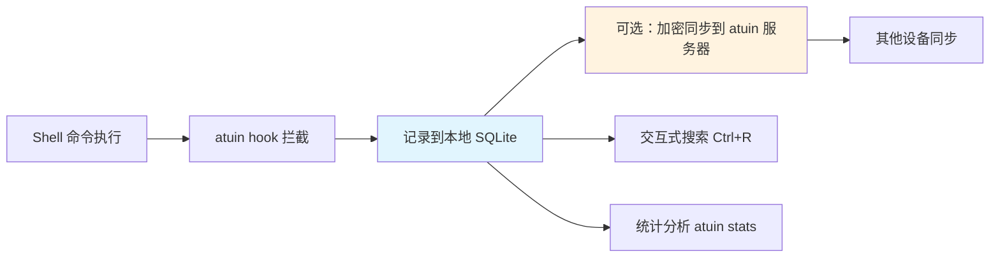

# atuin-命令历史增强

> **文档说明**：系统讲解 atuin 命令历史工具的安装配置、基本使用、高级搜索、多设备同步、统计分析，以及与各种 Shell 的集成和最佳实践。
>
> **适用人群**：全栈开发者、运维工程师、命令行重度用户、追求效率的开发者
>
> **前置知识**：[[Starship-跨平台提示符]]、[[浏览器开发者工具进阶]]、[[Git版本控制核心命令]]

---

## 一、概述

### 1. 什么是 atuin

**atuin** 是一个用 Rust 编写的命令历史增强工具，替代 Shell 默认的历史记录，提供：

| 特性 | 说明 |
|------|------|
| **SQLite 存储** | 历史记录存在 SQLite 数据库，支持复杂查询 |
| **全文搜索** | 支持模糊搜索、前缀搜索、正则搜索 |
| **上下文记录** | 记录命令的退出码、执行时间、工作目录、主机名、会话 |
| **多设备同步** | 端到端加密同步历史记录到所有设备 |
| **统计分析** | 命令使用频率、最常用命令、执行时间统计 |
| **跨 Shell** | 支持 bash/zsh/fish/nu/powershell |
| **离线优先** | 本地数据库，同步是可选的 |

### 2. 为什么用 atuin

```text
默认 Shell 历史的问题：
- 只有命令文本，没有上下文（时间、目录、退出码）
- 多终端会话会覆盖历史
- 搜索功能弱（只有 Ctrl+R 反向搜索）
- 无法跨设备同步
- 没有统计分析

atuin 的优势：
- 完整上下文：每条命令附带时间、目录、耗时、退出码
- 多会话不冲突：每个会话独立记录，合并到统一数据库
- 强大搜索：交互式搜索界面，支持多种搜索模式
- 端到端加密同步：历史记录安全同步到所有设备
- 统计面板：了解自己的命令使用习惯
```

### 3. 工作原理



---

## 二、安装

### 1. 各平台安装

```bash
# macOS（Homebrew）
brew install atuin

# Ubuntu/Debian
curl --proto '=https' --tlsv1.2 -LsSf https://setup.atuin.sh | sh

# 或使用 apt
sudo apt install atuin

# Windows（Scoop）
scoop install atuin

# Windows（Chocolatey）
choco install atuin

# Cargo（Rust 开发者）
cargo install atuin

# 验证安装
atuin --version
```

### 2. Shell 集成

```bash
# zsh（在 ~/.zshrc 末尾添加）
eval "$(atuin init zsh)"

# bash（在 ~/.bashrc 末尾添加）
eval "$(atuin init bash)"

# fish（在 ~/.config/fish/config.fish 添加）
atuin init fish | source

# nushell
# 在 config.nu 中添加
use ~/.local/share/atuin/init.nu *

# PowerShell
# 在 $PROFILE 中添加
Invoke-Expression (&atuin init powershell)
```

> 安装后重启 Shell 或 `source ~/.zshrc` 生效。

---

## 三、基本使用

### 1. 搜索（核心功能）

```bash
# 交互式搜索（默认绑定 Ctrl+R）
# 按 Ctrl+R 打开搜索界面
# 输入关键词实时过滤
# ↑↓ 选择历史命令
# Enter 执行选中的命令
# Tab 编辑选中的命令
# Ctrl+R 切换搜索模式

# 命令行搜索
atuin search "git commit"        # 包含 git commit
atuin search --prefix "git"      # 以 git 开头
atuin search --exact "ls -la"    # 精确匹配
atuin search --regex "git (add|commit)"  # 正则

# 搜索选项
atuin search --cwd .             # 只搜索当前目录执行的命令
atuin search --after "2026-01-01"  # 指定日期之后
atuin search --before "2026-08-01" # 指定日期之前
atuin search --exit-code 0       # 只搜索成功的命令
atuin search --limit 20          # 限制结果数量
```

### 2. 搜索界面快捷键

| 快捷键 | 功能 |
|--------|------|
| `Ctrl+R` | 打开搜索 / 切换搜索模式 |
| `↑` `↓` | 上下选择 |
| `Enter` | 执行选中命令 |
| `Tab` | 编辑选中命令（不执行） |
| `Ctrl+C` `Esc` | 取消搜索 |
| `Ctrl+W` | 删除前一个单词 |
| `Ctrl+A` | 光标到开头 |
| `Ctrl+E` | 光标到末尾 |

### 3. 搜索模式

```text
atuin 支持四种搜索模式（Ctrl+R 循环切换）：
1. prefix（前缀）：匹配以输入开头的命令
2. full-text（全文）：匹配包含输入的命令
3. fuzzy（模糊）：模糊匹配
4. regex（正则）：正则表达式匹配

配置默认搜索模式：
atuin config search_mode fuzzy
```

---

## 四、配置

### 1. 配置文件

```bash
# 配置文件位置
# Linux/macOS: ~/.config/atuin/config.toml
# Windows: %APPDATA%\atuin\config.toml

# 查看当前配置
atuin config show

# 设置配置项
atuin config search_mode "fuzzy"
atuin config show_preview true
atuin config max_length 100
```

### 2. 常用配置

```toml
# ~/.config/atuin/config.toml

# 搜索模式：prefix / full-text / fuzzy / regex
search_mode = "fuzzy"

# 显示命令预览
show_preview = true

# 预览最大高度
preview_height = 40

# 历史记录最大长度（字符）
max_length = 200

# 过滤掉的命令（不记录）
filter_mode = "global"  # global / host / session / directory

# 不记录的命令模式
[filters]
"secret" = true  # 不记录包含 secret 的命令

# 同步配置
[sync]
enabled = true
frequency = 300  # 同步频率（秒）

# 数据库路径
db_path = "~/.local/share/atuin/history.db"

# 自动同步
auto_sync = true
```

### 3. 按键绑定

```toml
# 自定义按键绑定
[keys]
# 全局
"ctrl-r" = "search"
"ctrl-s" = "search"

# 搜索界面
[keys.search]
"ctrl-n" = "next"
"ctrl-p" = "previous"
"ctrl-j" = "next"
"ctrl-k" = "previous"
```

---

## 五、多设备同步

### 1. 注册与登录

```bash
# 注册账号（使用官方 atuin.sh 服务器）
atuin register -u username -e email@example.com

# 登录
atuin login -u username

# 登录后会生成加密密钥，务必备份！
# 密钥保存在 ~/.config/atuin/key
# 丢失密钥无法恢复历史记录！
```

### 2. 同步操作

```bash
# 手动同步
atuin sync

# 强制同步
atuin sync --force

# 查看同步状态
atuin status

# 推送本地历史
atuin push

# 拉取远程历史
atuin pull
```

### 3. 自建服务器

```bash
# 使用 Docker 自建 atuin 服务器
docker run -d \
  --name atuin \
  -p 8888:8888 \
  -v atuin-data:/data \
  -e ATUIN_DB_URI="sqlite:///data/atuin.db" \
  ghcr.io/atuinsh/atuin:latest server start

# 客户端配置服务器地址
atuin config sync_address "http://your-server:8888"
```

### 4. 加密密钥备份

```bash
# 查看密钥
atuin key

# 输出类似：
# > 你的加密密钥是：xxxxxxxxxxxxxxxxxxxxxxxxxxxxxxxx
# > 请妥善保存，丢失无法恢复！

# 在新设备导入密钥
atuin import key
# 或
echo "你的密钥" | atuin import key
```

---

## 六、统计与分析

### 1. 统计命令

```bash
# 查看统计概览
atuin stats

# 输出示例：
# 总命令数: 12345
# 唯一命令数: 2345
# 最常用命令: git (2345次)
# 平均执行时间: 1.2s
# 最忙时段: 14:00-15:00

# 查看最常用命令
atuin stats top

# 按目录统计
atuin stats --cwd /home/user/project

# 按时间范围统计
atuin stats --after "2026-01-01" --before "2026-08-01"
```

### 2. 历史管理

```bash
# 查看历史记录列表
atuin history list
atuin history list --limit 50

# 删除单条历史
atuin history delete <id>

# 清空所有历史（危险！）
atuin history erase

# 优化数据库
atuin vacuum
```

---

## 七、导入导出

### 1. 从 Shell 历史导入

```bash
# 从 zsh 历史导入
atuin import zsh

# 从 bash 历史导入
atuin import bash

# 从 fish 历史导入
atuin import fish

# 从其他 atuin 数据库导入
atuin import auto  # 自动检测
```

### 2. 导出

```bash
# 导出为 JSON
atuin export > history.json

# 导出为 Shell 历史格式
atuin export --format bash > ~/.bash_history
```

---

## 八、最佳实践

### 1. 效率提升

- [ ] **绑定 Ctrl+R**：默认已绑定，熟练使用交互式搜索
- [ ] **使用模糊搜索**：配置 `search_mode = "fuzzy"`，输入更随意
- [ ] **开启预览**：`show_preview = true`，查看命令完整上下文
- [ ] **多设备同步**：配置同步，历史记录随身带
- [ ] **备份密钥**：加密密钥是恢复历史的唯一途径

### 2. 隐私保护

- [ ] **过滤敏感命令**：配置 filters，不记录包含密码/密钥的命令
- [ ] **使用私有服务器**：敏感环境自建 atuin 服务器
- [ ] **定期清理**：删除不需要的历史记录
- [ ] **注意工作目录**：atuin 记录工作目录，注意隐私

### 3. 团队协作

- [ ] **共享常用命令**：团队成员可共享常用命令片段
- [ ] **统计命令习惯**：了解团队常用工具和工作流
- [ ] **新人上手**：导出常用命令给新人参考

---

## 九、常见问题与排查

| 问题 | 原因 | 解决方案 |
|------|------|---------|
| **Ctrl+R 不生效** | Shell 集成未配置 / 冲突 | 检查 `eval "$(atuin init zsh)"`、检查其他插件绑定 |
| **历史不记录** | hook 未生效 / 命令被过滤 | 重启 Shell、检查 filter 配置 |
| **同步失败** | 网络问题 / 未登录 / 服务器错误 | 检查网络、`atuin login`、查看服务器状态 |
| **密钥丢失** | 未备份密钥 | 无法恢复历史，只能重新开始（务必备份！） |
| **数据库损坏** | 异常退出 / 磁盘错误 | `atuin vacuum` 修复，或从同步恢复 |
| **搜索慢** | 历史记录过多 / 数据库大 | `atuin vacuum` 优化、清理旧历史 |
| **跨设备重复** | 同步冲突 | `atuin sync --force` 强制同步 |
| **PowerShell 不工作** | 执行策略限制 | 允许脚本执行、检查 $PROFILE |
| **导入失败** | 历史格式不兼容 | 用 `atuin import auto` 自动检测 |
| **占用空间大** | 历史记录过多 | 清理旧历史、`atuin vacuum` |
| **命令退出码不对** | Shell hook 问题 | 更新 atuin 版本、重新 init |
| **fish 兼容问题** | fish 版本过旧 | 升级 fish 到 3.0+ |
| **同步端口被封** | 企业网络限制 | 自建服务器用 443 端口 / 代理 |

---

## 十、关联笔记

### 效率工具
- [[Starship-跨平台提示符]] · [[浏览器开发者工具进阶]] · [[Zed-高性能编辑器]]
- [[密码管理器-Bitwarden]]

### 开发工具
- [[Git版本控制核心命令]] · [[Git-Worktree多工作树]] · [[kubectl命令速查表]]

### 导航
- [[MOC-通用工具]] · [[全栈+AI工程双轨融合学习路线图]]

> **学习路径建议**：先掌握 [[Starship-跨平台提示符]] Shell 美化 → 深入本文 atuin 命令历史增强 → 实践 [[浏览器开发者工具进阶]] 开发工具 → 研究 [[Zed-高性能编辑器]] 编辑器 → 构建完整的高效开发工具链。

---

## 🔗 关联笔记

- [[MOC-通用工具]] — 返回本分类知识地图，查看更多相关文档

## 📖 前置知识

- [[Starship-跨平台提示符]]
- [[浏览器开发者工具进阶]]
- [[Git版本控制核心命令]]

## 🏷️ 相关标签

`#效率工具` `#命令历史` `#Shell增强` `#原子笔记`

[[Home|🏠 返回首页]] · [[MOC-通用工具|📚 返回分类]]
