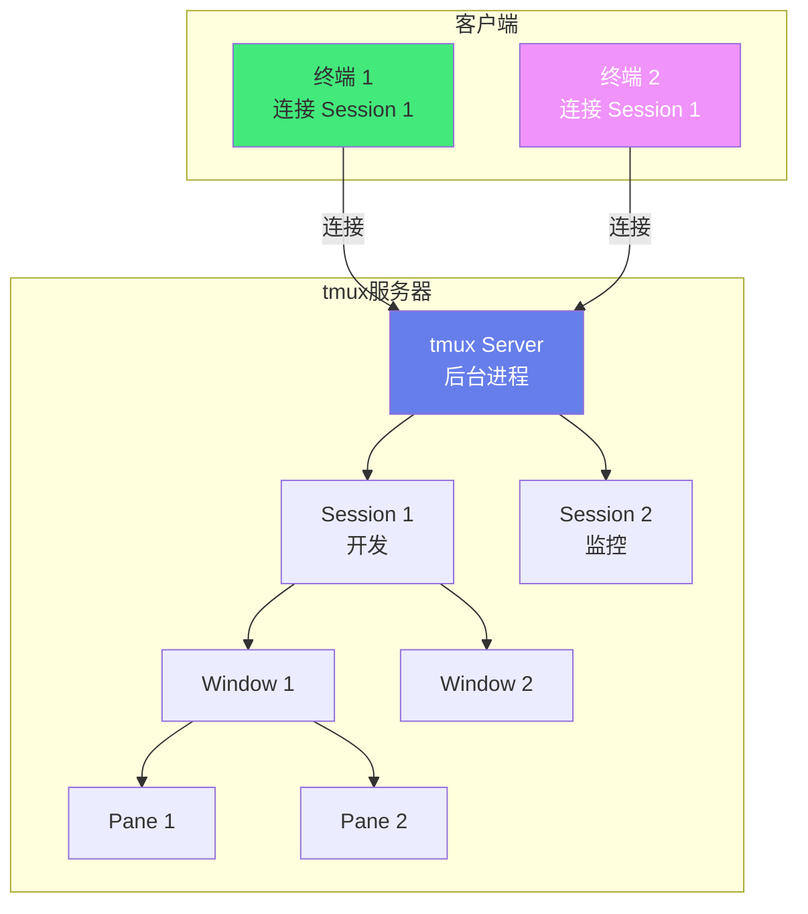
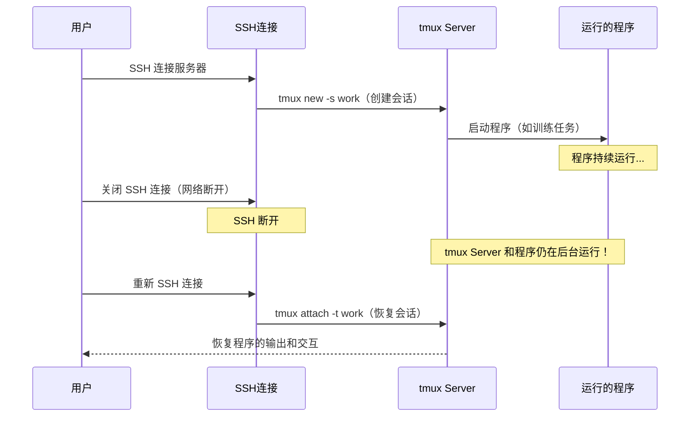

# 🖥️ tmux 终端复用器

> **文档说明**：系统讲解终端复用器 tmux 的完整知识体系，涵盖核心概念（Session/Window/Pane）、工作原理（客户端-服务器架构、伪终端）、安装与基础操作、会话管理、窗口管理、窗格管理、快捷键体系、配置文件（.tmux.conf）、复制模式、脚本自动化、与 SSH/Vim/IDE 集成、常见问题与最佳实践。tmux 是开发者和运维人员提升终端效率的必备工具。
>
> **适用人群**：开发者、运维工程师、DevOps、任何频繁使用终端的人
>
> **前置知识**：[[Linux系统管理与常用命令]] · [[SSH远程连接与密钥管理]]

---

## 一、概述

### 1.1 什么是 tmux

tmux（**terminal multiplexer**，终端复用器）是一个在终端中运行的工具，可以在一个终端窗口中创建多个**会话（Session）、窗口（Window）和窗格（Pane）**，实现多任务并行处理。最关键的特性是**会话保持**——即使关闭终端窗口或 SSH 断开，tmux 中的程序仍在后台运行，重新连接后可以恢复。

**三层结构**：

```text
Session（会话）—— 一个完整的工作场景，可包含多个 Window
  └── Window（窗口）—— 类似浏览器标签页，全屏显示，可包含多个 Pane
        └── Pane（窗格）—— 屏幕的一个分割区域，运行一个 Shell
```

| 层级 | 说明 | 类比 |
|------|------|------|
| **Session** | 一个工作场景（如"项目开发"、"服务器监控"） | 一个工作桌面 |
| **Window** | 会话中的一个全屏页面 | 浏览器标签页 |
| **Pane** | 窗口中的一个分割区域 | 分屏窗口 |

### 1.2 解决的问题

| 问题 | 说明 |
|------|------|
| **SSH 断开程序终止** | SSH 断开后，运行的程序（如训练、部署）被终止 |
| **单终端多任务困难** | 一个终端只能运行一个前台程序 |
| **终端窗口有限** | 屏幕空间有限，无法同时查看多个输出 |
| **工作场景切换慢** | 不同项目需要重新打开多个终端、cd 到目录 |
| **远程协作困难** | 无法共享终端会话给他人 |

### 1.3 tmux vs Screen vs 终端标签

| 工具 | 特点 | 优势 | 劣势 |
|------|------|------|------|
| **tmux** | 现代终端复用器 | 功能丰富、配置灵活、社区活跃、支持脚本 | 学习曲线稍陡 |
| **GNU Screen** | 经典终端复用器 | 老牌稳定、几乎所有系统预装 | 功能较少、配置复杂、社区不活跃 |
| **终端标签** | iTerm2/Windows Terminal 标签 | 简单直观 | 关闭窗口程序终止、无法 SSH 保持、不能分屏 |
| **VSCode 终端** | IDE 内置终端 | 与编辑器集成好 | 关闭 IDE 程序终止、功能有限 |

### 1.4 核心应用场景

- ✅ **SSH 远程长任务**：在服务器上运行训练/部署，断开 SSH 后继续运行
- ✅ **多任务并行**：一个窗口同时运行代码、查看日志、监控资源
- ✅ **工作场景管理**：不同项目用不同 Session，快速切换
- ✅ **结对编程**：共享 tmux Session，多人协作
- ✅ **服务器监控**：一个 Window 同时显示 top、日志、网络
- ✅ **脚本自动化**：用 tmux 脚本一键启动开发环境

---

## 二、底层原理

### 2.1 客户端-服务器架构



**关键机制**：
- **tmux Server**：后台守护进程，管理所有 Session/Window/Pane，即使没有客户端连接也在运行
- **客户端-服务器分离**：终端（客户端）断开不影响服务器中运行的程序
- **伪终端（PTY）**：每个 Pane 对应一个伪终端，程序以为自己在真实终端运行
- **多客户端连接**：多个终端可以同时连接同一个 Session（共享视图）

### 2.2 前缀键（Prefix）

tmux 的快捷键都需要先按**前缀键**（默认 `Ctrl+b`），再按功能键。这避免了与终端中其他程序的快捷键冲突。

```text
按下 Ctrl+b  →  进入 tmux 命令模式  →  按下功能键（如 c 创建窗口）
```

> 很多人将前缀键改为 `Ctrl+a`（Screen 的默认），因为左手小指按 Ctrl+a 更方便。

### 2.3 会话保持原理



**关键点**：tmux Server 是独立于 SSH 连接的后台进程，SSH 断开只断开了客户端连接，Server 和其中的程序继续运行。

---

## 三、实操示例

### 3.1 安装

```bash
# macOS
brew install tmux

# Ubuntu/Debian
sudo apt update && sudo apt install -y tmux

# CentOS/RHEL
sudo yum install -y tmux

# 验证安装
tmux -V
```

### 3.2 基础操作（命令行）

```bash
# ===== 会话（Session）管理 =====

# 创建新会话（默认名称）
tmux

# 创建命名会话
tmux new -s myproject
tmux new-session -s myproject

# 列出所有会话
tmux ls
tmux list-sessions

# 重新连接（attach）到会话
tmux attach -t myproject
tmux a -t myproject          # 简写

# 重新连接到最近的会话
tmux attach

# 分离（detach）当前会话（在 tmux 内按 Prefix+d，或命令行）
tmux detach
# 或在 tmux 内：Prefix + d

# 关闭会话
tmux kill-session -t myproject

# 关闭所有会话
tmux kill-server

# 重命名会话
tmux rename-session -t oldname newname
# 或在 tmux 内：Prefix + $

# ===== 窗口（Window）管理（在 tmux 内） =====
# Prefix + c     创建新窗口
# Prefix + ,     重命名窗口
# Prefix + &     关闭当前窗口（需确认）
# Prefix + 0-9   切换到指定编号窗口
# Prefix + n     下一个窗口
# Prefix + p     上一个窗口
# Prefix + w     窗口列表选择
# Prefix + f     按内容搜索窗口

# ===== 窗格（Pane）管理（在 tmux 内） =====
# Prefix + %     垂直分割（左右）
# Prefix + "     水平分割（上下）
# Prefix + x     关闭当前窗格（需确认）
# Prefix + z     最大化/还原当前窗格
# Prefix + 方向键  切换窗格
# Prefix + o     切换到下一个窗格
# Prefix + ;     切换到上一个窗格
# Prefix + {     与上一个窗格交换位置
# Prefix + }     与下一个窗格交换位置
# Prefix + Ctrl+方向键  调整窗格大小
# Prefix + Space 切换窗格布局
# Prefix + !     将窗格转为独立窗口
```

### 3.3 配置文件 ~/.tmux.conf

```bash
# ~/.tmux.conf — tmux 配置文件

# ===== 基础设置 =====
set -g default-terminal "screen-256color"  # 256 色终端
set -ga terminal-overrides ",xterm-256color:Tc"  # 真彩色支持
set -g history-limit 50000                   # 历史记录行数
set -g mouse on                               # 开启鼠标支持
set -g base-index 1                           # 窗口编号从 1 开始（默认 0）
setw -g pane-base-index 1                     # 窗格编号从 1 开始
set -g renumber-windows on                    # 关闭窗口后重新编号
set -g display-time 3000                      # 提示信息显示时间（ms）
set -g display-panes-time 1500                # 窗格编号显示时间
set -g escape-time 0                          # 消除 Esc 延迟

# ===== 前缀键改为 Ctrl+a（更顺手） =====
set -g prefix C-a
unbind C-b
bind C-a send-prefix                           # 按两次 Ctrl+a 发送实际 Ctrl+a

# ===== 窗口管理快捷键 =====
bind c new-window -c "#{pane_current_path}"  # 新窗口继承当前目录
bind , command-prompt -I "#W" "rename-window '%%'"
bind & kill-window
bind n next-window
bind p previous-window

# ===== 窗格分割快捷键（改为 | 和 -，更直观） =====
unbind '"'
unbind %
bind | split-window -h -c "#{pane_current_path}"   # 垂直分割（左右）
bind - split-window -v -c "#{pane_current_path}"   # 水平分割（上下）

# ===== 窗格切换（Alt+方向键，无需前缀） =====
bind -n M-Left select-pane -L
bind -n M-Right select-pane -R
bind -n M-Up select-pane -U
bind -n M-Down select-pane -D

# ===== 窗格大小调整（Prefix+方向键，更灵敏） =====
bind Left resize-pane -L 5
bind Right resize-pane -R 5
bind Up resize-pane -U 5
bind Down resize-pane -D 5

# ===== 复制模式（vi 风格） =====
setw -g mode-keys vi                            # 复制模式用 vi 键位
bind Escape copy-mode                            # Prefix+Esc 进入复制模式
bind -T copy-mode-vi v send -X begin-selection  # v 开始选择
bind -T copy-mode-vi y send -X copy-selection   # y 复制
bind -T copy-mode-vi C-v send -X rectangle-toggle # 矩形选择
bind p paste-buffer                              # Prefix+p 粘贴

# ===== 状态栏美化 =====
set -g status-position bottom                    # 状态栏在底部
set -g status-justify left                        # 左侧对齐
set -g status-interval 5                          # 刷新间隔（秒）
set -g status-style "bg=#1e1e2e,fg=#cdd6f4"     # 状态栏背景和前景
set -g status-left-length 40
set -g status-left "#[fg=#89b4fa,bold] #S #[fg=#6c7086]| "  # 左侧：会话名
set -g status-right "#[fg=#a6adc8]%Y-%m-%d %H:%M #[fg=#6c7086]| #[fg=#89b4fa]#H"  # 右侧：时间+主机名

# 窗口列表样式
setw -g window-status-format "#[fg=#6c7086] #I:#W "
setw -g window-status-current-format "#[fg=#1e1e2e,bg=#89b4fa,bold] #I:#W "
setw -g window-status-separator " "

# 窗格边框样式
set -g pane-border-style "fg=#313244"
set -g pane-active-border-style "fg=#89b4fa"
set -g display-panes-colour "#89b4fa"
set -g display-panes-active-colour "#f5c2e7"

# ===== 其他 =====
bind r source-file ~/.tmux.conf \; display "配置已重新加载！"  # Prefix+r 重载配置
bind-key -T copy-mode-vi MouseDragEnd1Pane send -X copy-selection-and-cancel  # 鼠标选择后自动复制

# 启动时自动启动（可选）
# new-session -s main -n editor
```

```bash
# 使配置生效
tmux source-file ~/.tmux.conf
# 或在 tmux 内按 Prefix + r（如果配置了上面的快捷键）
```

### 3.4 复制模式（Copy Mode）

复制模式用于查看历史记录和复制文本，类似 Vim 的 Normal 模式。

```bash
# 进入复制模式
# Prefix + [   （默认）
# Prefix + Esc （如果配置了上面的 vi 风格）

# ===== vi 风格复制模式快捷键 =====
# 移动：
#   h/j/k/l    左/下/上/右
#   w/b        下一个词/上一个词
#   0/$        行首/行尾
#   g/G        顶部/底部
#   Ctrl+u/d   上翻半页/下翻半页
#   Ctrl+b/f   上翻一页/下翻一页

# 搜索：
#   /          向下搜索
#   ?          向上搜索
#   n/N        下一个/上一个匹配

# 选择和复制：
#   v          开始选择（字符选择）
#   V          行选择
#   Ctrl+v     矩形选择
#   y          复制选择内容
#   Escape     取消选择/退出复制模式

# 其他：
#   q          退出复制模式
#   :          进入命令模式
```

```bash
# 复制到系统剪贴板（需要配置）
# macOS：在 .tmux.conf 中添加
bind -T copy-mode-vi y send-keys -X copy-pipe-and-cancel "pbcopy"

# Linux（xclip）：
bind -T copy-mode-vi y send-keys -X copy-pipe-and-cancel "xclip -selection clipboard"

# Linux（wl-copy，Wayland）：
bind -T copy-mode-vi y send-keys -X copy-pipe-and-cancel "wl-copy"
```

### 3.5 tmux 脚本自动化

```bash
#!/bin/bash
# dev-env.sh — 一键启动开发环境的 tmux 脚本

SESSION="dev"

# 如果会话已存在，直接连接
if tmux has-session -t $SESSION 2>/dev/null; then
    tmux attach -t $SESSION
    exit 0
fi

# 创建新会话（第一个窗口：代码编辑）
tmux new-session -d -s $SESSION -n editor
tmux send-keys -t $SESSION:editor "cd ~/projects/myapp && vim ." C-m

# 第二个窗口：运行服务
tmux new-window -t $SESSION -n server
tmux send-keys -t $SESSION:server "cd ~/projects/myapp && npm run dev" C-m

# 第三个窗口：日志和监控（分屏）
tmux new-window -t $SESSION -n monitor
tmux split-window -h -t $SESSION:monitor
tmux send-keys -t $SESSION:monitor.1 "cd ~/projects/myapp && tail -f logs/app.log" C-m
tmux send-keys -t $SESSION:monitor.2 "htop" C-m

# 第四个窗口：Git
tmux new-window -t $SESSION -n git
tmux send-keys -t $SESSION:git "cd ~/projects/myapp && git status" C-m

# 回到编辑器窗口
tmux select-window -t $SESSION:editor

# 连接会话
tmux attach -t $SESSION
```

```bash
# 使用脚本
chmod +x dev-env.sh
./dev-env.sh
```

### 3.6 命令模式（Prefix + :）

在 tmux 内按 `Prefix + :` 进入命令模式，可以执行任何 tmux 命令：

```bash
# 常用命令模式操作
:new-window -n logs                    # 创建命名窗口
:split-window -h                        # 水平分割
:kill-pane                               # 关闭当前窗格
:resize-pane -L 10                      # 向左调整 10 列
:resize-pane -x 80                      # 设置宽度为 80
:setw synchronize-panes on               # 同步输入到所有窗格（批量操作）
:setw synchronize-panes off              # 关闭同步
:capture-pane -S -3000                   # 捕获最近 3000 行历史
:save-buffer ~/tmux-output.txt           # 保存缓冲区到文件
:list-buffers                            # 列出所有缓冲区
:show-buffer                             # 显示当前缓冲区
:choose-buffer                           # 选择缓冲区粘贴
:clock-mode                              # 显示时钟（屏保）
:list-keys                               # 列出所有快捷键
:list-commands                           # 列出所有命令
```

### 3.7 同步窗格（批量操作）

```bash
# 在多个服务器上同时执行命令（同步输入）
# 1. 创建多个窗格，每个 SSH 到不同服务器
# 2. Prefix + : 进入命令模式
# 3. 输入 setw synchronize-panes on
# 4. 现在输入的任何命令会同时发送到所有窗格
# 5. 完成后 setw synchronize-panes off 关闭同步

# 示例场景：同时在 5 台服务器上更新代码
# Prefix+: setw synchronize-panes on
# git pull && npm run build && pm2 restart all
# Prefix+: setw synchronize-panes off
```

---

## 四、常见问题与排查

| 问题现象 | 可能原因 | 解决方案 |
|---------|---------|---------|
| **SSH 断开后 tmux 会话丢失** | 用了 `tmux` 而非 `tmux new -s name`；服务器重启 | 用命名会话；服务器重启会话确实会丢失（tmux 不是持久化存储） |
| **颜色显示异常** | terminal 类型不对；不支持 256 色 | 配置 `set -g default-terminal "screen-256color"`；终端设置为 xterm-256color |
| **复制内容不在系统剪贴板** | tmux 有自己的缓冲区，不直接到系统剪贴板 | 配置 `copy-pipe-and-cancel "pbcopy"`（mac）或 `xclip`（Linux） |
| **鼠标不工作** | 未开启鼠标支持 | 配置 `set -g mouse on`；注意：开启后选择文本需要按住 Alt/Option |
| **Vim 中 tmux 快捷键冲突** | Vim 捕获了按键 | 用 Prefix 前缀避免冲突；或配置 tmux 的前缀键 |
| **窗格大小调整不灵敏** | 默认每次调整 1 行/列 | 配置 `bind Left resize-pane -L 5` 每次调整 5 |
| **历史记录不够** | 默认历史行数有限 | 配置 `set -g history-limit 50000` |
| **窗口编号不连续** | 关闭窗口后编号留空 | 配置 `set -g renumber-windows on` 自动重新编号 |
| **Esc 键延迟** | tmux 等待转义序列 | 配置 `set -g escape-time 0` 消除延迟 |
| **真彩色不显示** | 终端或 tmux 不支持真彩色 | 配置 `set -ga terminal-overrides ",xterm-256color:Tc"` |
| **无法创建会话（socket 错误）** | /tmp 权限问题；tmux server 异常 | `tmux kill-server` 重启；检查 /tmp 权限；用 `-L` 指定新 socket |
| **中文显示乱码** | locale 配置问题 | 服务器安装中文 locale；设置 `LANG=zh_CN.UTF-8` |
| **Prefix 键按了没反应** | 终端拦截了 Ctrl+b；或配置错误 | 尝试改为 Ctrl+a；检查终端设置；`tmux show-options -g prefix` 查看 |
| **窗格内容被截断** | 窗格太小；程序输出宽度固定 | 调整窗格大小；用 `Prefix+z` 最大化窗格查看 |

---

## 五、进阶与最佳实践

### 5.1 效率提升技巧

```text
tmux 效率提升技巧：

✅ 用命名会话管理工作场景（dev/staging/prod/monitor）
✅ 配置前缀键为 Ctrl+a（比 Ctrl+b 更顺手）
✅ 开启鼠标支持（set -g mouse on），快速切换和调整窗格
✅ 用 Alt+方向键无前缀切换窗格（bind -n M-Left 等）
✅ 新窗口/窗格继承当前目录（-c "#{pane_current_path}"）
✅ 配置 vi 风格复制模式，用 v/y 复制文本
✅ 用 Prefix+z 最大化当前窗格，看完再还原
✅ 用 Prefix+s 在会话间快速切换
✅ 用 Prefix+w 查看所有窗口列表并选择
✅ 用脚本一键启动开发环境（多窗口+多窗格+自动命令）
✅ 用 synchronize-panes 批量操作多台服务器
✅ 用 capture-pane + save-buffer 保存终端输出
✅ 配置状态栏显示会话名、窗口列表、时间、主机名
✅ 用 tmux-resurrect 插件保存/恢复会话布局
✅ 用 tmux-continuum 插件自动保存和恢复
```

### 5.2 推荐插件

| 插件 | 功能 | 说明 |
|------|------|------|
| **tmux-resurrect** | 保存/恢复 tmux 会话 | 重启后恢复所有 Session/Window/Pane 布局和运行的程序 |
| **tmux-continuum** | 自动保存 | 配合 resurrect，自动定时保存，开机自动恢复 |
| **tmux-plugin-manager (tpm)** | 插件管理器 | 管理 tmux 插件的安装和更新 |
| **tmux-yank** | 复制到系统剪贴板 | 简化复制到系统剪贴板的操作 |
| **tmux-copycat** | 增强复制模式 | 支持正则搜索、快速选择 URL/IP/路径 |
| **tmux-open** | 打开选中的路径/URL | 选中文件路径后快速打开 |
| **tmux-sidebar** | 侧边栏目录树 | 类似 NERDTree 的文件浏览器 |
| **tmux-themepack** | 主题包 | 多种美观的状态栏主题 |

```bash
# 安装 tpm（插件管理器）
git clone https://github.com/tmux-plugins/tpm ~/.tmux/plugins/tpm

# 在 .tmux.conf 中添加
set -g @plugin 'tmux-plugins/tpm'
set -g @plugin 'tmux-plugins/tmux-resurrect'
set -g @plugin 'tmux-plugins/tmux-continuum'
set -g @plugin 'tmux-plugins/tmux-yank'

# 自动恢复
set -g @continuum-restore 'on'
set -g @continuum-save-interval '15'  # 每 15 分钟保存

# 初始化 tpm（放在配置文件最后）
run '~/.tmux/plugins/tpm/tpm'

# 使用：
# Prefix + I  安装插件
# Prefix + Ctrl+s  保存会话（resurrect）
# Prefix + Ctrl+r  恢复会话（resurrect）
```

### 5.3 与其他工具集成

| 工具 | 集成方式 | 说明 |
|------|---------|------|
| **Vim/Neovim** | vim-tmux-navigator | 用 Ctrl+hjkl 在 Vim 窗口和 tmux 窗格间无缝切换 |
| **iTerm2** | 原生集成 | iTerm2 的 tmux 集成模式（`tmux -CC`），用原生标签管理 tmux 窗口 |
| **VSCode** | 终端中运行 | VSCode 终端中运行 tmux，配合快捷键 |
| **SSH** | 自动 attach | SSH 登录后自动连接 tmux 会话 |
| **fzf** | 模糊切换 | 用 fzf 模糊搜索和切换会话/窗口 |
| **Alfred/Raycast** | 快捷启动 | macOS 上用 Alfred/Raycast 快速启动 tmux 会话 |

```bash
# SSH 自动连接 tmux（在 ~/.bashrc 或 ~/.zshrc 中添加）
if command -v tmux &> /dev/null && [ -n "$PS1" ] && [[ ! "$TERM" =~ screen ]] && [[ ! "$TERM" =~ tmux ]] && [ -z "$TMUX" ]; then
  tmux attach -t main || tmux new -s main
fi

# vim-tmux-navigator 配置（.tmux.conf）
is_vim="ps -o state= -o comm= -t '#{pane_tty}' | grep -iqE '^[^TXZ ]+ +(\\S+\\/)?g?(view|n?vim?x?)(diff)?$'"
bind-key -n 'C-h' if-shell "$is_vim" 'send-keys C-h' 'select-pane -L'
bind-key -n 'C-j' if-shell "$is_vim" 'send-keys C-j' 'select-pane -D'
bind-key -n 'C-k' if-shell "$is_vim" 'send-keys C-k' 'select-pane -U'
bind-key -n 'C-l' if-shell "$is_vim" 'send-keys C-l' 'select-pane -R'
```

### 5.4 生产环境/服务器最佳实践

| 场景 | 建议 |
|------|------|
| **服务器上运行长任务** | 用 `tmux new -s taskname` 创建命名会话，断开 SSH 后继续运行 |
| **多人协作** | 用 `tmux new-session -s shared` 创建共享会话，多人同时 attach |
| **日志监控** | 一个 Window 分多个 Pane，同时 tail 不同日志文件 |
| **批量部署** | 用 synchronize-panes 同时在多台服务器执行命令 |
| **会话命名规范** | 用项目名/环境名命名（如 `project-dev`、`project-prod`） |
| **定期清理** | 不用的会话及时 `kill-session`，避免资源占用 |
| **服务器重启** | tmux 会话不会持久化，重启后丢失；用 tmux-resurrect + 脚本恢复 |
| **安全** | tmux socket 在 /tmp，注意权限；不要在共享服务器上存敏感信息 |

---

## 六、关联笔记

### 终端与命令行
- [[Zsh与OhMyZsh]] · [[Shell脚本编程]] · [[curl高级用法]] · [[fzf-模糊搜索神器]]

### 基础工具
- [[Linux系统管理与常用命令]] · [[SSH远程连接与密钥管理]] · [[Vim编辑器进阶]]
- [[Git基础与进阶]]

### 导航
- [[MOC-通用工具]] · [[MOC-终端与命令行]] · [[MOC-综合导航]] · [[Home]]

> 🔍 **知识点深度解析**
>
> **作用**：tmux 解决的是「终端会话保持和多任务管理」问题，让你在一个终端中管理多个会话/窗口/窗格，且 SSH 断开后程序继续运行，是开发者和运维人员的终端效率神器。
>
> **底层原理**：tmux 采用客户端-服务器架构，tmux Server 是独立于终端的后台进程，管理所有 Session/Window/Pane；每个 Pane 对应一个伪终端（PTY），程序以为自己在真实终端运行；客户端（终端窗口）通过 socket 连接 Server，断开连接只断开客户端，Server 和程序继续运行。三层结构：Session（工作场景）→ Window（标签页）→ Pane（分屏）。快捷键通过前缀键（Prefix，默认 Ctrl+b）避免与终端程序冲突。
>
> **用法要点**：① 核心三层：Session（`tmux new -s name` 创建，`tmux a -t name` 恢复）→ Window（Prefix+c 创建，Prefix+0-9 切换）→ Pane（Prefix+% 左右分，Prefix+" 上下分） ② 分离会话用 Prefix+d，恢复用 `tmux attach` ③ 推荐改前缀键为 Ctrl+a，开启鼠标支持，配置 vi 复制模式 ④ 新窗口继承当前目录：`new-window -c "#{pane_current_path}"` ⑤ 复制模式用 Prefix+[ 进入，vi 风格用 v/y 复制 ⑥ 用脚本一键启动开发环境（多窗口+自动命令） ⑦ synchronize-panes 批量操作多服务器 ⑧ 推荐插件：tmux-resurrect（保存恢复）、tmux-continuum（自动保存） ⑨ SSH 登录后自动 attach tmux ⑩ 配置状态栏显示会话名/窗口/时间。

> 💡 **深度讲解**：tmux 最核心的价值是「会话保持」——SSH 断开后程序不终止。这是因为 tmux Server 是独立于 SSH 连接的后台进程，SSH 只负责传输客户端和 Server 之间的输入输出，断开 SSH 只是断开了传输通道，Server 和其中的程序毫发无损。这个特性让 tmux 成为服务器上运行长任务（训练、部署、数据处理）的标配。tmux 的另一个精妙设计是「前缀键」——所有 tmux 快捷键都需要先按 Prefix（默认 Ctrl+b），这避免了与终端中运行的 Vim/Emacs/Shell 等程序的快捷键冲突。实际使用中，大多数人会把 Prefix 改为 Ctrl+a（因为左手小指按 Ctrl+a 比 Ctrl+b 更顺手，且 GNU Screen 也是 Ctrl+a）。tmux 的学习曲线主要在于记忆大量快捷键，但核心操作只需要记住 10 个左右就能满足日常需求，其他的可以随用随查。

> 📝 **精简总结**：tmux = 终端复用器，核心三层：Session（会话）→ Window（窗口）→ Pane（窗格）。关键特性：SSH 断开程序不终止（客户端-服务器架构）。核心命令：`tmux new -s name`（创建）、`tmux a -t name`（恢复）、Prefix+d（分离）。核心快捷键：Prefix+c（新窗口）、Prefix+%（左右分）、Prefix+"（上下分）、Prefix+方向键（切换窗格）、Prefix+z（最大化）。推荐：改前缀为 Ctrl+a、开鼠标、vi 复制模式、tmux-resurrect 插件。

> **学习路径建议**：先学习 [[Linux系统管理与常用命令]] 掌握终端基础 → 学习 [[SSH远程连接与密钥管理]] 理解远程连接 → 学习本文档掌握 tmux → 学习 [[Zsh与OhMyZsh]] 优化 Shell 体验 → 学习 [[Vim编辑器进阶]] 提升编辑效率 → 在日常开发和运维中持续使用 tmux 形成肌肉记忆。

---

> **tmux 的本质是「给终端装上窗口管理器和会话守护进程」——让一个终端变成多个，让断开的连接不再中断工作。掌握 tmux 后，你会发现终端不再是一个只能跑一个命令的黑框，而是一个可以自由编排的工作空间。**

---

## 🔗 关联笔记

- [[MOC-通用工具]] — 返回本分类知识地图，查看更多相关文档

## 📖 前置知识

- 无特殊前置知识要求，具备基础编程概念即可

## 🏷️ 相关标签

`#tmux` `#终端复用` `#终端` `#命令行` `#效率工具` `#SSH`

[[Home|🏠 返回首页]] · [[MOC-通用工具|📚 返回分类]]
