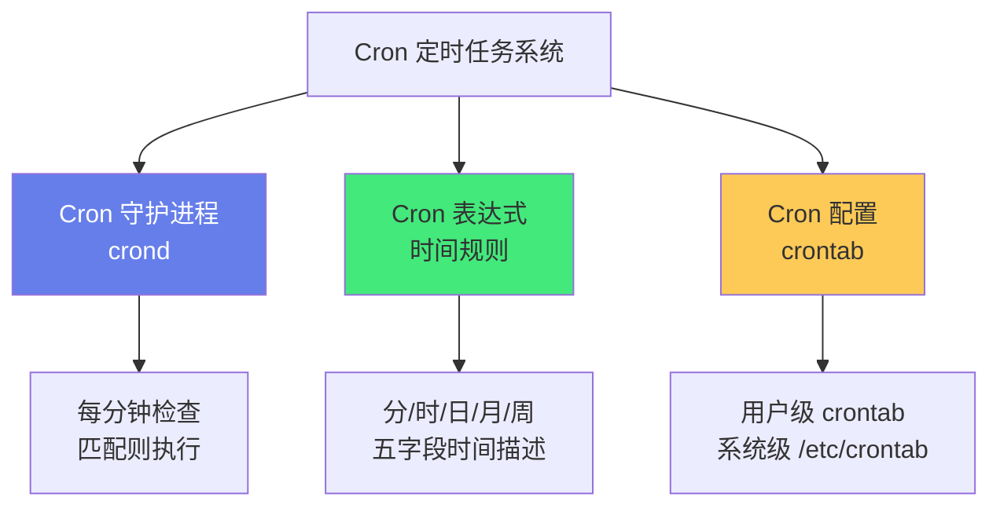
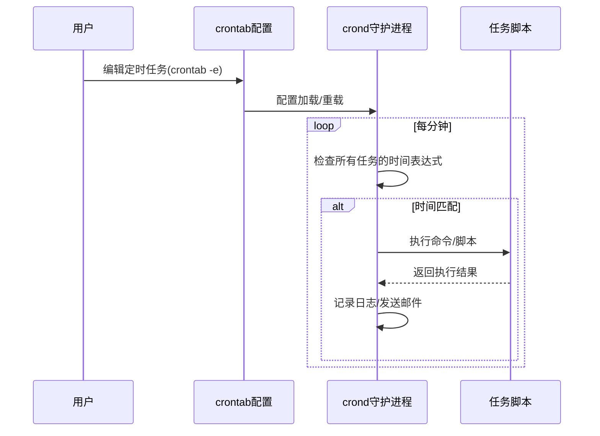

# ⏰ 定时任务与 Cron 表达式

> **文档说明**：系统讲解定时任务与 Cron 表达式的语法规则、各平台实现、常见场景与最佳实践，涵盖 Cron 的起源（UNIX 系统 1970s Ken Thompson 设计）、Cron 表达式的标准五字段语法（分/时/日/月/周）与 Quartz 六/七字段扩展（增加秒/年）、各字段取值范围与特殊字符详解（`*` 任意/`,` 列表/`-` 范围/`/` 步长/`?` 不指定/`L` 最后/`W` 最近工作日/`#` 第几个星期几）、标准 Cron 与 Quartz Cron 的区别、常用 Cron 表达式速查表（每分钟/每5分钟/每小时/每天零点/每天上午9点/每周一/每月1号/工作日/特定时间组合等50+常用表达式）、Cron 在各平台的具体实现（Linux crontab 命令与配置文件/Windows 任务计划程序 schtasks/macOS launchd plist/Java Spring @Scheduled 注解/Node.js node-cron 库/Python APScheduler/Kubernetes CronJob/GitHub Actions schedule/Java Quartz 框架）、Cron 表达式的常见错误与调试方法（字段顺序记混/日期与星期冲突/特殊字符误用/闰年与月末问题）、时区问题（UTC vs 本地时间/容器时区/多区域调度）、任务重叠与锁机制（flock/文件锁/数据库锁/幂等设计）、日志与监控（重定向日志/邮件通知/失败告警/执行追踪）、Cron 与其他调度方式对比（systemd timer/Quartz/XXL-JOB/Airflow/Celery Beat）、Cron 表达式在线解析与可视化工具、生产环境最佳实践（幂等/超时/重试/日志/监控/锁/时区/版本管理）。
>
> **适用人群**：后端开发者、运维工程师、DevOps、全栈开发者、数据工程师、自动化脚本编写者
>
> **前置知识**：[[Linux基础命令]] · [[Shell脚本基础]] · [[操作系统进程管理]]

---

## 一、概述

### 1.1 什么是 Cron

**Cron** 是类 UNIX 操作系统下的**定时任务调度器**，用于在指定时间自动执行脚本或命令。它由 Ken Thompson 于 1975 年在 UNIX Version 7 中引入，名称来自希腊语「χρόνος」（chronos，时间）。



**核心组成**：
- **crond 守护进程**：后台运行，每分钟检查一次所有 cron 任务，时间匹配则执行
- **Cron 表达式**：用五个字段描述「什么时候执行」的时间规则
- **crontab 配置**：存储 cron 任务的文件，分用户级和系统级

### 1.2 Cron 的工作原理



**关键特点**：
- **分钟级精度**：crond 每分钟检查一次，最小调度粒度为 1 分钟
- **基于本地时间**：默认使用系统本地时区（注意容器和云服务器时区）
- **独立进程**：每个任务执行时 fork 一个独立子进程，互不影响
- **无状态**：cron 本身不记录任务执行状态（需自己写日志）

### 1.3 Cron 的应用场景

| 场景 | 示例 |
|------|------|
| **系统维护** | 每天凌晨3点备份数据库、每周日清理日志、每月1号更新证书 |
| **数据同步** | 每5分钟同步订单数据、每小时拉取汇率、每天同步用户画像 |
| **监控告警** | 每分钟检查服务健康、每5分钟采集指标、每小时生成报表 |
| **业务调度** | 每天上午9点发送日报、每周一生成周报、每月1号结算账单 |
| **自动化运维** | 每小时检查磁盘空间、每天清理临时文件、每周重启服务 |
| **CI/CD** | 每天凌晨构建部署、每周运行全量测试、定期安全扫描 |

---

## 二、Cron 表达式语法

### 2.1 标准 Cron 五字段

标准 UNIX Cron 表达式由 **5 个字段**组成，用空格分隔：

```text
┌───────────── 分钟 (0 - 59)
│ ┌───────────── 小时 (0 - 23)
│ │ ┌───────────── 日 (1 - 31)
│ │ │ ┌───────────── 月 (1 - 12)
│ │ │ │ ┌───────────── 星期 (0 - 6) (0=周日, 7=周日)
│ │ │ │ │
* * * * *  要执行的命令
```

| 字段 | 取值范围 | 特殊字符 | 说明 |
|------|---------|---------|------|
| **分钟（Minute）** | 0-59 | `*` `,` `-` `/` | 第几分钟执行 |
| **小时（Hour）** | 0-23 | `*` `,` `-` `/` | 第几小时执行 |
| **日（Day of Month）** | 1-31 | `*` `,` `-` `/` `?` `L` `W` | 每月第几天 |
| **月（Month）** | 1-12 或 JAN-DEC | `*` `,` `-` `/` | 第几月 |
| **星期（Day of Week）** | 0-6 或 SUN-SAT（0/7=周日） | `*` `,` `-` `/` `?` `L` `#` | 星期几 |

> **重要**：日和星期是「或」的关系——如果两者都指定了非 `*` 值，则满足任一条件即执行（例如 `0 0 15 * 1` 表示每月15号 OR 每周一的零点执行，不是「15号且是周一」）。

### 2.2 特殊字符详解

| 字符 | 名称 | 含义 | 示例 |
|------|------|------|------|
| `*` | 任意值 | 匹配该字段的所有可能值 | `* * * * *` = 每分钟 |
| `,` | 列表 | 指定多个离散值 | `0,15,30,45 * * * *` = 每15分钟 |
| `-` | 范围 | 指定连续范围 | `0 9-18 * * 1-5` = 工作日9-18点整点 |
| `/` | 步长 | 从起始值开始每隔N执行 | `*/5 * * * *` = 每5分钟；`10/15 * * * *` = 第10,25,40,55分钟 |
| `?` | 不指定 | 日或星期字段中表示「不关心」（Quartz用，标准Cron不支持） | `0 0 15 * ?` = 每月15号零点（不关心星期） |
| `L` | 最后 | 日字段=当月最后一天；星期字段=当月最后一个星期X | `0 0 L * *` = 每月最后一天；`0 0 * * 6L` = 每月最后一个周六 |
| `W` | 最近工作日 | 日字段中表示离指定日期最近的工作日（周一到周五） | `0 0 15W * *` = 离15号最近的工作日 |
| `#` | 第几个 | 星期字段中表示当月第几个星期X | `0 0 * * 1#2` = 每月第二个周一 |

### 2.3 Quartz Cron 六/七字段

Java **Quartz** 框架和 **Spring @Scheduled** 使用扩展的 Cron 表达式，增加了「秒」字段（可选「年」字段）：

```text
┌───────────── 秒 (0 - 59)        ← 新增
│ ┌───────────── 分 (0 - 59)
│ │ ┌───────────── 时 (0 - 23)
│ │ │ ┌───────────── 日 (1 - 31)
│ │ │ │ ┌───────────── 月 (1 - 12)
│ │ │ │ │ ┌───────────── 周 (1-7 或 SUN-SAT, 1=周日)  ← 注意编号不同
│ │ │ │ │ │ ┌───────────── 年 (可选, 1970-2099)
│ │ │ │ │ │ │
* * * * * * *
```

**标准 Cron vs Quartz Cron 区别**：

| 维度 | 标准 UNIX Cron | Quartz / Spring Cron |
|------|---------------|---------------------|
| **字段数** | 5（分/时/日/月/周） | 6或7（秒/分/时/日/月/周[/年]） |
| **最小精度** | 分钟 | 秒 |
| **星期编号** | 0-6（0=周日），7也=周日 | 1-7（1=周日）或 SUN-SAT |
| **特殊字符** | `*` `,` `-` `/` | 额外支持 `?` `L` `W` `#` |
| **日/周关系** | 「或」关系 | 必须有一个为 `?`（互斥） |
| **执行环境** | 操作系统 crond | JVM 内调度器 |

> **注意**：Spring Boot 2.x 及以上版本默认使用 **6 字段** Cron（秒/分/时/日/月/周），与 Quartz 一致，但不支持年字段和部分特殊字符（如 `L` `W` `#` 在某些版本中支持有限）。

---

## 三、常用 Cron 表达式速查表

### 3.1 分钟级

| 表达式 | 含义 |
|--------|------|
| `* * * * *` | 每分钟 |
| `*/5 * * * *` | 每5分钟 |
| `*/10 * * * *` | 每10分钟 |
| `*/15 * * * *` | 每15分钟（0,15,30,45） |
| `*/30 * * * *` | 每30分钟 |
| `1-30/2 * * * *` | 每小时1-30分钟内每2分钟 |

### 3.2 小时级

| 表达式 | 含义 |
|--------|------|
| `0 * * * *` | 每小时整点 |
| `30 * * * *` | 每小时第30分钟 |
| `0 */2 * * *` | 每2小时整点 |
| `0 */3 * * *` | 每3小时整点 |
| `0 */6 * * *` | 每6小时整点（0,6,12,18点） |
| `0 9-18 * * *` | 每天9-18点每小时整点 |

### 3.3 每天

| 表达式 | 含义 |
|--------|------|
| `0 0 * * *` | 每天零点（00:00） |
| `0 1 * * *` | 每天凌晨1点 |
| `0 3 * * *` | 每天凌晨3点（常用备份时间） |
| `0 6 * * *` | 每天早上6点 |
| `0 8 * * *` | 每天早上8点 |
| `0 9 * * *` | 每天上午9点 |
| `30 9 * * *` | 每天上午9:30 |
| `0 12 * * *` | 每天中午12点 |
| `0 14 * * *` | 每天下午2点 |
| `0 18 * * *` | 每天下午6点 |
| `0 21 * * *` | 每天晚上9点 |
| `0 0,12 * * *` | 每天0点和12点 |
| `0 9,12,18 * * *` | 每天9点、12点、18点 |

### 3.4 每周

| 表达式 | 含义 |
|--------|------|
| `0 0 * * 0` | 每周日零点（0=周日） |
| `0 0 * * 1` | 每周一零点 |
| `0 0 * * 6` | 每周六零点 |
| `0 9 * * 1` | 每周一上午9点 |
| `0 9 * * 1-5` | 每周一到周五上午9点（工作日） |
| `0 0 * * 6,0` | 每周六和周日零点（周末） |
| `30 10 * * 5` | 每周五上午10:30 |

### 3.5 每月

| 表达式 | 含义 |
|--------|------|
| `0 0 1 * *` | 每月1号零点 |
| `0 0 15 * *` | 每月15号零点 |
| `0 0 L * *` | 每月最后一天零点（Quartz） |
| `0 0 1 1 *` | 每年1月1号零点 |
| `0 0 1 1,4,7,10 *` | 每季度第一天零点 |
| `0 9 1 * *` | 每月1号上午9点 |
| `0 0 1W * *` | 每月1号最近的工作日零点（Quartz） |

### 3.6 特定组合

| 表达式 | 含义 |
|--------|------|
| `*/5 9-18 * * 1-5` | 工作日9-18点每5分钟 |
| `0 0 1 * *` 配合脚本判断 | 每月1号执行（标准Cron无L，用脚本判断月末） |
| `0 2 * * 0` | 每周日凌晨2点（日志切割常用） |
| `0 3 * * *` | 每天凌晨3点（数据库备份常用） |
| `*/30 * * * *` | 每30分钟（健康检查常用） |

> **Quartz 表达式速查（6字段，含秒）**：
> - `0 0 0 * * ?` = 每天零点
> - `0 0 9 ? * MON-FRI` = 工作日上午9点
> - `0 0 0 1 * ?` = 每月1号零点
> - `0 0 0 L * ?` = 每月最后一天零点
> - `0 0 0 ? * 6L` = 每月最后一个周六零点
> - `0 0 0 ? * MON#2` = 每月第二个周一零点

---

## 四、各平台 Cron 实现

### 4.1 Linux crontab

**常用命令**：

```bash
crontab -e          # 编辑当前用户的定时任务
crontab -l          # 列出当前用户的定时任务
crontab -r          # 删除当前用户的所有定时任务（危险！）
crontab -u user -l  # 查看指定用户的定时任务（需root）
```

**用户级 crontab 格式**：
```bash
# 分 时 日 月 周  命令
*/5 * * * * /usr/bin/python3 /opt/scripts/health_check.py
0 3 * * * /opt/scripts/db_backup.sh >> /var/log/db_backup.log 2>&1
0 9 * * 1-5 /opt/scripts/send_daily_report.sh
```

**系统级 crontab（/etc/crontab）**：多了「用户名」字段
```bash
# 分 时 日 月 周  用户  命令
0 3 * * * root /opt/scripts/db_backup.sh
```

**系统级目录**：
- `/etc/cron.d/`：系统级定时任务目录，每个文件一个任务
- `/etc/cron.hourly/`：每小时执行的脚本
- `/etc/cron.daily/`：每天执行的脚本
- `/etc/cron.weekly/`：每周执行的脚本
- `/etc/cron.monthly/`：每月执行的脚本

**环境变量**：crontab 执行时环境变量极简（PATH 通常只有 `/usr/bin:/bin`），建议在脚本中使用绝对路径或在 crontab 顶部设置：
```bash
SHELL=/bin/bash
PATH=/usr/local/sbin:/usr/local/bin:/usr/sbin:/usr/bin:/sbin:/bin
MAILTO=admin@example.com
```

### 4.2 Windows 任务计划程序

**GUI 方式**：任务计划程序（taskschd.msc）→ 创建基本任务 → 按向导设置触发器和操作。

**命令行（schtasks）**：
```cmd
:: 创建每天凌晨3点执行备份的任务
schtasks /create /tn "DatabaseBackup" /tr "C:\scripts\backup.bat" /sc daily /st 03:00

:: 创建每5分钟执行一次的任务
schtasks /create /tn "HealthCheck" /tr "C:\scripts\health.bat" /sc minute /mo 5

:: 查看任务
schtasks /query /tn "DatabaseBackup"

:: 删除任务
schtasks /delete /tn "DatabaseBackup" /f
```

**PowerShell 方式**：
```powershell
# 创建每天凌晨3点的任务
$action = New-ScheduledTaskAction -Execute "C:\scripts\backup.bat"
$trigger = New-ScheduledTaskTrigger -Daily -At 3:00AM
Register-ScheduledTask -TaskName "DatabaseBackup" -Action $action -Trigger $trigger
```

### 4.3 macOS launchd

macOS 推荐使用 **launchd**（plist 文件）而非传统 cron：

```xml
<?xml version="1.0" encoding="UTF-8"?>
<!DOCTYPE plist PUBLIC "-//Apple//DTD PLIST 1.0//EN" "http://www.apple.com/DTDs/PropertyList-1.0.dtd">
<plist version="1.0">
<dict>
    <key>Label</key>
    <string>com.example.dbbackup</string>
    <key>ProgramArguments</key>
    <array>
        <string>/opt/scripts/db_backup.sh</string>
    </array>
    <key>StartCalendarInterval</key>
    <dict>
        <key>Hour</key>
        <integer>3</integer>
        <key>Minute</key>
        <integer>0</integer>
    </dict>
    <key>StandardOutPath</key>
    <string>/var/log/dbbackup.log</string>
    <key>StandardErrorPath</key>
    <string>/var/log/dbbackup.err</string>
</dict>
</plist>
```

```bash
# 加载任务
launchctl load ~/Library/LaunchAgents/com.example.dbbackup.plist
# 卸载任务
launchctl unload ~/Library/LaunchAgents/com.example.dbbackup.plist
# 立即执行
launchctl start com.example.dbbackup
```

### 4.4 Java Spring @Scheduled

```java
@Configuration
@EnableScheduling
public class SchedulerConfig {
    // 每天凌晨3点执行
    @Scheduled(cron = "0 0 3 * * ?")
    public void dailyBackup() {
        backupService.execute();
    }
    
    // 每5分钟执行
    @Scheduled(cron = "0 */5 * * * ?")
    public void healthCheck() {
        monitorService.check();
    }
    
    // 固定延迟（上次执行完成后间隔）
    @Scheduled(fixedDelay = 60000)
    public void fixedDelayTask() { }
    
    // 固定速率（每隔N毫秒，不管上次是否完成）
    @Scheduled(fixedRate = 60000)
    public void fixedRateTask() { }
}
```

> **注意**：Spring 默认使用单线程调度器，多个 `@Scheduled` 任务会串行执行。如需并发，需配置 `TaskScheduler` 线程池。

### 4.5 Java Quartz

Quartz 是功能更强大的 Java 调度框架，支持持久化、集群、日历、监听器等：

```java
// 定义Job
public class BackupJob implements Job {
    public void execute(JobExecutionContext context) {
        backupService.execute();
    }
}

// 调度
JobDetail job = JobBuilder.newJob(BackupJob.class)
    .withIdentity("backupJob", "group1")
    .build();

Trigger trigger = TriggerBuilder.newTrigger()
    .withIdentity("backupTrigger", "group1")
    .withSchedule(CronScheduleBuilder.cronSchedule("0 0 3 * * ?"))
    .build();

scheduler.scheduleJob(job, trigger);
```

```text
### 4.6 Node.js node-cron
```

```javascript
const cron = require('node-cron');

// 每天凌晨3点
cron.schedule('0 3 * * *', () => {
    console.log('执行每日备份');
    backupService.execute();
});

// 每5分钟
cron.schedule('*/5 * * * *', () => {
    healthCheck();
});

// 工作日9-18点每小时
cron.schedule('0 9-18 * * 1-5', () => {
    sendReport();
});
```

### 4.7 Python APScheduler

```python
from apscheduler.schedulers.blocking import BlockingScheduler

scheduler = BlockingScheduler(timezone='Asia/Shanghai')

# 每天凌晨3点
@scheduler.scheduled_job('cron', hour=3, minute=0)
def daily_backup():
    backup_service.execute()

# 每5分钟
@scheduler.scheduled_job('cron', minute='*/5')
def health_check():
    monitor.check()

scheduler.start()
```

### 4.8 Kubernetes CronJob

```yaml
apiVersion: batch/v1
kind: CronJob
metadata:
  name: db-backup
spec:
  schedule: "0 3 * * *"        # 每天凌晨3点
  timeZone: "Asia/Shanghai"      # K8s 1.27+ 支持
  concurrencyPolicy: Forbid       # 禁止并发（Forbid/Allow/Replace）
  startingDeadlineSeconds: 300    # 启动超时（秒）
  successfulJobsHistoryLimit: 3   # 保留成功任务数
  failedJobsHistoryLimit: 3       # 保留失败任务数
  jobTemplate:
    spec:
      backoffLimit: 3             # 重试次数
      template:
        spec:
          restartPolicy: OnFailure
          containers:
          - name: backup
            image: mysql:8.0
            command: ["/bin/sh", "-c", "mysqldump -h db -u root $MYSQL_PWD > /backup/$(date +%Y%m%d).sql"]
            env:
            - name: MYSQL_PWD
              valueFrom:
                secretKeyRef: { name: db-secret, key: password }
```

### 4.9 GitHub Actions schedule

```yaml
name: Daily Backup
on:
  schedule:
    - cron: '0 3 * * *'  # 每天UTC时间3点（注意是UTC！）
  workflow_dispatch:       # 支持手动触发

jobs:
  backup:
    runs-on: ubuntu-latest
    steps:
      - uses: actions/checkout@v4
      - name: Run backup
        run: ./scripts/backup.sh
```

> **重要**：GitHub Actions 的 cron 使用 **UTC 时间**，北京时间 = UTC + 8。如需北京时间凌晨3点，应写 `cron: '0 19 * * *'`（前一天UTC 19:00 = 北京时间次日03:00）。

---

## 五、常见问题与排查

### 5.1 常见错误

| 错误 | 原因 | 解决方案 |
|------|------|---------|
| **任务不执行** | crond 未启动/表达式错误/权限不足/路径错误 | `systemctl status crond`、`crontab -l` 检查、用绝对路径 |
| **手动执行成功，cron失败** | 环境变量不同（PATH/HOME）、相对路径、缺少交互终端 | 脚本中用绝对路径、在 crontab 顶部设置 PATH、`#!/bin/bash -l` |
| **时区错误** | 服务器时区不是预期/容器时区UTC | `timedatectl` 检查、容器设置 `TZ=Asia/Shanghai` |
| **任务重叠执行** | 上次未执行完下次又开始 | 加文件锁 `flock`、幂等设计、`concurrencyPolicy: Forbid` |
| **日和星期同时指定** | 两者是「或」关系，可能意外多执行 | 只用一个字段指定日期，另一个用 `*` |
| **月末问题** | 31号不存在于所有月份 | 用 `L`（Quartz）或脚本判断 `date -d tomorrow +%d` 是否为1 |
| **闰年2月29** | 每年2月天数不同 | 避免用29号，用脚本判断 |
| **Quartz 日/周冲突** | Quartz 要求日和周必须有一个为 `?` | 一个用具体值，另一个用 `?` |
| **Spring cron 6字段** | 误用5字段表达式 | Spring 用6字段（秒/分/时/日/月/周） |
| **输出丢失** | cron 默认邮件发送输出，无邮件则丢失 | 重定向到日志文件 `>> /var/log/task.log 2>&1` |

### 5.2 调试方法

**1. 检查 crond 状态**：
```bash
systemctl status crond        # 或 cron
systemctl start crond
systemctl enable crond
```

**2. 查看 cron 日志**：
```bash
# CentOS/RHEL
tail -f /var/log/cron
# Ubuntu/Debian
tail -f /var/log/syslog | grep CRON
# 通用
journalctl -u crond -f
```

**3. 验证表达式**：
- 在线工具：crontab.guru（标准Cron）、freeformatter.com（Quartz）
- 命令行：`crontab -l` 查看当前任务

**4. 简化测试**：
```bash
# 每分钟执行一次，测试是否触发
* * * * * echo "cron test $(date)" >> /tmp/cron_test.log
```

**5. 模拟 cron 环境**：
```bash
# 用 cron 的极简环境运行脚本
env -i HOME=$HOME PATH=/usr/bin:/bin /opt/scripts/mytask.sh
```

### 5.3 时区问题

**检查系统时区**：
```bash
timedatectl                    # 查看时区
date                           # 查看当前时间
timedatectl set-timezone Asia/Shanghai  # 设置时区
```

**容器时区**：
```dockerfile
# Dockerfile 设置时区
ENV TZ=Asia/Shanghai
RUN ln -snf /usr/share/zoneinfo/$TZ /etc/localtime && echo $TZ > /etc/timezone
```

```yaml
# K8s CronJob 设置时区（K8s 1.27+）
spec:
  timeZone: "Asia/Shanghai"
```

**GitHub Actions 时区转换**：
- GitHub Actions cron 用 UTC
- 北京时间 = UTC + 8
- 北京时间 03:00 = UTC 前一天 19:00 → `cron: '0 19 * * *'`

---

## 六、任务重叠与锁机制

### 6.1 为什么需要锁

如果任务执行时间超过调度间隔，会出现**多个实例同时运行**，可能导致：
- 数据重复处理（如重复发送邮件、重复扣款）
- 资源竞争（数据库锁冲突、文件写入冲突）
- 性能问题（CPU/内存耗尽）

### 6.2 文件锁（flock）

Linux 下最常用的锁机制：

```bash
# 方式1：flock 命令包裹
*/5 * * * * /usr/bin/flock -n /tmp/health_check.lock /opt/scripts/health_check.sh

# 方式2：脚本内部使用 flock
#!/bin/bash
exec 200>/tmp/mytask.lock
flock -n 200 || { echo "任务正在运行，跳过"; exit 0; }
# 任务逻辑...
```

| flock 参数 | 含义 |
|-----------|------|
| `-n` | 非阻塞，获取不到锁立即退出（推荐） |
| `-w N` | 等待N秒后超时 |
| `-u` | 释放锁 |

### 6.3 数据库锁

适用于分布式环境（多台服务器执行同一任务）：

```sql
-- MySQL 命名锁
SELECT GET_LOCK('daily_backup', 10);  -- 获取锁，超时10秒
-- 执行任务...
SELECT RELEASE_LOCK('daily_backup');   -- 释放锁
```

```java
// Redis 分布式锁
String lockKey = "cron:daily_backup";
boolean locked = redis.set(lockKey, "worker-1", "NX", "EX", 3600);
if (locked) {
    try {
        // 执行任务
    } finally {
        redis.del(lockKey);
    }
}
```

### 6.4 K8s 并发策略

```yaml
spec:
  concurrencyPolicy: Forbid   # 禁止并发（上次未完成则跳过本次）
  # concurrencyPolicy: Allow  # 允许并发（默认）
  # concurrencyPolicy: Replace # 替换（终止旧的，启动新的）
```

### 6.5 幂等设计

最根本的解决方案是让任务**幂等**——无论执行多少次，结果都相同：
- 用唯一键去重（如订单号、日期+类型）
- 先查后写（检查是否已处理）
- 状态机控制（只有特定状态才能执行）
- 数据库唯一约束防止重复插入

---

## 七、日志与监控

### 7.1 日志重定向

```bash
# 标准输出和错误都追加到日志
0 3 * * * /opt/scripts/backup.sh >> /var/log/backup.log 2>&1

# 按日期分割日志
0 3 * * * /opt/scripts/backup.sh >> /var/log/backup_$(date +\%Y\%m\%d).log 2>&1
```

> **注意**：crontab 中 `%` 需要转义为 `\%`，否则会被当作换行符。

### 7.2 日志轮转

```bash
# /etc/logrotate.d/myapp
/var/log/myapp/*.log {
    daily
    rotate 30
    compress
    missingok
    notifempty
    create 0644 root root
}
```

### 7.3 邮件通知

cron 默认将任务输出发送到用户邮箱：
```bash
# crontab 顶部设置
MAILTO=admin@example.com

# 任务有输出时才发邮件
0 3 * * * /opt/scripts/backup.sh
```

### 7.4 监控告警

| 监控维度 | 工具/方法 |
|---------|----------|
| **任务是否执行** | 脚本执行后写入心跳文件/数据库，监控心跳时间 |
| **执行时长** | 脚本记录开始/结束时间，超时告警 |
| **执行结果** | 脚本退出码非0时告警（`set -e` + 退出码） |
| **日志关键字** | ELK/Loki 监控日志中的 ERROR/Exception |
| **Prometheus** | 脚本暴露 metrics（pushgateway），Grafana 告警 |
| **K8s** | CronJob 失败次数告警（`kube_cronjob_status_last_successful_time`） |

**心跳示例**：
```bash
#!/bin/bash
set -e
START=$(date +%s)
# 任务逻辑...
backup_service.execute()
END=$(date +%s)
DURATION=$((END - START))
# 写入心跳
echo "{\"status\":\"success\",\"duration\":$DURATION,\"time\":\"$(date -Iseconds)\"}" > /var/run/heartbeat/backup.json
```

---

## 八、Cron 与其他调度方式对比

| 方案 | 精度 | 分布式 | 持久化 | 依赖 | 适用场景 |
|------|------|--------|--------|------|---------|
| **Cron (crond)** | 分钟 | 否 | 否 | 操作系统 | 单机简单定时任务 |
| **systemd timer** | 分钟 | 否 | 否 | systemd | Linux 系统级定时（替代cron） |
| **Spring @Scheduled** | 秒 | 否 | 否 | JVM | 单实例应用内定时 |
| **Quartz** | 秒 | 是（集群） | 是（JDBC） | JVM + DB | 企业级复杂调度 |
| **XXL-JOB** | 秒 | 是 | 是 | 调度中心+DB | 分布式任务调度（国内常用） |
| **ElasticJob** | 秒 | 是 | 是 | ZooKeeper/DB | 分布式弹性调度 |
| **Airflow** | 分钟 | 是 | 是 | Python+DB | 数据管道DAG调度 |
| **Celery Beat** | 秒 | 是 | 否 | Redis/RabbitMQ | Python 异步任务定时 |
| **K8s CronJob** | 分钟 | 是 | 是 | K8s | 容器化定时任务 |
| **GitHub Actions** | 分钟 | 是 | - | GitHub | CI/CD 定时 |

**选择建议**：
- 单机简单脚本 → **Cron**
- Linux 系统服务 → **systemd timer**
- 单实例 Java 应用 → **Spring @Scheduled**
- 企业级 Java 分布式调度 → **Quartz / XXL-JOB**
- 数据管道 → **Airflow**
- 容器化环境 → **K8s CronJob**
- CI/CD → **GitHub Actions / Jenkins**

---

## 九、Cron 表达式工具

### 9.1 在线工具

| 工具 | 网址 | 特点 |
|------|------|------|
| **crontab.guru** | crontab.guru | 标准Cron，实时预览下次执行时间 |
| **Cron Expression Generator** | freeformatter.com | Quartz 6/7字段，生成+解释 |
| **Cronhub** | cronhub.io | 监控+表达式生成 |
| **CronTab Parser** | crontab.cronhub.io | 解析+下次N次执行时间 |

### 9.2 命令行工具

```bash
# 查看下次执行时间（需安装）
npx cron-time # Node.js
pip install cron-descriptor  # Python，将表达式转为自然语言
```

### 9.3 IDE 插件

- **VS Code**：Cron Explained、Cron Tab Snippet
- **IntelliJ**：Cron Expression Generator（Spring/Quartz 支持）

---

## 十、生产最佳实践

### 10.1 任务设计

| 原则 | 说明 |
|------|------|
| **幂等** | 任务可重复执行，结果一致（最核心） |
| **超时控制** | 设置最大执行时间，防止卡死占用资源 |
| **重试机制** | 失败后自动重试（指数退避），但要配合幂等 |
| **分片处理** | 大数据量任务分批处理，避免长时间占用 |
| **优雅退出** | 收到终止信号时保存进度，下次从断点继续 |

### 10.2 配置管理

| 原则 | 说明 |
|------|------|
| **版本控制** | crontab/脚本纳入 Git，变更可追溯 |
| **环境分离** | 开发/测试/生产环境的 cron 配置分开 |
| **注释完整** | 每个任务写明用途、负责人、预期执行时间 |
| **集中管理** | 多台服务器的 cron 用配置管理工具（Ansible/Puppet）统一管理 |

### 10.3 安全

| 原则 | 说明 |
|------|------|
| **最小权限** | cron 任务用专用用户运行，不用 root |
| **路径安全** | 脚本路径限制在专用目录，防止篡改 |
| **敏感信息** | 密码/密钥用环境变量或密钥管理，不写在脚本里 |
| **输入校验** | 脚本参数校验，防止命令注入 |

### 10.4 可观测性

| 原则 | 说明 |
|------|------|
| **结构化日志** | JSON 格式日志，包含 trace_id、duration、status |
| **心跳上报** | 任务开始/结束上报状态，监控平台告警 |
| **指标采集** | 执行时长、成功率、处理数据量等 metrics |
| **告警规则** | 任务未执行、执行超时、失败率高时告警 |

### 10.5 时间选择

| 原则 | 说明 |
|------|------|
| **避开高峰** | 备份/清理等重任务放在凌晨低峰期 |
| **错开执行** | 多个任务不要在同一时间点同时启动（如用 `0,5,10` 错开） |
| **考虑时区** | 跨区域服务注意用户时区，避免在用户活跃期执行 |
| **月末/季末** | 注意月末天数不同，避免用31号；季末任务可能与月末任务冲突 |

---

## 十一、关联笔记

### 运维与自动化
- [[Linux基础命令]] · [[Shell脚本基础]] · [[操作系统进程管理]]
- [[Docker容器化]] · [[K8s-核心概念与架构]] · [[CI-CD流水线设计]]
- [[Nginx-反向代理与负载均衡]] · [[监控与告警体系]]

### 开发与效率
- [[Git 版本控制知识点系统梳理_优化版]] · [[GitHub-Actions流水线设计]] · [[自动化脚本编写]]
- [[Vim-Neovim入门与配置]] · [[VSCode-核心配置与插件]]

### 导航
- [[MOC-通用工具]] · [[MOC-云原生与运维]] · [[Home]] · [[学习路线总览]]

> 🔍 **知识点深度解析**
>
> **作用**：定时任务与 Cron 表达式解决的是「如何让计算机在指定时间自动执行重复性任务，无需人工干预」的自动化问题——从简单的「每天凌晨3点备份数据库」到复杂的「每5分钟检查服务健康、每小时同步数据、每月1号生成账单」，Cron 是运维自动化、数据处理、业务调度的基础工具。掌握 Cron 表达式语法和各平台实现，能将大量重复性工作自动化，提升效率、减少人为错误、保证任务准时执行。
>
> **底层原理**：①Cron 的核心是「时间表达式匹配+守护进程轮询」——crond 守护进程每分钟唤醒一次，读取所有 crontab 配置，将每个任务的5字段时间表达式与当前时间逐一匹配，匹配成功则 fork 子进程执行命令。这种「每分钟轮询+匹配」的设计简单可靠，但最小精度只能到分钟（Quartz 等框架在应用层实现秒级精度）。②Cron 表达式是「声明式时间描述」——用5个字段（分/时/日/月/周）和特殊字符（`*`任意/`,`列表/`-`范围/`/`步长）描述「什么时候执行」，而非「每隔多久执行」。这种声明式表达能力强大（可以描述「每月最后一个周五的上午9:30」这种复杂规则），但也容易出错（字段顺序、日/星期的「或」关系、特殊字符含义）。③日和星期的「或」关系是 Cron 最容易踩坑的设计——标准 Cron 中，如果日和星期都指定了非 `*` 值，则满足任一条件即执行（OR逻辑），而非「同时满足」（AND逻辑）。这是因为 Cron 设计者认为「每月15号 AND 周一」这种组合太罕见，而「每月15号 OR 每周一」更实用。Quartz 修正了这个问题，要求日和星期必须有一个为 `?`（不指定），避免歧义。④Cron 执行环境极简是另一个常见坑——crond 执行任务时不会加载用户的 `.bashrc`/`.profile`，PATH 通常只有 `/usr/bin:/bin`，没有交互终端，导致「手动执行成功但 cron 失败」。解决方案是脚本中用绝对路径、在 crontab 顶部设置 PATH、或用 `#!/bin/bash -l` 加载登录环境。⑤任务重叠是长时间任务的核心问题——如果任务执行时间超过调度间隔（如备份需要10分钟但每5分钟调度一次），会有多个实例同时运行，导致数据重复或资源竞争。解决方案包括：文件锁（flock）、分布式锁（Redis/DB）、K8s concurrencyPolicy、最根本的是幂等设计（无论执行多少次结果相同）。⑥时区问题在云原生和跨区域场景中尤为突出——服务器/容器可能是 UTC 时区，GitHub Actions 固定 UTC，K8s CronJob 在 1.27 前不支持时区字段。必须明确每个平台的时区基准，必要时进行转换（北京时间 = UTC + 8）。
>
> **用法要点**：① 标准Cron五字段顺序：分(0-59) 时(0-23) 日(1-31) 月(1-12) 周(0-6,0=周日)，记口诀「分时日月周」 ② 特殊字符：`*`任意/`,`列表/`-`范围/`/`步长(如`*/5`每5)；Quartz额外支持`?`不指定/`L`最后/`W`最近工作日/`#`第几个 ③ 标准Cron vs Quartz：标准5字段分钟级，Quartz 6/7字段秒级，星期编号不同(标准0=周日,Quartz 1=周日)，日/星期关系不同(标准OR,Quartz必须一个?) ④ 常用表达式：每天零点`0 0 * * *`、每5分钟`*/5 * * * *`、每天凌晨3点`0 3 * * *`、工作日9点`0 9 * * 1-5`、每周一`0 0 * * 1`、每月1号`0 0 1 * *` ⑤ Linux：`crontab -e`编辑/`-l`查看/`-r`删除(危险)；系统级`/etc/crontab`多用户名字段；脚本用绝对路径，顶部设PATH和MAILTO ⑥ Windows：任务计划程序GUI或`schtasks /create`命令；macOS用launchd plist ⑦ Java：Spring `@Scheduled(cron="0 0 3 * * ?")`6字段；Quartz更强大支持集群持久化 ⑧ Node：`node-cron`库；Python：`APScheduler`；K8s：`CronJob`资源+`schedule`字段+`concurrencyPolicy` ⑨ GitHub Actions：`on.schedule.cron`用UTC时间，北京时间需-8 ⑩ 调试：`systemctl status crond`、`tail -f /var/log/cron`、每分钟echo测试、`env -i`模拟cron环境 ⑪ 防重叠：`flock -n`文件锁、Redis/DB分布式锁、K8s `Forbid`、幂等设计 ⑫ 日志：`>> /var/log/task.log 2>&1`重定向，crontab中`%`转义为`\%`，logrotate轮转 ⑬ 时区：`timedatectl`检查，容器设`TZ=Asia/Shanghai`，K8s 1.27+`timeZone`字段，GitHub Actions UTC转换 ⑭ 最佳实践：幂等/超时/重试/分片/优雅退出；版本控制/环境分离/注释/集中管理；最小权限/路径安全/密钥管理；结构化日志/心跳/指标/告警；避开高峰/错开执行/注意时区/月末问题。

> 💡 **深度讲解**：Cron 最核心的智慧是「用声明式时间表达式+极简守护进程，实现了几十年不变的可靠定时调度」——从1975年 Ken Thompson 在 UNIX Version 7 中设计 Cron 到今天，Cron 的基本设计几乎没有变：5个字段的时间表达式、每分钟轮询的守护进程、fork 子进程执行。这种「极简即可靠」的设计哲学让 Cron 成为 UNIX 传统中最持久的工具之一——几乎所有类 UNIX 系统都内置 Cron，几乎所有运维人员都用过 Cron。Cron 的表达式设计是「声明式」而非「命令式」——你描述「什么时候执行」（每天凌晨3点），而非「怎么调度」（等待到凌晨3点然后执行）。这种声明式设计让 Cron 表达式非常简洁强大，可以描述「每月最后一个周五的上午9:30」这种复杂规则，但也带来了学习成本——5个字段的顺序、特殊字符的含义、日和星期的「或」关系，都是新手容易踩坑的地方。Cron 另一个智慧是「机制与策略分离」——Cron 只负责「在指定时间触发执行」，不关心「执行什么」「执行结果如何」「失败了怎么办」。这种极简设计让 Cron 非常灵活（可以执行任何命令/脚本），但也意味着你需要自己处理：日志记录、失败告警、任务重叠、幂等性、超时控制等。这就是为什么生产环境的 Cron 任务往往需要「外壳」——flock 锁、日志重定向、心跳上报、超时包装等。在云原生时代，Cron 的思想被继承和扩展：K8s CronJob 将 Cron 表达式作为调度规则，但用容器执行、支持并发策略、失败重试、历史保留；GitHub Actions 用 Cron 表达式触发工作流，但支持手动触发、并行矩阵、环境隔离；Quartz/XXL-JOB 等框架在应用层实现了秒级精度、分布式集群、持久化、DAG 依赖等高级特性。但无论怎么扩展，核心都是「Cron 表达式描述时间，调度器在匹配时触发执行」——这个从1975年延续至今的设计，证明了「极简即可靠」的力量。理解了 Cron 的设计哲学，你就能在各种平台和框架中快速上手定时调度——因为它们的核心都是 Cron 思想的变体。

> 📝 **精简总结**：定时任务与Cron表达式=自动化调度的基础工具。起源：1975年Ken Thompson UNIX设计。标准Cron五字段：分(0-59)时(0-23)日(1-31)月(1-12)周(0-6,0=周日)，口诀「分时日月周」。特殊字符：`*`任意/`,`列表/`-`范围/`/`步长。Quartz 6/7字段：增加秒(和年)，秒级精度，星期1=周日，支持`?`/`L`/`W`/`#`，日/星期必须一个?。常用：每天零点`0 0 * * *`、每5分`*/5 * * * *`、凌晨3点`0 3 * * *`、工作日9点`0 9 * * 1-5`、每周一`0 0 * * 1`、每月1号`0 0 1 * *`。平台：Linux crontab(-e/-l/-r)/Windows schtasks/任务计划/macOS launchd/Java Spring @Scheduled(6字段)/Quartz/Node node-cron/Python APScheduler/K8s CronJob(schedule+concurrencyPolicy)/GitHub Actions(UTC)。常见坑：环境变量极简(用绝对路径/设PATH)、日星期OR关系、时区(容器UTC/GitHub UTC)、任务重叠(flock锁/分布式锁/幂等)、输出丢失(重定向日志)、月末31号问题。调试：crond状态/cron日志/每分钟测试/env -i模拟。最佳实践：幂等/超时/重试/分片/版本控制/最小权限/结构化日志/心跳告警/避开高峰/错开执行。选择：单机脚本Cron、系统服务systemd timer、单实例Java Spring @Scheduled、企业分布式Quartz/XXL-JOB、数据管道Airflow、容器K8s CronJob、CI/CD GitHub Actions。

> **学习路径建议**：先学习 [[Linux基础命令]] 和 [[Shell脚本基础]] → 实践：用 crontab 设置第一个定时任务（如每分钟echo） → 学习本文档掌握 Cron 表达式语法和常用表达式 → 实践：设置每天凌晨3点的数据库备份任务（含日志重定向+flock锁） → 学习 [[Docker容器化]]，在容器中配置 Cron（注意时区和环境变量） → 学习 [[K8s-核心概念与架构]]，实践 K8s CronJob → 学习 [[CI-CD流水线设计]] 和 [[GitHub-Actions流水线设计]]，实践 GitHub Actions 定时任务 → 学习 Java 后端调度（Spring @Scheduled / Quartz） → 学习分布式任务调度（XXL-JOB / ElasticJob） → 学习数据管道调度（Airflow） → 生产实践：设计完整的定时任务体系（幂等/锁/日志/监控/告警）。

---

> **定时任务与 Cron 表达式的本质是「用声明式时间规则将重复性工作自动化，让计算机成为不知疲倦的执行者」——人类的注意力是有限的，我们不可能每天凌晨3点起来备份数据库，不可能每5分钟检查一次服务健康，不可能每月1号准时生成账单。但计算机可以——只要我们用 Cron 表达式告诉它「什么时候做什么」，它就会不知疲倦地、准时地、精确地执行。这就是自动化的力量：将人类从重复性工作中解放出来，让我们专注于更有创造性的事情。Cron 从1975年诞生至今，已经成为 UNIX 传统中最持久、最广泛使用的工具之一——它的设计极简（5个字段+守护进程），但功能强大（可以描述几乎任何时间规则）；它的机制简单（每分钟轮询匹配），但可靠性经过了50年的验证。在云原生时代，Cron 的思想被 K8s CronJob、GitHub Actions、Quartz、XXL-JOB 等继承和扩展，但核心始终不变：「用表达式描述时间，在匹配时触发执行」。掌握 Cron，不仅是掌握一个工具，更是掌握「自动化思维」——思考哪些工作可以自动化、如何设计可靠的自动化任务、如何监控和告警自动化任务。这种思维在运维、开发、数据、业务等各个领域都至关重要。从今天开始，审视你的日常工作，找出那些「每天/每周/每月都要做的重复性任务」，用 Cron 将它们自动化——你会发现，省下的不仅是时间，更是注意力和心智负担，让你能专注于真正重要的事情。**

---

## 🔗 关联笔记

- [[MOC-通用工具]] — 返回本分类知识地图，查看更多相关文档

## 📖 前置知识

- [[Linux基础命令]]
- [[Shell脚本基础]]
- [[操作系统进程管理]]

## 🏷️ 相关标签

`#Cron` `#定时任务` `#调度` `#自动化` `#Linux` `#crontab`

[[Home|🏠 返回首页]] · [[MOC-通用工具|📚 返回分类]]
