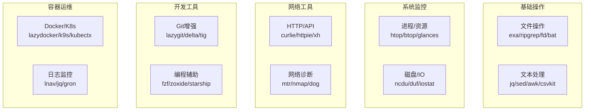

# 常用 CLI 工具速查

> **文档说明**：系统整理开发者日常高频使用的 CLI 工具速查表，涵盖文件操作、文本处理、系统监控、网络工具、Git 增强、开发工具、容器运维、数据处理等 8 大类 60+ 工具，每个工具提供核心用途、常用命令、实用技巧和安装方式，是终端效率提升的必备手册。
>
> **适用人群**：开发者、运维工程师、需要提升终端效率的全栈工程师
>
> **前置知识**：[[Linux命令速查表]]、[[Shell脚本编程]]、基本终端操作

---

## 一、概述

### 1. CLI 工具分类体系



### 2. 现代 CLI 工具 vs 传统工具

| 传统工具 | 现代替代 | 改进点 |
|---------|---------|--------|
| `ls` | `exa` / `eza` | 彩色、Git 状态、树视图、图标 |
| `cat` | `bat` | 语法高亮、行号、Git 集成、分页 |
| `grep` | `ripgrep (rg)` | 更快、自动忽略 .gitignore、彩色 |
| `find` | `fd` | 更快、更简单的语法、彩色 |
| `cd` | `zoxide (z)` | 智能跳转、学习访问频率 |
| `top` | `htop` / `btop` | 彩色、交互式、更丰富信息 |
| `du` | `ncdu` | 交互式、可视化磁盘使用 |
| `df` | `duf` | 彩色、表格化、更易读 |
| `curl` | `curlie` / `httpie` | 格式化输出、更友好的语法 |
| `diff` | `delta` | 语法高亮、并排视图、Git 集成 |
| `man` | `tldr` / `cheat` | 简洁示例、社区维护 |
| `ps` | `procs` | 彩色、多列、Docker 集成 |
| `tail -f` | `multitail` / `lnav` | 多文件、彩色、过滤 |

### 3. 安装方式速查

| 平台 | 包管理器 | 示例 |
|------|---------|------|
| **macOS** | Homebrew | `brew install ripgrep fd exa bat` |
| **Ubuntu/Debian** | apt | `sudo apt install ripgrep fd-find bat` |
| **Arch** | pacman | `sudo pacman -S ripgrep fd exa bat` |
| **Windows** | scoop / winget | `scoop install ripgrep fd bat` |
| **通用** | cargo (Rust) | `cargo install ripgrep fd-find exa bat` |
| **通用** | npm | `npm install -g fzf` |
| **通用** | pip | `pip install glances httpie csvkit` |

---

## 二、文件操作工具

### 1. exa / eza（ls 替代）

```bash
# 安装
brew install eza          # macOS
sudo apt install eza      # Ubuntu (24.04+)

# 常用命令
eza                       # 基本列表（彩色）
eza -l                    # 详细列表
eza -la                   # 包含隐藏文件
eza --tree                # 树视图
eza --tree --level=2      # 树视图（2层）
eza -l --git              # 显示 Git 状态
eza -l --icons            # 显示图标（需 Nerd Font）
eza -s size               # 按大小排序
eza -s modified           # 按修改时间排序
eza -r                    # 反向排序
eza -lh                   # 人类可读大小
eza --color=always        # 强制彩色（管道时）
```

**推荐别名**：
```bash
alias ls='eza --icons'
alias ll='eza -l --icons --git'
alias la='eza -la --icons --git'
alias lt='eza --tree --level=2 --icons'
```

### 2. bat（cat 替代）

```bash
# 安装
brew install bat
sudo apt install bat      # Ubuntu 下命令为 batcat

# 常用命令
bat file.txt              # 带语法高亮和行号
bat -n file.txt           # 显示行号
bat -A file.txt           # 显示不可见字符
bat --language=rs main.rs # 指定语言
bat --theme=TwoDark       # 指定主题
bat --list-themes         # 列出所有主题
bat --show-all            # 显示所有内容（不分页）
bat --style=plain         # 纯文本（无行号/边框）
bat --paging=never        # 不使用分页器

# 集成 Git
bat --diff main.rs        # 显示 Git diff 高亮
```

**配置文件**：`~/.config/bat/config`
```text
--theme="TwoDark"
--style="numbers,changes,header"
--paging="never"
```

```text
### 3. ripgrep (rg)（grep 替代）
```

```bash
# 安装
brew install ripgrep
sudo apt install ripgrep

# 常用命令
rg "pattern"                    # 搜索（自动忽略 .gitignore）
rg "pattern" src/               # 在指定目录搜索
rg -i "pattern"                 # 忽略大小写
rg -w "pattern"                 # 全词匹配
rg -e "pattern1" -e "pattern2"  # 多模式
rg "pattern" -g "*.ts"          # 只搜索 .ts 文件
rg "pattern" -g "!*.min.js"     # 排除 .min.js
rg -l "pattern"                 # 只显示文件名
rg -c "pattern"                  # 显示每个文件匹配数
rg -n "pattern"                  # 显示行号（默认）
rg -C 3 "pattern"                # 显示上下文（前后3行）
rg -B 2 -A 2 "pattern"           # 前2后2
rg --hidden "pattern"            # 搜索隐藏文件
rg -uu "pattern"                 # 搜索所有文件（不忽略任何）
rg "pattern" --type-add 'web:*.{html,css,js}' --type web
rg "foo|bar"                     # 正则
rg -F "literal.string"           # 字面量（不解析正则）
rg --stats "pattern"             # 显示统计信息
rg --json "pattern"               # JSON 输出（供编辑器使用）
```

**实用技巧**：
```bash
# 搜索并替换（配合 sd）
rg -l "old_text" | xargs sed -i 's/old_text/new_text/g'

# 只搜索 Rust 文件中的 TODO
rg "TODO" --type rust

# 搜索大文件
rg "pattern" --max-filesize 10M
```

### 4. fd（find 替代）

```bash
# 安装
brew install fd
sudo apt install fd-find   # Ubuntu 下命令为 fdfind

# 常用命令
fd "pattern"                    # 搜索文件（默认正则）
fd "pattern" src/               # 在指定目录搜索
fd -e js                        # 按扩展名搜索
fd -t f "pattern"               # 只搜文件
fd -t d "pattern"               # 只搜目录
fd -H "pattern"                 # 搜索隐藏文件
fd -I "pattern"                 # 不忽略 .gitignore
fd -u "pattern"                 # 搜索所有（不忽略）
fd -c never "pattern"           # 不彩色
fd -x rm {} \;                  # 对结果执行命令（删除）
fd -e log -x rm {}              # 删除所有 .log 文件
fd -e md -X bat                  # 用 bat 打开所有 .md
fd -t d -x cp -r {} /backup/    # 备份所有目录
fd --changed-within 2days       # 最近2天修改的文件
fd --changed-before 1week       # 1周前修改的文件
fd -s "Pattern"                  # 区分大小写（默认不区分）
fd -F "literal"                  # 字面量搜索
fd --max-depth 3                 # 最大深度3
```

**实用技巧**：
```bash
# 找到所有 .tmp 文件并删除
fd -e tmp -X rm

# 找到大于 100MB 的文件
fd -S +100M

# 用 fzf 选择文件并打开
fd -t f | fzf --preview 'bat --color always {}' | xargs code
```

### 5. zoxide（cd 替代）

```bash
# 安装
brew install zoxide
sudo apt install zoxide

# 初始化（加到 .bashrc / .zshrc）
eval "$(zoxide init bash)"
# 或 zsh
eval "$(zoxide init zsh)"

# 常用命令
z foo                       # 跳转到包含 foo 的最常访问目录
z foo bar                   # 跳转到同时包含 foo 和 bar 的目录
z -                         # 跳转到上一个目录
zi                          # 交互式选择（fzf）
zoxide query foo            # 查询匹配的目录
zoxide add /path/to/dir    # 添加目录到数据库
zoxide remove foo           # 移除目录
zoxide list                 # 列出所有记录（按分数排序）
```

### 6. fzf（模糊查找器）

```bash
# 安装
brew install fzf
sudo apt install fzf
$(brew --prefix)/opt/fzf/install  # 安装键绑定和补全

# 基本用法
fzf                         # 交互式模糊查找文件
find . -type f | fzf        # 管道输入
fzf --preview 'cat {}'      # 预览文件内容
fzf --preview 'bat --color always {}'  # 语法高亮预览
fzf --multi                  # 多选（Tab）
fzf --height 40%            # 高度40%
fzf --reverse                # 从上到下
fzf --prompt='Search: '     # 自定义提示

# 键绑定（安装后）
Ctrl+R                      # 历史命令模糊查找
Ctrl+T                      # 文件模糊查找（插入到命令行）
Alt+C                       # 目录模糊查找（cd 进去）

# 实用函数
# 用 fzf 选择并 cd
fcd() {
  local dir
  dir=$(find ${1:-.} -type d 2>/dev/null | fzf +m) && cd "$dir"
}

# 用 fzf 杀进程
fkill() {
  local pid
  pid=$(ps -ef | sed 1d | fzf -m | awk '{print $2}')
  if [ "x$pid" != "x" ]; then
    echo $pid | xargs kill -${1:-9}
  fi
}

# 用 fzf 切换 Git 分支
fbr() {
  local branches branch
  branches=$(git branch -vv) &&
  branch=$(echo "$branches" | fzf +m) &&
  git checkout $(echo "$branch" | awk '{print $1}' | sed "s/.* //")
}
```

---

## 三、文本处理工具

### 1. jq（JSON 处理）

```bash
# 安装
brew install jq
sudo apt install jq

# 常用命令
cat data.json | jq .                     # 格式化输出
cat data.json | jq '.name'               # 取字段
cat data.json | jq '.users[0].name'      # 嵌套字段
cat data.json | jq '.users[]'             # 数组展开
cat data.json | jq '.users[].name'        # 数组中所有 name
cat data.json | jq '[.users[] | {name, age}]'  # 投影（只取部分字段）
cat data.json | jq '.users | length'      # 数组长度
cat data.json | jq '.users | sort_by(.age)'  # 排序
cat data.json | jq '.users | map(.age)'   # 映射（提取所有 age）
cat data.json | jq '.users | map(select(.age > 18))'  # 过滤
cat data.json | jq 'keys'                  # 所有键
cat data.json | jq 'has("name")'           # 是否有键
cat data.json | jq '.name = "new"'         # 修改字段
cat data.json | jq '. + {"new": "field"}'  # 添加字段
cat data.json | jq 'del(.password)'         # 删除字段
cat data.json | jq -r '.name'               # 原始输出（无引号）
cat data.json | jq -c '.'                    # 压缩输出（单行）
cat data.json | jq '.age + 1'               # 运算
cat data.json | jq '.tags | join(", ")'      # 数组转字符串
cat data.json | jq '.string | split(",")'    # 字符串转数组
cat data.json | jq '@json'                   # 转 JSON 字符串
cat data.json | jq '@csv'                    # 转 CSV
cat data.json | jq -r '@sh "echo \(.name)"'  # Shell 转义

# 实用技巧
# 从 API 响应中提取数据
curl -s https://api.example.com/users | jq '.data[] | {id, name}'

# 合并多个 JSON 文件
jq -s 'add' file1.json file2.json

# 按字段分组
jq 'group_by(.department) | map({department: .[0].department, count: length})'
```

### 2. csvkit（CSV 处理）

```bash
# 安装
pip install csvkit
brew install csvkit

# 常用命令
csvlook data.csv                # 表格化查看
csvstat data.csv                # 统计信息
csvcut -n data.csv              # 列出列名
csvcut -c 1,3 data.csv          # 选择列
csvcut -c name,age data.csv     # 按列名选择
csvgrep -c age -m '25' data.csv # 过滤行
csvsort -c age data.csv          # 排序
csvsort -c age -r data.csv       # 降序
csvjoin left.csv right.csv        # 连接两个 CSV
csvstack file1.csv file2.csv      # 合并（行追加）
csvjson data.csv                   # CSV 转 JSON
in2csv data.xlsx > data.csv       # Excel 转 CSV
sql2csv --db "sqlite:///db.sqlite" "SELECT * FROM users" > users.csv
csvsql --db sqlite:///db.sqlite --insert data.csv  # 导入到数据库
csvpy data.csv                     # 进入 Python 交互环境
```

### 3. sd（sed 替代）

```bash
# 安装
brew install sd
cargo install sd

# 常用命令
sd 'old' 'new' file.txt           # 替换
sd 'old' 'new' file1.txt file2.txt # 多文件
sd -i 'old' 'new' file.txt         # 原地修改
sd -s 'old' 'new' file.txt         # 字符串模式（非正则）
sd '(\w+)@(\w+)' '$1[$2]' file.txt # 捕获组
echo "hello world" | sd 'world' 'there'  # 管道
sd -p 'pattern' 'replacement' file.txt    # 预览（不修改）
```

### 4. fx（交互式 JSON 查看器）

```bash
# 安装
brew install fx
npm install -g fx

# 常用命令
cat data.json | fx            # 交互式查看
fx data.json .name            # 非交互式取字段
fx data.json '.users | length'  # 执行表达式
fx data.json @package.json    # 从文件加载函数
```

---

## 四、系统监控工具

### 1. btop / htop（top 替代）

```bash
# 安装
brew install btop htop
sudo apt install btop htop

# btop 常用快捷键
#   ↑↓←→  导航
#   Tab    切换面板
#   +      增加进程详情
#   -      减少进程详情
#   e      展开进程树
#   f      过滤进程
#   /      搜索
#   ,      排序选项
#   .      反向排序
#   q      退出
#   ?      帮助

# htop 常用快捷键
#   F1     帮助
#   F2     设置
#   F3     搜索
#   F4     过滤
#   F5     树视图
#   F6     排序
#   F7/F8  调整优先级（nice）
#   F9     杀进程
#   F10    退出
#   u      按用户过滤
#   H      隐藏/显示用户线程
#   K      隐藏/显示内核线程
```

### 2. ncdu（磁盘使用分析）

```bash
# 安装
brew install ncdu
sudo apt install ncdu

# 常用命令
ncdu                        # 分析当前目录
ncdu /path/to/dir           # 分析指定目录
ncdu -x                      # 不跨文件系统
ncdu --exclude '.git'        # 排除目录
ncdu -o file.txt             # 导出结果
ncdu -f file.txt             # 导入结果
ncdu -r                       # 只读模式

# 交互快捷键
#   ↑↓    导航
#   Enter 进入目录
#   d     删除选中
#   s     排序
#   a     切换大小/表观大小
#   g     显示百分比/图
#   q     退出
```

### 3. duf（df 替代）

```bash
# 安装
brew install duf
sudo apt install duf

# 常用命令
duf                         # 显示所有挂载点
duf -all                    # 显示所有（包括伪文件系统）
duf -only local             # 只显示本地
duf -sort size              # 按大小排序
duf -output mountpoint,size,usage  # 指定输出列
duf -theme light            # 浅色主题
duf -json                   # JSON 输出
```

### 4. glances（系统监控）

```bash
# 安装
pip install glances
brew install glances

# 常用命令
glances                     # 启动监控
glances -1                  # 每1秒刷新
glances -t 5                # 每5秒刷新
glances -f                  # 全屏
glances --browser           # Web 模式（浏览器访问）
glances -w                  # Web 服务器模式
glances --export csv --export-csv-file /tmp/stats.csv  # 导出 CSV
glances --export influxdb   # 导出到 InfluxDB
glances -p password         # 设置密码（Web 模式）
glances -c 192.168.1.100   # 客户端模式连接服务器
glances -s                   # 服务器模式
```

### 5. procs（ps 替代）

```bash
# 安装
brew install procs

# 常用命令
procs                       # 列出进程
procs keyword               # 搜索进程
procs --tree                # 树视图
procs --watch               # 实时监控（类似 top）
procs --sortd cpu           # 按 CPU 降序
procs --sorta memory        # 按内存升序
procs --or                  # 多关键词 OR 搜索
procs --and                 # 多关键词 AND 搜索
procs --insert cpu          # 插入 CPU 列
procs --config              # 生成配置文件
```

---

## 五、网络工具

### 1. curlie / httpie（curl 替代）

```bash
# 安装
brew install curlie httpie
pip install httpie

# curlie（curl 的前端，格式化输出）
curlie https://api.example.com/users
curlie -X POST https://api.example.com/login -d '{"user":"test"}'
curlie -H "Authorization: Bearer token" https://api.example.com/me
curlie -v https://api.example.com              # 详细输出
curlie -o output.json https://api.example.com   # 保存到文件

# httpie（更友好的语法）
http https://api.example.com/users
http POST https://api.example.com/login user=test password=123
http GET https://api.example.com/users age:=25  # := 表示数字
http PUT https://api.example.com/users/1 name="new"
http DELETE https://api.example.com/users/1
http --auth user:pass https://api.example.com
http --auth-type bearer --auth token https://api.example.com
http --headers https://api.example.com           # 只看响应头
http --body https://api.example.com              # 只看响应体
http --verbose https://api.example.com           # 详细输出
http --follow https://example.com                # 跟随重定向
http --timeout 5 https://example.com             # 超时5秒
http --download https://example.com/file.zip     # 下载文件
http --session=mysession https://api.example.com # 会话（保存 cookie）
http --form POST https://api.example.com name=test  # form 格式
```

### 2. dog（dig 替代）

```bash
# 安装
brew install dog

# 常用命令
dog example.com                 # A 记录
dog example.com AAAA            # AAAA 记录
dog example.com MX              # MX 记录
dog example.com NS              # NS 记录
dog example.com TXT             # TXT 记录
dog example.com ANY             # 所有记录
dog -t A example.com            # 指定类型
dog @8.8.8.8 example.com        # 指定 DNS 服务器
dog example.com --json          # JSON 输出
dog example.com --short         # 简短输出
dog -c example.com              # 显示颜色
dog -T example.com              # TCP 查询
dog example.com --time          # 显示查询时间
```

### 3. mtr（traceroute + ping）

```bash
# 安装
brew install mtr
sudo apt install mtr

# 常用命令
mtr example.com                 # 交互式路由追踪
mtr -r example.com              # 报告模式（输出后退出）
mtr -rw example.com             # 宽报告模式
mtr -c 10 example.com           # 发送10个包
mtr -i 1 example.com            # 间隔1秒
mtr -s 100 example.com          # 包大小100字节
mtr -n example.com              # 不解析主机名
mtr -u example.com              # 使用 UDP（默认）
mtr -T example.com              # 使用 TCP
mtr -P 443 example.com          # 指定端口（TCP）
mtr --json example.com          # JSON 输出
mtr --csv example.com           # CSV 输出
```

### 4. nmap（网络扫描）

```bash
# 安装
brew install nmap
sudo apt install nmap

# 常用命令
nmap 192.168.1.1                # 基本扫描
nmap 192.168.1.1-100            # 扫描范围
nmap 192.168.1.0/24             # 扫描子网
nmap -iL targets.txt            # 从文件读取目标
nmap -p 80,443 192.168.1.1     # 指定端口
nmap -p- 192.168.1.1            # 扫描所有端口
nmap -F 192.168.1.1             # 快速扫描（100个常用端口）
nmap -sV 192.168.1.1            # 服务版本探测
nmap -O 192.168.1.1             # 操作系统探测
nmap -A 192.168.1.1             # 全面扫描（OS+版本+脚本）
nmap -sS 192.168.1.1            # SYN 半开扫描（需 root）
nmap -sU 192.168.1.1            # UDP 扫描
nmap -sn 192.168.1.0/24         # 主机发现（不扫端口）
nmap --script vuln 192.168.1.1  # 漏洞扫描脚本
nmap --script http-enum 192.168.1.1  # HTTP 枚举
nmap -oN output.txt 192.168.1.1 # 普通输出
nmap -oX output.xml 192.168.1.1 # XML 输出
nmap -oG output.gnmap 192.168.1.1 # Grep 友好输出
nmap -T4 192.168.1.1             #  timing 模板（0-5，越大越快）
nmap --open 192.168.1.1          # 只显示开放端口
```

### 5. bandwhich（网络连接监控）

```bash
# 安装
brew install bandwhich
cargo install bandwhich

# 常用命令
sudo bandwhich               # 启动（需 root）
bandwhich --raw              # 原始输出
bandwhich -a                 # 显示所有连接
# 交互快捷键：
#   tab  切换视图（连接/进程/地址）
#   s    排序
#   q    退出
```

---

## 六、Git 增强工具

### 1. lazygit（Git TUI）

```bash
# 安装
brew install lazygit
sudo apt install lazygit

# 启动
lazygit
lg                          # 别名

# 常用快捷键
#   1-5    切换面板（Status/Branches/Commits/Stash/Global）
#   PgUp/PgDn  滚动
#   a      全部添加到暂存
#   c      提交
#   C      修改上次提交
#   A      取消暂存所有
#   s      暂存选中文件
#   S      暂存所有块
#   d      删除文件
#   e      编辑文件
#   o      打开文件
#   i      忽略文件
#   w      进入 stash 面板
#   b      分支操作
#   x      执行自定义命令
#   ?      帮助
#   q      退出

# 配置文件：~/.config/lazygit/config.yml
```

### 2. delta（Git diff 增强）

```bash
# 安装
brew install git-delta
sudo apt install git-delta

# 配置（.gitconfig）
[core]
    pager = delta

[interactive]
    diffFilter = delta --color-only

[delta]
    navigate = true
    light = false
    side-by-side = true
    line-numbers = true
    syntax-theme = TwoDark
    plus-color = "#003800"
    minus-color = "#3f0001"

[merge]
    conflictstyle = zdiff3

# 使用
git diff                    # 自动使用 delta
git show HEAD               # 自动使用 delta
git log -p                  # 自动使用 delta
delta --help                # 查看帮助
```

### 3. tig（Git 文本界面）

```bash
# 安装
brew install tig
sudo apt install tig

# 常用命令
tig                         # 查看提交历史
tig status                  # 查看状态
tig log                     # 查看日志
tig diff                    # 查看 diff
tig show HEAD               # 查看某次提交
tig blame file.txt          # 查看文件 blame
tig grep "pattern"          # 在历史中搜索
tig --all                   # 显示所有分支
tig refs                    # 显示所有引用

# 交互快捷键
#   j/k    上下移动
#   Enter  进入详情
#   q      退出/返回
#   /      搜索
#   n      下一个搜索结果
#   m      标记提交
#   C       cherry-pick 标记的提交
#   !      执行命令
```

### 4. gitui（另一个 Git TUI）

```bash
# 安装
brew install gitui
cargo install gitui

# 启动
gitui

# 特点：Rust 编写，速度极快，异步操作
# 快捷键参考：https://github.com/extrawurst/gitui#key-bindings
```

---

## 七、开发工具

### 1. starship（提示符）

```bash
# 安装
brew install starship
curl -sS https://starship.rs/install.sh | sh

# 初始化（加到 .bashrc / .zshrc）
eval "$(starship init bash)"
# 或 zsh
eval "$(starship init zsh)"
# 或 PowerShell
Invoke-Expression (&starship init powershell)

# 配置文件：~/.config/starship.toml
# 常用配置
add_newline = true

[username]
show_always = true

[directory]
truncation_length = 3
truncate_to_repo = false

[git_branch]
symbol = " "
style = "bold purple"

[git_status]
conflicted = "⚡"
ahead = "⬆×"
behind = "⬇×"
diverged = "⇕"
untracked = "?"
stashed = " $"
modified = "!"
staged = "+"
renamed = "»"
deleted = "✘"

[nodejs]
symbol = " "
style = "bold green"

[python]
symbol = " "
style = "bold yellow"

[rust]
symbol = " "
style = "bold red"

[golang]
symbol = " "
style = "bold cyan"

[docker_context]
symbol = " "

[package]
symbol = " "

[time]
disabled = false
format = "🕐[ $time ]($style)"
time_format = "%T"
```

### 2. tldr（man 替代）

```bash
# 安装
brew install tldr
npm install -g tldr
pip install tldr

# 常用命令
tldr tar                    # 查看 tar 常用示例
tldr ffmpeg                 # 查看 ffmpeg 常用示例
tldr git commit             # 查看子命令
tldr --list                 # 列出所有页面
tldr --search "compress"    # 搜索
tldr --update               # 更新缓存
tldr --markdown             # Markdown 输出
tldr --linux tar            # 指定平台
tldr --osx tar              # macOS 平台
tldr --sunos tar            # Solaris 平台
tldr --windows robocopy     # Windows 平台
```

### 3. zsh / fish + 插件

```bash
# Oh My Zsh 插件推荐
plugins=(
  git
  zsh-autosuggestions      # 自动建议
  zsh-syntax-highlighting  # 语法高亮
  fzf                      # fzf 集成
  docker                   # Docker 补全
  kubectl                  # K8s 补全
  npm                      # npm 补全
  yarn                     # yarn 补全
  extract                  # 一键解压
  z                        # zoxide 集成
)

# Fish Shell 友好特性
#   - 自动建议（灰色）
#   - 语法高亮
#   - 智能补全
#   - Web 配置界面（fish_config）
#   - 无需配置即可使用
```

### 4. tmux（终端复用器）

```bash
# 安装
brew install tmux
sudo apt install tmux

# 常用命令
tmux                        # 新建会话
tmux new -s mysession       # 命名会话
tmux ls                     # 列出会话
tmux attach -t mysession    # 附加到会话
tmux kill-session -t mysession  # 杀死会话
tmux kill-server            # 杀死所有

# 前缀键：Ctrl+b（默认）
# 会话
#   :new<CR>           新建会话
#   s                  列出会话
#   $                  重命名会话
#   d                  分离会话
# 窗口
#   c                  新建窗口
#   w                  列出窗口
#   n                  下一个窗口
#   p                  上一个窗口
#   0-9                跳转到指定窗口
#   ,                  重命名窗口
#   &                  关闭窗口
# 窗格
#   %                  垂直分割
#   "                  水平分割
#   o                  切换窗格
#   方向键             切换窗格
#   x                  关闭窗格
#   +                  最大化窗格
#   z                  缩放窗格
#   !                  窗格转为窗口
#   空格               切换布局
# 复制模式
#   [                  进入复制模式
#   空格               开始选择
#   Enter              复制
#   ]                  粘贴
#   q                  退出复制模式
# 其他
#   ?                  帮助
#   :                  命令模式
#   t                  显示时钟
```

**推荐配置**：`~/.tmux.conf`
```css
# 前缀键改为 Ctrl+a
set -g prefix C-a
unbind C-b
bind C-a send-prefix

# 鼠标支持
set -g mouse on

# 历史记录行数
set -g history-limit 10000

# 状态栏
set -g status-position bottom
set -g status-bg colour235
set -g status-fg colour136
set -g status-left ''
set -g status-right '#[fg=colour233,bg=colour241,bold] %d/%m #[fg=colour233,bg=colour245,bold] %H:%M:%S '
set -g status-right-length 50
set -g status-left-length 20

setw -g mode-keys vi
setw -g monitor-activity on
```

### 5. multitail / lnav（日志查看）

```bash
# multitail
brew install multitail
multitail /var/log/syslog /var/log/auth.log  # 多文件
multitail -s 2 /var/log/*.log                  # 2列显示
multitail -ci yellow -CS apache /var/log/apache/access.log  # 颜色方案
multitail -R 5 /var/log/syslog                 # 每5秒重读
multitail -e "ERROR" /var/log/syslog           # 高亮 ERROR
multitail -e "ERROR" -e "WARN" /var/log/syslog  # 多关键词

# lnav（日志导航器）
brew install lnav
lnav /var/log/syslog
lnav *.log
lnav -t /var/log/syslog          # 时间线视图
lnav -n /var/log/syslog          # 不使用颜色
# 交互快捷键：
#   ?      帮助
#   /      搜索
#   n/N    下一个/上一个
#   i      打开/关闭直方图
#   p      打开/关闭解析
#   q      退出
#   e      导出
#   :      命令模式（SQL 查询）
```

---

## 八、容器运维工具

### 1. lazydocker（Docker TUI）

```bash
# 安装
brew install lazydocker
curl https://raw.githubusercontent.com/jesseduffield/lazydocker/master/scripts/install_update_linux.sh | bash

# 启动
lazydocker
ld                          # 别名

# 快捷键
#   1-5    切换面板（Containers/Images/Volumes/Networks/Stacks）
#   [ ]    切换面板
#   a      附加到容器
#   e      查看环境变量
#   l      查看日志
#   s      查看统计
#   c      配置
#   d      删除
#   r      重启
#   p      暂停/恢复
#   o      排序
#   b      批量操作
#   x      执行命令
#   m      查看挂载
#   n      查看网络
#   ?      帮助
#   q      退出
```

### 2. k9s（Kubernetes TUI）

```bash
# 安装
brew install k9s
curl -sS https://webinstall.dev/k9s | bash

# 启动
k9s
k9s -n mynamespace           # 指定命名空间
k9s --context mycluster      # 指定 context
k9s -c pod                   # 直接进入 pod 视图
k9s --readonly               # 只读模式
k9s --logLevel debug         # 调试日志

# 常用快捷键
#   :      命令模式（输入资源类型，如 :pod, :svc, :deploy）
#   /      过滤
#   ctrl+d  删除资源
#   ctrl+k  终止资源
#   e      编辑资源
#   l      查看日志
#   s      shell 进入容器
#   d      描述资源
#   y      查看 YAML
#   x      执行命令
#   r      重启（滚动更新）
#   ?      帮助
#   q      退出
#   esc    返回
#   tab    切换面板
#   space  标记资源
#   ctrl+space  标记所有
#   u      取消标记
#   ctrl+u  取消所有标记
#   b      打开基准测试
#   $      切换命名空间
#   :alias  查看所有别名
#   :pop    弹出资源
#   :q      退出
```

### 3. kubectx + kubens（K8s 上下文切换）

```bash
# 安装
brew install kubectx
sudo apt install kubectx

# kubectx：切换集群上下文
kubectx                     # 列出所有上下文
kubectx mycluster           # 切换到 mycluster
kubectx -                   # 切换到上一个
kubectx -d mycluster        # 删除上下文
kubectx -c                  # 当前上下文

# kubens：切换命名空间
kubens                      # 列出所有命名空间
kubens mynamespace          # 切换到 mynamespace
kubens -                    # 切换到上一个
kubens -c                   # 当前命名空间

# 配合 fzf 交互式选择（安装 fzf 后自动启用）
```

### 4. dive（Docker 镜像分析）

```bash
# 安装
brew install dive
curl -sS https://webinstall.dev/dive | bash

# 常用命令
dive myimage:latest         # 分析镜像
dive build -t myimage .     # 构建并分析
dive --json output.json myimage  # JSON 输出
dive --ci myimage           # CI 模式（退出码表示效率）
dive --lowestEfficiency 0.9 myimage  # 设置最低效率阈值

# 交互快捷键
#   Tab    切换面板（层/文件树）
#   空格   折叠/展开
#   ctrl+f 过滤
#   ctrl+a 查看所有层
#   ctrl+l 查看当前层
#   pageup/down  滚动
#   ?      帮助
#   ctrl+c 退出
```

### 5. ctop（容器监控）

```bash
# 安装
brew install ctop
curl -sS https://webinstall.dev/ctop | bash

# 常用命令
ctop                        # 启动
ctop -a                     # 显示所有容器（包括停止的）
ctop -i 2s                  # 刷新间隔2秒
ctop -l mycontainer         # 只显示指定容器
ctop -f name=mycontainer    # 过滤
ctop -s cpu                 # 按 CPU 排序
ctop -s mem                 # 按内存排序
ctop -s pids                # 按 PID 排序
ctop -r                     # 反向排序
ctop -h                     # 帮助

# 交互快捷键
#   ↑↓     选择容器
#   Enter  查看详情
#   o      查看日志
#   e      执行 shell
#   s      停止容器
#   r      重启容器
#   p      暂停/恢复
#   f      过滤
#   h      帮助
#   q      退出
```

---

## 九、其他实用工具

### 1. tldr + cheat + how2

```bash
# how2：AI 辅助的命令查找
npm install -g how2
how2 "extract tar.gz"       # 搜索如何解压
how2 "find large files"     # 搜索大文件
how2 -s "extract tar.gz"    # 简单模式

# cheat：社区维护的速查表
brew install cheat
cheat tar                   # 查看 tar 速查
cheat -l                    # 列出所有速查表
cheat -e tar                # 编辑速查表
cheat -c tar                # 创建个人速查表
```

### 2. thefuck（命令纠错）

```bash
# 安装
brew install thefuck
pip install thefuck

# 初始化（加到 .bashrc / .zshrc）
eval "$(thefuck --alias)"
# 或自定义别名
eval "$(thefuck --alias fuck)"

# 使用
gti status                  # 输错命令
fuck                        # 自动纠正为 git status
# 按 Enter 确认，↑↓ 选择其他建议
```

### 3. zellij（终端复用器，tmux 替代）

```bash
# 安装
brew install zellij
cargo install --locked zellij

# 启动
zellij
zellij --layout compact     # 紧凑布局
zellij --layout /path/to/layout.kdl  # 自定义布局

# 特点：
#   - 默认显示快捷键提示
#   - 更友好的默认配置
#   - 支持布局文件
#   - 可嵌入到其他应用
```

### 4. hyperfine（命令行基准测试）

```bash
# 安装
brew install hyperfine
cargo install hyperfine

# 常用命令
hyperfine 'ls'              # 基准测试 ls
hyperfine 'ls' 'exa'        # 对比两个命令
hyperfine --warmup 3 'ls'   # 预热3次
hyperfine --runs 20 'ls'    # 运行20次
hyperfine --prepare 'make clean' 'make build'  # 每次运行前执行
hyperfine --export-json result.json 'ls'        # 导出 JSON
hyperfine --export-markdown result.md 'ls'       # 导出 Markdown
hyperfine --parameter-list threads 1,2,4,8 'make -j {threads}'  # 参数化
hyperfine --min-runs 10 'ls'  # 最少运行次数
```

### 5. watchexec（文件监控执行）

```bash
# 安装
brew install watchexec
cargo install watchexec-cli

# 常用命令
watchexec --exts py python app.py    # .py 文件变化时运行
watchexec -w src -w tests npm test   # 监控多个目录
watchexec -i "*.log" npm run build   # 忽略 .log 文件
watchexec -c clear npm test           # 运行前清屏
watchexec -r npm run dev              # 重启进程（SIGTERM）
watchexec -s SIGKILL npm run dev      # 发送 SIGKILL
watchexec -w src --delay 500ms npm test  # 延迟500ms
watchexec -e rs -- cargo build        # Rust 项目
watchexec --only-emit-events          # 只输出事件
```

### 6. jqp（jq 的 TUI）

```bash
# 安装
brew install jqp
go install github.com/noahgorstein/jqp@latest

# 启动
cat data.json | jqp
jqp data.json

# 交互：
#   输入 jq 表达式，实时预览结果
#   Tab 切换输入/输出
#   Ctrl+C 退出
```

---

## 十、效率提升配置

### 1. 推荐工具组合

```bash
# 必装（提升日常效率 50%+）
brew install eza bat ripgrep fd zoxide fzf jq starship tldr

# 推荐（Git/开发）
brew install lazygit git-delta tig curlie httpie

# 系统监控
brew install btop ncdu duf glances procs

# 容器/K8s
brew install lazydocker k9s kubectx dive ctop

# 其他
brew install tmux hyperfine watchexec thefuck
```

### 2. Shell 配置参考

```bash
# ~/.zshrc 或 ~/.bashrc 关键配置

# 提示符
eval "$(starship init zsh)"

# 智能跳转
eval "$(zoxide init zsh)"

# fzf 键绑定
[ -f ~/.fzf.zsh ] && source ~/.fzf.zsh

# 别名
alias ls='eza --icons'
alias ll='eza -l --icons --git'
alias la='eza -la --icons --git'
alias lt='eza --tree --level=2 --icons'
alias cat='bat'
alias grep='rg'
alias find='fd'
alias cd='z'
alias lg='lazygit'
alias ld='lazydocker'
alias k='kubectl'
alias kx='kubectx'
alias kn='kubens'
alias top='btop'
alias du='ncdu'
alias df='duf'
alias curl='curlie'
alias man='tldr'
alias fuck='thefuck'

# 函数：用 fzf 模糊查找并打开文件
fo() {
  local file
  file=$(fd -t f | fzf --preview 'bat --color always {}')
  if [ -n "$file" ]; then
    ${EDITOR:-vim} "$file"
  fi
}

# 函数：用 fzf 切换 Git 分支
gco() {
  git checkout $(git branch -a | fzf | sed 's/.* //')
}
```

### 3. 终端字体推荐

- **Nerd Fonts**：包含大量图标（https://www.nerdfonts.com/）
  - JetBrainsMono Nerd Font
  - FiraCode Nerd Font
  - Hack Nerd Font
  - MesloLGS Nerd Font（Powerlevel10k 推荐）
- **安装**：`brew install --cask font-jetbrains-mono-nerd-font`

---

## 十一、关联笔记

### 终端与命令行
- [[Linux命令速查表]] · [[Shell脚本编程]] · [[Linux-运维常用命令手册]]
- [[终端与命令行基础]] · [[Vim编辑器进阶]] · [[Tmux终端复用]]

### 效率工具
- [[Obsidian高效使用]] · [[VSCode高效配置]] · [[Alfred效率神器]]
- [[自动化脚本编写]] · [[Zapier自动化入门]]

### 开发工具
- [[Git版本控制核心命令]] · [[Git分支管理与工作流]] · [[Git进阶技巧与最佳实践]]
- [[Docker容器化部署]] · [[Kubernetes入门与实践]]

### 导航
- [[MOC-效率工具链-四级展开]] · [[MOC-终端与命令行]] · [[MOC-自动化与效率]]

> **学习路径建议**：先安装 [[常用CLI工具速查]] 中的必装工具（eza/bat/rg/fd/fzf）→ 配置 Shell 别名和提示符 → 日常使用中逐步掌握每个工具 → 进阶学习 Tmux/Lazygit/K9s 等复杂工具 → 结合 [[Shell脚本编程]] 编写自动化脚本。

---

## 🔗 关联笔记

- [[MOC-通用工具]] — 返回本分类知识地图，查看更多相关文档

## 📖 前置知识

- [[Linux命令速查表]]
- [[Shell脚本编程]]

## 🏷️ 相关标签

`#终端命令行` `#CLI工具` `#效率工具` `#速查表` `#原子笔记`

[[Home|🏠 返回首页]] · [[MOC-通用工具|📚 返回分类]]
