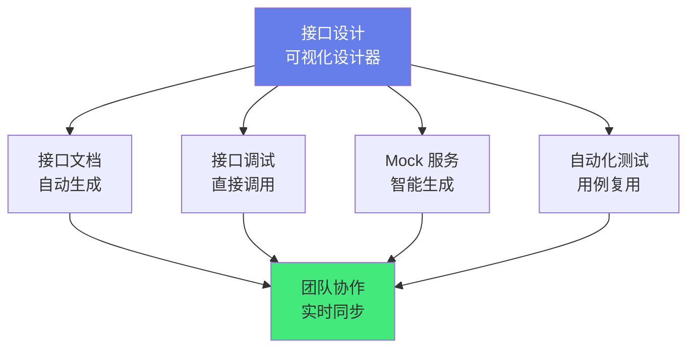

# 🦊 Apifox 接口管理平台

> **文档说明**：系统讲解 Apifox 接口管理平台的完整知识体系，涵盖 Apifox 的产品定位与核心价值、与 Postman/Swagger/YApi 等工具的对比、核心功能模块（接口设计/接口调试/Mock 服务/自动化测试/文档生成/团队协作）、接口设计规范与数据模型、接口调试高级技巧（环境变量/全局变量/动态参数/前置后置脚本）、Mock 服务配置（智能 Mock/自定义规则/期望请求）、自动化测试用例设计与 CI/CD 集成、接口文档自动生成与分享、团队协作与权限管理、数据导入导出（Postman/Swagger/OpenAPI/Har）、CLI 工具与自动化、常见问题与最佳实践。
>
> **适用人群**：前后端开发者、测试工程师、技术负责人、产品经理、需要 API 管理的所有技术人员
>
> **前置知识**：[[RESTfulAPI设计原则]] · [[HTTP协议与请求方法]]

---

## 一、概述

### 1.1 什么是 Apifox

Apifox 是一款**API 一体化协作平台**，将 API 文档、API 调试、API Mock、API 自动化测试整合在一个工具中，解决前后端协作中「文档不同步、调试工具分散、Mock 服务难维护、测试用例重复编写」等痛点。

**Apifox 的核心理念**：
> **API 文档 = API 调试 = API 测试 = API Mock**，一份数据多处使用，彻底解决数据不一致问题。

**传统 API 开发流程的痛点**：
| 阶段 | 传统工具 | 痛点 |
|------|---------|------|
| **接口设计** | Swagger/Word/手写文档 | 文档与代码不同步，维护成本高 |
| **接口调试** | Postman/curl | 调试数据与文档分离，需要手动同步 |
| **Mock 服务** | Mock.js/自建服务 | 需要单独维护 Mock 规则，与文档脱节 |
| **自动化测试** | JMeter/Postman Runner | 测试用例需要重新编写，与调试数据不共享 |
| **团队协作** | 邮件/IM 传文件 | 版本混乱，权限难管理 |

**Apifox 的解决方案**：


### 1.2 Apifox vs 其他工具

| 功能 | Apifox | Postman | Swagger | YApi |
|------|--------|---------|---------|------|
| **接口文档** | ✅ 可视化设计+自动生成 | ⚠️ 简单文档 | ✅ 注解生成 | ✅ 可视化设计 |
| **接口调试** | ✅ 内置 | ✅ 强大 | ❌ 需配合 Swagger UI | ✅ 内置 |
| **Mock 服务** | ✅ 智能 Mock+自定义 | ⚠️ 需付费 Mock Server | ❌ 无 | ✅ 内置 |
| **自动化测试** | ✅ 测试用例+CI 集成 | ✅ Newman+Runner | ❌ 无 | ⚠️ 基础测试 |
| **数据一致性** | ✅ 一份数据多处用 | ❌ 调试/测试分离 | ❌ 文档/调试分离 | ⚠️ 部分一致 |
| **团队协作** | ✅ 实时协作+权限 | ⚠️ 需付费团队版 | ❌ 无 | ✅ 团队协作 |
| **免费额度** | ✅ 个人免费+团队免费 | ⚠️ 基础免费，高级付费 | ✅ 开源免费 | ✅ 开源自建 |
| **中文支持** | ✅ 原生中文 | ⚠️ 英文为主 | ⚠️ 英文为主 | ✅ 中文 |
| **导入导出** | ✅ 支持 20+ 格式 | ✅ 支持多种 | ⚠️ OpenAPI 标准 | ✅ 支持多种 |

**选型建议**：
- **个人开发者/小团队**：Apifox（免费、功能全、中文友好）
- **大型企业/复杂 API**：Postman Enterprise（生态成熟、高级功能）
- **代码优先/Java 生态**：Swagger/OpenAPI（注解生成、与 Spring 集成好）
- **开源自建/隐私要求**：YApi（开源自部署）

### 1.3 核心功能模块

| 模块 | 说明 | 核心价值 |
|------|------|---------|
| **接口设计** | 可视化设计 API，支持 RESTful/GraphQL/gRPC | 标准化接口定义，前后端并行开发 |
| **接口调试** | 类 Postman 的调试界面，支持环境变量/脚本 | 快速验证接口，调试数据即文档 |
| **Mock 服务** | 智能 Mock 数据，自定义规则，期望请求 | 前端无需等后端，独立开发 |
| **自动化测试** | 测试用例、测试场景、断言、CI 集成 | 接口回归测试，保障质量 |
| **接口文档** | 自动生成在线文档，支持分享/导出 | 文档实时同步，无需手动维护 |
| **数据模型** | 可复用的数据结构定义 | 减少重复定义，保持一致性 |
| **环境管理** | 多环境（开发/测试/生产）变量管理 | 一套接口，多环境切换 |
| **团队协作** | 项目/团队/权限/变更记录 | 多人协作，版本可控 |
| **CLI 工具** | 命令行运行自动化测试 | CI/CD 流水线集成 |

---

## 二、接口设计

### 2.1 新建接口

**接口设计步骤**：
1. 选择「接口设计」模块，点击「新建接口」
2. 填写基本信息：接口名称、请求方法（GET/POST/PUT/DELETE 等）、路径
3. 设计请求参数：Path 参数、Query 参数、Body 参数（JSON/Form/文件）、Header
4. 设计响应数据：成功响应、失败响应、响应状态码
5. 填写接口说明：描述、使用场景、注意事项
6. 保存接口

**接口路径规范**：
```sql
# RESTful 风格
GET    /api/v1/users          # 获取用户列表
GET    /api/v1/users/{id}     # 获取单个用户
POST   /api/v1/users          # 创建用户
PUT    /api/v1/users/{id}     # 更新用户
DELETE /api/v1/users/{id}     # 删除用户

# 路径参数用 {参数名} 表示
GET /api/v1/projects/{projectId}/members/{memberId}
```

### 2.2 请求参数设计

**参数类型**：
| 参数类型 | 说明 | 示例 |
|---------|------|------|
| **Path 参数** | URL 路径中的参数 | `/users/{id}` 中的 `id` |
| **Query 参数** | URL ? 后的查询参数 | `?page=1&size=10` |
| **Body 参数** | 请求体中的参数（JSON/Form/文件） | `{"name": "张三", "age": 18}` |
| **Header 参数** | 请求头参数 | `Authorization: Bearer xxx` |
| **Cookie 参数** | Cookie 中的参数 | `sessionId=xxx` |

**JSON Body 设计示例**：
```json
{
  "name": "string",           // 用户名，必填
  "email": "string",          // 邮箱，必填，格式校验
  "age": 0,                   // 年龄，可选，范围 0-150
  "roles": ["string"],        // 角色列表，可选
  "address": {                // 地址对象，可选
    "province": "string",
    "city": "string",
    "detail": "string"
  }
}
```

**Apifox 中的字段设置**：
- 字段名、字段类型（string/number/boolean/object/array/null）
- 是否必填、默认值、示例值
- 描述说明、备注
- 高级设置：正则校验、取值范围、枚举值、Mock 规则

### 2.3 响应数据设计

**响应结构规范**：
```json
{
  "code": 0,              // 业务状态码，0 表示成功
  "message": "success",   // 提示信息
  "data": {               // 响应数据
    "id": 1,
    "name": "张三",
    "email": "zhangsan@example.com"
  },
  "timestamp": 1700000000000  // 时间戳
}
```

**响应状态码**：
| 状态码 | 说明 | 场景 |
|--------|------|------|
| 200 | OK | 请求成功 |
| 201 | Created | 创建成功 |
| 204 | No Content | 删除成功，无返回体 |
| 400 | Bad Request | 请求参数错误 |
| 401 | Unauthorized | 未认证/Token 失效 |
| 403 | Forbidden | 无权限 |
| 404 | Not Found | 资源不存在 |
| 409 | Conflict | 资源冲突（如重复创建） |
| 422 | Unprocessable Entity | 参数校验失败 |
| 429 | Too Many Requests | 请求过于频繁（限流） |
| 500 | Internal Server Error | 服务器内部错误 |
| 502 | Bad Gateway | 网关错误 |
| 503 | Service Unavailable | 服务不可用 |

### 2.4 数据模型（Schema）

数据模型是可复用的数据结构定义，避免在多个接口中重复定义相同的结构。

```json
// 用户模型（可复用）
{
  "id": "number",
  "name": "string",
  "email": "string",
  "avatar": "string",
  "createdAt": "string",
  "updatedAt": "string"
}

// 分页响应模型（可复用）
{
  "list": ["$ref:User"],  // 引用用户模型
  "total": "number",
  "page": "number",
  "size": "number"
}
```

**Apifox 数据模型功能**：
- 新建/编辑/删除数据模型
- 模型引用（`$ref`）
- 模型继承（allOf）
- 模型导入（从 JSON/JSON Schema 导入）
- 模型导出

---

## 三、接口调试

### 3.1 调试界面

Apifox 的接口调试界面类似 Postman，包含：
- **请求行**：请求方法、URL、发送按钮
- **参数区**：Params（Query）、Body、Headers、Cookies、Auth
- **响应区**：响应状态、响应头、响应体、响应时间、响应大小
- **控制台**：请求日志、脚本输出

### 3.2 环境变量

**环境变量的作用**：在不同环境（开发/测试/生产）中使用不同的变量值，接口定义不变。

**变量类型**：
| 变量类型 | 作用域 | 说明 |
|---------|--------|------|
| **全局变量** | 所有项目 | 跨项目共享的变量 |
| **环境变量** | 当前环境 | 随环境切换的变量（如 baseUrl） |
| **项目变量** | 当前项目 | 项目内共享，不随环境变化 |
| **临时变量** | 单次运行 | 脚本中设置的临时变量 |
| **内置变量** | 全局 | Apifox 内置（如 $timestamp/$randomInt） |

**变量引用语法**：
```json
{{variableName}}

# 示例
URL: {{baseUrl}}/api/v1/users
Header: Authorization: Bearer {{token}}
Body: {"userId": {{userId}}}
```

**环境配置示例**：
```css
# 开发环境
baseUrl: http://localhost:3000
token: dev-token-xxx

# 测试环境
baseUrl: https://test-api.example.com
token: test-token-xxx

# 生产环境
baseUrl: https://api.example.com
token: prod-token-xxx
```

### 3.3 前置/后置脚本

Apifox 支持在请求前（前置脚本）和请求后（后置脚本）执行 JavaScript 代码。

**前置脚本（Pre-request Script）**：
```javascript
// 生成时间戳
pm.environment.set("timestamp", Date.now());

// 生成签名
const appKey = "your-app-key";
const appSecret = "your-app-secret";
const timestamp = Date.now();
const sign = CryptoJS.MD5(appKey + appSecret + timestamp).toString();
pm.environment.set("sign", sign);
pm.environment.set("timestamp", timestamp);

// 生成随机数
pm.environment.set("nonce", Math.random().toString(36).substring(2));
```

**后置脚本（Tests/Post-response Script）**：
```javascript
// 断言响应状态码
pm.test("状态码为 200", function () {
  pm.response.to.have.status(200);
});

// 断言响应体包含字段
pm.test("返回数据包含 id", function () {
  const jsonData = pm.response.json();
  pm.expect(jsonData.data).to.have.property("id");
});

// 提取响应数据到环境变量
const jsonData = pm.response.json();
pm.environment.set("userId", jsonData.data.id);
pm.environment.set("token", jsonData.data.token);

// 断言响应时间
pm.test("响应时间小于 500ms", function () {
  pm.expect(pm.response.responseTime).to.be.below(500);
});
```

### 3.4 认证方式

Apifox 支持多种认证方式：
| 认证方式 | 说明 |
|---------|------|
| **API Key** | 在 Header/Query 中添加密钥 |
| **Bearer Token** | `Authorization: Bearer <token>` |
| **Basic Auth** | 用户名密码 Base64 编码 |
| **Digest Auth** | 摘要认证 |
| **OAuth 1.0** | OAuth 1.0 认证 |
| **OAuth 2.0** | OAuth 2.0 授权码/客户端模式 |
| **Hawk 认证** | Hawk 认证 |
| **AWS 签名** | AWS Signature V4 |
| **自定义签名** | 前置脚本生成签名 |

---

## 四、Mock 服务

### 4.1 智能 Mock

Apifox 的智能 Mock 功能根据接口定义的字段类型和名称，自动生成合理的 Mock 数据。

**智能 Mock 规则**：
| 字段名/类型 | Mock 生成规则 | 示例 |
|------------|--------------|------|
| `name`/`username` | 中文/英文姓名 | "张三" / "John Smith" |
| `email` | 邮箱地址 | "zhangsan@example.com" |
| `phone`/`mobile` | 手机号 | "13800138000" |
| `id` | 数字 ID | 12345 |
| `url`/`link` | URL 地址 | "https://example.com" |
| `image`/`avatar` | 图片 URL | "https://picsum.photos/200" |
| `time`/`date` | 时间/日期 | "2024-01-01 12:00:00" |
| `ip` | IP 地址 | "192.168.1.1" |
| `address` | 地址 | "北京市朝阳区xxx" |
| `price`/`amount` | 金额 | 99.99 |
| `status`/`state` | 状态枚举 | 0/1/2 |
| `boolean` 类型 | 布尔值 | true/false |
| `array` 类型 | 数组（默认 3 个元素） | [...] |
| `object` 类型 | 对象 | {...} |

### 4.2 自定义 Mock 规则

可以在字段设置中自定义 Mock 规则：

```css
# Mock 规则语法
@name()          // 生成姓名
@email()         // 生成邮箱
@phone()         // 生成手机号
@id()            // 生成 ID
@integer(1,100)  // 生成 1-100 的整数
@float(0,100,2)  // 生成 0-100 的两位小数
@boolean()       // 生成布尔值
@date('YYYY-MM-DD')  // 生成指定格式日期
@image('200x200')    // 生成指定尺寸图片
@url()           // 生成 URL
@ip()            // 生成 IP
@cparagraph()    // 生成中文段落
@csentence()     // 生成中文句子
@word()          // 生成英文单词
@title()         // 生成标题
```

**高级 Mock 规则**：
```css
# 枚举值
@pick('active','inactive','pending')

# 正则表达式
@regexp(/1[3-9]\d{9}/)

# 自增 ID
@increment(1)

# 当前时间
@now('YYYY-MM-DD HH:mm:ss')

# 数组长度
@array(5, 10)  // 生成 5-10 个元素的数组
```

### 4.3 期望请求（Expectation）

期望请求允许根据不同的请求参数返回不同的 Mock 响应，模拟真实业务场景。

**配置示例**：
| 请求条件 | 响应 |
|---------|------|
| `page=1&size=10` | 返回第 1 页数据 |
| `page=2&size=10` | 返回第 2 页数据 |
| `status=active` | 返回活跃用户列表 |
| `id=999` | 返回 404 未找到 |
| `token=invalid` | 返回 401 未授权 |

### 4.4 Mock 服务使用方式

| 方式 | 说明 |
|------|------|
| **云端 Mock** | Apifox 云端自动生成 Mock URL，无需启动本地服务 |
| **本地 Mock** | 桌面端启动本地 Mock 服务，支持自定义端口 |
| **内网 Mock** | 企业版支持内网部署 Mock 服务 |
| **Mock URL 格式** | `https://mock.apifox.cn/m1/{projectId}/{接口路径}` |

---

## 五、自动化测试

### 5.1 测试用例

自动化测试用例基于接口定义创建，复用接口的请求参数和响应断言。

**测试用例结构**：
```text
测试场景（Test Suite）
├── 测试用例1（Test Case）
│   ├── 步骤1：调用登录接口
│   ├── 步骤2：提取 token 到变量
│   ├── 步骤3：调用获取用户信息接口
│   └── 断言：验证返回数据
├── 测试用例2
│   ├── 步骤1：创建用户
│   ├── 步骤2：查询用户
│   ├── 步骤3：删除用户
│   └── 断言：验证 CRUD 流程
```

**断言类型**：
| 断言类型 | 说明 | 示例 |
|---------|------|------|
| **状态码断言** | 验证 HTTP 状态码 | `response.code === 200` |
| **响应头断言** | 验证响应头字段 | `response.headers.content-type === 'application/json'` |
| **响应体断言** | 验证响应体字段 | `response.data.code === 0` |
| **响应时间断言** | 验证响应时间 | `response.time < 500` |
| **JSON Schema 断言** | 验证响应结构符合 Schema | 符合预定义 Schema |
| **正则断言** | 验证内容匹配正则 | 匹配 `/success/i` |
| **自定义脚本断言** | JavaScript 自定义逻辑 | `pm.test(...)` |

### 5.2 测试场景

测试场景是多个测试用例的集合，用于模拟完整的业务流程。

**典型测试场景**：
1. **用户注册登录流程**：注册 → 登录 → 获取用户信息 → 修改信息 → 登出
2. **订单流程**：创建订单 → 支付 → 查询订单 → 取消订单
3. **权限测试**：未登录访问 → 普通用户访问 → 管理员访问
4. **边界测试**：空参数 → 超长参数 → 特殊字符 → 非法格式
5. **性能测试**：并发请求 → 响应时间统计 → 限流测试

### 5.3 CI/CD 集成

Apifox 提供 CLI 工具（Apifox CLI），可以在 CI/CD 流水线中运行自动化测试。

**安装 CLI**：
```bash
npm install -g apifox-cli
```

**运行测试**：
```bash
# 运行测试用例
apifox run <测试用例ID> --env <环境ID> --reporter cli,junit

# 运行测试场景
apifox run <测试场景ID> --env <环境ID>

# 输出测试报告
apifox run <ID> --reporter html --out ./report
```

**GitHub Actions 集成示例**：
```yaml
name: API Test
on: [push, pull_request]
jobs:
  test:
    runs-on: ubuntu-latest
    steps:
      - uses: actions/checkout@v4
      - uses: actions/setup-node@v4
        with:
          node-version: '20'
      - name: Install Apifox CLI
        run: npm install -g apifox-cli
      - name: Run API Tests
        run: apifox run ${{ secrets.APIFOX_TEST_ID }} --env ${{ secrets.APIFOX_ENV_ID }} --reporter cli,junit
        env:
          APIFOX_ACCESS_TOKEN: ${{ secrets.APIFOX_ACCESS_TOKEN }}
```

---

## 六、团队协作

### 6.1 项目与团队

**组织结构**：
```text
团队（Team）
├── 项目1（Project）
│   ├── 接口模块1
│   ├── 接口模块2
│   ├── 测试用例
│   ├── Mock 服务
│   └── 环境配置
├── 项目2
└── 成员管理
```

### 6.2 权限管理

| 角色 | 权限 |
|------|------|
| **管理员** | 全部权限，包括成员管理、项目设置 |
| **开发者** | 接口设计/调试/测试，可编辑接口 |
| **只读成员** | 查看接口、调试、运行测试，不可编辑 |
| **测试工程师** | 接口调试、测试用例管理，不可编辑接口定义 |

### 6.3 协作功能

- **实时协作**：多人同时编辑，实时同步
- **变更记录**：所有修改有历史记录，可回溯
- **评论功能**：接口下可评论，讨论设计问题
- **版本管理**：接口修改有版本，可对比和回滚
- **通知提醒**：接口变更通知相关成员
- **接口评审**：接口设计评审流程

---

## 七、数据导入导出

### 7.1 支持的导入格式

| 格式 | 说明 |
|------|------|
| **Postman** | Postman Collection v2.0/v2.1 |
| **Swagger/OpenAPI** | OpenAPI 2.0/3.0（JSON/YAML） |
| **HAR** | HTTP Archive 格式（浏览器抓包导出） |
| **YApi** | YApi 导出格式 |
| **RAP2** | RAP2 导出格式 |
| **ApiPost** | ApiPost 导出格式 |
| **ShowDoc** | ShowDoc 导出格式 |
| **DOClever** | DOClever 导出格式 |
| **Apifox** | Apifox 项目导出格式（完整备份） |
| **cURL** | cURL 命令导入单个接口 |
| **JSON Schema** | JSON Schema 导入数据模型 |

### 7.2 导出格式

| 格式 | 说明 |
|------|------|
| **OpenAPI/Swagger** | 标准 OpenAPI 3.0（JSON/YAML） |
| **Apifox** | Apifox 项目完整备份 |
| **HTML** | 静态 HTML 文档 |
| **Markdown** | Markdown 格式文档 |
| **Postman** | Postman Collection 格式 |

---

## 八、常见问题与最佳实践

### 8.1 常见问题

| 问题 | 原因 | 解决方案 |
|------|------|---------|
| **Mock 数据不符合预期** | 智能 Mock 规则不匹配字段名 | 自定义 Mock 规则，或设置字段示例值 |
| **环境变量不生效** | 变量名拼写错误，或未选择正确环境 | 检查变量名，确认当前环境，变量引用用 `{{}}` |
| **接口调试跨域** | 浏览器 CORS 限制 | 用桌面端（不受 CORS 限制），或后端配置 CORS |
| **导入 Swagger 后字段丢失** | Swagger 定义不规范，或版本不兼容 | 检查 Swagger 格式，用 OpenAPI 3.0 标准 |
| **自动化测试断言失败** | 响应数据变化，或断言条件太严格 | 用动态变量，合理设置断言，排除时间戳等变化字段 |
| **团队成员看不到项目** | 未加入团队，或权限不足 | 管理员邀请成员，分配正确角色 |
| **CLI 运行测试失败** | Token 无效，或测试 ID 错误 | 检查 Access Token，确认测试用例/场景 ID |
| **接口文档分享后无法访问** | 分享链接过期，或设置了密码 | 重新生成分享链接，检查访问设置 |
| **大文件上传调试失败** | 请求体大小限制，或超时 | 调整超时时间，用 form-data 上传，检查服务端限制 |
| **WebSocket 调试** | Apifox 版本不支持，或配置错误 | 升级到最新版，参考 WebSocket 调试文档 |

### 8.2 最佳实践

1. **接口设计先行**：
   - 前后端先约定接口设计，再并行开发
   - 接口设计经过评审后再开始编码
   - 接口变更走变更流程，通知相关方

2. **规范命名**：
   - 接口名称：动词+名词，如「获取用户列表」「创建用户」
   - 接口路径：RESTful 风格，小写，连字符分隔
   - 字段命名：统一风格（camelCase 或 snake_case），不要混用
   - 分组管理：按业务模块分组接口

3. **环境管理**：
   - 区分开发/测试/预发/生产环境
   - 敏感信息（token/密钥）只放在环境变量中，不写死在接口里
   - 生产环境变量设置访问权限

4. **Mock 服务**：
   - 前端开发阶段用 Mock 服务，不依赖后端
   - Mock 数据尽量真实，覆盖各种业务场景
   - 用期望请求模拟异常场景（404/500/超时）

5. **自动化测试**：
   - 核心接口必须有自动化测试用例
   - 测试用例覆盖正常流程和异常流程
   - CI/CD 中集成自动化测试，每次部署前运行
   - 定期清理失效的测试用例

6. **文档维护**：
   - 接口变更时同步更新文档（Apifox 天然解决）
   - 复杂接口添加详细说明和使用示例
   - 定期检查文档准确性，清理废弃接口

7. **团队协作**：
   - 明确接口负责人，谁的接口谁维护
   - 接口变更通知相关前后端人员
   - 定期评审接口设计，保持一致性
   - 用评论功能讨论接口问题，保留讨论记录

8. **数据安全**：
   - 不在接口示例中使用真实生产数据
   - 敏感接口设置访问权限
   - 分享文档时设置密码和有效期
   - 定期导出项目备份

---

## 九、关联笔记

### API 与接口
- [[RESTfulAPI设计原则]] · [[HTTP协议与请求方法]] · [[WebSocket与SSE原理]]
- [[Postman接口测试]] · [[Swagger与OpenAPI规范]] · [[接口安全与鉴权]]

### 开发工具
- [[VSCode高效开发]] · [[Git基础与核心命令]] · [[CI-CD流水线]]

### 导航
- [[MOC-通用工具]] · [[MOC-综合导航]] · [[Home]]

> 🔍 **知识点深度解析**
>
> **作用**：Apifox 解决的是「API 全生命周期管理中工具分散、数据不一致的问题」——传统开发中，接口设计用 Swagger/Word、接口调试用 Postman、Mock 服务用 Mock.js/自建、自动化测试用 JMeter/Postman、文档用手写/自动生成，每个工具的数据是独立的，同一份接口定义需要在多个工具中重复维护，导致文档与实际接口不同步、调试数据与测试用例不共享、Mock 规则与文档脱节。Apifox 将这些功能整合到一个平台，用「一份数据多处使用」的理念彻底解决数据一致性问题——接口设计即文档、调试数据即测试用例、字段定义即 Mock 规则。
>
> **底层原理**：Apifox 的核心是「统一数据模型」——所有功能模块（设计/调试/Mock/测试/文档）共享同一份接口定义数据。接口定义包含：基本信息（名称/方法/路径/描述）、请求参数（Path/Query/Body/Header/Cookie，每个参数有类型/是否必填/示例/Mock规则/描述）、响应数据（多个响应状态，每个响应有数据结构/示例）、数据模型（可复用的 Schema，支持引用和继承）。当你在接口设计器中定义了一个字段，这个字段的类型、示例、Mock规则会自动被调试功能（填充默认值）、Mock功能（生成Mock数据）、测试功能（断言响应结构）、文档功能（展示字段说明）共享。这种「单一数据源（Single Source of Truth）」的设计是 Apifox 与传统工具组合的本质区别。Mock 服务的原理是「根据字段定义动态生成响应」——收到请求后，匹配接口定义，根据字段类型和名称（智能规则）或自定义 Mock 规则生成 JSON 响应，无需编写 Mock 代码。自动化测试的原理是「按顺序执行请求+断言」——测试场景中的每个步骤是一个接口调用，步骤之间通过变量传递数据（如登录接口返回的 token 存入变量，后续接口引用），每个步骤可以配置断言验证响应，全部通过则测试成功。
>
> **用法要点**：① 接口设计：新建接口→填写方法/路径→设计请求参数（Path/Query/Body/Header）→设计响应数据（成功/失败响应+状态码）→填写说明→保存；字段设置：类型/必填/默认值/示例/描述/Mock规则/校验规则 ② 接口调试：选择环境→URL 用 `{{baseUrl}}` 变量→参数自动填充→发送请求→查看响应；前置脚本（生成签名/时间戳）、后置脚本（断言/提取变量）；认证方式（Bearer Token/Basic/OAuth2/自定义） ③ 环境变量：全局变量/环境变量/项目变量/临时变量/内置变量；引用语法 `{{varName}}`；多环境切换（dev/test/prod） ④ Mock 服务：智能 Mock（根据字段名/类型自动生成）、自定义 Mock 规则（@name/@email/@phone/@integer等）、期望请求（不同参数返回不同响应）；云端 Mock URL 直接使用 ⑤ 自动化测试：测试用例（单接口测试+断言）、测试场景（多步骤业务流程+变量传递）；断言类型（状态码/响应头/响应体/响应时间/Schema/正则/自定义脚本）；CLI 工具（apifox run）+ CI/CD 集成（GitHub Actions/GitLab CI） ⑥ 团队协作：团队/项目/成员/角色（管理员/开发者/只读/测试）；实时协作/变更记录/评论/版本管理/通知 ⑦ 导入导出：导入（Postman/Swagger/OpenAPI/HAR/YApi/cURL等20+格式）；导出（OpenAPI/HTML/Markdown/Postman/Apifox备份） ⑧ 最佳实践：接口设计先行+评审、规范命名（RESTful路径/统一字段风格）、环境管理（敏感信息用变量）、Mock真实化（覆盖异常场景）、核心接口自动化测试+CI集成、文档同步维护、明确接口负责人、数据安全（不用真实数据/分享设密码）。

> 💡 **深度讲解**：Apifox 最核心的智慧是「单一数据源（Single Source of Truth）」——在传统工具组合中，同一份接口定义需要在 Swagger（文档）、Postman（调试）、Mock.js（Mock）、JMeter（测试）中重复维护，每处都可能与实际代码不一致，这就是「数据不一致」的根源。Apifox 的解法是「所有功能共享同一份接口定义」——你在接口设计器中定义的字段，会自动出现在调试界面（作为默认参数）、Mock 服务（作为生成规则）、测试用例（作为断言依据）、在线文档（作为字段说明）。改一处，处处同步，从根本上消除了数据不一致。这就像「中央厨房」——传统模式是每个餐厅自己买菜做菜（每个工具自己维护数据），质量参差不齐；Apifox 是中央厨房统一采购加工（统一数据模型），各餐厅只需加热上桌（各功能模块消费统一数据），质量一致且高效。「接口设计先行」是 Apifox 推崇的开发模式——传统模式是后端先写代码，再从代码生成文档（Swagger 注解），前端等后端接口写完才能开发；Apifox 模式是前后端先在 Apifox 中约定接口设计（设计即文档），前端用 Mock 服务独立开发，后端按接口设计实现代码，双方并行，最后联调。这种模式大大缩短了开发周期，减少了联调阶段的接口变更。理解了「单一数据源」和「设计先行」，你就理解了 Apifox 的产品哲学——不是做一个「更好的 Postman」，而是做一个「API 全生命周期的统一平台」，从设计到调试到测试到文档，用一份数据贯穿始终。

> 📝 **精简总结**：Apifox = API 一体化协作平台，整合文档/调试/Mock/测试，一份数据多处使用。核心功能：接口设计（可视化+RESTful+数据模型）、接口调试（环境变量+前置后置脚本+认证）、Mock 服务（智能Mock+自定义规则+期望请求）、自动化测试（用例+场景+断言+CLI/CI）、文档（自动生成+分享）、团队协作（权限+实时+版本）。vs Postman：Apifox 免费功能全+中文+数据一致，Postman 生态成熟+高级付费。最佳实践：设计先行+规范命名+环境管理+Mock真实化+核心接口测试+CI集成+文档同步+数据安全。

> **学习路径建议**：先学习 [[RESTfulAPI设计原则]] 掌握 API 设计基础 → 学习 [[HTTP协议与请求方法]] 理解 HTTP 协议 → 学习本文档掌握 Apifox 使用 → 实践：用 Apifox 设计一个完整项目的 API → 学习 [[Postman接口测试]] 对比理解 → 学习 [[Swagger与OpenAPI规范]] 理解标准 → 学习 [[接口安全与鉴权]] 掌握 API 安全 → 在实际项目中推行 Apifox 工作流。

---

> **Apifox 的本质是「API 开发的协作秩序」——在没有统一工具的时代，API 开发是混乱的：文档散落在各处、调试数据各自维护、Mock 服务无人管理、测试用例重复编写、前后端联调时才发现接口不一致。Apifox 通过「单一数据源」将这些碎片化的工作整合到一个平台，让 API 开发从「混乱的手工协作」变成「有序的平台协作」——设计即文档、调试即测试、Mock 即规则，一切围绕同一份接口定义展开。当你的团队采用 Apifox 工作流后，API 开发不再是「后端写完前端等」的串行模式，而是「设计约定→并行开发→Mock 联调→自动化验证」的高效并行模式。这就是工具的力量：好的工具不仅仅是「提高效率」，更是「建立秩序」——它定义了协作的方式、规范了流程、统一了标准，让团队从「各自为战」变成「协同作战」。**

---

## 🔗 关联笔记

- [[MOC-通用工具]] — 返回本分类知识地图，查看更多相关文档

## 📖 前置知识

- 无特殊前置知识要求，具备基础编程概念即可

## 🏷️ 相关标签

`#自动化测试` `#Mock服务` `#Apifox` `#API管理` `#接口调试` `#API文档`

[[Home|🏠 返回首页]] · [[MOC-通用工具|📚 返回分类]]
