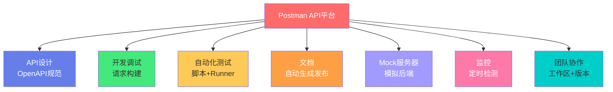
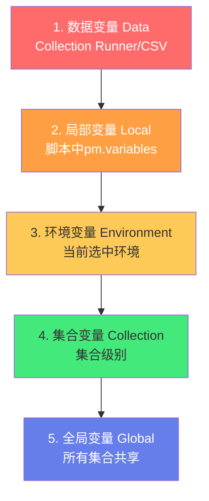
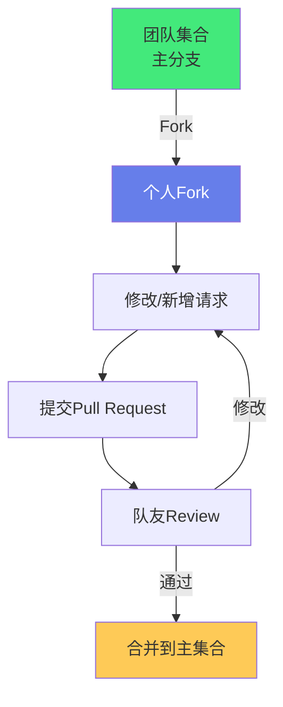

# 📮 Postman 高级用法与团队协作

> **文档说明**：系统讲解 Postman API 开发平台的高级功能、自动化测试、团队协作与 CI/CD 集成，涵盖 Postman 的核心架构（请求构建器/集合 Collection/环境 Environment/脚本引擎）、环境与变量管理（全局变量/环境变量/集合变量/数据变量/局部变量的五级作用域与优先级）、集合 Collection 的组织策略（文件夹/请求/描述/示例）、Pre-request Script 与 Tests 脚本详解（Postman JavaScript API / `pm` 对象 / 断言库 / 动态变量 / 设置变量 / 流程控制）、集合运行器 Collection Runner（批量执行/数据驱动测试/迭代次数/导出结果）、Newman 命令行运行器（命令行参数/HTML 报告/CI/CD 集成 Jenkins/GitHub Actions）、Mock 服务器（创建 Mock/自定义响应/前后端并行开发/响应延迟模拟）、API 文档自动生成（发布文档/自定义域名/版本管理/嵌入网站）、监视器 Monitors（定时运行集合/性能监控/告警通知）、团队协作功能（团队工作区/角色权限/集合版本控制/评论协作/分支与合并/Fork）、API 设计优先工作流（OpenAPI/Swagger 规范导入导出/API Builder/规范校验/契约测试）、Postman Interceptor（捕获浏览器请求/同步 Cookie）、Postman vs Insomnia vs curl vs Apifox 对比、Postman 免费版 vs 付费版（Pro/Enterprise/Basic）功能差异、常见问题（变量不生效/脚本报错/CORS/大集合卡顿）与最佳实践（命名规范/集合结构/环境隔离/安全管理/版本控制）。
>
> **适用人群**：后端/前端/全栈开发者、测试工程师、API 设计者、DevOps、需要团队协作 API 开发的技术团队
>
> **前置知识**：[[HTTP协议详解]] · [[RESTfulAPI设计原则]] · [[JSON数据格式]]

---

## 一、概述

### 1.1 Postman 是什么

**Postman** 是一个完整的 **API 开发平台**，从最初的 Chrome 扩展（2012 年）发展为涵盖 API 设计、开发、测试、文档、监控、协作的全生命周期平台。



**核心能力**：
- API 请求构建与调试（REST/GraphQL/SOAP/WebSocket）
- 集合（Collection）组织与管理
- 环境变量与多环境切换
- 自动化测试脚本（JavaScript）
- 集合批量运行与数据驱动
- Mock 服务器
- 自动生成 API 文档
- 定时监控
- 团队协作与版本控制
- CI/CD 集成（Newman）

### 1.2 为什么需要高级用法

大多数人只用 Postman 的「发请求」功能（约 10% 的能力），掌握高级用法能：

| 能力 | 价值 |
|------|------|
| **环境变量** | 一套请求在 dev/test/prod 间无缝切换 |
| **测试脚本** | 自动断言响应，替代手动检查 |
| **集合运行器** | 批量执行+数据驱动，回归测试自动化 |
| **Newman** | 命令行运行，接入 CI/CD 流水线 |
| **Mock 服务器** | 前后端并行开发，不等后端 |
| **团队协作** | API 资产共享，版本控制，评论协作 |
| **自动文档** | 集合即文档，保持文档与代码同步 |

---

## 二、环境与变量管理

### 2.1 五级变量作用域

Postman 有五级变量，优先级从高到低：



| 级别 | 作用域 | 定义方式 | 适用场景 |
|------|--------|---------|---------|
| **数据变量** | 单次运行 | CSV/JSON 文件 | 数据驱动测试 |
| **局部变量** | 单次请求 | `pm.variables.set()` | 脚本临时值 |
| **环境变量** | 当前环境 | 环境编辑器 | dev/test/prod 切换 |
| **集合变量** | 整个集合 | 集合变量标签 | 集合内共享配置 |
| **全局变量** | 所有集合 | 全局变量编辑器 | 跨集合共享 |

> **优先级规则**：高优先级覆盖低优先级。例如环境变量和全局变量同名时，使用环境变量的值。

### 2.2 变量使用

**在请求中引用变量**：`{{variableName}}`

```css
URL: https://{{baseUrl}}/api/users/{{userId}}
Header: Authorization: Bearer {{token}}
Body: {"name": "{{userName}}"}
```

**在脚本中操作变量**：
```javascript
// 获取变量（自动按优先级解析）
pm.variables.get("baseUrl");

// 设置局部变量（仅当前请求）
pm.variables.set("tempId", "123");

// 设置环境变量
pm.environment.set("token", response.json().token);

// 设置集合变量
pm.collectionVariables.set("apiVersion", "v2");

// 设置全局变量
pm.globals.set("globalVar", "value");

// 清除变量
pm.environment.unset("oldToken");
```

### 2.3 动态变量（Dynamic Variables）

Postman 内置的随机生成变量，用 `{{$variableName}}` 引用：

| 变量 | 说明 | 示例 |
|------|------|------|
| `{{$guid}}` | UUID | `611c0e71-9a7a-4ce1-8bc5-...` |
| `{{$timestamp}}` | Unix 时间戳 | `1693200000` |
| `{{$randomInt}}` | 0-1000 随机整数 | `42` |
| `{{$randomEmail}}` | 随机邮箱 | `john.doe@example.com` |
| `{{$randomFirstName}}` | 随机名 | `John` |
| `{{$randomLastName}}` | 随机姓 | `Doe` |
| `{{$randomPhoneNumber}}` | 随机手机号 | `+1-555-123-4567` |
| `{{$randomAlphaNumeric}}` | 随机字母数字 | `a1b2c3` |
| `{{$isoTimestamp}}` | ISO 时间 | `2026-08-28T12:00:00.000Z` |

---

## 三、集合（Collection）组织

### 3.1 集合结构最佳实践

```text
API集合名称/
├── 1.认证模块/
│   ├── 1.1 登录
│   ├── 1.2 注册
│   └── 1.3 登出
├── 2.用户模块/
│   ├── 2.1 获取用户列表
│   ├── 2.2 获取用户详情
│   ├── 2.3 创建用户
│   └── 2.4 删除用户
├── 3.订单模块/
│   └── ...
└── _通用/
    ├── 健康检查
    └── 工具请求
```

**组织原则**：
- 按业务模块分文件夹（而非按 HTTP 方法）
- 文件夹和请求用「编号+名称」便于排序
- 每个请求写清楚描述（会自动生成文档）
- 保存成功/失败的响应示例（用于文档和 Mock）

### 3.2 集合级配置

- **集合变量**：集合内所有请求共享的变量（如 `baseUrl`、`apiVersion`）
- **集合级 Pre-request Script**：集合内所有请求执行前运行（如统一加时间戳）
- **集合级 Tests**：集合内所有请求执行后运行（如统一检查响应时间）
- **授权方式**：集合级统一设置 Bearer Token，子请求继承

---

## 四、脚本引擎：Pre-request & Tests

### 4.1 脚本执行顺序


```text
### 4.2 Pre-request Script
```

请求发送前执行，常用于：
- 生成动态参数（时间戳、签名、随机数）
- 设置请求头
- 准备测试数据

```javascript
// 生成时间戳
const timestamp = Math.floor(Date.now() / 1000);
pm.variables.set("timestamp", timestamp);

// 生成签名（HMAC-SHA256）
const crypto = require('crypto-js');
const secret = pm.environment.get("appSecret");
const sign = crypto.HmacSHA256(timestamp + pm.request.body, secret).toString();
pm.variables.set("sign", sign);

// 设置请求头
pm.request.headers.add({ key: "X-Timestamp", value: timestamp });
```

### 4.3 Tests 脚本

请求响应后执行，用于断言和数据提取：

```javascript
// 1. 状态码断言
pm.test("状态码为200", function () {
    pm.response.to.have.status(200);
});

// 2. 响应时间断言
pm.test("响应时间小于500ms", function () {
    pm.expect(pm.response.responseTime).to.be.below(500);
});

// 3. JSON 内容断言
pm.test("返回成功", function () {
    const json = pm.response.json();
    pm.expect(json.code).to.eql(0);
    pm.expect(json.message).to.eql("success");
});

// 4. 提取 token 到环境变量
const json = pm.response.json();
if (json.data && json.data.token) {
    pm.environment.set("token", json.data.token);
    console.log("Token已保存");
}

// 5. 提取列表第一个元素的ID
const userId = pm.response.json().data.list[0].id;
pm.environment.set("userId", userId);

// 6. Schema 验证
const schema = {
    type: "object",
    properties: {
        code: { type: "number" },
        data: { type: "object" }
    },
    required: ["code", "data"]
};
pm.test("Schema验证通过", function () {
    pm.expect(tv4.validate(pm.response.json(), schema)).to.be.true;
});

// 7. 流程控制（条件跳过后续请求）
if (pm.response.code !== 200) {
    postman.setNextRequest(null); // 停止集合运行
}
```

### 4.4 常用 pm API

| API | 说明 |
|-----|------|
| `pm.response.json()` | 解析响应为 JSON |
| `pm.response.code` | 响应状态码 |
| `pm.response.responseTime` | 响应时间（ms） |
| `pm.response.to.have.status(code)` | 断言状态码 |
| `pm.expect(value).to.eql(expected)` | 深度相等断言 |
| `pm.expect(value).to.include(member)` | 包含断言 |
| `pm.environment.set/get/unset` | 环境变量操作 |
| `pm.variables.set/get` | 局部变量操作 |
| `pm.request` | 当前请求对象（可修改） |
| `pm.info.iteration` | 当前迭代次数 |
| `postman.setNextRequest(name)` | 设置下一个要执行的请求 |
| `console.log()` | 输出到 Console |

---

## 五、集合运行器（Collection Runner）

### 5.1 功能

批量执行集合中的所有请求，支持：
- 选择环境
- 设置迭代次数
- 数据驱动（CSV/JSON 文件）
- 延迟（请求间隔）
- 导出运行结果

### 5.2 数据驱动测试

**CSV 数据文件（users.csv）**：
```csv
username,password,expectedStatus
user1,pass123,200
user2,wrongpass,401
user3,,400
```

**在请求中引用数据变量**：
```css
Body: {"username": "{{username}}", "password": "{{password}}"}
```

**Tests 中使用数据变量**：
```javascript
pm.test("状态码正确", function () {
    pm.response.to.have.status(Number(pm.iterationData.get("expectedStatus")));
});
```

运行时选择 CSV 文件，Postman 会为每行数据执行一次集合。

### 5.3 使用场景

- 接口回归测试（每次发版前跑一遍）
- 数据驱动测试（多组输入验证）
- 性能基线测试（多次运行看平均响应时间）
- 批量数据准备（创建测试数据）

---

## 六、Newman：命令行运行器

### 6.1 什么是 Newman

**Newman** 是 Postman 的命令行运行器，可以在终端/CI 中运行 Postman 集合。

### 6.2 安装与使用

```bash
# 安装
npm install -g newman

# 基本运行
newman run collection.json -e environment.json

# 常用参数
newman run collection.json \
  -e dev-environment.json \      # 环境文件
  -d test-data.csv \             # 数据文件
  -n 3 \                         # 迭代次数
  --delay-request 500 \          # 请求间隔(ms)
  --timeout-request 10000 \      # 请求超时
  --reporters cli,html,junit \   # 报告格式
  --reporter-html-export report.html
```

### 6.3 CI/CD 集成

**GitHub Actions 示例**：
```yaml
name: API Test
on: [push, pull_request]
jobs:
  test:
    runs-on: ubuntu-latest
    steps:
      - uses: actions/checkout@v4
      - uses: actions/setup-node@v4
        with: { node-version: '20' }
      - run: npm install -g newman newman-reporter-html
      - name: Run API tests
        run: |
          newman run postman/collection.json \
            -e postman/env.json \
            --reporters cli,junit \
            --reporter-junit-export report.xml
      - name: Upload report
        uses: actions/upload-artifact@v4
        with:
          name: api-test-report
          path: report.xml
```

**Jenkins 示例**：
```groovy
stage('API Test') {
    sh 'newman run collection.json -e env.json --reporters cli,junit --reporter-junit-export results.xml'
    junit 'results.xml'
}
```

---

## 七、Mock 服务器

### 7.1 什么是 Mock 服务器

Postman Mock 服务器根据集合中的**示例响应**返回模拟数据，让前端可以在后端未完成时并行开发。

### 7.2 创建步骤

1. 在集合中为每个请求保存「示例响应」（Examples）
2. 集合 → 右键 → Mock Collection
3. 配置 Mock 名称、环境、延迟
4. 获得 Mock URL（如 `https://your-mock.mock.pstmn.io`）
5. 前端将 baseUrl 指向 Mock URL

### 7.3 高级用法

- **自定义响应头**：在示例中设置响应头
- **响应延迟模拟**：配置 Mock 服务器的延迟，模拟慢网络
- **条件响应**：根据请求参数返回不同示例（x-mock-response-code / x-mock-response-name 头）
- **私有 Mock**：需要 API Key 访问

```javascript
// 请求时指定返回哪个示例
// Header: x-mock-response-code: 500  → 返回500错误示例
// Header: x-mock-response-name: "用户不存在" → 返回指定名称的示例
```

---

## 八、API 文档

### 8.1 自动生成文档

Postman 集合可以一键发布为 API 文档：
- 集合 → 右键 → View Documentation → Publish
- 文档包含：请求方法/URL/参数/请求体/响应示例/代码片段
- 支持多种语言代码生成（cURL/JavaScript/Python/Java/Go 等）

### 8.2 文档最佳实践

- 每个请求写清楚描述（Markdown 支持）
- 保存多个响应示例（成功/失败/边界）
- 为参数添加描述和示例值
- 定期更新文档（集合更新后重新发布）
- 使用自定义域名（付费版）

---

## 九、监视器（Monitors）

### 9.1 功能

定时运行集合，监控 API 的可用性和性能：
- 设置运行频率（每分钟/每小时/每天）
- 监控响应时间、状态码、断言结果
- 失败时邮件/Slack 通知
- 查看历史趋势图

### 9.2 使用场景

- 生产 API 健康监控
- 第三方 API 可用性监控
- 性能基线追踪
- 定时任务（如每天同步数据）

---

## 十、团队协作

### 10.1 团队工作区

Postman 团队功能：
- **团队工作区**：共享集合、环境、Mock
- **角色权限**：Admin/Editor/Viewer
- **集合版本控制**：每次修改保存版本，可回滚
- **评论**：在请求/集合上评论，@提及队友
- **Fork & Pull Request**：类似 Git，个人 Fork 修改后提交 PR 合并
- **活动日志**：查看团队成员的操作历史

### 10.2 协作工作流



### 10.3 协作最佳实践

- 一个项目一个团队工作区
- 集合按模块组织，专人负责
- 大修改用 Fork + PR，小修改直接编辑
- 环境变量分 dev/test/prod，密钥不共享（用初始值/当前值分离）
- 定期清理无用集合和请求

---

## 十一、API 设计优先

### 11.1 OpenAPI 规范

Postman 支持 API 设计优先工作流：
1. 在 API Builder 中编写 OpenAPI 3.0 规范
2. 从规范生成集合（自动生成请求）
3. 从规范生成 Mock 服务器
4. 从规范生成文档
5. 规范变更时同步更新集合

### 11.2 导入导出

- 导入：OpenAPI/Swagger/Postman Collection/Run/cURL/Har/WSDL
- 导出：Postman Collection JSON / OpenAPI / cURL 命令

```bash
# 从 OpenAPI 生成集合（命令行）
postman-collection-transformer convert \
  -i openapi.yaml -o collection.json \
  -i openapi3 -o postman-collection
```

---

## 十二、版本对比

### 12.1 Postman vs 其他工具

| 维度 | Postman | Insomnia | Apifox | curl |
|------|---------|----------|--------|------|
| **定位** | 全功能API平台 | 简洁API客户端 | API设计+测试+文档 | 命令行工具 |
| **UI** | 功能丰富 | 简洁美观 | 中文友好 | 无UI |
| **测试脚本** | JavaScript | JavaScript | JavaScript | 无（需组合） |
| **Mock** | ✅ 内置 | ✅ 插件 | ✅ 内置 | ❌ |
| **文档** | ✅ 自动发布 | ✅ 生成 | ✅ 在线文档 | ❌ |
| **团队协作** | ✅ 强 | ✅ 基础 | ✅ 强 | ❌ |
| **CI集成** | ✅ Newman | ✅ inso | ✅ 命令行 | ✅ 本身就是 |
| **免费版限制** | 有限 | 较宽松 | 较宽松 | 完全免费 |
| **适用** | 企业团队/全流程 | 个人/小团队 | 国内团队 | 脚本/CI |

### 12.2 免费版 vs 付费版

| 功能 | Free | Basic($12/人/月) | Pro($19/人/月) | Enterprise |
|------|------|-------------------|-------------------|------------|
| 集合数量 | 有限 | 无限 | 无限 | 无限 |
| 团队成员 | 3人 | 无限 | 无限 | 无限 |
| Mock调用 | 1000/月 | 无限 | 无限 | 无限 |
| 监视器 | 有限 | 更多 | 无限 | 无限 |
| 自定义域名 | ❌ | ❌ | ✅ | ✅ |
| SSO/SCIM | ❌ | ❌ | ❌ | ✅ |
| 审计日志 | ❌ | ❌ | 基础 | 完整 |

---

## 十三、常见问题

| 问题 | 原因 | 解决方案 |
|------|------|---------|
| **变量不生效** | 变量名拼写错误/作用域不对/未选环境 | 检查变量名、确认环境选中、Console查看变量值 |
| **Tests 脚本报错** | 响应不是 JSON/字段不存在 | 先判断 `pm.response.code`，用可选链 `json?.data?.id` |
| **CORS 错误** | 浏览器跨域限制 | Postman 桌面端不受 CORS 限制，用桌面端而非网页版 |
| **大集合卡顿** | 集合太大/历史版本多 | 拆分集合、清理旧版本、关闭自动同步 |
| **环境变量泄露** | 密钥存在环境中并分享了 | 用「初始值」（同步）和「当前值」（本地）分离，密钥只填当前值 |
| **Newman 找不到变量** | 环境文件未导出或路径错 | 从 Postman 导出环境 JSON，用 `-e` 指定 |
| **Mock 返回默认响应** | 没有保存示例响应 | 为请求保存 Examples，Mock 基于示例返回 |
| **集合运行顺序不对** | 请求排列顺序或 setNextRequest 错误 | 检查请求排列顺序，脚本中用 `postman.setNextRequest()` 控制 |

---

## 十四、最佳实践

### 14.1 集合设计

- 一个 API 服务一个集合，按业务模块分文件夹
- 请求命名规范：`方法 资源 - 场景`（如 `POST 用户 - 正常登录`）
- 每个请求写描述，保存响应示例
- 集合级统一设置授权和基础 URL

### 14.2 环境管理

- 至少分 dev/test/prod 三个环境
- 环境变量命名规范：`{{baseUrl}}` `{{token}}` `{{userId}}`
- 密钥用「当前值」（本地），不分享到团队
- 定期轮换密钥

### 14.3 测试脚本

- 每个请求至少断言状态码
- 关键接口断言响应体字段
- 用 `pm.expect` 而非 `tests[]`（旧语法）
- 脚本加注释，便于团队理解
- 提取的 token/id 存环境变量，供后续请求使用

### 14.4 安全

- 不在集合/环境中硬编码生产密钥
- 分享集合前清除敏感数据（Postman 有「移除敏感数据」功能）
- Mock 服务器用私有模式（需 API Key）
- 定期审查团队成员权限

### 14.5 版本控制

- 重要集合导出 JSON 备份到 Git
- 大修改用 Fork + PR
- 利用 Postman 的版本历史回滚
- 集合变更写变更说明

---

## 十五、关联笔记

### API 与后端
- [[HTTP协议详解]] · [[RESTfulAPI设计原则]] · [[JSON数据格式]]
- [[SpringBoot-Web开发]] · [[Node.js-Express框架]] · [[API安全与认证]]

### 测试与运维
- [[CI-CD流水线设计]] · [[GitHub-Actions流水线设计]] · [[接口测试方法论]]
- [[性能测试与压测]] · [[监控与告警体系]]

### 导航
- [[MOC-通用工具]] · [[MOC-云原生与运维]] · [[Home]] · [[学习路线总览]]

> 🔍 **知识点深度解析**
>
> **作用**：Postman 高级用法与团队协作解决的是「如何将 Postman 从『手动发请求的调试工具』升级为『API 全生命周期管理平台』，实现自动化测试、Mock 并行开发、文档自动生成、团队协作和 CI/CD 集成」的问题——大多数开发者只用 Postman 发请求（约 10% 能力），掌握环境变量、测试脚本、集合运行器、Newman、Mock、团队协作等高级功能后，Postman 能成为 API 开发的核心平台，大幅提升开发和测试效率。
>
> **底层原理**：①Postman 的核心是「集合（Collection）+ 环境（Environment）+ 脚本引擎」的组合——集合是请求的有序组织容器，环境是变量的隔离容器（dev/test/prod），脚本引擎（基于 Node.js 的沙箱）提供 Pre-request 和 Tests 的可编程能力。三者结合实现了「参数化请求 + 自动断言 + 数据提取 + 流程控制」，这是自动化测试的基础。②变量的五级作用域和优先级是 Postman 灵活性的核心——数据变量（单次运行）> 局部变量（脚本临时）> 环境变量（当前环境）> 集合变量（集合共享）> 全局变量（所有集合）。高优先级覆盖低优先级，这种设计让同一套请求可以通过切换环境和数据文件实现不同场景的测试，而不需要修改请求本身。③Tests 脚本的本质是「在响应返回后执行的 JavaScript 断言和数据提取」——Postman 提供 `pm` 对象封装响应信息和断言库（Chai expect + tv4 JSON Schema），开发者可以写任意 JavaScript 代码做断言、提取数据、设置变量、控制流程（`postman.setNextRequest`）。这让 Postman 从「手动工具」变成了「可编程的测试框架」。④Newman 是 Postman 集合的「命令行运行时」——它读取 Collection JSON 和 Environment JSON，在 Node.js 环境中执行请求和脚本，输出结果和报告。Newman 让 Postman 集合可以脱离 GUI 运行，从而接入 CI/CD 流水线，实现「代码提交→自动跑 API 测试→报告结果」的自动化闭环。⑤Mock 服务器的原理是「根据请求匹配集合中的示例响应」——当请求发送到 Mock URL 时，Mock 服务器根据请求的方法、路径、参数、头信息匹配集合中保存的示例响应，直接返回模拟数据，不需要真实后端。这让前后端可以并行开发（前端基于 Mock 开发，后端基于规范实现），是 API 设计优先工作流的关键环节。⑥团队协作的核心是「集合版本控制 + Fork-PR 工作流」——类似 Git，团队成员 Fork 主集合做修改，提交 Pull Request，队友 Review 后合并。这种工作流避免了多人直接编辑同一集合导致的冲突和覆盖，让 API 资产的协作像代码一样规范可控。
>
> **用法要点**：① 五级变量：数据>局部>环境>集合>全局，引用用{{var}}，脚本用pm.variables/environment/collectionVariables/globals ② 动态变量：{{$guid}}/{{$timestamp}}/{{$randomEmail}}/{{$randomInt}}等内置随机生成 ③ 集合组织：按业务模块分文件夹，编号+名称，每请求写描述和响应示例 ④ Pre-request脚本：生成时间戳/签名/动态参数，pm.request.headers.add修改请求 ⑤ Tests脚本：pm.test()+pm.expect断言状态码/响应时间/JSON字段/Schema，pm.environment.set提取token，postman.setNextRequest控制流程 ⑥ Collection Runner：批量执行+CSV数据驱动，用于回归测试 ⑦ Newman：npm install -g newman，newman run collection.json -e env.json -d data.csv --reporters cli,junit,html，接入CI/CD ⑧ Mock服务器：保存示例响应→创建Mock→前端用Mock URL并行开发，x-mock-response-code/name头选择示例 ⑨ 文档：集合即文档，Publish发布，多语言代码片段自动生成 ⑩ Monitors：定时运行集合监控API健康，失败告警 ⑪ 团队协作：团队工作区+角色权限+Fork-PR+评论，密钥用当前值不分享 ⑫ API设计优先：OpenAPI规范→生成集合/Mock/文档 ⑬ 对比：Postman(全功能企业级)/Insomnia(简洁个人)/Apifox(国内友好)/curl(命令行) ⑭ 常见：变量不生效检查拼写和环境/CORS用桌面端/密钥用当前值/Newman导出环境JSON ⑮ 最佳实践：集合按模块/环境分dev-test-prod/每请求断言状态码/不硬编码密钥/集合导出Git备份。

> 💡 **深度讲解**：Postman 最核心的智慧是「将 API 开发从『手动调试』升级为『全生命周期管理』，用集合+环境+脚本的组合实现自动化，用 Mock+文档+协作实现团队并行」——很多人把 Postman 当作「高级版 curl 图形界面」，只用来发请求看响应，这极大低估了 Postman 的价值。Postman 真正的威力在于「集合」这个概念：它不是一堆零散的请求，而是一个**可组织、可参数化、可脚本化、可批量运行、可生成文档、可模拟、可监控、可协作**的 API 资产容器。当你把一个 API 的所有请求组织成集合，配上环境变量和测试脚本，你就拥有了：一套可以在 dev/test/prod 间切换的请求库、一套可以自动运行的回归测试、一份自动生成的 API 文档、一个可以供前端并行开发的 Mock 服务器、一个可以监控生产健康的监视器——而这一切都来自同一个集合。这种「一次定义，多处复用」的设计是 Postman 高级用法的核心。更重要的是，Newman 让 Postman 集合可以接入 CI/CD，实现「代码提交→自动跑 API 测试→失败阻断合并」的自动化质量门禁——这让 Postman 从「开发工具」变成了「质量保障工具」。在团队协作方面，Postman 的 Fork-PR 工作流让 API 集合像代码一样被版本控制和 Review，避免了「群里发 JSON 文件」「谁覆盖了谁的修改」等混乱。对于全栈开发者，掌握 Postman 高级用法意味着你可以独立完成 API 的设计（OpenAPI）、开发（请求调试）、测试（自动化脚本）、文档（自动发布）、Mock（前端并行）、监控（生产健康）全流程，成为 API 全栈开发者。

> 📝 **精简总结**：Postman高级用法=从手动调试到API全生命周期管理。核心：集合+环境+脚本引擎。五级变量(数据>局部>环境>集合>全局)，动态变量($guid/$timestamp等)。Pre-request脚本(生成签名/时间戳)，Tests脚本(pm.test+pm.expect断言+提取token+setNextRequest流程控制)。Collection Runner批量执行+CSV数据驱动。Newman命令行运行(newman run collection.json -e env.json)接入CI/CD。Mock服务器(示例响应→模拟后端→前后端并行)。自动文档发布。Monitors定时监控。团队协作(工作区+角色+Fork-PR+评论，密钥用当前值)。API设计优先(OpenAPI→集合/Mock/文档)。对比Insomnia(简洁)/Apifox(国内)/curl(命令行)。最佳实践：集合按模块/环境分离/每请求断言/不硬编码密钥/导出Git备份。

> **学习路径建议**：先掌握 [[HTTP协议详解]] 和 [[RESTfulAPI设计原则]] → 学习 Postman 基础（发请求/保存集合/环境变量） → 学习本文档高级功能（Tests脚本/Collection Runner） → 实践：为你的项目 API 编写自动化测试集合 → 学习 Newman，接入 GitHub Actions/Jenkins → 学习 Mock 服务器，实践前后端并行开发 → 学习团队协作（Fork-PR/版本控制） → 学习 API 设计优先（OpenAPI 规范） → 探索 Monitors 和文档发布 → 形成团队级 API 管理规范。

---

> **Postman 高级用法的本质是「将 API 从『需要手动调试的接口』升级为『可自动化、可协作、可保障质量的资产』」——在软件开发中，API 是系统之间的契约，是前后端协作的桥梁，是产品对外的窗口。但很多团队的 API 管理非常原始：用文档手写（经常过时）、用 curl 手动测试（容易遗漏）、用微信群传 JSON（混乱不堪）、后端没完成前端只能等（效率低下）。Postman 高级用法提供了一套完整的解决方案：集合让 API 请求可组织可复用，环境变量让多环境切换无缝，测试脚本让回归测试自动化，Newman 让测试接入 CI/CD，Mock 让前后端并行开发，文档让接口说明自动生成，监视器让生产健康可观测，团队协作让 API 资产像代码一样被管理。当你把这些功能用起来，Postman 就不再是「一个发请求的工具」，而是「API 全生命周期管理平台」——从设计到开发到测试到文档到监控，全流程覆盖。对于全栈开发者，这意味着你可以独立承担 API 的完整生命周期，不再依赖后端给接口、不再依赖测试写用例、不再依赖运维做监控。掌握 Postman 高级用法，就是掌握了 API 时代的核心生产力工具。从今天开始，把你手头的零散请求整理成集合，配上环境变量和测试脚本，运行一次 Collection Runner——你会发现，API 开发从未如此高效和可控。**

---

## 🔗 关联笔记

- [[MOC-通用工具]] — 返回本分类知识地图，查看更多相关文档

## 📖 前置知识

- 无特殊前置知识要求，具备基础编程概念即可

## 🏷️ 相关标签

`#接口测试` `#自动化测试` `#Mock服务器` `#Postman` `#API调试` `#团队协作`

[[Home|🏠 返回首页]] · [[MOC-通用工具|📚 返回分类]]
