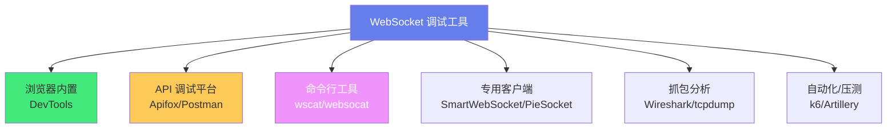
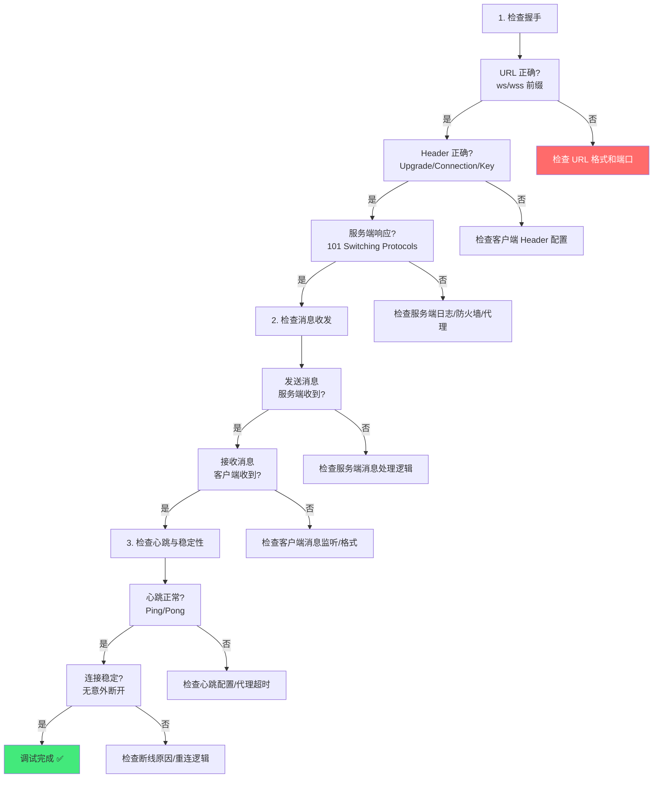

# 🛠️ WebSocket 调试工具

> **文档说明**：系统讲解 WebSocket 与 SSE 实时通信的调试工具与方法，涵盖 WebSocket 调试的核心需求与挑战、各类调试工具的详细使用（浏览器开发者工具、Apifox、Postman、wscat 命令行、SmartWebSocket 客户端、WebSocket King、PieSocket、Insomnia）、工具功能对比与选型、WebSocket 连接调试流程（握手检查/消息收发/帧分析/心跳检测/断线重连）、常见问题排查方法（连接失败/消息丢失/延迟高/跨域/鉴权）、SSE 调试方法与工具、服务端日志与抓包分析（Wireshark/tcpdump）、自动化测试与压测工具（Artillery/k6/wrk）、调试最佳实践与效率技巧。
>
> **适用人群**：全栈开发者、后端开发者、前端开发者、测试工程师、需要调试实时通信的工程师
>
> **前置知识**：[[WebSocket与SSE原理]] · [[Apifox接口管理平台]] · [[HTTP协议完整指南]]

---

## 一、概述

### 1.1 WebSocket 调试的挑战

WebSocket 是长连接全双工协议，与 HTTP 的请求-响应模型不同，调试面临独特挑战：

| 挑战 | 说明 |
|------|------|
| **长连接状态** | 连接建立后持续存在，需要观察连接生命周期（建立/保持/断开/重连） |
| **双向消息流** | 客户端和服务端都可以随时发送消息，需要同时观察双向消息 |
| **二进制数据** | WebSocket 支持二进制帧，普通文本工具无法查看 |
| **心跳与保活** | Ping/Pong 帧和应用层心跳需要观察，排查连接超时断开 |
| **握手过程** | HTTP Upgrade 握手需要检查请求头和响应头 |
| **断线重连** | 需要模拟断线和观察重连行为 |
| **消息顺序与丢失** | 需要确认消息是否按顺序到达、是否有丢失 |
| **鉴权与安全** | 需要测试 token 鉴权、Origin 校验、消息大小限制 |

### 1.2 调试工具分类



| 类别 | 工具 | 适用场景 |
|------|------|---------|
| **浏览器内置** | Chrome DevTools / Firefox DevTools | 前端页面中的 WebSocket 调试，最方便 |
| **API 调试平台** | Apifox / Postman / Insomnia | 独立测试 WebSocket 接口，支持环境变量和集合 |
| **命令行** | wscat / websocat / curl | 快速测试、脚本自动化、服务器无 GUI 环境 |
| **专用客户端** | SmartWebSocket / WebSocket King / PieSocket | 功能丰富的桌面客户端，支持二进制和高级功能 |
| **抓包分析** | Wireshark / tcpdump / Charles | 底层帧分析、网络层排查、性能分析 |
| **自动化/压测** | k6 / Artillery / wsbench | 自动化测试、并发压测、性能基准 |

---

## 二、浏览器开发者工具

### 2.1 Chrome DevTools

Chrome DevTools 是前端调试 WebSocket 最方便的工具，无需安装额外软件。

**打开方式**：
1. F12 或 Ctrl+Shift+I 打开 DevTools
2. 切换到 Network（网络）面板
3. 筛选 `WS`（WebSocket）类型
4. 点击具体的 WebSocket 连接
5. 切换到 Messages（消息）标签查看消息

**Messages 面板功能**：
| 功能 | 说明 |
|------|------|
| **消息列表** | 显示所有收发的消息，时间倒序 |
| **方向标记** | ↑ 表示发送（客户端→服务端），↓ 表示接收（服务端→客户端） |
| **消息内容** | 点击消息查看完整内容（文本或二进制十六进制） |
| **时间戳** | 每条消息的精确时间 |
| **大小** | 消息字节数 |
| **筛选** | 按关键词筛选消息 |
| **帧类型** | 显示 Opcode（文本/二进制/Ping/Pong/关闭） |

**查看 WebSocket 握手**：
1. Network 面板点击 WebSocket 连接
2. 切换到 Headers（标头）标签
3. 查看 Request Headers 和 Response Headers
4. 重点关注：`Upgrade: websocket`、`Connection: Upgrade`、`Sec-WebSocket-Key`、`Sec-WebSocket-Accept`、`Sec-WebSocket-Protocol`、`Origin`

**性能分析**：
- 查看每条消息的时间戳，计算消息间隔
- 观察消息延迟（发送时间 vs 接收响应时间）
- 检查是否有消息丢失或乱序

### 2.2 Firefox DevTools

Firefox DevTools 的 WebSocket 调试功能与 Chrome 类似：
- Network 面板筛选 `WS`
- 点击连接查看 Messages
- 支持消息搜索和筛选
- 支持查看原始帧数据

---

## 三、API 调试平台

### 3.1 Apifox

Apifox 是国内流行的 API 调试平台，支持 WebSocket 调试。

**Apifox WebSocket 调试功能**：
| 功能 | 说明 |
|------|------|
| **新建 WebSocket 接口** | 在项目中创建 WebSocket 接口，填写 URL 和子协议 |
| **连接管理** | 一键连接/断开，显示连接状态 |
| **消息发送** | 支持文本和二进制消息发送 |
| **消息历史** | 保存收发消息记录，可重复发送 |
| **环境变量** | URL 和消息中支持变量引用（`{{baseUrl}}`） |
| **消息模板** | 保存常用消息模板，快速发送 |
| **鉴权** | 支持 URL 参数 token、Header 鉴权 |
| **团队协作** | WebSocket 接口可共享给团队成员 |

**使用步骤**：
1. 新建接口 → 选择「WebSocket」类型
2. 填写 WebSocket URL（`ws://` 或 `wss://`）
3. 配置 Header（如鉴权 token）
4. 点击「连接」建立连接
5. 在消息输入框输入消息内容，点击「发送」
6. 在消息列表查看收发消息

### 3.2 Postman

Postman 从 v8.0 开始支持 WebSocket 调试（Beta）。

**Postman WebSocket 功能**：
- 新建 WebSocket 请求（New → WebSocket Request）
- 输入 URL，点击 Connect
- 支持文本和二进制消息
- 消息历史和收藏
- 支持环境变量
- 支持 Header 配置

**注意**：Postman 的 WebSocket 功能仍在 Beta，部分高级功能（如子协议、二进制帧分析）不如专用工具完善。

### 3.3 Insomnia

Insomnia 也支持 WebSocket 调试：
- 新建 WebSocket 请求
- 支持文本消息收发
- 支持环境变量
- 界面简洁，适合快速测试

---

## 四、命令行工具

### 4.1 wscat

wscat 是最流行的 WebSocket 命令行客户端，基于 Node.js。

**安装**：
```bash
npm install -g wscat
```

**基本用法**：
```bash
# 连接到 WebSocket 服务器
wscat -c ws://localhost:8080/chat

# 连接 wss（加密）
wscat -c wss://example.com/chat

# 指定子协议
wscat -c ws://localhost:8080/chat -s chat,superchat

# 指定 Header（鉴权）
wscat -c ws://localhost:8080/chat -H "Authorization: Bearer token123"
wscat -c ws://localhost:8080/chat -H "Origin: http://localhost:3000"

# 发送原始 Ping
wscat -c ws://localhost:8080/chat --ping

# 显示十六进制（二进制消息）
wscat -c ws://localhost:8080/chat -x

# 执行命令后退出（发送一条消息）
wscat -c ws://localhost:8080/chat -w 1 -x "hello"
```

**交互模式**：
连接后进入交互式 REPL：
- 直接输入文本按回车发送
- 输入 `/help` 查看帮助
- 输入 `/ping` 发送 Ping
- 输入 `/close` 关闭连接
- Ctrl+C 退出

**wscat 适用场景**：
- 快速测试 WebSocket 连接
- 服务器无 GUI 环境调试
- 脚本自动化测试
- CI/CD 流水线中的健康检查

### 4.2 websocat

websocat 是用 Rust 编写的 WebSocket 命令行工具，功能更强大，支持多种输入输出。

**安装**：
```bash
# macOS
brew install websocat

# Linux（下载二进制）
# https://github.com/vi/websocat/releases

# Cargo
cargo install websocat
```

**基本用法**：
```bash
# 连接（交互模式）
websocat ws://localhost:8080/chat

# 从 stdin 读取，发送到 WebSocket，输出到 stdout
echo "hello" | websocat ws://localhost:8080/chat

# WebSocket 转 TCP 代理
websocat ws-l:127.0.0.1:8080 tcp:127.0.0.1:6379

# 服务端模式（监听 WebSocket 连接）
websocat -s 8080

# 二进制模式
websocat --binary ws://localhost:8080/data

# 详细输出（显示帧信息）
websocat -v ws://localhost:8080/chat

# 自动重连
websocat --reconnect ws://localhost:8080/chat
```

**websocat vs wscat**：
| 特性 | wscat | websocat |
|------|-------|----------|
| 语言 | Node.js | Rust |
| 安装体积 | 较大（依赖 Node） | 小（单二进制） |
| 交互模式 | ✅ | ✅ |
| 管道/重定向 | ⚠️ 有限 | ✅ 强大 |
| 服务端模式 | ❌ | ✅ |
| 代理/转发 | ❌ | ✅ |
| 自动重连 | ❌ | ✅ |
| 二进制支持 | ✅ | ✅ |

### 4.3 curl（测试 SSE）

curl 不支持 WebSocket（因为需要 Upgrade 握手和帧解析），但非常适合调试 SSE：

```bash
# 调试 SSE 连接（持续输出事件流）
curl -N http://localhost:3000/events

# 带 Header 鉴权
curl -N -H "Authorization: Bearer token123" http://localhost:3000/events

# 模拟断线重连（带 Last-Event-ID）
curl -N -H "Last-Event-ID: 42" http://localhost:3000/events

# 查看响应头
curl -I http://localhost:3000/events
# 检查 Content-Type: text/event-stream
```

`-N` 参数禁用输出缓冲，确保 SSE 事件实时显示。

---

## 五、专用客户端工具

### 5.1 SmartWebSocket

SmartWebSocket 是一款功能丰富的 WebSocket 桌面客户端（Windows/Mac/Linux）。

**核心功能**：
| 功能 | 说明 |
|------|------|
| **多连接管理** | 同时管理多个 WebSocket 连接，标签页切换 |
| **消息收藏** | 收藏常用消息，一键发送 |
| **消息历史** | 完整的收发消息历史，支持搜索和导出 |
| **二进制支持** | 支持发送和查看二进制消息（十六进制/文本） |
| **JSON 格式化** | 自动格式化 JSON 消息，支持折叠展开 |
| **心跳配置** | 可配置自动心跳消息和间隔 |
| **鉴权配置** | 支持 Header、URL 参数、Cookie 鉴权 |
| **子协议** | 支持配置 Sec-WebSocket-Protocol |
| **连接状态** | 实时显示连接状态、延迟、消息计数 |
| **重连配置** | 可配置自动重连和重连间隔 |
| **请求/响应匹配** | 支持消息配对，查看请求对应的响应 |

### 5.2 WebSocket King

WebSocket King 是一款简洁的 WebSocket 客户端（Web 版和桌面版）。

**特点**：
- 界面简洁，上手快
- 支持文本和二进制
- 支持消息历史
- 支持连接配置保存
- Web 版无需安装，直接在浏览器使用

### 5.3 PieSocket

PieSocket 提供 WebSocket 测试工具和托管服务。

**测试工具功能**：
- 在线 WebSocket 客户端
- 支持自定义 Header
- 支持消息模板
- 支持连接日志
- 免费使用

### 5.4 工具对比与选型

| 工具 | 类型 | 平台 | 二进制 | 多连接 | 环境变量 | 团队协作 | 推荐场景 |
|------|------|------|--------|--------|---------|---------|---------|
| **Chrome DevTools** | 浏览器内置 | Web | ✅ | ❌ | ❌ | ❌ | 前端页面调试 |
| **Apifox** | API 平台 | 桌面/Web | ✅ | ✅ | ✅ | ✅ | 项目级 API 调试 |
| **Postman** | API 平台 | 桌面/Web | ⚠️ | ✅ | ✅ | ✅ | 已用 Postman 的团队 |
| **wscat** | 命令行 | 全平台 | ✅ | ❌ | ❌ | ❌ | 快速测试/服务器 |
| **websocat** | 命令行 | 全平台 | ✅ | ❌ | ❌ | ❌ | 高级/脚本/代理 |
| **SmartWebSocket** | 桌面客户端 | Win/Mac/Linux | ✅ | ✅ | ⚠️ | ❌ | 重度 WebSocket 调试 |
| **WebSocket King** | Web/桌面 | 全平台 | ✅ | ❌ | ❌ | ❌ | 轻量快速测试 |
| **PieSocket** | Web | 全平台 | ❌ | ❌ | ❌ | ❌ | 在线快速测试 |

**选型建议**：
- 前端开发调试页面中的 WebSocket → Chrome DevTools（最方便）
- 独立测试 WebSocket API，需要环境变量和团队协作 → Apifox
- 服务器无 GUI 环境或脚本自动化 → wscat / websocat
- 需要高级功能（二进制分析、多连接、消息配对）→ SmartWebSocket
- 快速临时测试 → WebSocket King / PieSocket 在线工具

---

## 六、调试流程与方法

### 6.1 WebSocket 连接调试流程



### 6.2 握手检查

**检查请求头**：
```http
GET /chat HTTP/1.1
Host: server.example.com
Upgrade: websocket                          # ✅ 必须
Connection: Upgrade                         # ✅ 必须
Sec-WebSocket-Key: dGhlIHNhbXBsZSBub25jZQ==  # ✅ 必须（随机 Base64）
Sec-WebSocket-Version: 13                   # ✅ 必须（版本 13）
Sec-WebSocket-Protocol: chat                # ⚠️ 可选（子协议）
Origin: http://example.com                  # ⚠️ 浏览器自动发送
Authorization: Bearer token123              # ⚠️ 可选（鉴权）
```

**检查响应头**：
```http
HTTP/1.1 101 Switching Protocols            # ✅ 必须（101 状态码）
Upgrade: websocket                          # ✅ 必须
Connection: Upgrade                         # ✅ 必须
Sec-WebSocket-Accept: s3pPLMBiTxaQ9kYGzzhZRbK+xOo=  # ✅ 必须（Key+GUID 的 SHA-1 Base64）
Sec-WebSocket-Protocol: chat                # ⚠️ 如果请求有子协议，响应必须选择一个
```

**常见握手错误**：
| 错误 | 原因 | 解决方案 |
|------|------|---------|
| 404 Not Found | URL 路径错误 | 检查服务端 WebSocket 端点路径 |
| 400 Bad Request | 缺少必要 Header 或版本不支持 | 检查 Upgrade/Connection/Key/Version 头 |
| 401 Unauthorized | 鉴权失败 | 检查 token/Header/Cookie |
| 403 Forbidden | Origin 校验失败 | 检查服务端 Origin 白名单 |
| 连接超时 | 服务端未响应或防火墙拦截 | 检查服务端状态、防火墙、端口 |
| 证书错误 | wss 使用了无效/过期证书 | 检查 SSL 证书，或用 ws 测试 |
| 代理不支持 Upgrade | Nginx/CDN 未配置 WebSocket 代理 | 配置 `proxy_set_header Upgrade $http_upgrade` |

### 6.3 消息调试

**消息发送调试**：
1. 客户端发送消息后，在服务端日志确认是否收到
2. 检查消息格式（JSON 是否合法、字段是否正确）
3. 检查消息大小（是否超过服务端限制）
4. 检查消息编码（UTF-8 文本 vs 二进制）

**消息接收调试**：
1. 服务端推送消息后，在客户端确认是否收到
2. 检查消息顺序（是否按发送顺序到达）
3. 检查消息完整性（是否有截断）
4. 检查消息延迟（发送到接收的时间差）

**消息丢失排查**：
- 检查服务端是否真的发送了（服务端日志）
- 检查客户端是否正确监听了消息事件
- 检查是否被中间代理缓冲或丢弃
- 检查连接是否在消息发送时已经断开
- 检查消息是否超过最大大小限制

### 6.4 心跳与断线调试

**心跳检查**：
- 观察是否定期收到 Ping 帧（浏览器 DevTools Messages 面板可看到）
- 确认客户端/服务端响应了 Pong
- 心跳间隔应小于代理超时时间（通常 60 秒，建议 20-30 秒）

**断线原因排查**：
| 断线原因 | 排查方法 |
|---------|---------|
| 服务端主动关闭 | 查看服务端日志，检查关闭码（1000/1001/1008 等） |
| 心跳超时 | 检查心跳间隔和超时设置，观察 Ping/Pong |
| 代理/NAT 超时 | 检查 Nginx/CDN/路由器超时配置，增加心跳 |
| 网络波动 | 检查网络稳定性，用 ping/traceroute 测试 |
| 服务端重启/崩溃 | 检查服务端进程状态和日志 |
| 客户端关闭 | 检查客户端代码是否主动关闭，页面是否跳转 |
| 内存溢出 | 检查服务端内存使用，消息是否积累未释放 |

**断线重连调试**：
- 模拟断线（关闭服务端/断开网络），观察客户端是否自动重连
- 检查重连间隔是否合理（指数退避：1s→2s→4s→...→最大30s）
- 检查重连后是否恢复状态（重新订阅、同步消息）
- 检查重连时是否携带鉴权信息

---

## 七、SSE 调试

### 7.1 SSE 调试方法

**curl 调试（最常用）**：
```bash
# 基本调试（-N 禁用缓冲，实时输出）
curl -N http://localhost:3000/events

# 查看响应头确认 Content-Type
curl -I http://localhost:3000/events
# HTTP/1.1 200 OK
# Content-Type: text/event-stream
# Cache-Control: no-cache
# Connection: keep-alive

# 带鉴权
curl -N -H "Authorization: Bearer token123" http://localhost:3000/events

# 模拟断线重连（Last-Event-ID）
curl -N -H "Last-Event-ID: 42" http://localhost:3000/events

# 详细输出（显示请求头和响应头）
curl -v -N http://localhost:3000/events
```

**浏览器调试**：
1. Chrome DevTools → Network → 筛选 `EventStream` 或 `text/event-stream`
2. 点击 SSE 请求 → EventStream 标签
3. 查看实时事件流（id/event/data）
4. 注意：Chrome 的 EventStream 面板可能不显示注释行（心跳）

**JavaScript 调试**：
```javascript
const es = new EventSource('http://localhost:3000/events');

es.onopen = () => console.log('SSE 连接已建立');
es.onmessage = (e) => console.log('收到消息:', e.data, 'ID:', e.lastEventId);
es.addEventListener('update', (e) => console.log('更新事件:', e.data));
es.onerror = (e) => console.error('SSE 错误:', e, '状态:', es.readyState);

// 检查连接状态
console.log('状态:', es.readyState);  // 0=CONNECTING, 1=OPEN, 2=CLOSED
```

### 7.2 SSE 常见问题

| 问题 | 原因 | 解决方案 |
|------|------|---------|
| 消息不实时 | Nginx/代理缓冲了响应 | `proxy_buffering off` + `X-Accel-Buffering: no` |
| 连接很快断开 | 代理超时设置太短 | 增加 `proxy_read_timeout`，用心跳保活 |
| 浏览器不自动重连 | 服务端返回非 200 或 CORS 错误 | 确保返回 200 + `text/event-stream`，配置 CORS |
| 消息丢失 | 断线期间消息未缓存 | 用 `id` + `Last-Event-ID` 实现断点续传 |
| 中文乱码 | 编码问题 | 确保 UTF-8 编码，设置 `Content-Type: text/event-stream; charset=utf-8` |
| 跨域失败 | CORS 未配置 | 服务端设置 `Access-Control-Allow-Origin` |
| 连接数超限 | 同域名 HTTP/1.1 限制 6 个 | 用 HTTP/2 或多域名 |

---

## 八、抓包与底层分析

### 8.1 Wireshark

Wireshark 可以捕获和分析 WebSocket 流量，查看原始帧数据。

**使用方法**：
1. 启动 Wireshark，选择网络接口
2. 设置过滤条件：`http` 或 `websocket` 或 `tcp.port == 8080`
3. 找到 WebSocket 握手请求（GET + Upgrade: websocket）
4. 右键 → Follow → TCP Stream，查看完整数据流
5. Wireshark 会自动解析 WebSocket 帧（FIN/Opcode/MASK/Payload）

**WebSocket 帧解析**：
Wireshark 会显示每个帧的详细信息：
- Frame number（帧号）
- Time（时间戳）
- Source/Destination（源/目的）
- WebSocket 层：FIN/Opcode/Masked/Masking key/Payload
- 载荷数据（文本或十六进制）

### 8.2 tcpdump

服务器端用 tcpdump 抓包：
```bash
# 抓取 8080 端口的流量
tcpdump -i any -w websocket.pcap port 8080

# 抓取并实时显示 HTTP 握手
tcpdump -i any -A -s 0 'tcp port 8080 and (tcp[((tcp[12:1] & 0xf0) >> 2):4] = 0x47455420)'

# 用 Wireshark 打开 pcap 文件分析
```

### 8.3 Charles / Fiddler

Charles 和 Fiddler 是 HTTP 代理工具，也支持 WebSocket 调试：
- 可以拦截和查看 WebSocket 消息
- 支持修改请求和响应
- 支持 HTTPS 解密（需要安装证书）
- 适合调试移动端 App 的 WebSocket 通信

---

## 九、自动化测试与压测

### 9.1 k6

k6 是现代负载测试工具，支持 WebSocket 压测。

```javascript
// ws-test.js
import { WebSocket } from 'k6/experimental/websockets';
import { check, sleep } from 'k6';

export const options = {
  vus: 100,           // 100 虚拟用户
  duration: '30s',    // 持续 30 秒
};

export default function () {
  const ws = new WebSocket('ws://localhost:8080/chat');

  ws.onopen = () => {
    console.log('连接已建立');
    ws.send(JSON.stringify({ type: 'join', room: 'test' }));
  };

  ws.onmessage = (event) => {
    check(event, {
      '收到消息': (e) => e.data.length > 0,
    });
  };

  sleep(5);  // 保持连接 5 秒
  ws.close();
}
```

```bash
# 运行压测
k6 run ws-test.js
```

### 9.2 Artillery

Artillery 是另一个支持 WebSocket 的性能测试工具。

```yaml
# ws-test.yml
config:
  target: "ws://localhost:8080"
  phases:
    - duration: 60
      arrivalRate: 10
      name: "Warm up"
    - duration: 120
      arrivalRate: 50
      name: "Sustained load"

scenarios:
  - engine: ws
    flow:
      - send: '{"type":"join","room":"test"}'
      - think: 2
      - loop:
          - send: '{"type":"message","content":"hello"}'
          - think: 1
        count: 5
      - send: '{"type":"leave"}'
```

```bash
# 安装
npm install -g artillery

# 运行
artillery run ws-test.yml

# 生成报告
artillery run --output report.json ws-test.yml
artillery report report.json
```

### 9.3 自动化功能测试

**Node.js 测试（ws 库 + Jest）**：
```javascript
const WebSocket = require('ws');

describe('WebSocket 服务', () => {
  let ws;

  beforeEach((done) => {
    ws = new WebSocket('ws://localhost:8080/chat');
    ws.on('open', done);
  });

  afterEach(() => {
    ws.close();
  });

  test('连接建立成功', () => {
    expect(ws.readyState).toBe(WebSocket.OPEN);
  });

  test('发送消息并收到响应', (done) => {
    ws.on('message', (data) => {
      const msg = JSON.parse(data);
      expect(msg.type).toBe('ack');
      done();
    });
    ws.send(JSON.stringify({ type: 'ping' }));
  });

  test('心跳响应', (done) => {
    ws.on('pong', () => done());
    ws.ping();
  });
});
```

---

## 十、常见问题与最佳实践

### 10.1 常见问题排查速查

| 现象 | 可能原因 | 排查步骤 |
|------|---------|---------|
| **连接失败（立即断开）** | URL 错误/端口错误/服务未启动 | 1. 检查 URL 格式 2. telnet 测试端口 3. 检查服务端日志 |
| **连接失败（401/403）** | 鉴权失败/Origin 校验 | 1. 检查 token 2. 检查 Header 3. 检查服务端 Origin 白名单 |
| **连接失败（证书错误）** | wss 证书无效/过期/自签名 | 1. 用 ws 测试是否正常 2. 检查证书有效期 3. 自签名证书需信任 |
| **连接成功但收不到消息** | 客户端未监听/服务端未推送/消息格式错 | 1. 检查 onmessage 监听 2. 检查服务端推送逻辑 3. 用 wscat 交叉测试 |
| **消息发送失败** | 连接已断开/消息过大/格式错 | 1. 检查 readyState 2. 检查消息大小限制 3. 检查 JSON 格式 |
| **连接频繁断开** | 心跳超时/代理超时/服务端崩溃 | 1. 检查心跳间隔 2. 检查 Nginx 超时 3. 检查服务端日志和内存 |
| **消息延迟高** | 服务端处理慢/网络延迟/消息积压 | 1. 检查服务端处理时间 2. 网络 ping 测试 3. 检查消息队列积压 |
| **消息丢失** | 连接断开/服务端未发送/代理丢弃 | 1. 检查连接状态 2. 服务端日志确认发送 3. 检查代理配置 |
| **跨域连接失败** | Origin 校验失败/CORS 配置 | 1. 检查服务端 Origin 白名单 2. 检查请求 Origin 头 |
| **Nginx 代理后连不上** | 未配置 Upgrade 头/缓冲 | 1. 配置 Upgrade/Connection 头 2. proxy_read_timeout 调大 |

### 10.2 调试最佳实践

1. **从简单开始**：
   - 先用 wscat/websocat 命令行测试基本连接
   - 确认服务端正常后再用复杂工具
   - 用最小化的消息（如 "hello"）测试收发

2. **分层排查**：
   - 网络层：ping/telnet 测试连通性
   - 握手层：检查 HTTP Upgrade 握手（DevTools Headers）
   - 协议层：检查 WebSocket 帧格式（Wireshark）
   - 应用层：检查消息内容和业务逻辑

3. **交叉验证**：
   - 用多个工具测试（wscat + Apifox + 浏览器）
   - 排除工具本身的问题
   - 服务端用日志确认收到和发送

4. **日志增强**：
   - 服务端记录连接建立/断开/错误
   - 记录收发消息（开发环境）
   - 记录心跳和异常
   - 用唯一连接 ID 追踪每个连接

5. **模拟异常场景**：
   - 模拟断线（关闭服务端/断开网络），测试重连
   - 模拟大消息，测试大小限制
   - 模拟高频消息，测试性能和积压
   - 模拟无效 token，测试鉴权

6. **利用浏览器 DevTools**：
   - Network → WS → Messages 查看所有消息
   - 检查握手 Headers
   - 用 Console 执行 `new WebSocket(url)` 快速测试
   - 用 Performance 面板分析消息处理性能

7. **环境隔离**：
   - 开发环境用 `ws://`（无加密，方便抓包）
   - 生产环境用 `wss://`（加密）
   - 测试环境单独部署，不影响生产

8. **文档化调试结果**：
   - 记录常见问题和解决方案
   - 保存有用的测试消息模板
   - 记录服务端配置（超时、大小限制、心跳间隔）

---

## 十一、关联笔记

### 实时通信
- [[WebSocket与SSE原理]] · [[实时通信架构设计]] · [[消息队列基础]]
- [[服务端推送技术对比]] · [[长连接与轮询]]

### API 调试
- [[Apifox接口管理平台]] · [[Postman接口测试]] · [[RESTfulAPI设计原则]]
- [[HTTP协议完整指南]]

### 前端技术
- [[JavaScript核心语法与ES6+]] · [[异步编程与Promise]] · [[事件循环与任务队列]]

### 导航
- [[MOC-通用工具]] · [[MOC-前端开发]] · [[MOC-综合导航]] · [[Home]]

> 🔍 **知识点深度解析**
>
> **作用**：WebSocket 调试工具解决的是「长连接全双工通信的可观测性问题」——HTTP 的请求-响应模型调试简单（发请求看响应），但 WebSocket 是长连接双向通信，连接生命周期长、消息流持续、双向收发、二进制支持、心跳保活，传统的 HTTP 调试工具无法直接使用。WebSocket 调试工具（浏览器 DevTools、Apifox、wscat、SmartWebSocket 等）专门针对这些特性设计，提供连接管理、消息收发、帧分析、心跳检测、断线重连模拟等功能，让开发者能高效地调试和排查 WebSocket 通信问题。
>
> **底层原理**：①浏览器 DevTools 的 WebSocket 调试基于浏览器的网络栈——浏览器本身就是 WebSocket 客户端，DevTools 直接从浏览器网络层捕获 WebSocket 握手和消息帧，无需额外代理，所以能看到原始的帧信息（Opcode、方向、时间戳）。②命令行工具（wscat/websocat）基于 WebSocket 客户端库（Node.js ws 库 / Rust websocket 库），实现完整的握手和帧解析，在终端展示收发消息，适合无 GUI 环境和脚本自动化。③API 调试平台（Apifox/Postman）内置 WebSocket 客户端，提供图形化界面，支持环境变量、消息模板、团队协作，适合项目级调试。④抓包工具（Wireshark）在网络层捕获 TCP 数据包，根据 WebSocket 帧格式（RFC 6455）解析出 FIN/Opcode/MASK/Payload 等字段，适合底层协议分析和网络问题排查。⑤所有工具的核心都是「实现 WebSocket 协议的握手和帧解析」——握手是 HTTP Upgrade（检查 Upgrade/Connection/Sec-WebSocket-Key/Accept），帧解析是按 RFC 6455 的位级格式解析（FIN/RSV/Opcode/MASK/Payload len/Masking key/Payload）。
>
> **用法要点**：① 工具选型：前端页面调试→Chrome DevTools（Network→WS→Messages）；独立 API 调试→Apifox（支持环境变量和团队协作）；命令行/服务器→wscat（`wscat -c ws://url`）或 websocat（更强大，支持管道/代理/服务端）；重度调试→SmartWebSocket（多连接/二进制/消息配对）；在线快速测试→WebSocket King/PieSocket ② 调试流程：检查握手（URL/Header/101响应）→检查消息收发（发送/接收/格式/顺序）→检查心跳与稳定性（Ping/Pong/断线/重连） ③ 握手检查：请求头必须有 Upgrade: websocket + Connection: Upgrade + Sec-WebSocket-Key + Sec-WebSocket-Version:13；响应必须是 101 Switching Protocols + Upgrade + Connection + Sec-WebSocket-Accept ④ 消息调试：DevTools Messages 面板看方向（↑发送↓接收）和内容；wscat 交互模式直接输入发送；检查 JSON 格式、消息大小、编码（文本/二进制） ⑤ 心跳调试：DevTools 看 Ping/Pong 帧；心跳间隔 20-30s 小于代理超时 60s；wscat `--ping` 参数 ⑥ 断线排查：看关闭码（1000正常/1001离开/1008策略违规/1011服务端错误）；检查服务端日志；检查代理超时；模拟断线测试重连 ⑦ SSE 调试：curl -N 实时输出；检查 Content-Type: text/event-stream；检查 proxy_buffering off；Last-Event-ID 断点续传 ⑧ 抓包分析：Wireshark 过滤 websocket，查看原始帧；tcpdump 服务器抓包；Charles/Fiddler 代理调试 ⑨ 自动化测试：k6/Artillery 压测；Jest+ws 库功能测试；CI 中健康检查 ⑩ 常见坑：Nginx 未配 Upgrade 头（WebSocket连不上）、代理缓冲导致 SSE 不实时、没心跳导致连接超时断开、wss 证书错误、跨域 Origin 校验、消息大小超限。

> 💡 **深度讲解**：WebSocket 调试最核心的智慧是「分层排查法」——WebSocket 问题可能出现在网络层、握手层、协议层、应用层中的任何一层，盲目排查效率很低。分层排查法从底层到上层依次验证：①网络层（ping/telnet 测试端口连通性）→②握手层（检查 HTTP Upgrade 握手是否成功，101 响应）→③协议层（检查 WebSocket 帧格式是否正确，Opcode/MASK/Payload）→④应用层（检查消息内容和业务逻辑）。每一层验证通过后再进入上一层，这样能快速定位问题在哪一层。这就像医生诊断——先量体温（基础生命体征），再验血（生理指标），再拍片（器官结构），最后问诊（生活习惯），从基础到复杂逐层排除。「交叉验证」是另一个重要技巧——当你怀疑是客户端问题还是服务端问题时，用多个工具交叉测试：用 wscat 连接服务端（排除客户端代码问题），用浏览器 DevTools 看页面中的 WebSocket（排除服务端问题），用 Apifox 独立测试（排除环境问题）。如果 wscat 能正常收发但浏览器不行，问题在客户端代码或浏览器环境；如果所有工具都不行，问题在服务端或网络。这种「控制变量」的方法能快速缩小问题范围。「心跳是长连接调试的关键」——很多 WebSocket 问题（连接频繁断开、消息突然收不到）根源都是心跳。中间设备（NAT 路由器、防火墙、代理服务器）会自动关闭一段时间没有数据传输的连接（通常 60-120 秒）。如果应用没有心跳，连接可能在用户不知情的情况下已经断开。调试时要观察：①是否有定期的 Ping/Pong 帧（DevTools Messages 面板）②心跳间隔是否小于代理超时（建议 20-30 秒）③断线后是否自动重连。心跳就像两个人打电话时定期说「还在吗？」——如果长时间没声音，电话公司可能会挂断。

> 📝 **精简总结**：WebSocket 调试工具分类：浏览器 DevTools（前端页面，最方便）、API 平台（Apifox/Postman，项目级）、命令行（wscat/websocat，服务器/脚本）、专用客户端（SmartWebSocket，重度调试）、抓包（Wireshark，底层分析）、压测（k6/Artillery）。调试流程：握手检查（URL/Header/101）→消息收发（方向/格式/顺序）→心跳稳定性（Ping/Pong/断线重连）。常用命令：wscat -c ws://url、curl -N http://url（SSE）、websocat ws://url。常见坑：Nginx 未配 Upgrade 头、代理缓冲 SSE 不实时、没心跳连接超时断、wss 证书错、跨域 Origin、消息大小超限。SSE 调试：curl -N + Content-Type: text/event-stream + proxy_buffering off + Last-Event-ID。选型：前端→DevTools，独立调试→Apifox，命令行→wscat，重度→SmartWebSocket。

> **学习路径建议**：先学习 [[WebSocket与SSE原理]] 理解 WebSocket 协议和握手 → 学习本文档掌握各类调试工具 → 实践：用 Chrome DevTools 调试一个简单的 WebSocket 页面 → 实践：用 wscat 命令行测试服务端 → 实践：用 Apifox 管理 WebSocket 接口集合 → 学习 [[消息队列基础]] 理解大规模实时推送架构 → 学习 k6/Artillery 进行 WebSocket 压测 → 学习 Wireshark 进行底层帧分析 → 在实际项目中积累调试经验。

---

> **WebSocket 调试工具的本质是「让不可见的长连接变得可观测」——HTTP 的请求-响应是「一次性」的，发请求看响应就完了，调试简单直观；但 WebSocket 是「持续性」的，连接建立后持续存在，消息双向流动，状态不断变化，这种持续性和双向性使得传统的 HTTP 调试工具无法直接使用。WebSocket 调试工具通过实现完整的协议栈（握手+帧解析），将隐藏在 TCP 字节流中的 WebSocket 消息可视化，让开发者能看到连接的生命周期、消息的收发、帧的格式、心跳的状态。这就是调试工具的核心价值——「将黑盒变成白盒，将不可见变成可见」。当你掌握了各类 WebSocket 调试工具，你就能在遇到实时通信问题时快速定位——是网络不通？是握手失败？是消息格式错？是心跳超时？是服务端 bug？——而不是盲目地「重启试试」「清缓存试试」。这种「基于证据的排查」是专业开发者和业余爱好者的核心区别。**

---

## 🔗 关联笔记

- [[MOC-通用工具]] — 返回本分类知识地图，查看更多相关文档

## 📖 前置知识

- [[WebSocket与SSE原理]]
- [[Apifox接口管理平台]]

## 🏷️ 相关标签

`#实时通信` `#调试工具` `#API调试` `#wscat` `#Apifox` `#Postman`

[[Home|🏠 返回首页]] · [[MOC-通用工具|📚 返回分类]]
