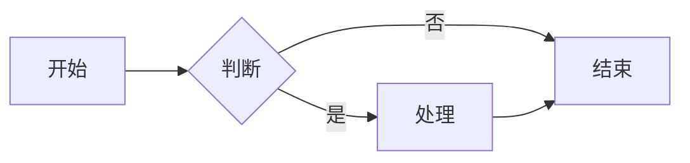

# 📝 Markdown 进阶语法

> **文档说明**：系统讲解 Markdown 进阶语法的完整知识体系，涵盖 GFM（GitHub Flavored Markdown）扩展语法、表格高级用法、任务列表、删除线、自动链接、脚注、定义列表、数学公式（LaTeX/KaTeX）、图表（Mermaid/PlantUML）、代码块高级用法（语法高亮/行号/差异对比）、HTML 内嵌、CSS 样式、Obsidian 专属语法（双向链接/嵌入/属性/标签/调用块/画布）、排版最佳实践、各平台兼容性对照表、常用快捷键与工具。
>
> **适用人群**：技术文档作者、开发者、知识管理者、Obsidian 用户、任何需要高效写作的人
>
> **前置知识**：[[Markdown写作规范]]

---

## 一、概述

### 1.1 Markdown 标准与扩展

| 标准 | 说明 | 发布方 |
|------|------|--------|
| **CommonMark** | Markdown 标准规范，定义核心语法 | CommonMark 组织 |
| **GFM（GitHub Flavored Markdown）** | GitHub 扩展，在 CommonMark 基础上增加表格/任务列表/删除线等 | GitHub |
| **Markdown Extra** | 增加脚注/定义列表/缩写等 | Michel Fortin |
| **MultiMarkdown** | 增加元数据/脚注/目录/数学公式等 | Fletcher Penney |
| **Pandoc Markdown** | Pandoc 扩展，支持最丰富的语法（脚注/定义列表/引用块属性等） | John MacFarlane |
| **Obsidian Flavored Markdown** | Obsidian 扩展，增加双向链接/嵌入/调用块/属性等 | Obsidian |

**兼容性原则**：
- 核心语法（标题/列表/链接/图片/代码块/引用）所有平台都支持
- GFM 扩展（表格/任务列表/删除线）GitHub/GitLab/Obsidian/Typora 都支持
- 数学公式/图表需要特定渲染器支持
- Obsidian 专属语法（双向链接/调用块）只在 Obsidian 中生效

### 1.2 进阶语法分类

| 类别 | 语法 | 兼容性 |
|------|------|--------|
| **文本格式** | 删除线、高亮、下标、上标、键盘按键 | GFM/部分扩展 |
| **列表** | 任务列表、有序列表嵌套、定义列表 | GFM/Markdown Extra |
| **表格** | 对齐、单元格换行、表格嵌套 | GFM |
| **链接** | 自动链接、锚点链接、引用式链接 | GFM/标准 |
| **代码** | 语法高亮、行号、差异对比、代码组 | 大部分支持 |
| **引用** | 嵌套引用、引用属性、告警块 | 标准/扩展 |
| **数学** | 行内公式、块级公式、KaTeX/MathJax | 扩展 |
| **图表** | Mermaid、PlantUML、Graphviz | 扩展 |
| **脚注** | 行内脚注、引用脚注 | Markdown Extra/Pandoc |
| **HTML** | 内嵌 HTML、CSS 样式、注释 | 标准 |
| **元数据** | YAML Front Matter、属性 | 扩展/Obsidian |

---

## 二、文本格式进阶

### 2.1 GFM 文本格式

| 语法 | 效果 | 说明 |
|------|------|------|
| `~~删除线~~` | ~~删除线~~ | GFM 标准 |
| `==高亮==` | ==高亮== | Obsidian/Typora 支持，GFM 不支持 |
| `H~2~O` | H~2~O | 下标，Pandoc/MultiMarkdown 支持 |
| `X^2^` | X^2^ | 上标，Pandoc/MultiMarkdown 支持 |
| `<kbd>Ctrl</kbd>` | <kbd>Ctrl</kbd> | 键盘按键，HTML 标签 |
| `==高亮==` 和 `**粗体**` 组合 | **==粗体高亮==** | 可嵌套使用 |

### 2.2 换行与段落

| 语法 | 说明 |
|------|------|
| 两个空格 + 回车 | 强制换行（`<br>`） |
| 反斜杠 + 回车 | 强制换行（GFM 支持） |
| 空行 | 段落分隔 |
| `<br>` | HTML 换行标签 |
| `\n` | 部分平台支持的换行符 |

> **注意**：Markdown 中单个回车通常被视为空格（同一行），需要两个空格+回车或空行才能换行。

### 2.3 注释

```markdown
<!-- 这是 HTML 注释，渲染后不可见 -->

<!-- 
多行注释
第二行
第三行
-->

[//]: # (这是 Markdown 注释技巧，利用引用链接语法)

[^_]: # (这也是一种注释方式)
```

> Obsidian 中 `%%` 也可以作为注释：`%%这是 Obsidian 注释%%`，渲染后不可见。

---

## 三、表格进阶

### 3.1 表格对齐

```markdown
| 左对齐 | 居中对齐 | 右对齐 |
|:------|:--------:|-------:|
| 内容1  | 内容2    | 内容3  |
| 内容4  | 内容5    | 内容6  |
```

| 左对齐 | 居中对齐 | 右对齐 |
|:------|:--------:|-------:|
| 内容1  | 内容2    | 内容3  |
| 内容4  | 内容5    | 内容6  |

**对齐符号**：
- `:---` 左对齐
- `:---:` 居中对齐
- `---:` 右对齐
- `---` 默认（通常左对齐）

### 3.2 表格高级用法

**单元格内换行**（用 `<br>`）：
```markdown
| 列1 | 列2 |
|-----|-----|
| 第一行<br>第二行 | 内容 |
```

**单元格内使用列表**：
```markdown
| 功能 | 说明 |
|------|------|
| 列表 | <ul><li>项目1</li><li>项目2</li></ul> |
```

**表格嵌套**（用 HTML）：
```html
<table>
  <tr>
    <td>
      <table>
        <tr><td>嵌套表格</td></tr>
      </table>
    </td>
    <td>外层单元格</td>
  </tr>
</table>
```

**表格标题**（部分平台支持）：
```markdown
| 列1 | 列2 |
|-----|-----|
| 内容 | 内容 |

*表1：表格标题*
```

### 3.3 表格生成工具

| 工具 | 说明 |
|------|------|
| **Tables Generator** | 在线表格生成器，支持 Excel/CSV 转 Markdown |
| **VSCode 插件** | Markdown All in One、Markdown Table Prettifier |
| **Obsidian 插件** | Advanced Tables（表格编辑/格式化/公式） |
| **Pandoc** | `pandoc input.xlsx -o output.md` 转换 |

---

## 四、列表进阶

### 4.1 任务列表（GFM）

```markdown
- [x] 已完成任务
- [ ] 未完成任务
- [ ] 待办事项
  - [x] 子任务1
  - [ ] 子任务2
- [~] 已取消任务（Obsidian 支持）
```

- [x] 已完成任务
- [ ] 未完成任务
- [ ] 待办事项
  - [x] 子任务1
  - [ ] 子任务2

> Obsidian 中点击复选框可以直接切换状态，支持 `[x]`（完成）、`[ ]`（未完成）、`[~]`（取消）。

### 4.2 定义列表（Markdown Extra/Pandoc）

```markdown
术语1
: 定义1的第一行
: 定义1的第二行

术语2
: 定义2
```

**效果**：
<dl>
<dt>术语1</dt>
<dd>定义1的第一行</dd>
<dd>定义1的第二行</dd>
<dt>术语2</dt>
<dd>定义2</dd>
</dl>

### 4.3 列表嵌套与缩进

```markdown
1. 有序列表项1
   - 无序列表嵌套
   - 另一个嵌套
     1. 更深层嵌套
2. 有序列表项2
   > 引用块嵌套
   ```
   代码块嵌套
   ```text
3. 有序列表项3
   | 表格 | 嵌套 |
   |------|------|
   | 内容 | 内容 |
```

> **关键**：嵌套内容需要与父列表项的内容对齐（通常缩进 3 个空格或按 Tab）。

---

## 五、链接与图片进阶

### 5.1 链接类型

| 类型 | 语法 | 说明 |
|------|------|------|
| **行内链接** | `[文字](url "标题")` | 最常用 |
| **引用式链接** | `[文字][id]` + `[id]: url "标题"` | 长文档推荐，链接集中管理 |
| **自动链接** | `<https://example.com>` | GFM 自动识别 URL |
| **锚点链接** | `[文字](#标题)` | 跳转到同一文档的标题 |
| **邮件链接** | `[邮箱](mailto:xxx@example.com)` | 打开邮件客户端 |
| **电话链接** | `[电话](tel:+8613800138000)` | 手机端拨号 |
| **图片链接** | `[](url)` | 点击图片跳转 |

**引用式链接示例**：
```markdown
这是一个[引用式链接][example]。

[example]: https://example.com "示例网站"
```

### 5.2 锚点链接规则

标题转锚点的规则：
1. 全部转小写
2. 空格转连字符 `-`
3. 移除特殊字符（保留中文、字母、数字、连字符）
4. 重复标题加序号 `-1`、`-2`

```markdown
# 我的标题
## 二级标题
### 三级标题！

[跳转到我的标题](#我的标题)
[跳转到二级标题](#二级标题)
```

### 5.3 图片高级用法

**图片尺寸**（HTML）：
```html


```

**图片对齐**：
```html


<center></center>
```

**图片标题**：
```markdown

*图1：图片标题*
```

**Obsidian 图片嵌入**：
```markdown
![[image.jpg]]           <!-- 嵌入图片 -->
![[image.jpg|300]]       <!-- 指定宽度 -->
![[image.jpg|300x200]]   <!-- 指定宽高 -->
![[image.jpg|alt|300]]   <!-- 指定替代文字和宽度 -->
```

### 5.4 Obsidian 双向链接

```markdown
[[笔记标题命名策略]]              <!-- 链接到笔记 -->
[[笔记标题命名策略|显示文字]]      <!-- 自定义显示文字 -->
[[笔记标题#标题]]          <!-- 链接到笔记内的标题 -->
[[笔记标题#^块引用]]       <!-- 链接到笔记内的块 -->
![[笔记标题命名策略]]              <!-- 嵌入笔记内容 -->
![[笔记标题#标题]]         <!-- 嵌入笔记内的标题部分 -->
```

**Obsidian 标签**：
```markdown
#标签                    <!-- 行内标签 -->
#父标签/子标签            <!-- 嵌套标签 -->
---
tags: [标签1, 标签2]     <!-- Front Matter 标签 -->
---
```

---

## 六、代码块进阶

### 6.1 语法高亮

````markdown
```python
def hello():
    print("Hello, World!")
```

```javascript
const hello = () => console.log("Hello!");
```

```bash
echo "Hello, World!"
```
````

**常用语言标识**：
`python`、`javascript`、`typescript`、`java`、`c`、`cpp`、`go`、`rust`、`bash`、`shell`、`sql`、`yaml`、`json`、`xml`、`html`、`css`、`markdown`、`dockerfile`、`nginx`、`diff`

### 6.2 行号与高亮

**行号**（部分平台支持，用 `linenos`）：
````markdown
```python
def hello():
    print("Hello")
```
````

**高亮特定行**（GitLab/GitHub 部分支持）：
````markdown
```python
def hello():
    name = "World"
    print(f"Hello, {name}")
    return name
```
````

### 6.3 差异对比（diff）

````markdown
```text
- 旧代码
+ 新代码
  不变的代码
@@ -1,4 +1,4 @@
-旧行1
-旧行2
+新行1
+新行2
```
````

**效果**：
```diff
- 旧代码
+ 新代码
  不变的代码
```

### 6.4 代码组（Obsidian/VitePress）

````markdown
::: code-group
```python
print("Hello")
```
```javascript
console.log("Hello");
```
:::
````

### 6.5 行内代码

```markdown
使用 `print()` 函数输出
使用 ``包含`反引号`的代码``
使用 `<div class="test">` HTML 标签
```

**效果**：使用 `print()` 函数输出，使用 ``包含`反引号`的代码``。

---

## 七、引用块进阶

### 7.1 嵌套引用

```markdown
> 第一层引用
> > 第二层引用
> > > 第三层引用
```

> 第一层引用
> > 第二层引用
> > > 第三层引用

### 7.2 引用块内的其他元素

```markdown
> ## 引用内的标题
> 
> - 引用内的列表
> - 第二项
> 
> ```python
> print("引用内的代码")
> ```
> 
> | 表格 | 引用 |
> |------|------|
> | 内容 | 内容 |
```

### 7.3 告警块（Obsidian/GitHub）

**Obsidian 调用块**：
```markdown
> [!note] 笔记
> 这是一个笔记提示框

> [!tip] 提示
> 这是一个技巧提示框

> [!warning] 警告
> 这是一个警告提示框

> [!danger] 危险
> 这是一个危险提示框

> [!success] 成功
> 这是一个成功提示框

> [!info] 信息
> 这是一个信息提示框

> [!question] 问题
> 这是一个问题提示框

> [!bug] Bug
> 这是一个 Bug 提示框

> [!quote] 引用
> 这是一个引用提示框
```

**GitHub 告警块**（2023+ 支持）：
```markdown
> [!NOTE]
> 有用的信息

> [!TIP]
> 有帮助的提示

> [!IMPORTANT]
> 重要信息

> [!WARNING]
> 警告信息

> [!CAUTION]
> 注意事项
```

---

## 八、数学公式

### 8.1 行内公式

```markdown
这是行内公式：$E = mc^2$，这是另一个：$\sum_{i=1}^{n} i = \frac{n(n+1)}{2}$
```

**效果**：这是行内公式：$E = mc^2$，这是另一个：$\sum_{i=1}^{n} i = \frac{n(n+1)}{2}$

### 8.2 块级公式

```markdown
$$
\int_{-\infty}^{\infty} e^{-x^2} dx = \sqrt{\pi}
$$

$$
\begin{pmatrix}
a & b \\
c & d
\end{pmatrix}
\begin{pmatrix}
x \\
y
\end{pmatrix}
=
\begin{pmatrix}
ax + by \\
cx + dy
\end{pmatrix}
$$
```

**效果**：
$$
\int_{-\infty}^{\infty} e^{-x^2} dx = \sqrt{\pi}
$$

### 8.3 常用数学符号

| 符号 | LaTeX | 说明 |
|------|-------|------|
| $\alpha$ | `\alpha` | 希腊字母 |
| $\beta$ | `\beta` | 希腊字母 |
| $\pi$ | `\pi` | 圆周率 |
| $\infty$ | `\infty` | 无穷大 |
| $\sum$ | `\sum` | 求和 |
| $\prod$ | `\prod` | 求积 |
| $\int$ | `\int` | 积分 |
| $\partial$ | `\partial` | 偏导 |
| $\nabla$ | `\nabla` | 梯度 |
| $\leq$ | `\leq` | 小于等于 |
| $\geq$ | `\geq` | 大于等于 |
| $\neq$ | `\neq` | 不等于 |
| $\approx$ | `\approx` | 约等于 |
| $\rightarrow$ | `\rightarrow` | 右箭头 |
| $\Rightarrow$ | `\Rightarrow` | 右双箭头 |
| $\sqrt{x}$ | `\sqrt{x}` | 平方根 |
| $\frac{a}{b}$ | `\frac{a}{b}` | 分数 |
| $x^2$ | `x^2` | 上标 |
| $x_2$ | `x_2` | 下标 |

> **渲染器**：数学公式需要 KaTeX 或 MathJax 渲染器支持，Obsidian/Typora/GitHub 都已支持。

---

## 九、图表与可视化

### 9.1 Mermaid

见 [[Mermaid-图表绘制]] 详细文档。

````markdown

````

### 9.2 PlantUML

见 [[PlantUML-UML建模]] 详细文档。

````markdown
```text
@startuml
Alice -> Bob: Hello
Bob --> Alice: Hi
@enduml
```
````

### 9.3 其他图表

| 图表类型 | 语法 | 说明 |
|---------|------|------|
| **Graphviz** | ` ```dot ` | DOT 语言绘图 |
| **ASCII 图表** | 直接写 | 纯文本图表，所有平台支持 |
| **Chart.js** | HTML 嵌入 | 交互式图表 |
| **SVG** | `<svg>` 标签 | 矢量图 |

---

## 十、HTML 与 CSS

### 10.1 常用 HTML 标签

| 标签 | 说明 | 示例 |
|------|------|------|
| `<details>` | 折叠/展开 | 可折叠内容 |
| `<summary>` | 折叠标题 | 配合 details |
| `<kbd>` | 键盘按键 | <kbd>Ctrl</kbd> |
| `<mark>` | 高亮 | <mark>高亮文字</mark> |
| `<small>` | 小字 | <small>小字</small> |
| `<sub>` | 下标 | H<sub>2</sub>O |
| `<sup>` | 上标 | X<sup>2</sup> |
| `<abbr>` | 缩写 | <abbr title="HyperText Markup Language">HTML</abbr> |
| `<u>` | 下划线 | <u>下划线</u> |
| `<center>` | 居中 | <center>居中文字</center> |

### 10.2 折叠内容

```markdown
<details>
<summary>点击展开/收起</summary>

这里是折叠的内容，可以包含 **Markdown** 语法。

- 列表项1
- 列表项2

```
print("代码块")
```text

</details>
```

**效果**：
<details>
<summary>点击展开/收起</summary>

这里是折叠的内容，可以包含 **Markdown** 语法。

</details>

### 10.3 内嵌 CSS

```html
<style>
  .custom-box {
    background: linear-gradient(135deg, #667eea, #764ba2);
    color: white;
    padding: 20px;
    border-radius: 10px;
  }
</style>

<div class="custom-box">
  自定义样式的内容块
</div>
```

> **注意**：大部分 Markdown 平台会过滤 `<style>` 和 `class` 属性以防止 XSS，Obsidian 支持自定义 CSS（CSS 片段）。

---

## 十一、Obsidian 专属语法

### 11.1 Front Matter（属性）

```yaml
---
title: 笔记标题
tags: [标签1, 标签2]
date: 2026-08-28
author: 作者
status: 进行中
priority: 高
aliases: [别名1, 别名2]
cssclasses: [自定义样式类]
---
```

### 11.2 调用块（Callout）

见 7.3 节，Obsidian 支持 `[!note]`、`[!tip]`、`[!warning]` 等 12 种调用块类型，支持折叠和自定义标题。

### 11.3 嵌入（Embed）

```markdown
![[笔记标题命名策略]]           <!-- 嵌入整个笔记 -->
![[笔记标题#标题]]       <!-- 嵌入笔记的某个标题部分 -->
![[笔记标题#^块ID]]      <!-- 嵌入笔记的某个块 -->
![[图片.jpg]]            <!-- 嵌入图片 -->
![[PDF文件名.pdf]]       <!-- 嵌入 PDF -->
![[音频.mp3]]            <!-- 嵌入音频 -->
![[视频.mp4]]            <!-- 嵌入视频 -->
```

### 11.4 块引用与块 ID

```markdown
这是一个可以被引用的段落 ^blockid

<!-- 在其他笔记中引用 -->
[[笔记标题#^blockid]]
```

### 11.5 画布（Canvas）

Obsidian Canvas 是可视化白板，可以将笔记、图片、网页、卡片自由排列在无限画布上，用于头脑风暴、知识图谱、项目规划。

---

## 十二、排版最佳实践

### 12.1 文档结构

```markdown
---
title: 文档标题
date: 2026-08-28
tags: [标签]
---

# 一级标题（文档标题，通常只有一个）

> 文档简介/说明

## 二级标题（主要章节）

### 三级标题（子章节）

#### 四级标题（小节，尽量不超过四级）

正文内容...

---

## 参考资料

- [链接1](url)
- [链接2](url)
```

### 12.2 排版规范

| 规范 | 说明 |
|------|------|
| **标题层级** | 不跳级（H1→H2→H3），文档只有一个 H1 |
| **段落间距** | 段落之间空一行 |
| **列表间距** | 列表项之间不空行（紧凑），列表前后空行 |
| **中英文间距** | 中文和英文/数字之间加空格 |
| **标点符号** | 中文用中文标点，英文用英文标点 |
| **代码块** | 代码块前后空行，指定语言 |
| **图片** | 图片前后空行，添加 alt 文字和标题 |
| **表格** | 表格前后空行，列对齐 |
| **链接** | 长链接用引用式链接，集中管理 |
| **行长度** | 建议每行不超过 80-120 字符（便于阅读和 diff） |

### 12.3 常用快捷键

| 操作 | VSCode | Obsidian | Typora |
|------|--------|----------|--------|
| 加粗 | `Ctrl+B` | `Ctrl+B` | `Ctrl+B` |
| 斜体 | `Ctrl+I` | `Ctrl+I` | `Ctrl+I` |
| 标题 | `Ctrl+1~6` | `Ctrl+1~6` | `Ctrl+1~6` |
| 代码块 | `Ctrl+Shift+K` | `Ctrl+Shift+K` | `Ctrl+Shift+K` |
| 链接 | `Ctrl+K` | `Ctrl+K` | `Ctrl+K` |
| 图片 | — | `Ctrl+P` | 拖拽 |
| 引用 | `Ctrl+Shift+>` | `Ctrl+Shift+>` | `Ctrl+Shift+>` |
| 列表 | `Ctrl+Shift+]` | — | `Ctrl+Shift+]` |
| 搜索 | `Ctrl+F` | `Ctrl+F` | `Ctrl+F` |
| 全局搜索 | `Ctrl+Shift+F` | `Ctrl+Shift+F` | — |

---

## 十三、关联笔记

### 文档与写作
- [[Markdown写作规范]] · [[技术文档写作指南]] · [[Mermaid-图表绘制]]
- [[PlantUML-UML建模]]

### 工具与效率
- [[Obsidian知识库构建]] · [[VSCode高效配置]] · [[Git基础与进阶]]

### 导航
- [[MOC-通用工具]] · [[MOC-文档与图表]] · [[MOC-综合导航]] · [[Home]]

> 🔍 **知识点深度解析**
>
> **作用**：Markdown 进阶语法解决的是「高效排版与丰富表达」问题——在基础 Markdown（标题/列表/链接/图片）之上，通过 GFM 扩展、数学公式、图表、HTML/CSS、Obsidian 专属语法等，实现更丰富的文档表达能力，满足技术文档、知识管理、学术写作等高级需求。
>
> **底层原理**：Markdown 是一种轻量级标记语言，核心设计是「易读易写」，通过简单的符号（#/*/-/`）标记文本结构，由渲染器转换为 HTML。CommonMark 定义了核心语法标准，各平台在此基础上扩展（GFM 增加表格/任务列表/删除线，Pandoc 增加脚注/定义列表/数学公式，Obsidian 增加双向链接/调用块/嵌入）。数学公式通过 KaTeX/MathJax 渲染 LaTeX 语法为数学符号，图表通过 Mermaid/PlantUML 渲染文本描述为图形，这些都是 Markdown 渲染器的扩展能力。
>
> **用法要点**：① 核心语法所有平台通用，扩展语法注意兼容性（GFM 最通用，Obsidian 专属只在 Obsidian 生效） ② 表格用 `:---`/`:---:`/`---:` 控制对齐，复杂表格用 HTML ③ 任务列表 `- [x]`/`- [ ]`，Obsidian 可点击切换 ④ 代码块指定语言实现语法高亮，`diff` 语言显示差异对比 ⑤ 数学公式用 `$行内$` 和 `$$块级$$`，需要 KaTeX/MathJax 支持 ⑥ 图表用 Mermaid（最通用）或 PlantUML（功能更强） ⑦ 折叠内容用 `<details><summary>` ⑧ Obsidian 专属：双向链接 `[[]]`、嵌入 `![[]]`、调用块 `[!note]`、Front Matter 属性、Canvas 画布 ⑨ 排版规范：标题不跳级、中英文加空格、代码块指定语言、长链接用引用式 ⑩ 工具推荐：VSCode + Markdown All in One、Obsidian + Advanced Tables、Typora（所见即所得）。

> 💡 **深度讲解**：Markdown 进阶语法最容易踩的坑是「平台兼容性」——同样的语法在不同平台渲染效果可能不同。比如 `==高亮==` 在 Obsidian/Typora 中生效，但 GitHub 不支持（GitHub 用 `<mark>` 标签）；数学公式在 GitHub/GitLab/Obsidian 中都支持，但一些轻量 Markdown 编辑器不支持；Obsidian 的双向链接 `[[]]` 只在 Obsidian 中生效，导出为 HTML/PDF 时需要转换。所以写文档时要考虑目标平台——如果是 GitHub README，用 GFM 标准语法；如果是 Obsidian 知识库，可以大胆用 Obsidian 专属语法；如果需要跨平台通用， stick to CommonMark + GFM。另一个关键点是「Markdown 不是万能的」——复杂排版（多列布局、复杂表格、精确样式控制）用 Markdown 很难实现，这时候可以内嵌 HTML/CSS，或者直接用 Word/LaTeX。Markdown 的优势是「纯文本、易读易写、版本控制友好」，不是「精确排版」。数学公式和图表是 Markdown 最强大的扩展——技术文档中经常需要数学公式和架构图，用 LaTeX 和 Mermaid 可以用纯文本描述，纳入版本控制，这是 Word 等富文本编辑器做不到的。

> 📝 **精简总结**：Markdown 进阶 = GFM 扩展（表格/任务列表/删除线）+ 数学公式（LaTeX/KaTeX）+ 图表（Mermaid/PlantUML）+ HTML/CSS + Obsidian 专属（双向链接/调用块/嵌入/属性）。核心语法全平台通用，扩展语法注意兼容性。表格对齐用冒号，代码块指定语言，数学公式用 $ 和 $$，图表用 mermaid 代码块。Obsidian 专属：[[]] 双向链接、![[]] 嵌入、[!note] 调用块、YAML Front Matter。排版：标题不跳级、中英文加空格、代码块指定语言。工具：VSCode/Obsidian/Typora。

> **学习路径建议**：先学习 [[Markdown写作规范]] 掌握基础语法 → 学习本文档掌握进阶语法 → 学习 [[Mermaid-图表绘制]] 和 [[PlantUML-UML建模]] 掌握图表 → 学习 [[Obsidian知识库构建]] 掌握 Obsidian 专属功能 → 在实际写作中不断练习和优化。

---

> **Markdown 的本质是「用纯文本表达结构化内容」——它不是排版工具，而是内容与样式分离的写作哲学。进阶语法让 Markdown 的表达能力更丰富，但核心始终不变：易读、易写、可版本控制。掌握进阶语法不是为了炫技，而是为了在合适的场景用合适的语法，让文档更清晰、更专业、更有价值。**

---

## 🔗 关联笔记

- [[MOC-通用工具]] — 返回本分类知识地图，查看更多相关文档

## 📖 前置知识

- [[Markdown写作规范]]

## 🏷️ 相关标签

`#Markdown` `#文档` `#语法` `#GFM` `#Obsidian` `#排版`

[[Home|🏠 返回首页]] · [[MOC-通用工具|📚 返回分类]]
