# 🎨 Mermaid 图表绘制

> **文档说明**：系统讲解 Mermaid 的完整知识体系，涵盖 Mermaid 简介与原理、支持的图表类型全解（流程图/时序图/类图/状态图/实体关系图/用户旅程图/甘特图/饼图/思维导图/看板/需求图/架构图）、每种图的语法详解与实战示例、主题与样式定制、与 Markdown/GitHub/GitLab/Obsidian/VSCode 集成、常用技巧与最佳实践、与 PlantUML 对比。Mermaid 是用纯文本描述图表的 JavaScript 工具，GitHub/GitLab 原生支持渲染。
>
> **适用人群**：开发者、技术文档作者、产品经理、架构师、任何使用 Markdown 的人
>
> **前置知识**：[[Markdown写作规范]]

---

## 一、概述

### 1.1 什么是 Mermaid

Mermaid 是一个基于 JavaScript 的图表绘制工具，允许用户使用**纯文本描述**在 Markdown 中创建各种图表。它的核心理念是「图表即代码」——用类似代码的文本描述图表结构，由 Mermaid 引擎在浏览器端动态渲染为 SVG 图形。

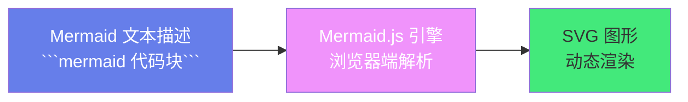

**核心特点**：
- ✅ **原生支持**：GitHub、GitLab、Notion、Obsidian、VSCode 等原生支持渲染
- ✅ **纯文本**：图表用文本描述，可纳入版本控制，Git diff 可追踪
- ✅ **浏览器渲染**：基于 JavaScript，在浏览器端动态生成 SVG，无需服务端
- ✅ **语法简洁**：类自然语言，学习成本低
- ✅ **图类型丰富**：流程图、时序图、类图、状态图、ER 图、甘特图、饼图、思维导图等
- ✅ **主题定制**：内置多种主题，支持自定义样式
- ✅ **交互性**：部分图表支持点击交互、缩放、导出

### 1.2 Mermaid vs PlantUML

| 维度 | Mermaid | PlantUML |
|------|---------|----------|
| **渲染方式** | 浏览器端 JavaScript | Java + Graphviz（服务端/本地） |
| **GitHub 原生** | ✅ 原生渲染 | ❌ 需插件 |
| **GitLab 原生** | ✅ 原生渲染 | ✅ 原生渲染 |
| **语法复杂度** | 简单 | 中等 |
| **图类型** | 常用图（10+ 种） | 极丰富（UML 全系列 + 扩展） |
| **复杂图能力** | 中等（简单图为主） | 极强（大型 UML/架构图） |
| **布局控制** | 自动布局，控制有限 | 自动布局 + 较多控制 |
| **样式定制** | 主题 + 部分自定义 | skinparam 强大定制 |
| **学习曲线** | 低 | 中等 |
| **适用场景** | Markdown 文档内嵌、简单流程图 | 大型 UML 建模、复杂架构图 |

> **选择建议**：Markdown 文档内嵌简单图用 Mermaid（GitHub 原生渲染，无需额外工具）；复杂 UML 建模和大型架构图用 PlantUML。

### 1.3 支持的图表类型

| 图表类型 | 声明关键字 | 说明 |
|---------|-----------|------|
| **流程图** | `flowchart` / `graph` | 最常用，描述流程和关系 |
| **时序图** | `sequenceDiagram` | 对象间按时间的交互 |
| **类图** | `classDiagram` | 面向对象类结构 |
| **状态图** | `stateDiagram-v2` | 对象状态转换 |
| **实体关系图** | `erDiagram` | 数据库表关系 |
| **用户旅程图** | `journey` | 用户使用产品的旅程 |
| **甘特图** | `gantt` | 项目时间计划 |
| **饼图** | `pie` | 数据占比 |
| **思维导图** | `mindmap` | 层级思维结构 |
| **看板** | `kanban` | 任务看板 |
| **需求图** | `requirementDiagram` | 需求与关系 |
| **架构图** | `architecture-beta` | 系统架构（Beta） |
| **Git 图** | `gitGraph` | Git 分支和提交历史 |
| **象限图** | `quadrantChart` | 四象限分析 |
| **时间线** | `timeline` | 事件时间线 |

---

## 二、底层原理

### 2.1 Mermaid 工作原理

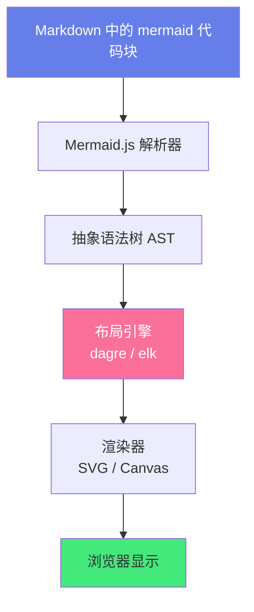

**核心组件**：
1. **解析器（Parser）**：基于 jison 生成的语法解析器，将 Mermaid 文本转换为 AST
2. **布局引擎**：
   - `dagre`：默认布局引擎，层次布局（流程图、类图等）
   - `elk`：Eclipse Layout Kernel，更强大的布局（可选）
3. **渲染器**：将布局后的图模型渲染为 SVG（默认）或 Canvas
4. **主题系统**：内置主题（default/forest/dark/neutral），支持自定义

### 2.2 在 Markdown 中使用

Mermaid 图表通过 Markdown 代码块声明，语言标记为 `mermaid`：

````markdown
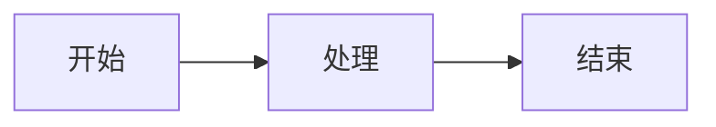
````

渲染结果：


**支持 Mermaid 的平台**：
- ✅ GitHub（原生）
- ✅ GitLab（原生）
- ✅ Notion（原生）
- ✅ Obsidian（需安装插件或原生支持）
- ✅ VSCode（需安装 Markdown Preview Mermaid Support 插件）
- ✅ Typora（原生）
- ✅ 飞书文档（部分支持）
- ✅ Confluence（需插件）

---

## 三、实操：图表类型详解

### 3.1 流程图（Flowchart）

流程图是 Mermaid 最常用的图表类型，用于描述流程、决策和关系。

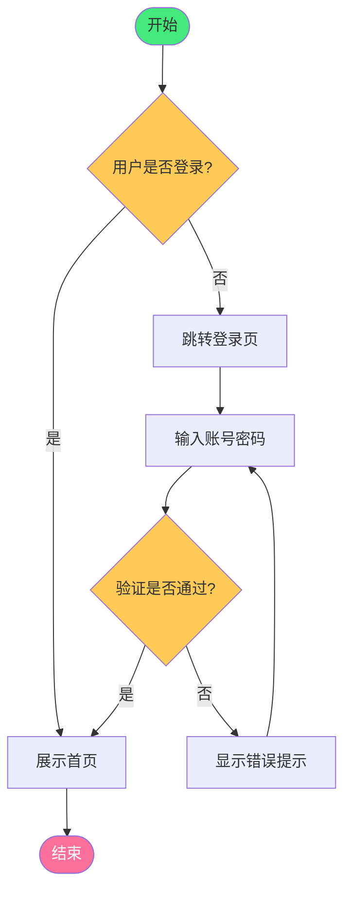

**语法**：
````markdown
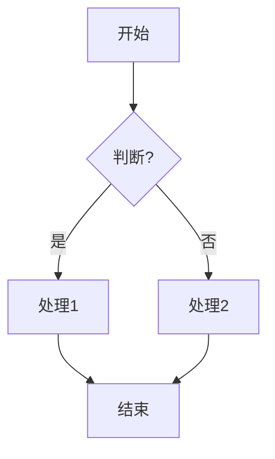
````

**方向**：
| 关键字 | 方向 |
|--------|------|
| `TD` / `TB` | 自上而下（Top-Down） |
| `BT` | 自下而上 |
| `LR` | 从左到右 |
| `RL` | 从右到左 |

**节点形状**：
| 语法 | 形状 | 示例 |
|------|------|------|
| `id[文本]` | 矩形 | `A[开始]` |
| `id(文本)` | 圆角矩形 | `A(开始)` |
| `id([文本])` | 体育场形 | `A([开始])` |
| `id[[文本]]` | 子程序 | `A[[子程序]]` |
| `id[(文本)]` | 数据库 | `A[(数据库)]` |
| `id((文本))` | 圆形 | `A((圆形))` |
| `id{文本}` | 菱形（判断） | `A{判断?}` |
| `id{{文本}}` | 六边形 | `A{{六边形}}` |
| `id[/文本/]` | 平行四边形 | `A[/输入/]` |
| `id[\文本\]` | 反向平行四边形 | `A[\输出\]` |

**连线类型**：
| 语法 | 说明 | 示例 |
|------|------|------|
| `-->` | 实线箭头 | `A --> B` |
| `---` | 实线无箭头 | `A --- B` |
| `-.->` | 虚线箭头 | `A -.-> B` |
| `==>` | 粗线箭头 | `A ==> B` |
| `-- 文本 -->` | 带标签的箭头 | `A -- 是 --> B` |
| `-. 文本 .->` | 带标签的虚线 | `A -. 注释 .-> B` |

**子图（Subgraph）**：
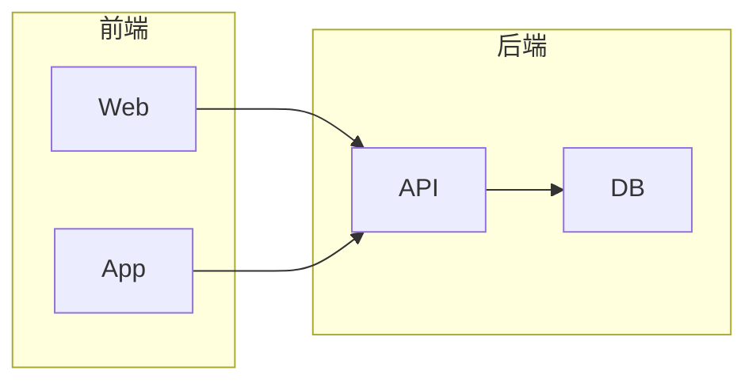

**样式**：


### 3.2 时序图（Sequence Diagram）

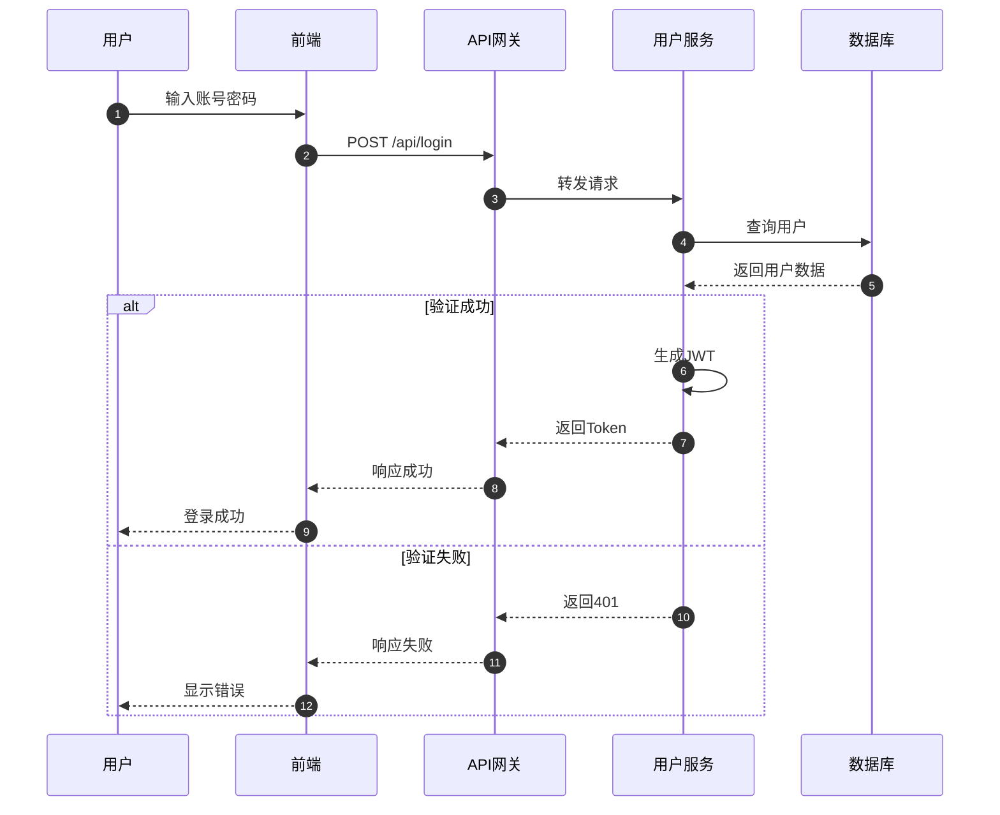

**语法**：
````markdown
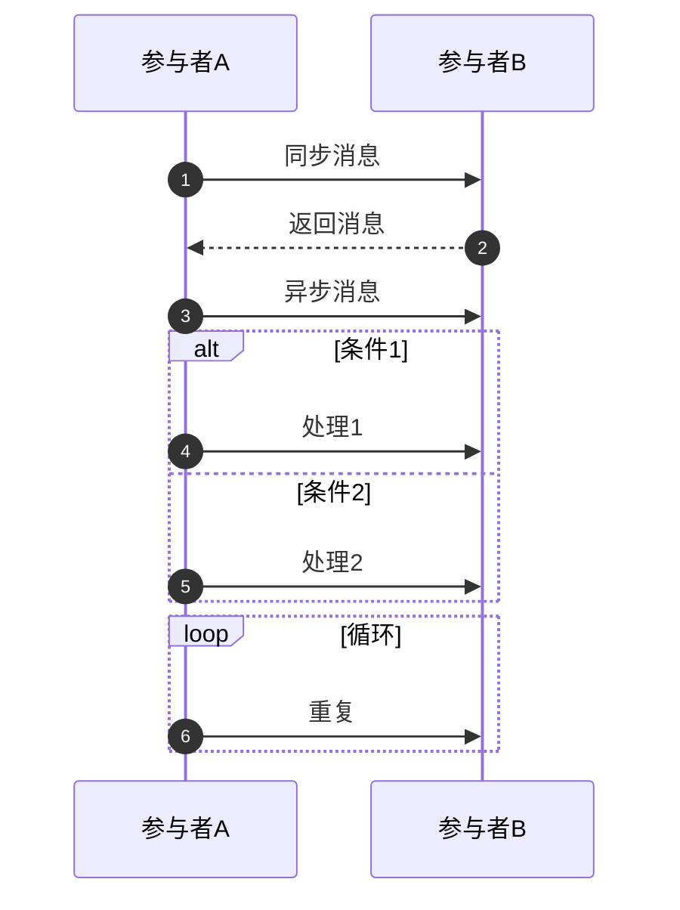
````

**消息类型**：
| 语法 | 说明 |
|------|------|
| `->>` | 实线箭头（同步） |
| `-->>` | 虚线箭头（返回） |
| `-)` | 实线箭头（异步，末尾空心） |
| `--)` | 虚线箭头（异步返回） |
| `->` | 实线无箭头 |
| `-->` | 虚线无箭头 |
| `-x` | 实线末端叉（丢失/错误） |
| `--x` | 虚线末端叉 |

### 3.3 类图（Class Diagram）

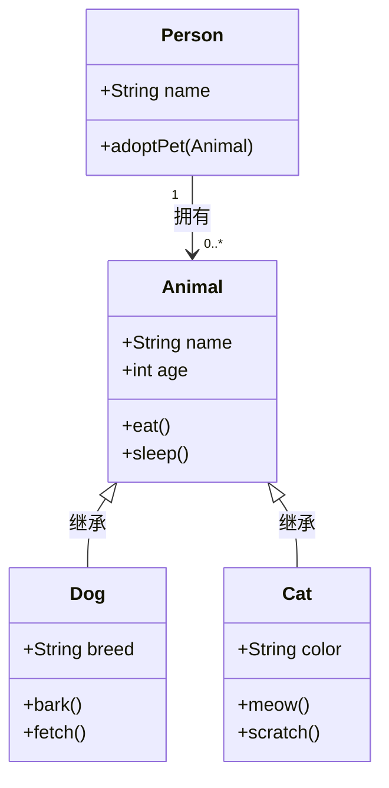

**关系**：
| 语法 | 关系 |
|------|------|
| `<|--` | 继承（泛化） |
| `*--` | 组合 |
| `o--` | 聚合 |
| `-->` | 关联 |
| `..>` | 依赖 |
| `..` | 虚线连接 |

**可见性**：
| 符号 | 可见性 |
|------|--------|
| `+` | public |
| `-` | private |
| `#` | protected |
| `~` | package |

### 3.4 状态图（State Diagram）

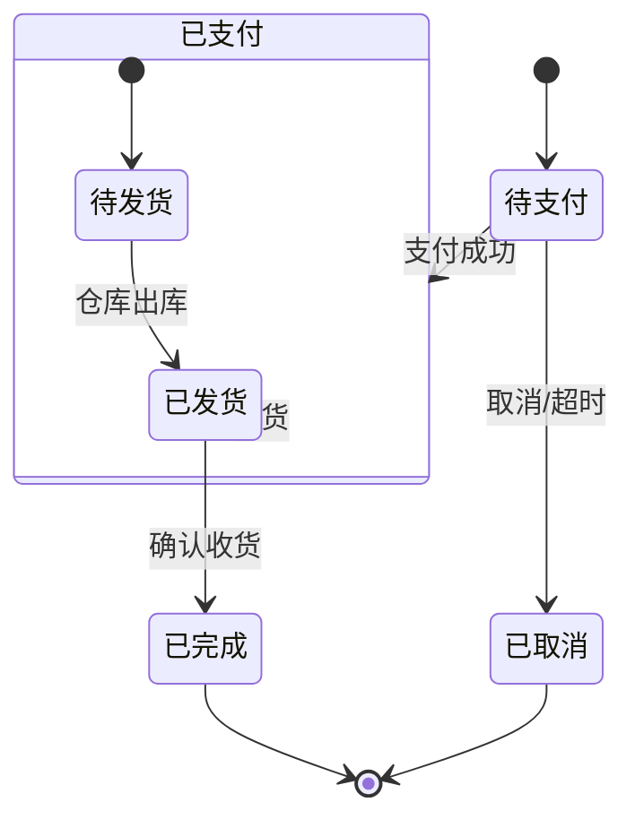

### 3.5 实体关系图（ER Diagram）

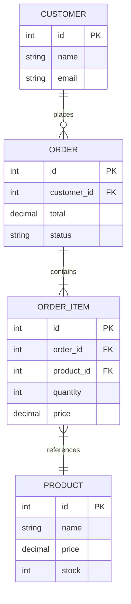

**基数关系**：
| 符号 | 说明 |
|------|------|
| `|o` | 零或一个 |
| `||` | 恰好一个 |
| `}o` | 零或多个 |
| `}|` | 一个或多个 |

### 3.6 甘特图（Gantt Chart）

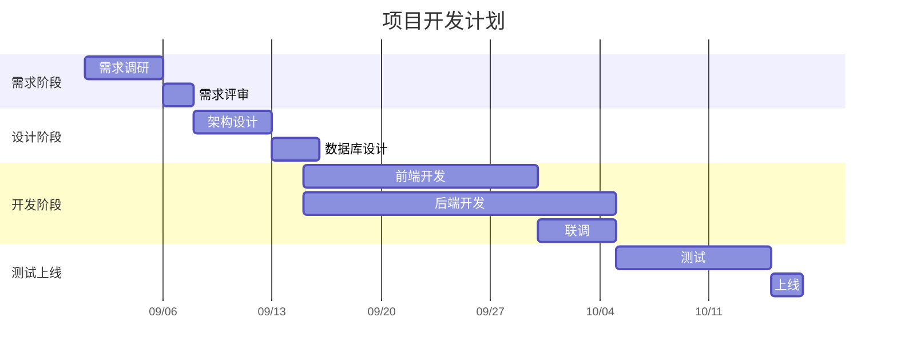

### 3.7 饼图（Pie Chart）

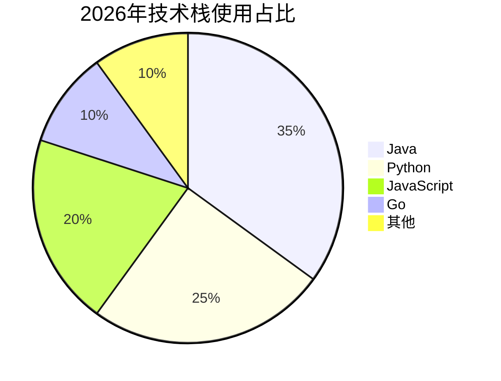

### 3.8 思维导图（Mindmap）

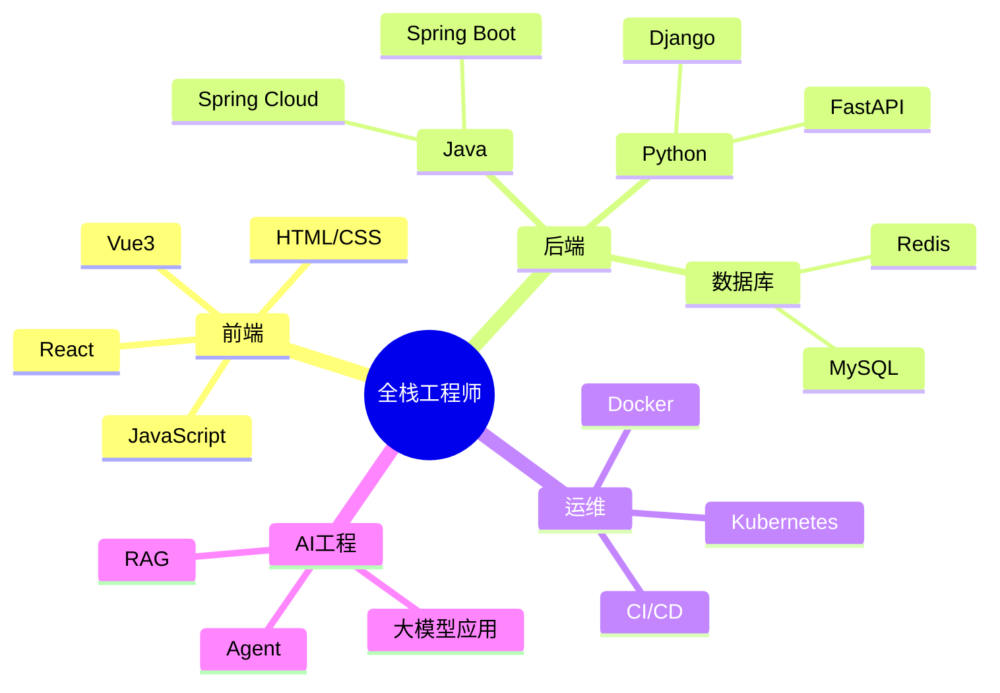

### 3.9 用户旅程图（User Journey）

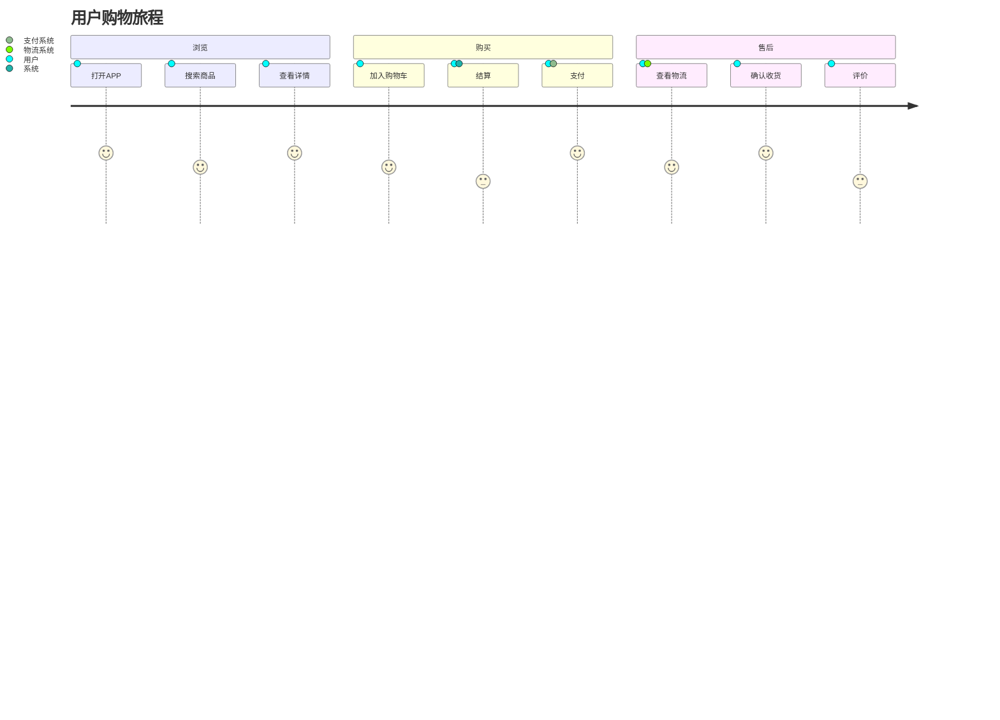

### 3.10 看板（Kanban）

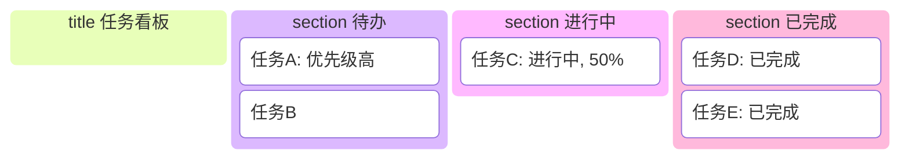

### 3.11 Git 图（Git Graph）

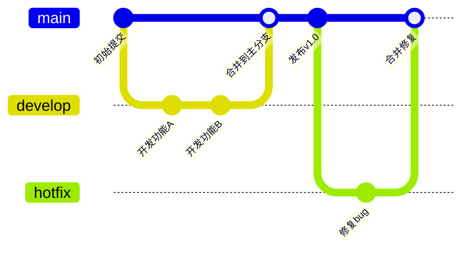

### 3.12 象限图（Quadrant Chart）

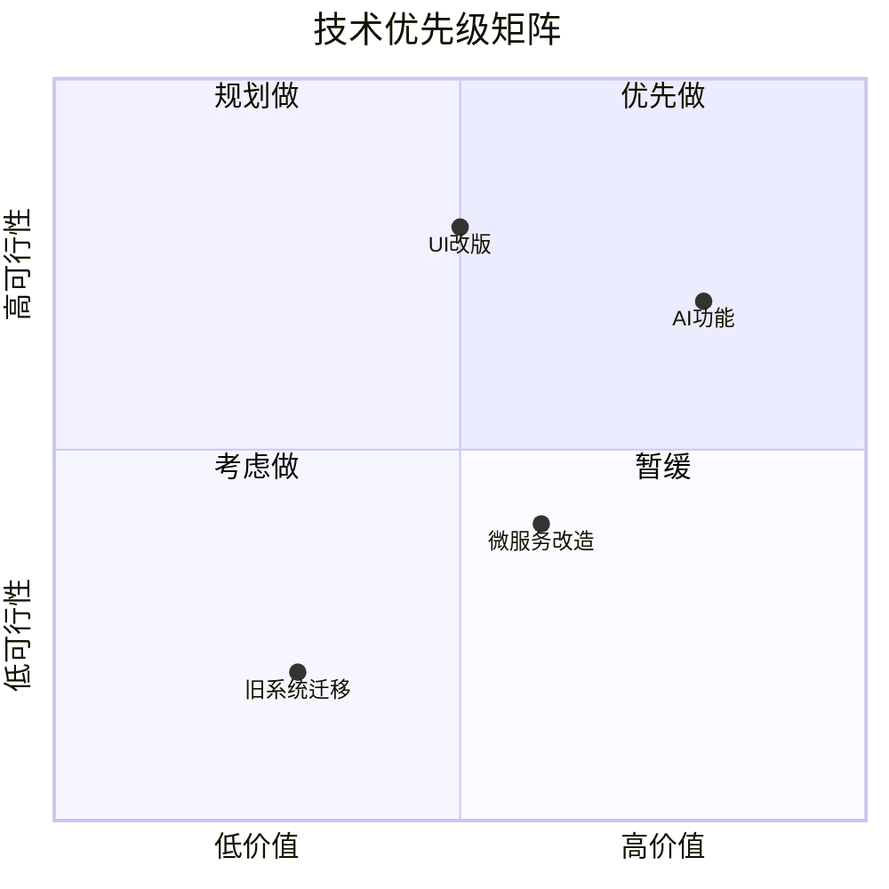

---

## 四、主题与样式定制

### 4.1 内置主题

```mermaid
%%{init: {'theme': 'forest'}}%%
flowchart LR
    A[Forest 主题] --> B[绿色风格]
```

| 主题 | 说明 |
|------|------|
| `default` | 默认主题（蓝色） |
| `forest` | 森林主题（绿色） |
| `dark` | 深色主题 |
| `neutral` | 中性主题（灰色） |
| `base` | 基础主题（用于自定义） |

### 4.2 初始化配置

````markdown
```mermaid
%%{init: {
    'theme': 'base',
    'themeVariables': {
        'primaryColor': '#667eea',
        'primaryTextColor': '#fff',
        'primaryBorderColor': '#4c51bf',
        'lineColor': '#667eea',
        'secondaryColor': '#f093fb',
        'tertiaryColor': '#43e97b',
        'fontFamily': 'Microsoft YaHei',
        'fontSize': '14px'
    }
}}%%
flowchart LR
    A[自定义主题] --> B[紫色风格]
```
````

### 4.3 流程图样式

```mermaid
flowchart LR
    A[成功]:::success --> B[警告]:::warning
    B --> C[错误]:::error
    C --> D[信息]:::info
    
    classDef success fill:#43e97b,color:#333,stroke:#2d9a5a,stroke-width:2px
    classDef warning fill:#feca57,color:#333,stroke:#f39c12,stroke-width:2px
    classDef error fill:#fa709a,color:#fff,stroke:#c44569,stroke-width:2px
    classDef info fill:#4facfe,color:#fff,stroke:#2c7be5,stroke-width:2px
```

### 4.4 常用配置项

| 配置 | 说明 | 示例 |
|------|------|------|
| `theme` | 主题 | `'theme': 'dark'` |
| `themeVariables` | 主题变量 | 颜色、字体等 |
| `flowchart.htmlLabels` | HTML 标签 | `true` |
| `flowchart.curve` | 连线曲线 | `'basis' / 'cardinal' / 'linear'` |
| `sequence.actorMargin` | 参与者间距 | `50` |
| `themeVariables.fontFamily` | 字体 | `'Microsoft YaHei'` |

---

## 五、工具集成与使用方式

### 5.1 GitHub / GitLab

GitHub 和 GitLab 原生支持 Mermaid，直接在 Markdown 中使用 `mermaid` 代码块即可自动渲染。

````markdown
# README

## 架构图

```mermaid
flowchart LR
    A[前端] --> B[后端]
    B --> C[数据库]
```
````

### 5.2 VSCode

```text
推荐插件：
1. Markdown Preview Mermaid Support（bierner.markdown-mermaid）
   — 最流行，在 Markdown 预览中渲染 Mermaid

2. Mermaid Preview（vstirbu.vscode-mermaid-preview）
   — 独立预览窗口

3. Markdown All in One
   — 包含 Mermaid 支持

使用方式：
1. 安装插件
2. 打开 .md 文件
3. Ctrl+Shift+V 打开预览
4. mermaid 代码块自动渲染
```

### 5.3 Obsidian

```text
Obsidian 原生支持 Mermaid（从 v0.10.0+ 开始）。

使用方式：
1. 在笔记中使用 mermaid 代码块
2. 切换到预览模式自动渲染

高级用法：
- 安装 "Mermaid Tools" 插件增强功能
- 安装 "Mermaid Live Editor" 插件在线编辑
- 支持导出为 SVG/PNG
```

### 5.4 在线编辑器

```text
Mermaid 官方在线编辑器：https://mermaid.live/

功能：
- 实时预览
- 导出 SVG/PNG
- 分享链接
- 主题切换
- 代码模板
- 历史记录
```

### 5.5 命令行导出

```bash
# 使用 mermaid-cli（mmdc）批量导出
npm install -g @mermaid-js/mermaid-cli

# 导出为 PNG
mmdc -i diagram.mmd -o diagram.png

# 导出为 SVG
mmdc -i diagram.mmd -o diagram.svg

# 导出为 PDF
mmdc -i diagram.mmd -o diagram.pdf

# 指定主题和宽度
mmdc -i diagram.mmd -o diagram.png -t dark -w 1200

# 批量导出
for f in *.mmd; do mmdc -i "$f" -o "${f%.mmd}.svg"; done
```

---

## 六、常用技巧与最佳实践

### 6.1 实用技巧

| 技巧 | 说明 | 示例 |
|------|------|------|
| **注释** | `%%` 开头 | `%% 这是注释` |
| **换行** | `<br/>` | `A[第一行<br/>第二行]` |
| **特殊字符** | 用 `#quot;` 等 HTML 实体 | `A[带#quot;引号#quot;的文本]` |
| **节点 ID** | 用字母数字，避免关键字 | `A[节点]` 而非 `graph[节点]` |
| **方向** | 流程图用 `TD/LR` | `flowchart LR` |
| **子图嵌套** | 子图内可再嵌套子图 | `subgraph A { subgraph B {...} }` |
| **点击事件** | `click` 绑定链接 | `click A "https://example.com"` |
| **初始化配置** | `%%{init: ...}%%` | 主题、字体、曲线 |

### 6.2 最佳实践

```mermaid
Mermaid 最佳实践：

✅ 图表设计
   - 一个图只表达一个主题，避免信息过载
   - 流程图节点不超过 15 个，过多则拆分
   - 时序图参与者不超过 6 个
   - 使用有意义的节点文本，避免 A/B/C
   - 添加标题说明图表用途
   - 复杂图拆分为多个小图

✅ 语法规范
   - 使用 `flowchart` 而非 `graph`（新版推荐）
   - 节点 ID 用有意义的缩写（如 `user`/`order`）
   - 连线标签简洁（"是/否"而非详细描述）
   - 统一使用中文或英文，不混用
   - 代码块内保持缩进一致

✅ 样式统一
   - 团队共用一套主题配置
   - 使用 classDef 统一样式
   - 颜色含义一致（绿色=成功，红色=错误，黄色=警告）
   - 字体统一（Microsoft YaHei / Inter）
   - 导出 SVG 格式（矢量，缩放不失真）

✅ 文档集成
   - Markdown 中直接使用 mermaid 代码块
   - 图表放在对应章节附近
   - 图表前加一句话说明
   - 复杂图提供文字说明
   - 保持图表与代码同步

✅ 版本控制
   - .mmd 源文件纳入 Git
   - 生成的图片也提交（方便不支持的平台）
   - 提交信息说明图表变更
   - Code Review 时审查图表

✅ 性能优化
   - 大图考虑拆分为多个小图
   - 避免过深的嵌套
   - 使用 SVG 而非 PNG
   - 在线编辑器调试，完成后嵌入文档
```

### 6.3 常见问题

| 问题 | 原因 | 解决方案 |
|------|------|---------|
| 图表不渲染 | 平台不支持 Mermaid | 检查平台支持；导出为图片嵌入 |
| 语法错误 | 拼写错误/缺少分号/关键字冲突 | 用在线编辑器调试；检查语法 |
| 中文乱码 | 字体不支持 | 配置 `themeVariables.fontFamily` |
| 布局混乱 | 节点过多/连线复杂 | 拆分图；调整方向；使用子图 |
| 节点文本被截断 | 文本过长 | 用 `<br/>` 换行；简化文本 |
| 导出图片模糊 | PNG 分辨率低 | 导出 SVG；或用 mmdc 指定宽度 |
| 时序图参与者重叠 | 参与者过多 | 减少参与者；拆分时序图 |
| 类图关系混乱 | 类过多/关系复杂 | 分包展示；使用命名空间 |
| GitHub 不渲染 | 旧版 GitHub | 更新到新版；或用图片替代 |
| 颜色不生效 | classDef 语法错误 | 检查 classDef 定义和引用 |

---

## 七、关联笔记

### 文档与图表
- [[Markdown写作规范]] · [[PlantUML-UML建模]] · [[技术文档写作指南]]

### 架构与设计
- [[架构设计原则-SOLID]] · [[高可用架构设计]] · [[微服务架构设计]]

### 工具链
- [[VSCode高效配置]] · [[Obsidian知识库构建]] · [[Git基础与进阶]]

### 导航
- [[MOC-通用工具]] · [[MOC-文档与图表]] · [[MOC-综合导航]] · [[Home]]

> 🔍 **知识点深度解析**
>
> **作用**：Mermaid 解决的是「在 Markdown 中用纯文本快速创建和渲染图表」问题，让图表可以直接嵌入文档、纳入版本控制，无需额外绘图工具，GitHub/GitLab 等平台原生支持渲染，极大降低了技术文档中图表的创建和维护成本。
>
> **底层原理**：Mermaid 是一个基于 JavaScript 的图表渲染引擎，工作流程为：解析 Markdown 中的 `mermaid` 代码块 → 用 jison 语法解析器将文本转换为抽象语法树（AST）→ 用 dagre/elk 布局引擎计算节点位置 → 用 SVG/Canvas 渲染器生成图形 → 浏览器显示。核心设计是「文本即图表」——用类自然语言的语法描述图的元素和关系，引擎自动处理布局和渲染。与 PlantUML 不同，Mermaid 在浏览器端渲染（JavaScript），不需要 Java/Graphviz，因此 GitHub 等平台可以原生支持。
>
> **用法要点**：① 基本结构：Markdown 代码块标记为 `mermaid`，第一行声明图类型（`flowchart TD`/`sequenceDiagram`/`classDiagram` 等） ② 最常用图：流程图（`flowchart`，节点+连线+判断+子图）、时序图（`sequenceDiagram`，参与者+消息+alt/loop）、类图（`classDiagram`，类+属性+方法+继承/关联）、甘特图（`gantt`，任务+时间+依赖）、饼图（`pie`，数据占比）、思维导图（`mindmap`，层级结构） ③ 流程图方向：`TD`（自上而下）/`LR`（从左到右） ④ 节点形状：`[]`矩形/`()`圆角/`{}`菱形/`[[]]`子程序/`[()]`数据库 ⑤ 连线：`-->`实线/`-.->`虚线/`==>`粗线/`-- 文本 -->`带标签 ⑥ 样式：`classDef` 定义样式类，`:::className` 应用；`%%{init: {'theme': 'forest'}}%%` 设置主题 ⑦ 工具：VSCode 插件（Markdown Preview Mermaid Support）实时预览，Obsidian 原生支持，mermaid.live 在线编辑，mmdc 命令行导出 ⑧ 最佳实践：一图一主题、节点不超过 15 个、用有意义的文本、导出 SVG、与代码同步。

> 💡 **深度讲解**：Mermaid 最大的优势是「零门槛」——不需要安装任何软件，不需要学习复杂的绘图工具，只要会写 Markdown，就能在文档中创建图表。GitHub 原生支持 Mermaid 渲染是它普及的关键——开发者在 README、Issue、PR 描述中直接写 Mermaid 代码块，就能看到渲染后的图表，这让技术文档的图表创建成本降到了几乎为零。Mermaid 的语法设计很简洁，比如流程图 `A --> B` 就是一个箭头，`A{判断?}` 就是一个菱形，几乎不需要学习就能上手。但它的能力也有边界——对于复杂的 UML 类图、组件图、部署图，Mermaid 的布局控制和样式定制不如 PlantUML 强大，大型架构图用 Mermaid 可能会显得拥挤和混乱。所以正确的姿势是：简单流程图、时序图、甘特图用 Mermaid（快、原生支持），复杂 UML 建模和大型架构图用 PlantUML（强大、精细控制）。最常见的坑是「节点文本太长导致布局混乱」——Mermaid 的自动布局对长文本处理不好，解决方案是用 `<br/>` 换行、简化文本、或者拆分图。另一个坑是「中文在某些平台显示为方框」——需要在初始化配置中指定中文字体 `'themeVariables': {'fontFamily': 'Microsoft YaHei'}`。

> 📝 **精简总结**：Mermaid = Markdown 中的纯文本图表，GitHub/GitLab 原生渲染。核心图：流程图（最常用）、时序图、类图、状态图、ER图、甘特图、饼图、思维导图、用户旅程图、看板、Git图。语法：`mermaid` 代码块 + 图类型声明。样式：主题（default/forest/dark）+ classDef + 初始化配置。工具：VSCode插件、Obsidian原生、mermaid.live在线、mmdc导出。最佳实践：一图一主题、节点精简、有意义文本、SVG导出、与代码同步。简单图用Mermaid，复杂UML用PlantUML。

> **学习路径建议**：先学习 [[Markdown写作规范]] 掌握文档基础 → 学习本文档掌握 Mermaid → 学习 [[PlantUML-UML建模]] 对比两种工具 → 学习 [[技术文档写作指南]] 提升文档能力 → 在项目中实践用 Mermaid 绘制流程图和设计文档。

---

> **Mermaid 的本质是「让图表像文字一样自然」——当图表变成 Markdown 中的一段代码，它就不再是文档里的一张静态图片，而是活的、可编辑的、可版本控制的文本。好的技术文档不是文字配图片，而是文字和图表融为一体，共同表达思想。**

---

## 🔗 关联笔记

- [[MOC-通用工具]] — 返回本分类知识地图，查看更多相关文档

## 📖 前置知识

- 无特殊前置知识要求，具备基础编程概念即可

## 🏷️ 相关标签

`#Mermaid` `#图表` `#可视化` `#文档` `#Markdown` `#流程图`

[[Home|🏠 返回首页]] · [[MOC-通用工具|📚 返回分类]]
