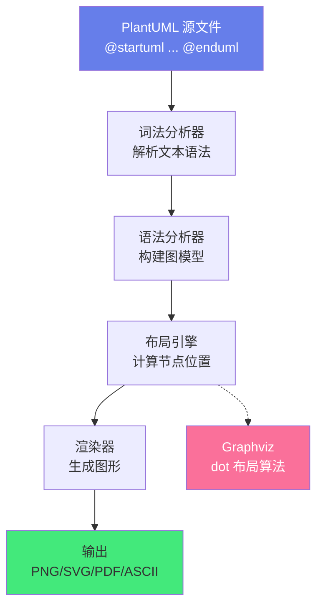
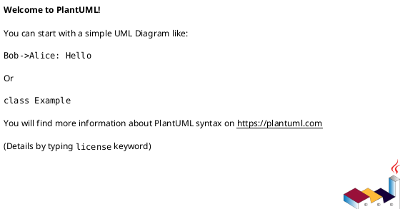
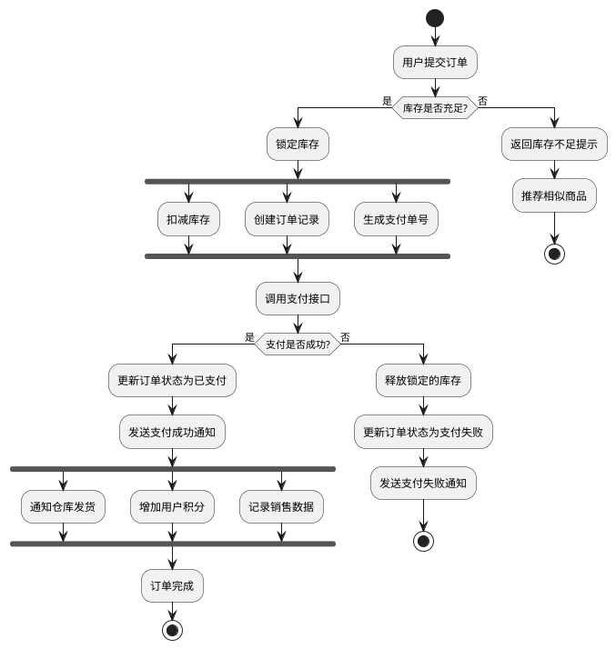
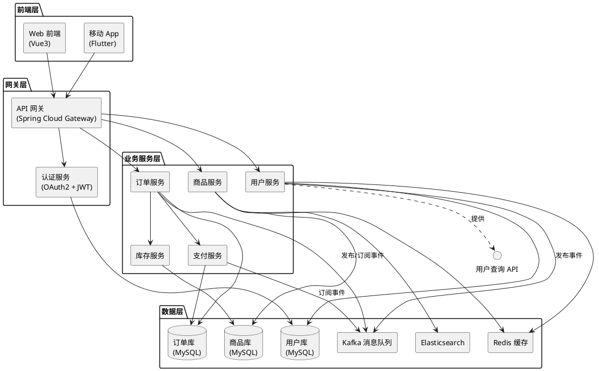
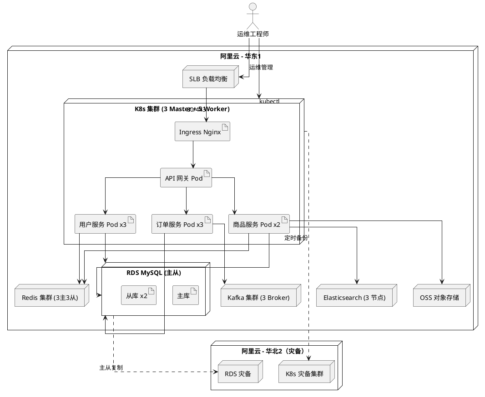
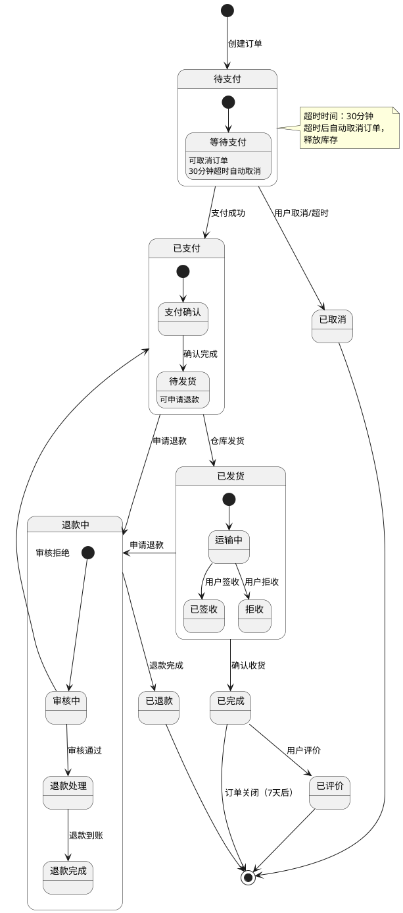
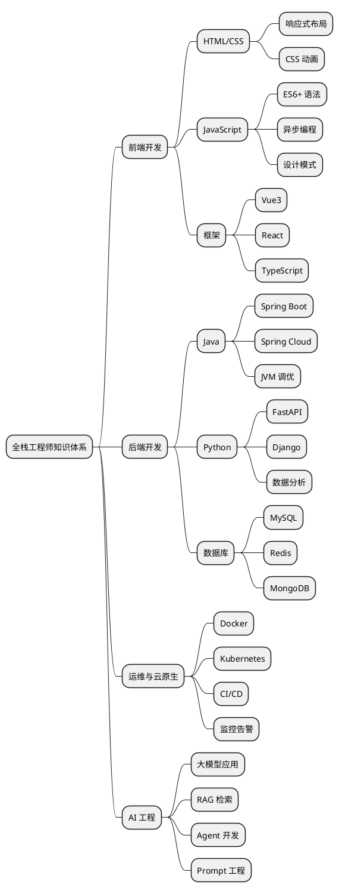
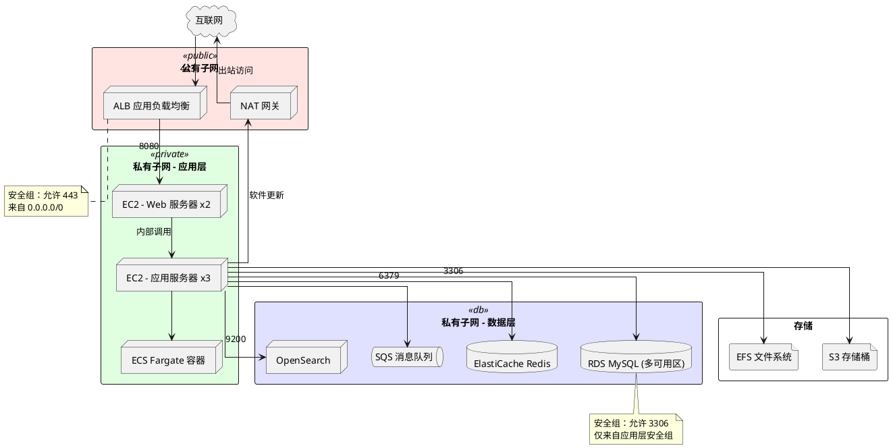
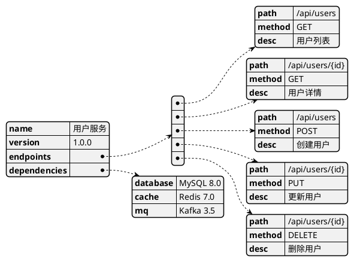
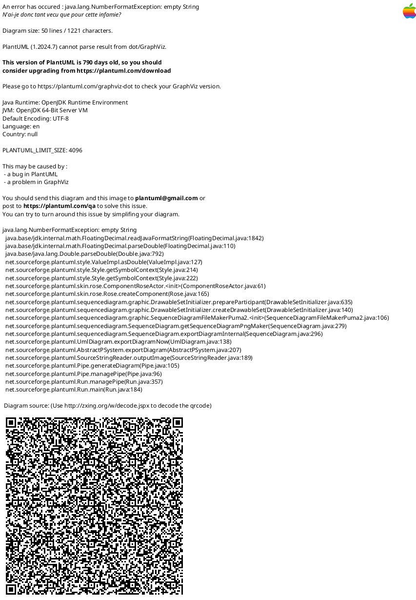

# 📐 PlantUML UML 建模

> **文档说明**：系统讲解 PlantUML 的完整知识体系，涵盖 PlantUML 简介与安装、UML 图类型全解（时序图/类图/用例图/活动图/组件图/部署图/状态图/对象图/包图）、每种图的语法详解与实战示例、非 UML 图（思维导图/甘特图/架构图/网络拓扑图）、皮肤与样式定制、与 Markdown/IDE/CI 集成、常用技巧与最佳实践、与 Mermaid 对比。PlantUML 是用纯文本描述图表的强大工具，支持版本控制和团队协作。
>
> **适用人群**：开发者、架构师、产品经理、技术文档作者、任何需要绘制技术图表的人
>
> **前置知识**：[[Markdown写作规范]]

---

## 一、概述

### 1.1 什么是 PlantUML

PlantUML 是一个开源的图表绘制工具，允许用户使用**纯文本描述**来创建各种 UML 图和非 UML 图。它使用简单直观的语法，通过 Java 程序将文本描述渲染为图片（PNG/SVG/ASCII Art 等）。


**核心特点**：
- ✅ **文本即图表**：用纯文本描述图表，可纳入版本控制（Git diff 可追踪变更）
- ✅ **语法简洁**：类自然语言的语法，学习成本低
- ✅ **图类型丰富**：支持所有 UML 图 + 思维导图/甘特图/架构图/网络拓扑图等
- ✅ **跨平台**：基于 Java，Windows/macOS/Linux 均可运行
- ✅ **生态丰富**：VSCode/IntelliJ/Eclipse/Atom 等 IDE 均有插件；Confluence/GitLab/GitHub 支持
- ✅ **样式可定制**：通过 skinparam 和主题定制图表外观
- ✅ **输出格式多**：PNG/SVG/PDF/ASCII Art/LaTeX 等

### 1.2 解决的问题

| 问题 | 说明 |
|------|------|
| **图表难以版本控制** | 传统绘图工具（Visio/draw.io）生成二进制文件，Git 无法 diff |
| **图表与代码不同步** | 代码改了但图表忘了更新，文档过时 |
| **团队协作困难** | 多人编辑同一图表容易冲突，需要合并 |
| **绘图效率低** | 拖拽式绘图耗时，调整布局麻烦 |
| **文档一致性差** | 不同人画的图表风格不统一 |
| **CI/CD 集成难** | 无法在构建流程中自动生成和更新图表 |

### 1.3 PlantUML vs Mermaid vs draw.io

| 维度 | PlantUML | Mermaid | draw.io |
|------|----------|---------|---------|
| **描述方式** | 纯文本 | 纯文本 | 图形拖拽 |
| **图类型** | 极丰富（UML 全系列 + 扩展） | 常用图（流程图/时序图/类图等） | 所有类型 |
| **语法复杂度** | 中等 | 简单 | 无（图形操作） |
| **渲染引擎** | Java + Graphviz | JavaScript（浏览器端） | 浏览器端 |
| **版本控制** | ✅ 文本可 diff | ✅ 文本可 diff | ❌ XML/二进制 |
| **GitHub 原生支持** | ❌（需插件） | ✅ 原生渲染 | ❌ |
| **GitLab 原生支持** | ✅ 原生渲染 | ✅ 原生渲染 | ❌ |
| **IDE 支持** | 丰富 | 丰富 | 独立应用 |
| **样式定制** | 强大（skinparam/主题） | 中等 | 强大 |
| **复杂图能力** | 极强（适合大型 UML） | 中等（简单图为主） | 极强 |
| **学习曲线** | 中等 | 低 | 低 |
| **适用场景** | 大型项目 UML 建模、架构设计 | 简单流程图、文档内嵌图 | 自由绘图、海报 |

> **选择建议**：复杂 UML 建模（类图/组件图/部署图）和大型架构图用 PlantUML；简单流程图和 Markdown 文档内嵌用 Mermaid；自由布局和非技术图用 draw.io。

---

## 二、底层原理

### 2.1 PlantUML 工作原理



**核心组件**：
1. **词法/语法分析器**：解析 PlantUML 文本，识别图类型、元素、关系
2. **图模型构建**：将文本转换为内部图模型（节点、边、属性）
3. **布局引擎**：
   - 时序图/活动图：PlantUML 内置布局算法
   - 类图/组件图/部署图：调用 Graphviz（dot）进行自动布局
4. **渲染器**：将布局后的图模型渲染为矢量/位图
5. **输出**：支持多种格式

### 2.2 Graphviz 与 dot 布局

PlantUML 的大部分图（类图、组件图、部署图等）依赖 **Graphviz** 的 `dot` 命令进行自动布局。

| 布局算法 | 说明 | 适用图 |
|---------|------|--------|
| `dot` | 层次布局（有向图，自上而下） | 类图、组件图、活动图 |
| `neato` | 弹簧模型布局（无向图） | 网络拓扑图 |
| `fdp` | 力导向布局 | 大型关系图 |
| `sfdp` | 大规模力导向布局 | 超大型图 |
| `twopi` | 放射状布局 | 中心辐射图 |
| `circo` | 环形布局 | 环形关系图 |

> PlantUML 默认使用 `dot` 布局，可以通过 `!pragma layout` 或图内命令切换布局算法。

### 2.3 PlantUML 基本结构

所有 PlantUML 图都以 `@startuml` 开始，以 `@enduml` 结束（非 UML 图有特定的开始标记，如 `@startmindmap`）。



**通用语法规则**：
- 注释：单引号 `'` 开头
- 多行文本：用 `\n` 换行，或用 `--`/`==`/`..` 分隔
- 别名：用 `as` 关键字给元素起别名，方便引用
- 颜色：支持颜色名（red/blue）、十六进制（#FF0000）、RGB
- 箭头：`-->` 实线箭头，`--` 实线，`..>` 虚线箭头，`..` 虚线

---

## 三、实操：UML 图类型详解

### 3.1 时序图（Sequence Diagram）

时序图显示对象之间按时间顺序的交互，是最常用的 UML 图之一。

```plantuml
@startuml
' ===== 时序图基础 =====
autonumber  ' 自动编号消息

actor 用户 as User
participant "前端应用" as Frontend
participant "API 网关" as Gateway
participant "用户服务" as UserService
database "MySQL" as DB
queue "消息队列" as MQ

== 用户登录流程 ==

User -> Frontend: 输入用户名密码
Frontend -> Gateway: POST /api/login
Gateway -> UserService: 转发请求
activate UserService

UserService -> DB: 查询用户信息
activate DB
DB --> UserService: 返回用户数据
deactivate DB

alt 验证成功
    UserService -> UserService: 生成 JWT Token
    UserService -> MQ: 发布登录事件
    UserService --> Gateway: 返回 Token + 用户信息
else 验证失败
    UserService --> Gateway: 返回 401 错误
end

deactivate UserService
Gateway --> Frontend: 响应结果
Frontend --> User: 显示登录结果

== 后续操作 ==

User -> Frontend: 访问受保护页面
Frontend -> Gateway: 请求（携带 Token）
Gateway -> Gateway: 验证 Token
Gateway --> Frontend: 返回页面数据

@enduml
```

**时序图核心语法**：

| 语法 | 说明 | 示例 |
|------|------|------|
| `actor` | 参与者（人） | `actor 用户 as User` |
| `participant` | 参与者（系统/组件） | `participant "用户服务" as Svc` |
| `database` | 数据库 | `database "MySQL" as DB` |
| `queue` | 消息队列 | `queue "Kafka" as MQ` |
| `->` | 实线消息（同步） | `A -> B: 请求` |
| `-->` | 虚线消息（返回） | `B --> A: 响应` |
| `->>` | 异步消息 | `A ->> B: 异步请求` |
| `activate/deactivate` | 激活/停用生命线 | `activate B` / `deactivate B` |
| `alt/else/end` | 条件分支 | `alt 成功 ... else 失败 ... end` |
| `opt/end` | 可选分支 | `opt 可选 ... end` |
| `loop/end` | 循环 | `loop 10次 ... end` |
| `group/end` | 分组 | `group 登录流程 ... end` |
| `== 标题 ==` | 分隔框 | `== 登录流程 ==` |
| `autonumber` | 自动编号 | `autonumber` |
| `note over/left/right` | 注释 | `note over A,B: 注释` |
| `skinparam` | 样式配置 | `skinparam sequenceArrowColor blue` |

### 3.2 类图（Class Diagram）

类图描述系统的静态结构，展示类、接口、属性、方法及其关系。

```plantuml
@startuml
' ===== 类图基础 =====
skinparam classAttributeIconSize 0
skinparam linetype ortho

' 接口
interface UserRepository {
    + findById(id: Long): Optional<User>
    + save(user: User): User
    + deleteById(id: Long): void
}

' 抽象类
abstract class BaseEntity {
    # id: Long
    # createdAt: LocalDateTime
    # updatedAt: LocalDateTime
    + equals(obj: Object): boolean
    + hashCode(): int
}

' 实体类
class User extends BaseEntity {
    - username: String
    - password: String
    - email: String
    - role: Role
    + login(username, password): boolean
    + changePassword(oldPwd, newPwd): boolean
    + getProfile(): UserProfile
}

class UserProfile {
    - nickname: String
    - avatar: String
    - phone: String
    + update(info: ProfileDTO): void
}

enum Role {
    ADMIN
    USER
    GUEST
}

' 服务类
class UserService {
    - userRepository: UserRepository
    - passwordEncoder: PasswordEncoder
    + login(req: LoginDTO): LoginVO
    + register(req: RegisterDTO): UserVO
    + updateProfile(userId, dto): void
}

' 关系
UserRepository <|.. JdbcUserRepository : 实现
User "1" *-- "1" UserProfile : 组合
User "1" --> "1" Role : 关联
UserService --> UserRepository : 依赖
UserService --> PasswordEncoder : 依赖

' 注释
note right of UserService
  业务逻辑层，
  处理用户相关操作
end note

note for User "领域实体，\n对应数据库表"

@enduml
```

**类图关系语法**：

| 关系 | 语法 | 说明 |
|------|------|------|
| 继承（泛化） | `A <|-- B` | B 继承 A（空心三角箭头） |
| 实现 | `A <|.. B` | B 实现接口 A（空心三角虚线） |
| 关联 | `A --> B` | A 关联 B（实线箭头） |
| 双向关联 | `A -- B` | 双向关联（实线无箭头） |
| 依赖 | `A ..> B` | A 依赖 B（虚线箭头） |
| 聚合 | `A o-- B` | A 聚合 B（空心菱形） |
| 组合 | `A *-- B` | A 组合 B（实心菱形） |
| 多重度 | `A "1" -- "*" B` | 一对多关系 |

**可见性符号**：
| 符号 | 可见性 |
|------|--------|
| `+` | public |
| `-` | private |
| `#` | protected |
| `~` | package-private |

**多重度**：
| 符号 | 含义 |
|------|------|
| `1` | 恰好 1 个 |
| `0..1` | 0 或 1 个 |
| `*` 或 `0..*` | 0 或多个 |
| `1..*` | 1 或多个 |
| `n..m` | n 到 m 个 |

### 3.3 用例图（Use Case Diagram）

用例图描述系统功能与参与者的关系。

```plantuml
@startuml
' ===== 用例图 =====
left to right direction
skinparam packageStyle rectangle

actor 普通用户 as User
actor 管理员 as Admin
actor 系统 as System

rectangle "电商平台系统" {
    usecase "浏览商品" as UC1
    usecase "搜索商品" as UC2
    usecase "加入购物车" as UC3
    usecase "下单支付" as UC4
    usecase "查看订单" as UC5
    usecase "用户注册" as UC6
    usecase "用户登录" as UC7
    usecase "商品管理" as UC8
    usecase "订单管理" as UC9
    usecase "用户管理" as UC10
    usecase "数据统计" as UC11
    usecase "发送通知" as UC12
}

' 参与者与用例关系
User --> UC1
User --> UC2
User --> UC3
User --> UC4
User --> UC5
User --> UC6
User --> UC7

Admin --> UC7
Admin --> UC8
Admin --> UC9
Admin --> UC10
Admin --> UC11

System --> UC12

' 用例间关系
UC4 .include.> UC7 : 包含
UC3 .extend.> UC7 : 扩展（需登录）
UC11 .include.> UC9 : 包含
UC8 <|-- UC2 : 泛化（搜索是商品管理的特例）

' 注释
note right of UC4
  下单支付包含：
  确认订单、选择地址、
  选择支付方式、完成支付
end note

@enduml
```

**用例图关系**：
| 关系 | 语法 | 说明 |
|------|------|------|
| 关联 | `actor --> usecase` | 参与者与用例的关联 |
| 包含 | `A .include.> B` | A 包含 B（B 是 A 的必要步骤） |
| 扩展 | `A .extend.> B` | A 扩展 B（B 是 A 的可选功能） |
| 泛化 | `A <|-- B` | B 是 A 的特例 |

### 3.4 活动图（Activity Diagram）

活动图描述工作流和业务流程。



**活动图核心语法**：
| 语法 | 说明 |
|------|------|
| `start` / `stop` | 开始/结束 |
| `:活动;` | 活动节点（以分号结尾） |
| `if/then/else/endif` | 条件分支 |
| `fork/fork again/end fork` | 并行分支 |
| `while/endwhile` | 循环 |
| `repeat/repeat while` | 重复循环 |
| `partition` | 泳道/分区 |
| `note left/right` | 注释 |

### 3.5 组件图（Component Diagram）

组件图描述系统的组件及其依赖关系。



### 3.6 部署图（Deployment Diagram）

部署图描述系统硬件节点和软件组件的部署关系。



### 3.7 状态图（State Diagram）

状态图描述对象在生命周期中的状态转换。



---

## 四、实操：非 UML 图

### 4.1 思维导图（Mind Map）



### 4.2 甘特图（Gantt Chart）

```plantuml
@startgantt
' ===== 甘特图 =====
project starts 2026-09-01
project scale weekly

' 阶段定义
-- 需求阶段 --
[需求调研] lasts 5 days
[需求评审] lasts 2 days
[需求文档] lasts 3 days

-- 设计阶段 --
[架构设计] lasts 5 days
[数据库设计] lasts 3 days
[接口设计] lasts 3 days
[UI 设计] lasts 7 days

-- 开发阶段 --
[前端开发] lasts 15 days
[后端开发] lasts 20 days
[联调测试] lasts 5 days

-- 测试阶段 --
[单元测试] lasts 5 days
[集成测试] lasts 5 days
[性能测试] lasts 3 days
[UAT 测试] lasts 5 days

-- 上线阶段 --
[预发布验证] lasts 2 days
[生产部署] lasts 1 day
[上线监控] lasts 3 days

' 依赖关系
[需求评审] starts at [需求调研]'s end
[需求文档] starts at [需求评审]'s end
[架构设计] starts at [需求文档]'s end
[数据库设计] starts at [架构设计]'s end
[接口设计] starts at [架构设计]'s end
[UI 设计] starts at [需求文档]'s end
[前端开发] starts at [接口设计]'s end
[后端开发] starts at [数据库设计]'s end
[联调测试] starts at [前端开发]'s end
[单元测试] starts at [联调测试]'s end
[集成测试] starts at [单元测试]'s end
[性能测试] starts at [集成测试]'s end
[UAT 测试] starts at [性能测试]'s end
[预发布验证] starts at [UAT 测试]'s end
[生产部署] starts at [预发布验证]'s end
[上线监控] starts at [生产部署]'s end

' 里程碑
[项目启动] happens at 2026-09-01
[设计完成] happens at [架构设计]'s end
[开发完成] happens at [联调测试]'s end
[测试完成] happens at [UAT 测试]'s end
[项目上线] happens at [生产部署]'s end

@endgantt
```

### 4.3 架构图 / 网络拓扑图



### 4.4 JSON/YAML 数据图



---

## 五、样式与皮肤定制

### 5.1 常用 skinparam



### 5.2 使用主题（Theme）

```plantuml
@startuml
' ===== 使用内置主题 =====
!theme cerulean   ' 可选：cerulean, cyborg, journal, readable, sandstone, simplex, slate, spacelab, superhero, united, cosmo, flatly, darkly, lumen, paper, yeti

' 或使用自定义主题文件
'!theme mytheme from /path/to/themes

actor 用户
participant 系统
用户 -> 系统: 请求
系统 --> 用户: 响应
@enduml
```

### 5.3 颜色与样式速查

```plantuml
@startuml
' 颜色定义
skinparam class {
    BackgroundColor #FFE4E1  ' 浅红
    BorderColor #DC143C       ' 猩红
}

' 元素级颜色
class "红色类" as Red #FFB6C1 {
}

class "蓝色类" as Blue #87CEEB {
}

class "绿色类" as Green #90EE90 {
}

' 渐变色
class "渐变类" as Grad #FFE4E1-#FFB6C1 {
}

' 箭头颜色
Red -[#DC143C]-> Blue : 红色箭头
Blue -[#1E90FF,dashed]-> Green : 蓝色虚线箭头
Green -[#228B22,bold]-> Red : 绿色粗箭头

@enduml
```

---

## 六、工具集成与使用方式

### 6.1 安装 PlantUML

```bash
# ===== 方式1：Java JAR（最通用）=====
# 1. 安装 Java 8+
java -version

# 2. 安装 Graphviz（类图/组件图需要）
# macOS
brew install graphviz
# Ubuntu/Debian
sudo apt install graphviz
# Windows
# 下载 https://graphviz.org/download/ 安装

# 3. 下载 PlantUML JAR
wget https://github.com/plantuml/plantuml/releases/download/v1.2024.0/plantuml-1.2024.0.jar
# 或从官网下载：https://plantuml.com/download

# 4. 使用
java -jar plantuml.jar diagram.puml           # 生成 PNG
java -jar plantuml.jar -tsvg diagram.puml      # 生成 SVG
java -jar plantuml.jar -tpdf diagram.puml       # 生成 PDF
java -jar plantuml.jar -ttxt diagram.puml       # 生成 ASCII Art
java -jar plantuml.jar -charset UTF-8 diagram.puml  # 指定编码

# ===== 方式2：命令行工具（npm）=====
npm install -g plantuml
plantuml diagram.puml

# ===== 方式3：Docker =====
docker run -d -p 8080:8080 plantuml/plantuml-server
# 访问 http://localhost:8080 在线编辑
# API 调用：curl http://localhost:8080/png/~encoded-text
```

### 6.2 VSCode 集成

```json
推荐插件：
1. PlantUML（jebbs.plantuml）— 最流行，支持预览/导出/语法高亮
2. PlantUML Previewer — 轻量预览

配置步骤：
1. 安装 Java 和 Graphviz
2. 安装 PlantUML 插件
3. 配置 settings.json：
   {
     "plantuml.server": "http://localhost:8080",  // 可选：使用本地服务器
     "plantuml.render": "PlantUMLServer",          // 或 "Local"
     "plantuml.exportFormat": "svg",
     "plantuml.exportOutDir": "images"
   }
4. 快捷键：
   - Alt+D：预览当前图表
   - Ctrl+Shift+P → "PlantUML: Export Current Diagram"：导出
   - Ctrl+Shift+P → "PlantUML: Export Workspace Diagrams"：批量导出
```

### 6.3 IntelliJ IDEA 集成

```text
推荐插件：
1. PlantUML integration — 官方推荐，功能完整

配置步骤：
1. 安装插件：Settings → Plugins → 搜索 "PlantUML integration"
2. 配置 Graphviz 路径：Settings → Languages & Frameworks → PlantUML
3. 创建 .puml 文件，自动预览
4. 右键 → Export to File 导出图片
```

### 6.4 Markdown 中嵌入 PlantUML

````markdown
<!-- 方式1：代码块（需要渲染器支持，如 GitLab/Notion/Obsidian 插件） -->
```text
@startuml
Alice -> Bob: Hello
@enduml
```

<!-- 方式2：图片引用（预渲染） -->


<!-- 方式3：在线服务（PlantUML 官方服务器） -->


<!-- 方式4：Obsidian 插件 -->
<!-- 安装 "PlantUML" 插件后，代码块自动渲染 -->
````

### 6.5 CI/CD 自动生成图表

```yaml
# .github/workflows/generate-diagrams.yml
name: Generate Diagrams

on:
  push:
    paths:
      - 'docs/diagrams/**.puml'

jobs:
  generate:
    runs-on: ubuntu-latest
    steps:
      - uses: actions/checkout@v4
      
      - name: Install Java
        uses: actions/setup-java@v4
        with:
          distribution: 'temurin'
          java-version: '17'
      
      - name: Install Graphviz
        run: sudo apt-get install -y graphviz
      
      - name: Download PlantUML
        run: |
          wget -q https://github.com/plantuml/plantuml/releases/download/v1.2024.0/plantuml-1.2024.0.jar
      
      - name: Generate diagrams
        run: |
          find docs/diagrams -name "*.puml" -exec java -jar plantuml-1.2024.0.jar -tsvg -charset UTF-8 {} \;
      
      - name: Commit generated images
        run: |
          git config --global user.name 'github-actions'
          git add docs/diagrams/**.svg
          git commit -m 'docs: auto-generate diagrams' || echo "No changes"
          git push
```

---

## 七、常用技巧与最佳实践

### 7.1 实用技巧

```plantuml
@startuml
' ===== 技巧1：使用别名简化引用 =====
participant "用户服务（UserService）" as US
participant "订单服务（OrderService）" as OS
US -> OS: 创建订单  ' 用别名引用，简洁

' ===== 技巧2：多行文本 =====
note right of US
  多行注释第一行
  多行注释第二行
  多行注释第三行
end note

' ===== 技巧3：使用分隔符 =====
== 第一阶段 ==
US -> OS: 请求1
== 第二阶段 ==
US -> OS: 请求2

' ===== 技巧4：隐藏/显示脚注 =====
hide footbox  ' 隐藏参与者底部

' ===== 技巧5：自动创建参与者 =====
' 不需要提前声明，直接使用即可自动创建
A -> B: 自动创建 A 和 B

' ===== 技巧6：使用预处理器 =====
!define MSG(x) 发送消息: x
A -> B: MSG(你好)  ' 宏替换

!include common.puml  ' 包含公共文件

' ===== 技巧7：条件编译 =====
!if %variable_exists("DEBUG")
  note over A,B: 调试模式
!endif

@enduml
```

### 7.2 最佳实践

```text
PlantUML 最佳实践：

✅ 文件管理
   - 每个图一个 .puml 文件，文件名与图内容对应
   - 大图拆分为多个小图，通过 !include 组合
   - 公共样式提取到 common.puml，通过 !include 引用
   - 生成的图片放在 images/ 目录，与源文件分开

✅ 命名规范
   - 参与者/类名使用有意义的名称，避免 A/B/C
   - 别名使用英文缩写，全名用中文描述
   - 文件名使用 kebab-case（如 user-login-sequence.puml）

✅ 图表设计
   - 一个图只表达一个主题，避免信息过载
   - 时序图参与者不超过 7 个，过多则拆分
   - 类图类不超过 15 个，过多则分包展示
   - 使用颜色区分不同类型/层级，但不要过度使用
   - 添加标题和注释，让图自解释

✅ 样式统一
   - 团队共用一个 common.puml 样式文件
   - 统一字体、颜色、圆角、连线风格
   - 使用主题（theme）保持一致性
   - 导出 SVG 格式（矢量，缩放不失真，文件小）

✅ 版本控制
   - .puml 源文件纳入 Git 管理
   - 生成的图片也提交（方便不装插件的人查看）
   - 提交信息说明图表变更内容
   - Code Review 时审查图表（和代码一样）

✅ 文档集成
   - Markdown 文档中引用生成的 SVG 图片
   - 或使用支持 PlantUML 的渲染器（GitLab/Obsidian 插件）
   - 图表放在文档对应章节附近
   - 保持图表与代码同步（代码变更时更新图表）

✅ 性能优化
   - 大图使用 `!pragma layout smetana`（新布局引擎，不需要 Graphviz）
   - 复杂图拆分为多个小图
   - 使用 SVG 而非 PNG（文件更小）
   - 本地渲染而非在线服务（更快，更安全）
```

### 7.3 常见问题

| 问题 | 原因 | 解决方案 |
|------|------|---------|
| 中文乱码 | 编码问题 | 添加 `-charset UTF-8` 参数；文件保存为 UTF-8 |
| 图渲染失败 | Graphviz 未安装 | 安装 Graphviz；或使用 `!pragma layout smetana` |
| 布局混乱 | 元素过多/关系复杂 | 拆分图；使用 `together` 分组；调整布局算法 |
| 箭头交叉 | 自动布局不理想 | 使用 `hide empty members`；调整元素顺序；使用 `skinparam linetype ortho` |
| 图片模糊 | 导出 PNG 分辨率低 | 导出 SVG；或用 `-DPLANTUML_LIMIT_SIZE=8192` 提高分辨率 |
| 字体不显示 | 系统缺少字体 | 安装对应字体；或用 `skinparam defaultFontName` 指定系统已有字体 |
| 在线服务不可用 | 网络问题 | 本地安装 PlantUML；或部署私有 PlantUML 服务器 |
| 类图方法太多 | 显示拥挤 | 使用 `hide empty members`；只显示关键方法；拆分为多个类图 |

---

## 八、关联笔记

### 文档与图表
- [[Markdown写作规范]] · [[Mermaid图表绘制]] · [[技术文档写作指南]]

### 架构与设计
- [[架构设计原则-SOLID]] · [[高可用架构设计]] · [[微服务架构设计]]

### 工具链
- [[VSCode高效配置]] · [[Obsidian知识库构建]] · [[Git基础与进阶]]

### 导航
- [[MOC-通用工具]] · [[MOC-文档与图表]] · [[MOC-综合导航]] · [[Home]]

> 🔍 **知识点深度解析**
>
> **作用**：PlantUML 解决的是「用纯文本描述和管理技术图表」问题，让图表可以像代码一样纳入版本控制、进行 diff、在 CI/CD 中自动生成，解决了传统绘图工具图表难以版本管理、团队协作困难、与代码不同步的痛点。
>
> **底层原理**：PlantUML 是一个基于 Java 的图表渲染引擎，工作流程为：解析 PlantUML 文本（词法/语法分析）→ 构建内部图模型（节点/边/属性）→ 布局计算（时序图/活动图用内置算法，类图/组件图/部署图调用 Graphviz 的 dot 布局算法）→ 渲染输出（PNG/SVG/PDF/ASCII）。核心设计是「文本即图表」——用类自然语言的语法描述图的元素和关系，引擎自动处理布局和渲染，用户不需要手动拖拽调整位置。Graphviz 的 dot 算法使用层次布局（有向图自上而下），是 PlantUML 大部分图的布局基础。
>
> **用法要点**：① 基本结构：`@startuml` 开始，`@enduml` 结束，中间是元素和关系定义 ② 最常用图：时序图（`actor/participant` + `->/-->` + `alt/loop`）、类图（`class/interface` + 继承/关联/聚合/组合）、用例图（`usecase` + 包含/扩展）、活动图（`start/stop` + `:活动;` + `if/else`）、组件图（`[组件]` + 依赖）、部署图（`node` + 部署关系） ③ 非 UML 图：思维导图（`@startmindmap`）、甘特图（`@startgantt`）、架构图/网络拓扑图、JSON 数据图 ④ 样式定制：`skinparam` 配置全局样式，`!theme` 使用主题，颜色支持十六进制和颜色名 ⑤ 工具集成：VSCode 插件（jebbs.plantuml）实时预览，IntelliJ 插件，CI/CD 自动生成 ⑥ 输出 SVG 格式（矢量，缩放不失真） ⑦ 最佳实践：一个图一个主题、公共样式提取、纳入 Git、Code Review 审查图表 ⑧ 与 Mermaid 对比：PlantUML 适合复杂 UML 和大型架构图，Mermaid 适合简单流程图和文档内嵌。

> 💡 **深度讲解**：PlantUML 最大的价值不是「画图」，而是「让图表成为代码的一部分」——传统绘图工具（Visio/draw.io）生成的是二进制或 XML 文件，Git 无法进行有意义的 diff，多人编辑容易冲突，图表更新后无法追溯变更历史。PlantUML 用纯文本描述图表，`.puml` 文件就是源代码，可以 `git diff` 看变更、`git blame` 看谁改的、Pull Request 里审查图表、CI/CD 自动生成最新图片，这让图表真正融入了软件开发流程。PlantUML 的语法设计很巧妙——类自然语言，比如 `Alice -> Bob: Hello` 就是一条消息，`class User { + name: String }` 就是一个类，学习成本很低。但它的能力很强，支持所有 UML 图类型，还扩展了思维导图、甘特图、架构图、网络拓扑图等，几乎能满足技术文档的所有绘图需求。最常见的坑是「Graphviz 没装导致类图渲染失败」——PlantUML 的时序图和活动图用内置布局，但类图、组件图、部署图依赖 Graphviz 的 dot 命令，必须单独安装。另一个坑是「中文乱码」——需要在渲染时加 `-charset UTF-8` 参数，文件也要保存为 UTF-8 编码。

> 📝 **精简总结**：PlantUML = 纯文本描述图表，支持版本控制和自动生成。核心图：时序图（最常用）、类图、用例图、活动图、组件图、部署图、状态图。扩展图：思维导图、甘特图、架构图、JSON 图。语法：`@startuml/@enduml` 包裹，类自然语言。样式：`skinparam` 全局配置，`!theme` 主题。工具：VSCode/IntelliJ 插件，Java JAR 渲染，CI/CD 自动生成。最佳实践：一图一主题、公共样式提取、SVG 输出、纳入 Git、与代码同步。

> **学习路径建议**：先学习 [[Markdown写作规范]] 掌握文档基础 → 学习本文档掌握 PlantUML → 学习 [[Mermaid图表绘制]] 对比两种工具 → 学习 [[技术文档写作指南]] 提升文档能力 → 在项目中实践用 PlantUML 绘制架构图和设计文档。

---

> **PlantUML 的本质是「给图表装上版本控制的翅膀」——当图表变成纯文本，它就不再是文档里的一张静态图片，而是活的、可追溯的、可自动更新的工程资产。好的架构图不是画出来给人看的，而是和代码一起演进、一起审查、一起交付的。**

---

## 🔗 关联笔记

- [[MOC-通用工具]] — 返回本分类知识地图，查看更多相关文档

## 📖 前置知识

- 无特殊前置知识要求，具备基础编程概念即可

## 🏷️ 相关标签

`#PlantUML` `#UML` `#建模` `#图表` `#文档` `#时序图`

[[Home|🏠 返回首页]] · [[MOC-通用工具|📚 返回分类]]
