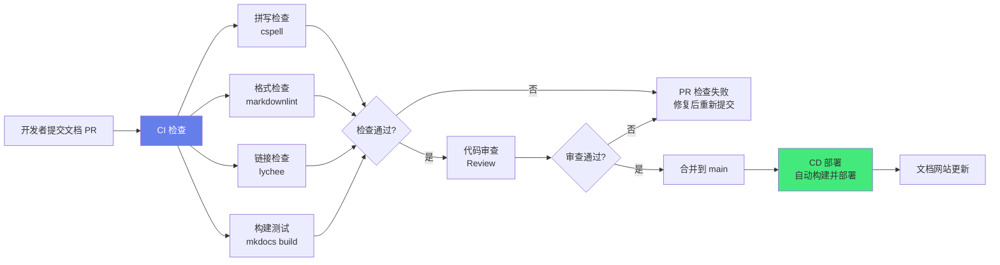

# 📝 文档自动生成工具

> **文档说明**：系统讲解文档自动生成工具的完整知识体系，涵盖文档自动化的核心价值与分类、API 文档生成（OpenAPI/Swagger/SpringDoc/apidoc）、代码文档生成（Javadoc/TypeDoc/Doxygen/Godoc/Rdoc/Pdoc）、静态站点生成器（MkDocs/VitePress/Docusaurus/GitBook/Hugo/Jekyll）、文档即代码（Docs as Code）方法论、CI/CD 集成与自动化部署、AI 辅助文档生成（Copilot/ChatGPT/Mintlify）、文档质量保障（链接检查/拼写检查/版本管理）、多语言与国际化、常见问题与最佳实践。
>
> **适用人群**：开发者、技术写作者、DevOps 工程师、开源项目维护者、需要提升文档效率的团队
>
> **前置知识**：[[Markdown语法与最佳实践]] · [[Git工作流与分支策略]] · [[CI-CD流水线]]

---

## 一、概述

### 1.1 为什么需要文档自动化

**文档的痛点**：
| 痛点 | 说明 |
|------|------|
| **手写耗时** | 手写 API 文档、代码文档耗时且枯燥 |
| **容易过时** | 代码更新了但文档没更新，文档与代码不一致 |
| **格式不统一** | 不同人写的文档风格、格式、详略程度差异大 |
| **维护成本高** | 项目变大后，文档维护成为沉重负担 |
| **重复劳动** | 同样的信息（如 API 接口）在代码注释、API 文档、用户手册中重复编写 |

**文档自动化的价值**：
| 价值 | 说明 |
|------|------|
| **从代码生成** | 从代码注释、类型定义、注解自动生成文档，保证文档与代码一致 |
| **统一格式** | 模板化生成，格式统一，风格一致 |
| **降低维护成本** | 代码更新后重新生成即可，不需要手动修改文档 |
| **提升质量** | 自动化检查（死链、拼写、完整性）提升文档质量 |
| **加速发布** | CI/CD 中自动生成和部署文档，随代码一起发布 |
| **单一信息源** | 代码注释是文档的唯一来源，避免信息重复和不一致 |

> **核心原则：文档即代码（Docs as Code）**——将文档视为代码的一部分，用版本控制管理、用 CI/CD 自动化、用代码审查流程审核。文档自动化是 Docs as Code 的核心实践。

### 1.2 文档自动生成工具分类

```mermaid
flowchart TB
    Gen[文档自动生成工具]
    
    Gen --> A[API 文档生成]
    Gen --> B[代码文档生成]
    Gen --> C[静态站点生成器]
    Gen --> D[AI 辅助文档生成]
    Gen --> E[文档质量工具]
    
    A --> A1[OpenAPI/Swagger]
    A --> A2[SpringDoc/Swagger UI]
    A --> A3[apidoc]
    A --> A4[GraphQL Doc]
    
    B --> B1[Javadoc]
    B --> B2[TypeDoc]
    B --> B3[Doxygen]
    B --> B4[Godoc]
    B --> B5[Pdoc/Sphinx]
    
    C --> C1[MkDocs]
    C --> C2[VitePress]
    C --> C3[Docusaurus]
    C --> C4[GitBook]
    C --> C5[Hugo/Jekyll]
    
    D --> D1[GitHub Copilot]
    D --> D2[ChatGPT/AI]
    D --> D3[Mintlify]
    
    E --> E1[链接检查]
    E --> E2[拼写检查]
    E --> E3[Lint工具]
    
    style Gen fill:#667eea,color:#fff
    style A fill:#43e97b,color:#333
    style B fill:#f093fb,color:#fff
    style C fill:#feca57,color:#333
    style D fill:#00d2ff,color:#333
    style E fill:#ff6b6b,color:#fff
```



| 类别 | 说明 | 代表工具 |
|------|------|---------|
| **API 文档生成** | 从代码注解/接口定义生成 API 文档 | OpenAPI/Swagger、SpringDoc、apidoc |
| **代码文档生成** | 从代码注释生成 API 参考文档 | Javadoc、TypeDoc、Doxygen、Godoc、Sphinx |
| **静态站点生成器** | 将 Markdown 等源文件转为静态网站 | MkDocs、VitePress、Docusaurus、Hugo |
| **AI 辅助文档生成** | 用 AI 自动生成和优化文档内容 | GitHub Copilot、ChatGPT、Mintlify |
| **文档质量工具** | 检查文档质量（死链、拼写、格式） | markdownlint、lychee、cspell |

---

## 二、API 文档生成

### 2.1 OpenAPI / Swagger

OpenAPI 规范（原 Swagger 规范）是 REST API 的标准描述格式，用 YAML/JSON 描述 API 的接口、参数、响应、认证等信息。

**OpenAPI 文档结构**：
```yaml
openapi: 3.0.3
info:
  title: 用户管理 API
  version: 1.0.0
  description: 用户管理系统的 REST API
servers:
  - url: https://api.example.com/v1
    description: 生产环境
paths:
  /users:
    get:
      summary: 获取用户列表
      description: 分页获取用户列表
      parameters:
        - name: page
          in: query
          schema:
            type: integer
            default: 1
        - name: size
          in: query
          schema:
            type: integer
            default: 20
      responses:
        '200':
          description: 成功
          content:
            application/json:
              schema:
                type: object
                properties:
                  data:
                    type: array
                    items:
                      $ref: '#/components/schemas/User'
                  total:
                    type: integer
    post:
      summary: 创建用户
      requestBody:
        required: true
        content:
          application/json:
            schema:
              $ref: '#/components/schemas/UserCreate'
      responses:
        '201':
          description: 创建成功
components:
  schemas:
    User:
      type: object
      properties:
        id:
          type: string
          format: uuid
        name:
          type: string
        email:
          type: string
          format: email
        createdAt:
          type: string
          format: date-time
    UserCreate:
      type: object
      required:
        - name
        - email
      properties:
        name:
          type: string
        email:
          type: string
          format: email
  securitySchemes:
    bearerAuth:
      type: http
      scheme: bearer
      bearerFormat: JWT
```

**Swagger 工具链**：
| 工具 | 说明 |
|------|------|
| **Swagger Editor** | 在线编辑 OpenAPI 文档，实时预览 |
| **Swagger UI** | 将 OpenAPI 文档渲染为可交互的 API 文档页面 |
| **Swagger Codegen** | 从 OpenAPI 文档生成客户端 SDK 和服务端框架 |
| **Redoc** | 另一种 OpenAPI 文档渲染工具，更美观 |
| **Stoplight** | API 设计和文档平台 |
| **Postman** | 支持导入 OpenAPI 文档，生成测试集合 |

**Swagger UI 部署（Docker）**：
```bash
docker run -d \
  --name swagger-ui \
  -p 8080:8080 \
  -e SWAGGER_JSON=/openapi.yaml \
  -v $(pwd)/openapi.yaml:/openapi.yaml \
  swaggerapi/swagger-ui
```

### 2.2 SpringDoc（Java/Spring Boot）

SpringDoc 是 Spring Boot 生态的 OpenAPI 文档生成工具，通过注解自动从代码生成 OpenAPI 文档。

```xml
<!-- pom.xml -->
<dependency>
    <groupId>org.springdoc</groupId>
    <artifactId>springdoc-openapi-starter-webmvc-ui</artifactId>
    <version>2.3.0</version>
</dependency>
```

```java
@RestController
@RequestMapping("/api/users")
@Tag(name = "用户管理", description = "用户 CRUD 操作")
public class UserController {

    @Operation(summary = "获取用户列表", description = "分页获取用户列表")
    @GetMapping
    public Page<User> list(
        @Parameter(description = "页码", example = "1") @RequestParam(defaultValue = "1") int page,
        @Parameter(description = "每页数量", example = "20") @RequestParam(defaultValue = "20") int size
    ) {
        return userService.list(page, size);
    }

    @Operation(summary = "创建用户")
    @ApiResponse(responseCode = "201", description = "创建成功")
    @PostMapping
    public User create(@Valid @RequestBody UserCreateDTO dto) {
        return userService.create(dto);
    }

    @Operation(summary = "获取用户详情")
    @GetMapping("/{id}")
    public User get(@PathVariable Long id) {
        return userService.get(id);
    }
}
```

**访问地址**：
- OpenAPI JSON：`http://localhost:8080/v3/api-docs`
- Swagger UI：`http://localhost:8080/swagger-ui.html`

### 2.3 apidoc（通用）

apidoc 从代码注释生成 REST API 文档，支持多种语言（Java/JavaScript/Python/PHP 等）。

```javascript
/**
 * @api {get} /users/:id 获取用户信息
 * @apiName GetUser
 * @apiGroup User
 *
 * @apiParam {Number} id 用户唯一 ID
 *
 * @apiSuccess {String} name 用户名
 * @apiSuccess {String} email 邮箱
 * @apiSuccess {Date} createdAt 创建时间
 *
 * @apiSuccessExample Success-Response:
 *     HTTP/1.1 200 OK
 *     {
 *       "name": "张三",
 *       "email": "zhangsan@example.com"
 *     }
 *
 * @apiError UserNotFound 用户不存在
 *
 * @apiErrorExample Error-Response:
 *     HTTP/1.1 404 Not Found
 *     {
 *       "error": "UserNotFound"
 *     }
 */
app.get('/users/:id', (req, res) => {
    // ...
});
```

```bash
# 安装
npm install -g apidoc

# 生成文档
apidoc -i src/ -o docs/
```

### 2.4 GraphQL 文档

GraphQL API 自带类型系统（Schema），可以从 Schema 自动生成文档。

| 工具 | 说明 |
|------|------|
| **GraphiQL** | GraphQL 自带的交互式文档和调试工具 |
| **GraphQL Playground** | 更强大的 GraphQL IDE，自动生成文档 |
| **Apollo Studio** | Apollo 的 GraphQL 管理平台，自动文档 |
| **Dgraph** | 支持 GraphQL 的图数据库，自动文档 |
| **gqlgen** | Go 的 GraphQL 代码生成器，从 Schema 生成代码 |

---

## 三、代码文档生成

### 3.1 Javadoc（Java）

Javadoc 是 Java 官方的代码文档生成工具，从代码注释生成 HTML API 文档。

```java
/**
 * 用户服务类，处理用户相关的业务逻辑。
 *
 * <p>该类提供用户的 CRUD 操作、认证授权等功能。
 * 所有方法都是线程安全的。</p>
 *
 * @author 张三
 * @version 1.0
 * @since 2024-01-01
 * @see UserRepository
 * @see UserController
 */
@Service
public class UserService {

    /**
     * 根据 ID 获取用户信息。
     *
     * @param id 用户唯一标识，不能为 null
     * @return 对应的用户信息
     * @throws UserNotFoundException 如果用户不存在
     * @throws IllegalArgumentException 如果 id 为 null
     * @example
     * <pre>
     * User user = userService.getUser(1L);
     * System.out.println(user.getName());
     * </pre>
     */
    public User getUser(Long id) {
        if (id == null) {
            throw new IllegalArgumentException("id cannot be null");
        }
        return userRepository.findById(id)
            .orElseThrow(() -> new UserNotFoundException(id));
    }

    /**
     * 创建新用户。
     *
     * @param dto 用户创建数据传输对象
     * @return 创建后的用户信息（含生成的 ID）
     * @deprecated 使用 {@link #createUser(UserCreateDTO)} 替代
     */
    @Deprecated
    public User create(UserCreateDTO dto) {
        return createUser(dto);
    }
}
```

```bash
# 生成 Javadoc
javadoc -d docs/ -sourcepath src/main/java -subpackages com.example

# Maven 插件
mvn javadoc:javadoc
```

**常用 Javadoc 标签**：
| 标签 | 说明 |
|------|------|
| `@author` | 作者 |
| `@version` | 版本 |
| `@since` | 从哪个版本开始 |
| `@param` | 方法参数说明 |
| `@return` | 返回值说明 |
| `@throws` / `@exception` | 抛出的异常 |
| `@see` | 参考其他类/方法 |
| `@deprecated` | 已废弃 |
| `@example` | 示例代码 |
| `{@link}` | 内联链接到其他类/方法 |
| `{@code}` | 内联代码 |

### 3.2 TypeDoc（TypeScript）

TypeDoc 是 TypeScript 的代码文档生成工具，从类型定义和注释生成 HTML/Markdown 文档。

```typescript
/**
 * 用户服务类，处理用户相关的业务逻辑。
 */
export class UserService {
    private users: Map<string, User> = new Map();

    /**
     * 根据 ID 获取用户信息。
     *
     * @param id - 用户唯一标识
     * @returns 对应的用户信息，如果不存在返回 null
     * @example
     * ```typescript
     * const user = userService.getUser('123');
     * ```
     */
    getUser(id: string): User | null {
        return this.users.get(id) ?? null;
    }

    /**
     * 创建新用户。
     *
     * @param data - 用户创建数据
     * @returns 创建后的用户信息
     * @throws {UserExistsError} 如果用户已存在
     */
    createUser(data: UserCreateDTO): User {
        if (this.users.has(data.email)) {
            throw new UserExistsError(data.email);
        }
        const user: User = { id: uuid(), ...data, createdAt: new Date() };
        this.users.set(user.id, user);
        return user;
    }
}
```

```bash
# 安装
npm install --save-dev typedoc

# 生成文档
npx typedoc --out docs src/index.ts

# 配置文件 typedoc.json
{
  "entryPoints": ["src/index.ts"],
  "out": "docs",
  "theme": "default",
  "plugin": ["typedoc-plugin-markdown"]
}
```

### 3.3 Doxygen（C/C++/多语言）

Doxygen 是最强大的代码文档生成工具，支持 C/C++/Java/Python/PHP/C# 等多种语言，可以生成 HTML/LaTeX/PDF/RTF 等格式。

```cpp
/**
 * @file user.h
 * @brief 用户管理模块头文件
 * @author 张三
 * @version 1.0
 * @date 2024-01-01
 */

/**
 * @class User
 * @brief 用户类，表示系统中的一个用户
 *
 * 该类封装了用户的基本信息和相关操作。
 * 支持用户的创建、更新、删除等操作。
 */
class User {
public:
    /**
     * @brief 构造函数
     * @param name 用户名
     * @param email 邮箱地址
     */
    User(const std::string& name, const std::string& email);

    /**
     * @brief 获取用户名
     * @return 用户名
     */
    std::string getName() const;

    /**
     * @brief 设置邮箱
     * @param email 新的邮箱地址
     * @return 是否设置成功
     * @retval true 设置成功
     * @retval false 邮箱格式无效
     */
    bool setEmail(const std::string& email);

private:
    std::string name_;   ///< 用户名
    std::string email_;  ///< 邮箱地址
};
```

```bash
# 生成配置文件
doxygen -g Doxyfile

# 编辑 Doxyfile，设置关键配置
# INPUT = src/
# OUTPUT_DIRECTORY = docs/
# RECURSIVE = YES
# EXTRACT_ALL = YES
# GENERATE_HTML = YES
# GENERATE_LATEX = NO
# HAVE_DOT = YES（需要安装 Graphviz，生成类图和调用图）

# 生成文档
doxygen Doxyfile
```

### 3.4 其他语言文档工具

| 语言 | 工具 | 说明 |
|------|------|------|
| **Go** | `godoc` / `pkgsite` | Go 官方文档工具，从注释生成文档，Go 1.21+ 用 pkgsite |
| **Python** | `Sphinx` + `reStructuredText` | Python 生态标准，功能强大，支持 autodoc 从代码生成 |
| **Python** | `pdoc` | 更简单的 Python 文档生成，支持 Markdown |
| **Python** | `mkdocstrings` | MkDocs 插件，从 Python 代码生成文档 |
| **Ruby** | `RDoc` / `YARD` | Ruby 官方文档工具 |
| **Rust** | `rustdoc` | Rust 官方文档工具，内置在 cargo 中，`cargo doc` |
| **PHP** | `phpDocumentor` | PHP 文档生成工具 |
| **C#** | `Sandcastle` / `DocFX` | .NET 文档生成工具 |
| **Swift** | `swift-doc` | Swift 文档生成工具 |
| **Kotlin** | `Dokka` | Kotlin 官方文档工具 |

**Rust 示例**：
```rust
//! # 用户管理模块
//!
//! 该模块提供用户的 CRUD 操作。

/// 用户结构体，表示系统中的一个用户
#[derive(Debug, Clone)]
pub struct User {
    /// 用户唯一标识
    pub id: u64,
    /// 用户名
    pub name: String,
    /// 邮箱地址
    pub email: String,
}

impl User {
    /// 创建新用户
    ///
    /// # 参数
    /// - `name`: 用户名
    /// - `email`: 邮箱地址
    ///
    /// # 返回
    /// 新创建的用户实例
    ///
    /// # 示例
    /// ```
    /// let user = User::new("张三", "zhangsan@example.com");
    /// assert_eq!(user.name, "张三");
    /// ```
    pub fn new(name: &str, email: &str) -> Self {
        User { id: 0, name: name.to_string(), email: email.to_string() }
    }
}
```

```bash
cargo doc --open  # 生成文档并在浏览器中打开
```

---

## 四、静态站点生成器

### 4.1 MkDocs（Python）

MkDocs 是一个简单快速的静态站点生成器，用 Markdown 写文档，配置简单，适合项目文档。

```bash
# 安装
pip install mkdocs mkdocs-material

# 创建项目
mkdocs new my-project
cd my-project

# 本地预览
mkdocs serve

# 构建
mkdocs build
```

```yaml
# mkdocs.yml
site_name: 我的项目文档
site_description: 项目使用文档
site_author: 张三

theme:
  name: material
  language: zh
  features:
    - navigation.tabs
    - navigation.sections
    - search.highlight
    - content.code.copy
  palette:
    - scheme: default
      toggle:
        icon: material/brightness-7
        name: 切换暗色模式
    - scheme: slate
      toggle:
        icon: material/brightness-4
        name: 切换亮色模式

nav:
  - 首页: index.md
  - 快速开始:
    - 安装: quickstart/install.md
    - 配置: quickstart/config.md
  - 用户指南:
    - 基础用法: guide/basic.md
    - 高级用法: guide/advanced.md
  - API 参考: api/
  - 常见问题: faq.md

plugins:
  - search
  - mkdocstrings:  # 从代码生成 API 文档
      handlers:
        python:
          rendering:
            show_source: true

markdown_extensions:
  - admonition
  - codehilite
  - toc:
      permalink: true
  - pymdownx.superfences
  - pymdownx.tabbed
```

**部署到 GitHub Pages**：
```bash
pip install mkdocs-git-revision-date-localized-plugin
mkdocs gh-deploy
```

### 4.2 VitePress（Vue/Vite）

VitePress 是基于 Vite 和 Vue 的静态站点生成器，速度极快，支持 Vue 组件，适合技术文档。

```bash
# 初始化
npm init vitepress@latest docs
cd docs
npm install

# 本地预览
npm run docs:dev

# 构建
npm run docs:build
```

```typescript
// docs/.vitepress/config.ts
import { defineConfig } from 'vitepress'

export default defineConfig({
  title: '我的项目',
  description: '项目文档',
  lang: 'zh-CN',
  themeConfig: {
    nav: [
      { text: '首页', link: '/' },
      { text: '指南', link: '/guide/' },
      { text: 'API', link: '/api/' }
    ],
    sidebar: {
      '/guide/': [
        {
          text: '入门',
          items: [
            { text: '安装', link: '/guide/install' },
            { text: '快速开始', link: '/guide/quickstart' }
          ]
        },
        {
          text: '进阶',
          items: [
            { text: '配置', link: '/guide/config' },
            { text: '主题', link: '/guide/theme' }
          ]
        }
      ]
    },
    socialLinks: [
      { icon: 'github', link: 'https://github.com/xxx' }
    ],
    footer: {
      message: 'MIT Licensed',
      copyright: 'Copyright © 2024'
    },
    search: {
      provider: 'local'
    }
  }
})
```

**VitePress 优势**：
- 基于 Vite，开发服务器启动快（毫秒级），热更新快
- 支持 Vue 组件，可以在 Markdown 中使用交互组件
- 内置搜索（不需要额外插件）
- 支持暗色模式
- SEO 友好（SSR）

### 4.3 Docusaurus（React）

Docusaurus 是 Facebook 开源的静态站点生成器，基于 React，功能丰富，适合大型项目和开源社区文档。

```bash
# 创建项目
npx create-docusaurus@latest my-website classic

cd my-website
npm start  # 本地预览
npm run build  # 构建
```

```javascript
// docusaurus.config.js
module.exports = {
  title: '我的项目',
  tagline: '项目文档',
  url: 'https://example.com',
  baseUrl: '/',
  onBrokenLinks: 'throw',
  favicon: 'img/favicon.ico',
  i18n: {
    defaultLocale: 'zh-Hans',
    locales: ['zh-Hans', 'en'],
  },
  presets: [
    [
      'classic',
      {
        docs: {
          sidebarPath: require.resolve('./sidebars.js'),
          editUrl: 'https://github.com/xxx/edit/main/',
        },
        blog: {
          showReadingTime: true,
        },
        theme: {
          customCss: require.resolve('./src/css/custom.css'),
        },
      },
    ],
  ],
  themeConfig: {
    navbar: {
      title: '我的项目',
      items: [
        { type: 'doc', docId: 'intro', position: 'left', label: '文档' },
        { to: '/blog', label: '博客', position: 'left' },
        { href: 'https://github.com/xxx', label: 'GitHub', position: 'right' },
      ],
    },
    footer: {
      style: 'dark',
      links: [
        { title: '文档', items: [{ label: '入门', to: '/docs/intro' }] },
        { title: '社区', items: [{ label: 'GitHub', href: 'https://github.com/xxx' }] },
      ],
      copyright: 'Copyright © 2024',
    },
  },
};
```

**Docusaurus 特色**：
- 内置版本管理（多版本文档）
- 内置国际化（i18n）
- 内置博客功能
- 支持 MDX（Markdown + JSX）
- 强大的主题和插件生态
- Algolia 搜索集成（DocSearch）

### 4.4 其他静态站点生成器

| 工具 | 语言 | 特点 | 适用场景 |
|------|------|------|---------|
| **Hugo** | Go | 极快的构建速度（秒级构建数千页），丰富主题 | 博客、大型文档站 |
| **Jekyll** | Ruby | GitHub Pages 原生支持，简单稳定 | 个人博客、项目文档 |
| **GitBook** | Node.js | 简洁美观，书籍式布局，支持协作 | 书籍、教程、文档 |
| **Docsify** | JavaScript | 无需构建，运行时渲染 Markdown | 轻量文档、快速原型 |
| **VuePress** | Vue | VitePress 的前身，基于 Vue 2 | Vue 生态项目 |
| **Next.js** | React | 全栈框架，支持 SSG/SSR/ISR | 需要动态内容的文档站 |
| **Astro** | 多框架 | 岛屿架构，零 JS 默认，支持多框架组件 | 内容驱动的网站 |
| **Hexo** | Node.js | 博客专用，丰富主题和插件 | 个人博客 |
| **MkDocs Material** | Python | MkDocs 的 Material 主题，美观功能强 | 技术文档（推荐） |

---

## 五、文档即代码（Docs as Code）

### 5.1 核心理念

文档即代码（Docs as Code）是将文档视为代码的实践，用软件开发的流程和工具来管理文档。

**核心原则**：
| 原则 | 说明 |
|------|------|
| **版本控制** | 文档用 Git 管理，有提交历史、分支、标签 |
| **代码审查** | 文档变更通过 Pull Request/Merge Request 审核 |
| **自动化测试** | 文档有自动化检查（死链、拼写、格式） |
| **CI/CD 构建** | 文档在 CI/CD 中自动构建和部署 |
| **Issue 跟踪** | 文档问题用 Issue 跟踪 |
| **单一信息源** | 文档源文件是唯一来源，生成的文档是产物 |

### 5.2 文档 CI/CD 流水线



**GitHub Actions 示例**：
```yaml
# .github/workflows/docs.yml
name: Docs CI/CD

on:
  push:
    branches: [main]
    paths: ['docs/**']
  pull_request:
    paths: ['docs/**']

jobs:
  lint:
    runs-on: ubuntu-latest
    steps:
      - uses: actions/checkout@v4
      
      - name: markdownlint
        uses: DavidAnson/markdownlint-cli2-action@v15
        with:
          globs: 'docs/**/*.md'
      
      - name: cspell 拼写检查
        uses: streetsidesoftware/cspell-action@v5
        with:
          files: 'docs/**/*.md'
      
      - name: lychee 链接检查
        uses: lycheeverse/lychee-action@v1
        with:
          args: --verbose --no-progress './docs/**/*.md'
          fail: true

  build:
    runs-on: ubuntu-latest
    needs: lint
    steps:
      - uses: actions/checkout@v4
      - uses: actions/setup-python@v5
        with:
          python-version: '3.x'
      - run: pip install mkdocs-material
      - run: mkdocs build --strict
      - uses: actions/upload-pages-artifact@v3
        with:
          path: site

  deploy:
    runs-on: ubuntu-latest
    needs: build
    if: github.ref == 'refs/heads/main'
    permissions:
      pages: write
      id-token: write
    environment:
      name: github-pages
      url: ${{ steps.deployment.outputs.page_url }}
    steps:
      - id: deployment
        uses: actions/deploy-pages@v4
```

### 5.3 文档质量检查工具

| 工具 | 检查内容 | 说明 |
|------|---------|------|
| **markdownlint** | Markdown 格式规范 | 检查标题层级、列表、代码块等格式问题 |
| **cspell** | 拼写检查 | 支持自定义词典，检查中英文拼写 |
| **lychee** | 链接检查 | 检查 Markdown 中的死链（404、超时） |
| **markdown-link-check** | 链接检查 | 另一个链接检查工具 |
| **alex** | 无礼语言检查 | 检查文档中是否有不友好、歧视性的语言 |
| **write-good** | 写作风格检查 | 检查被动语态、冗余词汇、弱词等 |
| **textlint** | 文本检查框架 | 可扩展的文本检查框架，支持多种规则 |
| **Vale** | 写作风格检查 | 可配置的 prose linter，支持自定义风格指南 |
| **HTMLProofer** | HTML 检查 | 检查生成的 HTML 中的链接、图片、脚本 |

**markdownlint 配置（.markdownlint.json）**：
```json
{
  "default": true,
  "MD003": { "style": "atx" },
  "MD007": { "indent": 4 },
  "MD013": false,
  "MD024": { "siblings_only": true },
  "MD033": false,
  "MD041": false
}
```

**cspell 配置（cspell.json）**：
```json
{
  "version": "0.2",
  "language": "en,zh",
  "words": [
    "Kubernetes",
    "Docker",
    "Microservices",
    "全栈",
    "微服务"
  ],
  "ignorePaths": [
    "node_modules/",
    "dist/",
    "*.png"
  ]
}
```

---

## 六、AI 辅助文档生成

### 6.1 AI 文档生成工具

| 工具 | 说明 | 特点 |
|------|------|------|
| **GitHub Copilot** | AI 编程助手 | 自动生成代码注释、Javadoc/TSDoc 注释 |
| **ChatGPT / Claude** | 通用 AI 助手 | 生成文档内容、优化文档、翻译文档、回答文档问题 |
| **Mintlify** | AI 文档平台 | AI 自动生成和维护文档，Docs as Code |
| **Swimm** | 代码文档平台 | AI 辅助生成代码文档，与代码同步 |
| **ReadMe** | API 文档平台 | AI 辅助 API 文档生成 |
| **Levity** | AI 文档生成 | 从代码自动生成文档 |
| **DocuAsk** | AI 文档问答 | 对文档进行 AI 问答 |
| **Squadron** | AI 文档审查 | AI 审查文档质量 |

### 6.2 GitHub Copilot 生成注释

在 VS Code 中，GitHub Copilot 可以根据代码自动生成注释：

```typescript
// 输入 /** 后按 Tab，Copilot 自动生成注释
/**
 * 计算两个数的最大公约数
 * @param a - 第一个数
 * @param b - 第二个数
 * @returns 最大公约数
 */
function gcd(a: number, b: number): number {
    return b === 0 ? a : gcd(b, a % b);
}
```

### 6.3 AI 文档生成 Prompt 模板

```json
# 角色
你是一位资深技术写作者，擅长编写清晰、准确、结构化的技术文档。

# 任务
请为以下代码/接口生成完整的技术文档，包括：
1. 功能概述（一句话说明）
2. 详细说明（工作原理、使用场景）
3. 参数说明（名称、类型、是否必填、说明）
4. 返回值说明
5. 异常/错误说明
6. 使用示例（至少 2 个，包含正常和边界情况）
7. 注意事项和最佳实践

# 代码
{粘贴代码}

# 约束
- 使用 Markdown 格式
- 语言简洁准确，避免冗余
- 示例代码必须可运行
- 遵循 Google 技术写作风格指南
```

### 6.4 AI 辅助文档工作流


> **AI 文档的注意事项**：
> - AI 生成的文档必须人工审核——AI 可能产生幻觉（编造不存在的参数/行为）
> - AI 生成的是初稿，需要根据实际代码和业务逻辑修正
> - 敏感信息不要输入到公共 AI 工具
> - AI 适合生成模板化内容（API 参考、参数说明），不适合生成需要深度理解的架构设计文档

---

## 七、常见问题与最佳实践

### 7.1 常见问题

| 问题 | 原因 | 解决方案 |
|------|------|---------|
| **文档与代码不一致** | 代码更新了但文档没更新 | 从代码自动生成文档，CI 中检查文档是否过期 |
| **API 文档过时** | 手写 API 文档，接口变更后忘记更新 | 用 OpenAPI/SpringDoc 从代码自动生成 |
| **文档格式不统一** | 不同人写的文档风格差异大 | 用 markdownlint 等工具强制格式规范，提供模板 |
| **死链太多** | 链接的页面被删除或移动 | CI 中用 lychee 自动检查死链，失败则阻断合并 |
| **拼写错误多** | 人工检查遗漏 | CI 中用 cspell 自动拼写检查 |
| **构建失败** | Markdown 语法错误、配置错误 | CI 中运行构建检查，严格模式（--strict） |
| **搜索效果差** | 静态站点搜索功能弱 | 集成 Algolia DocSearch、Typesense、MeiliSearch |
| **多语言维护困难** | 翻译不同步 | 用 Docusaurus/VitePress 的 i18n 功能，翻译管理工具（Crowdin/Transifex） |
| **版本管理复杂** | 多个版本文档并存 | 用 Docusaurus 版本管理，或按版本分支管理 |
| **文档搜索不到** | SEO 差 | 生成 sitemap.xml、robots.txt，用 SSR/SSG，合理的标题和描述 |
| **AI 生成文档有幻觉** | AI 编造不存在的信息 | 必须人工审核，与实际代码对比验证 |
| **私有代码不能用公共 AI** | 数据安全 | 用私有化部署的 AI（本地 LLM、企业版 Copilot） |

### 7.2 最佳实践

1. **文档即代码**：用 Git 管理文档，PR 审核，CI/CD 自动构建部署
2. **从代码生成**：API 文档和代码参考文档从代码自动生成，保证一致性
3. **单一信息源**：代码注释是文档的唯一来源，不要在多处重复编写同样的信息
4. **模板化**：提供文档模板（API 文档模板、教程模板、README 模板），统一格式
5. **自动化检查**：CI 中集成 markdownlint（格式）、cspell（拼写）、lychee（链接）、构建检查
6. **渐进式文档**：先写最小可用文档（README + 快速开始），逐步完善
7. **示例驱动**：每个功能都要有可运行的示例代码，示例比文字更有说服力
8. **分层文档**：快速开始（5 分钟上手）→ 用户指南（详细用法）→ API 参考（完整接口）→ 架构设计（深度理解）
9. **版本化文档**：为每个版本保留文档，用户可以查看对应版本的文档
10. **搜索优化**：集成强大的搜索（Algolia/Typesense），生成 sitemap，SEO 优化
11. **反馈机制**：在文档页面添加「编辑此页」链接、反馈按钮、评论功能
12. **分析工具**：用 Google Analytics/Plausible 分析文档访问情况，优化热门和冷门页面
13. **AI 辅助+人工审核**：用 AI 生成初稿和模板化内容，人工审核和润色
14. **文档债务管理**：像管理技术债务一样管理文档债务，定期审查和更新过时文档
15. **文档文化**：将文档质量纳入代码审查标准，鼓励团队成员贡献文档

---

## 八、关联笔记

### 效率工具
- [[Markdown语法与最佳实践]] · [[VSCode高效配置]] · [[Git工作流与分支策略]]
- [[命令行工具与Shell脚本]] · [[Obsidian知识库构建]]

### DevOps
- [[CI-CD流水线]] · [[Docker容器化]] · [[K8s-核心概念与架构]]
- [[制品管理与镜像仓库]]

### 开发规范
- [[代码规范与Lint]] · [[代码审查最佳实践]] · [[API设计规范]]
- [[技术写作指南]]

### 导航
- [[MOC-通用工具]] · [[MOC-DevOps-四级展开]] · [[MOC-综合导航]] · [[Home]]

> 🔍 **知识点深度解析**
>
> **作用**：文档自动生成工具解决的是「文档编写耗时、容易过时、格式不统一、维护成本高」的问题——传统手写文档存在与代码不一致、重复劳动、格式混乱等痛点。文档自动化通过从代码注释/类型定义/注解自动生成 API 文档和代码参考，用静态站点生成器将 Markdown 转为美观的文档网站，用 CI/CD 自动化构建和部署，用质量检查工具保证文档质量，用 AI 辅助提升文档生成效率，最终实现「文档即代码」——文档与代码一起版本管理、一起审查、一起发布，保证文档始终与代码同步。
>
> **底层原理**：文档自动生成的核心原理是「从结构化源提取信息并渲染为目标格式」。API 文档生成（OpenAPI/SpringDoc）从代码注解（如 `@Operation`、`@Parameter`）或接口定义文件（OpenAPI YAML）中提取接口元数据（路径、方法、参数、响应、认证），通过模板引擎渲染为 HTML 页面（Swagger UI/Redoc）或客户端 SDK（Swagger Codegen）。代码文档生成（Javadoc/TypeDoc/Doxygen）从代码注释（符合特定格式的注释标签如 `@param`、`@return`）和代码结构（类、方法、字段、类型定义）中提取信息，解析为抽象语法树（AST），再通过模板引擎渲染为 HTML/Markdown/PDF 等格式。静态站点生成器（MkDocs/VitePress/Docusaurus）将 Markdown 源文件解析为 HTML，应用主题模板，生成静态网站——本质是「内容（Markdown）+ 结构（导航配置）+ 主题（模板）→ 静态 HTML」。CI/CD 集成通过在代码提交时触发自动化流水线，运行文档质量检查（lint/拼写/链接）、构建（生成静态站点）、部署（发布到 GitHub Pages/Vercel/Netlify），实现文档的自动化发布。AI 辅助文档生成通过大语言模型（LLM）理解代码语义，自动生成注释、文档内容、示例代码，提升文档编写效率。
>
> **用法要点**：① API 文档：REST 用 OpenAPI/Swagger（SpringDoc for Java、Swagger UI 渲染），GraphQL 用 GraphiQL/Playground（自带类型系统），通用用 apidoc（从注释生成） ② 代码文档：Java 用 Javadoc（`mvn javadoc:javadoc`），TypeScript 用 TypeDoc，C/C++ 用 Doxygen（功能最强，支持类图/调用图），Go 用 godoc/pkgsite，Python 用 Sphinx/pdoc，Rust 用 rustdoc（`cargo doc`） ③ 静态站点：技术文档推荐 MkDocs Material（Python，简单美观）或 VitePress（Vue，速度快支持组件），大型开源项目用 Docusaurus（React，版本管理+i18n+博客），博客用 Hugo（极快）或 Hexo ④ Docs as Code：Git 版本管理 + PR 审核 + CI 检查（markdownlint 格式/cspell 拼写/lychee 链接/构建检查）+ CD 自动部署（GitHub Pages/Vercel/Netlify） ⑤ 质量工具：markdownlint（格式规范）、cspell（拼写，支持中英文）、lychee（死链检查）、alex（无礼语言）、write-good（写作风格） ⑥ AI 辅助：Copilot 生成代码注释、ChatGPT/Claude 生成文档初稿和示例、Mintlify AI 文档平台，但必须人工审核（AI 可能幻觉） ⑦ 最佳实践：从代码生成（保证一致性）、单一信息源（避免重复）、模板化（统一格式）、自动化检查（CI 阻断）、分层文档（快速开始→指南→API→架构）、示例驱动（可运行示例）、版本化（多版本文档）、搜索优化（Algolia/Typesense）、反馈机制（编辑链接/评论）、文档债务管理（定期审查过时文档） ⑧ 常见坑：文档与代码不一致（从代码生成解决）、死链（lychee CI 检查）、拼写错误（cspell CI 检查）、格式不统一（markdownlint + 模板）、AI 幻觉（人工审核）、搜索差（集成 Algolia）、多语言不同步（i18n 工具+翻译管理）。

> 💡 **深度讲解**：文档自动生成最核心的智慧是「单一信息源 + 自动化流水线」。单一信息源（Single Source of Truth）意味着文档信息只在一个地方维护——代码注释是 API 文档的唯一来源，Markdown 源文件是文档网站的唯一来源，OpenAPI YAML 是接口定义的唯一来源。从这个唯一来源自动生成各种格式的文档（HTML/PDF/客户端 SDK），避免了在多个地方重复维护同样的信息导致的不一致。这就像数据库的范式化——消除冗余，每个事实只存储一次。自动化流水线意味着文档的生成、检查、部署都不需要人工干预——代码提交后，CI 自动从代码生成 API 文档、检查文档质量（格式/拼写/链接）、构建静态站点、部署到生产环境。这保证了文档始终是最新的（与代码同步发布）、始终是高质量的（CI 检查阻断低质量文档）、始终是可访问的（自动部署）。这两个原则结合——单一信息源（消除冗余和不一致）+ 自动化流水线（保证最新和质量）——就是现代文档管理的精髓。另一个关键点是「文档的分层结构」。好的文档不是一堆平铺的 Markdown 文件，而是有清晰的层次：① 快速开始（Quick Start）——5 分钟跑通，让用户快速获得成就感；② 用户指南（User Guide）——按功能/场景详细讲解用法，包含示例和最佳实践；③ API 参考（API Reference）——完整的接口文档，从代码自动生成，作为查询参考；④ 架构设计（Architecture）——深度讲解系统设计、原理、决策，供高级用户和贡献者阅读；⑤ 常见问题（FAQ）——收集常见问题和解决方案。这种分层结构满足了不同用户在不同阶段的需求——新手从快速开始入门，中级用户看用户指南，高级用户查 API 参考，贡献者读架构设计。每个层次的详略程度和写作风格不同——快速开始要极简（最少步骤跑通），用户指南要详细（每个功能都有示例），API 参考要完整（每个参数都有说明），架构设计要深入（讲清楚为什么这样设计）。理解了这种分层结构，你就能写出既适合新手入门又适合专家参考的高质量文档。

> 📝 **精简总结**：文档自动生成 = 从代码/源文件自动生成文档 + 静态站点渲染 + CI/CD 自动化 + 质量检查 + AI 辅助。分类：API 文档（OpenAPI/Swagger、SpringDoc、apidoc）、代码文档（Javadoc、TypeDoc、Doxygen、godoc、Sphinx、rustdoc）、静态站点（MkDocs Material、VitePress、Docusaurus、Hugo）、AI 辅助（Copilot、ChatGPT、Mintlify）、质量工具（markdownlint、cspell、lychee）。核心原则：文档即代码（Git+PR+CI/CD）、单一信息源（从代码生成）、模板化（统一格式）、自动化检查（CI 阻断）、分层文档（快速开始→指南→API→架构）、示例驱动、版本化、搜索优化。推荐组合：技术文档用 MkDocs Material 或 VitePress，API 文档用 OpenAPI+Swagger UI，代码文档用对应语言工具，CI 用 GitHub Actions+markdownlint+cspell+lychee，部署用 GitHub Pages/Vercel。AI 生成初稿+人工审核。常见坑：文档与代码不一致（从代码生成）、死链（lychee）、拼写（cspell）、格式不统一（markdownlint）、AI 幻觉（人工审核）。

> **学习路径建议**：先学习 [[Markdown语法与最佳实践]] 掌握文档写作基础 → 选择一个静态站点生成器实践（推荐 MkDocs Material 或 VitePress）→ 学习 API 文档生成（OpenAPI/Swagger 或 SpringDoc）→ 学习代码文档生成（对应语言的 Javadoc/TypeDoc/Doxygen）→ 配置 CI/CD 自动化（GitHub Actions + markdownlint + cspell + lychee + 自动部署）→ 学习 Docs as Code 方法论 → 实践 AI 辅助文档生成（Copilot + ChatGPT）→ 学习文档质量保障和 SEO 优化 → 阅读《技术写作指南》和 Google/Diátaxis 文档框架提升文档设计能力。

---

> **文档自动生成的本质是「让文档像代码一样被对待」——传统观念中，文档是代码的「附属品」，写完代码后「顺便」写文档，文档质量参差不齐，容易过时。文档即代码（Docs as Code）改变了这种观念——文档和代码一样重要，一样需要版本管理、代码审查、自动化测试、CI/CD 发布。当你把文档纳入软件工程的流程和工具中，文档就不再是「负担」，而是「产品」——有质量标准、有自动化保障、有持续迭代。从代码自动生成 API 文档保证了文档与代码的一致性，静态站点生成器让文档美观且易于导航，CI/CD 让文档自动发布，质量检查工具让文档错误在合并前就被发现，AI 辅助让文档编写效率大幅提升。这些工具和实践结合起来，最终目标是让「好文档」成为默认状态，而不是例外——不是因为某个人特别用心写了文档，而是因为整个流程和工具保证了文档的质量。这就是文档自动化的终极价值：从「依赖个人责任心」到「依赖流程和工具保障」，让高质量文档成为可复制、可规模化的标准实践。**

---

## 🔗 关联笔记

- [[MOC-通用工具]] — 返回本分类知识地图，查看更多相关文档

## 📖 前置知识

- 无特殊前置知识要求，具备基础编程概念即可

## 🏷️ 相关标签

`#Javadoc` `#AI文档` `#文档生成` `#API文档` `#代码文档` `#静态站点`

[[Home|🏠 返回首页]] · [[MOC-通用工具|📚 返回分类]]
