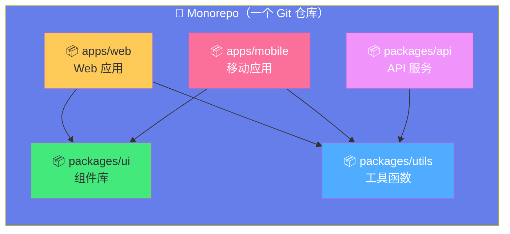
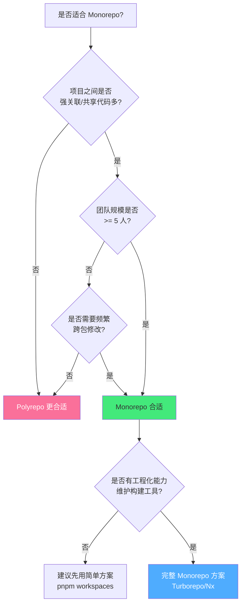

# 📦 Monorepo 管理策略

> **文档说明**：系统讲解 Monorepo（单仓库多包）管理的完整知识体系，涵盖 Monorepo vs Polyrepo 对比、Monorepo 优缺点分析、适用场景判断、目录结构设计、包管理工具（pnpm workspaces / npm workspaces / yarn workspaces）、构建工具（Turborepo / Nx / Lerna）、依赖管理与版本管理、Changesets 发版流程、CI/CD 优化（增量构建/缓存/并行）、代码共享与复用、常见问题与最佳实践、大型 Monorepo 治理策略。
>
> **适用人群**：前端工程师、全栈开发者、技术负责人、DevOps、架构师
>
> **前置知识**：[[Git基础与进阶]] · [[Git工作流与分支策略]] · [[Node.js与npm生态]]

---

## 一、概述

### 1.1 什么是 Monorepo

Monorepo（Monolithic Repository，单仓多包）是一种代码管理策略，将多个项目/包的代码存放在同一个 Git 仓库中，每个项目/包可以独立开发、构建和发布，但共享统一的依赖管理、构建工具和代码规范。



**与 Polyrepo 对比**：
| 维度 | Monorepo（单仓多包） | Polyrepo（多仓单包） |
|------|---------------------|---------------------|
| 仓库数量 | 1 个 | 多个（每个项目一个） |
| 代码共享 | 直接引用，原子提交 | 需要发版 + 依赖更新 |
| 依赖管理 | 统一管理，版本一致 | 各自管理，可能版本不一致 |
| 跨包修改 | 一次 PR 完成 | 多个 PR + 协调发版 |
| 构建测试 | 可增量构建，只构建变更包 | 每个仓库独立构建 |
| 权限控制 | 粗粒度（仓库级） | 细粒度（仓库级） |
| CI/CD | 复杂（需识别变更范围） | 简单（每个仓库独立） |
| 克隆体积 | 大（全量代码） | 小（只克隆需要的） |
| 适用规模 | 中大型团队、强关联项目 | 小型团队、独立项目 |

### 1.2 Monorepo 的优势

| 优势 | 说明 |
|------|------|
| **代码共享便捷** | 公共包直接引用，无需发版即可使用最新代码 |
| **原子提交** | 跨包修改一次提交完成，不会出现版本不匹配 |
| **统一依赖版本** | 所有包共享依赖版本，避免版本冲突 |
| **统一工程规范** | ESLint/Prettier/TypeScript/提交规范统一配置 |
| **跨包重构容易** | IDE 全局搜索替换，一次重构所有引用 |
| **增量构建** | 只构建变更的包及其依赖，CI 更快 |
| **代码发现性强** | 一个仓库浏览所有项目，容易发现可复用代码 |
| **新人上手快** | 克隆一个仓库即可开发所有项目 |

### 1.3 Monorepo 的挑战

| 挑战 | 说明 | 解决方案 |
|------|------|---------|
| **仓库体积大** | 全量代码克隆慢，占空间 | 浅克隆（--depth）、稀疏检出（sparse-checkout）、Git LFS |
| **CI/CD 复杂** | 需要识别变更范围，只构建相关包 | Turborepo/Nx 增量构建、changesets |
| **权限控制粗** | 仓库级权限，不能限制单个包 | CODEOWNERS、分支保护、分包发版 |
| **构建性能** | 包多时全量构建慢 | 远程缓存、并行构建、增量构建 |
| **版本管理复杂** | 多包版本依赖关系复杂 | Changesets、Lerna version、独立版本/统一版本 |
| **Git 性能** | 大仓库 Git 操作慢 | Git 配置优化、partial clone、monorepo 拆分 |
| **发布协调** | 多包同时发版需要协调 | Changesets 自动化、独立发版 |

### 1.4 适用场景判断



**适合 Monorepo 的场景**：
- ✅ 多个前端应用共享组件库/工具函数
- ✅ 微前端架构（多个子应用 + 公共包）
- ✅ 全栈项目（前端 + 后端 + 共享类型定义）
- ✅ SDK 开发（核心包 + 多个框架适配包）
- ✅ 设计系统（组件库 + 图标 + 主题 + 文档站）
- ✅ 中大型团队，代码强关联

**不适合 Monorepo 的场景**：
- ❌ 项目之间完全独立，无代码共享
- ❌ 小型团队（<3 人），维护成本高于收益
- ❌ 需要严格的包级权限控制
- ❌ 第三方开源项目（每个项目独立社区）
- ❌ 部署周期完全不同且无关联的项目

---

## 二、目录结构设计

### 2.1 标准目录结构

```text
my-monorepo/
├── .github/                    # GitHub 配置
│   ├── workflows/              # CI/CD 工作流
│   └── CODEOWNERS              # 代码所有者
├── .husky/                     # Git Hooks
├── .vscode/                    # VSCode 配置
├── apps/                       # 应用目录（可独立部署的项目）
│   ├── web/                    # Web 应用
│   │   ├── src/
│   │   ├── package.json
│   │   ├── tsconfig.json
│   │   └── vite.config.ts
│   ├── admin/                  # 管理后台
│   ├── mobile/                 # 移动应用
│   └── docs/                   # 文档站
├── packages/                   # 包目录（可复用的库）
│   ├── ui/                     # UI 组件库
│   │   ├── src/
│   │   ├── package.json
│   │   ├── tsconfig.json
│   │   └── vite.config.ts
│   ├── utils/                  # 工具函数库
│   ├── hooks/                  # React Hooks 库
│   ├── types/                  # TypeScript 类型定义
│   ├── config/                 # 共享配置（eslint/prettier/tsconfig）
│   └── api-client/             # API 客户端
├── services/                   # 后端服务（可选）
│   ├── user-service/
│   └── order-service/
├── scripts/                    # 脚本目录
│   ├── build.sh
│   └── release.sh
├── .gitignore
├── .npmrc                      # npm 配置
├── .editorconfig
├── .eslintrc.js                # 根 ESLint 配置
├── .prettierrc                 # 根 Prettier 配置
├── tsconfig.base.json          # 根 TypeScript 基础配置
├── pnpm-workspace.yaml         # pnpm workspace 配置
├── turbo.json                  # Turborepo 配置
├── package.json                # 根 package.json
└── README.md
```

### 2.2 目录设计原则

| 原则 | 说明 |
|------|------|
| **apps vs packages 分离** | apps 是可独立部署的应用，packages 是可复用的库 |
| **按领域分组** | 相关的包放在一起（如 ui/hooks/utils 都是前端基础库） |
| **统一命名** | 包名统一前缀（如 `@myorg/ui`、`@myorg/utils`） |
| **配置共享** | 根目录放共享配置，子包继承并扩展 |
| **扁平结构** | 避免过深嵌套，最多 2-3 层 |
| **清晰边界** | 每个包职责单一，明确对外导出的 API |

### 2.3 根 package.json

```json
{
  "name": "my-monorepo",
  "private": true,
  "version": "0.0.0",
  "packageManager": "pnpm@9.0.0",
  "engines": {
    "node": ">=18.0.0",
    "pnpm": ">=9.0.0"
  },
  "scripts": {
    "build": "turbo run build",
    "dev": "turbo run dev",
    "lint": "turbo run lint",
    "test": "turbo run test",
    "typecheck": "turbo run typecheck",
    "clean": "turbo run clean && rm -rf node_modules",
    "format": "prettier --write \"**/*.{ts,tsx,js,jsx,json,md}\"",
    "changeset": "changeset",
    "version-packages": "changeset version",
    "release": "changeset publish"
  },
  "devDependencies": {
    "turbo": "^2.0.0",
    "typescript": "^5.4.0",
    "eslint": "^8.57.0",
    "prettier": "^3.2.0",
    "@changesets/cli": "^2.27.0",
    "husky": "^9.0.0",
    "lint-staged": "^15.2.0"
  }
}
```

---

## 三、包管理工具

### 3.1 pnpm Workspaces（推荐）

pnpm 是 Monorepo 最推荐的包管理器，通过符号链接实现高效的依赖管理，磁盘占用小、安装速度快。

**pnpm-workspace.yaml**：
```yaml
packages:
  - 'apps/*'
  - 'packages/*'
  - 'services/*'
  # 排除目录
  - '!**/node_modules'
  - '!**/dist'
```

**.npmrc**：
```ini
# 严格的对等依赖
strict-peer-dependencies=false
# 自动安装对等依赖
auto-install-peers=true
# 提升依赖到根 node_modules（兼容某些工具）
shamefully-hoist=false
# 共享锁文件
shared-workspace-lockfile=true
# 链接工作区包
link-workspace-packages=true
# 缓存目录
store-dir=~/.local/share/pnpm/store
```

**pnpm 常用命令**：
```bash
# 安装所有依赖
pnpm install

# 在根目录执行脚本（所有包）
pnpm run build

# 在指定包执行脚本
pnpm --filter @myorg/ui run build

# 在指定包及其依赖执行
pnpm --filter @myorg/ui... run build

# 添加依赖到指定包
pnpm --filter @myorg/ui add react
pnpm --filter @myorg/ui add -D typescript

# 添加工作区内依赖（包之间引用）
pnpm --filter apps/web add @myorg/ui@workspace

# 添加根依赖
pnpm add -D turbo

# 查看依赖图
pnpm list --filter @myorg/ui --depth=2

# 查看哪些包依赖了某个包
pnpm why react

# 清理
pnpm store prune  # 清理未引用的缓存
```

### 3.2 npm Workspaces

npm 7+ 原生支持 workspaces，配置简单但功能不如 pnpm 强大。

**package.json**：
```json
{
  "name": "my-monorepo",
  "private": true,
  "workspaces": [
    "apps/*",
    "packages/*"
  ]
}
```

```bash
# 安装
npm install

# 执行所有包的 build
npm run build --workspaces

# 指定包
npm run build --workspace=@myorg/ui

# 添加依赖
npm install react --workspace=@myorg/ui
```

### 3.3 Yarn Workspaces

Yarn Berry（v2+）支持 workspaces，Plug'n'Play 模式减少 node_modules。

**package.json**：
```json
{
  "name": "my-monorepo",
  "private": true,
  "workspaces": [
    "apps/*",
    "packages/*"
  ],
  "packageManager": "yarn@4.0.0"
}
```

### 3.4 包管理器对比

| 维度 | pnpm | npm | Yarn Berry |
|------|------|-----|-----------|
| **安装速度** | 极快（硬链接+符号链接） | 中等 | 快（PnP） |
| **磁盘占用** | 极小（全局存储+硬链接） | 大（每个包独立） | 小（PnP 无 node_modules） |
| **Monorepo 支持** | 优秀（filter 强大） | 基础 | 优秀 |
| **严格依赖** | 严格（默认不提升） | 宽松（提升到根） | 严格（PnP） |
| **生态兼容** | 好（shamefully-hoist 兼容） | 最好 | 一般（PnP 兼容问题） |
| **锁文件** | pnpm-lock.yaml | package-lock.json | yarn.lock |
| **推荐度** | ⭐⭐⭐⭐⭐ | ⭐⭐⭐ | ⭐⭐⭐⭐ |

---

## 四、构建工具

### 4.1 Turborepo（推荐）

Turborepo 是 Vercel 出品的 Monorepo 构建系统，核心特性是**增量构建 + 远程缓存 + 并行执行**。

**turbo.json**：
```json
{
  "$schema": "https://turbo.build/schema.json",
  "globalDependencies": ["**/.env.*local"],
  "globalEnv": ["NODE_ENV", "VERCEL_URL"],
  "pipeline": {
    "build": {
      "dependsOn": ["^build"],
      "outputs": ["dist/**", ".next/**", "!.next/cache/**"],
      "env": ["VITE_*", "NEXT_PUBLIC_*"]
    },
    "dev": {
      "cache": false,
      "persistent": true
    },
    "lint": {
      "dependsOn": ["^build"],
      "outputs": []
    },
    "test": {
      "dependsOn": ["^build"],
      "outputs": ["coverage/**"],
      "env": ["JEST_*"]
    },
    "typecheck": {
      "dependsOn": ["^build"],
      "outputs": []
    },
    "clean": {
      "cache": false
    }
  }
}
```

**Turborepo 核心概念**：
| 概念 | 说明 |
|------|------|
| **Pipeline** | 定义任务依赖关系和执行顺序 |
| **dependsOn** | 任务依赖，`^build` 表示依赖所有依赖包的 build |
| **outputs** | 构建输出目录，用于缓存判断 |
| **cache** | 是否缓存任务结果（默认 true） |
| **persistent** | 是否为持久进程（dev 服务，默认 false） |
| **远程缓存** | 将构建缓存上传到云端，CI/多人共享 |
| **filter** | 筛选要执行的包 |

**常用命令**：
```bash
# 构建所有包
turbo run build

# 只构建指定包及其依赖
turbo run build --filter=@myorg/ui...

# 只构建变更的包（基于 git diff）
turbo run build --filter=[origin/main]

# 并行执行多个任务
turbo run build lint test

# 不使用缓存
turbo run build --force

# 查看任务依赖图
turbo run build --graph

# 登录远程缓存
turbo login
turbo link
```

### 4.2 Nx

Nx 是 Nrwl 出品的 Monorepo 构建系统，功能更全面，包含代码生成、依赖图可视化、项目分析等。

**nx.json**：
```json
{
  "$schema": "./node_modules/nx/schemas/nx-schema.json",
  "targetDefaults": {
    "build": {
      "dependsOn": ["^build"],
      "outputs": ["{projectRoot}/dist"]
    },
    "test": {
      "dependsOn": ["^build"]
    }
  },
  "defaultBase": "main",
  "cacheDirectory": ".nx/cache"
}
```

**Nx vs Turborepo**：
| 维度 | Turborepo | Nx |
|------|-----------|-----|
| **定位** | 轻量构建工具 | 完整 Monorepo 解决方案 |
| **学习曲线** | 低 | 中高 |
| **功能** | 构建/缓存/并行 | 构建/缓存/代码生成/依赖图/分析 |
| **框架绑定** | 无（框架无关） | 有（Angular/React/Vue 插件） |
| **配置** | 简单（turbo.json） | 稍复杂（nx.json + project.json） |
| **适用** | 大多数项目 | 大型企业级项目 |

### 4.3 Lerna

Lerna 是最早的 Monorepo 工具，主要负责版本管理和发布，构建功能已委托给 Turborepo/Nx。

```bash
# 初始化
lerna init

# 查看所有包
lerna list

# 执行所有包的脚本
lerna run build

# 版本管理（自动更新版本号和 changelog）
lerna version

# 发布
lerna publish
```

> **注意**：Lerna 6+ 已将构建任务委托给 Nx，推荐用 Turborepo 做构建，Changesets 做版本管理。

---

## 五、版本管理与发布

### 5.1 Changesets（推荐）

Changesets 是 Atlassian 出品的版本管理工具，通过 markdown 文件记录变更，自动更新版本号和 changelog。

**初始化**：
```bash
pnpm add -D @changesets/cli
pnpm changeset init
```

**.changeset/config.json**：
```json
{
  "$schema": "https://unpkg.com/@changesets/config@3.0.0/schema.json",
  "changelog": "@changesets/cli/changelog",
  "commit": false,
  "fixed": [],
  "linked": [],
  "access": "restricted",
  "baseBranch": "main",
  "updateInternalDependencies": "patch",
  "ignore": ["apps/*"]
}
```

**工作流程**：
```bash
# 1. 开发者创建 changeset（描述变更）
pnpm changeset
# 选择变更的包和版本类型（patch/minor/major），输入变更描述
# 会在 .changeset/ 目录生成一个 markdown 文件

# 2. 提交 changeset 文件到 Git
git add .changeset/
git commit -m "feat: add new feature"

# 3. 发版时，消耗 changesets，更新版本号和 changelog
pnpm version-packages
# 自动：更新 package.json 版本号、生成 CHANGELOG.md、删除已消耗的 changesets

# 4. 提交版本更新
git add .
git commit -m "chore: release packages"
git tag v1.0.0

# 5. 发布到 npm
pnpm release
```

**版本类型（SemVer）**：
| 类型 | 说明 | 示例 |
|------|------|------|
| **patch** | 补丁版本，bug 修复 | 1.0.0 → 1.0.1 |
| **minor** | 次版本，新增功能（向后兼容） | 1.0.0 → 1.1.0 |
| **major** | 主版本，不兼容变更 | 1.0.0 → 2.0.0 |

### 5.2 版本策略

| 策略 | 说明 | 适用场景 |
|------|------|---------|
| **统一版本（Fixed）** | 所有包版本号同步更新 | 强关联的包（如组件库全家桶） |
| **独立版本（Independent）** | 每个包独立维护版本号 | 关联较弱的包（如工具函数 + UI 库） |
| **混合版本** | 部分包统一版本，部分独立 | 大型 Monorepo |

---

## 六、CI/CD 优化

### 6.1 增量构建

利用 Turborepo/Nx 的缓存能力，只构建变更的包及其依赖。

```yaml
# .github/workflows/ci.yml
name: CI

on:
  push:
    branches: [main]
  pull_request:
    branches: [main]

jobs:
  build:
    runs-on: ubuntu-latest
    steps:
      - uses: actions/checkout@v4
        with:
          fetch-depth: 0  # 需要完整历史用于变更检测

      - uses: pnpm/action-setup@v3
        with:
          version: 9

      - uses: actions/setup-node@v4
        with:
          node-version: 20
          cache: pnpm

      - run: pnpm install --frozen-lockfile

      # Turborepo 远程缓存
      - name: Turbo Cache
        uses: dtinth/setup-github-actions-caching-for-turbo@v1

      # 只构建变更的包
      - run: pnpm turbo run build lint test typecheck --filter=[origin/main]
```

### 6.2 缓存策略

| 缓存类型 | 工具 | 说明 |
|---------|------|------|
| **依赖缓存** | actions/setup-node cache | 缓存 node_modules，加速安装 |
| **构建缓存** | Turborepo/Nx 远程缓存 | 缓存构建产物，跳过未变更包的构建 |
| **Docker 层缓存** | Docker BuildKit | 缓存 Docker 镜像层 |
| **测试缓存** | Jest cache / Vitest cache | 缓存测试结果，只跑变更测试 |

---

## 七、代码共享与 TypeScript

### 7.1 共享 TypeScript 配置

**tsconfig.base.json**：
```json
{
  "compilerOptions": {
    "target": "ES2022",
    "module": "ESNext",
    "moduleResolution": "bundler",
    "lib": ["ES2022", "DOM", "DOM.Iterable"],
    "strict": true,
    "esModuleInterop": true,
    "skipLibCheck": true,
    "forceConsistentCasingInFileNames": true,
    "resolveJsonModule": true,
    "isolatedModules": true,
    "noUnusedLocals": true,
    "noUnusedParameters": true,
    "noFallthroughCasesInSwitch": true,
    "declaration": true,
    "declarationMap": true,
    "sourceMap": true
  }
}
```

**子包 tsconfig.json**：
```json
{
  "extends": "../../tsconfig.base.json",
  "compilerOptions": {
    "outDir": "./dist",
    "rootDir": "./src",
    "baseUrl": ".",
    "paths": {
      "@myorg/utils": ["../utils/src"]
    }
  },
  "include": ["src"],
  "references": [{ "path": "../utils" }]
}
```

### 7.2 包之间引用

```json
// apps/web/package.json
{
  "name": "@myorg/web",
  "dependencies": {
    "@myorg/ui": "workspace:*",
    "@myorg/utils": "workspace:*",
    "@myorg/types": "workspace:*"
  }
}
```

> `workspace:*` 表示引用工作区内的包，pnpm 会创建符号链接，修改源文件立即生效。

---

## 八、常见问题与最佳实践

### 8.1 常见问题

| 问题 | 原因 | 解决方案 |
|------|------|---------|
| 依赖找不到 | 包未正确链接或未安装 | `pnpm install`；检查 package.json name |
| TypeScript 类型错误 | 路径别名未配置或引用错误 | 配置 tsconfig paths；使用 `workspace:*` |
| 构建顺序错误 | 依赖包未先构建 | Turborepo `dependsOn: ["^build"]` |
| 发布失败 | 版本号未更新或 npm 权限 | 检查 changesets；npm login；检查 package.json private |
| Git 仓库过大 | 大文件或历史提交 | Git LFS；浅克隆；历史清理（git filter-repo） |
| CI 构建慢 | 全量构建无缓存 | Turborepo 远程缓存；增量构建；并行 |
| 依赖版本冲突 | 不同包依赖不同版本 | 统一根依赖；pnpm.overrides；.npmrc |
| ESLint 配置不生效 | 子包未继承根配置 | 根配置 extends；子包 .eslintrc 继承 |
| 包循环依赖 | A 依赖 B，B 依赖 A | 重构提取公共包；检查依赖方向 |

### 8.2 最佳实践

```text
Monorepo 最佳实践：

✅ 目录结构
   - apps/ 放可部署应用，packages/ 放可复用库
   - 统一包名前缀（@myorg/xxx）
   - 每个包有清晰的 README 和 package.json
   - 配置文件放根目录，子包继承

✅ 依赖管理
   - 用 pnpm（速度快、磁盘省、严格依赖）
   - 公共依赖提升到根目录
   - 用 workspace:* 引用工作区包
   - 定期运行 pnpm dedupe 去重
   - 用 pnpm.overrides 强制统一版本

✅ 构建工具
   - 用 Turborepo（轻量、强大）或 Nx（企业级）
   - 配置 dependsOn 确保构建顺序
   - 配置 outputs 启用缓存
   - 启用远程缓存（Vercel Remote Cache）
   - dev 任务设为 persistent: false, cache: false

✅ 版本与发布
   - 用 Changesets 管理版本和 changelog
   - 遵循 SemVer（patch/minor/major）
   - apps 不发布（设为 private），只发布 packages
   - 发版前跑完整测试和构建
   - 用 CI 自动发布（main 分支合并后自动发版）

✅ 代码质量
   - 根目录统一 ESLint/Prettier/TypeScript 配置
   - Husky + lint-staged 提交前检查
   - commitlint 规范提交信息
   - 每个包有独立的测试
   - CI 跑 lint/test/typecheck/build

✅ CI/CD
   - 用 fetch-depth: 0 获取完整历史（变更检测需要）
   - 缓存 pnpm store 和 node_modules
   - 用 Turborepo filter 只构建变更包
   - 并行执行独立任务
   - 远程缓存共享构建结果

✅ 性能优化
   - 大仓库用 Git 稀疏检出（sparse-checkout）
   - 大文件用 Git LFS
   - 定期清理 node_modules 和 dist
   - 用 pnpm store 全局共享依赖
   - 监控仓库大小，及时拆分过大的包

✅ 团队协作
   - CODEOWNERS 指定包的负责人
   - 分支保护规则（main 需 PR + CI 通过）
   - PR 模板包含变更说明和测试要求
   - 定期 Monorepo 健康检查（依赖更新、废弃包清理）
   - 文档说明包的用途和使用方式
```

---

## 九、关联笔记

### 工程化与工具
- [[Git基础与进阶]] · [[Git工作流与分支策略]] · [[Git-Hooks自动化]]
- [[Node.js与npm生态]] · [[TypeScript-类型系统进阶_backup_skeleton]] · [[VSCode高效配置]]

### CI/CD 与部署
- [[GitHub-Actions自动化]] · [[GitLab-CI配置]] · [[Docker容器化]]

### 前端工程化
- [[ESLint代码规范]] · [[Prettier代码格式化]] · [[Vite构建工具]]

### 导航
- [[MOC-通用工具]] · [[MOC-自动化与效率]] · [[MOC-综合导航]] · [[Home]]

> 🔍 **知识点深度解析**
>
> **作用**：Monorepo 管理策略解决的是「多项目代码统一管理与高效协作」问题——当多个项目之间共享代码、需要频繁跨包修改、统一工程规范时，将所有包放在一个 Git 仓库中，通过工作区链接、增量构建、统一版本管理，实现代码共享便捷、原子提交、统一规范、CI 高效。
>
> **底层原理**：Monorepo 的核心是「工作区（Workspaces）+ 符号链接 + 增量构建」。包管理器（pnpm/npm/yarn）通过 workspaces 配置识别所有包，安装时将工作区内的包通过符号链接（symlink）互相引用（`workspace:*`），修改源文件立即生效，无需发版。构建工具（Turborepo/Nx）通过任务依赖图（pipeline）确定构建顺序，利用缓存（文件哈希）实现增量构建——只重新构建变更的包及其依赖，未变更的包直接复用缓存。版本管理（Changesets）通过 markdown 文件记录变更，发版时自动更新 SemVer 版本号和 changelog。
>
> **用法要点**：① 目录结构：apps/（可部署应用）+ packages/（可复用库）+ 根配置 ② 包管理器：推荐 pnpm（pnpm-workspace.yaml + workspace:* 引用） ③ 构建工具：推荐 Turborepo（turbo.json 配置 pipeline，dependsOn: ["^build"] 确保依赖先构建） ④ 版本管理：推荐 Changesets（changeset 创建变更 → version-packages 更新版本 → release 发布） ⑤ 依赖共享：根目录统一 devDependencies（typescript/eslint/prettier/turbo），子包只放运行时依赖 ⑥ TypeScript：tsconfig.base.json 基础配置，子包 extends + paths 引用 ⑦ CI/CD：fetch-depth: 0 + pnpm 缓存 + Turborepo 远程缓存 + filter 增量构建 ⑧ 代码质量：根 ESLint/Prettier + Husky + lint-staged + commitlint ⑨ 包命名：统一前缀 @myorg/xxx，apps 设为 private 不发布 ⑩ 适用判断：强关联/共享多/中大型团队适合，独立/小团队/严格权限不适合。

> 💡 **深度讲解**：Monorepo 最大的价值不是「把代码放一起」，而是「原子提交和代码共享」——在 Polyrepo 中，修改一个公共包需要：修改公共包代码→发版→在所有依赖项目中更新依赖版本→每个项目单独测试发版，这个流程可能涉及多个 PR、多次发版、几天时间。而在 Monorepo 中，一次 PR 就能完成公共包修改 + 所有依赖项目的适配 + 统一测试，原子提交保证不会出现版本不匹配的中间状态。Monorepo 最大的挑战是「构建性能和仓库体积」——包多了全量构建慢，全量克隆占空间。Turborepo 的增量构建和远程缓存是关键：通过文件哈希判断包是否变更，未变更的包直接复用缓存（本地或远程），CI 时间从几十分钟降到几分钟。pnpm 的全局存储和硬链接让磁盘占用从每个包独立 node_modules（可能几个 G）降到全局共享（几百 M）。选择 Monorepo 工具链的建议：大多数项目用「pnpm + Turborepo + Changesets」就足够了，轻量且强大；大型企业级项目才需要 Nx 的完整功能（代码生成、依赖图、项目分析）。

> 📝 **精简总结**：Monorepo = 一个 Git 仓库管理多个包，核心优势是代码共享+原子提交+统一规范。工具链：pnpm（包管理，workspace:* 引用）+ Turborepo（构建，增量+缓存）+ Changesets（版本，SemVer+changelog）。目录：apps/（应用）+ packages/（库）+ 根配置。CI：fetch-depth:0 + 缓存 + 增量构建。适用：强关联/共享多/中大型团队；不适用：独立/小团队/严格权限。

> **学习路径建议**：先学习 [[Git基础与进阶]] 掌握版本控制 → 学习 [[Node.js与npm生态]] 理解包管理 → 学习本文档掌握 Monorepo 管理 → 学习 [[GitHub-Actions自动化]] 实现 CI/CD → 在实际项目中实践 Monorepo（从 pnpm workspaces 开始，逐步引入 Turborepo 和 Changesets）。

---

> **Monorepo 的本质是「用一个仓库承载一个组织的代码宇宙」——当代码共享和协作效率成为瓶颈时，Monorepo 就是答案。但它不是银弹，需要工程化能力的支撑：好的工具链、清晰的目录结构、严格的代码规范、高效的 CI/CD，才能让 Monorepo 真正发挥威力。**

---

## 🔗 关联笔记

- [[MOC-通用工具]] — 返回本分类知识地图，查看更多相关文档

## 📖 前置知识

- 无特殊前置知识要求，具备基础编程概念即可

## 🏷️ 相关标签

`#Monorepo` `#工程化` `#代码管理` `#pnpm` `#Turborepo` `#Nx`

[[Home|🏠 返回首页]] · [[MOC-通用工具|📚 返回分类]]
