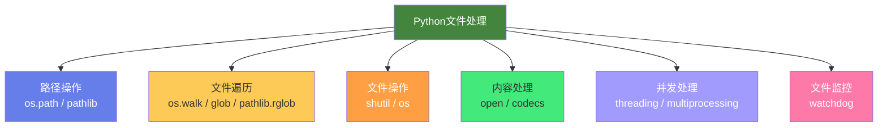

# 🐍 Python 脚本：批量文件处理

> **文档说明**：系统讲解使用 Python 进行批量文件处理的核心模块、常用场景与实战脚本，涵盖 Python 文件处理核心模块（os / pathlib / shutil / glob / fnmatch）、文件遍历方法（os.walk / pathlib.rglob / glob.glob / pathlib.iterdir）、路径处理（绝对/相对路径、跨平台路径、路径拼接、扩展名/文件名提取）、批量重命名（正则替换/序号重命名/日期前缀/扩展名修改）、批量内容处理（文本替换/编码转换/格式转换/头部插入）、文件分类整理（按扩展名/按日期/按大小/按类型自动归档）、文件去重（基于哈希/基于名称/基于大小）、大文件处理（流式读取/分块处理/内存优化）、文件监控（watchdog 库实时监控文件变化）、并发批量处理（多线程 threading / 多进程 multiprocessing / 异步 asyncio / ThreadPoolExecutor）、错误处理与日志（try-except / logging / 失败重试 / 事务性操作）、跨平台注意事项（路径分隔符/权限/编码/符号链接）、安全注意事项（路径遍历攻击/危险操作确认/备份优先）、六大实战场景完整脚本（批量重命名/批量格式转换/批量内容替换/文件分类归档/文件去重/目录大小统计）、性能优化技巧、常用库对比、常见问题与最佳实践。
>
> **适用人群**：Python 开发者、运维工程师、需要批量处理文件的办公人员、数据分析师、自动化脚本编写者
>
> **前置知识**：[[Python基础语法]] · [[正则表达式入门]]

---

## 一、概述

### 1.1 为什么用 Python 做批量文件处理

Python 是批量文件处理的首选语言，原因：

| 优势 | 说明 |
|------|------|
| **标准库强大** | os/pathlib/shutil/glob 开箱即用 |
| **跨平台** | Windows/macOS/Linux 一套代码 |
| **语法简洁** | 几十行代码完成复杂批量操作 |
| **生态丰富** | watchdog/exifread/Pillow 等第三方库 |
| **易维护** | 脚本可读、可复用、可版本控制 |

### 1.2 核心模块一览



| 模块 | 功能 | 推荐度 |
|------|------|--------|
| **pathlib** | 面向对象的路径操作（Python 3.4+） | ⭐⭐⭐⭐⭐ 首选 |
| **os** | 操作系统接口（环境/进程/路径） | ⭐⭐⭐⭐ 兼容旧代码 |
| **os.path** | 传统路径操作函数 | ⭐⭐⭐ 已被 pathlib 替代 |
| **shutil** | 高级文件操作（复制/移动/删除/压缩） | ⭐⭐⭐⭐⭐ 必备 |
| **glob** | 文件名模式匹配 | ⭐⭐⭐⭐ 简单场景 |
| **fnmatch** | 文件名匹配底层 | ⭐⭐ 很少直接用 |
| **fileinput** | 多文件逐行读取 | ⭐⭐ 特定场景 |

---

## 二、路径处理：pathlib 首选

### 2.1 pathlib 基础

`pathlib` 是 Python 3.4 引入的面向对象路径库，**推荐所有新代码使用**：

```python
from pathlib import Path

# 创建路径对象
p = Path("C:/Users/name/Documents/report.pdf")

# 路径属性
print(p.name)       # report.pdf（文件名+扩展名）
print(p.stem)       # report（文件名无扩展名）
print(p.suffix)     # .pdf（扩展名）
print(p.parent)     # C:/Users/name/Documents（父目录）
print(p.anchor)     # C:/（锚点）
print(p.parts)      # ('C:\\', 'Users', 'name', 'Documents', 'report.pdf')

# 路径判断
print(p.exists())       # 是否存在
print(p.is_file())      # 是否文件
print(p.is_dir())       # 是否目录
print(p.is_absolute())  # 是否绝对路径

# 路径操作
print(p.resolve())          # 解析为绝对路径
print(p.with_suffix(".txt"))  # 改扩展名
print(p.with_name("new.txt")) # 改文件名
print(p.parent / "subdir" / "file.txt")  # 路径拼接（推荐用 /）
```

### 2.2 路径拼接：用 `/` 运算符

```python
# 推荐：pathlib 的 / 运算符（跨平台自动处理分隔符）
base = Path("C:/project")
file_path = base / "src" / "utils" / "helper.py"
# 结果：C:\project\src\utils\helper.py（Windows）
#       /project/src/utils/helper.py（Linux/macOS）

# 不推荐：字符串拼接（跨平台问题）
file_path = base + "\\src\\utils\\helper.py"  # 仅 Windows
```

### 2.3 常用路径操作

```python
from pathlib import Path

# 获取当前工作目录
cwd = Path.cwd()

# 获取用户主目录
home = Path.home()

# 相对路径转绝对路径
abs_path = Path("relative/path").resolve()

# 获取文件大小（字节）
size = Path("file.txt").stat().st_size

# 获取修改时间
from datetime import datetime
mtime = Path("file.txt").stat().st_mtime
print(datetime.fromtimestamp(mtime))

# 创建目录（递归）
Path("a/b/c").mkdir(parents=True, exist_ok=True)

# 删除文件
Path("file.txt").unlink(missing_ok=True)

# 删除空目录
Path("empty_dir").rmdir()
```

---

## 三、文件遍历

### 3.1 四种遍历方式对比

| 方法 | 递归 | 返回类型 | 适用场景 |
|------|------|---------|---------|
| `Path.iterdir()` | ❌ | Path 迭代器 | 遍历当前目录 |
| `Path.glob(pattern)` | ❌ | Path 迭代器 | 当前目录模式匹配 |
| `Path.rglob(pattern)` | ✅ | Path 迭代器 | 递归模式匹配（推荐） |
| `os.walk(top)` | ✅ | (dirpath, dirnames, filenames) | 需要同时操作目录和文件 |
| `glob.glob(pattern, recursive=True)` | ✅ | 路径字符串列表 | 旧代码兼容 |

### 3.2 pathlib.rglob（推荐）

```python
from pathlib import Path

# 递归查找所有 .md 文件
for md_file in Path(".").rglob("*.md"):
    print(md_file)  # 相对路径的 Path 对象

# 递归查找所有图片
for img in Path(".").rglob("*.{jpg,png,gif}"):
    print(img)

# 查找特定深度（用 parts 过滤）
for f in Path(".").rglob("*.py"):
    if len(f.relative_to(".").parts) <= 3:  # 最多3层
        print(f)
```

### 3.3 os.walk

```python
import os

for root, dirs, files in os.walk("project"):
    # root: 当前目录路径
    # dirs: 当前目录下的子目录列表（可修改以跳过某些目录）
    # files: 当前目录下的文件列表
    
    # 跳过 .git 目录
    if ".git" in dirs:
        dirs.remove(".git")
    
    for file in files:
        if file.endswith(".py"):
            full_path = os.path.join(root, file)
            print(full_path)
```

### 3.4 遍历性能注意

- `rglob` 返回迭代器，惰性求值，内存效率高
- 大目录遍历时不要转 list，直接迭代
- 跳过不需要的目录（如 `.git`/`node_modules`/`__pycache__`）可大幅提速

---

## 四、实战场景一：批量重命名

### 4.1 序号重命名

```python
from pathlib import Path

def batch_rename_by_index(directory: str, pattern: str = "*.jpg", prefix: str = "photo_"):
    """按序号批量重命名文件"""
    dir_path = Path(directory)
    files = sorted(dir_path.glob(pattern))  # 按名称排序
    
    for i, file in enumerate(files, start=1):
        new_name = f"{prefix}{i:03d}{file.suffix}"  # photo_001.jpg
        new_path = file.with_name(new_name)
        
        # 避免覆盖
        if new_path.exists():
            print(f"跳过（已存在）: {new_name}")
            continue
        
        file.rename(new_path)
        print(f"{file.name} → {new_name}")

# 使用
batch_rename_by_index("./photos", "*.jpg", "vacation_")
```

### 4.2 正则替换重命名

```python
import re
from pathlib import Path

def batch_rename_regex(directory: str, pattern: str, replace: str, file_filter: str = "*"):
    """用正则表达式批量重命名"""
    dir_path = Path(directory)
    regex = re.compile(pattern)
    
    for file in dir_path.glob(file_filter):
        if file.is_file():
            new_name = regex.sub(replace, file.name)
            if new_name != file.name:
                new_path = file.with_name(new_name)
                file.rename(new_path)
                print(f"{file.name} → {new_name}")

# 将 "IMG_2026_01_01.jpg" 改为 "2026-01-01.jpg"
batch_rename_regex(
    "./photos",
    pattern=r"IMG_(\d{4})_(\d{2})_(\d{2})",
    replace=r"\1-\2-\3",
    file_filter="*.jpg"
)
```

### 4.3 添加日期前缀

```python
from pathlib import Path
from datetime import datetime

def add_date_prefix(directory: str, pattern: str = "*"):
    """给文件添加修改日期前缀"""
    dir_path = Path(directory)
    
    for file in dir_path.glob(pattern):
        if file.is_file():
            mtime = file.stat().st_mtime
            date_str = datetime.fromtimestamp(mtime).strftime("%Y%m%d")
            new_name = f"{date_str}_{file.name}"
            new_path = file.with_name(new_name)
            if not new_path.exists():
                file.rename(new_path)
                print(f"{file.name} → {new_name}")
```

---

## 五、实战场景二：批量内容替换

### 5.1 文本替换

```python
from pathlib import Path

def batch_replace_text(directory: str, pattern: str, old: str, new: str, encoding: str = "utf-8"):
    """批量替换文件中的文本"""
    dir_path = Path(directory)
    count = 0
    
    for file in dir_path.rglob(pattern):
        if file.is_file():
            try:
                content = file.read_text(encoding=encoding)
                if old in content:
                    new_content = content.replace(old, new)
                    file.write_text(new_content, encoding=encoding)
                    count += 1
                    print(f"已替换: {file}")
            except UnicodeDecodeError:
                print(f"跳过（编码错误）: {file}")
    
    print(f"共处理 {count} 个文件")

# 将所有 .md 文件中的 "旧术语" 替换为 "新术语"
batch_replace_text("./docs", "*.md", "旧术语", "新术语")
```

### 5.2 正则替换

```python
import re
from pathlib import Path

def batch_regex_replace(directory: str, file_pattern: str, regex_pattern: str, replace: str):
    """批量正则替换"""
    dir_path = Path(directory)
    pattern = re.compile(regex_pattern)
    
    for file in dir_path.rglob(file_pattern):
        if file.is_file():
            content = file.read_text(encoding="utf-8")
            new_content, n = pattern.subn(replace, content)
            if n > 0:
                file.write_text(new_content, encoding="utf-8")
                print(f"{file}: 替换 {n} 处")
```

### 5.3 编码转换

```python
from pathlib import Path
import chardet  # pip install chardet

def detect_encoding(file_path: Path) -> str:
    """检测文件编码"""
    raw = file_path.read_bytes()
    result = chardet.detect(raw)
    return result["encoding"] or "utf-8"

def batch_convert_encoding(directory: str, pattern: str, target_encoding: str = "utf-8"):
    """批量转换文件编码"""
    dir_path = Path(directory)
    
    for file in dir_path.rglob(pattern):
        if file.is_file():
            src_encoding = detect_encoding(file)
            if src_encoding.lower() != target_encoding.lower():
                content = file.read_text(encoding=src_encoding, errors="replace")
                file.write_text(content, encoding=target_encoding)
                print(f"{file}: {src_encoding} → {target_encoding}")
```

---

## 六、实战场景三：文件分类整理

### 6.1 按扩展名分类

```python
from pathlib import Path
import shutil

# 扩展名到分类目录的映射
CATEGORY_MAP = {
    "图片": {".jpg", ".jpeg", ".png", ".gif", ".bmp", ".webp", ".svg"},
    "文档": {".pdf", ".doc", ".docx", ".txt", ".md", ".xls", ".xlsx", ".ppt", ".pptx"},
    "视频": {".mp4", ".avi", ".mkv", ".mov", ".flv", ".wmv"},
    "音频": {".mp3", ".wav", ".flac", ".aac", ".ogg"},
    "压缩包": {".zip", ".rar", ".7z", ".tar", ".gz"},
    "代码": {".py", ".js", ".ts", ".java", ".cpp", ".c", ".go", ".rs", ".html", ".css"},
}

def classify_by_extension(source_dir: str, target_dir: str):
    """按扩展名将文件分类到不同目录"""
    src = Path(source_dir)
    dst = Path(target_dir)
    
    for file in src.iterdir():
        if file.is_file():
            ext = file.suffix.lower()
            
            # 找到分类
            category = "其他"
            for cat, exts in CATEGORY_MAP.items():
                if ext in exts:
                    category = cat
                    break
            
            # 创建目标目录并移动
            target_path = dst / category
            target_path.mkdir(parents=True, exist_ok=True)
            shutil.move(str(file), str(target_path / file.name))
            print(f"{file.name} → {category}/")
```

### 6.2 按修改日期分类

```python
from pathlib import Path
from datetime import datetime
import shutil

def classify_by_date(source_dir: str, target_dir: str):
    """按修改年份-月份分类文件"""
    src = Path(source_dir)
    dst = Path(target_dir)
    
    for file in src.iterdir():
        if file.is_file():
            mtime = file.stat().st_mtime
            date_folder = datetime.fromtimestamp(mtime).strftime("%Y-%m")
            target_path = dst / date_folder
            target_path.mkdir(parents=True, exist_ok=True)
            shutil.move(str(file), str(target_path / file.name))
            print(f"{file.name} → {date_folder}/")
```

---

## 七、实战场景四：文件去重

### 7.1 基于内容哈希去重

```python
import hashlib
from pathlib import Path
from collections import defaultdict

def file_hash(file_path: Path, chunk_size: int = 8192) -> str:
    """计算文件的 MD5 哈希（分块读取，支持大文件）"""
    md5 = hashlib.md5()
    with open(file_path, "rb") as f:
        while chunk := f.read(chunk_size):
            md5.update(chunk)
    return md5.hexdigest()

def deduplicate_by_hash(directory: str, dry_run: bool = True):
    """基于文件内容哈希去重"""
    dir_path = Path(directory)
    hash_map = defaultdict(list)
    
    # 第一步：按大小分组（快速过滤）
    size_map = defaultdict(list)
    for file in dir_path.rglob("*"):
        if file.is_file():
            size_map[file.stat().st_size].append(file)
    
    # 第二步：相同大小的文件计算哈希
    for size, files in size_map.items():
        if len(files) > 1:
            for file in files:
                h = file_hash(file)
                hash_map[h].append(file)
    
    # 第三步：处理重复
    for h, files in hash_map.items():
        if len(files) > 1:
            print(f"\n哈希 {h[:8]}... 有 {len(files)} 个重复文件:")
            for f in files:
                print(f"  {f}")
            
            # 保留第一个，删除其余
            if not dry_run:
                for f in files[1:]:
                    f.unlink()
                    print(f"  已删除: {f}")
```

---

## 八、并发批量处理

### 8.1 多线程（IO 密集型）

```python
from pathlib import Path
from concurrent.futures import ThreadPoolExecutor, as_completed

def process_file(file_path: Path) -> str:
    """处理单个文件（IO 密集型操作）"""
    # 示例：统计文件行数
    try:
        with open(file_path, "r", encoding="utf-8") as f:
            lines = sum(1 for _ in f)
        return f"{file_path.name}: {lines} 行"
    except Exception as e:
        return f"{file_path.name}: 错误 - {e}"

def batch_process_concurrent(directory: str, pattern: str = "*.py", max_workers: int = 8):
    """多线程批量处理文件"""
    dir_path = Path(directory)
    files = list(dir_path.rglob(pattern))
    
    with ThreadPoolExecutor(max_workers=max_workers) as executor:
        futures = {executor.submit(process_file, f): f for f in files}
        
        for future in as_completed(futures):
            result = future.result()
            print(result)

# 使用
batch_process_concurrent("./project", "*.py", max_workers=8)
```

### 8.2 多进程（CPU 密集型）

```python
from pathlib import Path
from concurrent.futures import ProcessPoolExecutor

def cpu_intensive_task(file_path: str) -> str:
    """CPU 密集型任务（如图片处理、视频转码）"""
    # 注意：多进程函数必须在模块顶层定义（Windows 限制）
    path = Path(file_path)
    # ... 处理逻辑 ...
    return f"处理完成: {path.name}"

def batch_process_multiprocess(directory: str, pattern: str = "*.jpg"):
    """多进程批量处理（CPU 密集型）"""
    dir_path = Path(directory)
    files = [str(f) for f in dir_path.rglob(pattern) if f.is_file()]
    
    with ProcessPoolExecutor() as executor:
        results = executor.map(cpu_intensive_task, files)
        for result in results:
            print(result)
```

> **选择指南**：文件读写/网络请求用**多线程**；图片处理/视频转码/哈希计算用**多进程**。

---

## 九、文件监控：watchdog

### 9.1 实时监控文件变化

```python
from watchdog.observers import Observer
from watchdog.events import FileSystemEventHandler

class MyHandler(FileSystemEventHandler):
    def on_created(self, event):
        if not event.is_directory:
            print(f"文件创建: {event.src_path}")
    
    def on_modified(self, event):
        if not event.is_directory:
            print(f"文件修改: {event.src_path}")
    
    def on_deleted(self, event):
        if not event.is_directory:
            print(f"文件删除: {event.src_path}")
    
    def on_moved(self, event):
        if not event.is_directory:
            print(f"文件重命名: {event.src_path} → {event.dest_path}")

# 启动监控
observer = Observer()
observer.schedule(MyHandler(), path="./watch_dir", recursive=True)
observer.start()

try:
    while True:
        time.sleep(1)
except KeyboardInterrupt:
    observer.stop()
observer.join()
```

---

## 十、错误处理与安全

### 10.1 健壮的错误处理

```python
from pathlib import Path
import logging
import shutil

# 配置日志
logging.basicConfig(
    level=logging.INFO,
    format="%(asctime)s [%(levelname)s] %(message)s",
    handlers=[
        logging.FileHandler("batch_process.log", encoding="utf-8"),
        logging.StreamHandler()
    ]
)
logger = logging.getLogger(__name__)

def safe_move(src: Path, dst: Path, retries: int = 3):
    """安全移动文件（带重试）"""
    for attempt in range(retries):
        try:
            shutil.move(str(src), str(dst))
            logger.info(f"移动成功: {src} → {dst}")
            return True
        except PermissionError as e:
            logger.warning(f"移动失败（权限），重试 {attempt+1}/{retries}: {src} - {e}")
            time.sleep(1)
        except Exception as e:
            logger.error(f"移动失败: {src} - {e}")
            return False
    return False
```

### 10.2 安全注意事项

| 风险 | 防范措施 |
|------|---------|
| **路径遍历攻击** | 校验路径在目标目录内：`target.resolve().is_relative_to(base.resolve())` |
| **误删文件** | 先 dry_run 预览，确认后再执行；删除前备份 |
| **覆盖文件** | 重命名前检查目标是否存在 |
| **编码错误** | 指定 encoding，用 errors="replace" 容错 |
| **大文件内存溢出** | 分块读取（chunk），不要 read() 整个文件 |
| **符号链接循环** | 遍历时跳过符号链接：`if file.is_symlink(): continue` |
| **权限不足** | try-except 捕获 PermissionError，记录后继续 |

### 10.3 Dry Run 模式

所有批量操作脚本都应支持 `dry_run` 参数，先预览再执行：

```python
def batch_operation(directory: str, dry_run: bool = True):
    for file in Path(directory).rglob("*.txt"):
        if dry_run:
            print(f"[预览] 将处理: {file}")
        else:
            # 实际操作
            process(file)
```

---

## 十一、大文件处理

### 11.1 流式读取

```python
# 错误：一次性读取大文件（内存溢出）
content = Path("big_file.log").read_text()  # 10GB 文件会 OOM

# 正确：逐行读取
with open("big_file.log", "r", encoding="utf-8") as f:
    for line in f:  # 迭代器，每次只读一行
        process(line)

# 分块读取二进制
with open("big_file.bin", "rb") as f:
    while chunk := f.read(8192):  # 每次 8KB
        process(chunk)
```

### 11.2 大文件 CSV 处理

```python
import csv

def process_large_csv(file_path: str):
    """流式处理大 CSV 文件"""
    with open(file_path, "r", encoding="utf-8", newline="") as f:
        reader = csv.DictReader(f)
        for row in reader:  # 逐行迭代，不加载全部
            process_row(row)
```

---

## 十二、常用库速查

| 库 | 安装 | 用途 |
|----|------|------|
| **pathlib** | 标准库 | 路径操作（首选） |
| **shutil** | 标准库 | 复制/移动/删除/压缩 |
| **os** | 标准库 | 系统接口/环境变量 |
| **glob** | 标准库 | 文件名匹配 |
| **watchdog** | `pip install watchdog` | 文件系统监控 |
| **chardet** | `pip install chardet` | 编码检测 |
| **Pillow** | `pip install Pillow` | 图片处理 |
| **openpyxl** | `pip install openpyxl` | Excel 处理 |
| **python-docx** | `pip install python-docx` | Word 处理 |
| **PyPDF2** | `pip install PyPDF2` | PDF 处理 |
| **send2trash** | `pip install send2trash` | 安全删除（移到回收站） |

---

## 十三、常见问题

| 问题 | 解决方案 |
|------|---------|
| **Windows 路径反斜杠转义** | 用原始字符串 `r"C:\path"` 或 pathlib 的 `/` 拼接 |
| **文件名包含特殊字符** | pathlib 自动处理，不要手动拼接路径字符串 |
| **递归遍历太慢** | 跳过不需要的目录（.git/node_modules），用 rglob 而非 list |
| **编码错误 UnicodeDecodeError** | 指定 encoding，或用 chardet 检测，errors="replace" |
| **多进程在 Windows 报错** | 函数必须在模块顶层定义，用 `if __name__ == "__main__":` 保护 |
| **文件被占用无法删除** | 捕获 PermissionError，重试或记录后跳过 |
| **批量操作误删文件** | 永远先 dry_run，重要操作先备份，用 send2trash 替代 unlink |
| **遍历符号链接导致死循环** | 检查 `file.is_symlink()` 并跳过 |
| **中文路径乱码** | Python 3 默认 UTF-8，Windows 控制台可能需要 `chcp 65001` |

---

## 十四、最佳实践

1. **优先使用 pathlib**：替代 os.path，面向对象更优雅
2. **永远支持 dry_run**：批量操作先预览再执行
3. **先备份再操作**：重要文件操作前创建备份
4. **用 send2trash 替代删除**：移到回收站而非永久删除
5. **配置日志**：记录操作过程，便于排查和回滚
6. **跳过系统目录**：遍历时排除 `.git`/`node_modules`/`__pycache__`
7. **大文件流式处理**：不要一次性 read() 整个文件
8. **并发选择**：IO 密集用线程，CPU 密集用进程
9. **错误不中断**：单个文件失败不影响整体，记录后继续
10. **脚本可复用**：参数化目录/模式/操作，写成函数和 CLI

---

## 十五、关联笔记

```text
### Python 与开发
```
- [[Python基础语法]] · [[Python-文件与IO操作]] · [[正则表达式入门]]
- [[Python-虚拟环境与包管理]] · [[Python-并发编程]]

### 工具与自动化
- [[WindowsTerminal与PowerShell]] · [[定时任务与Cron表达式]]
- [[GitHub-Actions流水线设计]] · [[Cursor-AI编辑器深度使用]]

### 导航
- [[MOC-通用工具]] · [[MOC-Python全栈]] · [[Home]] · [[学习路线总览]]

> 🔍 **知识点深度解析**
>
> **作用**：Python 批量文件处理解决的是「如何用脚本自动化完成重复性的文件操作（重命名/转换/分类/去重/替换），将人工几小时的工作压缩为几分钟」的问题——在日常工作中，我们经常面临「下载文件夹乱成一团需要分类」「几百张照片需要重命名」「所有文档需要替换某个术语」「文件编码不一致需要统一」等重复性任务，手动操作既耗时又容易出错。Python 凭借强大的标准库（pathlib/os/shutil/glob）和简洁的语法，是批量文件处理的首选工具。
>
> **底层原理**：①pathlib 的核心是「面向对象的路径抽象」——传统的 os.path 用字符串表示路径，拼接需要 os.path.join，判断需要 os.path.exists，操作分散且不直观。pathlib 将路径封装为 Path 对象，属性（name/stem/suffix/parent）和方法（exists/is_file/glob/rglob）都挂在对象上，用 `/` 运算符拼接路径，代码更可读且跨平台（自动处理 Windows 反斜杠和 Unix 正斜杠）。②文件遍历的本质是「目录树的深度优先遍历」——os.walk 内部就是递归遍历目录树，每次返回 (当前目录, 子目录列表, 文件列表)。pathlib.rglob 是更现代的封装，返回 Path 对象的迭代器（惰性求值，内存效率高）。遍历性能的关键是「跳过不需要的目录」——.git/node_modules 等目录包含大量文件，跳过它们可将遍历时间从分钟级降到秒级。③批量重命名的核心是「先收集后操作」——不要在遍历过程中直接重命名（可能导致重复遍历或命名冲突），而是先收集所有目标文件到列表，排序后统一重命名。重命名前检查目标是否存在，避免覆盖。④文件去重的优化策略是「两阶段过滤」——第一阶段按文件大小分组（O(n)，极快），只有大小相同的文件才可能重复；第二阶段对相同大小的文件计算 MD5 哈希（O(n×文件大小)，较慢）。这种策略避免了对所有文件计算哈希，在大文件场景下性能提升显著。⑤并发处理的选择依据是「瓶颈类型」——IO 密集型（文件读写/网络请求）用多线程（ThreadPoolExecutor），因为线程在等待 IO 时会释放 GIL；CPU 密集型（图片处理/哈希计算/视频转码）用多进程（ProcessPoolExecutor），因为多进程可以利用多核 CPU 绕过 GIL。⑥错误处理的核心原则是「单个失败不影响整体」——批量处理可能涉及成百上千个文件，某个文件权限不足或编码错误不应中断整个任务。用 try-except 捕获异常，记录日志后继续处理下一个文件。同时支持 dry_run 模式先预览，避免不可逆的误操作。
>
> **用法要点**：① 路径处理：优先用pathlib，Path("dir")/"sub"/"file.txt"拼接，.name/.stem/.suffix/.parent属性，.exists()/.is_file()/.is_dir()判断，.mkdir(parents=True)创建目录 ② 文件遍历：Path.rglob("*.md")递归匹配(推荐)，Path.glob()当前目录，os.walk()需要同时操作目录和文件时用，跳过.git/node_modules ③ 批量重命名：先收集到list再操作，sorted排序，enumerate加序号，with_name改文件名，with_suffix改扩展名，检查目标存在避免覆盖 ④ 内容替换：read_text+replace+write_text，正则用re.subn统计替换数，编码转换用chardet检测 ⑤ 文件分类：按扩展名映射字典/按修改日期strftime("%Y-%m")，shutil.move移动，mkdir(parents=True,exist_ok=True) ⑥ 文件去重：两阶段(先按大小分组→相同大小算MD5)，hashlib.md5分块读取，保留第一个删除其余 ⑦ 并发：IO密集用ThreadPoolExecutor，CPU密集用ProcessPoolExecutor，as_completed获取结果 ⑧ 文件监控：watchdog库FileSystemEventHandler，on_created/on_modified/on_deleted/on_moved ⑨ 错误处理：logging记录+try-except+dry_run预览+send2trash安全删除 ⑩ 大文件：逐行迭代for line in f，分块读取f.read(8192)，不要read()整个文件 ⑪ 安全：校验路径在目标目录内(is_relative_to)，跳过符号链接is_symlink()，指定encoding和errors ⑫ 最佳实践：pathlib优先/永远dry_run/先备份/日志记录/跳过系统目录/流式处理大文件/参数化可复用。

> 💡 **深度讲解**：Python 批量文件处理最核心的智慧是「将重复性的手工操作转化为可复用、可验证、可版本控制的脚本，用确定性的自动化替代不确定性的人工操作」——很多人面对批量文件任务时的第一反应是「手动做吧，也就几百个文件」，但手动操作有三个致命问题：①慢——几百个文件的重命名/分类可能需要几小时；②易错——人会疲劳，可能漏操作或误操作；③不可复现——下次遇到同样的任务，还得重新手动做。Python 脚本解决了这三个问题：几分钟跑完、逻辑确定无遗漏、保存后可反复使用。更重要的是，批量文件处理脚本是「编程思维」的最佳入门实践——它不需要复杂的算法或架构，只需要「遍历→判断→操作」的基本模式，但能立刻产生巨大的效率提升。当你把「下载文件夹自动分类」「照片按日期重命名」「文档批量替换术语」这些日常任务脚本化后，你会发现「自动化」不是什么高大上的概念，而是实实在在的生活质量提升。在 AI 时代，批量文件处理脚本和 AI 工具结合可以产生更大的威力——用 AI 生成脚本框架，用 Python 执行批量操作，用 AI 分析处理结果。但核心仍然是「理解文件系统的基本操作和 Python 的文件处理模块」——AI 可以帮你写代码，但你需要理解代码在做什么，才能在出错时调试和在需求变化时修改。掌握 Python 批量文件处理，就是掌握了「让计算机为你干活」的基本能力——这是每个知识工作者都应该具备的技能。

> 📝 **精简总结**：Python批量文件处理=用脚本自动化重复性文件操作。核心模块：pathlib(路径首选)/os(系统接口)/shutil(复制移动删除)/glob(文件名匹配)。路径：Path对象+/拼接，.name/.stem/.suffix/.parent，.exists()/.is_file()。遍历：rglob递归(推荐)/glob当前目录/os.walk，跳过.git/node_modules。实战：批量重命名(序号/正则/日期前缀)、内容替换(text replace/正则/编码转换)、文件分类(按扩展名/按日期)、文件去重(两阶段：大小分组+MD5哈希)、大文件处理(逐行/分块)。并发：IO密集用ThreadPoolExecutor，CPU密集用ProcessPoolExecutor。监控：watchdog实时监控。安全：永远dry_run先预览，先备份，send2trash替代删除，日志记录，路径校验，跳过符号链接。最佳实践：pathlib优先/参数化可复用/单个失败不中断整体。

> **学习路径建议**：先学习 [[Python基础语法]] 掌握基本语法 → 学习本文档的 pathlib 和文件遍历 → 实践：写一个批量重命名脚本（给自己的照片文件夹重命名） → 实践：写一个文件分类脚本（整理下载文件夹） → 学习 [[正则表达式入门]] 增强文本处理能力 → 实践：写一个批量内容替换脚本 → 学习并发编程（threading/multiprocessing） → 实践：用多线程加速批量处理 → 学习 watchdog 做文件监控 → 进阶：结合 Pillow/openpyxl/python-docx 处理特定格式文件 → 形成自己的「批量处理脚本工具箱」。

---

> **Python 批量文件处理的本质是「将重复性的手工劳动转化为确定性的自动化脚本，让计算机为你干活」——我们每天都在和文件打交道：下载的文件乱成一团需要分类，拍摄的照片需要按日期重命名，收到的文档编码不一致需要转换，项目中的术语需要批量替换，重复的文件需要清理……这些任务看起来琐碎，但累积起来消耗了大量时间。更糟糕的是，手动操作容易出错——漏了一个文件、改错了一个名字、删错了一个文档，后果可能很严重。Python 批量文件处理提供了一个优雅的解决方案：用几十行代码，将几小时的手工工作压缩为几分钟，而且逻辑确定、可复现、可版本控制。当你第一次运行自己写的脚本，看着几百个文件在几秒内被整齐地重命名或分类时，你会感受到「自动化」的力量——这不是什么高深的技术，而是「让计算机做它擅长的事（重复性操作），让人做人擅长的事（判断和创造）」的基本思维。在 AI 时代，这种能力更加重要：AI 可以帮你生成脚本，但你需要理解文件系统的基本操作和 Python 的文件处理模块，才能判断脚本是否正确、在出错时调试、在需求变化时修改。掌握 Python 批量文件处理，就是掌握了「数字时代的家务能力」——就像会做饭、会修理一样，是每个和计算机打交道的人都应该具备的基本技能。从今天开始，下次你面对一个需要重复操作的文件任务时，不要手动做——花 10 分钟写一个 Python 脚本，你会感谢自己的。**

---

## 🔗 关联笔记

- [[MOC-通用工具]] — 返回本分类知识地图，查看更多相关文档

## 📖 前置知识

- 无特殊前置知识要求，具备基础编程概念即可

## 🏷️ 相关标签

`#Python` `#批量文件处理` `#自动化` `#os` `#pathlib` `#shutil`

[[Home|🏠 返回首页]] · [[MOC-通用工具|📚 返回分类]]
