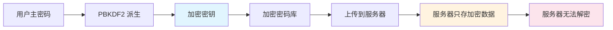

# 密码管理器-Bitwarden

> **文档说明**：系统讲解 Bitwarden 密码管理器的使用、安全特性、自托管部署（Vaultwarden）、团队协作、CLI/API，以及密码管理最佳实践和常见问题。
>
> **适用人群**：全栈开发者、运维工程师、注重密码安全的个人和团队
>
> **前置知识**：[[密码学基础-对称非对称哈希]]、[[常见攻击与防御手段]]、[[Java-数据加密与脱敏]]

---

## 一、概述

### 1. 什么是 Bitwarden

**Bitwarden** 是开源的跨平台密码管理器，提供密码存储、自动填充、密码生成、团队共享等功能。

| 特性 | 说明 |
|------|------|
| **开源** | 客户端和服务端代码开源，可审计 |
| **跨平台** | Windows/macOS/Linux/iOS/Android/浏览器扩展/CLI |
| **端到端加密** | 零知识架构，服务端无法查看密码 |
| **自动填充** | 浏览器扩展自动填充网站密码 |
| **密码生成器** | 强密码生成、密码历史 |
| **密码共享** | 组织/团队安全共享密码 |
| **自托管** | 可自建服务端（Vaultwarden） |
| **免费版功能强** | 个人免费版功能足够日常使用 |

### 2. 为什么需要密码管理器

```text
密码管理的问题：
- 每个网站用相同密码 → 一个泄露全部沦陷
- 用弱密码 → 容易被暴力破解
- 记在纸上/文档里 → 容易丢失/被看到
- 浏览器自带密码 → 换浏览器/设备不同步

密码管理器的价值：
- 只需记住一个主密码
- 每个网站用独立强密码
- 跨设备同步
- 自动填充，防钓鱼
- 密码泄露检测
```

### 3. 零知识加密架构



```text
零知识架构：
1. 用户主密码在本地通过 PBKDF2/Argon2 派生加密密钥
2. 密码库在本地加密后上传
3. 服务器只存储加密后的密文
4. 即使服务器被攻破，攻击者也无法解密
5. 主密码不会上传到服务器
```

---

## 二、安装与使用

### 1. 客户端安装

```bash
# 桌面端
# 官网下载：https://bitwarden.com/download/
# macOS
brew install --cask bitwarden
# Windows
scoop install bitwarden
# Linux
# AppImage / Snap / Flatpak

# 浏览器扩展
# Chrome / Firefox / Edge / Safari / Brave 应用商店搜索 Bitwarden

# 移动端
# App Store / Google Play 搜索 Bitwarden
```

### 2. 基本使用

```text
1. 注册账号（邮箱 + 主密码）
   - 主密码是唯一需要记住的密码
   - 务必使用强密码且牢记（丢失无法找回）

2. 安装浏览器扩展
   - 登录账号
   - 访问网站时自动提示保存密码
   - 登录页自动填充

3. 添加密码条目
   - 点击扩展 → 添加项目
   - 填写：名称、用户名、密码、URL、备注
   - 可附加文件、自定义字段

4. 密码生成器
   - 注册新账号时自动生成强密码
   - 可配置长度、字符类型、是否易读
```

### 3. 密码生成器配置

```text
推荐密码策略：
- 长度：16+ 位
- 包含：大写、小写、数字、符号
- 每个网站独立密码
- 重要账号（邮箱、银行）用 20+ 位

密码类型：
- 随机密码：xK9$mP2!vL8@qR5
- 易记密码（Passphrase）：correct-horse-battery-staple
- PIN：纯数字（仅适合本地设备）
```

---

## 三、核心功能

### 1. 密码库组织

```text
文件夹（Folders）：
- 按类别组织：工作、个人、财务、社交
- 一个条目只能属于一个文件夹

收藏（Favorites）：
- 常用密码加星标
- 快速访问

组织（Organizations）：
- 团队共享密码库
- 集合（Collections）分类共享
- 权限控制（可查看/可编辑/管理员）
```

### 2. 自动填充

```text
浏览器扩展自动填充：
- 访问登录页时自动检测并填充
- 快捷键：Ctrl/Cmd + Shift + L
- 右键菜单手动填充
- 支持多账号选择

移动端自动填充：
- iOS：密码 AutoFill（设置 → 密码 → Bitwarden）
- Android：自动填充服务（设置 → 输入法 → Bitwarden）
```

### 3. 密码健康检查

```text
密码健康报告（Tools → Password Health）：
- 弱密码：强度不足
- 重复密码：多个网站用相同密码
- 泄露密码：Have I Been Pwned 数据库匹配
- 旧密码：长期未更换

数据泄露扫描（Tools → Data Breach Report）：
- 检查邮箱是否在已知数据泄露中
- 基于 Have I Been Pwned API
- 本地计算哈希，不泄露邮箱
```

### 4. 两步验证（2FA）

```text
Bitwarden 账号本身建议开启 2FA：
- 认证器 App（Google Authenticator / Authy）
- 邮件验证码
- YubiKey / FIDO2 安全密钥（高级版）
- 恢复码（务必保存，丢失可找回）

注意：
- Bitwarden 内可存储其他网站的 2FA 密钥（TOTP）
- 但 Bitwarden 账号本身的 2FA 不要存在 Bitwarden 内
```

---

## 四、自托管部署（Vaultwarden）

### 1. 为什么自托管

```text
自托管优势：
- 数据完全自己掌控
- 无用户数限制（官方免费版组织最多2人）
- 无功能限制
- 内网部署，不依赖外网
- 成本低

Vaultwarden：
- Bitwarden 官方服务端的 Rust 重写
- 轻量、高性能、资源占用低
- 兼容 Bitwarden 客户端
- 支持大部分功能（部分企业功能除外）
```

### 2. Docker 部署

```yaml
# docker-compose.yml
version: '3.8'
services:
  vaultwarden:
    image: vaultwarden/server:latest
    container_name: vaultwarden
    restart: always
    environment:
      - DOMAIN=https://vault.example.com
      - SIGNUPS_ALLOWED=false  # 禁止公开注册（部署后关闭）
      - ADMIN_TOKEN=your-admin-token  # 管理面板令牌
      - WEBSOCKET_ENABLED=true  # 实时同步
      - PUSH_ENABLED=true  # 移动端推送
      - PUSH_INSTALLATION_ID=your-id
      - PUSH_INSTALLATION_KEY=your-key
    volumes:
      - ./vw-data:/data
    ports:
      - "8080:80"
      - "3012:3012"  # WebSocket
```

```bash
# 启动
docker-compose up -d

# 配置 Nginx 反向代理（HTTPS 必需）
# Bitwarden 客户端要求 HTTPS
```

### 3. Nginx 反向代理

```nginx
server {
    listen 443 ssl http2;
    server_name vault.example.com;

    ssl_certificate /etc/letsencrypt/live/vault.example.com/fullchain.pem;
    ssl_certificate_key /etc/letsencrypt/live/vault.example.com/privkey.pem;

    client_max_body_size 128M;

    location / {
        proxy_pass http://127.0.0.1:8080;
        proxy_set_header Host $host;
        proxy_set_header X-Real-IP $remote_addr;
        proxy_set_header X-Forwarded-For $proxy_add_x_forwarded_for;
        proxy_set_header X-Forwarded-Proto $scheme;
    }

    location /notifications/hub {
        proxy_pass http://127.0.0.1:3012;
        proxy_http_version 1.1;
        proxy_set_header Upgrade $http_upgrade;
        proxy_set_header Connection "upgrade";
    }

    location /notifications/hub/negotiate {
        proxy_pass http://127.0.0.1:8080;
    }
}
```

### 4. 客户端连接自托管

```text
桌面端/浏览器扩展：
1. 登录页面 → 左下角"自托管"
2. 输入服务器 URL：https://vault.example.com
3. 保存后正常登录

移动端：
1. 登录页面 → 设置 → 自托管环境
2. 输入服务器 URL
3. 保存后登录
```

### 5. 数据备份

```bash
# Vaultwarden 数据都在 /data 目录
# 备份策略：
# 1. 定期备份 vw-data 目录
tar -czf vaultwarden-backup-$(date +%Y%m%d).tar.gz vw-data/

# 2. 数据库备份（SQLite）
sqlite3 vw-data/db.sqlite3 ".backup backup.sqlite3"

# 3. 异地备份
# 上传到对象存储 / 另一台服务器
```

---

## 五、团队与组织

### 1. 组织功能

```text
组织（Organization）：
- 创建组织，邀请成员
- 集合（Collections）：共享密码的分组
- 权限：
  - 可查看：只能查看和使用
  - 可编辑：可以修改
  - 管理员：管理集合和成员
- 群组（Groups）：批量管理成员权限（企业版）

使用场景：
- 团队共享开发服务器密码
- 共享测试账号
- 共享 SaaS 工具账号
- IT 部门管理基础设施密码
```

### 2. 企业版功能

```text
Bitwarden 企业版额外功能：
- SSO 登录（SAML 2.0）
- 企业策略（强制主密码强度、2FA）
- 审计日志
- 目录同步（LDAP/AD）
- 自定义角色
- 高级 2FA（YubiKey/FIDO2）
- 密码less 登录
```

---

## 六、CLI 与 API

### 1. Bitwarden CLI

```bash
# 安装
npm install -g @bitwarden/cli
# 或下载二进制

# 登录
bw login email@example.com
# 或用 API Key
bw login --apikey

# 解锁（获取 session key）
bw unlock
# 输出 BW_SESSION，设置环境变量
export BW_SESSION="session-key"

# 列出密码
bw list items

# 搜索密码
bw list items --search "github"

# 获取密码
bw get password "github"
bw get username "github"
bw get item "github"  # 完整信息

# 生成密码
bw generate --length 20 --uppercase --lowercase --number --special

# 同步
bw sync

# 锁定
bw lock
```

### 2. CLI 脚本示例

```bash
#!/bin/bash
# 从 Bitwarden 获取密码并设置环境变量
export BW_SESSION=$(bw unlock --raw)
export DB_PASSWORD=$(bw get password "prod-db")
export API_KEY=$(bw get password "prod-api")

# 使用后锁定
bw lock
```

### 3. API

```text
Bitwarden 提供完整 REST API：
- 身份认证：/identity/connect/token
- 密码库：/api/sync, /api/ciphers
- 组织：/api/organizations
- 附件：/api/ciphers/{id}/attachment

使用场景：
- CI/CD 中获取密钥
- 自动化脚本集成
- 自定义工具开发
```

---

## 七、最佳实践

### 1. 主密码安全

- [ ] **强主密码**：至少 16 位，包含多种字符，或用 passphrase
- [ ] **唯一主密码**：主密码不用于其他任何地方
- [ ] **牢记主密码**：写在安全的地方（保险箱），不要存在电子设备
- [ ] **开启 2FA**：Bitwarden 账号本身开启两步验证
- [ ] **保存恢复码**：2FA 恢复码安全保存

### 2. 密码管理规范

- [ ] **每站独立密码**：不同网站用不同密码
- [ ] **定期更换重要密码**：邮箱、银行、主密码
- [ ] **使用密码生成器**：不自己想密码
- [ ] **清理旧账号**：不再使用的账号删除或标记
- [ ] **定期健康检查**：检查弱密码、重复密码、泄露密码
- [ ] **敏感信息加密备注**：银行卡、身份证等存备注

### 3. 设备安全

- [ ] **设备加密**：开启全盘加密（BitLocker/FileVault）
- [ ] **自动锁定**：Bitwarden 闲置自动锁定（推荐5分钟）
- [ ] **生物识别**：移动端用指纹/面容解锁（方便又安全）
- [ ] **不自动填充钓鱼网站**：检查 URL 是否正确
- [ ] **登出公共设备**：公共电脑使用后登出
- [ ] **紧急访问**：设置紧急联系人（可在紧急情况下访问）

### 4. 团队规范

- [ ] **最小权限**：只共享必要的密码
- [ ] **定期审计**：检查组织成员和访问权限
- [ ] **离职回收**：员工离职及时移除并更换共享密码
- [ ] **共享不共享主密码**：通过组织共享，不直接告诉密码
- [ ] **企业策略**：强制主密码强度和 2FA
- [ ] **审计日志**：定期查看访问日志

---

## 八、常见问题与排查

| 问题 | 原因 | 解决方案 |
|------|------|---------|
| **忘记主密码** | 主密码丢失 | 无法找回，只能用恢复码或重新注册（数据丢失） |
| **同步失败** | 网络问题 / 服务器不可达 | 检查网络、自托管检查服务状态 |
| **自动填充不工作** | 扩展权限 / 网站兼容性 | 重新安装扩展、检查网站识别 |
| **自托管无法登录** | 非 HTTPS / URL 不对 | 必须 HTTPS、检查客户端服务器地址 |
| **移动端推送不工作** | 未配置推送密钥 | 配置 PUSH_INSTALLATION_ID/KEY |
| **2FA 设备丢失** | 手机丢失 | 用恢复码登录、更换 2FA 设备 |
| **密码泄露检测不更新** | 未同步 | 手动同步、检查网络 |
| **附件上传失败** | 大小限制 / 存储满 | 检查附件大小限制、磁盘空间 |
| **组织邀请收不到** | 邮件被拦截 | 检查垃圾邮件、手动添加 |
| **CLI 登录失败** | 2FA 未处理 | 用 --method 选择 2FA 方式 |
| **数据重复** | 多设备同步冲突 | 用重复密码检查器清理 |
| **导入失败** | 格式不支持 | 用支持的格式（CSV/JSON）、参考导入指南 |
| **导出忘记密码** | 导出文件未加密 | 导出时选择加密、妥善保存导出文件 |
| **Vaultwarden 升级失败** | 数据库迁移问题 | 备份后升级、查看升级日志 |
| **浏览器扩展冲突** | 其他密码管理器冲突 | 禁用其他密码管理器扩展 |

---

## 九、关联笔记

### 安全相关
- [[密码学基础-对称非对称哈希]] · [[常见攻击与防御手段]] · [[Java-数据加密与脱敏]]
- [[API安全最佳实践]] · [[AI安全与对齐基础]]

### 工具相关
- [[浏览器开发者工具进阶]] · [[Zed-高性能编辑器]] · [[Starship-跨平台提示符]]
- [[atuin-命令历史增强]]

### 导航
- [[MOC-通用工具]] · [[MOC-计算机基础]] · [[全栈+AI工程双轨融合学习路线图]]

> **学习路径建议**：先掌握 [[密码学基础-对称非对称哈希]] 密码学基础 → 深入本文 Bitwarden 密码管理 → 学习 [[常见攻击与防御手段]] 安全防护 → 实践 [[Java-数据加密与脱敏]] 数据安全 → 构建完整的个人和团队安全体系。

---

## 🔗 关联笔记

- [[MOC-通用工具]] — 返回本分类知识地图，查看更多相关文档

## 📖 前置知识

- [[密码学基础-对称非对称哈希]]
- [[常见攻击与防御手段]]
- [[Java-数据加密与脱敏]]

## 🏷️ 相关标签

`#效率工具` `#密码管理` `#安全` `#Vaultwarden` `#原子笔记`

[[Home|🏠 返回首页]] · [[MOC-通用工具|📚 返回分类]]
