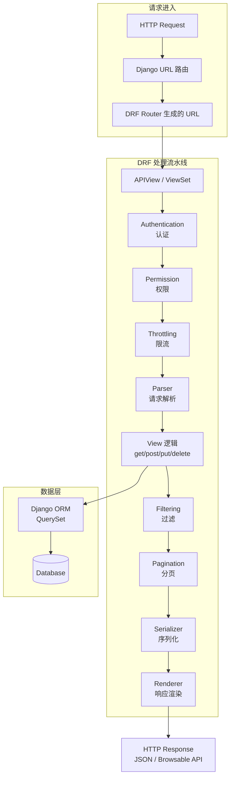
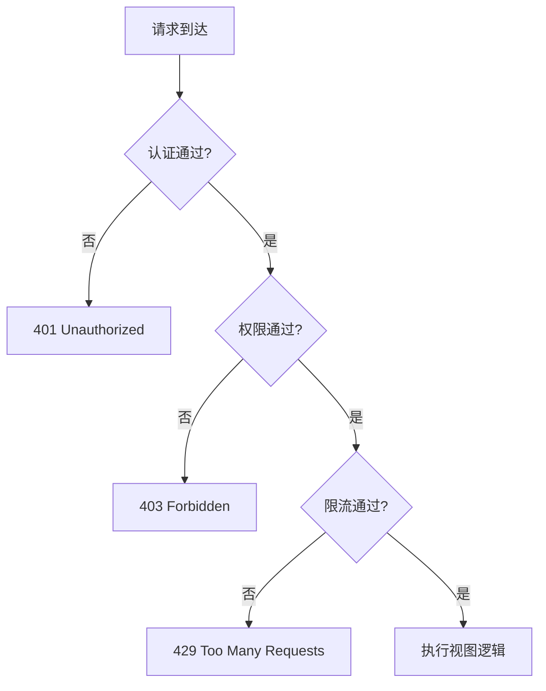

# Django REST Framework 设计

> **文档说明**：系统讲解 Django REST Framework（DRF）的序列化器、视图集、路由、认证权限、限流过滤与分页机制，含可运行的 ViewSet + Serializer + 自定义权限代码，以及与 Django ORM 的深度集成方案。
>
> **适用人群**：需要构建 RESTful API 的 Python 后端开发者、从 Django 模板渲染迁移到前后端分离的全栈工程师
>
> **前置知识**：[[Django-ORM与Admin体系]]、[[Python-面向对象与元类]]

---

## 一、概述

### 1.1 什么是 Django REST Framework

Django REST Framework（DRF）是基于 Django 的 Web API 构建框架，它在 Django ORM 之上提供了一套完整的 API 开发工具链：序列化器（Serializer）负责 Model 与 JSON 之间的双向转换，视图集（ViewSet）将 CRUD 操作浓缩为一个类，路由器（Router）自动生成 URL 路由，认证/权限/限流/过滤/分页作为可插拔组件按需启用。

DRF 的设计哲学是**约定优于配置**：一个 Model 对应一个 Serializer + 一个 ViewSet + 一行 Router 注册，即可获得完整的 RESTful API（列表/创建/详情/更新/删除）。

### 1.2 痛点对比

| 痛点（Django 原生视图手写 API） | DRF 解决方式 |
|-------------------------------|-------------|
| 每个接口都要手动 json.dumps 和设置 Content-Type | `Response` 对象自动序列化，自动设置正确的 Content-Type |
| 请求数据需手动 `json.loads(request.body)` | `request.data` 自动解析 JSON/表单/文件上传 |
| 序列化需手写 `model_to_dict`，关联字段处理麻烦 | `ModelSerializer` 自动生成字段，支持嵌套序列化 |
| 校验逻辑分散在视图中，重复代码多 | Serializer 的 `validate_<field>` 和 `validate()` 统一校验 |
| 分页需手写 `?page=` 解析和切片 | `PageNumberPagination` 等内置分页类，一行配置 |
| 认证需手写中间件解析 Token | `TokenAuthentication`、`JWTAuthentication` 开箱即用 |
| 权限判断散落在每个视图的 if 中 | `permission_classes` 声明式权限，可组合 |
| API 文档需手动维护 | 内置 Browsable API，配合 drf-spectacular 自动生成 OpenAPI 文档 |

### 1.3 核心概念与术语

| 术语 | 说明 |
|------|------|
| **Serializer** | 序列化器，负责 Model↔JSON 双向转换和数据校验 |
| **ModelSerializer** | 基于 Model 自动生成字段的序列化器 |
| **ViewSet** | 视图集，将 CRUD 浓缩为一个类，配合 Router 自动生成路由 |
| **Mixin** | 混入类，提供单个 HTTP 方法的实现（CreateModelMixin 等） |
| **Router** | 路由器，自动为 ViewSet 生成 RESTful URL |
| **Authentication** | 认证，解决"你是谁" |
| **Permission** | 权限，解决"你能做什么" |
| **Throttling** | 限流，解决"你能做多快" |
| **Pagination** | 分页，控制列表返回数据量 |
| **Filtering** | 过滤，支持条件筛选、搜索、排序 |
| **Browsable API** | 可浏览 API，DRF 内置的 HTML 界面，可直接在浏览器测试接口 |

<div style="background:linear-gradient(135deg,#f093fb,#f5576c);border-radius:16px;padding:20px;margin:16px 0;font-family:-apple-system,'Segoe UI','PingFang SC','Microsoft YaHei',sans-serif;color:#fff;overflow:hidden;box-shadow:0 8px 28px rgba(0,0,0,.14),0 3px 10px rgba(0,0,0,.08)">
<style>@keyframes flow{0%{transform:translateX(-10px);opacity:0}15%{transform:translateX(0);opacity:1}85%{transform:translateX(0);opacity:1}100%{transform:translateX(10px);opacity:0}}.flow-step{display:inline-block;background:rgba(255,255,255,.2);border:2px solid rgba(255,255,255,.5);border-radius:8px;padding:10px 14px;margin:4px;text-align:center;font-weight:600;font-size:13px;animation:flow 4s ease-in-out infinite;min-width:90px}.flow-step:nth-child(2){animation-delay:.5s}.flow-step:nth-child(4){animation-delay:1s}.flow-step:nth-child(6){animation-delay:1.5s}.flow-step:nth-child(8){animation-delay:2s}.flow-arrow{display:inline-block;font-size:20px;animation:flow 4s ease-in-out infinite;vertical-align:middle}.flow-code{background:rgba(0,0,0,.2);border-radius:6px;box-shadow:0 2px 8px rgba(0,0,0,.06);padding:8px 12px;margin-top:10px;font-family:monospace;font-size:12px;text-align:center}</style>
<div style="text-align:center;font-size:15px;font-weight:700;margin-bottom:14px;padding-bottom:10px;border-bottom:1.5px solid rgba(255,255,255,.22);letter-spacing:1px;text-shadow:0 1px 3px rgba(0,0,0,.12)">DRF 请求处理流水线</div>
<div style="text-align:center;white-space:nowrap;overflow-x:auto">
<span class="flow-step">认证</span><span class="flow-arrow">→</span><span class="flow-step">权限</span><span class="flow-arrow">→</span><span class="flow-step">限流</span><span class="flow-arrow">→</span><span class="flow-step">解析</span><span class="flow-arrow">→</span><span class="flow-step">视图逻辑</span><span class="flow-arrow">→</span><span class="flow-step">过滤</span><span class="flow-arrow">→</span><span class="flow-step">分页</span><span class="flow-arrow">→</span><span class="flow-step">序列化</span>
</div>
<div class="flow-code">全可插拔组件：全局 DEFAULT_*_CLASSES 或视图级 *_classes 配置</div>
<div style="text-align:center;font-size:12px;opacity:.85;margin-top:8px">任一环节不通过即返回对应错误码：401/403/429</div>
</div>

### 1.4 适用场景与边界

| 场景 | 是否推荐 | 原因 |
|------|---------|------|
| 基于 Django 的 RESTful API 开发 | 强烈推荐 | 与 Django ORM 深度集成，开发效率极高 |
| 前后端分离项目的后端 API | 推荐 | 序列化器+视图集+路由一站式解决方案 |
| 高并发异步 API 服务 | 部分适用 | DRF 基于同步 WSGI，异步支持有限，高并发场景考虑 FastAPI |
| 微服务架构中的轻量 API | 可用但偏重 | Django+DRF 栈较重，微服务考虑 Flask+Flask-RESTful 或 FastAPI |
| GraphQL API | 不适用 | DRF 专注 RESTful，GraphQL 用 Graphene 或 Strawberry |

> 💡 **深度讲解**：DRF 的核心价值在于**将 RESTful API 开发的重复性工作标准化、自动化**。在没有 DRF 的时代，每个 API 接口都需要手动处理：请求解析（JSON/Form/File）、数据校验、ORM 查询、序列化输出、分页、错误处理、认证权限——这些重复代码占据了后端开发 60% 以上的工作量。DRF 通过 Serializer（统一校验+序列化）、ViewSet（CRUD 浓缩）、Router（自动路由）三大核心组件，将这些工作标准化，一个 Model 对应一个 Serializer+ViewSet+Router 注册，5 行代码获得完整的 RESTful API。认证/权限/限流/过滤/分页作为可插拔组件，通过 `DEFAULT_*_CLASSES` 全局配置或 `*_classes` 视图级配置按需启用。这种"约定优于配置+可插拔组件"的设计哲学，使得 DRF 既适合快速原型开发，又能通过深度定制满足复杂业务需求。与 FastAPI 相比，DRF 的优势是 Django 生态（ORM/Admin/Auth/Migrations）和成熟度，劣势是同步阻塞和类型提示弱。
>
> **📝 精简总结**：DRF = Serializer（校验+序列化）+ ViewSet（CRUD 浓缩）+ Router（自动路由）+ 可插拔组件（认证/权限/限流/过滤/分页）。一个 Model 对应一套配置，5 行代码获得完整 RESTful API，适合 Django 生态的前后端分离项目。

---

## 二、原理

### 2.1 DRF 核心组件全景


### 2.2 Serializer 序列化机制

Serializer 是 DRF 的核心，它承担三个职责：**校验输入**、**序列化输出**、**反序列化保存**。

```mermaid
graph LR
    subgraph 反序列化（输入）
        A[request.data<br/>JSON/Form] --> B[Serializer(data=...)]
        B --> C[is_valid()<br/>字段校验+对象级校验]
        C -->|valid| D[validated_data]
        D --> E[save()<br/>create/update]
        E --> F[Model 实例]
    end

    subgraph 序列化（输出）
        G[Model 实例 / QuerySet] --> H[Serializer(instance=...)]
        H --> I[.data<br/>OrderedDict]
        I --> J[Response<br/>JSON]
    end
```
**字段映射原理**：`ModelSerializer` 通过 `model._meta.fields` 自动获取模型字段，根据字段类型映射到对应的 DRF Field 类：

| Django Model Field | DRF Field | 序列化输出 |
|-------------------|-----------|-----------|
| `CharField` | `CharField` | string |
| `IntegerField` | `IntegerField` | number |
| `BooleanField` | `BooleanField` | boolean |
| `DateTimeField` | `DateTimeField` | ISO 8601 string |
| `ForeignKey` | `PrimaryKeyRelatedField` | id（整数） |
| `ManyToManyField` | `PrimaryKeyRelatedField(many=True)` | id 数组 |
| `TextField` | `CharField` | string |

> 🔍 **知识点深度解析：ViewSet 与 Mixin 组合模式**
>
> **作用**：ViewSet 通过组合不同的 Mixin 类获得不同的 HTTP 方法支持，避免了传统 APIView 中重复编写 list/create/retrieve/update/destroy 方法的问题。开发者只需选择需要的 Mixin 组合，即可获得对应的 API 能力。
>
> **原理**：DRF 的视图层采用**组合模式**而非继承模式。`GenericViewSet` 提供 `queryset`、`serializer_class`、`get_object()` 等通用能力，但不提供任何具体的 HTTP 方法实现。每个 Mixin 类（CreateModelMixin/ListModelMixin/RetrieveModelMixin/UpdateModelMixin/DestroyModelMixin）只实现一个对应的 action 方法（create/list/retrieve/update/destroy）。`ViewSetMixin` 负责将 HTTP 方法映射到 action：GET→list/retrieve、POST→create、PUT→update、PATCH→partial_update、DELETE→destroy。`ModelViewSet` = 全部 5 个 Mixin + GenericViewSet，一次性获得完整 CRUD。
>
> **用法要点**：① `ModelViewSet` 适合需要完整 CRUD 的资源 ② `ReadOnlyModelViewSet`（List+Retrieve Mixin）适合只读资源 ③ 自定义组合：`class MyViewSet(CreateModelMixin, ListModelMixin, GenericViewSet)` 只需要创建和列表 ④ 自定义 action 用 `@action(detail=True/False, methods=['post'])` 装饰器 ⑤ `get_serializer_class()` 根据 action 返回不同序列化器（列表用轻量版，详情用完整版）⑥ `get_queryset()` 根据用户权限过滤数据。

### 2.3 Router 路由生成原理

`DefaultRouter` 自动为 ViewSet 生成标准 RESTful URL：

| URL 模式 | HTTP 方法 | 对应 action | 说明 |
|---------|----------|------------|------|
| `/api/articles/` | GET | `list` | 列表 |
| `/api/articles/` | POST | `create` | 创建 |
| `/api/articles/{pk}/` | GET | `retrieve` | 详情 |
| `/api/articles/{pk}/` | PUT | `update` | 全量更新 |
| `/api/articles/{pk}/` | PATCH | `partial_update` | 部分更新 |
| `/api/articles/{pk}/` | DELETE | `destroy` | 删除 |
| `/api/articles/{pk}/{action}/` | GET/POST | 自定义 action | `@action` 装饰器 |

### 2.4 认证与权限流水线


认证（Authentication）解决"你是谁"，权限（Permission）解决"你能做什么"，限流（Throttling）解决"你能做多快"。三者按顺序执行，任一不通过即返回对应错误码。

### 2.5 与 FastAPI 的对比

| 维度 | DRF | FastAPI |
|------|-----|---------|
| 底层框架 | Django | Starlette |
| 异步支持 | Django 4.2+ 部分支持 | 原生 async |
| 自动文档 | Browsable API + drf-spectacular | 内置 Swagger/ReDoc |
| 类型提示 | 弱（Serializer 校验） | 强（Pydantic + Python typing） |
| ORM 集成 | Django ORM 深度集成 | 任意 ORM（SQLAlchemy 为主） |
| 性能 | 中（同步 WSGI） | 高（异步 ASGI） |
| 适用场景 | 内容管理、企业后台 | 高并发 API、AI 服务 |
| 生态 | Django 生态（Admin/Auth/Migrations） | 轻量，需自行组装 |

> 💡 **深度讲解**：DRF 的架构核心是**处理流水线**和**组合模式**两大设计。处理流水线将一个 API 请求的处理过程拆解为：认证→权限→限流→解析→视图逻辑→过滤→分页→序列化→渲染，每个环节都是可插拔的独立组件，通过全局配置（`DEFAULT_*_CLASSES`）或视图级配置（`*_classes`）启用。这种流水线设计使得横切关注点（认证/权限/限流/日志）与业务逻辑（视图方法）完全解耦，开发者只需关注业务逻辑。组合模式体现在 ViewSet 层：`GenericViewSet` 提供通用能力，每个 Mixin 只实现一个 action，通过多重继承组合出需要的功能集（ModelViewSet = 5个Mixin + GenericViewSet）。这种设计避免了传统类继承中"胖基类"的问题，使得功能组合灵活且语义清晰。Serializer 则是 DRF 最精巧的设计：它同时承担输入校验（`is_valid()`）、输出序列化（`.data`）、持久化（`save()`→create/update）三个职责，通过 `ModelSerializer` 的元类自动从 Model 生成字段，大幅减少样板代码。理解这些架构原理后，才能在定制需求（自定义权限、自定义分页、自定义序列化器）时精准扩展而非重写。
>
> **📝 精简总结**：DRF 原理 = 处理流水线（认证→权限→限流→解析→视图→过滤→分页→序列化→渲染，全可插拔）+ ViewSet 组合模式（GenericViewSet + Mixin 多重继承）+ Serializer 三职责（校验/序列化/持久化）。ModelViewSet 5行代码获得完整 CRUD，自定义用 @action 装饰器和 get_serializer_class/get_queryset 钩子。

---

## 三、实操

### 3.1 项目初始化与配置

```python
# 安装依赖
pip install djangorestframework djangorestframework-simplejwt django-filter drf-spectacular
```
```css
# settings.py
INSTALLED_APPS = [
```
    'django.contrib.admin',
    'django.contrib.auth',
    'django.contrib.contenttypes',
    'django.contrib.sessions',
    'django.contrib.messages',
    'django.contrib.staticfiles',
    'rest_framework',
    'django_filters',
    'drf_spectacular',
    'blog',
```text
]

REST_FRAMEWORK = {
```
```text
    ## # 认证
```
    'DEFAULT_AUTHENTICATION_CLASSES': [
        'rest_framework_simplejwt.authentication.JWTAuthentication',
        'rest_framework.authentication.SessionAuthentication',
    ],
```text
    ## # 权限：默认需登录
```
    'DEFAULT_PERMISSION_CLASSES': [
        'rest_framework.permissions.IsAuthenticated',
    ],
```text
    ## # 限流
```
    'DEFAULT_THROTTLE_CLASSES': [
        'rest_framework.throttling.AnonRateThrottle',
        'rest_framework.throttling.UserRateThrottle',
    ],
    'DEFAULT_THROTTLE_RATES': {
        'anon': '100/day',
        'user': '1000/day',
        'burst': '60/minute',
    },
```text
    ## # 分页
```
    'DEFAULT_PAGINATION_CLASS': 'blog.pagination.StandardResultsSetPagination',
    'PAGE_SIZE': 20,
```text
    ## # 过滤
```
    'DEFAULT_FILTER_BACKENDS': [
        'django_filters.rest_framework.DjangoFilterBackend',
        'rest_framework.filters.SearchFilter',
        'rest_framework.filters.OrderingFilter',
    ],
```text
    ## # 版本控制
```
    'DEFAULT_VERSIONING_CLASS': 'rest_framework.versioning.URLPathVersioning',
```text
    ## # Schema
```
    'DEFAULT_SCHEMA_CLASS': 'drf_spectacular.openapi.AutoSchema',
```text
    ## # 异常处理
```
    'EXCEPTION_HANDLER': 'blog.exceptions.custom_exception_handler',
```text
}

SPECTACULAR_SETTINGS = {
```
    'TITLE': 'Blog API',
    'DESCRIPTION': '博客系统 RESTful API',
    'VERSION': '1.0.0',
    'SERVE_INCLUDE_SCHEMA': False,
}
### 3.2 序列化器设计

```python
# blog/serializers.py
from rest_framework import serializers
from django.contrib.auth.models import User
from .models import Article, Category, Tag, Comment


class UserSerializer(serializers.ModelSerializer):
    class Meta:
        model = User
        fields = ('id', 'username', 'email', 'date_joined')
        read_only_fields = ('id', 'date_joined')


class CategorySerializer(serializers.ModelSerializer):
    article_count = serializers.IntegerField(read_only=True)

    class Meta:
        model = Category
        fields = ('id', 'name', 'slug', 'description', 'article_count', 'created_at')
        read_only_fields = ('id', 'created_at')

    def validate_name(self, value):
        if len(value) < 2:
            raise serializers.ValidationError('分类名称至少 2 个字符')
        return value


class TagSerializer(serializers.ModelSerializer):
    class Meta:
        model = Tag
        fields = ('id', 'name', 'color')


class CommentSerializer(serializers.ModelSerializer):
    user = UserSerializer(read_only=True)
    user_id = serializers.PrimaryKeyRelatedField(
        queryset=User.objects.all(), source='user', write_only=True
    )

    class Meta:
        model = Comment
        fields = ('id', 'article', 'user', 'user_id', 'content', 'is_approved', 'created_at')
        read_only_fields = ('id', 'is_approved', 'created_at')

    def validate_content(self, value):
        if len(value.strip()) < 5:
            raise serializers.ValidationError('评论内容至少 5 个字符')
        return value


class ArticleListSerializer(serializers.ModelSerializer):
    """列表页用的轻量序列化器：不包含大字段 content"""
    author = UserSerializer(read_only=True)
    category = CategorySerializer(read_only=True)
    tags = TagSerializer(many=True, read_only=True)
    comment_count = serializers.IntegerField(read_only=True)

    class Meta:
        model = Article
        fields = ('id', 'title', 'slug', 'author', 'category', 'tags',
                  'summary', 'status', 'views', 'comment_count', 'pub_date')


class ArticleDetailSerializer(serializers.ModelSerializer):
    """详情页用的完整序列化器"""
    author = UserSerializer(read_only=True)
    category = CategorySerializer(read_only=True)
    category_id = serializers.PrimaryKeyRelatedField(
        queryset=Category.objects.all(), source='category', write_only=True,
        allow_null=True, required=False
    )
    tags = TagSerializer(many=True, read_only=True)
    tag_ids = serializers.PrimaryKeyRelatedField(
        queryset=Tag.objects.all(), many=True, source='tags', write_only=True,
        required=False
    )
    comments = CommentSerializer(many=True, read_only=True)
    is_owner = serializers.SerializerMethodField()

    class Meta:
        model = Article
        fields = ('id', 'title', 'slug', 'author', 'category', 'category_id',
                  'tags', 'tag_ids', 'content', 'summary', 'status', 'views',
                  'comments', 'is_owner', 'pub_date', 'updated_at')
        read_only_fields = ('id', 'author', 'views', 'pub_date', 'updated_at')

    def get_is_owner(self, obj):
        request = self.context.get('request')
        if request and request.user.is_authenticated:
            return obj.author_id == request.user.id
        return False

    def validate(self, attrs):
        # 对象级校验：已发布文章必须有分类
        if attrs.get('status') == 'published' and not attrs.get('category'):
            raise serializers.ValidationError({'category': '已发布文章必须选择分类'})
        return attrs

    def create(self, validated_data):
        tags = validated_data.pop('tags', [])
        article = Article.objects.create(**validated_data)
        if tags:
            article.tags.set(tags)
        return article

    def update(self, instance, validated_data):
        tags = validated_data.pop('tags', None)
        for attr, value in validated_data.items():
            setattr(instance, attr, value)
        instance.save()
        if tags is not None:
            instance.tags.set(tags)
        return instance
```
### 3.3 视图集实现

```python
# blog/views.py
from rest_framework import viewsets, status, permissions, filters
from rest_framework.decorators import action
from rest_framework.response import Response
from django_filters.rest_framework import DjangoFilterBackend
from django.db.models import Count, Q
from .models import Article, Category, Tag, Comment
from .serializers import (
    ArticleListSerializer, ArticleDetailSerializer,
    CategorySerializer, TagSerializer, CommentSerializer
)
from .permissions import IsOwnerOrReadOnly
from .pagination import StandardResultsSetPagination


class ArticleViewSet(viewsets.ModelViewSet):
    """文章 API：列表/创建/详情/更新/删除 + 自定义动作"""
    queryset = Article.objects.all()
    serializer_class = ArticleDetailSerializer
    permission_classes = [permissions.IsAuthenticatedOrReadOnly, IsOwnerOrReadOnly]
    pagination_class = StandardResultsSetPagination
    filter_backends = [DjangoFilterBackend, filters.SearchFilter, filters.OrderingFilter]
    filterset_fields = ['status', 'category', 'author']
    search_fields = ['title', 'content', 'summary']
    ordering_fields = ['pub_date', 'views', 'created_at']
    ordering = ['-pub_date']

    def get_queryset(self):
        qs = super().get_queryset()
        # 匿名用户只能看到已发布文章
        if not self.request.user.is_authenticated:
            qs = qs.filter(status='published')
        # 预加载关联，避免 N+1
        return qs.select_related('author', 'category').prefetch_related('tags')

    def get_serializer_class(self):
        """列表用轻量序列化器，详情用完整序列化器"""
        if self.action == 'list':
            return ArticleListSerializer
        return ArticleDetailSerializer

    def perform_create(self, serializer):
        # 创建时自动设置作者为当前用户
        serializer.save(author=self.request.user)

    # 自定义动作：发布文章
    @action(detail=True, methods=['post'], permission_classes=[permissions.IsAuthenticated])
    def publish(self, request, pk=None):
        article = self.get_object()
        if article.status != 'draft':
            return Response(
                {'detail': '只有草稿状态的文章才能发布'},
                status=status.HTTP_400_BAD_REQUEST
            )
        article.status = 'published'
        article.save(update_fields=['status'])
        return Response({'status': 'published', 'id': article.id})

    # 自定义动作：热门文章（不需要 pk）
    @action(detail=False, methods=['get'])
    def popular(self, request):
        popular_articles = self.get_queryset().filter(
            status='published'
        ).order_by('-views')[:10]
        serializer = ArticleListSerializer(popular_articles, many=True)
        return Response(serializer.data)

    # 自定义动作：增加浏览量
    @action(detail=True, methods=['post'])
    def increment_views(self, request, pk=None):
        from django.db.models import F
        Article.objects.filter(pk=pk).update(views=F('views') + 1)
        return Response({'status': 'ok'})


class CategoryViewSet(viewsets.ModelViewSet):
    queryset = Category.objects.annotate(article_count=Count('articles'))
    serializer_class = CategorySerializer
    permission_classes = [permissions.IsAuthenticatedOrReadOnly]
    search_fields = ['name']


class TagViewSet(viewsets.ModelViewSet):
    queryset = Tag.objects.all()
    serializer_class = TagSerializer
    permission_classes = [permissions.IsAuthenticatedOrReadOnly]
    search_fields = ['name']


class CommentViewSet(viewsets.ModelViewSet):
    queryset = Comment.objects.select_related('user', 'article').all()
    serializer_class = CommentSerializer
    permission_classes = [permissions.IsAuthenticatedOrReadOnly]
    filterset_fields = ['article', 'is_approved']
    ordering_fields = ['created_at']

    def perform_create(self, serializer):
        serializer.save(user=self.request.user)

    def get_queryset(self):
        qs = super().get_queryset()
        # 非管理员只能看到已审核的评论
        if not self.request.user.is_staff:
            qs = qs.filter(is_approved=True)
        return qs
```
### 3.4 自定义权限与分页

```python
# blog/permissions.py
from rest_framework import permissions


class IsOwnerOrReadOnly(permissions.BasePermission):
    """对象级权限：只有作者可以修改，其他人只读"""
    def has_object_permission(self, request, view, obj):
        if request.method in permissions.SAFE_METHODS:
            return True
        return obj.author == request.user


class IsAdminOrReadOnly(permissions.BasePermission):
    """管理员可写，其他只读"""
    def has_permission(self, request, view):
        if request.method in permissions.SAFE_METHODS:
            return True
        return request.user and request.user.is_staff


class IsOwner(permissions.BasePermission):
    """仅作者可访问"""
    def has_object_permission(self, request, view, obj):
        return obj.user == request.user
```
```python
# blog/pagination.py
from rest_framework.pagination import PageNumberPagination
from rest_framework.response import Response


class StandardResultsSetPagination(PageNumberPagination):
    page_size = 20
    page_size_query_param = 'page_size'
    max_page_size = 100

    def get_paginated_response(self, data):
        return Response({
            'count': self.page.paginator.count,
            'total_pages': self.page.paginator.num_pages,
            'current_page': self.page.number,
            'next': self.get_next_link(),
            'previous': self.get_previous_link(),
            'results': data,
        })
```
### 3.5 路由注册与异常处理

```python
# blog/urls.py
from django.urls import path, include
from rest_framework.routers import DefaultRouter
from rest_framework_simplejwt.views import TokenObtainPairView, TokenRefreshView
from drf_spectacular.views import SpectacularAPIView, SpectacularSwaggerView
from .views import ArticleViewSet, CategoryViewSet, TagViewSet, CommentViewSet

router = DefaultRouter()
router.register(r'articles', ArticleViewSet, basename='article')
router.register(r'categories', CategoryViewSet, basename='category')
router.register(r'tags', TagViewSet, basename='tag')
router.register(r'comments', CommentViewSet, basename='comment')

urlpatterns = [
    path('v1/', include(router.urls)),
    # JWT 认证
    path('v1/auth/token/', TokenObtainPairView.as_view(), name='token_obtain_pair'),
    path('v1/auth/token/refresh/', TokenRefreshView.as_view(), name='token_refresh'),
    # API 文档
    path('v1/schema/', SpectacularAPIView.as_view(), name='schema'),
    path('v1/docs/', SpectacularSwaggerView.as_view(url_name='schema'), name='swagger-ui'),
]
```
```python
# blog/exceptions.py
from rest_framework.views import exception_handler
from rest_framework.response import Response
from rest_framework import status


def custom_exception_handler(exc, context):
    response = exception_handler(exc, context)
    if response is not None:
        # 统一错误响应格式
        response.data = {
            'error': {
                'code': response.status_code,
                'message': response.data.get('detail', str(exc)),
                'errors': response.data if isinstance(response.data, dict) and 'detail' not in response.data else None,
            }
        }
    else:
        # 未被 DRF 捕获的异常
        return Response(
            {'error': {'code': 500, 'message': '服务器内部错误'}},
            status=status.HTTP_500_INTERNAL_SERVER_ERROR
        )
    return response
```
> 💡 **深度讲解**：DRF 实操的核心是掌握**配置→序列化器→视图集→路由→权限分页**的完整开发流程。配置阶段在 `settings.py` 中通过 `REST_FRAMEWORK` 字典全局配置认证/权限/限流/分页/过滤/异常处理，这些全局配置可以被视图级配置覆盖。序列化器设计是 DRF 最关键的环节：`ModelSerializer` 自动从 Model 生成字段，但生产级项目通常需要自定义——列表用轻量序列化器（排除大字段 content）、详情用完整序列化器、读写分离（嵌套序列化器只读 + PrimaryKeyRelatedField 只写）、`validate_<field>` 字段级校验 + `validate()` 对象级校验、`create()`/`update()` 处理多对多关系。视图集实现中，`get_queryset()` 过滤数据+预加载防 N+1、`get_serializer_class()` 根据 action 切换序列化器、`perform_create()` 设置默认值、`@action` 装饰器定义自定义动作（publish/popular/increment_views）。自定义权限通过继承 `BasePermission` 实现 `has_permission`（视图级）和 `has_object_permission`（对象级）。路由用 `DefaultRouter` 一行注册自动生成 6 个 RESTful URL。
>
> **📝 精简总结**：实操流程 = settings 全局配置 → Serializer（ModelSerializer + 自定义字段/校验/create/update，列表详情分离）→ ViewSet（queryset/serializer_class/permission/pagination/filter + get_queryset/get_serializer_class/perform_create + @action）→ Router 注册 → 自定义 Permission/Pagination/ExceptionHandler。JWT 用 djangorestframework-simplejwt，文档用 drf-spectacular。

---

## 四、问题

### 4.1 常见错误与排查方案

| 问题现象 | 原因 | 解决方案 |
|---------|------|---------|
| 序列化器输出中关联对象只有 id 没有详情 | 默认 `PrimaryKeyRelatedField` 只输出 id | 定义嵌套 Serializer 并设置为只读，或使用 `depth = 1` |
| `create()` 中多对多字段报错 `needs to have a value for field "id" before this many-to-many relationship can be used` | 多对多关系需要对象先保存获得主键 | 先 `create` 对象，再调用 `instance.tags.set(tags)` |
| 列表页 N+1 查询严重 | ViewSet 的 `get_queryset` 未预加载关联 | 重写 `get_queryset`，添加 `select_related` 和 `prefetch_related` |
| `permission_classes` 设置了 `IsAuthenticated` 但匿名用户仍能访问 | 该视图的 `permission_classes` 被覆盖为空列表 | 检查视图类是否显式设置了空的 `permission_classes = []` |
| JWT Token 过期后返回 401 但前端无法区分 | 默认 401 响应没有区分认证失败和 Token 过期 | 自定义 `AUTH_TOKEN_CLASSES` 或在异常处理器中检查异常类型 |
| `search_fields` 搜索外键字段报错 | 直接写了外键字段名 | 使用双下划线：`search_fields = ('author__username', 'title')` |
| `@action` 自定义动作返回 404 | `detail=True` 但 URL 中没有 pk，或 `detail=False` 但传了 pk | 确认 `detail` 参数与 URL 匹配：`detail=True` 需要 `/{pk}/{action_name}/` |
| 文件上传时 `request.data` 为空 | 前端未设置 `Content-Type: multipart/form-data` | DRF 的 `MultiPartParser` 需要正确的 Content-Type，前端用 FormData 上传 |
| 批量创建性能差，循环调用 serializer.save() | 逐条创建触发 N 次 INSERT | 使用 `serializer(many=True)` + `bulk_create`，或重写 `create` 方法批量写入 |

### 4.2 性能瓶颈与优化策略

| 优化手段 | 说明 | 适用场景 |
|---------|------|---------|
| 列表/详情分离序列化器 | 列表页排除大字段（content），减少数据传输 | 列表接口 |
| `select_related` / `prefetch_related` | 在 `get_queryset` 中预加载 | 所有含关联字段的接口 |
| `only()` / `defer()` | 只查询需要的字段 | 大表、大字段 |
| 避免嵌套序列化器中的 N+1 | 嵌套序列化器的关联也需要预加载 | 深层嵌套结构 |
| `bulk_create` / `bulk_update` | 批量写入 | 批量导入、批量更新 |
| 缓存高频接口 | 列表页缓存 5 分钟 | 读多写少的接口 |

### 4.3 安全风险与防护措施

| 风险 | 说明 | 防护措施 |
|------|------|---------|
| 越权访问 | 用户可访问/修改他人数据 | 对象级权限 `has_object_permission`；`get_queryset` 按用户过滤 |
| 暴力破解 | 登录接口被暴力尝试 | 限流 `AnonRateThrottle`；django-axes 登录防护 |
| 数据泄露 | 序列化器输出敏感字段（密码、密钥） | `exclude` 或 `read_only_fields` 排除敏感字段；列表用轻量序列化器 |
| SQL 注入 | 原生 SQL 拼接 | 使用 ORM 查询；`raw()` 用 params 参数 |
| 滥用/爬虫 | 接口被高频调用 | 限流 `UserRateThrottle`；API Key 鉴权；频率监控告警 |

### 4.4 生产环境踩坑记录

**问题→原因→方案**：

1. **问题**：DRF 接口在高并发下响应变慢，数据库连接池耗尽
   - **原因**：每个请求创建新的数据库连接，未使用连接池；同步 WSGI 阻塞
   - **方案**：配置 `CONN_MAX_AGE` 复用连接；使用 `django-db-geventpool` 等连接池；考虑异步视图或 FastAPI

2. **问题**：JWT Token 泄露后无法立即失效
   - **原因**：JWT 是无状态的，服务端不存储 Token，无法主动吊销
   - **方案**：缩短 access token 有效期（15分钟）+ refresh token；维护 Token 黑名单（Redis）；关键操作要求重新认证

3. **问题**：drf-spectacular 生成的文档中嵌套序列化器显示不正确
   - **原因**：`get_serializer_class` 动态返回不同序列化器，schema 生成器无法推断
   - **方案**：使用 `@extend_schema` 装饰器显式指定请求/响应序列化器；或在 ViewSet 上设置 `serializer_class` 为详情版

> 💡 **深度讲解**：DRF 在生产环境中最常见的问题是**性能问题**和**安全问题**。性能问题的根源依然是 N+1 查询——在 `get_queryset` 中必须使用 `select_related`（外键/一对一）和 `prefetch_related`（多对多/反向外键）预加载关联数据，否则序列化器输出嵌套对象时会触发大量额外查询。另一个性能优化是列表/详情分离序列化器，列表页排除大字段（如 content TEXT），减少数据传输量。安全问题主要是越权访问——必须同时配置视图级权限（`has_permission`）和对象级权限（`has_object_permission`），并在 `get_queryset` 中按用户权限过滤数据，仅靠权限类不足以防止越权。JWT 的无状态特性导致 Token 泄露后无法立即吊销，解决方案是缩短有效期+维护黑名单。生产部署时，DRF 基于同步 WSGI，高并发场景需要配合 Gunicorn 多 worker + 数据库连接池，极端高并发考虑迁移到 FastAPI。
>
> **📝 精简总结**：常见问题 = N+1 查询（get_queryset 中 select_related/prefetch_related）、多对多 create 报错（先 create 再 set）、越权访问（对象级权限 + get_queryset 过滤）、JWT 无法吊销（短有效期 + Redis 黑名单）、高并发连接池耗尽（CONN_MAX_AGE + 连接池）。安全方面排除敏感字段、配置限流、防 SQL 注入。

---

## 五、拓展

### 5.1 API 版本控制策略

```python
# 方式 1：URL 路径版本（推荐）
# /api/v1/articles/ vs /api/v2/articles/
from rest_framework.versioning import URLPathVersioning

# urls.py
urlpatterns = [
    path('v1/', include('blog.v1_urls')),
    path('v2/', include('blog.v2_urls')),
]

# 方式 2：Accept Header 版本
# Accept: application/json; version=1.0
from rest_framework.versioning import AcceptHeaderVersioning
```
### 5.2 缓存策略

```python
from django.utils.decorators import method_decorator
from django.views.decorators.cache import cache_page
from django.views.decorators.vary import vary_on_headers

class ArticleViewSet(viewsets.ModelViewSet):
    # 列表页缓存 5 分钟
    @method_decorator(cache_page(60 * 5))
    @method_decorator(vary_on_headers('Authorization'))
    def list(self, request, *args, **kwargs):
        return super().list(request, *args, **kwargs)
```
### 5.3 测试策略

```python
# tests/test_api.py
from rest_framework.test import APITestCase, APIClient
from rest_framework import status
from django.contrib.auth.models import User
from blog.models import Article


class ArticleAPITest(APITestCase):
    def setUp(self):
        self.user = User.objects.create_user(username='testuser', password='testpass123')
        self.client = APIClient()
        self.client.force_authenticate(user=self.user)
        self.article = Article.objects.create(
            title='测试文章', content='测试内容', author=self.user
        )

    def test_list_articles(self):
        response = self.client.get('/api/v1/articles/')
        self.assertEqual(response.status_code, status.HTTP_200_OK)
        self.assertEqual(response.data['count'], 1)

    def test_create_article(self):
        data = {'title': '新文章', 'content': '新内容', 'status': 'draft'}
        response = self.client.post('/api/v1/articles/', data, format='json')
        self.assertEqual(response.status_code, status.HTTP_201_CREATED)
        self.assertEqual(Article.objects.count(), 2)

    def test_unauthenticated_create(self):
        self.client.force_authenticate(user=None)
        response = self.client.post('/api/v1/articles/', {'title': 'x'}, format='json')
        self.assertEqual(response.status_code, status.HTTP_401_UNAUTHORIZED)

    def test_non_owner_cannot_edit(self):
        other_user = User.objects.create_user(username='other', password='pass123')
        self.client.force_authenticate(user=other_user)
        response = self.client.patch(
            f'/api/v1/articles/{self.article.id}/',
            {'title': '篡改'}, format='json'
        )
        self.assertEqual(response.status_code, status.HTTP_403_FORBIDDEN)
```

### 5.4 生态工具与周边库

| 工具 | 说明 | 适用场景 |
|------|------|---------|
| **djangorestframework-simplejwt** | JWT 认证 | 前后端分离、无状态认证 |
| **drf-spectacular** | OpenAPI 3.0 文档生成 | API 文档、前后端协作 |
| **django-filter** | 高级过滤 | 复杂筛选、范围查询 |
| **django-axes** | 登录限流和暴力破解防护 | 安全加固 |
| **django-debug-toolbar** | 开发调试面板 | 开发环境 SQL 分析 |
| **djangorestframework-camel-case** | 驼峰命名转换 | 前端 JavaScript 命名习惯 |
| **drf-writable-nested** | 可写嵌套序列化器 | 嵌套对象创建/更新 |

### 5.5 学习资源与延伸阅读

- [DRF 官方文档](https://www.django-rest-framework.org/) 🔗 — DRF 权威指南
- [DRF 官方教程](https://www.django-rest-framework.org/tutorial/quickstart/) 🔗 — 快速入门教程
- [SimpleJWT 文档](https://django-rest-framework-simplejwt.readthedocs.io/) 🔗 — JWT 认证参考
- [drf-spectacular 文档](https://drf-spectacular.readthedocs.io/) 🔗 — OpenAPI 文档生成

> 💡 **深度讲解**：拓展部分聚焦于 DRF 的**高级特性和生产级实践**。API 版本控制是系统演进的关键，URL 路径版本（/v1/、/v2/）是最直观的方案，适合大多数项目；Accept Header 版本更 RESTful 但调试不便。缓存策略对读多写少的接口（如文章列表）效果显著，使用 `cache_page` 装饰器+`vary_on_headers('Authorization')` 确保不同用户缓存隔离，但要注意缓存失效策略（写操作时清除相关缓存）。测试是 DRF 项目质量保障的核心，`APITestCase` + `APIClient` + `force_authenticate` 可以快速编写 API 测试，测试金字塔建议：单元测试（Serializer/Validator）> 集成测试（ViewSet+ORM）> E2E 测试（完整请求链路）。生态工具方面，SimpleJWT 是 JWT 认证的事实标准，drf-spectacular 是 OpenAPI 3.0 文档生成的最佳选择（替代已停止维护的 django-rest-swagger），django-filter 提供比 DRF 内置 SearchFilter 更强大的过滤能力。理解这些拓展内容后，可以构建出功能完善、安全可靠、可演进的生产级 API 服务。
>
> **📝 精简总结**：拓展方向 = API 版本控制（URL 路径 v1/v2）、缓存策略（cache_page + vary_on_headers）、测试策略（APITestCase + APIClient，测试金字塔）、生态工具（SimpleJWT/drf-spectacular/django-filter/axes）。学习资源以 DRF 官方文档为主。

---

> 💡 **深度讲解**：本章介绍了进阶用法、生态工具、技术集成、行业应用和学习资源，为深入学习提供方向。技术的价值不仅在于自身功能，更在于与其他技术的组合使用所产生的协同效应。建议根据项目需求和个人兴趣，选择1-2个拓展方向深入学习，避免浅尝辄止。
>
> **📝 精简总结**：本章介绍了进阶特性、生态工具、技术集成、应用案例和学习资源，为深入学习和技术拓展提供方向。


## 🔗 关联笔记

- [[Django-ORM与Admin体系]] — DRF 的数据层基础，Model 和 QuerySet
- [[FastAPI-路由与依赖注入]] — 现代异步 API 框架，与 DRF 对比选型
- [[FastAPI-中间件与异常处理]] — FastAPI 的横切关注点处理，对比 DRF 流水线
- [[Flask-轻量服务架构]] — 轻量微框架，理解 DRF "一站式" vs Flask "组装式"
- [[Python接口设计与文档知识点系统梳理_优化版]] — API 设计通用原则和文档规范
- [[Python全栈前端集成知识点系统梳理_优化版]] — 前后端分离架构和 CORS 配置
- [[Redis-Python客户端与缓存策略]] — DRF 接口缓存的后端实现

## 📖 前置知识

- [[Django-ORM与Admin体系]] — Django Model 和 QuerySet 基础
- [[Python-面向对象与元类]] — 理解 Serializer 元类和 Mixin 组合

## 🏷️ 相关标签

`#Python` `#Django` `#后端` `#安全` `#RESTful` `#API`

---

[[Home|🏠 返回首页]] · [[MOC-Python全栈|📚 返回分类]]
