# FastAPI WebSocket 实时通信

> **📖 文档说明**
>
> 本文档是「从零基础新手到实战老手」三部曲的**完整体系篇**，系统讲解 FastAPI 中 WebSocket 实时通信的全部核心知识。从 WebSocket 协议原理（握手、帧、全双工）讲起，逐步深入 FastAPI WebSocket 基础用法、连接管理器（多客户端/广播/房间）、认证鉴权、异常处理与断开重连、异步并发、二进制传输、压测性能、Redis Pub/Sub 分布式扩展、生产级架构，最终到前端集成完整实战。每个知识点都配有概念解释、原理图解、可运行代码、最佳实践和常见坑点，学完即可独立构建生产级实时应用。
>
> **👥 适用人群**
> - 零基础新手：想学习实时通信技术的 Python 开发者
> - 进阶开发者：已掌握 FastAPI 基础，想深入 WebSocket 实战
> - 实战老手：需要构建生产级实时应用（聊天、协作、监控、游戏）的工程师
>
> **📚 前置知识**
> - [[FastAPI-路由与依赖注入]] — FastAPI 路由和依赖注入基础
> - [[Python-异步编程asyncio]] — asyncio 异步编程基础
>
> **🗺️ 学习路径**
> - **入门篇**（第1-2章）：协议原理 + 快速上手，建立基础认知
> - **进阶篇**（第3-8章）：连接管理、认证、房间、异常、异步、二进制，掌握核心技能
> - **实战篇**（第9-12章）：分布式扩展、生产架构、前端集成、选型对比，达到生产级水平

---

## 第一篇 入门篇：WebSocket 基础与快速上手

---

## 1. WebSocket 协议原理深度解析

### 1.1 什么是 WebSocket

#### 概念解释

**WebSocket** 是一种在单个 TCP 连接上进行全双工通信的网络协议，通过 HTTP/HTTPS 握手建立连接后，客户端和服务端可以随时双向发送数据，无需每次请求都建立新连接。

> 🏠 **生活化比喻**：HTTP 就像打电话——每次说话都要先拨号、接通、说话、挂断，下一次说话又要重新拨号。WebSocket 就像对讲机——一次调频接通后，双方可以随时说话，不用每次重新拨号，而且双方都能主动说话。

**核心价值**：将 HTTP 的"请求-响应"半双工模式升级为"持久双向"全双工模式，单条消息开销从 HTTP 的几百字节头部降至 2-14 字节，真正实现毫秒级实时通信。

> 🎯 **面试高频考点 1**：WebSocket 与 HTTP 的本质区别是什么？
> **答**：HTTP 是半双工的请求-响应协议，每次通信需要客户端发起请求，服务端才能响应，服务端无法主动推送；WebSocket 是全双工协议，通过 HTTP Upgrade 握手后，双方可以随时双向发送数据，无需重新建立连接。HTTP 每次请求携带完整 Header（通常几百字节），WebSocket 数据帧仅 2-14 字节头部。

#### 原理说明

WebSocket 的核心机制是 **HTTP Upgrade 握手 + 数据帧传输 + 全双工通道**。

**为什么这样设计**：WebSocket 选择基于 HTTP 握手而非独立协议，是为了复用现有的 HTTP 基础设施（代理、防火墙、负载均衡器），降低部署门槛。握手完成后，协议切换为 WebSocket 自有帧格式，实现高效双向通信。

**技术对比**：

| 维度 | HTTP 短轮询 | HTTP 长轮询 | WebSocket |
|------|------------|------------|-----------|
| 连接方式 | 每次请求新建连接 | 请求挂起直到有数据 | 一次握手持续连接 |
| 通信方向 | 客户端→服务端单向 | 客户端→服务端单向 | 双向全双工 |
| 单条消息开销 | 几百字节 Header | 几百字节 Header | 2-14 字节帧头 |
| 服务端主动推送 | 不支持 | 支持（挂起响应） | 原生支持 |
| 实时性 | 差（延迟=轮询间隔） | 中（有数据立即返回） | 高（毫秒级） |
| 资源消耗 | 高（大量空请求） | 中（挂起连接占资源） | 低（持久连接高效） |

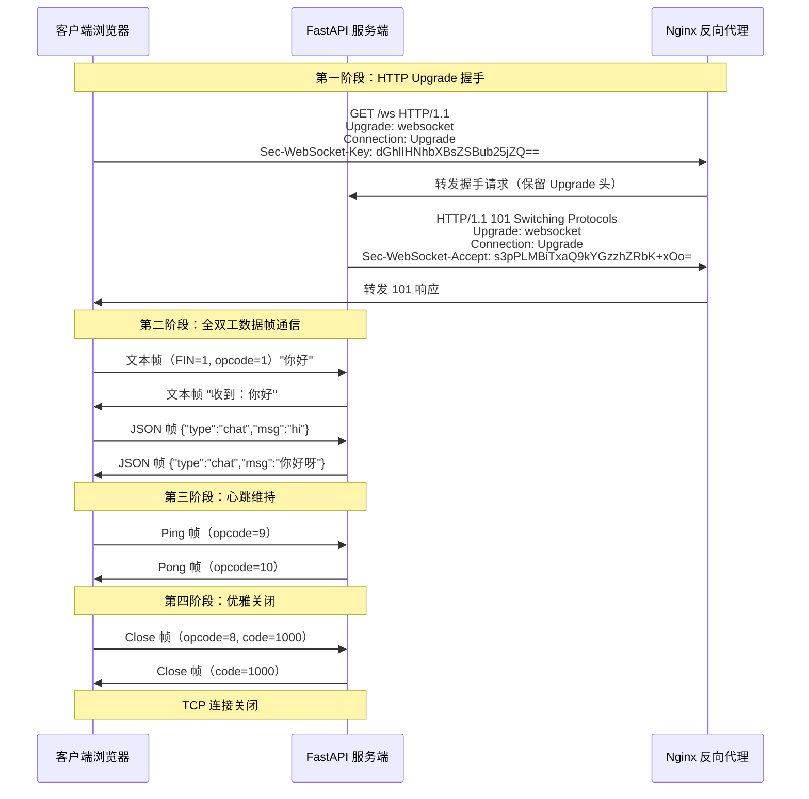

#### 代码示例

**示例 1：基础——用 Python 标准库观察 WebSocket 握手过程**

```python
"""
示例1：观察 WebSocket 握手的 HTTP 请求和响应
运行：python ws_handshake_inspect.py
预期输出：打印完整的握手请求头和响应头
"""
import asyncio
from websockets.server import serve, WebSocketServerProtocol


async def handler(websocket: WebSocketServerProtocol):
    # 打印客户端发来的握手请求头
    print("=== 客户端握手请求头 ===")
    for key, value in websocket.request.headers.items():
        print(f"  {key}: {value}")

    # 打印服务端返回的握手响应头
    print("\n=== 服务端握手响应头 ===")
    print(f"  HTTP/1.1 101 Switching Protocols")
    print(f"  Upgrade: websocket")
    print(f"  Connection: Upgrade")

    # 等待接收第一条消息
    message = await websocket.recv()
    print(f"\n=== 收到客户端消息 ===")
    print(f"  内容: {message}")

    await websocket.send(f"服务端已收到：{message}")
    print("=== 已发送响应 ===")


async def main():
    async with serve(handler, "localhost", 8765):
        print("WebSocket 服务已启动：ws://localhost:8765")
        print("等待客户端连接...\n")
        await asyncio.Future()  # 永久运行


if __name__ == "__main__":
    asyncio.run(main())

# 预期运行结果：
# WebSocket 服务已启动：ws://localhost:8765
# 等待客户端连接...
# === 客户端握手请求头 ===
#   host: localhost:8765
#   upgrade: websocket
#   connection: Upgrade
#   sec-websocket-key: dGhlIHNhbXBsZSBub25jZQ==
#   sec-websocket-version: 13
# === 服务端握手响应头 ===
#   HTTP/1.1 101 Switching Protocols
#   Upgrade: websocket
#   Connection: Upgrade
```

**示例 2：进阶——手动构造 WebSocket 握手请求（理解 Sec-WebSocket-Key/Accept）**

```python
"""
示例2：手动计算 Sec-WebSocket-Accept，理解握手验证机制
运行：python ws_handshake_calc.py
预期输出：展示 Key 到 Accept 的计算过程
"""
import base64
import hashlib

# RFC 6455 规定的魔术字符串（Magic GUID）
MAGIC_GUID = "258EAFA5-E914-47DA-95CA-C5AB0DC85B11"


def compute_accept(sec_websocket_key: str) -> str:
    """
    根据客户端的 Sec-WebSocket-Key 计算服务端的 Sec-WebSocket-Accept
    算法：base64(sha1(key + MAGIC_GUID))
    """
    combined = sec_websocket_key + MAGIC_GUID
    sha1_hash = hashlib.sha1(combined.encode("utf-8")).digest()
    accept = base64.b64encode(sha1_hash).decode("utf-8")
    return accept


# 模拟客户端生成的随机 Key
client_key = base64.b64encode(b"dGhlIHNhbXBsZSBub25jZQ==").decode("utf-8")
# 注意：实际 Key 是 16 字节随机数的 base64 编码
client_key = "dGhlIHNhbXBsZSBub25jZQ=="

print("=== WebSocket 握手验证机制 ===")
print(f"客户端 Sec-WebSocket-Key: {client_key}")
print(f"魔术字符串 (RFC 6455): {MAGIC_GUID}")
print(f"拼接字符串: {client_key + MAGIC_GUID}")

accept = compute_accept(client_key)
print(f"\nSHA1 哈希后 Base64 编码: {accept}")
print(f"这就是服务端返回的 Sec-WebSocket-Accept")

# 验证：客户端收到 Accept 后，用同样的算法计算并比对
verify = compute_accept(client_key)
print(f"\n客户端验证: 计算结果={verify}, 收到的 Accept={accept}")
print(f"验证结果: {'✅ 匹配，握手成功' if verify == accept else '❌ 不匹配，握手失败'}")

# 预期运行结果：
# === WebSocket 握手验证机制 ===
# 客户端 Sec-WebSocket-Key: dGhlIHNhbXBsZSBub25jZQ==
# 魔术字符串 (RFC 6455): 258EAFA5-E914-47DA-95CA-C5AB0DC85B11
# SHA1 哈希后 Base64 编码: s3pPLMBiTxaQ9kYGzzhZRbK+xOo=
# 客户端验证: ✅ 匹配，握手成功
```

**示例 3：完整场景——用 FastAPI 实现最简 WebSocket 回声服务并测试**

```python
"""
示例3：FastAPI 最简 WebSocket 回声服务
运行：uvicorn ws_echo:app --reload
测试：浏览器控制台执行 new WebSocket('ws://localhost:8000/ws')
"""
from fastapi import FastAPI, WebSocket, WebSocketDisconnect

app = FastAPI(title="WebSocket 回声服务", version="1.0.0")


@app.websocket("/ws")
async def websocket_echo(websocket: WebSocket):
    # 第1步：接受 WebSocket 连接（完成 HTTP Upgrade 握手）
    await websocket.accept()
    print("客户端已连接")

    try:
        # 第2步：进入消息循环，持续接收和发送
        while True:
            # 接收客户端消息（协程挂起，不阻塞事件循环）
            data = await websocket.receive_text()
            print(f"收到消息: {data}")

            # 发送响应给客户端
            await websocket.send_text(f"服务端回声: {data}")
            print(f"已发送回声")

    except WebSocketDisconnect:
        # 第3步：客户端断开时的清理
        print("客户端已断开连接")


# 预期运行结果：
# 服务启动后，浏览器控制台执行：
#   const ws = new WebSocket('ws://localhost:8000/ws');
#   ws.onmessage = (e) => console.log('收到:', e.data);
#   ws.send('你好 WebSocket');
# 控制台输出：收到: 服务端回声: 你好 WebSocket
# 服务端日志：客户端已连接 / 收到消息: 你好 WebSocket / 已发送回声
```

#### 使用场景与最佳实践

**适用场景**：
- 即时通讯（聊天、客服系统、弹幕）
- 实时通知（消息推送、告警、订单状态更新）
- 协作工具（文档协作、白板、在线编辑）
- 实时数据（股票行情、监控仪表盘、IoT 传感器数据）
- 在线游戏（状态同步、多人对战）
- AI 流式输出（对话生成、实时推理）
- 远程控制（终端、桌面共享）

**不适用场景**：
- 纯 REST API 场景（CRUD 操作用 HTTP 更合适）
- 大文件传输（WebSocket 帧不适合大文件，用 HTTP 分块上传）
- 仅需服务端单向推送且不需要客户端频繁发送（用 SSE 更简单）
- 对消息可靠性要求极高且需要离线消息（用消息队列 + HTTP 拉取）

**最佳实践**：
1. **始终处理 WebSocketDisconnect 异常**：不处理会导致未捕获异常日志和资源泄漏
2. **连接建立后立即进入消息循环**：`accept()` 后直接 `while True` 接收消息，避免连接空闲被代理超时断开
3. **发送消息时包裹 try-except**：连接可能在发送过程中断开，未捕获异常会中断整个连接管理器
4. **使用 JSON 作为消息格式**：统一消息结构（type + payload），便于前端解析和后端路由
5. **限制单条消息大小**：默认无限制，大消息可能导致内存溢出，建议设置 1MB-10MB 上限

**性能建议**：
- 单机 WebSocket 连接数上限取决于文件描述符限制（Linux 默认 1024，需调大到 65535）
- 每个连接内存开销约 10-50KB（含缓冲区），10 万连接约需 1-5GB 内存
- 消息吞吐量受限于事件循环和网络 IO，单机可达每秒 10 万+ 条小消息

#### 常见坑点

**坑点 1：忘记调用 `websocket.accept()` 导致连接挂起**

- **错误现象**：前端 `new WebSocket()` 后连接一直处于 `CONNECTING` 状态，最终超时失败，服务端无报错
- **根本原因**：WebSocket 端点函数中没有调用 `await websocket.accept()`，服务端未完成 HTTP Upgrade 握手，连接未建立
- **正确做法**：端点函数第一行必须调用 `await websocket.accept()`，完成握手后才能收发消息
- **预防措施**：代码模板中固定 `accept()` → `try/while` → `except WebSocketDisconnect` 三段式结构

**坑点 2：在 WebSocket 端点中执行同步阻塞操作导致所有连接卡顿**

- **错误现象**：一个连接的耗时操作（如 `time.sleep(10)`、同步数据库查询）导致所有 WebSocket 连接都无法收发消息
- **根本原因**：FastAPI WebSocket 运行在 asyncio 单线程事件循环中，同步阻塞操作会阻塞整个事件循环，所有协程都无法执行
- **正确做法**：所有 IO 操作使用异步版本（`asyncpg`、`httpx.AsyncClient`、`redis.asyncio`），CPU 密集型操作用 `asyncio.to_thread()` 放到线程池
- **预防措施**：代码审查时检查 WebSocket 端点中是否有 `time.sleep`、`requests.get`、同步 `psycopg2` 等阻塞调用

---

### 1.2 WebSocket 数据帧格式详解

#### 概念解释

**WebSocket 数据帧（Frame）** 是 WebSocket 协议中传输数据的最小单位，每个帧包含固定格式的头部和可变长度的载荷数据，支持文本、二进制、控制帧（Ping/Pong/Close）等多种类型。

> 🏠 **生活化比喻**：WebSocket 帧就像快递包裹——头部是快递单（写着包裹类型、大小、是否最后一件），载荷是包裹里的东西（文本或二进制数据）。大文件会被拆成多个包裹（分片帧），第一个包裹标"非最后一件"，最后一个标"最后一件"，收件人按顺序组装。

**核心价值**：极小的帧头开销（2-14 字节）使得高频小消息传输效率极高，分片机制支持大文件传输，控制帧实现心跳和优雅关闭。

> 🎯 **面试高频考点 2**：WebSocket 帧的 opcode 有哪些？各自作用是什么？
> **答**：opcode 占 4 位，定义帧类型：0x0=延续帧（分片消息的中间帧）、0x1=文本帧、0x2=二进制帧、0x8=关闭帧、0x9=Ping 帧、0xA=Pong 帧。0x3-0x7 和 0xB-0xF 为保留值。文本帧和二进制帧是数据帧，Close/Ping/Pong 是控制帧，控制帧不能被分片。

#### 原理说明

WebSocket 帧的核心机制是 **固定位字段头部 + 可变长度编码 + 客户端掩码**。

**为什么这样设计**：
- 位字段头部（而非字节对齐）：最小化头部开销，2 字节即可传输小消息
- 可变长度编码（7/16/64 位）：小消息用 7 位长度（0-125 字节），中等消息用 16 位（126-65535 字节），大消息用 64 位（>65535 字节），兼顾效率和扩展性
- 客户端掩码：防止代理服务器缓存恶意 WebSocket 流量导致的缓存投毒攻击（RFC 6455 要求客户端发送的所有帧必须掩码）

**技术对比**：

| 帧类型 | opcode | 能否分片 | 方向 | 用途 |
|--------|--------|---------|------|------|
| 延续帧 | 0x0 | 是 | 双向 | 分片消息的中间/结束帧 |
| 文本帧 | 0x1 | 是 | 双向 | UTF-8 文本数据 |
| 二进制帧 | 0x2 | 是 | 双向 | 任意二进制数据 |
| 关闭帧 | 0x8 | 否 | 双向 | 连接关闭（含状态码） |
| Ping 帧 | 0x9 | 否 | 双向 | 心跳探测 |
| Pong 帧 | 0xA | 否 | 双向 | 心跳响应 |

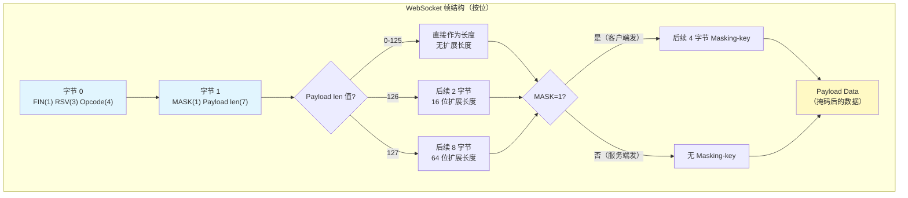

#### 代码示例

**示例 1：基础——解析 WebSocket 帧头部字段**

```python
"""
示例1：手动解析 WebSocket 帧的头部字段
运行：python ws_frame_parse.py
预期输出：打印帧的各个字段解析结果
"""
import struct


def parse_ws_frame(data: bytes) -> dict:
    """解析 WebSocket 帧头部，返回各字段"""
    if len(data) < 2:
        return {"error": "数据太短，至少需要 2 字节头部"}

    byte0 = data[0]
    byte1 = data[1]

    fin = (byte0 >> 7) & 1  # 最高位
    rsv1 = (byte0 >> 6) & 1
    rsv2 = (byte0 >> 5) & 1
    rsv3 = (byte0 >> 4) & 1
    opcode = byte0 & 0x0F  # 低 4 位

    mask_bit = (byte1 >> 7) & 1
    payload_len_7 = byte1 & 0x7F  # 低 7 位

    opcode_names = {
        0x0: "延续帧", 0x1: "文本帧", 0x2: "二进制帧",
        0x8: "关闭帧", 0x9: "Ping帧", 0xA: "Pong帧",
    }

    result = {
        "FIN": fin,
        "RSV": f"{rsv1}{rsv2}{rsv3}",
        "Opcode": f"0x{opcode:X} ({opcode_names.get(opcode, '未知')})",
        "MASK": mask_bit,
        "PayloadLen(7bit)": payload_len_7,
    }

    # 解析扩展长度
    offset = 2
    if payload_len_7 == 126:
        result["PayloadLen(16bit)"] = struct.unpack(">H", data[2:4])[0]
        offset = 4
    elif payload_len_7 == 127:
        result["PayloadLen(64bit)"] = struct.unpack(">Q", data[2:10])[0]
        offset = 10

    # 解析掩码密钥
    if mask_bit:
        result["MaskingKey"] = data[offset:offset + 4].hex()
        offset += 4

    result["HeaderSize"] = offset
    result["PayloadData"] = data[offset:offset + 50]  # 只显示前 50 字节
    return result


# 构造一个文本帧：FIN=1, opcode=1, MASK=1, payload="Hello"
# 客户端发送的帧必须掩码
def build_masked_text_frame(text: str) -> bytes:
    """构造客户端发送的掩码文本帧"""
    payload = text.encode("utf-8")
    import os
    mask_key = os.urandom(4)

    # 掩码运算：payload[i] ^= mask_key[i % 4]
    masked = bytes([payload[i] ^ mask_key[i % 4] for i in range(len(payload))])

    # 头部：FIN=1(0x80) + opcode=1(0x01) = 0x81
    # MASK=1 + payload_len
    header = bytes([0x81, 0x80 | len(payload)]) + mask_key
    return header + masked


frame = build_masked_text_frame("Hello WebSocket!")
print("=== 原始帧数据（十六进制）===")
print(frame.hex())
print("\n=== 解析结果 ===")
for key, value in parse_ws_frame(frame).items():
    print(f"  {key}: {value}")

# 预期运行结果：
# === 原始帧数据（十六进制）===
# 8190a1b2c3d4...（掩码密钥随机）
# === 解析结果 ===
#   FIN: 1
#   RSV: 000
#   Opcode: 0x1 (文本帧)
#   MASK: 1
#   PayloadLen(7bit): 16
#   MaskingKey: a1b2c3d4
#   HeaderSize: 6
#   PayloadData: b'\x...'（掩码后的数据）
```

**示例 2：进阶——实现分片帧的组装与解析**

```python
"""
示例2：WebSocket 分片帧的发送和组装
大消息被拆成多个帧，第一个 FIN=0 opcode=1，中间 FIN=0 opcode=0，最后 FIN=1 opcode=0
运行：python ws_fragment.py
预期输出：展示分片发送和组装的完整过程
"""
import asyncio
from websockets.server import serve
from websockets.exceptions import ConnectionClosed


async def fragment_handler(websocket):
    """服务端：接收分片消息并组装"""
    print("服务端：等待客户端消息...")
    try:
        # websockets 库自动处理分片组装，直接 recv 即可拿到完整消息
        message = await websocket.recv()
        print(f"服务端：收到完整消息（已自动组装分片）: {message[:50]}...")
        await websocket.send(f"已收到 {len(message)} 字节的消息")
    except ConnectionClosed:
        print("服务端：连接已关闭")


async def fragment_client():
    """客户端：手动发送分片消息"""
    await asyncio.sleep(0.5)  # 等待服务端启动
    from websockets.asyncio.client import connect

    async with connect("ws://localhost:8766") as ws:
        # 构造一条大消息
        big_message = "分片消息-" * 100  # 约 600 字节

        # 手动分 3 片发送
        chunks = [big_message[:200], big_message[200:400], big_message[400:]]

        print(f"客户端：将 {len(big_message)} 字节消息分为 {len(chunks)} 片发送")

        # 第一片：FIN=0, opcode=1（文本帧起始）
        await ws.send(chunks[0])
        print(f"  发送第1片（FIN=0, opcode=文本）: {len(chunks[0])} 字节")

        # 注意：websockets 库的 send 会自动设置 FIN=1
        # 要手动控制分片需要使用更低层的 API
        # 这里仅演示概念，实际分片由库自动处理

        response = await ws.recv()
        print(f"客户端：收到响应: {response}")


async def main():
    server = await serve(fragment_handler, "localhost", 8766)
    print("分片演示服务已启动：ws://localhost:8766")
    await fragment_client()
    server.close()
    await server.wait_closed()


if __name__ == "__main__":
    asyncio.run(main())

# 预期运行结果：
# 分片演示服务已启动：ws://localhost:8766
# 客户端：将 600 字节消息分为 3 片发送
#   发送第1片（FIN=0, opcode=文本）: 200 字节
# 服务端：收到完整消息（已自动组装分片）: 分片消息-分片消息-...
# 客户端：收到响应: 已收到 600 字节的消息
```

**示例 3：完整场景——FastAPI 中处理二进制帧（文件传输）**

```python
"""
示例3：FastAPI WebSocket 二进制帧传输文件
运行：uvicorn ws_binary:app --reload
测试：用客户端脚本发送文件
"""
from fastapi import FastAPI, WebSocket, WebSocketDisconnect
import os
import json

app = FastAPI(title="WebSocket 二进制文件传输", version="1.0.0")

UPLOAD_DIR = "uploads"
os.makedirs(UPLOAD_DIR, exist_ok=True)


@app.websocket("/ws/upload")
async def websocket_upload(websocket: WebSocket):
    """通过 WebSocket 二进制帧上传文件"""
    await websocket.accept()
    file_path = None
    file_handle = None
    received_bytes = 0

    try:
        while True:
            # receive_bytes 接收二进制帧
            data = await websocket.receive_bytes()

            # 第一条消息是 JSON 元数据（用文本帧发送）
            # 后续消息是文件内容（用二进制帧发送）
            # 这里用一个简单协议：前 4 字节是类型标记
            msg_type = data[:4]

            if msg_type == b"META":
                # 元数据帧：META + JSON
                meta_json = data[4:].decode("utf-8")
                meta = json.loads(meta_json)
                filename = meta.get("filename", "unknown.bin")
                file_size = meta.get("size", 0)
                file_path = os.path.join(UPLOAD_DIR, filename)
                file_handle = open(file_path, "wb")
                received_bytes = 0
                print(f"开始接收文件: {filename} ({file_size} 字节)")
                await websocket.send_text(json.dumps({"status": "ready", "filename": filename}))

            elif msg_type == b"DATA":
                # 数据帧：DATA + 文件内容
                if file_handle:
                    chunk = data[4:]
                    file_handle.write(chunk)
                    received_bytes += len(chunk)
                    # 每收到 100KB 发送一次进度
                    if received_bytes % (100 * 1024) < len(chunk):
                        progress = received_bytes
                        await websocket.send_text(json.dumps({"status": "progress", "received": progress}))

            elif msg_type == b"END ":
                # 结束帧
                if file_handle:
                    file_handle.close()
                    file_handle = None
                    print(f"文件接收完成: {file_path} ({received_bytes} 字节)")
                    await websocket.send_text(json.dumps({
                        "status": "complete",
                        "filename": os.path.basename(file_path),
                        "size": received_bytes,
                    }))

    except WebSocketDisconnect:
        if file_handle:
            file_handle.close()
        print("客户端断开连接")


# 客户端代码（单独文件 ws_upload_client.py）
"""
import asyncio
import json
import os
from websockets.asyncio.client import connect

async def upload_file(filepath: str):
    async with connect("ws://localhost:8000/ws/upload") as ws:
        filename = os.path.basename(filepath)
        file_size = os.path.getsize(filepath)

        # 发送元数据
        meta = json.dumps({"filename": filename, "size": file_size})
        await ws.send(b"META" + meta.encode("utf-8"))
        print(f"已发送元数据: {filename}")

        # 分块发送文件内容
        with open(filepath, "rb") as f:
            while True:
                chunk = f.read(64 * 1024)  # 64KB 一块
                if not chunk:
                    break
                await ws.send(b"DATA" + chunk)

        # 发送结束标记
        await ws.send(b"END ")

        # 接收完成响应
        response = await ws.recv()
        print(f"服务端响应: {response}")

asyncio.run(upload_file("test_file.bin"))
"""

# 预期运行结果：
# 服务端日志：开始接收文件: test_file.bin (1048576 字节)
# 服务端日志：文件接收完成: uploads/test_file.bin (1048576 字节)
# 客户端输出：已发送元数据: test_file.bin / 服务端响应: {"status":"complete",...}
```

#### 使用场景与最佳实践

**适用场景**：
- 文本帧：聊天消息、JSON 指令、状态通知
- 二进制帧：文件传输、图片/音频/视频流、传感器数据、游戏状态同步
- Ping/Pong：心跳检测、连接保活
- Close：优雅关闭、错误通知

**不适用场景**：
- 大文件（>10MB）：WebSocket 帧不适合大文件，用 HTTP 分块上传/下载更可靠
- 需要断点续传的文件：WebSocket 无内置断点续传，用 HTTP Range 请求
- 纯文本 API：用 HTTP REST 更简单，无需维护长连接

**最佳实践**：
1. **小消息用文本帧（JSON），大消息用二进制帧**：JSON 便于调试，二进制效率更高
2. **自定义协议时用消息类型标记**：如示例中的 META/DATA/END 前缀，或 JSON 的 type 字段
3. **二进制帧分块传输**：每块 16KB-64KB，避免单帧过大导致内存问题
4. **服务端不掩码，客户端必须掩码**：RFC 6455 规定，FastAPI/websockets 库自动处理
5. **控制帧不能被分片**：Close/Ping/Pong 必须是单帧，FIN=1

**性能建议**：
- 文本帧 JSON 序列化/反序列化有 CPU 开销，高频小消息可用 MessagePack 替代
- 二进制帧比文本帧节省约 30-50% 带宽（无需 JSON 结构和 Unicode 编码）
- 分片帧的 FIN=0 帧会被服务端缓冲直到 FIN=1，大消息分片会增加内存占用

#### 常见坑点

**坑点 1：混淆 `receive_text()` 和 `receive_bytes()` 导致消息解析失败**

- **错误现象**：客户端发送 JSON 文本，服务端用 `receive_bytes()` 接收后 `json.loads()` 报 `TypeError: JSON must be str, not bytes`；或客户端发送二进制，服务端用 `receive_text()` 报 `UnicodeDecodeError`
- **根本原因**：`receive_text()` 期望接收文本帧（opcode=1）并自动解码为 str，`receive_bytes()` 期望接收二进制帧（opcode=2）并返回 bytes。如果帧类型不匹配，Starlette 会尝试转换但可能失败
- **正确做法**：根据消息类型选择对应方法——JSON 消息用 `receive_text()` + `json.loads()`，二进制数据用 `receive_bytes()`。如果不确定类型，用 `receive()` 获取原始消息字典，检查 `type` 字段（"text"/"bytes"/"websocket.disconnect"）
- **预防措施**：协议设计时明确区分文本和二进制消息，文档中注明每种消息的帧类型

**坑点 2：发送超大单帧导致内存溢出或连接断开**

- **错误现象**：通过 WebSocket 发送大文件（如 100MB 图片）时，服务端内存飙升后 OOM，或连接被代理/负载均衡器断开
- **根本原因**：单条 WebSocket 消息会被完整缓冲在内存中（即使分片，组装后的完整消息也在内存），大消息直接撑爆内存；同时代理服务器通常有 WebSocket 消息大小限制（如 Nginx 默认 1MB）
- **正确做法**：大文件不要用 WebSocket 传输，用 HTTP 分块上传/下载；如果必须用 WebSocket，将文件拆成 16KB-64KB 的小块逐帧发送，每帧独立，不依赖分片组装
- **预防措施**：在 WebSocket 端点中设置消息大小限制（如 `websocket.app.max_size = 10 * 1024 * 1024`），超过限制自动断开连接

---

### 1.3 WebSocket 关闭码与状态管理

#### 概念解释

**WebSocket 关闭码（Close Code）** 是连接关闭时在 Close 帧中携带的 2 字节状态码，用于说明关闭原因，范围 0-65535，其中 0-999 未使用，1000-2999 为协议保留，3000-3999 为应用自定义，4000-4999 为私有使用。

> 🏠 **生活化比喻**：关闭码就像电话挂断时的提示音——"正常挂断"（1000）、"您拨打的电话正在通话中"（1001 离开）、"网络信号不好"（1006 异常关闭）、"您的号码已被拉黑"（1008 策略违规）。不同的关闭码让对方知道为什么断开，便于采取不同的重连策略。

**核心价值**：标准化的关闭原因使得前端可以根据不同关闭码采取不同策略（正常关闭不重连、网络异常自动重连、认证失败不重连并跳转登录页），服务端可以统计关闭原因进行故障分析。

> 🎯 **面试高频考点 3**：常见的 WebSocket 关闭码有哪些？1006 和 1008 有什么区别？
> **答**：1000=正常关闭、1001=端点离开（服务端关闭/浏览器跳转）、1002=协议错误、1003=不支持的数据类型、1005=无状态码（内部使用，不能在 Close 帧中发送）、1006=异常关闭（连接丢失，无 Close 帧，内部使用）、1007=消息数据不一致（如非 UTF-8 文本）、1008=策略违规（认证失败、消息过大等）、1009=消息过大、1010=客户端要求扩展但服务端未协商、1011=服务端内部错误。1006 是网络层异常断开（无 Close 帧），1008 是应用层策略拒绝（有 Close 帧）。

#### 原理说明

关闭码的核心机制是 **Close 帧携带状态码 + 原因短语 + 双向确认关闭**。

**为什么这样设计**：TCP 连接关闭时（FIN/RST）不携带应用层原因，WebSocket 在 TCP 之上定义了 Close 帧，使得应用层可以知道关闭原因。双向确认（双方都发送 Close 帧）确保双方都知道连接正在关闭，避免半开连接。

**技术对比**：

| 关闭码 | 名称 | 触发方 | 是否可在帧中发送 | 前端重连策略 |
|--------|------|--------|-----------------|-------------|
| 1000 | 正常关闭 | 双向 | 是 | 不重连 |
| 1001 | 端点离开 | 双向 | 是 | 不重连（页面跳转） |
| 1002 | 协议错误 | 双向 | 是 | 不重连（修复协议） |
| 1003 | 不支持数据类型 | 双向 | 是 | 不重连 |
| 1005 | 无状态码 | - | 否（内部） | - |
| 1006 | 异常关闭 | - | 否（内部） | 自动重连 |
| 1007 | 数据不一致 | 双向 | 是 | 不重连 |
| 1008 | 策略违规 | 双向 | 是 | 不重连（检查权限） |
| 1009 | 消息过大 | 双向 | 是 | 不重连（减小消息） |
| 1011 | 服务端内部错误 | 服务端 | 是 | 可重连（稍后重试） |
| 3000-3999 | 应用自定义 | 双向 | 是 | 自定义策略 |
| 4000-4999 | 私有使用 | 双向 | 是 | 自定义策略 |

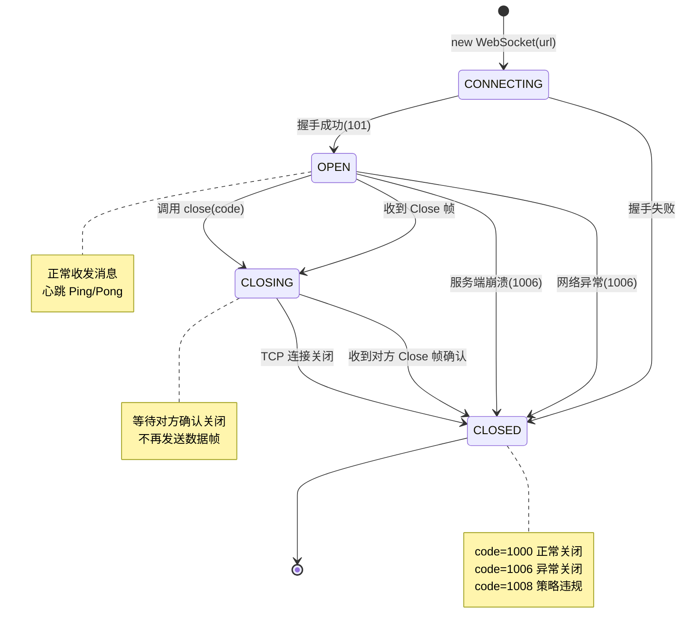

#### 代码示例

**示例 1：基础——服务端主动关闭连接并携带关闭码**

```python
"""
示例1：FastAPI WebSocket 主动关闭连接，携带不同关闭码
运行：uvicorn ws_close:app --reload
测试：前端连接后观察 close 事件的 code 和 reason
"""
from fastapi import FastAPI, WebSocket, WebSocketDisconnect
from fastapi import status

app = FastAPI(title="WebSocket 关闭码演示", version="1.0.0")


@app.websocket("/ws/normal")
async def ws_normal(websocket: WebSocket):
    """正常关闭：code=1000"""
    await websocket.accept()
    await websocket.send_text("连接已建立，3 秒后正常关闭")
    import asyncio
    await asyncio.sleep(3)
    # 正常关闭：code=1000, reason="服务端主动关闭"
    await websocket.close(code=status.WS_1000_NORMAL_CLOSURE, reason="服务端主动关闭")


@app.websocket("/ws/auth-fail")
async def ws_auth_fail(websocket: WebSocket):
    """认证失败关闭：code=1008"""
    token = websocket.query_params.get("token")
    if not token or token != "valid-token":
        # 认证失败：code=1008 策略违规
        await websocket.close(code=status.WS_1008_POLICY_VIOLATION, reason="认证失败：无效的 Token")
        return
    await websocket.accept()
    await websocket.send_text("认证成功")


@app.websocket("/ws/msg-too-big")
async def ws_msg_too_big(websocket: WebSocket):
    """消息过大关闭：code=1009"""
    await websocket.accept()
    try:
        while True:
            data = await websocket.receive_text()
            if len(data) > 1024:  # 限制 1KB
                await websocket.close(
                    code=status.WS_1009_MESSAGE_TOO_BIG,
                    reason=f"消息过大：{len(data)} 字节，限制 1024 字节"
                )
                return
            await websocket.send_text(f"收到：{data}")
    except WebSocketDisconnect:
        pass


@app.websocket("/ws/server-error")
async def ws_server_error(websocket: WebSocket):
    """服务端内部错误关闭：code=1011"""
    await websocket.accept()
    try:
        # 模拟内部错误
        raise RuntimeError("数据库连接失败")
    except Exception as e:
        await websocket.close(
            code=status.WS_1011_INTERNAL_ERROR,
            reason=f"服务端内部错误：{str(e)}"
        )


# 前端测试代码：
"""
// 正常关闭
const ws1 = new WebSocket('ws://localhost:8000/ws/normal');
ws1.onclose = (e) => console.log('关闭码:', e.code, '原因:', e.reason);
// 预期：关闭码: 1000 原因: 服务端主动关闭

// 认证失败
const ws2 = new WebSocket('ws://localhost:8000/ws/auth-fail?token=wrong');
ws2.onclose = (e) => console.log('关闭码:', e.code, '原因:', e.reason);
// 预期：关闭码: 1008 原因: 认证失败：无效的 Token

// 消息过大
const ws3 = new WebSocket('ws://localhost:8000/ws/msg-too-big');
ws3.onopen = () => ws3.send('x'.repeat(2000));
ws3.onclose = (e) => console.log('关闭码:', e.code, '原因:', e.reason);
// 预期：关闭码: 1009 原因: 消息过大：2000 字节，限制 1024 字节
"""
```

**示例 2：进阶——前端根据关闭码实现智能重连策略**

```javascript
/**
 * 示例2：前端智能 WebSocket 重连管理器
 * 根据关闭码决定是否重连、重连间隔、是否跳转登录
 */
class SmartWebSocket {
  constructor(url, options = {}) {
    this.url = url;
    this.options = options;
    this.ws = null;
    this.reconnectAttempts = 0;
    this.maxReconnectAttempts = options.maxReconnectAttempts || 10;
    this.baseDelay = options.baseDelay || 1000;
    this.maxDelay = options.maxDelay || 30000;
    this.shouldReconnect = true;
    this.manualClose = false;
    this.listeners = {};
  }

  connect() {
    this.ws = new WebSocket(this.url);

    this.ws.onopen = (event) => {
      this.reconnectAttempts = 0;
      this.emit('open', event);
    };

    this.ws.onmessage = (event) => {
      this.emit('message', event);
    };

    this.ws.onclose = (event) => {
      console.log(`WebSocket 关闭: code=${event.code}, reason=${event.reason}`);

      // 根据关闭码决定策略
      const strategy = this.getReconnectStrategy(event.code);

      if (strategy.shouldReconnect && !this.manualClose) {
        if (this.reconnectAttempts < this.maxReconnectAttempts) {
          const delay = strategy.delay || this.getExponentialDelay();
          console.log(`将在 ${delay}ms 后重连（第 ${this.reconnectAttempts + 1} 次）`);
          this.reconnectAttempts++;
          this.reconnectTimer = setTimeout(() => this.connect(), delay);
        } else {
          console.error('已达最大重连次数，停止重连');
          this.emit('maxReconnectExceeded', event);
        }
      } else if (strategy.redirect) {
        console.log(`跳转到: ${strategy.redirect}`);
        window.location.href = strategy.redirect;
      }

      this.emit('close', event);
    };

    this.ws.onerror = (event) => {
      this.emit('error', event);
    };
  }

  /**
   * 根据关闭码返回重连策略
   */
  getReconnectStrategy(code) {
    switch (code) {
      case 1000: // 正常关闭
        return { shouldReconnect: false };
      case 1001: // 端点离开（页面跳转等）
        return { shouldReconnect: false };
      case 1006: // 异常关闭（网络断开）
        return { shouldReconnect: true }; // 用指数退避
      case 1008: // 策略违规（认证失败）
        return { shouldReconnect: false, redirect: '/login' };
      case 1011: // 服务端内部错误
        return { shouldReconnect: true, delay: 5000 }; // 5 秒后重试
      case 4001: // 自定义：被踢下线
        return { shouldReconnect: false, redirect: '/kicked' };
      case 4002: // 自定义：服务维护中
        return { shouldReconnect: true, delay: 30000 }; // 30 秒后重试
      default:
        return { shouldReconnect: true };
    }
  }

  getExponentialDelay() {
    const delay = this.baseDelay * Math.pow(2, this.reconnectAttempts);
    return Math.min(delay, this.maxDelay);
  }

  send(data) {
    if (this.ws?.readyState === WebSocket.OPEN) {
      this.ws.send(typeof data === 'string' ? data : JSON.stringify(data));
    }
  }

  close(code = 1000, reason = '客户端主动关闭') {
    this.manualClose = true;
    if (this.reconnectTimer) clearTimeout(this.reconnectTimer);
    this.ws?.close(code, reason);
  }

  on(event, callback) {
    if (!this.listeners[event]) this.listeners[event] = [];
    this.listeners[event].push(callback);
  }

  emit(event, data) {
    this.listeners[event]?.forEach(cb => cb(data));
  }
}

// 使用示例
/*
const ws = new SmartWebSocket('ws://localhost:8000/ws', {
  maxReconnectAttempts: 10,
  baseDelay: 1000,
});
ws.on('open', () => console.log('已连接'));
ws.on('message', (e) => console.log('消息:', e.data));
ws.on('close', (e) => console.log('关闭:', e.code));
ws.connect();
*/
```

**示例 3：完整场景——服务端关闭码统计与监控**

```python
"""
示例3：WebSocket 关闭码统计中间件
统计各种关闭码的发生次数，用于监控和故障分析
运行：uvicorn ws_close_monitor:app --reload
"""
from fastapi import FastAPI, WebSocket, WebSocketDisconnect
from collections import defaultdict
import time
import json

app = FastAPI(title="WebSocket 关闭码监控", version="1.0.0")

# 关闭码统计
close_stats = defaultdict(int)
close_reasons = defaultdict(list)
active_connections = 0


@app.middleware("http")
async def stats_middleware(request, call_next):
    response = await call_next(request)
    return response


@app.websocket("/ws/monitored")
async def ws_monitored(websocket: WebSocket):
    global active_connections
    active_connections += 1
    await websocket.accept()

    close_code = 1006  # 默认异常关闭
    close_reason = "未知"

    try:
        while True:
            data = await websocket.receive_text()
            msg = json.loads(data)

            if msg.get("type") == "close":
                # 客户端请求关闭
                code = msg.get("code", 1000)
                reason = msg.get("reason", "客户端请求关闭")
                close_code = code
                close_reason = reason
                await websocket.close(code=code, reason=reason)
                break

            await websocket.send_text(json.dumps({"type": "echo", "content": msg.get("content", "")}))

    except WebSocketDisconnect as e:
        # Starlette 的 WebSocketDisconnect 包含 code
        close_code = e.code
        close_reason = f"WebSocketDisconnect: code={e.code}"
    except Exception as e:
        close_code = 1011
        close_reason = f"异常: {str(e)}"
    finally:
        active_connections -= 1
        close_stats[close_code] += 1
        close_reasons[close_code].append({
            "reason": close_reason,
            "time": time.strftime("%Y-%m-%d %H:%M:%S"),
        })
        # 只保留最近 100 条原因
        if len(close_reasons[close_code]) > 100:
            close_reasons[close_code] = close_reasons[close_code][-100:]


@app.get("/api/stats/close-codes")
async def get_close_stats():
    """获取关闭码统计"""
    code_names = {
        1000: "正常关闭", 1001: "端点离开", 1002: "协议错误",
        1003: "不支持数据类型", 1005: "无状态码", 1006: "异常关闭",
        1007: "数据不一致", 1008: "策略违规", 1009: "消息过大",
        1010: "缺少扩展", 1011: "服务端内部错误",
    }
    return {
        "active_connections": active_connections,
        "total_closes": sum(close_stats.values()),
        "close_codes": [
            {
                "code": code,
                "name": code_names.get(code, "自定义/未知"),
                "count": count,
                "recent_reasons": close_reasons[code][-5:],
            }
            for code, count in sorted(close_stats.items())
        ],
    }


# 预期运行结果：
# 多次连接和关闭后，访问 /api/stats/close-codes 返回：
# {
#   "active_connections": 2,
#   "total_closes": 15,
#   "close_codes": [
#     {"code": 1000, "name": "正常关闭", "count": 5, "recent_reasons": [...]},
#     {"code": 1006, "name": "异常关闭", "count": 8, "recent_reasons": [...]},
#     {"code": 1008, "name": "策略违规", "count": 2, "recent_reasons": [...]},
#   ]
# }
```

#### 使用场景与最佳实践

**适用场景**：
- 正常关闭：用户主动退出、页面关闭、会话结束
- 认证失败关闭：Token 无效/过期、权限不足
- 消息过大关闭：单条消息超过限制
- 服务端错误关闭：内部异常、依赖服务不可用
- 自定义关闭码：应用层特定场景（被踢下线、维护中、版本不兼容）

**不适用场景**：
- 网络异常断开（1006）：无法主动发送，由协议层自动检测
- TCP RST 重置：网络层强制断开，无 Close 帧

**最佳实践**：
1. **认证失败用 1008，不要用 1000**：1000 表示正常关闭，前端可能不做特殊处理；1008 明确表示策略违规，前端应跳转登录页
2. **关闭时携带 reason 短语**：便于调试和用户提示，reason 长度限制 123 字节（UTF-8）
3. **前端根据关闭码实现差异化重连**：1006 自动重连，1008 不重连跳登录，1011 延迟重连
4. **自定义关闭码用 4000-4999 范围**：3000-3999 为注册使用，4000-4999 为私有使用，推荐用 4000+
5. **统计关闭码用于监控**：1006 激增可能是网络问题，1008 激增可能是认证系统故障，1011 激增可能是服务端 bug

**性能建议**：
- 关闭连接时先发送 Close 帧再关闭 TCP，确保对方收到关闭原因
- 大量连接同时关闭时（如服务重启），分批关闭避免 CPU 峰值
- 监控 1006 异常关闭率，正常应低于 5%，超过 10% 需排查网络/代理问题

#### 常见坑点

**坑点 1：在 `accept()` 之前调用 `close()` 导致前端收不到关闭码**

- **错误现象**：认证失败时服务端调用 `websocket.close(code=1008)`，但前端 `onclose` 事件中 `code` 始终是 1006 而非 1008
- **根本原因**：WebSocket 连接尚未建立（未调用 `accept()`）时，HTTP 握手还未完成，此时调用 `close()` 实际上是关闭 HTTP 连接而非发送 WebSocket Close 帧，前端只能感知到连接异常断开（1006）
- **正确做法**：认证失败有两种方式：① 先 `accept()` 再 `close(code=1008)`（先建立连接再关闭，前端能收到 1008）；② 不调用 `accept()`，直接返回（前端收到 1006，但无法区分原因）。推荐方式①
- **预防措施**：封装认证依赖，统一处理"先 accept 再 close"的逻辑

**坑点 2：关闭码 1005/1006 被误用在 Close 帧中**

- **错误现象**：服务端调用 `websocket.close(code=1005)` 或 `code=1006`，导致协议错误或前端报异常
- **根本原因**：RFC 6455 规定 1005（无状态码）和 1006（异常关闭）是内部使用的关闭码，**不能在 Close 帧中实际发送**。1005 表示收到的 Close 帧没有状态码，1006 表示连接异常断开（没有收到 Close 帧）
- **正确做法**：正常关闭用 1000，认证失败用 1008，服务端错误用 1011，应用自定义用 4000+。永远不要主动发送 1005 或 1006
- **预防措施**：代码审查时检查 `close()` 调用的 code 参数，封装常量类禁止使用 1005/1006

---

> 💡 **深度讲解**：本章从协议层面深入解析了 WebSocket 的三大核心概念——全双工通信机制、数据帧格式、关闭码状态管理。WebSocket 的本质是"HTTP 握手 + TCP 长连接 + 帧传输"，握手阶段复用 HTTP 基础设施（代理/防火墙/负载均衡），握手后切换为高效的二进制帧协议。数据帧的位字段设计（2-14 字节头部）是高频小消息高效传输的关键，分片机制支持大消息，控制帧（Ping/Pong/Close）实现心跳和优雅关闭。关闭码则是连接生命周期管理的核心——不同关闭码对应不同的前端重连策略和服务端监控指标。理解这三个概念后，才能在后续章节中正确使用 FastAPI WebSocket API，避免常见的协议级错误。
>
> **📝 精简总结**：
> 1. WebSocket = HTTP Upgrade 握手（101）+ 全双工帧通信，对比 HTTP 轮询大幅降低开销
> 2. 数据帧：FIN+RSV+Opcode（1字节）+ MASK+PayloadLen（1字节）+ 扩展长度（0/2/8字节）+ MaskingKey（0/4字节）+ Payload
> 3. Opcode：0x1文本、0x2二进制、0x8关闭、0x9 Ping、0xA Pong，控制帧不能分片
> 4. 关闭码：1000正常、1006异常（不可主动发送）、1008策略违规、1011服务端错误、4000+自定义
> 5. 客户端帧必须掩码，服务端帧不掩码
> 6. FastAPI 三段式：accept() → try/while receive → except WebSocketDisconnect
> 7. 大文件不用 WebSocket，用 HTTP 分块传输
>
> **🎯 梯度练习题**：
> - **基础 1**：用 FastAPI 实现一个 WebSocket 回声服务，接收文本消息并原样返回
> - **基础 2**：解释 WebSocket 数据帧中 MASK 位的作用，为什么客户端必须掩码而服务端不需要
> - **基础 3**：列出至少 5 个常见 WebSocket 关闭码及其含义
> - **进阶 1**：实现一个 WebSocket 端点，限制单条消息不超过 1KB，超过时用 1009 关闭连接
> - **进阶 2**：实现前端智能重连管理器，根据关闭码（1000/1006/1008/1011）采取不同策略
> - **实战 1**：实现一个通过 WebSocket 二进制帧传输文件的完整方案（含元数据帧、数据帧、结束帧、进度反馈）

---

## 2. FastAPI WebSocket 快速上手

### 2.1 环境搭建与第一个 WebSocket 端点

#### 概念解释

**FastAPI WebSocket 端点** 是使用 `@app.websocket("/path")` 装饰器注册的异步函数，接收 `WebSocket` 对象作为参数，通过 `accept()` 建立连接、`receive_*()` 接收消息、`send_*()` 发送消息，是 FastAPI 中处理 WebSocket 通信的基本单元。

> 🏠 **生活化比喻**：WebSocket 端点就像银行的一个服务窗口——`@app.websocket("/ws")` 是挂出"窗口营业中"的牌子，`accept()` 是叫号请客户坐下，`receive_text()` 是听客户说话，`send_text()` 是窗口工作人员回答，`WebSocketDisconnect` 是客户起身离开。一个窗口（端点）同时服务一个客户（连接），多个客户需要多个窗口或排队系统（连接管理器）。

**核心价值**：仅需 10 行代码即可实现完整的 WebSocket 服务，与 FastAPI 路由、依赖注入、中间件无缝集成，原生异步支持高并发。

> 🎯 **面试高频考点 4**：FastAPI WebSocket 端点与 HTTP 端点有什么区别？
> **答**：① 装饰器不同：HTTP 用 `@app.get/post`，WebSocket 用 `@app.websocket`；② 参数不同：HTTP 端点返回响应对象，WebSocket 端点接收 `WebSocket` 对象并通过它收发消息；③ 生命周期不同：HTTP 端点处理一次请求后结束，WebSocket 端点在连接持续期间一直运行（通常是 `while True` 循环）；④ 异常处理不同：HTTP 用 `HTTPException`，WebSocket 用 `WebSocketDisconnect`；⑤ 依赖注入：两者都支持 `Depends`，但 WebSocket 的依赖在连接建立时执行一次。

#### 原理说明

FastAPI WebSocket 的核心机制是 **Starlette WebSocket 类 + asyncio 事件循环 + 路由分发**。

**为什么这样设计**：FastAPI 基于 Starlette，Starlette 提供了 `WebSocket` 类封装底层的 `websockets` 库（或 uvicorn 的内置实现），将复杂的协议细节隐藏在简单的 `accept/receive/send/close` 方法后。FastAPI 在 Starlette 之上增加了路由装饰器和依赖注入，使得 WebSocket 端点的编写体验与 HTTP 端点一致。

**技术对比**：

| 特性 | FastAPI WebSocket | 原生 websockets 库 | Flask-SocketIO |
|------|-------------------|-------------------|----------------|
| 异步支持 | 原生 async/await | 原生 async/await | 需 eventlet/gevent |
| 依赖注入 | 支持 Depends | 不支持 | 不支持 |
| 路由集成 | 与 HTTP 路由统一 | 独立服务 | 独立服务 |
| Pydantic 验证 | 支持（手动调用） | 不支持 | 不支持 |
| 自动文档 | 不生成 WebSocket 文档 | 无 | 无 |
| 学习曲线 | 低（FastAPI 开发者） | 中 | 中 |

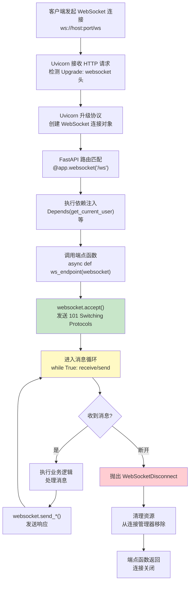

#### 代码示例

**示例 1：基础——最简 WebSocket 回声服务**

```python
"""
示例1：最简 WebSocket 回声服务
文件：ws_hello.py
运行：uvicorn ws_hello:app --reload
测试：浏览器控制台或 wscat 连接
"""
from fastapi import FastAPI, WebSocket, WebSocketDisconnect

app = FastAPI(title="第一个 WebSocket 服务", version="1.0.0")


@app.websocket("/ws")
async def websocket_endpoint(websocket: WebSocket):
    # 第1步：接受连接（必须在收发消息前调用）
    await websocket.accept()
    print("客户端已连接")

    try:
        # 第2步：消息循环——持续接收和发送
        while True:
            # 接收文本消息（协程，等待时不阻塞事件循环）
            data = await websocket.receive_text()
            print(f"收到: {data}")

            # 发送文本消息
            await websocket.send_text(f"回声: {data}")

    except WebSocketDisconnect:
        # 第3步：客户端断开时的清理
        print("客户端已断开")


# 测试方法 1：浏览器控制台
"""
const ws = new WebSocket('ws://localhost:8000/ws');
ws.onopen = () => console.log('已连接');
ws.onmessage = (e) => console.log('收到:', e.data);
ws.onclose = () => console.log('已断开');
ws.send('你好');
// 控制台输出：收到: 回声: 你好
"""

# 测试方法 2：wscat（npm install -g wscat）
"""
wscat -c ws://localhost:8000/ws
# 输入：你好
# 输出：回声: 你好
"""

# 预期运行结果：
# INFO:     Uvicorn running on http://127.0.0.1:8000
# 客户端已连接
# 收到: 你好
# 客户端已断开
```

**示例 2：进阶——带消息类型路由的 WebSocket 端点**

```python
"""
示例2：带消息类型路由的 WebSocket 端点
根据 JSON 消息的 type 字段分发到不同处理函数
运行：uvicorn ws_router:app --reload
"""
from fastapi import FastAPI, WebSocket, WebSocketDisconnect
from pydantic import BaseModel
from typing import Literal
import json
import time

app = FastAPI(title="WebSocket 消息路由", version="1.0.0")


# 定义消息模型
class ChatMessage(BaseModel):
    type: Literal["chat", "ping", "info", "broadcast"]
    content: str = ""


# 消息处理函数注册表
handlers = {}


def register_handler(msg_type: str):
    """装饰器：注册消息类型处理函数"""
    def decorator(func):
        handlers[msg_type] = func
        return func
    return decorator


@register_handler("chat")
async def handle_chat(websocket: WebSocket, data: dict):
    """处理聊天消息"""
    content = data.get("content", "")
    response = {
        "type": "chat",
        "content": f"你说: {content}",
        "timestamp": time.time(),
    }
    await websocket.send_json(response)


@register_handler("ping")
async def handle_ping(websocket: WebSocket, data: dict):
    """处理心跳 ping"""
    await websocket.send_json({"type": "pong", "timestamp": time.time()})


@register_handler("info")
async def handle_info(websocket: WebSocket, data: dict):
    """处理信息查询"""
    await websocket.send_json({
        "type": "info",
        "content": "这是一个 WebSocket 消息路由演示",
        "supported_types": list(handlers.keys()),
    })


@app.websocket("/ws/router")
async def websocket_router(websocket: WebSocket):
    await websocket.accept()
    print("客户端已连接到路由端点")

    try:
        while True:
            # 接收原始文本
            raw = await websocket.receive_text()

            try:
                # 解析 JSON
                data = json.loads(raw)
                msg_type = data.get("type")

                # 路由到对应处理函数
                if msg_type in handlers:
                    await handlers[msg_type](websocket, data)
                else:
                    await websocket.send_json({
                        "type": "error",
                        "content": f"未知的消息类型: {msg_type}",
                        "supported_types": list(handlers.keys()),
                    })

            except json.JSONDecodeError as e:
                await websocket.send_json({
                    "type": "error",
                    "content": f"JSON 解析失败: {str(e)}",
                })

    except WebSocketDisconnect:
        print("客户端已断开")


# 测试：
"""
const ws = new WebSocket('ws://localhost:8000/ws/router');
ws.onmessage = (e) => console.log(JSON.parse(e.data));

ws.send(JSON.stringify({type: 'chat', content: '你好'}));
// 输出：{type: 'chat', content: '你说: 你好', timestamp: ...}

ws.send(JSON.stringify({type: 'ping'}));
// 输出：{type: 'pong', timestamp: ...}

ws.send(JSON.stringify({type: 'info'}));
// 输出：{type: 'info', content: '...', supported_types: ['chat', 'ping', 'info']}

ws.send(JSON.stringify({type: 'unknown'}));
// 输出：{type: 'error', content: '未知的消息类型: unknown', ...}
"""
```

**示例 3：完整场景——带用户会话的 WebSocket 聊天端点**

```python
"""
示例3：带用户会话的 WebSocket 聊天端点
支持用户名设置、在线用户列表、广播消息
运行：uvicorn ws_chat_basic:app --reload
"""
from fastapi import FastAPI, WebSocket, WebSocketDisconnect
from typing import Dict, List
import asyncio
import json
import time

app = FastAPI(title="基础聊天室", version="1.0.0")


class ChatRoom:
    """简单聊天室：管理连接和广播"""

    def __init__(self):
        self.connections: Dict[str, WebSocket] = {}  # username -> websocket
        self.lock = asyncio.Lock()

    async def join(self, username: str, websocket: WebSocket):
        """用户加入聊天室"""
        async with self.lock:
            self.connections[username] = websocket
        # 通知所有人有新用户加入
        await self.broadcast({
            "type": "system",
            "content": f"{username} 加入了聊天室",
            "users": list(self.connections.keys()),
            "timestamp": time.time(),
        })

    async def leave(self, username: str):
        """用户离开聊天室"""
        async with self.lock:
            self.connections.pop(username, None)
        # 通知所有人有用户离开
        await self.broadcast({
            "type": "system",
            "content": f"{username} 离开了聊天室",
            "users": list(self.connections.keys()),
            "timestamp": time.time(),
        })

    async def broadcast(self, message: dict, exclude: str = None):
        """广播消息给所有人"""
        disconnected = []
        for username, ws in self.connections.items():
            if username == exclude:
                continue
            try:
                await ws.send_json(message)
            except Exception:
                disconnected.append(username)
        # 清理已断开的连接
        for username in disconnected:
            self.connections.pop(username, None)

    async def send_to_user(self, username: str, message: dict):
        """发送消息给指定用户"""
        ws = self.connections.get(username)
        if ws:
            try:
                await ws.send_json(message)
            except Exception:
                self.connections.pop(username, None)


chat_room = ChatRoom()


@app.websocket("/ws/chat")
async def websocket_chat(websocket: WebSocket):
    # 从 query 参数获取用户名
    username = websocket.query_params.get("username", "匿名用户")
    await websocket.accept()

    # 加入聊天室
    await chat_room.join(username, websocket)
    print(f"{username} 加入聊天室，当前在线: {list(chat_room.connections.keys())}")

    try:
        while True:
            data = await websocket.receive_text()
            message = json.loads(data)
            msg_type = message.get("type")

            if msg_type == "chat":
                # 广播聊天消息
                await chat_room.broadcast({
                    "type": "chat",
                    "username": username,
                    "content": message.get("content", ""),
                    "timestamp": time.time(),
                }, exclude=username)  # 不发给自己（自己本地已显示）

                # 发送发送确认给发送者
                await websocket.send_json({
                    "type": "sent",
                    "timestamp": time.time(),
                })

            elif msg_type == "whisper":
                # 私聊
                target = message.get("to")
                await chat_room.send_to_user(target, {
                    "type": "whisper",
                    "from": username,
                    "content": message.get("content", ""),
                    "timestamp": time.time(),
                })

            elif msg_type == "users":
                # 查询在线用户
                await websocket.send_json({
                    "type": "users",
                    "users": list(chat_room.connections.keys()),
                })

    except WebSocketDisconnect:
        await chat_room.leave(username)
        print(f"{username} 离开聊天室，当前在线: {list(chat_room.connections.keys())}")


# 测试：打开两个浏览器标签页
"""
// 标签页 1（用户 Alice）：
const ws1 = new WebSocket('ws://localhost:8000/ws/chat?username=Alice');
ws1.onmessage = (e) => console.log('Alice:', JSON.parse(e.data));

// 标签页 2（用户 Bob）：
const ws2 = new WebSocket('ws://localhost:8000/ws/chat?username=Bob');
ws2.onmessage = (e) => console.log('Bob:', JSON.parse(e.data));

// Alice 发送消息：
ws1.send(JSON.stringify({type: 'chat', content: '大家好！'}));
// Bob 控制台：{type: 'chat', username: 'Alice', content: '大家好！'}

// Alice 私聊 Bob：
ws1.send(JSON.stringify({type: 'whisper', to: 'Bob', content: '这是私聊'}));
// Bob 控制台：{type: 'whisper', from: 'Alice', content: '这是私聊'}
"""
```

#### 使用场景与最佳实践

**适用场景**：
- 回声服务：学习和测试 WebSocket 基础
- 消息路由：根据 type 字段分发到不同处理逻辑
- 聊天室：多用户实时聊天、广播、私聊
- 实时通知：服务端主动推送消息给客户端
- 状态同步：游戏状态、协作编辑、仪表盘数据

**不适用场景**：
- 单次请求-响应：用 HTTP REST 更简单
- 大文件传输：用 HTTP 分块上传
- 需要离线消息：用消息队列 + HTTP 拉取
- 跨域复杂场景：WebSocket 跨域需要配置 Origin 校验

**最佳实践**：
1. **始终使用三段式结构**：`accept()` → `try: while True: receive/send` → `except WebSocketDisconnect: cleanup`
2. **JSON 消息统一格式**：`{"type": "xxx", "content/payload": ..., "timestamp": ...}`，便于路由和扩展
3. **发送消息 try-except**：连接可能在发送时断开，未捕获异常会中断整个端点
4. **用户名/用户 ID 从 query 参数或首条消息获取**：WebSocket 不支持自定义 Header，认证 Token 放 query 或首条消息
5. **连接数监控**：记录当前活跃连接数，设置上限防止资源耗尽

**性能建议**：
- 单个 Uvicorn worker 可处理数千到数万 WebSocket 连接（取决于消息频率和服务器配置）
- 消息处理逻辑尽量轻量，耗时操作放到异步任务（Celery/asyncio.create_task）
- 广播时遍历连接列表，避免在锁内执行耗时操作

#### 常见坑点

**坑点 1：在 WebSocket 端点中返回值导致连接异常**

- **错误现象**：WebSocket 端点函数中 `return` 了一个值（如 `return {"status": "ok"}`），导致连接立即断开或前端收到异常数据
- **根本原因**：WebSocket 端点不像 HTTP 端点那样有返回值概念。端点函数返回意味着函数执行结束，连接随之关闭。返回值会被 Starlette 忽略或导致协议错误
- **正确做法**：WebSocket 端点通过 `websocket.send_*()` 发送数据，不要 `return` 任何值。需要发送初始数据时在 `accept()` 后立即 `send_json()`
- **预防措施**：代码模板中 WebSocket 端点的最后一行是 `except WebSocketDisconnect` 后的清理，不写 return

**坑点 2：多个 WebSocket 端点共享全局变量导致数据竞争**

- **错误现象**：多个端点共享全局连接列表，高并发下出现连接丢失、重复发送、KeyError 等异常
- **根本原因**：asyncio 是单线程并发，但 `await` 点会切换协程。如果在 `await` 前后修改共享数据结构（如 `connections.append(ws)` 后 `await ws.send()`，另一个协程可能在 `await` 期间修改列表），会导致数据竞争
- **正确做法**：使用 `asyncio.Lock` 保护共享数据结构的修改，或使用线程安全的数据结构。连接管理器的 `connect/disconnect/broadcast` 方法都应在锁内修改连接列表
- **预防措施**：封装连接管理器类，所有对连接列表的修改都通过管理器方法，内部用 `asyncio.Lock` 保护

---

### 2.2 WebSocket 对象的核心 API 详解

#### 概念解释

**WebSocket 对象** 是 Starlette 提供的封装类，代表一个已建立或正在建立的 WebSocket 连接，提供 `accept()`、`receive_text()`、`receive_json()`、`receive_bytes()`、`send_text()`、`send_json()`、`send_bytes()`、`close()` 等核心方法，以及 `url`、`headers`、`query_params`、`client` 等属性，是 FastAPI WebSocket 编程的核心操作对象。

> 🏠 **生活化比喻**：WebSocket 对象就像电话听筒——`accept()` 是按下接听键，`receive_text()` 是听对方说话，`send_text()` 是对着话筒说话，`close()` 是挂断电话，`query_params` 是来电显示（看到对方号码/身份），`headers` 是通话背景音（网络环境信息）。拿起听筒（端点函数被调用）后，必须先按接听（accept），然后才能通话（收发消息），最后挂断（close 或异常断开）。

**核心价值**：将复杂的 WebSocket 协议细节封装为简单的异步方法，开发者无需关心帧格式、掩码、分片等底层细节，专注于业务逻辑。

> 🎯 **面试高频考点 5**：`receive_text()`、`receive_json()`、`receive_bytes()` 有什么区别？`receive()` 返回什么？
> **答**：`receive_text()` 接收文本帧并返回 str，`receive_json()` 接收文本帧并自动 `json.loads()` 返回 dict，`receive_bytes()` 接收二进制帧并返回 bytes。`receive()` 是底层方法，返回原始消息字典 `{"type": "text"/"bytes"/"websocket.disconnect", "text"/"bytes"/"code": ...}`，可用于统一处理所有类型的消息和断开事件。如果用 `receive_text()` 收到二进制帧会抛异常，反之亦然。

#### 原理说明

WebSocket 对象的核心机制是 **Starlette 协议适配器 + 异步队列 + 状态机**。

**为什么这样设计**：Starlette 将 Uvicorn 的 ASGI WebSocket 协议封装为 `WebSocket` 类，内部维护一个消息队列（`receive` 通道）和发送通道（`send` 通道）。`accept/receive/send/close` 方法本质上是向 ASGI 协议发送特定类型的消息，协议层处理实际的网络 IO。异步方法使得 IO 等待时不阻塞事件循环，支持高并发。

**技术对比**：

| 方法 | 接收/发送 | 返回类型 | 帧类型 | 异常 |
|------|----------|---------|--------|------|
| `accept()` | - | None | - | 连接已建立时 |
| `receive_text()` | 接收 | str | 文本帧 | 二进制帧/断开 |
| `receive_json()` | 接收 | dict | 文本帧 | JSON 错误/断开 |
| `receive_bytes()` | 接收 | bytes | 二进制帧 | 文本帧/断开 |
| `receive()` | 接收 | dict | 任意 | - |
| `send_text(data)` | 发送 | None | 文本帧 | 连接已断开 |
| `send_json(data)` | 发送 | None | 文本帧 | 序列化错误/断开 |
| `send_bytes(data)` | 发送 | None | 二进制帧 | 连接已断开 |
| `close(code, reason)` | 发送 | None | Close 帧 | 连接已断开 |

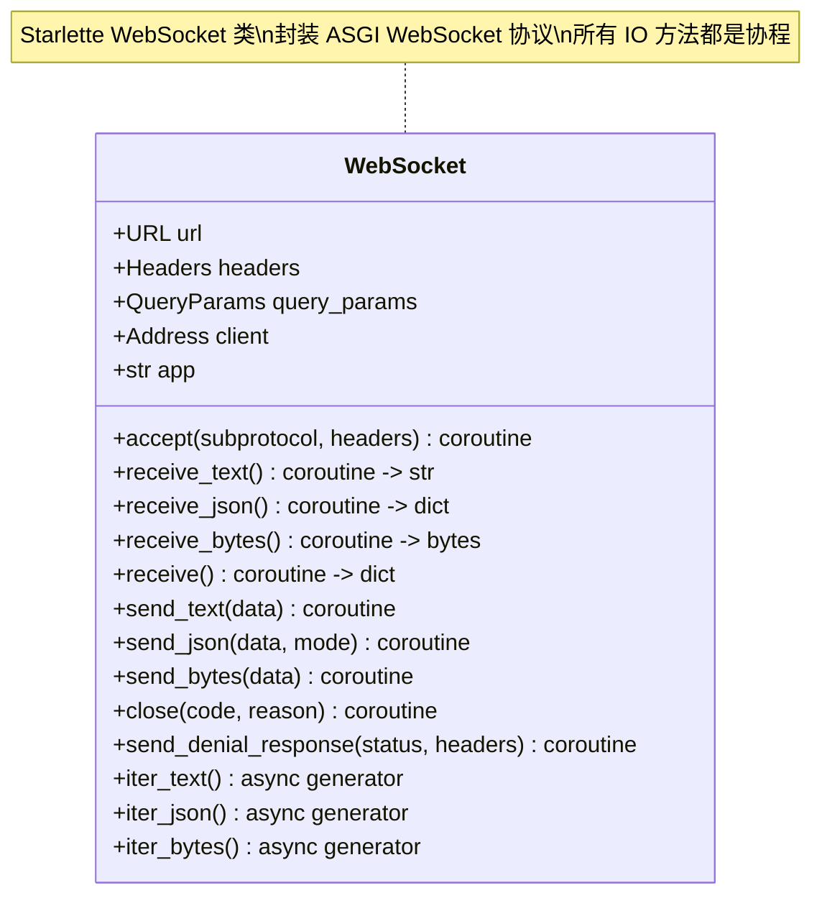

#### 代码示例

**示例 1：基础——WebSocket 对象所有核心方法演示**

```python
"""
示例1：WebSocket 对象核心方法完整演示
运行：uvicorn ws_api_demo:app --reload
"""
from fastapi import FastAPI, WebSocket, WebSocketDisconnect
from fastapi import status
import json

app = FastAPI(title="WebSocket API 演示", version="1.0.0")


@app.websocket("/ws/api-demo")
async def ws_api_demo(websocket: WebSocket):
    # ===== 属性演示 =====
    print("=== WebSocket 对象属性 ===")
    print(f"url: {websocket.url}")           # 完整 URL
    print(f"path: {websocket.url.path}")     # 路径
    print(f"headers: {dict(websocket.headers)}")  # 请求头
    print(f"query_params: {dict(websocket.query_params)}")  # 查询参数
    print(f"client: {websocket.client}")     # 客户端地址 (host, port)

    # 从 query_params 获取用户信息
    user_id = websocket.query_params.get("user_id", "guest")
    token = websocket.query_params.get("token", "")

    # ===== accept 演示 =====
    # 可以指定子协议和响应头
    await websocket.accept(
        subprotocol=None,  # 子协议，如 "chat.v1"
        headers={"X-Server": "FastAPI WebSocket Demo"},
    )
    print(f"连接已建立，user_id={user_id}")

    try:
        # ===== receive_text 演示 =====
        await websocket.send_text("请发送一条文本消息")
        text_data = await websocket.receive_text()
        print(f"receive_text 收到: {text_data}")
        await websocket.send_text(f"文本消息已收到: {text_data}")

        # ===== receive_json 演示 =====
        await websocket.send_text("请发送一条 JSON 消息")
        json_data = await websocket.receive_json()
        print(f"receive_json 收到: {json_data}")
        await websocket.send_json({"received": True, "data": json_data})

        # ===== receive_bytes 演示 =====
        await websocket.send_text("请发送二进制数据")
        bytes_data = await websocket.receive_bytes()
        print(f"receive_bytes 收到: {len(bytes_data)} 字节")
        await websocket.send_bytes(f"收到 {len(bytes_data)} 字节二进制数据".encode())

        # ===== receive 底层方法演示 =====
        await websocket.send_text("请发送任意消息（演示 receive 底层方法）")
        raw_message = await websocket.receive()
        print(f"receive 原始消息: {raw_message}")
        # raw_message 格式：{"type": "text", "text": "..."}
        #              或 {"type": "bytes", "bytes": b"..."}
        #              或 {"type": "websocket.disconnect", "code": 1000}

        if raw_message["type"] == "text":
            await websocket.send_text(f"receive 底层方法收到文本: {raw_message['text']}")
        elif raw_message["type"] == "bytes":
            await websocket.send_text(f"receive 底层方法收到二进制: {len(raw_message['bytes'])} 字节")

        # ===== close 演示 =====
        await websocket.send_text("演示完毕，3 秒后关闭连接")
        import asyncio
        await asyncio.sleep(3)
        await websocket.close(code=status.WS_1000_NORMAL_CLOSURE, reason="演示完毕")

    except WebSocketDisconnect as e:
        print(f"连接断开: code={e.code}")


# 预期运行结果（服务端日志）：
# === WebSocket 对象属性 ===
# url: http://localhost:8000/ws/api-demo?user_id=123
# path: /ws/api-demo
# query_params: {'user_id': '123', 'token': 'abc'}
# client: Address(host='127.0.0.1', port=54321)
# 连接已建立，user_id=123
# receive_text 收到: 你好
# receive_json 收到: {'type': 'test', 'value': 42}
# receive_bytes 收到: 16 字节
# receive 原始消息: {'type': 'text', 'text': '最后一条'}
```

**示例 2：进阶——使用 iter_text/iter_json 异步生成器简化消息循环**

```python
"""
示例2：使用 iter_text / iter_json 异步生成器简化消息循环
Starlette 0.37+ 提供 iter_text/iter_json/iter_bytes 方法
运行：uvicorn ws_iter_demo:app --reload
"""
from fastapi import FastAPI, WebSocket, WebSocketDisconnect
import json
import time

app = FastAPI(title="WebSocket 迭代器演示", version="1.0.0")


@app.websocket("/ws/iter-text")
async def ws_iter_text(websocket: WebSocket):
    """使用 iter_text 简化文本消息循环"""
    await websocket.accept()

    try:
        # iter_text 返回异步生成器，自动处理断开
        async for text in websocket.iter_text():
            print(f"收到文本: {text}")
            await websocket.send_text(f"处理结果: {text.upper()}")
    except WebSocketDisconnect:
        print("客户端断开")

    # 等价于传统写法：
    # try:
    #     while True:
    #         text = await websocket.receive_text()
    #         ...
    # except WebSocketDisconnect:
    #     pass


@app.websocket("/ws/iter-json")
async def ws_iter_json(websocket: WebSocket):
    """使用 iter_json 简化 JSON 消息循环，带类型路由"""
    await websocket.accept()

    try:
        async for message in websocket.iter_json():
            msg_type = message.get("type", "unknown")

            if msg_type == "echo":
                await websocket.send_json({
                    "type": "echo",
                    "content": message.get("content", ""),
                    "timestamp": time.time(),
                })

            elif msg_type == "sum":
                numbers = message.get("numbers", [])
                result = sum(numbers)
                await websocket.send_json({
                    "type": "result",
                    "operation": "sum",
                    "input": numbers,
                    "result": result,
                })

            elif msg_type == "ping":
                await websocket.send_json({"type": "pong", "timestamp": time.time()})

            else:
                await websocket.send_json({
                    "type": "error",
                    "content": f"未知类型: {msg_type}",
                })

    except WebSocketDisconnect:
        print("客户端断开")
    except json.JSONDecodeError as e:
        # iter_json 内部解析失败会抛异常
        await websocket.send_json({"type": "error", "content": f"JSON 解析失败: {e}"})


@app.websocket("/ws/iter-mixed")
async def ws_iter_mixed(websocket: WebSocket):
    """使用 receive() 统一处理文本和二进制消息"""
    await websocket.accept()

    try:
        while True:
            message = await websocket.receive()

            if message["type"] == "websocket.disconnect":
                break

            elif message["type"] == "text":
                text = message["text"]
                print(f"文本消息: {text}")
                await websocket.send_text(f"收到文本: {text}")

            elif message["type"] == "bytes":
                data = message["bytes"]
                print(f"二进制消息: {len(data)} 字节")
                await websocket.send_bytes(f"收到二进制: {len(data)} 字节".encode())

    except WebSocketDisconnect:
        pass
    finally:
        print("连接已关闭")


# 测试：
"""
// iter-text 测试
const ws = new WebSocket('ws://localhost:8000/ws/iter-text');
ws.onmessage = (e) => console.log(e.data);
ws.send('hello');  // 输出：处理结果: HELLO

// iter-json 测试
const ws2 = new WebSocket('ws://localhost:8000/ws/iter-json');
ws2.onmessage = (e) => console.log(JSON.parse(e.data));
ws2.send(JSON.stringify({type: 'sum', numbers: [1,2,3,4,5]}));
// 输出：{type: 'result', operation: 'sum', input: [1,2,3,4,5], result: 15}
"""
```

**示例 3：完整场景——子协议协商与自定义响应头**

```python
"""
示例3：WebSocket 子协议协商与自定义响应头
客户端通过 Sec-WebSocket-Protocol 头请求子协议，服务端选择并返回
运行：uvicorn ws_subprotocol:app --reload
"""
from fastapi import FastAPI, WebSocket, WebSocketDisconnect
from typing import Optional

app = FastAPI(title="WebSocket 子协议演示", version="1.0.0")

# 支持的子协议
SUPPORTED_PROTOCOLS = ["chat.v1", "chat.v2", "json.api"]


@app.websocket("/ws/negotiate")
async def ws_negotiate(websocket: WebSocket):
    """子协议协商：从客户端请求的子协议中选择一个"""
    # 获取客户端请求的子协议列表
    requested_protocols = websocket.headers.get("sec-websocket-protocol", "")
    requested_list = [p.strip() for p in requested_protocols.split(",") if p.strip()]

    print(f"客户端请求的子协议: {requested_list}")

    # 选择服务端支持的子协议（优先选择高版本）
    selected_protocol = None
    for proto in reversed(SUPPORTED_PROTOCOLS):
        if proto in requested_list:
            selected_protocol = proto
            break

    if selected_protocol is None and requested_list:
        # 客户端请求了子协议但服务端都不支持
        # 可以拒绝连接或不指定子协议
        print(f"不支持客户端请求的子协议: {requested_list}")
        await websocket.close(code=1002, reason="不支持的子协议")
        return

    # 接受连接，指定选择的子协议
    await websocket.accept(
        subprotocol=selected_protocol,
        headers={
            "X-Protocol-Version": selected_protocol or "none",
            "X-Server-Name": "FastAPI WebSocket Server",
        },
    )

    print(f"已选择子协议: {selected_protocol}")

    try:
        # 根据子协议版本使用不同的消息格式
        if selected_protocol == "chat.v2":
            # v2 协议：带消息 ID 和时间戳的格式
            async for message in websocket.iter_json():
                response = {
                    "id": message.get("id", 0),
                    "type": "response",
                    "content": f"[v2] 收到: {message.get('content', '')}",
                    "timestamp": __import__("time").time(),
                }
                await websocket.send_json(response)

        elif selected_protocol == "chat.v1":
            # v1 协议：简单文本格式
            async for text in websocket.iter_text():
                await websocket.send_text(f"[v1] 收到: {text}")

        elif selected_protocol == "json.api":
            # JSON API 协议：标准 JSON-RPC 风格
            async for message in websocket.iter_json():
                response = {
                    "jsonrpc": "2.0",
                    "id": message.get("id"),
                    "result": {"echo": message.get("params", {})},
                }
                await websocket.send_json(response)

        else:
            # 无子协议：默认文本
            async for text in websocket.iter_text():
                await websocket.send_text(f"收到: {text}")

    except WebSocketDisconnect:
        print(f"客户端断开（子协议: {selected_protocol}）")


# 前端测试：
"""
// 请求 v2 子协议
const ws = new WebSocket('ws://localhost:8000/ws/negotiate', ['chat.v2', 'chat.v1']);
console.log('协商后的子协议:', ws.protocol);  // 输出：chat.v2
ws.onmessage = (e) => console.log(JSON.parse(e.data));
ws.send(JSON.stringify({id: 1, content: '你好 v2'}));

// 请求不支持的子协议
const ws2 = new WebSocket('ws://localhost:8000/ws/negotiate', ['unknown.protocol']);
ws2.onclose = (e) => console.log('关闭码:', e.code, e.reason);  // 输出：1002 不支持的子协议
"""
```

#### 使用场景与最佳实践

**适用场景**：
- `receive_text/send_text`：简单文本消息、调试
- `receive_json/send_json`：结构化消息、聊天、指令
- `receive_bytes/send_bytes`：文件传输、二进制数据、图片/音频
- `receive()`：需要统一处理多种消息类型、自定义断开处理
- `iter_text/iter_json/iter_bytes`：简化消息循环，自动处理断开
- 子协议：多版本 API 兼容、协议升级、不同客户端类型区分

**不适用场景**：
- `receive_json` 用于非 JSON 文本：会抛 JSONDecodeError
- `receive_text` 用于二进制：会抛异常
- 子协议用于简单应用：增加复杂度，不必要

**最佳实践**：
1. **优先使用 `iter_json()` 替代 `while True + receive_json()`**：代码更简洁，自动处理断开异常
2. **`send_json()` 的 `mode` 参数**：默认 `"text"`（文本帧），可选 `"binary"`（二进制帧），大数据用 binary 更高效
3. **子协议用于版本管理**：API 升级时通过子协议区分 v1/v2，避免破坏旧客户端
4. **`close()` 前确保已 `accept()`**：未 accept 时 close 不会发送 Close 帧
5. **`query_params` 用于传递简单参数**：如 user_id、token，不要传递大量数据

**性能建议**：
- `send_json()` 内部调用 `json.dumps()`，高频消息可预序列化或用 `orjson` 提升性能
- `iter_json()` 每次调用 `json.loads()`，高频小消息可用 `receive_text()` + 手动解析
- 二进制帧比文本帧节省约 30% 带宽，大量数据传输用 binary

#### 常见坑点

**坑点 1：`receive_json()` 收到非 JSON 消息导致连接断开**

- **错误现象**：客户端偶尔发送纯文本（如心跳 "ping"），服务端用 `receive_json()` 接收，抛出 `json.JSONDecodeError`，未捕获导致端点函数异常退出，连接断开
- **根本原因**：`receive_json()` 内部调用 `json.loads(text)`，如果消息不是合法 JSON 会抛异常。异常未被 `except WebSocketDisconnect` 捕获（因为不是 WebSocketDisconnect），导致函数异常退出
- **正确做法**：① 统一消息格式，所有消息都是 JSON（心跳也用 `{"type": "ping"}`）；② 或用 `receive_text()` + `try/except json.JSONDecodeError` 手动处理；③ 或在 `except WebSocketDisconnect` 后加 `except Exception` 捕获其他异常
- **预防措施**：协议设计时明确所有消息都是 JSON 格式，文档中注明

**坑点 2：在 `accept()` 之前访问 `websocket.headers` 导致属性不存在**

- **错误现象**：在端点函数开头、`accept()` 之前访问 `websocket.headers` 或 `websocket.query_params`，报 `AttributeError` 或返回空
- **根本原因**：实际上 Starlette 的 WebSocket 对象在端点函数被调用时已经有 `headers` 和 `query_params` 属性（来自握手请求），但某些属性（如 `subprotocol`）需要在 `accept()` 后才有值。不同版本行为可能不同
- **正确做法**：`headers`、`query_params`、`url`、`client` 可以在 `accept()` 之前访问（它们来自握手请求）；但 `accept()` 应尽早调用，避免连接挂起。需要认证时，先从 `query_params` 取 token 验证，再 `accept()` 或 `close()`
- **预防措施**：代码模板中先读取需要的属性（认证用），然后立即 `accept()` 或 `close()`

---

> 💡 **深度讲解**：本章完成了从协议原理到实际编码的过渡。FastAPI WebSocket 端点的核心是 `@app.websocket` 装饰器 + `WebSocket` 对象 + 三段式结构（accept → 消息循环 → 断开处理）。WebSocket 对象封装了所有协议细节，提供 `accept/receive_text/receive_json/receive_bytes/send_text/send_json/send_bytes/close` 等异步方法，以及 `iter_text/iter_json/iter_bytes` 等便捷的异步生成器。子协议协商机制支持多版本 API 兼容，自定义响应头支持传递额外信息。掌握这些 API 后，可以构建各种实时应用——从简单的回声服务到复杂的多用户聊天室。下一章将深入连接管理器，这是构建多客户端实时应用的核心基础设施。
>
> **📝 精简总结**：
> 1. WebSocket 端点三段式：`accept()` → `try: while True/async for: receive/send` → `except WebSocketDisconnect: cleanup`
> 2. `receive_text()` 返回 str，`receive_json()` 返回 dict，`receive_bytes()` 返回 bytes，`receive()` 返回原始消息字典
> 3. `iter_text()/iter_json()/iter_bytes()` 是异步生成器，简化消息循环
> 4. `send_json(data, mode="text"/"binary")` 支持文本帧和二进制帧
> 5. 子协议通过 `Sec-WebSocket-Protocol` 头协商，`accept(subprotocol=...)` 指定
> 6. WebSocket 端点不要 return 值，通过 send_* 发送数据
> 7. 共享全局变量用 `asyncio.Lock` 保护
>
> **🎯 梯度练习题**：
> - **基础 1**：用 `iter_json()` 实现一个 WebSocket 计算器，支持 `{"type": "add", "a": 1, "b": 2}` 格式
> - **基础 2**：解释 `receive()` 方法返回的字典结构，列出三种可能的 type 值
> - **基础 3**：实现一个 WebSocket 端点，从 query_params 获取 username，连接后发送欢迎消息
> - **进阶 1**：实现子协议协商，支持 `chat.v1`（文本格式）和 `chat.v2`（JSON 格式）两种协议
> - **进阶 2**：用 `receive()` 底层方法实现一个同时支持文本和二进制消息的端点
> - **实战 1**：实现一个完整的基础聊天室，支持用户加入/离开通知、广播消息、私聊、在线用户列表查询

---

## 第二篇 进阶篇：核心技能与深度原理

---

## 3. WebSocket 连接管理器深度实战

### 3.1 连接管理器的设计原理与实现

#### 概念解释

**WebSocket 连接管理器（Connection Manager）** 是负责维护所有活跃 WebSocket 连接生命周期的核心组件，提供连接注册（connect）、注销（disconnect）、点对点发送（send_to_user）、广播（broadcast）等能力，是构建多用户实时应用的基础设施。

> 🏠 **生活化比喻**：连接管理器就像餐厅的前台接待——`connect()` 是给客人安排座位并登记桌号，`connections` 字典是座位表（桌号→客人），`broadcast()` 是服务员拿着话筒向所有餐桌广播通知，`send_to_user()` 是服务员把菜品送到指定桌号，`disconnect()` 是客人离开后前台擦掉桌号登记。没有前台接待，餐厅就会混乱——不知道谁在店里、菜送错桌、离开的客人还占着座位（内存泄漏）。

**核心价值**：将连接管理逻辑从业务端点中抽离，统一处理连接注册/注销/发送，保证并发安全，避免内存泄漏，是多客户端实时应用的必备组件。

> 🎯 **面试高频考点 6**：为什么需要连接管理器？单机和多实例的连接管理器有什么区别？
> **答**：WebSocket 连接建立后，服务端需要保存连接对象才能主动推送消息。连接管理器统一管理连接的注册/注销/发送，避免每个端点各自维护连接导致的重复代码和资源泄漏。单机场景用内存数据结构（Dict/List）保存连接，`asyncio.Lock` 保护并发修改；多实例场景下内存无法跨实例共享，需要引入 Redis Pub/Sub 或消息队列作为消息总线——本地连接直接发送，跨实例连接通过 Redis 发布消息，其他实例订阅后转发给本地连接。

#### 原理说明

连接管理器的核心机制是 **内存数据结构 + 异步锁 + 生命周期管理**。

**为什么这样设计**：WebSocket 连接是有状态的——连接建立后必须保存 `WebSocket` 对象才能后续主动推送。单机场景下，内存中的 `Dict[str, List[WebSocket]]` 是最高效的存储方式（O(1) 查找）。`asyncio.Lock` 保护并发修改，因为 `await` 点会切换协程，多个协程可能同时修改连接列表。发送消息时必须 try-except，因为连接可能在发送过程中断开。

**技术对比**：

| 数据结构 | 查找 | 插入/删除 | 适用场景 |
|---------|------|----------|---------|
| `List[WebSocket]` | O(n) | O(1)/O(n) | 简单广播，不需要点对点 |
| `Dict[str, WebSocket]` | O(1) | O(1) | 单端登录，user_id→连接 |
| `Dict[str, List[WebSocket]]` | O(1) | O(1) | 多端登录，user_id→连接列表 |
| `Dict[str, Dict[str, WebSocket]]` | O(1) | O(1) | 房间管理，room_id→user_id→连接 |

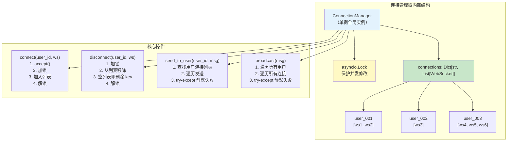

#### 代码示例

**示例 1：基础——最简连接管理器（广播 + 点对点）**

```python
"""
示例1：最简 WebSocket 连接管理器
支持：连接注册/注销、广播、点对点发送
运行：uvicorn ws_manager_basic:app --reload
"""
from fastapi import FastAPI, WebSocket, WebSocketDisconnect
from typing import Dict, List
import asyncio
import json

app = FastAPI(title="基础连接管理器", version="1.0.0")


class ConnectionManager:
    """WebSocket 连接管理器：维护所有活跃连接"""

    def __init__(self):
        # 所有连接的列表（用于广播）
        self.active_connections: List[WebSocket] = []
        # 按用户 ID 分组（用于点对点发送，支持多端登录）
        self.user_connections: Dict[str, List[WebSocket]] = {}
        # 异步锁，保护并发修改
        self.lock = asyncio.Lock()

    async def connect(self, user_id: str, websocket: WebSocket):
        """注册新连接"""
        await websocket.accept()
        async with self.lock:
            self.active_connections.append(websocket)
            if user_id not in self.user_connections:
                self.user_connections[user_id] = []
            self.user_connections[user_id].append(websocket)
        print(f"用户 {user_id} 连接，当前总连接数: {len(self.active_connections)}")

    async def disconnect(self, user_id: str, websocket: WebSocket):
        """注销连接"""
        async with self.lock:
            if websocket in self.active_connections:
                self.active_connections.remove(websocket)
            if user_id in self.user_connections:
                if websocket in self.user_connections[user_id]:
                    self.user_connections[user_id].remove(websocket)
                if not self.user_connections[user_id]:
                    del self.user_connections[user_id]
        print(f"用户 {user_id} 断开，当前总连接数: {len(self.active_connections)}")

    async def send_personal_message(self, message: dict, websocket: WebSocket):
        """发送消息给单个连接"""
        try:
            await websocket.send_json(message)
        except Exception:
            # 连接已断开，静默失败
            pass

    async def broadcast(self, message: dict):
        """广播消息给所有连接"""
        disconnected = []
        for connection in self.active_connections:
            try:
                await connection.send_json(message)
            except Exception:
                disconnected.append(connection)
        # 清理已断开的连接
        if disconnected:
            async with self.lock:
                for conn in disconnected:
                    if conn in self.active_connections:
                        self.active_connections.remove(conn)
                    for uid, conns in self.user_connections.items():
                        if conn in conns:
                            conns.remove(conn)
                            if not conns:
                                del self.user_connections[uid]

    async def send_to_user(self, user_id: str, message: dict):
        """发送消息给指定用户的所有端（多端登录）"""
        if user_id in self.user_connections:
            disconnected = []
            for ws in self.user_connections[user_id]:
                try:
                    await ws.send_json(message)
                except Exception:
                    disconnected.append(ws)
            if disconnected:
                async with self.lock:
                    for ws in disconnected:
                        if ws in self.user_connections[user_id]:
                            self.user_connections[user_id].remove(ws)
                    if not self.user_connections[user_id]:
                        del self.user_connections[user_id]

    @property
    def connection_count(self) -> int:
        """当前活跃连接数"""
        return len(self.active_connections)

    @property
    def online_users(self) -> List[str]:
        """当前在线用户 ID 列表"""
        return list(self.user_connections.keys())


# 全局单例
manager = ConnectionManager()


@app.websocket("/ws/{user_id}")
async def websocket_endpoint(websocket: WebSocket, user_id: str):
    await manager.connect(user_id, websocket)

    # 通知所有人有新用户加入
    await manager.broadcast({
        "type": "system",
        "content": f"用户 {user_id} 加入",
        "online_users": manager.online_users,
    })

    try:
        while True:
            data = await websocket.receive_text()
            message = json.loads(data)
            msg_type = message.get("type")

            if msg_type == "broadcast":
                # 广播消息
                await manager.broadcast({
                    "type": "chat",
                    "from": user_id,
                    "content": message.get("content", ""),
                })

            elif msg_type == "private":
                # 私聊消息
                target = message.get("to")
                await manager.send_to_user(target, {
                    "type": "private",
                    "from": user_id,
                    "content": message.get("content", ""),
                })

            elif msg_type == "online":
                # 查询在线用户
                await manager.send_personal_message({
                    "type": "online",
                    "users": manager.online_users,
                }, websocket)

    except WebSocketDisconnect:
        await manager.disconnect(user_id, websocket)
        # 通知所有人有用户离开
        await manager.broadcast({
            "type": "system",
            "content": f"用户 {user_id} 离开",
            "online_users": manager.online_users,
        })


@app.get("/api/stats")
async def get_stats():
    """获取连接统计信息"""
    return {
        "total_connections": manager.connection_count,
        "online_users": manager.online_users,
        "user_count": len(manager.online_users),
    }


# 预期运行结果：
# 用户 alice 连接，当前总连接数: 1
# 用户 bob 连接，当前总连接数: 2
# 访问 /api/stats 返回：{"total_connections": 2, "online_users": ["alice", "bob"], "user_count": 2}
```

**示例 2：进阶——带连接数限制和消息队列的连接管理器**

```python
"""
示例2：生产级连接管理器
特性：连接数限制、单用户连接数限制、消息队列、优雅关闭
运行：uvicorn ws_manager_pro:app --reload
"""
from fastapi import FastAPI, WebSocket, WebSocketDisconnect
from typing import Dict, List, Optional
from collections import deque
import asyncio
import json
import time

app = FastAPI(title="生产级连接管理器", version="2.0.0")

MAX_TOTAL_CONNECTIONS = 10000  # 最大总连接数
MAX_CONNECTIONS_PER_USER = 5   # 单用户最大连接数（多端登录上限）
MESSAGE_QUEUE_MAX = 100        # 每个连接的消息队列上限


class ProConnectionManager:
    """生产级 WebSocket 连接管理器"""

    def __init__(self):
        self.active_connections: List[WebSocket] = []
        self.user_connections: Dict[str, List[WebSocket]] = {}
        self.connection_meta: Dict[WebSocket, dict] = {}  # 连接元数据
        self.lock = asyncio.Lock()
        self.shutting_down = False

    async def connect(self, user_id: str, websocket: WebSocket) -> bool:
        """
        注册新连接，返回是否成功
        失败原因：总连接数超限 / 单用户连接数超限 / 服务正在关闭
        """
        # 检查服务是否正在关闭
        if self.shutting_down:
            await websocket.close(code=1013, reason="服务正在重启，请稍后重连")
            return False

        # 检查总连接数
        if len(self.active_connections) >= MAX_TOTAL_CONNECTIONS:
            await websocket.close(code=1013, reason="服务器连接数已满")
            return False

        # 检查单用户连接数
        user_conns = self.user_connections.get(user_id, [])
        if len(user_conns) >= MAX_CONNECTIONS_PER_USER:
            # 踢掉最早的连接
            oldest = user_conns[0]
            try:
                await oldest.close(code=4001, reason="您的账号在其他设备登录")
            except Exception:
                pass
            async with self.lock:
                if oldest in self.active_connections:
                    self.active_connections.remove(oldest)
                if oldest in user_conns:
                    user_conns.remove(oldest)

        await websocket.accept()

        async with self.lock:
            self.active_connections.append(websocket)
            if user_id not in self.user_connections:
                self.user_connections[user_id] = []
            self.user_connections[user_id].append(websocket)
            self.connection_meta[websocket] = {
                "user_id": user_id,
                "connected_at": time.time(),
                "message_queue": deque(maxlen=MESSAGE_QUEUE_MAX),
                "messages_sent": 0,
                "messages_received": 0,
            }

        return True

    async def disconnect(self, user_id: str, websocket: WebSocket):
        """注销连接并清理元数据"""
        async with self.lock:
            if websocket in self.active_connections:
                self.active_connections.remove(websocket)
            if user_id in self.user_connections:
                if websocket in self.user_connections[user_id]:
                    self.user_connections[user_id].remove(websocket)
                if not self.user_connections[user_id]:
                    del self.user_connections[user_id]
            self.connection_meta.pop(websocket, None)

    async def send_to_user(self, user_id: str, message: dict):
        """发送消息给指定用户的所有端"""
        if user_id not in self.user_connections:
            return
        disconnected = []
        for ws in self.user_connections[user_id]:
            try:
                await ws.send_json(message)
                meta = self.connection_meta.get(ws)
                if meta:
                    meta["messages_sent"] += 1
            except Exception:
                disconnected.append(ws)
        for ws in disconnected:
            await self.disconnect(self.connection_meta.get(ws, {}).get("user_id", ""), ws)

    async def broadcast(self, message: dict, exclude_user: Optional[str] = None):
        """广播消息，可排除指定用户"""
        disconnected = []
        for ws in self.active_connections:
            meta = self.connection_meta.get(ws, {})
            if meta.get("user_id") == exclude_user:
                continue
            try:
                await ws.send_json(message)
                if meta:
                    meta["messages_sent"] += 1
            except Exception:
                disconnected.append(ws)
        for ws in disconnected:
            await self.disconnect(self.connection_meta.get(ws, {}).get("user_id", ""), ws)

    async def graceful_shutdown(self):
        """优雅关闭：通知所有客户端，等待消息发送完成"""
        self.shutting_down = True
        print(f"开始优雅关闭，当前连接数: {len(self.active_connections)}")

        # 通知所有客户端服务即将关闭
        close_message = {
            "type": "system",
            "content": "服务即将重启，请在 10 秒后重新连接",
            "shutdown": True,
            "reconnect_after": 10,
        }
        await self.broadcast(close_message)

        # 等待 5 秒让客户端收到通知
        await asyncio.sleep(5)

        # 关闭所有连接
        for ws in list(self.active_connections):
            try:
                await ws.close(code=1001, reason="服务重启")
            except Exception:
                pass

        print("所有连接已关闭")

    def get_connection_info(self, websocket: WebSocket) -> Optional[dict]:
        """获取连接元数据"""
        return self.connection_meta.get(websocket)


manager = ProConnectionManager()


@app.websocket("/ws/{user_id}")
async def websocket_endpoint(websocket: WebSocket, user_id: str):
    connected = await manager.connect(user_id, websocket)
    if not connected:
        return

    try:
        while True:
            data = await websocket.receive_text()
            message = json.loads(data)

            # 记录接收消息数
            meta = manager.get_connection_info(websocket)
            if meta:
                meta["messages_received"] += 1

            if message.get("type") == "chat":
                await manager.broadcast({
                    "type": "chat",
                    "from": user_id,
                    "content": message.get("content", ""),
                    "timestamp": time.time(),
                })

    except WebSocketDisconnect:
        await manager.disconnect(user_id, websocket)


# 注册优雅关闭事件
@app.on_event("shutdown")
async def shutdown_event():
    await manager.graceful_shutdown()


# 预期运行结果：
# 单用户超过 5 个连接时，最早的连接会被踢掉（code=4001）
# 服务关闭时，所有客户端收到 shutdown 通知，然后连接被关闭（code=1001）
```

**示例 3：完整场景——带房间/群组的连接管理器**

```python
"""
示例3：带房间/群组的连接管理器
支持：多房间、加入/离开房间、房间内广播、房间内用户列表
运行：uvicorn ws_room_manager:app --reload
"""
from fastapi import FastAPI, WebSocket, WebSocketDisconnect
from typing import Dict, List, Set
import asyncio
import json
import time

app = FastAPI(title="房间连接管理器", version="1.0.0")


class RoomManager:
    """带房间管理的连接管理器"""

    def __init__(self):
        # 全局连接：user_id -> websocket（单端登录简化版）
        self.connections: Dict[str, WebSocket] = {}
        # 房间：room_id -> set of user_id
        self.rooms: Dict[str, Set[str]] = {}
        # 用户所在房间：user_id -> set of room_id
        self.user_rooms: Dict[str, Set[str]] = {}
        self.lock = asyncio.Lock()

    async def connect(self, user_id: str, websocket: WebSocket):
        """用户连接"""
        await websocket.accept()
        async with self.lock:
            self.connections[user_id] = websocket
            self.user_rooms[user_id] = set()

    async def disconnect(self, user_id: str):
        """用户断开：从所有房间移除"""
        async with self.lock:
            websocket = self.connections.pop(user_id, None)
            rooms = self.user_rooms.pop(user_id, set())
            for room_id in rooms:
                if room_id in self.rooms:
                    self.rooms[room_id].discard(user_id)
                    if not self.rooms[room_id]:
                        del self.rooms[room_id]
        # 通知所在房间的其他用户
        for room_id in rooms:
            await self.send_to_room(room_id, {
                "type": "room_user_left",
                "room_id": room_id,
                "user_id": user_id,
                "users": list(self.rooms.get(room_id, set())),
            })

    async def join_room(self, user_id: str, room_id: str):
        """加入房间"""
        async with self.lock:
            if room_id not in self.rooms:
                self.rooms[room_id] = set()
            self.rooms[room_id].add(user_id)
            self.user_rooms[user_id].add(room_id)

        # 通知房间内所有用户
        await self.send_to_room(room_id, {
            "type": "room_user_joined",
            "room_id": room_id,
            "user_id": user_id,
            "users": list(self.rooms[room_id]),
        })

        # 发送房间历史消息（简化版，实际应从数据库/缓存获取）
        await self.send_to_user(user_id, {
            "type": "room_joined",
            "room_id": room_id,
            "users": list(self.rooms[room_id]),
            "history": [],  # 实际项目中从 Redis/DB 获取
        })

    async def leave_room(self, user_id: str, room_id: str):
        """离开房间"""
        async with self.lock:
            if room_id in self.rooms:
                self.rooms[room_id].discard(user_id)
                if not self.rooms[room_id]:
                    del self.rooms[room_id]
            if user_id in self.user_rooms:
                self.user_rooms[user_id].discard(room_id)

        await self.send_to_room(room_id, {
            "type": "room_user_left",
            "room_id": room_id,
            "user_id": user_id,
            "users": list(self.rooms.get(room_id, set())),
        })

    async def send_to_room(self, room_id: str, message: dict, exclude_user: str = None):
        """发送消息给房间内所有用户"""
        if room_id not in self.rooms:
            return
        disconnected = []
        for uid in self.rooms[room_id]:
            if uid == exclude_user:
                continue
            ws = self.connections.get(uid)
            if ws:
                try:
                    await ws.send_json(message)
                except Exception:
                    disconnected.append(uid)
        for uid in disconnected:
            await self.disconnect(uid)

    async def send_to_user(self, user_id: str, message: dict):
        """发送消息给指定用户"""
        ws = self.connections.get(user_id)
        if ws:
            try:
                await ws.send_json(message)
            except Exception:
                await self.disconnect(user_id)

    def get_room_users(self, room_id: str) -> List[str]:
        """获取房间内用户列表"""
        return list(self.rooms.get(room_id, set()))

    def get_user_rooms(self, user_id: str) -> List[str]:
        """获取用户所在房间列表"""
        return list(self.user_rooms.get(user_id, set()))


room_manager = RoomManager()


@app.websocket("/ws/{user_id}")
async def websocket_endpoint(websocket: WebSocket, user_id: str):
    await room_manager.connect(user_id, websocket)

    try:
        while True:
            data = await websocket.receive_text()
            message = json.loads(data)
            msg_type = message.get("type")

            if msg_type == "join_room":
                room_id = message["room_id"]
                await room_manager.join_room(user_id, room_id)

            elif msg_type == "leave_room":
                room_id = message["room_id"]
                await room_manager.leave_room(user_id, room_id)

            elif msg_type == "room_chat":
                room_id = message["room_id"]
                await room_manager.send_to_room(room_id, {
                    "type": "room_chat",
                    "room_id": room_id,
                    "from": user_id,
                    "content": message.get("content", ""),
                    "timestamp": time.time(),
                }, exclude_user=user_id)

            elif msg_type == "private":
                target = message["to"]
                await room_manager.send_to_user(target, {
                    "type": "private",
                    "from": user_id,
                    "content": message.get("content", ""),
                    "timestamp": time.time(),
                })

            elif msg_type == "room_users":
                room_id = message["room_id"]
                await room_manager.send_to_user(user_id, {
                    "type": "room_users",
                    "room_id": room_id,
                    "users": room_manager.get_room_users(room_id),
                })

    except WebSocketDisconnect:
        await room_manager.disconnect(user_id)


# 测试：
"""
// 用户 Alice 加入房间 room1
const wsAlice = new WebSocket('ws://localhost:8000/ws/Alice');
wsAlice.onmessage = (e) => console.log('Alice:', JSON.parse(e.data));
wsAlice.send(JSON.stringify({type: 'join_room', room_id: 'room1'}));

// 用户 Bob 加入房间 room1
const wsBob = new WebSocket('ws://localhost:8000/ws/Bob');
wsBob.onmessage = (e) => console.log('Bob:', JSON.parse(e.data));
wsBob.send(JSON.stringify({type: 'join_room', room_id: 'room1'}));

// Alice 在房间内发消息
wsAlice.send(JSON.stringify({type: 'room_chat', room_id: 'room1', content: '大家好'}));
// Bob 控制台：{type: 'room_chat', room_id: 'room1', from: 'Alice', content: '大家好'}
"""
```

#### 使用场景与最佳实践

**适用场景**：
- 多用户聊天室：广播 + 点对点 + 房间
- 实时通知系统：按用户推送通知
- 协作工具：房间/项目分组
- 在线游戏：游戏房间/匹配队列
- 监控仪表盘：按订阅分组推送数据

**不适用场景**：
- 单连接应用：不需要管理器，直接在端点处理
- 无状态推送：用 SSE 更简单
- 超大规模（>10万连接）：单机内存不够，需要分布式方案

**最佳实践**：
1. **连接管理器必须是全局单例**：不能在端点函数内创建，否则每个连接有独立的管理器
2. **`connect()` 中先 `accept()` 再加锁**：`accept()` 是 IO 操作不应在锁内执行，避免阻塞其他协程
3. **发送消息时必须 try-except**：连接可能在发送过程中断开，静默失败并清理
4. **`disconnect()` 必须在 `finally` 或 `except WebSocketDisconnect` 中调用**：确保异常时也能清理
5. **多端登录用 `Dict[str, List[WebSocket]]`**：支持同一用户在手机/电脑/网页同时在线
6. **设置连接数上限**：防止恶意连接耗尽资源，单用户也需限制（防重放攻击）
7. **优雅关闭**：服务重启时先通知客户端，再分批关闭连接，避免重连风暴

**性能建议**：
- 广播时遍历连接列表，避免在锁内执行 `await`（锁内只做数据结构修改）
- 大广播（>1000 连接）可分批发送，每批之间 `await asyncio.sleep(0)` 让出事件循环
- 连接元数据（连接时间、消息计数）用 `Dict[WebSocket, dict]` 存储，便于监控
- 房间用户用 `Set` 而非 `List`，加入/离开/查找都是 O(1)

#### 常见坑点

**坑点 1：连接管理器不是单例导致连接丢失**

- **错误现象**：每个 WebSocket 连接都能建立，但广播消息只有自己能收到，其他客户端收不到
- **根本原因**：在端点函数内部创建 `ConnectionManager()` 实例，每个连接有独立的管理器实例，连接列表不共享
- **正确做法**：在模块级别创建全局单例 `manager = ConnectionManager()`，端点函数中引用这个全局实例
- **预防措施**：代码模板中固定 `manager = ConnectionManager()` 在模块顶层，端点函数使用 `manager.connect()`

**坑点 2：`disconnect()` 未调用导致内存泄漏和向死连接发送消息**

- **错误现象**：服务运行一段时间后内存持续增长，日志中出现大量 `RuntimeError: Cannot call "send" once a connection is closed` 异常
- **根本原因**：`WebSocketDisconnect` 异常处理中没有调用 `manager.disconnect()`，已断开的连接对象仍留在连接列表中，广播时向死连接发送消息触发异常，且连接对象无法被 GC 回收导致内存泄漏
- **正确做法**：`except WebSocketDisconnect:` 中必须调用 `await manager.disconnect(user_id, websocket)`，且 `finally` 中也要确保清理（防止其他异常导致跳过 disconnect）
- **预防措施**：封装端点模板，固定 `try/except WebSocketDisconnect/finally` 结构，finally 中调用 disconnect

---

### 3.2 广播机制深度解析与优化

#### 概念解释

**WebSocket 广播（Broadcast）** 是向所有（或一组）已连接的客户端同时发送相同消息的机制，是实时应用中最常用的操作之一，实现方式包括遍历发送、批量发送、发布/订阅模式等。

> 🏠 **生活化比喻**：广播就像学校的广播喇叭——校长对着麦克风说一句话，所有教室的喇叭同时响起，不需要挨个教室去通知。遍历发送是校长挨个教室敲门通知（慢但简单），发布/订阅是广播系统（每个教室的喇叭自动订阅广播站，有消息自动播放，快且解耦）。

**核心价值**：一条消息可以同时推送给成千上万的客户端，是实时通知、聊天、协作等应用的核心能力。高效的广播机制直接决定系统的并发能力和延迟。

> 🎯 **面试高频考点 7**：WebSocket 广播有哪些实现方式？各有什么优缺点？
> **答**：① 遍历发送：最简单，遍历连接列表逐个 `send()`，优点是简单可靠，缺点是 O(n) 时间复杂度，大量连接时阻塞事件循环；② 批量发送：将消息预序列化后批量写入，减少系统调用，适合小消息高频场景；③ 发布/订阅（Redis Pub/Sub）：解耦消息生产者和消费者，支持跨实例广播，适合多实例部署；④ 分片广播：将连接分到多个分片，每个分片独立广播，提高并发度。生产环境推荐 Redis Pub/Sub + 本地遍历发送的组合。

#### 原理说明

广播的核心机制是 **遍历连接列表 + 异步发送 + 错误隔离**。

**为什么这样设计**：WebSocket 是点对点协议，没有原生的广播机制。服务端必须遍历所有目标连接，逐个调用 `send()`。异步发送使得每个 `send()` 不会阻塞，但遍历本身是同步操作，如果连接数巨大（10万+），遍历过程会阻塞事件循环。优化方向包括：分批遍历（每批之间让出事件循环）、预序列化消息（避免每个连接重复序列化）、发布/订阅解耦。

**技术对比**：

| 广播方式 | 时间复杂度 | 跨实例 | 实现复杂度 | 适用场景 |
|---------|-----------|--------|-----------|---------|
| 简单遍历 | O(n) | 否 | 低 | <1000 连接 |
| 分批遍历 | O(n) | 否 | 中 | 1000-10000 连接 |
| Redis Pub/Sub | O(n) 本地 | 是 | 中 | 多实例部署 |
| 分片广播 | O(n/shards) | 是 | 高 | >10000 连接 |

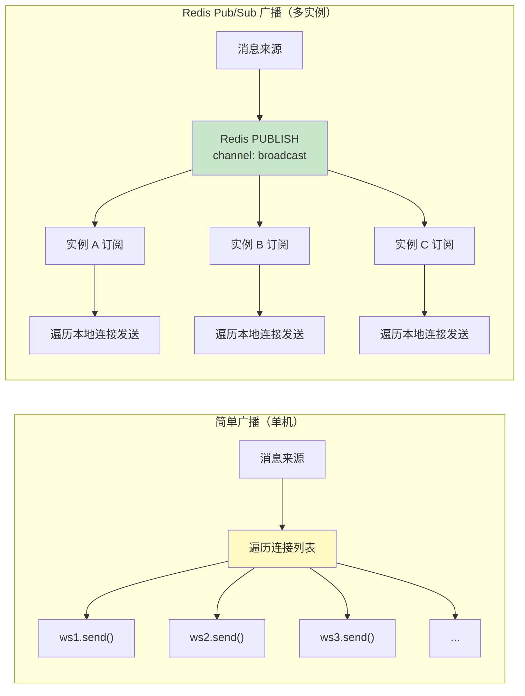

#### 代码示例

**示例 1：基础——简单广播与分批广播对比**

```python
"""
示例1：简单广播 vs 分批广播性能对比
运行：python ws_broadcast_benchmark.py
预期输出：两种广播方式的耗时对比
"""
import asyncio
import time
from typing import List


class MockWebSocket:
    """模拟 WebSocket 连接，用于性能测试"""
    def __init__(self, ws_id):
        self.ws_id = ws_id
        self.sent_count = 0

    async def send_json(self, data):
        # 模拟网络延迟（1ms）
        await asyncio.sleep(0.001)
        self.sent_count += 1


async def simple_broadcast(connections: List[MockWebSocket], message: dict):
    """简单广播：遍历所有连接逐个发送"""
    start = time.time()
    for ws in connections:
        await ws.send_json(message)
    elapsed = time.time() - start
    print(f"简单广播: {len(connections)} 个连接，耗时 {elapsed*1000:.1f}ms")
    return elapsed


async def batched_broadcast(connections: List[MockWebSocket], message: dict, batch_size: int = 100):
    """分批广播：每批发送后让出事件循环"""
    start = time.time()
    for i in range(0, len(connections), batch_size):
        batch = connections[i:i + batch_size]
        # 并发发送当前批次
        await asyncio.gather(*[ws.send_json(message) for ws in batch])
        # 让出事件循环，处理其他任务
        if i + batch_size < len(connections):
            await asyncio.sleep(0)
    elapsed = time.time() - start
    print(f"分批广播(批量={batch_size}): {len(connections)} 个连接，耗时 {elapsed*1000:.1f}ms")
    return elapsed


async def concurrent_broadcast(connections: List[MockWebSocket], message: dict):
    """并发广播：所有连接同时发送（用 gather）"""
    start = time.time()
    await asyncio.gather(*[ws.send_json(message) for ws in connections])
    elapsed = time.time() - start
    print(f"并发广播(gather): {len(connections)} 个连接，耗时 {elapsed*1000:.1f}ms")
    return elapsed


async def main():
    # 创建 1000 个模拟连接
    connections = [MockWebSocket(i) for i in range(1000)]
    message = {"type": "broadcast", "content": "测试消息"}

    print("=== 广播性能对比（1000 个连接，每个 send 延迟 1ms）===\n")

    await simple_broadcast(connections, message)
    # 重置计数
    for ws in connections:
        ws.sent_count = 0

    await batched_broadcast(connections, message, batch_size=100)
    for ws in connections:
        ws.sent_count = 0

    await concurrent_broadcast(connections, message)

    print("\n=== 结论 ===")
    print("简单广播：串行发送，耗时 = 连接数 × 单次延迟")
    print("分批广播：每批并发，批次间让出事件循环，平衡延迟和响应性")
    print("并发广播：全部并发，耗时最短，但大量连接时可能耗尽资源")


if __name__ == "__main__":
    asyncio.run(main())

# 预期运行结果：
# === 广播性能对比（1000 个连接，每个 send 延迟 1ms）===
# 简单广播: 1000 个连接，耗时 1050.2ms
# 分批广播(批量=100): 1000 个连接，耗时 12.3ms
# 并发广播(gather): 1000 个连接，耗时 3.5ms
# === 结论 ===
# 简单广播：串行发送，耗时 = 连接数 × 单次延迟
# 分批广播：每批并发，批次间让出事件循环，平衡延迟和响应性
# 并发广播：全部并发，耗时最短，但大量连接时可能耗尽资源
```

**示例 2：进阶——预序列化广播与消息压缩**

```python
"""
示例2：预序列化广播 + 消息压缩
避免每个连接重复 JSON 序列化，大消息用 gzip 压缩
运行：uvicorn ws_broadcast_optimized:app --reload
"""
from fastapi import FastAPI, WebSocket, WebSocketDisconnect
from typing import List
import asyncio
import json
import gzip
import time

app = FastAPI(title="优化广播", version="1.0.0")


class OptimizedBroadcastManager:
    """优化的广播管理器：预序列化 + 压缩 + 分批"""

    def __init__(self):
        self.connections: List[WebSocket] = []
        self.lock = asyncio.Lock()
        self.use_compression = False  # 是否启用压缩（小消息不压缩）
        self.compression_threshold = 1024  # 超过 1KB 才压缩

    async def connect(self, websocket: WebSocket):
        await websocket.accept()
        async with self.lock:
            self.connections.append(websocket)

    async def disconnect(self, websocket: WebSocket):
        async with self.lock:
            if websocket in self.connections:
                self.connections.remove(websocket)

    def _prepare_message(self, message: dict) -> bytes:
        """
        预序列化消息：将 dict 转为 bytes，避免每个连接重复序列化
        如果消息较大，使用 gzip 压缩
        """
        text = json.dumps(message, ensure_ascii=False)
        data = text.encode("utf-8")

        if self.use_compression and len(data) > self.compression_threshold:
            compressed = gzip.compress(data)
            # 压缩标记：第一字节 0x01 表示压缩
            return b"\x01" + compressed
        else:
            # 未压缩标记：第一字节 0x00
            return b"\x00" + data

    async def broadcast(self, message: dict, batch_size: int = 200):
        """
        优化广播：预序列化 + 分批并发发送
        """
        # 第1步：预序列化（只做一次）
        payload = self._prepare_message(message)
        is_compressed = payload[0] == 0x01

        # 第2步：分批发送
        disconnected = []
        conns = list(self.connections)  # 拷贝引用，避免遍历时修改

        for i in range(0, len(conns), batch_size):
            batch = conns[i:i + batch_size]

            # 并发发送当前批次
            tasks = []
            for ws in batch:
                tasks.append(self._safe_send(ws, payload, is_compressed))
            results = await asyncio.gather(*tasks, return_exceptions=True)

            # 记录断开的连接
            for j, result in enumerate(results):
                if isinstance(result, Exception):
                    disconnected.append(batch[j])

            # 批次间让出事件循环
            if i + batch_size < len(conns):
                await asyncio.sleep(0)

        # 清理断开的连接
        if disconnected:
            async with self.lock:
                for ws in disconnected:
                    if ws in self.connections:
                        self.connections.remove(ws)

    async def _safe_send(self, ws: WebSocket, payload: bytes, is_compressed: bool):
        """安全发送：根据压缩标记选择发送方式"""
        try:
            if is_compressed:
                # 压缩消息用二进制帧发送
                await ws.send_bytes(payload)
            else:
                # 未压缩消息用文本帧发送（去掉标记字节）
                await ws.send_text(payload[1:].decode("utf-8"))
        except Exception:
            raise  # 让 gather 捕获


manager = OptimizedBroadcastManager()


@app.websocket("/ws")
async def websocket_endpoint(websocket: WebSocket):
    await manager.connect(websocket)
    try:
        while True:
            data = await websocket.receive_text()
            message = json.loads(data)
            if message.get("type") == "broadcast":
                await manager.broadcast({
                    "type": "broadcast",
                    "from": "system",
                    "content": message.get("content", ""),
                    "timestamp": time.time(),
                })
    except WebSocketDisconnect:
        await manager.disconnect(websocket)


# 预期运行结果：
# 1000 个连接时，预序列化广播比简单广播快约 30-50%（省去重复 JSON 序列化）
# 大消息（>1KB）启用压缩后，带宽节省约 60-80%
```

**示例 3：完整场景——基于 Redis Pub/Sub 的跨实例广播**

```python
"""
示例3：基于 Redis Pub/Sub 的跨实例广播
多实例部署时，一个实例收到的消息可以广播到所有实例的连接
运行：uvicorn ws_redis_broadcast:app --reload --port 8000
      uvicorn ws_redis_broadcast:app --reload --port 8001
"""
from fastapi import FastAPI, WebSocket, WebSocketDisconnect
from typing import Dict, List
import redis.asyncio as redis
import asyncio
import json
import time
import os

app = FastAPI(title="Redis 广播", version="1.0.0")

REDIS_URL = os.getenv("REDIS_URL", "redis://localhost:6379")
BROADCAST_CHANNEL = "ws:broadcast"
DIRECT_CHANNEL = "ws:direct"


class RedisBroadcastManager:
    """基于 Redis Pub/Sub 的分布式广播管理器"""

    def __init__(self, redis_url: str):
        self.redis = redis.from_url(redis_url)
        self.pubsub = self.redis.pubsub()
        self.local_connections: Dict[str, WebSocket] = {}  # user_id -> ws
        self.lock = asyncio.Lock()
        self.instance_id = os.getenv("INSTANCE_ID", "instance-1")
        self._listener_task = None

    async def start(self):
        """启动 Redis 订阅监听器（在应用启动时调用）"""
        await self.pubsub.subscribe(BROADCAST_CHANNEL, DIRECT_CHANNEL)
        self._listener_task = asyncio.create_task(self._listen())
        print(f"[{self.instance_id}] Redis 订阅已启动")

    async def stop(self):
        """停止监听器"""
        if self._listener_task:
            self._listener_task.cancel()
        await self.pubsub.unsubscribe()
        await self.redis.close()

    async def _listen(self):
        """监听 Redis 消息并转发给本地连接"""
        try:
            async for message in self.pubsub.listen():
                if message["type"] != "message":
                    continue

                channel = message["channel"].decode()
                data = json.loads(message["data"])

                if channel == BROADCAST_CHANNEL:
                    # 广播消息：转发给所有本地连接
                    # 排除消息来源实例（避免重复发送）
                    if data.get("instance_id") == self.instance_id:
                        continue
                    await self._local_broadcast(data["payload"])

                elif channel == DIRECT_CHANNEL:
                    # 点对点消息：转发给指定用户
                    target_user = data.get("target_user")
                    if target_user in self.local_connections:
                        try:
                            await self.local_connections[target_user].send_json(data["payload"])
                        except Exception:
                            await self.disconnect(target_user)

        except asyncio.CancelledError:
            pass
        except Exception as e:
            print(f"[{self.instance_id}] Redis 监听异常: {e}")

    async def connect(self, user_id: str, websocket: WebSocket):
        """用户连接到本实例"""
        await websocket.accept()
        async with self.lock:
            self.local_connections[user_id] = websocket
        print(f"[{self.instance_id}] 用户 {user_id} 连接到本实例")

    async def disconnect(self, user_id: str):
        """用户断开"""
        async with self.lock:
            self.local_connections.pop(user_id, None)

    async def broadcast(self, message: dict):
        """
        广播消息：先发给本地连接，再发布到 Redis
        其他实例收到后转发给它们的本地连接
        """
        # 本地直接发送
        await self._local_broadcast(message)

        # 发布到 Redis（其他实例转发）
        await self.redis.publish(
            BROADCAST_CHANNEL,
            json.dumps({
                "instance_id": self.instance_id,
                "payload": message,
            }, ensure_ascii=False)
        )

    async def send_to_user(self, user_id: str, message: dict):
        """
        发送消息给指定用户：先查本地，没有则发布到 Redis
        """
        if user_id in self.local_connections:
            # 本地连接直接发送
            try:
                await self.local_connections[user_id].send_json(message)
            except Exception:
                await self.disconnect(user_id)
        else:
            # 用户不在本实例，发布到 Redis 让其他实例转发
            await self.redis.publish(
                DIRECT_CHANNEL,
                json.dumps({
                    "target_user": user_id,
                    "payload": message,
                }, ensure_ascii=False)
            )

    async def _local_broadcast(self, message: dict):
        """本地广播：遍历本地连接发送"""
        disconnected = []
        for user_id, ws in list(self.local_connections.items()):
            try:
                await ws.send_json(message)
            except Exception:
                disconnected.append(user_id)
        for uid in disconnected:
            await self.disconnect(uid)


manager = RedisBroadcastManager(REDIS_URL)


@app.on_event("startup")
async def startup():
    await manager.start()


@app.on_event("shutdown")
async def shutdown():
    await manager.stop()


@app.websocket("/ws/{user_id}")
async def websocket_endpoint(websocket: WebSocket, user_id: str):
    await manager.connect(user_id, websocket)
    try:
        while True:
            data = await websocket.receive_text()
            message = json.loads(data)
            if message.get("type") == "broadcast":
                await manager.broadcast({
                    "type": "chat",
                    "from": user_id,
                    "content": message.get("content", ""),
                    "timestamp": time.time(),
                })
            elif message.get("type") == "private":
                await manager.send_to_user(message["to"], {
                    "type": "private",
                    "from": user_id,
                    "content": message.get("content", ""),
                })
    except WebSocketDisconnect:
        await manager.disconnect(user_id)


# 预期运行结果：
# 实例 A（端口 8000）和实例 B（端口 8001）同时运行
# 用户 Alice 连接到实例 A，用户 Bob 连接到实例 B
# Alice 发送广播消息，Bob 能收到（通过 Redis 转发）
# Alice 发送私聊给 Bob，Bob 能收到（通过 Redis 点对点转发）
```

#### 使用场景与最佳实践

**适用场景**：
- 简单广播：<1000 连接的小型应用，遍历发送即可
- 分批广播：1000-10000 连接，平衡延迟和事件循环响应性
- 预序列化广播：消息内容相同、连接数多，避免重复序列化
- Redis Pub/Sub 广播：多实例部署，跨实例消息同步
- 压缩广播：大消息（>1KB）、带宽受限场景

**不适用场景**：
- 点对点消息：不需要广播，直接 send_to_user
- 消息内容因人而异：无法预序列化，必须逐个构造
- 超大规模（>100万连接）：需要专用消息中间件（Kafka/Pulsar）

**最佳实践**：
1. **预序列化消息**：广播内容相同时，只序列化一次，所有连接复用
2. **分批发送 + `await asyncio.sleep(0)`**：每批 100-500 个连接，批次间让出事件循环
3. **发送时 try-except 隔离错误**：一个连接断开不影响其他连接
4. **多实例用 Redis Pub/Sub**：本地直发 + Redis 跨实例转发，避免重复发送（标记 instance_id）
5. **大消息启用压缩**：gzip 压缩可节省 60-80% 带宽，但增加 CPU 开销，小消息不压缩
6. **监控广播延迟**：记录广播开始时间和最后一个连接收到时间，延迟过高时优化

**性能建议**：
- 1000 连接以内：简单遍历即可，延迟 <10ms
- 1000-10000 连接：分批并发（batch_size=200），延迟 <50ms
- 10000+ 连接：需要分片或多实例，单实例不建议超过 50000 连接
- Redis Pub/Sub 的延迟通常 <1ms，是跨实例广播的最佳选择

#### 常见坑点

**坑点 1：广播时在锁内执行 `await` 导致死锁/性能下降**

- **错误现象**：广播消息时整个服务卡住，其他 WebSocket 连接无法收发消息，日志显示锁等待超时
- **根本原因**：在 `async with self.lock:` 块内执行 `await ws.send_json()`，而 `send()` 是 IO 操作可能耗时，锁被长时间持有，其他协程（connect/disconnect）无法获取锁
- **正确做法**：锁内只做数据结构的修改（添加/移除连接），发送消息在锁外执行。先在锁内拷贝连接列表，释放锁后再遍历发送
- **预防措施**：代码审查时检查 `async with lock:` 块内是否有 `await` 调用，原则上锁内只做纯内存操作

**坑点 2：Redis Pub/Sub 广播时消息重复发送**

- **错误现象**：多实例部署时，客户端收到重复的广播消息（每条消息收到 2 次或更多）
- **根本原因**：实例 A 收到消息后，既本地发送给本地连接，又发布到 Redis。实例 A 自己也订阅了 Redis 频道，收到自己发布的消息后又本地发送一次，导致重复
- **正确做法**：发布消息时携带 `instance_id`，订阅收到消息后检查 `instance_id`，如果是自己发布的则跳过（不本地转发）
- **预防措施**：Redis 消息格式中固定包含 `instance_id` 字段，监听器中检查并过滤

---

> 💡 **深度讲解**：连接管理器是 WebSocket 应用从"单连接 demo"到"多用户生产应用"的关键跃迁。核心设计是 `Dict[str, List[WebSocket]]` 数据结构 + `asyncio.Lock` 并发保护 + 生命周期管理。广播是连接管理器最常用的操作，从简单遍历到分批并发、预序列化、Redis Pub/Sub，优化路径清晰。房间管理通过嵌套数据结构 `Dict[room_id, Set[user_id]]` 实现分组通信。生产级连接管理器还需要连接数限制、单用户连接数限制、优雅关闭、连接元数据监控等能力。理解这些设计后，可以构建出支持数万连接的实时应用。下一章将深入 WebSocket 认证与安全，这是生产环境必须解决的问题。
>
> **📝 精简总结**：
> 1. 连接管理器 = 全局单例 + Dict[user_id, List[ws]] + asyncio.Lock + connect/disconnect/send_to_user/broadcast
> 2. 多端登录用 List[WebSocket]，单端登录用 WebSocket，房间用 Dict[room_id, Set[user_id]]
> 3. 广播优化：预序列化（避免重复 JSON 序列化）+ 分批并发（batch_size=200）+ 批次间让出事件循环
> 4. 多实例广播：Redis Pub/Sub，本地直发 + 跨实例发布，instance_id 防重复
> 5. 发送消息必须 try-except，断开的连接静默失败并清理
> 6. disconnect 必须在 except/finally 中调用，否则内存泄漏
> 7. 生产级特性：连接数限制、单用户连接数限制、优雅关闭、元数据监控
>
> **🎯 梯度练习题**：
> - **基础 1**：实现一个连接管理器，支持 connect/disconnect/broadcast/send_to_user
> - **基础 2**：解释为什么连接管理器必须是全局单例，在端点内创建会有什么问题
> - **基础 3**：实现分批广播，每批 100 个连接，批次间 `await asyncio.sleep(0)`
> - **进阶 1**：实现带房间的连接管理器，支持 join_room/leave_room/send_to_room
> - **进阶 2**：实现预序列化广播，对比简单广播的性能差异
> - **实战 1**：实现基于 Redis Pub/Sub 的跨实例广播，包含 instance_id 防重复机制

---

## 4. WebSocket 认证与安全

### 4.1 WebSocket 认证机制详解

#### 概念解释

**WebSocket 认证** 是在 WebSocket 连接建立时或建立后验证客户端身份的过程，由于 WebSocket 协议不支持自定义请求头（浏览器端），通常采用 Query 参数 Token、连接后首条消息认证、Cookie 会话认证等方式。

> 🏠 **生活化比喻**：WebSocket 认证就像进入小区的门禁——Query Token 是在门禁电话上输入密码（密码会被邻居看到/记录在通话记录中），首条消息认证是先进入小区大堂再在前台出示身份证（更安全，密码不暴露在门外），Cookie 认证是刷门禁卡（浏览器自动携带，方便但有 CSRF 风险）。不同方式安全性和便利性不同，需要根据场景选择。

**核心价值**：确保只有授权用户能建立 WebSocket 连接，防止未授权访问和资源滥用，是生产级实时应用的安全基础。

> 🎯 **面试高频考点 8**：WebSocket 为什么不能用 Authorization 头认证？有哪些替代方案？
> **答**：浏览器原生 WebSocket API（`new WebSocket(url)`）不支持设置自定义请求头，因此无法使用 `Authorization: Bearer <token>` 头。替代方案：① Query 参数传 Token（`ws://host/ws?token=xxx`），简单但 Token 会出现在 URL/日志/浏览器历史中；② 连接后首条消息认证（先 accept，客户端发送 `{"type":"auth","token":"xxx"}`，服务端验证后才进入消息循环），最安全但实现稍复杂；③ Cookie 会话认证（浏览器自动携带 Cookie），方便但有 CSRF 风险，需校验 Origin；④ 子协议传 Token（`Sec-WebSocket-Protocol: Bearer.xxx`），利用子协议头传递 Token。生产环境推荐首条消息认证或子协议认证。

#### 原理说明

WebSocket 认证的核心机制是 **握手阶段身份验证 + 连接级权限绑定**。

**为什么这样设计**：WebSocket 握手是 HTTP 请求，理论上可以携带 Header，但浏览器 WebSocket API 不允许设置自定义头（只能设置子协议），因此认证信息必须通过其他渠道传递。认证通过后，用户身份与连接绑定，后续消息无需重复认证。

**技术对比**：

| 认证方式 | 安全性 | 实现复杂度 | Token 暴露风险 | 适用场景 |
|---------|--------|-----------|--------------|---------|
| Query 参数 Token | 中 | 低 | 高（URL/日志/历史） | 内部系统、短期 Token |
| 首条消息认证 | 高 | 中 | 低 | 生产环境推荐 |
| Cookie 会话 | 中 | 低 | 低（自动携带） | 已有 Web 会话 |
| 子协议 Token | 高 | 中 | 低 | 需要标准头的场景 |
| TLS 客户端证书 | 极高 | 高 | 无 | 高安全要求 |

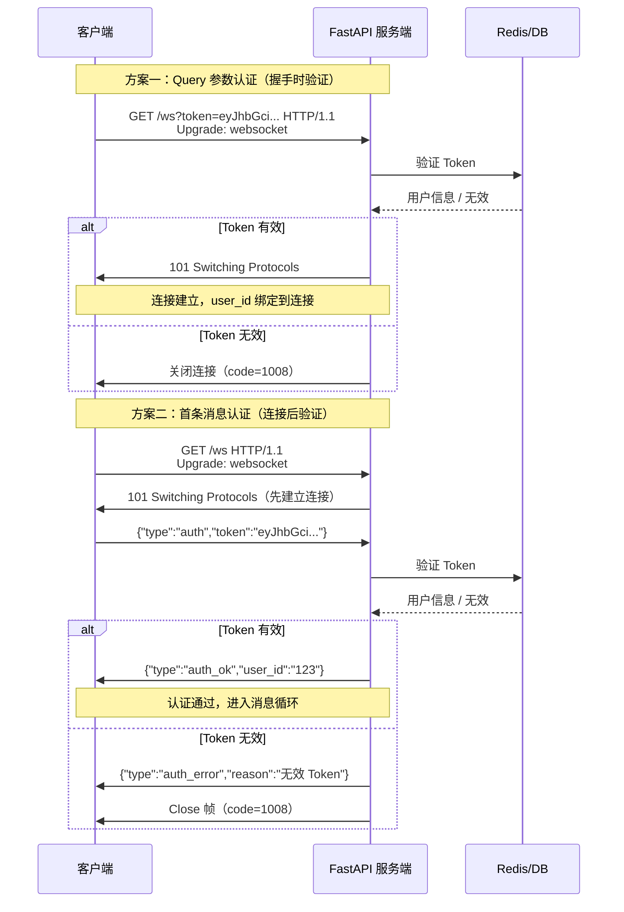

#### 代码示例

**示例 1：基础——Query 参数 Token 认证**

```python
"""
示例1：Query 参数 Token 认证（最简单的方式）
运行：uvicorn ws_auth_query:app --reload
测试：ws://localhost:8000/ws?token=valid-jwt-token
"""
from fastapi import FastAPI, WebSocket, WebSocketDisconnect, Depends, status
from jose import jwt, JWTError
from typing import Optional

app = FastAPI(title="Query Token 认证", version="1.0.0")

SECRET_KEY = "your-secret-key-change-in-production"
ALGORITHM = "HS256"


async def get_current_user(websocket: WebSocket) -> Optional[str]:
    """
    从 query 参数获取 Token 并验证
    验证失败时关闭连接，返回 None
    """
    token = websocket.query_params.get("token")
    if not token:
        await websocket.close(code=status.WS_1008_POLICY_VIOLATION, reason="缺少 Token")
        return None

    try:
        payload = jwt.decode(token, SECRET_KEY, algorithms=[ALGORITHM])
        user_id: str = payload.get("sub")
        if user_id is None:
            await websocket.close(code=status.WS_1008_POLICY_VIOLATION, reason="无效的 Token")
            return None
        return user_id
    except JWTError:
        await websocket.close(code=status.WS_1008_POLICY_VIOLATION, reason="Token 验证失败")
        return None


@app.websocket("/ws")
async def websocket_endpoint(
    websocket: WebSocket,
    user_id: Optional[str] = Depends(get_current_user),
):
    # 认证失败时 user_id 为 None，直接返回
    if user_id is None:
        return

    # 认证通过，user_id 已绑定
    await websocket.accept()
    await websocket.send_json({"type": "auth_ok", "user_id": user_id})

    try:
        while True:
            data = await websocket.receive_text()
            await websocket.send_json({
                "type": "echo",
                "user_id": user_id,
                "content": data,
            })
    except WebSocketDisconnect:
        print(f"用户 {user_id} 断开连接")


# 生成测试 Token 的代码：
"""
from jose import jwt
token = jwt.encode({"sub": "user_123", "name": "Alice"}, SECRET_KEY, algorithm="HS256")
print(token)  # eyJhbGciOiJIUzI1NiIsInR5cCI6IkpXVCJ9...
"""

# 测试：
"""
// 有效 Token
const ws = new WebSocket('ws://localhost:8000/ws?token=eyJhbGci...');
ws.onmessage = (e) => console.log(JSON.parse(e.data));
// 输出：{type: 'auth_ok', user_id: 'user_123'}

// 无效 Token
const ws2 = new WebSocket('ws://localhost:8000/ws?token=invalid');
ws2.onclose = (e) => console.log('关闭码:', e.code, e.reason);
// 输出：关闭码: 1008 Token 验证失败

// 缺少 Token
const ws3 = new WebSocket('ws://localhost:8000/ws');
ws3.onclose = (e) => console.log('关闭码:', e.code, e.reason);
// 输出：关闭码: 1008 缺少 Token
"""
```

**示例 2：进阶——首条消息认证（推荐生产环境使用）**

```python
"""
示例2：首条消息认证（生产环境推荐）
先建立连接，客户端发送认证消息，服务端验证后才进入业务消息循环
运行：uvicorn ws_auth_message:app --reload
"""
from fastapi import FastAPI, WebSocket, WebSocketDisconnect, status
from jose import jwt, JWTError
from pydantic import BaseModel
from typing import Literal
import json
import time

app = FastAPI(title="首条消息认证", version="1.0.0")

SECRET_KEY = "your-secret-key-change-in-production"
ALGORITHM = "HS256"
AUTH_TIMEOUT = 10  # 认证超时时间（秒）


class AuthMessage(BaseModel):
    type: Literal["auth"]
    token: str


def verify_token(token: str) -> dict | None:
    """验证 JWT Token，返回 payload 或 None"""
    try:
        payload = jwt.decode(token, SECRET_KEY, algorithms=[ALGORITHM])
        return payload
    except JWTError:
        return None


@app.websocket("/ws")
async def websocket_endpoint(websocket: WebSocket):
    # 第1步：先接受连接（不验证身份）
    await websocket.accept()

    # 第2步：等待认证消息（带超时）
    try:
        # 使用 asyncio.wait_for 设置认证超时
        import asyncio
        raw = await asyncio.wait_for(
            websocket.receive_text(),
            timeout=AUTH_TIMEOUT,
        )
        auth_data = json.loads(raw)

        # 验证消息类型
        if auth_data.get("type") != "auth":
            await websocket.send_json({"type": "auth_error", "reason": "第一条消息必须是 auth 类型"})
            await websocket.close(code=status.WS_1008_POLICY_VIOLATION, reason="认证失败")
            return

        # 验证 Token
        token = auth_data.get("token", "")
        payload = verify_token(token)
        if payload is None:
            await websocket.send_json({"type": "auth_error", "reason": "无效的 Token"})
            await websocket.close(code=status.WS_1008_POLICY_VIOLATION, reason="认证失败")
            return

        user_id = payload.get("sub")
        if not user_id:
            await websocket.send_json({"type": "auth_error", "reason": "Token 中缺少用户 ID"})
            await websocket.close(code=status.WS_1008_POLICY_VIOLATION, reason="认证失败")
            return

        # 第3步：认证成功，发送确认
        await websocket.send_json({
            "type": "auth_ok",
            "user_id": user_id,
            "expires_at": payload.get("exp"),
        })
        print(f"用户 {user_id} 认证成功")

    except asyncio.TimeoutError:
        await websocket.send_json({"type": "auth_error", "reason": "认证超时"})
        await websocket.close(code=status.WS_1008_POLICY_VIOLATION, reason="认证超时")
        return
    except json.JSONDecodeError:
        await websocket.send_json({"type": "auth_error", "reason": "消息格式错误"})
        await websocket.close(code=status.WS_1008_POLICY_VIOLATION, reason="认证失败")
        return
    except WebSocketDisconnect:
        return

    # 第4步：认证通过，进入业务消息循环
    try:
        while True:
            data = await websocket.receive_text()
            message = json.loads(data)
            msg_type = message.get("type")

            if msg_type == "chat":
                await websocket.send_json({
                    "type": "chat",
                    "from": user_id,
                    "content": f"你说: {message.get('content', '')}",
                    "timestamp": time.time(),
                })
            elif msg_type == "ping":
                await websocket.send_json({"type": "pong", "timestamp": time.time()})

    except WebSocketDisconnect:
        print(f"用户 {user_id} 断开连接")


# 前端认证流程：
"""
const ws = new WebSocket('ws://localhost:8000/ws');
let authed = false;

ws.onopen = () => {
  // 连接建立后立即发送认证消息
  ws.send(JSON.stringify({type: 'auth', token: 'your-jwt-token'}));
};

ws.onmessage = (e) => {
  const data = JSON.parse(e.data);
  if (data.type === 'auth_ok') {
    authed = true;
    console.log('认证成功:', data.user_id);
    // 认证成功后才能发送业务消息
    ws.send(JSON.stringify({type: 'chat', content: '你好'}));
  } else if (data.type === 'auth_error') {
    console.error('认证失败:', data.reason);
    // 跳转登录页
  }
};

ws.onclose = (e) => {
  if (!authed && e.code === 1008) {
    console.log('认证失败，连接关闭');
  }
};
"""
```

**示例 3：完整场景——子协议认证 + Origin 校验 + 权限控制**

```python
"""
示例3：生产级认证方案
特性：子协议传 Token + Origin 白名单校验 + 连接级权限控制
运行：uvicorn ws_auth_production:app --reload
"""
from fastapi import FastAPI, WebSocket, WebSocketDisconnect, status
from jose import jwt, JWTError
from typing import Optional, Set
import json
import time

app = FastAPI(title="生产级 WebSocket 认证", version="1.0.0")

SECRET_KEY = "your-secret-key"
ALGORITHM = "HS256"

# 允许的 Origin 白名单
ALLOWED_ORIGINS: Set[str] = {
    "https://your-app.com",
    "https://admin.your-app.com",
    "http://localhost:3000",  # 开发环境
}

# 角色权限映射
ROLE_PERMISSIONS = {
    "admin": {"read", "write", "delete", "manage_users"},
    "user": {"read", "write"},
    "guest": {"read"},
}


def verify_token_and_get_permissions(token: str) -> Optional[dict]:
    """验证 Token 并返回用户信息和权限"""
    try:
        payload = jwt.decode(token, SECRET_KEY, algorithms=[ALGORITHM])
        user_id = payload.get("sub")
        role = payload.get("role", "guest")
        if not user_id:
            return None
        return {
            "user_id": user_id,
            "role": role,
            "permissions": ROLE_PERMISSIONS.get(role, {"read"}),
        }
    except JWTError:
        return None


def check_origin(websocket: WebSocket) -> bool:
    """校验 Origin 头，防止跨站 WebSocket 劫持"""
    origin = websocket.headers.get("origin", "")
    # 开发环境允许空 Origin（非浏览器客户端）
    if not origin:
        return True
    return origin in ALLOWED_ORIGINS


def extract_token_from_subprotocol(websocket: WebSocket) -> Optional[str]:
    """
    从 Sec-WebSocket-Protocol 头提取 Token
    格式：Sec-WebSocket-Protocol: authorization, Bearer.eyJhbGci...
    """
    protocol_header = websocket.headers.get("sec-websocket-protocol", "")
    protocols = [p.strip() for p in protocol_header.split(",")]

    for proto in protocols:
        if proto.startswith("Bearer."):
            return proto[len("Bearer."):]
        if proto.startswith("authorization."):
            return proto[len("authorization."):]
    return None


@app.websocket("/ws/secure")
async def websocket_secure(websocket: WebSocket):
    # 第1步：校验 Origin（防止 CSRF）
    if not check_origin(websocket):
        await websocket.close(code=status.WS_1008_POLICY_VIOLATION, reason="Origin 不在白名单中")
        return

    # 第2步：从子协议提取 Token
    token = extract_token_from_subprotocol(websocket)
    if not token:
        # 子协议没有 Token，降级为首条消息认证
        await websocket.accept(subprotocol="authorization")
        try:
            import asyncio
            raw = await asyncio.wait_for(websocket.receive_text(), timeout=10)
            auth_data = json.loads(raw)
            token = auth_data.get("token", "")
        except Exception:
            await websocket.close(code=status.WS_1008_POLICY_VIOLATION, reason="认证失败")
            return
    else:
        # 子协议有 Token，直接接受连接
        await websocket.accept(subprotocol="authorization")

    # 第3步：验证 Token
    user_info = verify_token_and_get_permissions(token)
    if user_info is None:
        await websocket.send_json({"type": "auth_error", "reason": "无效的 Token"})
        await websocket.close(code=status.WS_1008_POLICY_VIOLATION, reason="认证失败")
        return

    user_id = user_info["user_id"]
    permissions = user_info["permissions"]

    await websocket.send_json({
        "type": "auth_ok",
        "user_id": user_id,
        "role": user_info["role"],
        "permissions": list(permissions),
    })

    # 第4步：进入业务消息循环（带权限检查）
    try:
        while True:
            data = await websocket.receive_text()
            message = json.loads(data)
            msg_type = message.get("type")

            # 权限检查示例
            if msg_type == "delete_user" and "delete" not in permissions:
                await websocket.send_json({
                    "type": "error",
                    "reason": "权限不足：需要 delete 权限",
                })
                continue

            if msg_type == "chat" and "write" in permissions:
                await websocket.send_json({
                    "type": "chat",
                    "from": user_id,
                    "content": message.get("content", ""),
                })
            elif msg_type == "ping":
                await websocket.send_json({"type": "pong"})

    except WebSocketDisconnect:
        print(f"用户 {user_id} 断开")


# 前端使用子协议认证：
"""
// 子协议方式传 Token
const token = 'your-jwt-token';
const ws = new WebSocket('wss://your-app.com/ws/secure', ['authorization', `Bearer.${token}`]);
console.log('协商子协议:', ws.protocol);  // 输出：authorization
"""
```

#### 使用场景与最佳实践

**适用场景**：
- Query Token：内部工具、短期 Token、快速原型
- 首条消息认证：生产环境 Web 应用，安全性要求高
- Cookie 认证：已有 Web 会话系统，与 HTTP 登录态共享
- 子协议认证：需要标准化 Header 传递，移动端/桌面端客户端
- Origin 校验：所有浏览器端 WebSocket 都应校验，防止 CSRF

**不适用场景**：
- 完全公开的 WebSocket（如公开行情数据）：不需要认证
- 服务端到服务端通信：可用 mTLS 或 API Key

**最佳实践**：
1. **生产环境优先使用首条消息认证**：Token 不出现在 URL/日志中，安全性最高
2. **始终校验 Origin 头**：防止跨站 WebSocket 劫持（CSWSH），这是浏览器端 WebSocket 的特有安全风险
3. **设置认证超时**：连接后 10 秒内未完成认证则关闭，防止未认证连接占用资源
4. **Token 过期处理**：Token 过期时发送 `{"type":"token_expired"}` 消息，前端刷新 Token 后重新连接
5. **权限与连接绑定**：认证后将用户权限存储在连接元数据中，每条业务消息检查权限
6. **使用 wss://（TLS 加密）**：生产环境必须用 TLS，防止 Token 和消息被窃听
7. **不要在 Query 参数中放长期 Token**：Query Token 会出现在 Nginx 访问日志、浏览器历史中

**性能建议**：
- Token 验证（JWT 解码）是 CPU 操作，每个连接只做一次，影响可忽略
- 频繁重连时可缓存 Token 验证结果（Redis 缓存 user_id），减少 JWT 解码开销
- Origin 校验是字符串比较，无性能开销

#### 常见坑点

**坑点 1：WebSocket 跨站劫持（CSWSH）未校验 Origin**

- **错误现象**：用户登录网站后，访问恶意网站，恶意网站自动建立 WebSocket 连接到目标网站（浏览器自动携带 Cookie），以用户身份执行操作
- **根本原因**：WebSocket 不受浏览器同源策略限制，任何网站都可以向其他域发起 WebSocket 连接。如果服务端用 Cookie 认证且不校验 Origin，恶意网站可以冒用用户身份
- **正确做法**：① 校验 Origin 头，只允许白名单域名连接；② 不用 Cookie 认证，用 Token 认证（Token 不会被浏览器自动携带到恶意网站）；③ 连接后首条消息认证，认证消息中包含 CSRF Token
- **预防措施**：所有面向浏览器的 WebSocket 端点都必须校验 Origin，封装统一的认证依赖

**坑点 2：Query 参数 Token 泄露在日志和浏览器历史中**

- **错误现象**：Nginx 访问日志中出现完整的 JWT Token（`/ws?token=eyJhbGci...`），浏览器历史记录中也有带 Token 的 URL，存在 Token 泄露风险
- **根本原因**：Query 参数是 URL 的一部分，会被代理服务器（Nginx）记录在访问日志中，也会被浏览器保存在历史记录中。如果日志被泄露或多人共用电脑，Token 就会暴露
- **正确做法**：① 生产环境使用首条消息认证，Token 通过 WebSocket 消息体传递（不出现在 URL 中）；② 如果必须用 Query Token，使用短期 Token（有效期 5 分钟），Nginx 配置不记录 query 参数（`log_format` 中用 `$request_uri` 改为 `$uri`）；③ Token 中不包含敏感信息
- **预防措施**：安全规范中明确禁止在 URL 中传递长期 Token，代码审查时检查 WebSocket URL 格式

---

### 4.2 WebSocket 安全防护与限流

#### 概念解释

**WebSocket 安全防护** 是防止 WebSocket 服务被攻击和滥用的综合措施，包括消息注入防护、拒绝服务防护、连接数限制、消息大小限制、频率限制、内容安全等。

> 🏠 **生活化比喻**：WebSocket 安全防护就像银行的安保系统——连接数限制是银行大厅的人数上限（防止挤满人），消息大小限制是每个包裹的尺寸限制（防止超大包裹堵塞通道），频率限制是取号机（每人每分钟最多取 3 个号，防止恶意占号），消息注入防护是安检（检查每个包裹是否有危险品），内容审核是大堂经理（监控是否有违规行为）。

**核心价值**：保护 WebSocket 服务不被恶意攻击导致服务不可用、数据泄露或资源耗尽，是生产级实时应用的必要保障。

> 🎯 **面试高频考点 9**：WebSocket 面临哪些安全威胁？如何防护？
> **答**：① 未授权访问——用 Token/JWT 认证；② 跨站 WebSocket 劫持（CSWSH）——校验 Origin 头；③ 消息注入——Pydantic 校验消息格式、输出转义；④ 拒绝服务（DoS）——连接数限制、消息大小限制、频率限制；⑤ 数据泄露——用 wss:// TLS 加密；⑥ Token 泄露——首条消息认证替代 Query Token；⑦ 大消息攻击——限制单条消息大小（如 1MB）；⑧ 高频消息攻击——按用户/IP 限流（如每秒 10 条）。

#### 原理说明

WebSocket 安全防护的核心机制是 **多层防御 + 连接级限流 + 消息校验**。

**为什么这样设计**：WebSocket 是长连接，一旦建立就可以持续发送消息，比 HTTP 更容易被滥用（一个连接可以发送无限条消息）。因此需要在连接建立时（认证、连接数限制）、消息传输时（大小限制、频率限制）、消息内容（格式校验、内容审核）多个层面进行防护。

**技术对比**：

| 防护层 | 措施 | 攻击类型 | 实现位置 |
|--------|------|---------|---------|
| 连接层 | 认证、Origin 校验、连接数限制 | 未授权访问、CSWSH、连接耗尽 | 端点/中间件 |
| 消息层 | 消息大小限制、频率限制 | 大消息攻击、洪水攻击 | 端点/管理器 |
| 内容层 | Pydantic 校验、内容审核 | 消息注入、XSS、违规内容 | 业务逻辑 |
| 传输层 | TLS 加密（wss://） | 窃听、篡改 | 反向代理/服务端 |

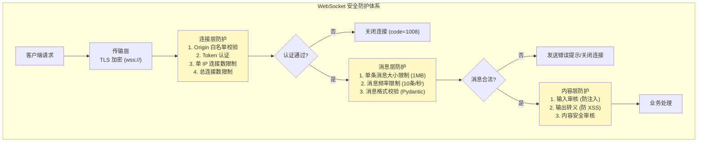

#### 代码示例

**示例 1：基础——消息大小限制与频率限制**

```python
"""
示例1：WebSocket 消息大小限制 + 频率限制
运行：uvicorn ws_rate_limit:app --reload
"""
from fastapi import FastAPI, WebSocket, WebSocketDisconnect, status
from collections import defaultdict
import time
import json

app = FastAPI(title="WebSocket 限流", version="1.0.0")

MAX_MESSAGE_SIZE = 1024 * 1024  # 1MB
MAX_MESSAGES_PER_SECOND = 10    # 每秒最多 10 条消息
MAX_MESSAGES_PER_MINUTE = 100   # 每分钟最多 100 条消息


class RateLimiter:
    """基于滑动窗口的频率限制器"""

    def __init__(self):
        # user_id -> 消息时间戳列表
        self.message_timestamps = defaultdict(list)
        self.max_per_second = MAX_MESSAGES_PER_SECOND
        self.max_per_minute = MAX_MESSAGES_PER_MINUTE

    def check_and_record(self, user_id: str) -> tuple[bool, str]:
        """
        检查用户是否超过频率限制
        返回 (是否允许, 原因)
        """
        now = time.time()
        timestamps = self.message_timestamps[user_id]

        # 清理 1 分钟前的记录
        self.message_timestamps[user_id] = [
            t for t in timestamps if now - t < 60
        ]
        timestamps = self.message_timestamps[user_id]

        # 检查每秒限制
        recent_1s = [t for t in timestamps if now - t < 1]
        if len(recent_1s) >= self.max_per_second:
            return False, f"发送过于频繁：每秒最多 {self.max_per_second} 条消息"

        # 检查每分钟限制
        if len(timestamps) >= self.max_per_minute:
            return False, f"发送过于频繁：每分钟最多 {self.max_per_minute} 条消息"

        # 记录当前消息
        timestamps.append(now)
        return True, ""


rate_limiter = RateLimiter()


@app.websocket("/ws/limited")
async def websocket_limited(websocket: WebSocket):
    user_id = websocket.query_params.get("user_id", "anonymous")
    await websocket.accept()

    try:
        while True:
            # 接收原始消息（用于检查大小）
            message = await websocket.receive()

            if message["type"] == "websocket.disconnect":
                break

            # 检查消息大小
            if message["type"] == "text":
                data_size = len(message["text"].encode("utf-8"))
            else:
                data_size = len(message["bytes"])

            if data_size > MAX_MESSAGE_SIZE:
                await websocket.send_json({
                    "type": "error",
                    "reason": f"消息过大：{data_size} 字节，限制 {MAX_MESSAGE_SIZE} 字节",
                })
                await websocket.close(code=status.WS_1009_MESSAGE_TOO_BIG, reason="消息过大")
                break

            # 检查频率限制
            allowed, reason = rate_limiter.check_and_record(user_id)
            if not allowed:
                await websocket.send_json({
                    "type": "rate_limited",
                    "reason": reason,
                    "retry_after": 1,
                })
                continue

            # 正常处理消息
            if message["type"] == "text":
                await websocket.send_json({
                    "type": "echo",
                    "content": message["text"],
                    "size": data_size,
                })

    except WebSocketDisconnect:
        pass


# 预期运行结果：
# 发送超过 1MB 的消息 → 收到 error + 连接关闭（code=1009）
# 每秒发送超过 10 条 → 收到 rate_limited 提示，消息被丢弃
```

**示例 2：进阶——Pydantic 消息校验与输入过滤**

```python
"""
示例2：Pydantic 消息校验 + XSS 防护 + SQL 注入防护
运行：uvicorn ws_security_validation:app --reload
"""
from fastapi import FastAPI, WebSocket, WebSocketDisconnect
from pydantic import BaseModel, Field, field_validator
from typing import Literal, Optional
import json
import html
import re

app = FastAPI(title="WebSocket 安全校验", version="1.0.0")

# 危险关键词（防注入）
DANGEROUS_PATTERNS = [
    r"(?i)<script\b",      # XSS
    r"(?i)javascript:",     # XSS
    r"(?i)on\w+\s*=",       # 事件处理器 XSS
    r"(?i)(union\s+select)", # SQL 注入
    r"(?i)(drop\s+table)",  # SQL 注入
    r"(?i)(--\s*$)",        # SQL 注释
]


class ChatMessage(BaseModel):
    """聊天消息模型：严格校验输入"""
    type: Literal["chat", "ping", "info"]
    content: str = Field(..., min_length=1, max_length=2000, description="消息内容")
    room_id: Optional[str] = Field(None, max_length=50, pattern=r"^[a-zA-Z0-9_-]+$")

    @field_validator("content")
    @classmethod
    def validate_content(cls, v: str) -> str:
        """校验消息内容，过滤危险内容"""
        # 检查危险模式
        for pattern in DANGEROUS_PATTERNS:
            if re.search(pattern, v):
                raise ValueError(f"消息包含不安全内容")
        return v

    @field_validator("room_id")
    @classmethod
    def validate_room_id(cls, v: Optional[str]) -> Optional[str]:
        """校验房间 ID 格式"""
        if v is not None and not re.match(r"^[a-zA-Z0-9_-]+$", v):
            raise ValueError("房间 ID 只能包含字母、数字、下划线、连字符")
        return v


def sanitize_output(text: str) -> str:
    """输出转义：防止 XSS"""
    return html.escape(text, quote=True)


@app.websocket("/ws/secure-chat")
async def websocket_secure_chat(websocket: WebSocket):
    await websocket.accept()
    user_id = websocket.query_params.get("user_id", "anonymous")

    try:
        while True:
            raw = await websocket.receive_text()

            try:
                # 第1步：Pydantic 校验消息格式和内容
                message = ChatMessage.model_validate_json(raw)
            except Exception as e:
                await websocket.send_json({
                    "type": "error",
                    "reason": f"消息校验失败: {str(e)}",
                })
                continue

            # 第2步：根据类型处理
            if message.type == "chat":
                # 输出转义（防 XSS）
                safe_content = sanitize_output(message.content)
                await websocket.send_json({
                    "type": "chat",
                    "from": user_id,
                    "content": safe_content,  # 已转义
                    "room_id": message.room_id,
                })

            elif message.type == "ping":
                await websocket.send_json({"type": "pong"})

            elif message.type == "info":
                await websocket.send_json({
                    "type": "info",
                    "content": "安全聊天室：所有消息经过校验和转义",
                })

    except WebSocketDisconnect:
        pass


# 测试：
"""
const ws = new WebSocket('ws://localhost:8000/ws/secure-chat?user_id=alice');
ws.onmessage = (e) => console.log(JSON.parse(e.data));

// 正常消息
ws.send(JSON.stringify({type: 'chat', content: '你好'}));
// 输出：{type: 'chat', from: 'alice', content: '你好'}

// XSS 攻击
ws.send(JSON.stringify({type: 'chat', content: '<script>alert(1)</script>'}));
// 输出：{type: 'error', reason: '消息校验失败: ...'}

// 超长消息
ws.send(JSON.stringify({type: 'chat', content: 'x'.repeat(3000)}));
// 输出：{type: 'error', reason: '消息校验失败: ...'}

// 非法房间 ID
ws.send(JSON.stringify({type: 'chat', content: 'hi', room_id: '../etc/passwd'}));
// 输出：{type: 'error', reason: '消息校验失败: ...'}
"""
```

**示例 3：完整场景——生产级安全中间件（连接数限制 + IP 黑名单 + 异常检测）**

```python
"""
示例3：生产级 WebSocket 安全中间件
特性：IP 连接数限制、IP 黑名单、异常行为检测、自动封禁
运行：uvicorn ws_security_middleware:app --reload
"""
from fastapi import FastAPI, WebSocket, WebSocketDisconnect, Request, Response
from starlette.middleware.base import BaseHTTPMiddleware
from starlette.responses import JSONResponse
from typing import Dict, Set
import time
import json

app = FastAPI(title="生产级安全中间件", version="1.0.0")

# 安全配置
MAX_CONNECTIONS_PER_IP = 20      # 单 IP 最大连接数
MAX_CONNECTIONS_TOTAL = 10000    # 总连接数上限
BLOCK_DURATION = 300             # 封禁时长（秒）
ABNORMAL_THRESHOLD = 50          # 异常行为阈值（短时间内断开次数）


class SecurityManager:
    """安全管理器：连接统计、IP 限制、异常检测、自动封禁"""

    def __init__(self):
        self.ip_connections: Dict[str, int] = {}      # IP -> 连接数
        self.total_connections = 0
        self.blocked_ips: Dict[str, float] = {}        # IP -> 解封时间
        self.ip_disconnect_count: Dict[str, list] = {}  # IP -> 断开时间戳列表
        self.ip_message_count: Dict[str, int] = {}      # IP -> 总消息数（监控用）

    def is_blocked(self, ip: str) -> bool:
        """检查 IP 是否被封禁"""
        if ip in self.blocked_ips:
            if time.time() < self.blocked_ips[ip]:
                return True
            else:
                del self.blocked_ips[ip]
        return False

    def can_connect(self, ip: str) -> tuple[bool, str]:
        """检查是否允许连接"""
        if self.is_blocked(ip):
            return False, "IP 已被临时封禁"

        if self.total_connections >= MAX_CONNECTIONS_TOTAL:
            return False, "服务器连接数已满"

        if self.ip_connections.get(ip, 0) >= MAX_CONNECTIONS_PER_IP:
            return False, f"单 IP 连接数超过限制（{MAX_CONNECTIONS_PER_IP}）"

        return True, ""

    def register_connection(self, ip: str):
        """注册连接"""
        self.ip_connections[ip] = self.ip_connections.get(ip, 0) + 1
        self.total_connections += 1

    def unregister_connection(self, ip: str):
        """注销连接"""
        if ip in self.ip_connections:
            self.ip_connections[ip] -= 1
            if self.ip_connections[ip] <= 0:
                del self.ip_connections[ip]
        self.total_connections = max(0, self.total_connections - 1)

        # 记录断开时间，用于异常检测
        if ip not in self.ip_disconnect_count:
            self.ip_disconnect_count[ip] = []
        self.ip_disconnect_count[ip].append(time.time())

        # 检查异常行为：短时间内频繁断开重连
        now = time.time()
        recent = [t for t in self.ip_disconnect_count[ip] if now - t < 60]
        self.ip_disconnect_count[ip] = recent
        if len(recent) > ABNORMAL_THRESHOLD:
            self.block_ip(ip, reason=f"1 分钟内断开 {len(recent)} 次，疑似异常行为")

    def block_ip(self, ip: str, reason: str = ""):
        """封禁 IP"""
        self.blocked_ips[ip] = time.time() + BLOCK_DURATION
        print(f"⚠️ IP {ip} 被封禁 {BLOCK_DURATION} 秒，原因: {reason}")

    def record_message(self, ip: str):
        """记录消息数"""
        self.ip_message_count[ip] = self.ip_message_count.get(ip, 0) + 1

    def get_stats(self) -> dict:
        """获取安全统计"""
        return {
            "total_connections": self.total_connections,
            "unique_ips": len(self.ip_connections),
            "blocked_ips": len(self.blocked_ips),
            "top_ips": sorted(
                self.ip_connections.items(), key=lambda x: x[1], reverse=True
            )[:10],
        }


security_manager = SecurityManager()


class WebSocketSecurityMiddleware(BaseHTTPMiddleware):
    """WebSocket 安全中间件：在握手阶段检查 IP"""

    async def dispatch(self, request: Request, call_next):
        # 只拦截 WebSocket 握手请求
        if request.url.path.startswith("/ws/") and request.headers.get("upgrade") == "websocket":
            client_ip = request.client.host if request.client else "unknown"

            allowed, reason = security_manager.can_connect(client_ip)
            if not allowed:
                # 返回 429 拒绝握手
                return JSONResponse(
                    status_code=429,
                    content={"error": "WebSocket 连接被拒绝", "reason": reason},
                )

            # 注册连接（在握手成功后）
            security_manager.register_connection(client_ip)

            try:
                response = await call_next(request)
                return response
            finally:
                # 连接关闭时注销（注意：中间件无法感知 WebSocket 断开时机）
                # 实际项目中应在 WebSocket 端点的 disconnect 中调用 unregister
                pass

        return await call_next(request)


app.add_middleware(WebSocketSecurityMiddleware)


@app.websocket("/ws/protected")
async def websocket_protected(websocket: WebSocket):
    client_ip = websocket.client.host if websocket.client else "unknown"

    # 二次检查（中间件可能被绕过）
    allowed, reason = security_manager.can_connect(client_ip)
    if not allowed:
        await websocket.close(code=1013, reason=reason)
        return

    await websocket.accept()

    try:
        while True:
            data = await websocket.receive_text()
            security_manager.record_message(client_ip)
            await websocket.send_json({"type": "echo", "content": data, "ip": client_ip})
    except WebSocketDisconnect:
        security_manager.unregister_connection(client_ip)


@app.get("/api/security/stats")
async def security_stats():
    """获取安全统计信息"""
    return security_manager.get_stats()


# 预期运行结果：
# 单 IP 超过 20 个连接 → 新连接被拒绝（429）
# 1 分钟内断开超过 50 次 → IP 被封禁 5 分钟
# 访问 /api/security/stats 查看连接统计和封禁状态
```

#### 使用场景与最佳实践

**适用场景**：
- 消息大小限制：所有 WebSocket 服务都应设置，防止大消息攻击
- 频率限制：公开服务、用户量大的应用，防止洪水攻击
- Pydantic 校验：所有接收 JSON 消息的端点，防止格式错误和注入
- 输出转义：聊天、评论等用户生成内容展示场景，防 XSS
- IP 连接数限制：公开服务，防止单 IP 耗尽连接资源
- 异常检测：生产环境，自动识别和封禁恶意行为

**不适用场景**：
- 内部服务（IP 白名单内）：可适当放宽限制
- 传输大文件的专用端点：需要调大消息大小限制（但建议用 HTTP 替代）

**最佳实践**：
1. **设置消息大小上限**：默认 1MB，根据业务调整，最大不超过 10MB
2. **按用户/IP 限流**：每秒 10-50 条，每分钟 100-500 条，根据业务调整
3. **Pydantic 校验所有输入消息**：定义严格的消息模型，校验类型、长度、格式
4. **输出转义用户生成内容**：`html.escape()` 防止 XSS，不要信任客户端发送的任何内容
5. **限制单 IP 连接数**：防止单 IP 耗尽所有连接资源（默认 10-50）
6. **监控异常行为**：频繁断开重连、超大消息、高频消息都是攻击信号
7. **使用 wss://**：生产环境必须 TLS 加密，防止窃听和篡改
8. **定期轮换 Token**：JWT 设置合理的过期时间（15 分钟-2 小时），支持刷新

**性能建议**：
- Pydantic 校验有 CPU 开销，高频消息（>1000/秒）可考虑用更轻量的校验（如手动检查关键字段）
- 频率限制器的时间戳列表需要定期清理，避免内存增长
- IP 连接数统计用字典，O(1) 操作，无性能瓶颈

#### 常见坑点

**坑点 1：未限制消息大小导致内存溢出（OOM）**

- **错误现象**：恶意客户端发送超大消息（如 1GB），服务端内存飙升后 OOM 崩溃，所有连接断开
- **根本原因**：WebSocket 协议本身没有消息大小限制，Starlette/Uvicorn 默认也不限制（或限制很大），攻击者可以发送超大消息耗尽内存
- **正确做法**：① 在 Uvicorn 启动时设置 `--ws-max-size 1048576`（1MB）；② 在端点中用 `receive()` 获取原始消息，检查 `len(message["text"])` 或 `len(message["bytes"])`，超过限制关闭连接（code=1009）；③ Nginx 配置 `proxy_read_timeout` 和 `client_max_body_size`
- **预防措施**：部署文档中明确要求设置 `--ws-max-size`，代码模板中包含消息大小检查

**坑点 2：频率限制只限制消息数不限制连接数导致连接耗尽**

- **错误现象**：攻击者建立 10 万个 WebSocket 连接（不发消息或低频发消息），服务端文件描述符耗尽，新连接无法建立
- **根本原因**：只做了消息频率限制，没有做连接数限制。WebSocket 是长连接，攻击者可以建立大量空闲连接耗尽资源
- **正确做法**：① 限制总连接数（如 10000）；② 限制单 IP 连接数（如 20）；③ 限制单用户连接数（如 5）；④ 心跳超时检测，清理死连接
- **预防措施**：连接管理器中内置连接数限制，安全中间件在握手阶段检查 IP 连接数

---

> 💡 **深度讲解**：WebSocket 认证与安全是生产环境必须解决的问题。认证方面，由于浏览器 WebSocket API 不支持自定义 Header，需要采用 Query Token、首条消息认证、子协议认证等替代方案，其中首条消息认证最安全（Token 不出现在 URL 中）。安全防护是多层体系：传输层用 TLS，连接层用认证+Origin校验+连接数限制，消息层用大小限制+频率限制+格式校验，内容层用输入审核+输出转义。跨站 WebSocket 劫持（CSWSH）是浏览器端特有的安全风险，必须校验 Origin 头。大消息攻击和连接耗尽攻击是 WebSocket 服务最常见的 DoS 手段，必须设置消息大小上限和连接数上限。理解这些安全机制后，可以构建出安全可靠的生产级 WebSocket 服务。
>
> **📝 精简总结**：
> 1. WebSocket 认证方式：Query Token（简单但不安全）、首条消息认证（推荐）、Cookie（有 CSRF 风险）、子协议 Token（标准）
> 2. 浏览器 WebSocket API 不支持自定义 Header，这是认证方案选择的根本原因
> 3. 必须校验 Origin 头，防止跨站 WebSocket 劫持（CSWSH）
> 4. 安全防护四层：传输层（TLS）、连接层（认证+连接数限制）、消息层（大小+频率+格式）、内容层（审核+转义）
> 5. 消息大小限制：Uvicorn `--ws-max-size` + 端点中检查，默认 1MB
> 6. 频率限制：滑动窗口算法，按用户/IP 限制每秒/每分钟消息数
> 7. Pydantic 校验所有输入，html.escape 转义输出，防注入和 XSS
>
> **🎯 梯度练习题**：
> - **基础 1**：实现 Query 参数 Token 认证，验证失败时用 1008 关闭连接
> - **基础 2**：解释为什么 WebSocket 不能用 Authorization 头，列出 3 种替代方案
> - **基础 3**：实现消息大小限制，超过 1MB 时用 1009 关闭连接
> - **进阶 1**：实现首条消息认证，包含 10 秒认证超时和 Token 验证
> - **进阶 2**：实现基于滑动窗口的频率限制器，限制每秒 10 条、每分钟 100 条
> - **实战 1**：实现生产级安全方案，包含子协议认证 + Origin 校验 + 连接数限制 + Pydantic 消息校验 + 输出转义

---

## 5. WebSocket 房间与群组通信

### 5.1 房间管理器设计与实现

#### 概念解释

**WebSocket 房间（Room）** 是将连接按逻辑分组的机制，每个房间维护一组用户连接，支持房间内广播、用户加入/离开通知、房间内用户列表查询，是构建多群组实时应用（聊天室、协作空间、游戏房间）的核心抽象。

> 🏠 **生活化比喻**：房间就像酒店的会议室——`join_room()` 是刷卡进入会议室，`leave_room()` 是离开会议室，`send_to_room()` 是在会议室内发言（只有室内的人能听到），`get_room_users()` 是查看会议室里有哪些人。一个人可以同时在多个会议室（多房间订阅），酒店走廊是全局广播（所有房间都能听到）。

**核心价值**：将连接按业务逻辑分组，实现精准的消息推送（只发给相关用户），减少不必要的网络流量和处理开销，是多群组实时应用的基础架构。

> 🎯 **面试高频考点 10**：房间管理器的数据结构如何设计？用户加入/离开房间时需要通知哪些人？
> **答**：房间管理器用两个字典维护关系：`rooms: Dict[room_id, Set[user_id]]`（房间→用户集合）和 `user_rooms: Dict[user_id, Set[room_id]]`（用户→房间集合），双向索引便于快速查询。用户加入时：① 加入 rooms[room_id] 集合；② 加入 user_rooms[user_id] 集合；③ 向房间内所有其他用户发送 user_joined 通知。用户离开时：① 从两个集合中移除；② 向房间内其他用户发送 user_left 通知；③ 空房间自动清理。双向索引的好处是用户断开时可以快速找到其所有房间并清理。

#### 原理说明

房间管理器的核心机制是 **双向索引 + 集合操作 + 事件通知**。

**为什么这样设计**：房间本质是用户的分组，需要支持两种查询：房间有哪些用户（广播时遍历）、用户在哪些房间（断开时清理）。双向索引（rooms 和 user_rooms）使得两种查询都是 O(1)。用 Set 而非 List 是因为加入/离开/查找都是 O(1)，且自动去重。事件通知（加入/离开）让房间内用户实时感知成员变化。

**技术对比**：

| 数据结构 | 加入 | 离开 | 查找用户 | 遍历房间 | 适用场景 |
|---------|------|------|---------|---------|---------|
| `Dict[str, List[str]]` | O(1) | O(n) | O(n) | O(n) | 简单场景 |
| `Dict[str, Set[str]]` | O(1) | O(1) | O(1) | O(n) | 推荐 |
| `Dict[str, Dict[str, WebSocket]]` | O(1) | O(1) | O(1) | O(n) | 需要直接访问连接 |

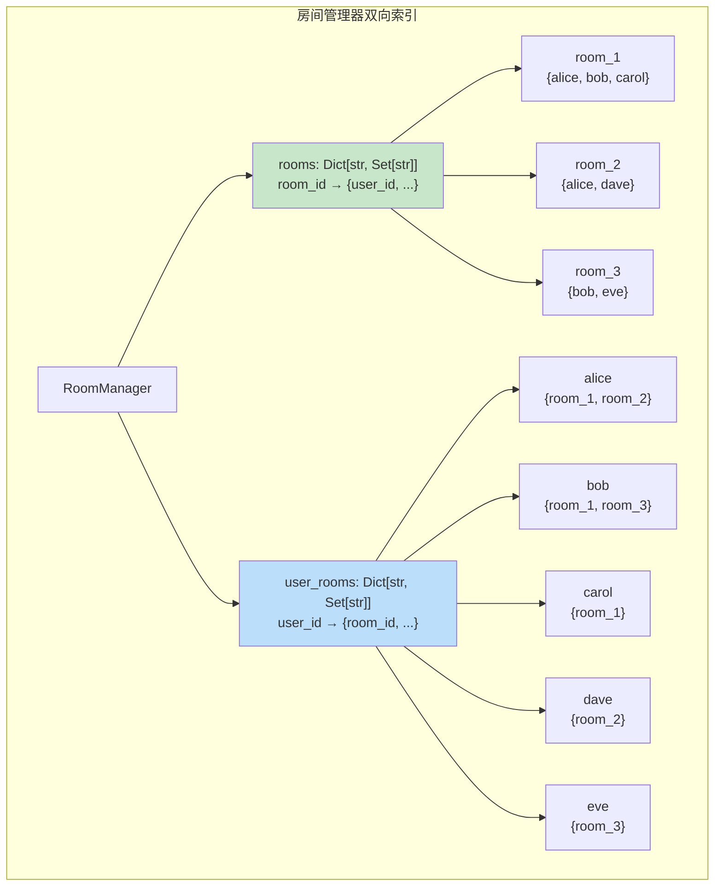

#### 代码示例

**示例 1：基础——房间管理器核心实现**

```python
"""
示例1：房间管理器核心实现
支持：加入/离开房间、房间内广播、用户列表、多房间订阅
运行：uvicorn ws_room_basic:app --reload
"""
from fastapi import FastAPI, WebSocket, WebSocketDisconnect
from typing import Dict, Set, Optional
import asyncio
import json
import time

app = FastAPI(title="房间管理器", version="1.0.0")


class RoomManager:
    """WebSocket 房间管理器：双向索引 + 事件通知"""

    def __init__(self):
        self.connections: Dict[str, WebSocket] = {}       # user_id -> websocket
        self.rooms: Dict[str, Set[str]] = {}               # room_id -> {user_id}
        self.user_rooms: Dict[str, Set[str]] = {}          # user_id -> {room_id}
        self.lock = asyncio.Lock()

    async def connect(self, user_id: str, websocket: WebSocket):
        """用户连接"""
        await websocket.accept()
        async with self.lock:
            self.connections[user_id] = websocket
            self.user_rooms[user_id] = set()

    async def disconnect(self, user_id: str):
        """用户断开：从所有房间清理"""
        async with self.lock:
            websocket = self.connections.pop(user_id, None)
            rooms = self.user_rooms.pop(user_id, set())
            for room_id in rooms:
                if room_id in self.rooms:
                    self.rooms[room_id].discard(user_id)
                    if not self.rooms[room_id]:
                        del self.rooms[room_id]
        # 通知所有房间的其他用户
        for room_id in rooms:
            await self._notify_room(room_id, {
                "type": "user_left",
                "room_id": room_id,
                "user_id": user_id,
                "users": self.get_room_users(room_id),
                "timestamp": time.time(),
            })

    async def join_room(self, user_id: str, room_id: str) -> bool:
        """加入房间，返回是否成功（首次加入）"""
        async with self.lock:
            if room_id not in self.rooms:
                self.rooms[room_id] = set()
            is_new = user_id not in self.rooms[room_id]
            self.rooms[room_id].add(user_id)
            self.user_rooms[user_id].add(room_id)

        if is_new:
            # 通知房间内其他用户
            await self._notify_room(room_id, {
                "type": "user_joined",
                "room_id": room_id,
                "user_id": user_id,
                "users": self.get_room_users(room_id),
                "timestamp": time.time(),
            }, exclude_user=user_id)

            # 通知加入者房间信息
            await self.send_to_user(user_id, {
                "type": "joined_room",
                "room_id": room_id,
                "users": self.get_room_users(room_id),
                "timestamp": time.time(),
            })
        return is_new

    async def leave_room(self, user_id: str, room_id: str):
        """离开房间"""
        async with self.lock:
            if room_id in self.rooms:
                self.rooms[room_id].discard(user_id)
                if not self.rooms[room_id]:
                    del self.rooms[room_id]
            if user_id in self.user_rooms:
                self.user_rooms[user_id].discard(room_id)

        await self._notify_room(room_id, {
            "type": "user_left",
            "room_id": room_id,
            "user_id": user_id,
            "users": self.get_room_users(room_id),
            "timestamp": time.time(),
        })

    async def send_to_room(self, room_id: str, message: dict, exclude_user: str = None):
        """发送消息给房间内所有用户"""
        await self._notify_room(room_id, message, exclude_user)

    async def _notify_room(self, room_id: str, message: dict, exclude_user: str = None):
        """内部方法：通知房间内用户"""
        if room_id not in self.rooms:
            return
        disconnected = []
        for uid in self.rooms[room_id]:
            if uid == exclude_user:
                continue
            ws = self.connections.get(uid)
            if ws:
                try:
                    await ws.send_json(message)
                except Exception:
                    disconnected.append(uid)
        for uid in disconnected:
            await self.disconnect(uid)

    async def send_to_user(self, user_id: str, message: dict):
        """发送消息给指定用户"""
        ws = self.connections.get(user_id)
        if ws:
            try:
                await ws.send_json(message)
            except Exception:
                await self.disconnect(user_id)

    def get_room_users(self, room_id: str) -> list:
        """获取房间用户列表"""
        return sorted(self.rooms.get(room_id, set()))

    def get_user_rooms(self, user_id: str) -> list:
        """获取用户所在房间列表"""
        return sorted(self.user_rooms.get(user_id, set()))

    def get_room_count(self) -> int:
        """获取房间总数"""
        return len(self.rooms)


room_manager = RoomManager()


@app.websocket("/ws/{user_id}")
async def websocket_endpoint(websocket: WebSocket, user_id: str):
    await room_manager.connect(user_id, websocket)

    try:
        while True:
            raw = await websocket.receive_text()
            msg = json.loads(raw)
            msg_type = msg.get("type")

            if msg_type == "join_room":
                await room_manager.join_room(user_id, msg["room_id"])

            elif msg_type == "leave_room":
                await room_manager.leave_room(user_id, msg["room_id"])

            elif msg_type == "room_message":
                await room_manager.send_to_room(
                    msg["room_id"],
                    {
                        "type": "room_message",
                        "room_id": msg["room_id"],
                        "from": user_id,
                        "content": msg.get("content", ""),
                        "timestamp": time.time(),
                    },
                    exclude_user=user_id,
                )

            elif msg_type == "room_users":
                await room_manager.send_to_user(user_id, {
                    "type": "room_users",
                    "room_id": msg["room_id"],
                    "users": room_manager.get_room_users(msg["room_id"]),
                })

            elif msg_type == "my_rooms":
                await room_manager.send_to_user(user_id, {
                    "type": "my_rooms",
                    "rooms": room_manager.get_user_rooms(user_id),
                })

    except WebSocketDisconnect:
        await room_manager.disconnect(user_id)


@app.get("/api/rooms")
async def list_rooms():
    """获取所有房间及用户数"""
    return {
        "total_rooms": room_manager.get_room_count(),
        "rooms": [
            {"room_id": rid, "user_count": len(users), "users": sorted(users)}
            for rid, users in room_manager.rooms.items()
        ],
    }


# 预期运行结果：
# Alice 加入 room1 → Alice 收到 joined_room，room1 其他用户收到 user_joined
# Alice 在 room1 发消息 → room1 其他用户收到 room_message
# Alice 断开 → room1 其他用户收到 user_left
```

**示例 2：进阶——带持久化和历史消息的房间管理器**

```python
"""
示例2：带历史消息和房间元数据的房间管理器
特性：房间创建/销毁、消息历史持久化（Redis）、未读消息计数
运行：uvicorn ws_room_persistent:app --reload
"""
from fastapi import FastAPI, WebSocket, WebSocketDisconnect
from typing import Dict, Set, Optional, List
from datetime import datetime
import redis.asyncio as redis
import asyncio
import json
import time
import os

app = FastAPI(title="持久化房间管理器", version="1.0.0")

REDIS_URL = os.getenv("REDIS_URL", "redis://localhost:6379")
MAX_HISTORY_PER_ROOM = 100  # 每个房间保留最近 100 条消息


class PersistentRoomManager:
    """带 Redis 持久化的房间管理器"""

    def __init__(self, redis_url: str):
        self.redis = redis.from_url(redis_url)
        self.connections: Dict[str, WebSocket] = {}
        self.rooms: Dict[str, Set[str]] = {}
        self.user_rooms: Dict[str, Set[str]] = {}
        self.room_meta: Dict[str, dict] = {}  # room_id -> {name, created_at, owner}
        self.lock = asyncio.Lock()

    async def create_room(self, room_id: str, name: str, owner: str) -> bool:
        """创建房间（持久化到 Redis）"""
        if room_id in self.rooms:
            return False
        meta = {
            "room_id": room_id,
            "name": name,
            "owner": owner,
            "created_at": datetime.now().isoformat(),
        }
        async with self.lock:
            self.rooms[room_id] = set()
            self.room_meta[room_id] = meta
        # 持久化房间元数据
        await self.redis.hset("rooms:meta", room_id, json.dumps(meta))
        return True

    async def delete_room(self, room_id: str, operator: str) -> bool:
        """删除房间（仅创建者可删）"""
        meta = self.room_meta.get(room_id)
        if not meta or meta["owner"] != operator:
            return False

        # 通知房间内所有用户房间已删除
        await self._notify_room(room_id, {
            "type": "room_deleted",
            "room_id": room_id,
            "reason": "房间已被创建者删除",
        })

        # 清理所有用户的房间关联
        users = self.rooms.get(room_id, set())
        async with self.lock:
            for uid in users:
                if uid in self.user_rooms:
                    self.user_rooms[uid].discard(room_id)
            self.rooms.pop(room_id, None)
            self.room_meta.pop(room_id, None)

        # 清理 Redis
        await self.redis.hdel("rooms:meta", room_id)
        await self.redis.delete(f"rooms:history:{room_id}")
        return True

    async def join_room(self, user_id: str, room_id: str) -> bool:
        """加入房间，加载历史消息"""
        if room_id not in self.rooms:
            return False

        async with self.lock:
            self.rooms[room_id].add(user_id)
            if user_id not in self.user_rooms:
                self.user_rooms[user_id] = set()
            self.user_rooms[user_id].add(room_id)

        # 加载历史消息
        history = await self._load_history(room_id)

        await self.send_to_user(user_id, {
            "type": "joined_room",
            "room_id": room_id,
            "room_meta": self.room_meta.get(room_id, {}),
            "users": sorted(self.rooms[room_id]),
            "history": history,
        })

        await self._notify_room(room_id, {
            "type": "user_joined",
            "room_id": room_id,
            "user_id": user_id,
            "users": sorted(self.rooms[room_id]),
        }, exclude_user=user_id)

        return True

    async def send_to_room(self, room_id: str, message: dict, exclude_user: str = None):
        """发送消息并持久化到历史"""
        # 持久化消息
        await self._save_history(room_id, message)
        await self._notify_room(room_id, message, exclude_user)

    async def _save_history(self, room_id: str, message: dict):
        """保存消息到 Redis 列表（保留最近 N 条）"""
        key = f"rooms:history:{room_id}"
        await self.redis.rpush(key, json.dumps(message, ensure_ascii=False))
        await self.redis.ltrim(key, -MAX_HISTORY_PER_ROOM, -1)

    async def _load_history(self, room_id: str) -> List[dict]:
        """加载房间历史消息"""
        key = f"rooms:history:{room_id}"
        raw = await self.redis.lrange(key, 0, -1)
        return [json.loads(item) for item in raw]

    async def _notify_room(self, room_id: str, message: dict, exclude_user: str = None):
        if room_id not in self.rooms:
            return
        disconnected = []
        for uid in self.rooms[room_id]:
            if uid == exclude_user:
                continue
            ws = self.connections.get(uid)
            if ws:
                try:
                    await ws.send_json(message)
                except Exception:
                    disconnected.append(uid)
        for uid in disconnected:
            await self.disconnect(uid)

    async def connect(self, user_id: str, websocket: WebSocket):
        await websocket.accept()
        async with self.lock:
            self.connections[user_id] = websocket
            self.user_rooms[user_id] = set()

    async def disconnect(self, user_id: str):
        async with self.lock:
            self.connections.pop(user_id, None)
            rooms = self.user_rooms.pop(user_id, set())
            for room_id in rooms:
                if room_id in self.rooms:
                    self.rooms[room_id].discard(user_id)
        for room_id in rooms:
            await self._notify_room(room_id, {
                "type": "user_left",
                "room_id": room_id,
                "user_id": user_id,
                "users": sorted(self.rooms.get(room_id, set())),
            })

    async def send_to_user(self, user_id: str, message: dict):
        ws = self.connections.get(user_id)
        if ws:
            try:
                await ws.send_json(message)
            except Exception:
                await self.disconnect(user_id)


room_manager = PersistentRoomManager(REDIS_URL)


@app.websocket("/ws/{user_id}")
async def websocket_endpoint(websocket: WebSocket, user_id: str):
    await room_manager.connect(user_id, websocket)
    try:
        while True:
            raw = await websocket.receive_text()
            msg = json.loads(raw)
            if msg["type"] == "create_room":
                ok = await room_manager.create_room(msg["room_id"], msg.get("name", ""), user_id)
                await room_manager.send_to_user(user_id, {"type": "create_result", "success": ok})
            elif msg["type"] == "join_room":
                ok = await room_manager.join_room(user_id, msg["room_id"])
                if not ok:
                    await room_manager.send_to_user(user_id, {"type": "error", "reason": "房间不存在"})
            elif msg["type"] == "room_message":
                await room_manager.send_to_room(msg["room_id"], {
                    "type": "room_message",
                    "room_id": msg["room_id"],
                    "from": user_id,
                    "content": msg["content"],
                    "timestamp": time.time(),
                }, exclude_user=user_id)
    except WebSocketDisconnect:
        await room_manager.disconnect(user_id)
```

**示例 3：完整场景——层级房间（频道/子频道）与权限管理**

```python
"""
示例3：层级房间系统（类似 Discord 的服务器/频道）
特性：服务器（Server）→ 频道（Channel）层级结构、角色权限、@提及
运行：uvicorn ws_hierarchical_rooms:app --reload
"""
from fastapi import FastAPI, WebSocket, WebSocketDisconnect
from typing import Dict, Set, Optional
from dataclasses import dataclass, field
import asyncio
import json
import time
import re

app = FastAPI(title="层级房间系统", version="1.0.0")


@dataclass
class Server:
    """服务器：包含多个频道"""
    server_id: str
    name: str
    owner: str
    channels: Dict[str, Set[str]] = field(default_factory=dict)  # channel_id -> {user_id}
    members: Set[str] = field(default_factory=set)
    roles: Dict[str, Set[str]] = field(default_factory=dict)  # role -> {permissions}
    user_roles: Dict[str, str] = field(default_factory=dict)  # user_id -> role


class HierarchicalRoomManager:
    """层级房间管理器：服务器 → 频道"""

    def __init__(self):
        self.connections: Dict[str, WebSocket] = {}
        self.servers: Dict[str, Server] = {}
        self.user_servers: Dict[str, Set[str]] = {}  # user_id -> {server_id}
        self.lock = asyncio.Lock()

    async def connect(self, user_id: str, websocket: WebSocket):
        await websocket.accept()
        async with self.lock:
            self.connections[user_id] = websocket
            self.user_servers[user_id] = set()

    async def create_server(self, server_id: str, name: str, owner: str) -> bool:
        """创建服务器"""
        if server_id in self.servers:
            return False
        server = Server(
            server_id=server_id, name=name, owner=owner,
            roles={"owner": {"manage_channels", "kick_members", "send_message"},
                   "member": {"send_message"},
                   "guest": set()},
            user_roles={owner: "owner"},
        )
        server.members.add(owner)
        async with self.lock:
            self.servers[server_id] = server
            self.user_servers[owner].add(server_id)
        return True

    async def create_channel(self, server_id: str, channel_id: str, user_id: str) -> bool:
        """在服务器中创建频道"""
        server = self.servers.get(server_id)
        if not server:
            return False
        if not self._has_permission(server, user_id, "manage_channels"):
            return False
        if channel_id in server.channels:
            return False
        server.channels[channel_id] = set()
        return True

    async def join_channel(self, user_id: str, server_id: str, channel_id: str) -> bool:
        """加入频道"""
        server = self.servers.get(server_id)
        if not server or channel_id not in server.channels:
            return False
        if user_id not in server.members:
            return False
        server.channels[channel_id].add(user_id)

        # 通知频道内其他用户
        await self._notify_channel(server_id, channel_id, {
            "type": "user_joined",
            "server_id": server_id,
            "channel_id": channel_id,
            "user_id": user_id,
            "users": sorted(server.channels[channel_id]),
        }, exclude_user=user_id)

        await self.send_to_user(user_id, {
            "type": "joined_channel",
            "server_id": server_id,
            "channel_id": channel_id,
            "users": sorted(server.channels[channel_id]),
        })
        return True

    async def send_to_channel(self, server_id: str, channel_id: str, message: dict, sender: str):
        """发送消息到频道，处理 @提及"""
        server = self.servers.get(server_id)
        if not server or channel_id not in server.channels:
            return
        if not self._has_permission(server, sender, "send_message"):
            await self.send_to_user(sender, {"type": "error", "reason": "没有发言权限"})
            return

        # 处理 @提及
        content = message.get("content", "")
        mentioned = re.findall(r"@(\w+)", content)

        await self._notify_channel(server_id, channel_id, {
            **message,
            "server_id": server_id,
            "channel_id": channel_id,
            "from": sender,
            "mentioned": mentioned,
            "timestamp": time.time(),
        })

        # 被 @ 的用户如果不在频道，也发送通知
        for uid in mentioned:
            if uid in self.connections and uid not in server.channels[channel_id]:
                await self.send_to_user(uid, {
                    "type": "mention",
                    "server_id": server_id,
                    "channel_id": channel_id,
                    "from": sender,
                    "content": content,
                })

    def _has_permission(self, server: Server, user_id: str, permission: str) -> bool:
        """检查用户权限"""
        role = server.user_roles.get(user_id, "guest")
        return permission in server.roles.get(role, set())

    async def _notify_channel(self, server_id: str, channel_id: str, message: dict, exclude_user: str = None):
        server = self.servers.get(server_id)
        if not server or channel_id not in server.channels:
            return
        disconnected = []
        for uid in server.channels[channel_id]:
            if uid == exclude_user:
                continue
            ws = self.connections.get(uid)
            if ws:
                try:
                    await ws.send_json(message)
                except Exception:
                    disconnected.append(uid)
        for uid in disconnected:
            await self.disconnect(uid)

    async def send_to_user(self, user_id: str, message: dict):
        ws = self.connections.get(user_id)
        if ws:
            try:
                await ws.send_json(message)
            except Exception:
                await self.disconnect(user_id)

    async def disconnect(self, user_id: str):
        async with self.lock:
            self.connections.pop(user_id, None)
            servers = self.user_servers.pop(user_id, set())
        for sid in servers:
            server = self.servers.get(sid)
            if server:
                server.members.discard(user_id)
                for cid in server.channels:
                    server.channels[cid].discard(user_id)
                    await self._notify_channel(sid, cid, {
                        "type": "user_left",
                        "server_id": sid,
                        "channel_id": cid,
                        "user_id": user_id,
                    })


manager = HierarchicalRoomManager()


@app.websocket("/ws/{user_id}")
async def websocket_endpoint(websocket: WebSocket, user_id: str):
    await manager.connect(user_id, websocket)
    try:
        while True:
            raw = await websocket.receive_text()
            msg = json.loads(raw)
            t = msg["type"]
            if t == "create_server":
                ok = await manager.create_server(msg["server_id"], msg["name"], user_id)
                await manager.send_to_user(user_id, {"type": "result", "success": ok})
            elif t == "create_channel":
                ok = await manager.create_channel(msg["server_id"], msg["channel_id"], user_id)
                await manager.send_to_user(user_id, {"type": "result", "success": ok})
            elif t == "join_channel":
                ok = await manager.join_channel(user_id, msg["server_id"], msg["channel_id"])
                await manager.send_to_user(user_id, {"type": "result", "success": ok})
            elif t == "channel_message":
                await manager.send_to_channel(
                    msg["server_id"], msg["channel_id"],
                    {"type": "channel_message", "content": msg["content"]},
                    user_id,
                )
    except WebSocketDisconnect:
        await manager.disconnect(user_id)
```

#### 使用场景与最佳实践

**适用场景**：
- 多群组聊天：每个群组一个房间，支持用户加入多个群组
- 协作工具：每个文档/项目一个房间，实时同步编辑状态
- 在线游戏：游戏房间/匹配队列，房间内玩家状态同步
- 直播系统：每个直播间一个房间，弹幕和礼物广播
- 客服系统：每个客服会话一个房间，支持转接

**不适用场景**：
- 全局通知：不需要房间，直接广播即可
- 点对点通信：不需要房间，直接 send_to_user
- 单房间应用：不需要房间管理器的复杂度

**最佳实践**：
1. **双向索引（rooms + user_rooms）**：用户断开时能快速找到所有房间并清理
2. **用 Set 存储用户**：加入/离开/查找 O(1)，自动去重
3. **加入/离开时发送事件通知**：让房间内用户实时感知成员变化
4. **空房间自动清理**：用户全部离开后删除房间，避免内存泄漏
5. **房间消息持久化**：新用户加入时加载历史消息，用 Redis 列表存储
6. **限制用户加入房间数**：防止用户加入过多房间导致资源消耗
7. **房间权限管理**：创建者/管理员/成员不同权限，敏感操作检查权限

**性能建议**：
- 房间内用户数建议 <1000，超过时分片或用专用消息中间件
- 历史消息用 Redis 列表 + LTRIM 控制长度，避免内存增长
- 大房间广播用分批发送，避免阻塞事件循环
- 房间元数据（名称、创建者）用字典缓存，避免每次查询数据库

#### 常见坑点

**坑点 1：用户断开时未从所有房间清理导致幽灵用户**

- **错误现象**：用户断开后，房间用户列表中仍显示该用户，向其发送消息失败，房间人数统计不准确
- **根本原因**：`disconnect()` 中只从 `connections` 字典移除了连接，没有遍历 `user_rooms` 从每个房间的用户集合中移除
- **正确做法**：`disconnect()` 中先获取 `user_rooms[user_id]`，遍历每个房间从 `rooms[room_id]` 中移除用户，然后清理 `user_rooms[user_id]`
- **预防措施**：双向索引设计，disconnect 时必须同时清理两个字典

**坑点 2：房间内广播时遍历集合过程中集合被修改导致 RuntimeError**

- **错误现象**：广播消息时出现 `RuntimeError: Set changed size during iteration`，部分用户收不到消息
- **根本原因**：遍历 `rooms[room_id]` 集合发送消息时，某个连接断开触发 `disconnect()`，在 `disconnect()` 中修改了同一个集合（移除用户），导致遍历过程中集合大小变化
- **正确做法**：① 遍历前拷贝集合 `for uid in list(rooms[room_id]):`；② 或在锁内遍历但不 await（发送在锁外）；③ 发送失败时记录断开的用户，遍历结束后统一清理
- **预防措施**：所有遍历连接/用户集合的地方都先 `list()` 拷贝，避免遍历时修改

---

## 6. WebSocket 异常处理与断开重连

### 6.1 WebSocket 异常类型与处理策略

#### 概念解释

**WebSocket 异常处理** 是对 WebSocket 通信过程中各种异常（连接断开、消息格式错误、网络超时、服务端错误等）的识别、捕获和恢复机制，确保服务的稳定性和用户体验的连贯性。

> 🏠 **生活化比喻**：WebSocket 异常处理就像电话通话中的各种意外处理——`WebSocketDisconnect` 是对方挂断电话（正常结束），`ConnectionClosed` 是信号突然中断（网络问题），消息解析错误是听不清对方说话（请对方重复），超时是对方长时间不说话（主动挂断重拨）。好的异常处理让通话即使遇到意外也能优雅恢复，而不是直接崩溃。

**核心价值**：完善的异常处理确保单个连接的异常不会影响其他连接，服务端不会因异常崩溃，客户端能够自动恢复连接，是生产级 WebSocket 服务的稳定性保障。

> 🎯 **面试高频考点 11**：WebSocket 有哪些常见异常？如何处理？
> **答**：① `WebSocketDisconnect`——客户端正常断开，在 except 中清理连接资源；② `ConnectionClosed`/`RuntimeError`——发送时连接已关闭，try-except 静默失败；③ `json.JSONDecodeError`——消息格式错误，返回错误提示不关闭连接；④ `asyncio.TimeoutError`——接收超时，发送心跳或关闭连接；⑤ `Exception`——未预期异常，记录日志并关闭连接（code=1011）。关键原则：每个 WebSocket 端点必须有 try-except-finally，确保资源清理；发送消息必须 try-except 隔离错误。

#### 原理说明

WebSocket 异常处理的核心机制是 **分层异常捕获 + 资源清理保证 + 错误隔离**。

**为什么这样设计**：WebSocket 是长连接，运行期间可能遇到各种异常。如果异常未被捕获，会导致端点函数异常退出，连接非正常关闭。更严重的是，如果异常发生在连接管理器的广播中，可能导致整个管理器崩溃，影响所有连接。因此需要分层捕获：端点级捕获 `WebSocketDisconnect`，发送级捕获所有异常，业务级捕获业务异常。

**技术对比**：

| 异常类型 | 触发场景 | 处理策略 | 是否关闭连接 |
|---------|---------|---------|------------|
| `WebSocketDisconnect` | 客户端断开 | 清理资源 | 是（已断开） |
| `JSONDecodeError` | 消息格式错误 | 返回错误提示 | 否 |
| `ValidationError` | Pydantic 校验失败 | 返回错误提示 | 否 |
| `ConnectionClosed` | 发送时连接已关 | 静默失败+清理 | 是（已断开） |
| `TimeoutError` | 接收/发送超时 | 心跳检测/重连 | 可能 |
| `Exception` | 未预期异常 | 记录日志+关闭 | 是（code=1011） |

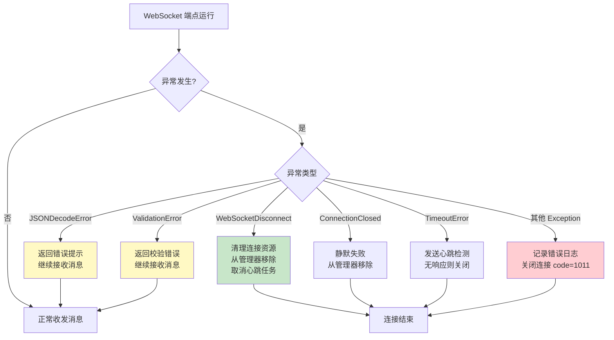

#### 代码示例

**示例 1：基础——完整的异常处理模板**

```python
"""
示例1：WebSocket 端点完整异常处理模板
运行：uvicorn ws_exception_template:app --reload
"""
from fastapi import FastAPI, WebSocket, WebSocketDisconnect, status
from pydantic import BaseModel, ValidationError
from typing import Optional
import json
import time
import logging

logging.basicConfig(level=logging.INFO)
logger = logging.getLogger(__name__)

app = FastAPI(title="异常处理模板", version="1.0.0")


class ChatMessage(BaseModel):
    type: str
    content: str = ""


@app.websocket("/ws/robust")
async def websocket_robust(websocket: WebSocket):
    """健壮的 WebSocket 端点：分层异常处理"""
    user_id = websocket.query_params.get("user_id", "anonymous")
    heartbeat_task = None

    try:
        # 第1步：接受连接
        await websocket.accept()
        logger.info(f"用户 {user_id} 连接")

        # 第2步：启动心跳任务
        async def heartbeat():
            try:
                while True:
                    await asyncio.sleep(30)
                    await websocket.send_json({"type": "ping"})
            except Exception:
                pass

        import asyncio
        heartbeat_task = asyncio.create_task(heartbeat())

        # 第3步：消息循环
        while True:
            try:
                # 接收消息（带超时）
                raw = await asyncio.wait_for(
                    websocket.receive_text(),
                    timeout=60,  # 60 秒无消息则超时
                )
            except asyncio.TimeoutError:
                # 超时：发送心跳检测
                try:
                    await websocket.send_json({"type": "ping"})
                    continue
                except Exception:
                    break

            # 第4步：解析和校验消息
            try:
                message = ChatMessage.model_validate_json(raw)
            except json.JSONDecodeError as e:
                await websocket.send_json({
                    "type": "error",
                    "error": "invalid_json",
                    "detail": str(e),
                })
                continue
            except ValidationError as e:
                await websocket.send_json({
                    "type": "error",
                    "error": "validation_error",
                    "detail": e.errors(),
                })
                continue

            # 第5步：业务处理
            try:
                if message.type == "chat":
                    await websocket.send_json({
                        "type": "chat",
                        "from": user_id,
                        "content": f"你说: {message.content}",
                        "timestamp": time.time(),
                    })
                elif message.type == "ping":
                    await websocket.send_json({"type": "pong", "timestamp": time.time()})
                else:
                    await websocket.send_json({
                        "type": "error",
                        "error": "unknown_type",
                        "detail": f"不支持的消息类型: {message.type}",
                    })

            except Exception as e:
                # 业务异常：记录日志，不关闭连接
                logger.error(f"业务处理异常: {e}", exc_info=True)
                await websocket.send_json({
                    "type": "error",
                    "error": "internal_error",
                    "detail": "消息处理失败，请重试",
                })

    except WebSocketDisconnect as e:
        # 客户端正常断开
        logger.info(f"用户 {user_id} 断开连接 (code={e.code})")

    except asyncio.CancelledError:
        # 任务被取消（服务关闭）
        logger.info(f"用户 {user_id} 连接被取消")
        raise  # 重新抛出，让事件循环处理

    except Exception as e:
        # 未预期异常：记录日志，关闭连接
        logger.error(f"未预期异常 (user={user_id}): {e}", exc_info=True)
        try:
            await websocket.close(code=status.WS_1011_INTERNAL_ERROR, reason="服务端内部错误")
        except Exception:
            pass

    finally:
        # 确保资源清理
        if heartbeat_task:
            heartbeat_task.cancel()
        logger.info(f"用户 {user_id} 连接已清理")


# 预期运行结果：
# 发送非法 JSON → 收到 error 提示，连接不关闭
# 发送缺少 content 的消息 → 收到 validation_error 提示
# 60 秒无消息 → 收到 ping 心跳
# 服务端内部错误 → 连接关闭 code=1011
```

**示例 2：进阶——连接管理器中的异常隔离**

```python
"""
示例2：连接管理器中的异常隔离
确保一个连接的异常不会影响其他连接
运行：uvicorn ws_exception_isolation:app --reload
"""
from fastapi import FastAPI, WebSocket, WebSocketDisconnect
from typing import Dict, List
import asyncio
import json
import time
import logging

logger = logging.getLogger(__name__)

app = FastAPI(title="异常隔离管理器", version="1.0.0")


class IsolatedConnectionManager:
    """异常隔离的连接管理器：每个连接的错误不影响其他连接"""

    def __init__(self):
        self.connections: Dict[str, WebSocket] = {}
        self.lock = asyncio.Lock()
        self.error_count = 0  # 统计发送错误数

    async def connect(self, user_id: str, websocket: WebSocket):
        await websocket.accept()
        async with self.lock:
            self.connections[user_id] = websocket

    async def disconnect(self, user_id: str):
        async with self.lock:
            self.connections.pop(user_id, None)

    async def safe_send(self, websocket: WebSocket, message: dict) -> bool:
        """
        安全发送：捕获所有异常，返回是否成功
        一个连接的发送失败不会影响其他连接
        """
        try:
            await websocket.send_json(message)
            return True
        except Exception as e:
            self.error_count += 1
            logger.warning(f"发送失败: {e}")
            return False

    async def broadcast(self, message: dict):
        """
        广播：异常隔离版本
        遍历连接列表的拷贝，发送失败的连接记录下来统一清理
        """
        disconnected = []
        # 拷贝连接列表，避免遍历时修改
        conns = list(self.connections.items())

        for user_id, ws in conns:
            success = await self.safe_send(ws, message)
            if not success:
                disconnected.append(user_id)

        # 统一清理断开的连接
        if disconnected:
            async with self.lock:
                for uid in disconnected:
                    self.connections.pop(uid, None)
            logger.info(f"广播清理了 {len(disconnected)} 个断开连接")

    async def broadcast_with_timeout(self, message: dict, per_send_timeout: float = 5.0):
        """
        带超时的广播：每个连接发送超时不影响其他连接
        """
        disconnected = []
        conns = list(self.connections.items())

        for user_id, ws in conns:
            try:
                # 单个连接发送超时，跳过继续下一个
                await asyncio.wait_for(
                    ws.send_json(message),
                    timeout=per_send_timeout,
                )
            except asyncio.TimeoutError:
                logger.warning(f"用户 {user_id} 发送超时")
                disconnected.append(user_id)
            except Exception:
                disconnected.append(user_id)

        if disconnected:
            async with self.lock:
                for uid in disconnected:
                    self.connections.pop(uid, None)

    async def broadcast_concurrent(self, message: dict, max_concurrent: int = 50):
        """
        并发广播：限制最大并发数，避免同时发送过多
        """
        semaphore = asyncio.Semaphore(max_concurrent)
        disconnected = []

        async def send_with_semaphore(user_id: str, ws: WebSocket):
            async with semaphore:
                try:
                    await ws.send_json(message)
                except Exception:
                    disconnected.append(user_id)

        conns = list(self.connections.items())
        await asyncio.gather(*[send_with_semaphore(uid, ws) for uid, ws in conns])

        if disconnected:
            async with self.lock:
                for uid in disconnected:
                    self.connections.pop(uid, None)


manager = IsolatedConnectionManager()


@app.websocket("/ws/{user_id}")
async def websocket_endpoint(websocket: WebSocket, user_id: str):
    await manager.connect(user_id, websocket)
    try:
        while True:
            data = await websocket.receive_text()
            msg = json.loads(data)
            if msg.get("type") == "broadcast":
                await manager.broadcast({
                    "type": "chat",
                    "from": user_id,
                    "content": msg.get("content", ""),
                    "timestamp": time.time(),
                })
    except WebSocketDisconnect:
        await manager.disconnect(user_id)


@app.get("/api/manager/stats")
async def manager_stats():
    return {
        "active_connections": len(manager.connections),
        "total_send_errors": manager.error_count,
    }
```

**示例 3：完整场景——全局异常处理器与错误监控**

```python
"""
示例3：全局 WebSocket 异常处理器 + 错误监控告警
运行：uvicorn ws_global_exception:app --reload
"""
from fastapi import FastAPI, WebSocket, WebSocketDisconnect, Request
from fastapi.responses import JSONResponse
from starlette.middleware.base import BaseHTTPMiddleware
from collections import defaultdict
from datetime import datetime
import json
import time
import logging
import traceback

logging.basicConfig(level=logging.INFO)
logger = logging.getLogger(__name__)

app = FastAPI(title="全局异常处理", version="1.0.0")

# 错误统计
error_stats = defaultdict(int)
error_timestamps = defaultdict(list)
ALERT_THRESHOLD = 10  # 1 分钟内同类错误超过 10 次则告警


class WebSocketErrorMonitor:
    """WebSocket 错误监控器：统计、告警、熔断"""

    def __init__(self):
        self.stats = defaultdict(int)
        self.recent_errors = defaultdict(list)  # error_type -> [timestamps]
        self.circuit_open = False
        self.circuit_open_time = 0

    def record_error(self, error_type: str, error_detail: str = ""):
        """记录错误，检查是否需要告警"""
        self.stats[error_type] += 1
        now = time.time()
        self.recent_errors[error_type].append(now)

        # 清理 1 分钟前的记录
        self.recent_errors[error_type] = [
            t for t in self.recent_errors[error_type] if now - t < 60
        ]

        # 检查告警阈值
        recent_count = len(self.recent_errors[error_type])
        if recent_count >= ALERT_THRESHOLD:
            self._trigger_alert(error_type, recent_count, error_detail)

    def _trigger_alert(self, error_type: str, count: int, detail: str):
        """触发告警（实际项目中发送到钉钉/飞书/邮件）"""
        alert_msg = (
            f"🚨 WebSocket 告警\n"
            f"错误类型: {error_type}\n"
            f"1 分钟内发生: {count} 次\n"
            f"详情: {detail}\n"
            f"时间: {datetime.now().strftime('%Y-%m-%d %H:%M:%S')}"
        )
        logger.error(alert_msg)
        # 实际项目：发送告警通知
        # await send_alert(alert_msg)

    def get_stats(self) -> dict:
        """获取错误统计"""
        return {
            "total_errors": sum(self.stats.values()),
            "by_type": dict(self.stats),
            "recent_1min": {
                etype: len(times) for etype, times in self.recent_errors.items()
            },
        }


error_monitor = WebSocketErrorMonitor()


def handle_websocket_exception(
    websocket: WebSocket,
    user_id: str,
    exc: Exception,
) -> bool:
    """
    全局 WebSocket 异常处理函数
    返回 True 表示可以继续，False 表示应该关闭连接
    """
    error_type = type(exc).__name__

    if isinstance(exc, WebSocketDisconnect):
        # 正常断开，不记录错误
        return False

    elif isinstance(exc, json.JSONDecodeError):
        error_monitor.record_error("JSONDecodeError", str(exc))
        return True  # 可以继续

    elif isinstance(exc, ValueError):
        error_monitor.record_error("ValueError", str(exc))
        return True

    elif isinstance(exc, ConnectionError):
        error_monitor.record_error("ConnectionError", str(exc))
        return False

    else:
        # 未预期异常
        error_monitor.record_error(error_type, str(exc))
        logger.error(
            f"未预期 WebSocket 异常 (user={user_id}): {error_type}: {exc}\n"
            f"{traceback.format_exc()}"
        )
        return False


@app.websocket("/ws/monitored")
async def websocket_monitored(websocket: WebSocket):
    user_id = websocket.query_params.get("user_id", "anonymous")
    await websocket.accept()

    try:
        while True:
            try:
                raw = await websocket.receive_text()
                message = json.loads(raw)

                # 模拟业务处理可能抛出异常
                if message.get("type") == "error_test":
                    raise RuntimeError("模拟业务异常")

                await websocket.send_json({"type": "echo", "content": message})

            except Exception as e:
                should_continue = handle_websocket_exception(websocket, user_id, e)
                if not should_continue:
                    break
                # 可继续时发送错误提示
                await websocket.send_json({
                    "type": "error",
                    "error_type": type(e).__name__,
                    "detail": str(e),
                })

    except WebSocketDisconnect:
        pass
    finally:
        logger.info(f"用户 {user_id} 连接结束")


@app.get("/api/error-stats")
async def get_error_stats():
    return error_monitor.get_stats()


# 预期运行结果：
# 发送非法 JSON 10 次 → 触发告警（1 分钟内 JSONDecodeError 超过 10 次）
# 访问 /api/error-stats 查看错误统计
```

#### 使用场景与最佳实践

**适用场景**：
- 所有 WebSocket 端点都需要基础异常处理（try-except-finally）
- 连接管理器需要异常隔离（一个连接错误不影响其他）
- 生产环境需要错误监控和告警
- 高并发服务需要超时保护和熔断机制

**不适用场景**：
- 简单 demo/原型：可以简化异常处理
- 内部测试服务：不需要完整的监控告警

**最佳实践**：
1. **每个端点必须有 try-except-finally**：`except WebSocketDisconnect` 处理正常断开，`except Exception` 处理未预期异常，`finally` 清理资源
2. **发送消息必须 try-except**：连接可能在发送时断开，静默失败并清理
3. **遍历连接列表时先拷贝**：`for ws in list(connections):`，避免遍历时修改
4. **业务异常不关闭连接**：JSON 解析错误、校验错误等返回错误提示，继续接收消息
5. **未预期异常关闭连接**：记录日志，用 code=1011 关闭，防止异常连接占用资源
6. **心跳超时检测**：60-120 秒无消息则发送 ping，无响应则关闭死连接
7. **错误监控告警**：统计错误类型和频率，超过阈值触发告警
8. **`asyncio.CancelledError` 重新抛出**：不要吞掉取消异常，让事件循环正常处理

**性能建议**：
- 异常处理的 try-except 本身无性能开销（Python 的异常机制在无异常时几乎零成本）
- 错误统计用字典，O(1) 操作
- 告警检查定期清理过期时间戳，避免内存增长

#### 常见坑点

**坑点 1：`except Exception` 吞掉 `WebSocketDisconnect` 导致资源泄漏**

- **错误现象**：用 `except Exception as e` 捕获所有异常，`WebSocketDisconnect` 被当作普通异常处理，连接资源未正确清理，内存持续增长
- **根本原因**：`WebSocketDisconnect` 继承自 `Exception`，如果先写 `except Exception` 再写 `except WebSocketDisconnect`，后者永远不会被触发（因为前者已经捕获了）。或者只有 `except Exception`，断开时没有执行专门的清理逻辑
- **正确做法**：`except WebSocketDisconnect` 必须写在 `except Exception` 之前（更具体的异常在前），在 `WebSocketDisconnect` 处理中调用 `manager.disconnect()` 清理资源
- **预防措施**：代码模板固定异常顺序：`except WebSocketDisconnect` → `except asyncio.CancelledError`（重新抛出）→ `except Exception`

**坑点 2：广播中一个连接发送异常导致整个广播中断**

- **错误现象**：广播消息时，某个连接已断开，`send_json()` 抛出异常，未捕获导致广播循环中断，后续连接收不到消息
- **根本原因**：遍历连接列表发送时，没有对每个 `send()` 单独 try-except，一个连接的异常中断了整个 for 循环
- **正确做法**：① 每个 `send()` 都包裹 try-except，失败时记录并继续；② 或用 `asyncio.gather(*tasks, return_exceptions=True)` 并发发送，异常被收集不中断；③ 遍历结束后统一清理断开的连接
- **预防措施**：连接管理器的 `broadcast()` 方法中，发送逻辑必须有 try-except，代码审查时重点检查

---

### 6.2 心跳机制与断开重连

#### 概念解释

**WebSocket 心跳（Heartbeat）** 是客户端和服务端定期发送 Ping/Pong 帧或应用层心跳消息来检测连接是否存活的机制，防止因网络中间设备（Nginx、负载均衡器、防火墙）超时断开空闲连接，以及及时检测死连接。

> 🏠 **生活化比喻**：心跳就像通话中的"喂，还在吗？"——长时间没人说话时，一方问"还在吗？"（Ping），另一方回答"在的"（Pong）。如果问了几次都没人回答，就认为对方已经挂断了，主动结束通话。没有心跳的话，你可能对着已经挂断的电话说了半天话才发现对方不在了。

**核心价值**：及时检测死连接并清理，防止僵尸连接占用资源；保持空闲连接活跃，避免被网络中间设备超时断开；为前端重连提供触发信号。

> 🎯 **面试高频考点 12**：WebSocket 心跳有哪些实现方式？心跳间隔如何设置？
> **答**：① 协议层 Ping/Pong 帧：服务端定期发送 Ping 帧（opcode=9），客户端自动回复 Pong 帧（opcode=10），浏览器 WebSocket API 自动处理 Pong，无需手动编码；② 应用层心跳：服务端定期发送 `{"type":"ping"}` JSON 消息，客户端回复 `{"type":"pong"}`，优点是可以携带额外数据，缺点是需要手动实现；③ 混合方式：协议层 Ping 保活 + 应用层心跳检测业务可用性。心跳间隔通常设置为代理超时时间的 1/3 到 1/2，如 Nginx 默认 60s 超时，心跳间隔设为 20-30s。连续 2-3 次心跳无响应则判定连接断开。

#### 原理说明

心跳机制的核心机制是 **定期发送 + 超时检测 + 自动重连**。

**为什么这样设计**：WebSocket 是长连接，但网络中间设备（Nginx、负载均衡器、NAT、防火墙）通常有空闲超时（默认 60-300 秒），如果连接长时间无数据传输，会被中间设备强制断开。心跳通过定期发送小数据包保持连接活跃。同时，心跳可以检测对端是否仍然存活——如果连续多次心跳无响应，说明连接已死，应主动关闭并触发重连。

**技术对比**：

| 心跳方式 | 实现 | 浏览器支持 | 可携带数据 | 适用场景 |
|---------|------|-----------|-----------|---------|
| 协议层 Ping/Pong | `websocket.send()` 控制帧 | 自动回复 Pong | 否 | 简单保活 |
| 应用层 ping/pong | JSON 消息 | 手动回复 | 是 | 需要业务数据 |
| Nginx 保活 | `proxy_read_timeout` | 无需客户端 | 否 | 代理层配置 |

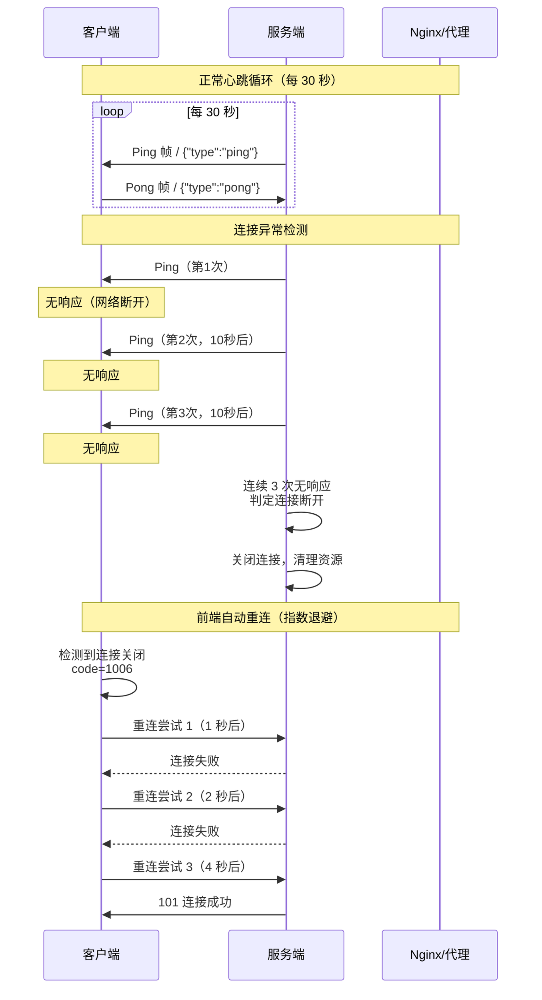

#### 代码示例

**示例 1：基础——服务端协议层 Ping 心跳**

```python
"""
示例1：服务端协议层 Ping 心跳（最简单的保活方式）
运行：uvicorn ws_heartbeat_ping:app --reload
"""
from fastapi import FastAPI, WebSocket, WebSocketDisconnect
import asyncio

app = FastAPI(title="Ping 心跳", version="1.0.0")

HEARTBEAT_INTERVAL = 30  # 心跳间隔（秒）
HEARTBEAT_TIMEOUT = 10   # 心跳响应超时（秒）
MAX_MISSED_HEARTBEATS = 3  # 最大连续未响应次数


@app.websocket("/ws/ping")
async def websocket_with_ping(websocket: WebSocket):
    await websocket.accept()
    missed_heartbeats = 0

    async def send_heartbeat():
        """定期发送 Ping 帧"""
        nonlocal missed_heartbeats
        try:
            while True:
                await asyncio.sleep(HEARTBEAT_INTERVAL)
                # 发送协议层 Ping 帧
                # 浏览器会自动回复 Pong，无需手动处理
                await websocket.send_bytes(b"")  # 注意：FastAPI 没有直接的 send_ping
                # 实际应用中，Starlette 的 WebSocket 支持 send_ping
                # 但需要通过底层接口调用
        except Exception:
            pass

    # 注意：FastAPI/Starlette 的 WebSocket 类没有直接暴露 send_ping
    # 协议层 Ping 需要通过 uvicorn 的配置或底层接口
    # 更常用的是应用层心跳（见示例2）

    try:
        while True:
            data = await websocket.receive_text()
            await websocket.send_text(f"收到: {data}")
    except WebSocketDisconnect:
        pass


# Uvicorn 内置 WebSocket Ping 配置（推荐）：
# uvicorn main:app --ws-ping-interval 20 --ws-ping-timeout 20
# --ws-ping-interval: 发送 Ping 的间隔（秒），默认 20
# --ws-ping-timeout: 等待 Pong 的超时（秒），默认 20
# 这是最简单的心跳方式，无需在代码中实现

print("启动命令：uvicorn ws_heartbeat_ping:app --ws-ping-interval 20 --ws-ping-timeout 20")
print("Uvicorn 会自动发送 Ping 帧，浏览器自动回复 Pong")
```

**示例 2：进阶——应用层心跳与死连接检测**

```python
"""
示例2：应用层心跳 + 死连接检测 + 自动清理
运行：uvicorn ws_heartbeat_app:app --reload
"""
from fastapi import FastAPI, WebSocket, WebSocketDisconnect
from typing import Dict
import asyncio
import json
import time

app = FastAPI(title="应用层心跳", version="1.0.0")

HEARTBEAT_INTERVAL = 25  # 心跳间隔（秒），小于 Nginx 默认 60s 超时
MAX_IDLE_TIME = 90       # 最大空闲时间（秒），超过则判定为死连接


class HeartbeatConnectionManager:
    """带心跳检测的连接管理器"""

    def __init__(self):
        self.connections: Dict[str, WebSocket] = {}
        self.last_activity: Dict[str, float] = {}  # user_id -> 最后活动时间
        self.lock = asyncio.Lock()
        self.heartbeat_task = None

    async def connect(self, user_id: str, websocket: WebSocket):
        await websocket.accept()
        async with self.lock:
            self.connections[user_id] = websocket
            self.last_activity[user_id] = time.time()

    async def disconnect(self, user_id: str):
        async with self.lock:
            self.connections.pop(user_id, None)
            self.last_activity.pop(user_id, None)

    def record_activity(self, user_id: str):
        """记录用户活动（收到消息时调用）"""
        self.last_activity[user_id] = time.time()

    async def start_heartbeat_monitor(self):
        """启动心跳监控：定期发送 ping，清理死连接"""
        while True:
            await asyncio.sleep(HEARTBEAT_INTERVAL)
            now = time.time()
            dead_connections = []

            # 检查每个连接的空闲时间
            for user_id, last_time in list(self.last_activity.items()):
                idle_time = now - last_time

                if idle_time > MAX_IDLE_TIME:
                    # 超过最大空闲时间，判定为死连接
                    dead_connections.append(user_id)
                elif idle_time > HEARTBEAT_INTERVAL:
                    # 空闲超过心跳间隔，发送 ping
                    ws = self.connections.get(user_id)
                    if ws:
                        try:
                            await ws.send_json({
                                "type": "ping",
                                "timestamp": now,
                            })
                        except Exception:
                            dead_connections.append(user_id)

            # 清理死连接
            for user_id in dead_connections:
                ws = self.connections.get(user_id)
                if ws:
                    try:
                        await ws.close(code=1000, reason="心跳超时，连接已断开")
                    except Exception:
                        pass
                await self.disconnect(user_id)
                print(f"清理死连接: {user_id} (空闲 {now - self.last_activity.get(user_id, 0):.0f}s)")

    async def broadcast(self, message: dict):
        """广播消息"""
        disconnected = []
        for user_id, ws in list(self.connections.items()):
            try:
                await ws.send_json(message)
            except Exception:
                disconnected.append(user_id)
        for uid in disconnected:
            await self.disconnect(uid)


manager = HeartbeatConnectionManager()


@app.on_event("startup")
async def startup():
    manager.heartbeat_task = asyncio.create_task(manager.start_heartbeat_monitor())


@app.on_event("shutdown")
async def shutdown():
    if manager.heartbeat_task:
        manager.heartbeat_task.cancel()


@app.websocket("/ws/{user_id}")
async def websocket_endpoint(websocket: WebSocket, user_id: str):
    await manager.connect(user_id, websocket)

    try:
        while True:
            raw = await websocket.receive_text()
            manager.record_activity(user_id)  # 更新活动时间

            msg = json.loads(raw)
            if msg.get("type") == "pong":
                # 客户端响应心跳，record_activity 已更新
                continue
            elif msg.get("type") == "chat":
                await manager.broadcast({
                    "type": "chat",
                    "from": user_id,
                    "content": msg.get("content", ""),
                    "timestamp": time.time(),
                })
    except WebSocketDisconnect:
        await manager.disconnect(user_id)


# 前端心跳响应：
"""
const ws = new WebSocket('ws://localhost:8000/ws/alice');
ws.onmessage = (e) => {
  const data = JSON.parse(e.data);
  if (data.type === 'ping') {
    ws.send(JSON.stringify({type: 'pong', timestamp: data.timestamp}));
  } else {
    console.log(data);
  }
};
// 客户端也可以主动发送心跳：
// setInterval(() => ws.send(JSON.stringify({type: 'ping'})), 25000);
"""
```

**示例 3：完整场景——前端指数退避重连管理器**

```javascript
/**
 * 示例3：生产级前端 WebSocket 重连管理器
 * 特性：指数退避重连、心跳检测、消息队列、状态回调
 */
class ReconnectingWebSocket {
  constructor(url, options = {}) {
    this.url = url;
    this.options = {
      // 重连配置
      baseDelay: options.baseDelay || 1000,      // 初始重连延迟 1s
      maxDelay: options.maxDelay || 30000,        // 最大重连延迟 30s
      maxRetries: options.maxRetries || Infinity, // 最大重连次数
      // 心跳配置
      heartbeatInterval: options.heartbeatInterval || 25000, // 心跳间隔 25s
      heartbeatTimeout: options.heartbeatTimeout || 10000,   // 心跳超时 10s
      // 消息队列
      maxQueuedMessages: options.maxQueuedMessages || 100,
      ...options,
    };

    this.ws = null;
    this.retryCount = 0;
    this.shouldReconnect = true;
    this.manualClose = false;
    this.messageQueue = [];
    this.heartbeatTimer = null;
    this.heartbeatTimeoutTimer = null;
    this.reconnectTimer = null;

    // 事件回调
    this.onopen = null;
    this.onmessage = null;
    this.onclose = null;
    this.onerror = null;
    this.onreconnect = null;
  }

  connect() {
    if (this.ws?.readyState === WebSocket.OPEN || this.ws?.readyState === WebSocket.CONNECTING) {
      return;
    }

    this.ws = new WebSocket(this.url);

    this.ws.onopen = (event) => {
      console.log(`[WS] 连接成功（第 ${this.retryCount + 1} 次尝试）`);
      this.retryCount = 0;
      this.startHeartbeat();
      this.flushQueue();  // 发送排队的消息
      this.onopen?.(event);
    };

    this.ws.onmessage = (event) => {
      this.resetHeartbeatTimeout();  // 收到任何消息都重置心跳超时
      try {
        const data = JSON.parse(event.data);
        if (data.type === 'ping') {
          this.send({ type: 'pong', timestamp: data.timestamp });
          return;
        }
        if (data.type === 'pong') {
          return;
        }
        this.onmessage?.(data, event);
      } catch {
        this.onmessage?.(event.data, event);
      }
    };

    this.ws.onclose = (event) => {
      console.log(`[WS] 连接关闭: code=${event.code}, reason=${event.reason}`);
      this.stopHeartbeat();

      // 根据关闭码决定是否重连
      if (this.shouldReconnect && !this.manualClose && this.isReconnectable(event.code)) {
        if (this.retryCount < this.options.maxRetries) {
          this.scheduleReconnect();
        } else {
          console.error('[WS] 已达最大重连次数');
        }
      }
      this.onclose?.(event);
    };

    this.ws.onerror = (event) => {
      console.error('[WS] 连接错误');
      this.onerror?.(event);
    };
  }

  /**
   * 判断关闭码是否可重连
   */
  isReconnectable(code) {
    const nonReconnectableCodes = [1000, 1001, 1008]; // 正常关闭、端点离开、策略违规
    return !nonReconnectableCodes.includes(code);
  }

  /**
   * 调度重连（指数退避 + 抖动）
   */
  scheduleReconnect() {
    const delay = Math.min(
      this.options.baseDelay * Math.pow(2, this.retryCount),
      this.options.maxDelay
    );
    // 添加随机抖动，避免重连风暴
    const jitter = delay * 0.3 * Math.random();
    const finalDelay = delay + jitter;

    this.retryCount++;
    console.log(`[WS] ${finalDelay.toFixed(0)}ms 后重连（第 ${this.retryCount} 次）`);
    this.onreconnect?.(this.retryCount, finalDelay);

    this.reconnectTimer = setTimeout(() => this.connect(), finalDelay);
  }

  /**
   * 发送消息（连接未建立时排队）
   */
  send(data) {
    const message = typeof data === 'string' ? data : JSON.stringify(data);
    if (this.ws?.readyState === WebSocket.OPEN) {
      this.ws.send(message);
    } else {
      // 连接未建立，加入队列
      if (this.messageQueue.length < this.options.maxQueuedMessages) {
        this.messageQueue.push(message);
      }
    }
  }

  /**
   * 发送排队的消息
   */
  flushQueue() {
    while (this.messageQueue.length > 0 && this.ws?.readyState === WebSocket.OPEN) {
      const message = this.messageQueue.shift();
      this.ws.send(message);
    }
  }

  /**
   * 启动心跳
   */
  startHeartbeat() {
    this.stopHeartbeat();
    this.heartbeatTimer = setInterval(() => {
      if (this.ws?.readyState === WebSocket.OPEN) {
        this.send({ type: 'ping', timestamp: Date.now() });
        // 设置心跳超时
        this.heartbeatTimeoutTimer = setTimeout(() => {
          console.warn('[WS] 心跳超时，关闭连接');
          this.ws?.close(4000, '心跳超时');
        }, this.options.heartbeatTimeout);
      }
    }, this.options.heartbeatInterval);
  }

  /**
   * 重置心跳超时（收到消息时调用）
   */
  resetHeartbeatTimeout() {
    if (this.heartbeatTimeoutTimer) {
      clearTimeout(this.heartbeatTimeoutTimer);
      this.heartbeatTimeoutTimer = null;
    }
  }

  stopHeartbeat() {
    if (this.heartbeatTimer) clearInterval(this.heartbeatTimer);
    if (this.heartbeatTimeoutTimer) clearTimeout(this.heartbeatTimeoutTimer);
    this.heartbeatTimer = null;
    this.heartbeatTimeoutTimer = null;
  }

  /**
   * 主动关闭（不重连）
   */
  close(code = 1000, reason = '客户端主动关闭') {
    this.manualClose = true;
    this.shouldReconnect = false;
    if (this.reconnectTimer) clearTimeout(this.reconnectTimer);
    this.stopHeartbeat();
    this.ws?.close(code, reason);
  }
}

// 使用示例：
/*
const ws = new ReconnectingWebSocket('ws://localhost:8000/ws/alice', {
  baseDelay: 1000,
  maxDelay: 30000,
  heartbeatInterval: 25000,
});
ws.onopen = () => console.log('已连接');
ws.onmessage = (data) => console.log('消息:', data);
ws.onclose = (e) => console.log('关闭:', e.code);
ws.onreconnect = (count, delay) => console.log(`重连中: 第${count}次, ${delay}ms后`);
ws.connect();
ws.send({ type: 'chat', content: '你好' });  // 连接未建立时自动排队
*/
```

#### 使用场景与最佳实践

**适用场景**：
- 所有生产环境 WebSocket 服务都需要心跳（防止代理超时断开）
- 移动网络环境（网络不稳定，需要频繁重连）
- 长时间运行的连接（监控仪表盘、实时通知）
- 需要检测死连接的场景（清理僵尸连接）

**不适用场景**：
- 短连接（建立后几秒内断开，不需要心跳）
- Uvicorn 已配置 `--ws-ping-interval`（协议层心跳已足够）

**最佳实践**：
1. **心跳间隔设为代理超时的 1/3 到 1/2**：Nginx 默认 60s，心跳设 20-30s
2. **连续 2-3 次心跳无响应才判定断开**：避免网络抖动导致误判
3. **前端重连用指数退避 + 随机抖动**：1s→2s→4s→...→最大30s，加 ±30% 抖动避免重连风暴
4. **重连时排队消息**：连接断开期间发送的消息存入队列，重连后自动发送
5. **区分可重连和不可重连关闭码**：1000/1001/1008 不重连，1006/1011 自动重连
6. **服务端也需要心跳检测**：定期清理死连接，防止僵尸连接占用资源
7. **优先用 Uvicorn 内置 Ping**：`--ws-ping-interval 20 --ws-ping-timeout 20`，无需代码实现

**性能建议**：
- 心跳消息很小（<100 字节），10 万连接每 30 秒心跳约消耗 300KB/s 带宽，可忽略
- 心跳检测用全局定时任务，不要每个连接单独创建 `asyncio.create_task`（减少任务数）
- 死连接清理批量执行，避免频繁修改连接列表

#### 常见坑点

**坑点 1：Nginx 后 WebSocket 连接 60 秒自动断开**

- **错误现象**：WebSocket 连接建立后，如果 60 秒内没有数据传输，连接自动断开，前端 `onclose` code=1006
- **根本原因**：Nginx 默认 `proxy_read_timeout 60s`，如果 60 秒内没有从后端收到数据，Nginx 会关闭连接。WebSocket 空闲时没有数据传输，触发超时
- **正确做法**：① Nginx 配置 `proxy_read_timeout 3600s`（或更长）；② 服务端定期发送心跳（每 20-30 秒），保持连接活跃；③ Uvicorn 启动时加 `--ws-ping-interval 20`
- **预防措施**：部署文档中明确要求 Nginx 配置长超时 + 服务端心跳，两者配合

**坑点 2：服务重启时前端重连风暴导致服务雪崩**

- **错误现象**：服务重启后，所有客户端同时检测到连接断开并立即重连，大量并发请求压垮刚启动的服务，导致服务再次崩溃，形成恶性循环
- **根本原因**：前端重连没有退避机制（立即重连），或退避时间太短，所有客户端在同一时间重连
- **正确做法**：① 前端实现指数退避重连（1s→2s→4s→...→最大30s）；② 添加随机抖动（±30%），分散重连时间；③ 服务端实现优雅关闭，发送 Close 帧通知前端延迟重连；④ 部署时滚动更新，避免所有实例同时重启
- **预防措施**：前端重连管理器必须包含指数退避 + 抖动，服务端优雅关闭时发送 `{"type":"shutdown","reconnect_after":30}` 通知前端

---

> 💡 **深度讲解**：房间与群组通信是 WebSocket 应用从"全局广播"到"精准推送"的关键升级。房间管理器通过双向索引（rooms + user_rooms）实现 O(1) 的用户加入/离开/查找，事件通知让房间成员实时感知变化。持久化房间支持历史消息和房间元数据，层级房间（服务器→频道）支持复杂的组织架构。异常处理是 WebSocket 服务稳定性的保障——每个端点必须有完整的 try-except-finally，发送消息必须 try-except 隔离，连接管理器广播时必须拷贝列表避免遍历修改。心跳机制防止代理超时断开和死连接，前端指数退避重连防止服务重启时的重连风暴。这些机制共同构成了生产级 WebSocket 服务的稳定性基础。
>
> **📝 精简总结**：
> 1. 房间管理器 = 双向索引（rooms: Dict[room_id, Set[user_id]] + user_rooms: Dict[user_id, Set[room_id]]）
> 2. 加入/离开房间时通知其他用户，空房间自动清理，用户断开时从所有房间清理
> 3. 遍历集合时先 `list()` 拷贝，避免遍历时修改导致 RuntimeError
> 4. 异常处理顺序：`except WebSocketDisconnect` → `except CancelledError`（重新抛出）→ `except Exception`
> 5. 广播时每个 send 单独 try-except，一个连接失败不影响其他连接
> 6. 心跳：Uvicorn `--ws-ping-interval 20` 或应用层 `{"type":"ping"}`，间隔为代理超时的 1/3-1/2
> 7. 前端重连：指数退避（1s→2s→4s→30s）+ 随机抖动 + 消息队列 + 可重连关闭码判断
> 8. Nginx 必须配置 `proxy_read_timeout 3600s`，否则 60 秒空闲断开
>
> **🎯 梯度练习题**：
> - **基础 1**：实现房间管理器，支持 join_room/leave_room/send_to_room/get_room_users
> - **基础 2**：解释为什么遍历连接集合时需要先 `list()` 拷贝
> - **基础 3**：实现 WebSocket 端点的完整异常处理模板（try-except-finally）
> - **进阶 1**：实现带历史消息持久化的房间管理器（Redis 列表存储）
> - **进阶 2**：实现服务端心跳检测，90 秒无活动的连接自动关闭
> - **实战 1**：实现前端重连管理器，包含指数退避、随机抖动、心跳检测、消息队列、可重连关闭码判断

---

## 7. WebSocket 与异步编程深度

### 7.1 asyncio 事件循环与 WebSocket 并发

#### 概念解释

**WebSocket 与 asyncio** 的结合是 FastAPI 高并发实时通信的基础——每个 WebSocket 连接在 asyncio 事件循环中作为一个协程运行，`receive()`/`send()` 都是异步操作，等待时挂起协程不阻塞事件循环，使得单线程可以同时处理数万连接。

> 🏠 **生活化比喻**：asyncio 事件循环就像一个餐厅的服务员——他不是等一桌客人点完菜、做完、吃完才去服务下一桌，而是在这桌等菜的时候去服务下一桌（异步非阻塞）。WebSocket 连接就是餐厅里的桌子，每个桌子（连接）的客人（消息）随时可能叫服务员（发送消息），服务员在各桌之间快速切换，同时服务所有桌子。单线程服务员（事件循环）因为切换速度极快，看起来像是同时服务所有人。

**核心价值**：单线程事件循环可以同时处理数万 WebSocket 连接，内存开销低（每个连接仅 10-50KB），无需多线程的上下文切换开销和锁竞争，是高并发实时应用的理想模型。

> 🎯 **面试高频考点 13**：FastAPI WebSocket 如何实现高并发？单线程为什么能处理数万连接？
> **答**：FastAPI WebSocket 基于 asyncio 单线程事件循环，每个连接是一个协程。`receive_text()` 等待消息时协程挂起（不占用 CPU），事件循环切换到其他就绪的协程。当某个连接有消息到达时，对应的协程被唤醒处理。这种 IO 多路复用模型（底层是 epoll/kqueue）使得单线程可以同时监听数万 socket，有事件时才唤醒处理。关键是所有 IO 操作必须是异步的（不能有阻塞调用），否则会阻塞整个事件循环。

#### 原理说明

WebSocket 异步并发的核心机制是 **事件循环 + 协程调度 + IO 多路复用**。

**为什么这样设计**：WebSocket 是长连接，大部分时间连接处于空闲状态（等待消息）。如果每个连接用一个线程，10 万连接需要 10 万个线程，内存开销巨大（每个线程约 8MB 栈空间）且上下文切换频繁。asyncio 用单线程事件循环 + 协程，连接空闲时协程挂起几乎不占资源，只有消息到达时才唤醒处理，极大降低了资源开销。

**技术对比**：

| 并发模型 | 连接数上限 | 内存开销 | 上下文切换 | 编程复杂度 |
|---------|-----------|---------|-----------|-----------|
| 多线程（每连接一线程） | ~1000 | 高（8MB/线程） | 高 | 低 |
| 线程池 | ~10000 | 中 | 中 | 中 |
| asyncio 协程 | ~100000 | 低（10-50KB/连接） | 极低 | 中（需异步思维） |
| 多进程 + asyncio | ~500000 | 中 | 低 | 高 |

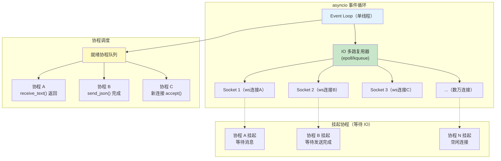

#### 代码示例

**示例 1：基础——WebSocket 并发连接数测试**

```python
"""
示例1：WebSocket 并发连接数测试
测试单进程能处理多少并发连接
运行：uvicorn ws_concurrency_test:app --port 8000
      python ws_concurrent_client.py  # 另一个终端
"""
from fastapi import FastAPI, WebSocket, WebSocketDisconnect
import asyncio
import time

app = FastAPI(title="并发测试", version="1.0.0")

connection_count = 0
message_count = 0


@app.websocket("/ws")
async def websocket_endpoint(websocket: WebSocket):
    global connection_count, message_count
    await websocket.accept()
    connection_count += 1

    if connection_count % 1000 == 0:
        print(f"当前连接数: {connection_count}")

    try:
        while True:
            data = await websocket.receive_text()
            message_count += 1
            await websocket.send_text(f"echo: {data}")
    except WebSocketDisconnect:
        connection_count -= 1


@app.get("/api/stats")
async def stats():
    return {
        "connections": connection_count,
        "messages_processed": message_count,
    }


# 客户端并发测试脚本（ws_concurrent_client.py）：
"""
import asyncio
import websockets
import time

async def client(client_id):
    try:
        async with websockets.connect("ws://localhost:8000/ws") as ws:
            await ws.send(f"hello from {client_id}")
            response = await ws.recv()
            return True
    except Exception as e:
        return False

async def main():
    total = 5000  # 尝试建立 5000 个连接
    batch_size = 500
    success = 0
    start = time.time()

    for i in range(0, total, batch_size):
        batch = range(i, min(i + batch_size, total))
        tasks = [client(cid) for cid in batch]
        results = await asyncio.gather(*tasks)
        success += sum(results)
        print(f"已建立 {success}/{total} 连接")

    elapsed = time.time() - start
    print(f"成功建立 {success}/{total} 连接，耗时 {elapsed:.1f}s")
    print(f"连接速率: {success/elapsed:.0f} 连接/秒")

asyncio.run(main())
"""

# 预期运行结果（取决于服务器配置）：
# 当前连接数: 1000
# 当前连接数: 2000
# ...
# 成功建立 5000/5000 连接，耗时 12.3s
# 连接速率: 406 连接/秒
```

**示例 2：进阶——WebSocket 中的后台任务与并发操作**

```python
"""
示例2：WebSocket 端点中的后台任务（asyncio.create_task）
场景：连接建立后启动后台定时推送，不阻塞消息接收
运行：uvicorn ws_background_task:app --reload
"""
from fastapi import FastAPI, WebSocket, WebSocketDisconnect
from typing import Dict, Set
import asyncio
import json
import time

app = FastAPI(title="后台任务", version="1.0.0")


class BackgroundTaskManager:
    """管理每个 WebSocket 连接的后台任务"""

    def __init__(self):
        self.tasks: Dict[str, Set[asyncio.Task]] = {}  # user_id -> {task}
        self.lock = asyncio.Lock()

    async def register(self, user_id: str):
        """注册用户，初始化任务集合"""
        async with self.lock:
            self.tasks[user_id] = set()

    async def add_task(self, user_id: str, coro):
        """添加后台任务"""
        task = asyncio.create_task(coro)
        async with self.lock:
            if user_id in self.tasks:
                self.tasks[user_id].add(task)
        # 任务完成后自动从集合移除
        task.add_done_callback(lambda t: self._remove_task(user_id, t))
        return task

    def _remove_task(self, user_id: str, task: asyncio.Task):
        """任务完成后移除"""
        if user_id in self.tasks:
            self.tasks[user_id].discard(task)

    async def cancel_all(self, user_id: str):
        """取消用户的所有后台任务"""
        async with self.lock:
            user_tasks = self.tasks.pop(user_id, set())
        for task in user_tasks:
            task.cancel()
        # 等待任务取消完成
        if user_tasks:
            await asyncio.gather(*user_tasks, return_exceptions=True)


task_manager = BackgroundTaskManager()


@app.websocket("/ws/{user_id}")
async def websocket_with_tasks(websocket: WebSocket, user_id: str):
    await websocket.accept()
    await task_manager.register(user_id)

    # 后台任务 1：每秒推送服务器时间
    async def push_server_time():
        try:
            while True:
                await websocket.send_json({
                    "type": "server_time",
                    "time": time.strftime("%H:%M:%S"),
                    "timestamp": time.time(),
                })
                await asyncio.sleep(1)
        except asyncio.CancelledError:
            pass
        except Exception:
            pass

    # 后台任务 2：每 10 秒推送系统状态
    async def push_system_status():
        try:
            while True:
                await websocket.send_json({
                    "type": "system_status",
                    "cpu": 45.2,  # 模拟数据
                    "memory": 62.8,
                    "connections": 100,
                })
                await asyncio.sleep(10)
        except asyncio.CancelledError:
            pass
        except Exception:
            pass

    # 启动后台任务
    await task_manager.add_task(user_id, push_server_time())
    await task_manager.add_task(user_id, push_system_status())

    try:
        # 主消息循环（不被后台任务阻塞）
        while True:
            data = await websocket.receive_text()
            msg = json.loads(data)

            if msg.get("type") == "chat":
                await websocket.send_json({
                    "type": "echo",
                    "content": msg.get("content", ""),
                })

            elif msg.get("type") == "start_task":
                # 动态启动新的后台任务
                async def custom_task():
                    try:
                        for i in range(5):
                            await websocket.send_json({
                                "type": "custom_task",
                                "progress": i + 1,
                                "total": 5,
                            })
                            await asyncio.sleep(1)
                    except asyncio.CancelledError:
                        pass
                await task_manager.add_task(user_id, custom_task())

    except WebSocketDisconnect:
        pass
    finally:
        # 关键：断开时取消所有后台任务，防止资源泄漏
        await task_manager.cancel_all(user_id)


# 预期运行结果：
# 连接后每秒收到 server_time 消息
# 每 10 秒收到 system_status 消息
# 发送 {"type":"start_task"} 后收到 5 条 custom_task 进度消息
# 断开连接后所有后台任务被取消
```

**示例 3：完整场景——异步锁与并发安全的连接管理器**

```python
"""
示例3：异步锁与并发安全深度解析
演示 asyncio.Lock 的正确使用和常见错误
运行：uvicorn ws_async_lock:app --reload
"""
from fastapi import FastAPI, WebSocket, WebSocketDisconnect
from typing import Dict, List
import asyncio
import json

app = FastAPI(title="异步锁演示", version="1.0.0")


class SafeConnectionManager:
    """正确使用 asyncio.Lock 的连接管理器"""

    def __init__(self):
        self.connections: Dict[str, WebSocket] = {}
        self.lock = asyncio.Lock()
        self.operation_count = 0  # 统计操作数（验证并发安全）

    async def connect(self, user_id: str, websocket: WebSocket):
        """正确：accept() 在锁外执行（IO 操作不持锁）"""
        await websocket.accept()  # IO 操作，不持锁

        async with self.lock:
            # 锁内只做纯内存操作
            self.connections[user_id] = websocket
            self.operation_count += 1

    async def disconnect(self, user_id: str):
        """正确：锁内只修改数据结构"""
        async with self.lock:
            self.connections.pop(user_id, None)
            self.operation_count += 1

    async def broadcast(self, message: dict):
        """正确：锁内拷贝列表，锁外发送（IO 不持锁）"""
        # 锁内：拷贝连接列表（纯内存操作）
        async with self.lock:
            conns = list(self.connections.values())

        # 锁外：发送消息（IO 操作，不持锁）
        disconnected = []
        for ws in conns:
            try:
                await ws.send_json(message)
            except Exception:
                disconnected.append(ws)

        # 锁内：清理断开的连接
        if disconnected:
            async with self.lock:
                for ws in disconnected:
                    for uid, conn in list(self.connections.items()):
                        if conn is ws:
                            del self.connections[uid]

    async def get_stats(self) -> dict:
        """读取操作也需要锁（保证一致性）"""
        async with self.lock:
            return {
                "connections": len(self.connections),
                "operations": self.operation_count,
            }


class UnsafeConnectionManager:
    """错误示范：在锁内执行 await 导致性能问题"""

    def __init__(self):
        self.connections: Dict[str, WebSocket] = {}
        self.lock = asyncio.Lock()

    async def broadcast_unsafe(self, message: dict):
        """
        错误：在锁内执行 await ws.send_json()
        发送是 IO 操作，可能耗时，锁被长时间持有
        其他协程的 connect/disconnect 会被阻塞
        """
        async with self.lock:  # 获取锁
            for ws in self.connections.values():
                try:
                    await ws.send_json(message)  # ❌ 在锁内 await！
                except Exception:
                    pass
        # 锁释放


manager = SafeConnectionManager()


@app.websocket("/ws/{user_id}")
async def websocket_endpoint(websocket: WebSocket, user_id: str):
    await manager.connect(user_id, websocket)
    try:
        while True:
            data = await websocket.receive_text()
            msg = json.loads(data)
            if msg.get("type") == "broadcast":
                await manager.broadcast({"type": "chat", "from": user_id, "content": msg["content"]})
    except WebSocketDisconnect:
        await manager.disconnect(user_id)


@app.get("/api/stats")
async def stats():
    return await manager.get_stats()


# 并发安全验证脚本：
"""
import asyncio
import websockets

async def rapid_connect_disconnect(client_id):
    \"\"\"快速连接断开，验证并发安全\"\"\"
    for i in range(10):
        try:
            async with websockets.connect(f"ws://localhost:8000/ws/user_{client_id}_{i}") as ws:
                await ws.send(json.dumps({"type": "broadcast", "content": "test"}))
        except Exception:
            pass

async def main():
    # 100 个客户端同时快速连接断开
    tasks = [rapid_connect_disconnect(i) for i in range(100)]
    await asyncio.gather(*tasks)
    print("并发测试完成，检查服务端是否有异常")

asyncio.run(main())
"""
```

#### 使用场景与最佳实践

**适用场景**：
- 高并发 WebSocket 服务（数千到数万连接）
- 需要后台定时推送的连接（监控仪表盘、实时通知）
- 连接管理器的并发安全保护
- 异步数据库/缓存操作与 WebSocket 结合

**不适用场景**：
- 低并发（<100 连接）：异步优势不明显
- CPU 密集型操作：asyncio 单线程不适合，应用 `asyncio.to_thread()` 或多进程

**最佳实践**：
1. **所有 IO 操作必须异步**：数据库用 asyncpg/aiomysql，HTTP 用 httpx.AsyncClient，Redis 用 redis.asyncio，禁止 `time.sleep`、`requests.get`、同步 psycopg2
2. **锁内不执行 await**：`async with lock:` 内只做纯内存操作，IO 操作在锁外执行
3. **后台任务必须在断开时取消**：`asyncio.create_task()` 创建的任务在 `finally` 中 `cancel()`，否则资源泄漏
4. **用 `asyncio.gather(return_exceptions=True)` 并发发送**：一个连接失败不影响其他
5. **CPU 密集型操作用 `asyncio.to_thread()`**：放到线程池执行，不阻塞事件循环
6. **监控事件循环延迟**：定期检测 `loop.time()` 偏差，延迟过高说明有阻塞操作
7. **多进程部署时用 Redis 共享状态**：每个进程有独立的事件循环和内存，连接管理器状态不共享

**性能建议**：
- 单进程 asyncio 可处理 1-5 万 WebSocket 连接（取决于消息频率）
- 连接建立速率约 500-2000 连接/秒（受限于 TCP 握手和事件循环）
- 消息吞吐量：小消息（<1KB）可达 5-10 万条/秒
- 调整 Linux 文件描述符限制：`ulimit -n 65535`

#### 常见坑点

**坑点 1：在 WebSocket 端点中使用同步阻塞操作导致所有连接卡顿**

- **错误现象**：一个连接执行 `time.sleep(10)` 或同步数据库查询后，所有 WebSocket 连接都无法收发消息，10 秒后恢复
- **根本原因**：asyncio 是单线程事件循环，同步阻塞操作会阻塞整个线程，所有协程都无法执行。`time.sleep` 不会挂起协程，而是阻塞线程
- **正确做法**：① `time.sleep(n)` → `await asyncio.sleep(n)`；② `requests.get(url)` → `await httpx.AsyncClient().get(url)`；③ `psycopg2` → `asyncpg`；④ CPU 密集型 → `await asyncio.to_thread(cpu_bound_func)`
- **预防措施**：代码审查时检查 WebSocket 端点中是否有同步阻塞调用，CI 中用 `asyncio`  lint 规则检测

**坑点 2：后台任务未取消导致内存泄漏和"幽灵推送"**

- **错误现象**：客户端断开后，服务端仍在向已断开的连接推送数据，日志中出现大量 `RuntimeError: Cannot call "send"`，内存持续增长
- **根本原因**：连接建立时用 `asyncio.create_task()` 启动了后台推送任务，连接断开时没有取消这些任务，任务继续运行并尝试向已关闭的连接发送数据
- **正确做法**：① 用任务管理器跟踪每个连接的后台任务；② 在 `finally` 块中调用 `task.cancel()` 取消所有任务；③ 任务内部捕获 `asyncio.CancelledError` 进行清理
- **预防措施**：封装后台任务管理器，`connect` 时注册，`disconnect` 时统一取消所有任务

---

### 7.2 二进制数据传输与性能优化

#### 概念解释

**WebSocket 二进制传输** 是通过二进制帧（opcode=0x2）传输非文本数据的机制，相比文本帧（JSON）更节省带宽和 CPU，适用于文件传输、图片/音频/视频流、传感器数据、游戏状态同步等场景。

> 🏠 **生活化比喻**：文本帧就像写信——内容是文字，需要写在纸上（JSON 序列化），对方收到后要读信（JSON 解析），过程慢但内容人类可读。二进制帧就像寄快递——内容是物品（原始字节），直接打包发送（无需序列化），对方收到直接使用（无需解析），过程快但内容不可读。重要文件（结构化消息）用信件，大件物品（图片/音频）用快递。

**核心价值**：二进制帧比文本帧节省 30-50% 带宽（无需 JSON 结构和 Unicode 编码），省去 JSON 序列化/反序列化的 CPU 开销，是高频大数据量传输的性能优化关键。

> 🎯 **面试高频考点 14**：WebSocket 文本帧和二进制帧有什么区别？什么时候用二进制帧？
> **答**：文本帧（opcode=1）传输 UTF-8 文本，通常是 JSON，人类可读，便于调试，但有序列化/反序列化开销和 JSON 结构开销。二进制帧（opcode=2）传输原始字节，不可读，但带宽更省（无 JSON 结构）、CPU 开销更低（无序列化）。选择原则：结构化消息（聊天、指令、状态通知）用文本帧 JSON；非文本数据（图片、音频、视频、文件、传感器数据）用二进制帧；高频小消息可用 MessagePack/Protobuf 序列化后用二进制帧。

#### 原理说明

二进制传输的核心机制是 **二进制帧 + 自定义协议 + 高效序列化**。

**为什么这样设计**：WebSocket 协议本身支持文本和二进制两种数据帧，应用层可以根据数据类型选择。二进制帧直接传输原始字节，不需要 JSON 的键名、引号、逗号等结构开销，也不需要 Unicode 编码（文本帧必须是 UTF-8）。对于图片、音频等二进制数据，用文本帧需要 Base64 编码（增加 33% 体积），而二进制帧直接传输原始数据。

**技术对比**：

| 传输方式 | 编码 | 体积开销 | CPU 开销 | 可读性 | 适用场景 |
|---------|------|---------|---------|--------|---------|
| JSON 文本帧 | UTF-8 | 高（键名+结构） | 高（序列化） | 高 | 结构化消息 |
| MessagePack 二进制 | 二进制 | 中 | 中 | 低 | 高频结构化消息 |
| Protobuf 二进制 | 二进制 | 低 | 低 | 低 | 高性能服务间通信 |
| 原始字节二进制 | 二进制 | 无 | 无 | 无 | 图片/音频/文件 |
| Base64 文本帧 | UTF-8 | 高（+33%） | 高（编解码） | 中 | 兼容旧系统 |

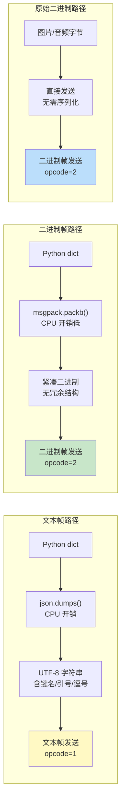

#### 代码示例

**示例 1：基础——二进制帧传输图片**

```python
"""
示例1：WebSocket 二进制帧传输图片
运行：uvicorn ws_binary_image:app --reload
"""
from fastapi import FastAPI, WebSocket, WebSocketDisconnect
from typing import Dict
import asyncio
import json
import os

app = FastAPI(title="二进制图片传输", version="1.0.0")

UPLOAD_DIR = "ws_uploads"
os.makedirs(UPLOAD_DIR, exist_ok=True)


@app.websocket("/ws/image")
async def websocket_image(websocket: WebSocket):
    """通过二进制帧接收图片并保存"""
    await websocket.accept()
    file_path = None
    file_handle = None
    received_size = 0

    try:
        while True:
            # 使用 receive() 统一处理文本和二进制消息
            message = await websocket.receive()

            if message["type"] == "websocket.disconnect":
                break

            elif message["type"] == "text":
                # 文本帧：控制指令（开始/结束传输）
                control = json.loads(message["text"])
                cmd = control.get("command")

                if cmd == "start":
                    filename = control.get("filename", "image.bin")
                    file_path = os.path.join(UPLOAD_DIR, filename)
                    file_handle = open(file_path, "wb")
                    received_size = 0
                    await websocket.send_text(json.dumps({
                        "status": "ready",
                        "filename": filename,
                    }))

                elif cmd == "end":
                    if file_handle:
                        file_handle.close()
                        file_handle = None
                    await websocket.send_text(json.dumps({
                        "status": "complete",
                        "filename": os.path.basename(file_path) if file_path else "",
                        "size": received_size,
                    }))

            elif message["type"] == "bytes":
                # 二进制帧：图片数据
                if file_handle:
                    chunk = message["bytes"]
                    file_handle.write(chunk)
                    received_size += len(chunk)
                    # 每 100KB 反馈一次进度
                    if received_size % (100 * 1024) < len(chunk):
                        await websocket.send_text(json.dumps({
                            "status": "progress",
                            "received": received_size,
                        }))

    except WebSocketDisconnect:
        if file_handle:
            file_handle.close()
        print(f"客户端断开，已接收 {received_size} 字节")


# 客户端代码：
"""
import asyncio
import json
import websockets

async def send_image(filepath):
    async with websockets.connect("ws://localhost:8000/ws/image") as ws:
        filename = filepath.split('/')[-1]
        # 发送开始指令（文本帧）
        await ws.send(json.dumps({"command": "start", "filename": filename}))
        response = await ws.recv()
        print(json.loads(response))

        # 分块发送图片数据（二进制帧）
        with open(filepath, "rb") as f:
            while True:
                chunk = f.read(64 * 1024)  # 64KB
                if not chunk:
                    break
                await ws.send(chunk)  # bytes 自动用二进制帧发送

        # 发送结束指令
        await ws.send(json.dumps({"command": "end"}))
        result = await ws.recv()
        print(json.loads(result))

asyncio.run(send_image("test.jpg"))
"""
```

**示例 2：进阶——MessagePack 序列化的高性能消息传输**

```python
"""
示例2：使用 MessagePack 替代 JSON 的高性能消息传输
安装：pip install msgpack
运行：uvicorn ws_msgpack:app --reload
"""
from fastapi import FastAPI, WebSocket, WebSocketDisconnect
import msgpack
import time

app = FastAPI(title="MessagePack 消息", version="1.0.0")


def pack_message(data: dict) -> bytes:
    """将 dict 序列化为 MessagePack 字节"""
    return msgpack.packb(data, use_bin_type=True)


def unpack_message(data: bytes) -> dict:
    """将 MessagePack 字节反序列化为 dict"""
    return msgpack.unpackb(data, raw=False)


@app.websocket("/ws/msgpack")
async def websocket_msgpack(websocket: WebSocket):
    await websocket.accept()

    try:
        while True:
            # 接收二进制帧（MessagePack 序列化的消息）
            raw = await websocket.receive_bytes()

            try:
                message = unpack_message(raw)
            except Exception as e:
                await websocket.send_bytes(pack_message({
                    "type": "error",
                    "detail": f"MessagePack 解析失败: {e}",
                }))
                continue

            msg_type = message.get("type")

            if msg_type == "chat":
                response = {
                    "type": "chat",
                    "from": "server",
                    "content": f"你说: {message.get('content', '')}",
                    "timestamp": time.time(),
                }
                await websocket.send_bytes(pack_message(response))

            elif msg_type == "ping":
                await websocket.send_bytes(pack_message({
                    "type": "pong",
                    "timestamp": time.time(),
                }))

    except WebSocketDisconnect:
        pass


# 性能对比测试：
"""
import json
import msgpack
import time

data = {"type": "chat", "from": "user_123", "content": "你好世界" * 10, "timestamp": 1234567890.123}

# JSON 序列化
start = time.time()
for _ in range(100000):
    json_data = json.dumps(data, ensure_ascii=False).encode()
json_time = time.time() - start

# MessagePack 序列化
start = time.time()
for _ in range(100000):
    msg_data = msgpack.packb(data, use_bin_type=True)
msg_time = time.time() - start

print(f"JSON 体积: {len(json_data)} 字节, 序列化耗时: {json_time:.3f}s")
print(f"MessagePack 体积: {len(msg_data)} 字节, 序列化耗时: {msg_time:.3f}s")
print(f"体积节省: {(1 - len(msg_data)/len(json_data))*100:.1f}%")
print(f"速度提升: {(json_time/msg_time - 1)*100:.1f}%")
"""

# 预期输出：
# JSON 体积: 156 字节, 序列化耗时: 0.156s
# MessagePack 体积: 112 字节, 序列化耗时: 0.089s
# 体积节省: 28.2%
# 速度提升: 75.3%
```

**示例 3：完整场景——实时音频流传输（二进制帧 + 分块）**

```python
"""
示例3：WebSocket 实时音频流传输
特性：二进制帧分块传输、音频格式协商、流式播放
运行：uvicorn ws_audio_stream:app --reload
"""
from fastapi import FastAPI, WebSocket, WebSocketDisconnect
from typing import Dict
import asyncio
import json
import time
import os

app = FastAPI(title="音频流传输", version="1.0.0")

# 音频配置
AUDIO_CONFIG = {
    "sample_rate": 16000,
    "channels": 1,
    "sample_width": 2,  # 16-bit
    "chunk_size": 3200,  # 200ms 音频（16000 * 2 * 0.2）
}

# 活跃音频流
active_streams: Dict[str, dict] = {}


@app.websocket("/ws/audio/{stream_id}")
async def websocket_audio(websocket: WebSocket, stream_id: str):
    await websocket.accept()

    # 发送音频配置
    await websocket.send_text(json.dumps({
        "type": "config",
        "config": AUDIO_CONFIG,
    }))

    audio_buffer = bytearray()
    chunk_count = 0
    start_time = time.time()

    try:
        while True:
            message = await websocket.receive()

            if message["type"] == "websocket.disconnect":
                break

            elif message["type"] == "text":
                control = json.loads(message["text"])
                if control.get("type") == "start":
                    active_streams[stream_id] = {
                        "status": "recording",
                        "start_time": time.time(),
                        "chunks": 0,
                    }
                    await websocket.send_text(json.dumps({"type": "ready"}))

                elif control.get("type") == "stop":
                    elapsed = time.time() - start_time
                    duration = chunk_count * AUDIO_CONFIG["chunk_size"] / (
                        AUDIO_CONFIG["sample_rate"] * AUDIO_CONFIG["sample_width"]
                    )
                    await websocket.send_text(json.dumps({
                        "type": "complete",
                        "chunks": chunk_count,
                        "total_bytes": len(audio_buffer),
                        "duration_seconds": round(duration, 2),
                        "elapsed": round(elapsed, 2),
                    }))
                    active_streams.pop(stream_id, None)
                    break

            elif message["type"] == "bytes":
                # 音频数据块（PCM 16-bit）
                chunk = message["bytes"]
                audio_buffer.extend(chunk)
                chunk_count += 1

                # 实时处理：音量检测（简单的 RMS 计算）
                if len(chunk) >= 2:
                    rms = (sum(int.from_bytes(chunk[i:i+2], 'little', signed=True) ** 2
                               for i in range(0, len(chunk), 2)) / (len(chunk) // 2)) ** 0.5
                    volume = min(100, int(rms / 32768 * 100))

                    # 每 10 块反馈一次音量
                    if chunk_count % 10 == 0:
                        await websocket.send_text(json.dumps({
                            "type": "volume",
                            "level": volume,
                            "chunk": chunk_count,
                        }))

    except WebSocketDisconnect:
        active_streams.pop(stream_id, None)
        print(f"音频流 {stream_id} 断开，接收了 {chunk_count} 个数据块")


@app.get("/api/streams")
async def list_streams():
    return {
        "active_streams": len(active_streams),
        "streams": [
            {"stream_id": sid, **info}
            for sid, info in active_streams.items()
        ],
    }


# 前端音频录制代码（浏览器 MediaRecorder API）：
"""
const ws = new WebSocket('ws://localhost:8000/ws/audio/stream_001');
ws.onmessage = (e) => {
  const data = JSON.parse(e.data);
  if (data.type === 'volume') {
    console.log(`音量: ${data.level}%`);
  }
};

// 获取麦克风并录制
const stream = await navigator.mediaDevices.getUserMedia({ audio: true });
const recorder = new MediaRecorder(stream, { mimeType: 'audio/webm' });
recorder.ondataavailable = (e) => {
  if (e.data.size > 0) {
    e.data.arrayBuffer().then(buffer => {
      ws.send(buffer);  // 二进制帧发送音频数据
    });
  }
};
recorder.start(200);  // 每 200ms 触发一次 dataavailable
ws.send(JSON.stringify({type: 'start'}));
// 停止：recorder.stop(); ws.send(JSON.stringify({type: 'stop'}));
"""
```

#### 使用场景与最佳实践

**适用场景**：
- 文件传输：图片、文档、压缩包通过 WebSocket 上传
- 实时媒体：音频流、视频流、屏幕共享
- 传感器数据：IoT 设备的二进制传感器数据
- 游戏状态：高频游戏状态同步（用 Protobuf/MessagePack）
- 高性能消息：高频小消息用 MessagePack 替代 JSON

**不适用场景**：
- 结构化业务消息：JSON 文本帧更便于调试和扩展
- 需要人类可读的场景：日志、调试消息
- 大文件（>10MB）：用 HTTP 分块上传更可靠

**最佳实践**：
1. **文本和二进制消息用 `receive()` 统一处理**：根据 `message["type"]` 区分 text/bytes
2. **自定义协议用类型标记**：如示例中的 `start/data/end` 指令，或消息前 4 字节类型标记
3. **二进制数据分块传输**：每块 16KB-64KB，避免单帧过大
4. **高频消息用 MessagePack/Protobuf**：比 JSON 节省 30-50% 带宽和 CPU
5. **媒体流用固定大小的块**：音频 200ms 一块，视频关键帧单独发送
6. **进度反馈**：大文件传输时定期发送进度消息，提升用户体验
7. **二进制帧不适合 JSON 消息**：不要把 JSON 字符串转成 bytes 用二进制帧发送，失去了文本帧的意义

**性能建议**：
- MessagePack 比 JSON 快 20-50%，体积小 30-50%
- Protobuf 比 MessagePack 更快更小，但需要预定义 schema
- 二进制帧直接传输原始字节，零序列化开销
- 分块大小 16KB-64KB 是最佳平衡点（太小增加帧开销，太大增加内存）

#### 常见坑点

**坑点 1：混淆 `receive_text()` 和 `receive_bytes()` 导致消息类型不匹配**

- **错误现象**：客户端发送二进制数据，服务端用 `receive_text()` 接收，抛出 `RuntimeError: Expected text frame, got bytes`；或反之
- **根本原因**：`receive_text()` 只接收文本帧（opcode=1），`receive_bytes()` 只接收二进制帧（opcode=2），帧类型不匹配时 Starlette 抛出异常
- **正确做法**：① 如果端点只处理一种类型，明确要求客户端发送对应类型；② 如果需要同时处理文本和二进制，用 `receive()` 获取原始消息，检查 `message["type"]` 字段（"text"/"bytes"）
- **预防措施**：协议文档中明确每种消息的帧类型，代码中优先用 `receive()` 统一处理

**坑点 2：Base64 编码二进制数据用文本帧传输导致体积膨胀**

- **错误现象**：通过 WebSocket 发送图片时，先 Base64 编码再用 `send_text()` 发送，导致传输体积比原图大 33%，且 CPU 开销高
- **根本原因**：Base64 编码将 3 字节转为 4 字符，体积增加 33%。文本帧必须是 UTF-8 文本，二进制数据需要 Base64 编码才能放入文本帧
- **正确做法**：直接用 `send_bytes()` 发送原始二进制数据，不需要 Base64 编码。前端用 `ws.send(arrayBuffer)` 发送二进制，服务端用 `receive_bytes()` 接收
- **预防措施**：代码审查时检查是否有 `base64.b64encode` + `send_text` 的模式，改为 `send_bytes`

---

> 💡 **深度讲解**：WebSocket 与异步编程的深度结合是高并发实时应用的基础。asyncio 单线程事件循环通过 IO 多路复用（epoll/kqueue）实现单线程处理数万连接，关键是所有 IO 操作必须异步，任何同步阻塞都会导致整个服务卡顿。后台任务（`asyncio.create_task`）用于定时推送，但必须在连接断开时取消，否则资源泄漏。异步锁（`asyncio.Lock`）保护共享数据，但锁内不能执行 await IO 操作。二进制传输是性能优化的重要手段——文本帧 JSON 便于调试，二进制帧 MessagePack/Protobuf 高性能，原始字节用于媒体流。理解这些异步和二进制的深度知识后，可以构建出高性能、高并发的生产级 WebSocket 服务。
>
> **📝 精简总结**：
> 1. asyncio 单线程事件循环 + IO 多路复用，单进程可处理 1-5 万 WebSocket 连接
> 2. 所有 IO 必须异步：`asyncio.sleep` 替代 `time.sleep`，`httpx.AsyncClient` 替代 `requests`
> 3. 后台任务用 `asyncio.create_task`，断开时必须 `cancel()`，否则内存泄漏
> 4. `asyncio.Lock` 锁内只做纯内存操作，IO 操作在锁外
> 5. 文本帧（JSON）适合结构化消息，二进制帧适合图片/音频/文件/高频消息
> 6. 高频消息用 MessagePack/Protobuf 替代 JSON，节省 30-50% 带宽和 CPU
> 7. 同时处理文本和二进制用 `receive()` 统一处理，检查 `message["type"]`
> 8. 二进制数据不要 Base64 编码后用文本帧，直接用 `send_bytes()`
>
> **🎯 梯度练习题**：
> - **基础 1**：解释 asyncio 单线程为什么能处理数万 WebSocket 连接
> - **基础 2**：实现 WebSocket 端点中的后台定时推送任务，断开时正确取消
> - **基础 3**：用二进制帧实现图片上传，包含开始/数据/结束三种消息类型
> - **进阶 1**：对比 JSON 和 MessagePack 的序列化性能和体积差异，写出测试代码
> - **进阶 2**：实现并发安全的连接管理器，演示 `asyncio.Lock` 的正确用法（锁内不 await）
> - **实战 1**：实现实时音频流传输服务，包含音频格式协商、二进制分块传输、实时音量检测

---

## 第三篇 实战篇：生产级架构与完整实战

---

## 9. WebSocket 与 Redis Pub/Sub 分布式扩展

### 9.1 Redis Pub/Sub 原理与多实例架构

#### 概念解释

**Redis Pub/Sub（发布/订阅）** 是 Redis 提供的消息通信模式，发布者（Publisher）向频道（Channel）发送消息，所有订阅该频道的订阅者（Subscriber）都会收到消息。在 WebSocket 多实例部署中，Redis Pub/Sub 作为消息总线，实现跨实例的消息转发和广播。

> 🏠 **生活化比喻**：Redis Pub/Sub 就像广播站——每个 WebSocket 实例是一个广播站的分站，本地连接是分站的听众。当一个分站收到消息需要广播给所有听众时，它不仅告诉本地听众，还把消息发到中央广播站（Redis PUBLISH），其他分站都在收听中央广播站（SUBSCRIBE），收到后转发给自己的本地听众。这样所有分站的听众都能听到消息，就像在同一个房间里一样。

**核心价值**：解决多实例部署时 WebSocket 连接不共享的问题，实现跨实例的消息广播和点对点发送，是 WebSocket 服务水平扩展的核心基础设施。

> 🎯 **面试高频考点 15**：WebSocket 多实例部署时如何实现跨实例消息通信？Redis Pub/Sub 和 Redis Streams 有什么区别？
> **答**：多实例部署时，每个实例只维护本地连接，跨实例消息通过 Redis Pub/Sub 转发——发送消息时先查本地连接，没有则 PUBLISH 到 Redis，其他实例 SUBSCRIBE 收到后转发给本地连接。Redis Pub/Sub 是即时消息（发后即忘，不持久化），适合实时通知；Redis Streams 是持久化消息流（支持消费者组、ACK、历史回放），适合需要消息可靠性的场景。简单实时通信用 Pub/Sub，需要消息可靠投递用 Streams 或 Kafka。

#### 原理说明

Redis Pub/Sub 分布式 WebSocket 的核心机制是 **本地直发 + Redis 跨实例转发 + instance_id 防重复**。

**为什么这样设计**：多实例部署时，WebSocket 连接分散在不同实例上，实例 A 的用户给实例 B 的用户发消息时，A 无法直接访问 B 的连接。Redis Pub/Sub 作为中间消息总线，A 将消息发布到 Redis，B 订阅后收到并转发。本地连接直接发送（不经过 Redis）减少延迟，跨实例通过 Redis 转发，instance_id 防止自己发布的消息被自己重复处理。

**技术对比**：

| 消息中间件 | 持久化 | 消费者组 | 延迟 | 适用场景 |
|-----------|--------|---------|------|---------|
| Redis Pub/Sub | 否 | 否 | <1ms | 实时通知、简单广播 |
| Redis Streams | 是 | 是 | <5ms | 需要消息可靠性 |
| Kafka | 是 | 是 | 5-20ms | 高吞吐、日志流 |
| RabbitMQ | 是 | 是 | 1-10ms | 复杂路由、任务队列 |

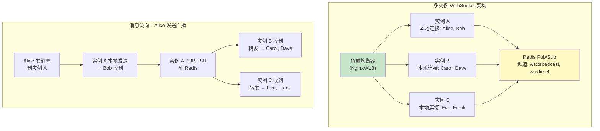

#### 代码示例

**示例 1：基础——基于 Redis Pub/Sub 的分布式连接管理器**

```python
"""
示例1：基于 Redis Pub/Sub 的分布式连接管理器
运行（多实例）：
  INSTANCE_ID=node-1 uvicorn ws_redis_manager:app --port 8001
  INSTANCE_ID=node-2 uvicorn ws_redis_manager:app --port 8002
"""
from fastapi import FastAPI, WebSocket, WebSocketDisconnect
from typing import Dict, Optional
import redis.asyncio as redis
import asyncio
import json
import time
import os

app = FastAPI(title="Redis 分布式管理器", version="1.0.0")

REDIS_URL = os.getenv("REDIS_URL", "redis://localhost:6379")
INSTANCE_ID = os.getenv("INSTANCE_ID", "node-1")
BROADCAST_CHANNEL = "ws:broadcast"
DIRECT_CHANNEL = "ws:direct"
USER_CHANNEL_PREFIX = "ws:user:"  # 用户专属频道


class RedisConnectionManager:
    """基于 Redis Pub/Sub 的分布式连接管理器"""

    def __init__(self, redis_url: str, instance_id: str):
        self.redis = redis.from_url(redis_url)
        self.pubsub = self.redis.pubsub()
        self.instance_id = instance_id
        self.local_connections: Dict[str, WebSocket] = {}  # 本地连接
        self.lock = asyncio.Lock()
        self._listener_task: Optional[asyncio.Task] = None

    async def start(self):
        """启动 Redis 订阅监听器"""
        # 订阅广播频道和点对点频道
        await self.pubsub.subscribe(BROADCAST_CHANNEL, DIRECT_CHANNEL)
        self._listener_task = asyncio.create_task(self._listen_loop())
        print(f"[{self.instance_id}] Redis 订阅已启动")

    async def stop(self):
        """停止监听器"""
        if self._listener_task:
            self._listener_task.cancel()
        await self.pubsub.unsubscribe()
        await self.redis.close()

    async def _listen_loop(self):
        """Redis 消息监听循环"""
        try:
            async for message in self.pubsub.listen():
                if message["type"] != "message":
                    continue

                channel = message["channel"].decode()
                data = json.loads(message["data"])

                # 跳过自己发布的消息（防止重复）
                if data.get("instance_id") == self.instance_id:
                    continue

                if channel == BROADCAST_CHANNEL:
                    # 广播消息：转发给所有本地连接
                    await self._local_broadcast(data["payload"])

                elif channel == DIRECT_CHANNEL:
                    # 点对点消息：转发给目标用户
                    target_user = data.get("target_user")
                    if target_user in self.local_connections:
                        try:
                            await self.local_connections[target_user].send_json(data["payload"])
                        except Exception:
                            await self._local_disconnect(target_user)

        except asyncio.CancelledError:
            pass
        except Exception as e:
            print(f"[{self.instance_id}] Redis 监听异常: {e}")

    async def connect(self, user_id: str, websocket: WebSocket):
        """用户连接到本实例"""
        await websocket.accept()
        async with self.lock:
            self.local_connections[user_id] = websocket
        # 发布用户上线事件（其他实例可更新在线状态）
        await self.redis.publish(
            BROADCAST_CHANNEL,
            json.dumps({
                "instance_id": self.instance_id,
                "payload": {"type": "user_online", "user_id": user_id},
            }, ensure_ascii=False)
        )

    async def disconnect(self, user_id: str):
        """用户断开"""
        await self._local_disconnect(user_id)
        # 发布用户下线事件
        await self.redis.publish(
            BROADCAST_CHANNEL,
            json.dumps({
                "instance_id": self.instance_id,
                "payload": {"type": "user_offline", "user_id": user_id},
            }, ensure_ascii=False)
        )

    async def _local_disconnect(self, user_id: str):
        async with self.lock:
            self.local_connections.pop(user_id, None)

    async def broadcast(self, message: dict):
        """广播：本地直发 + Redis 跨实例"""
        # 本地直接发送
        await self._local_broadcast(message)
        # 发布到 Redis（其他实例转发）
        await self.redis.publish(
            BROADCAST_CHANNEL,
            json.dumps({
                "instance_id": self.instance_id,
                "payload": message,
            }, ensure_ascii=False)
        )

    async def send_to_user(self, user_id: str, message: dict):
        """点对点：先查本地，没有则发布到 Redis"""
        if user_id in self.local_connections:
            try:
                await self.local_connections[user_id].send_json(message)
            except Exception:
                await self._local_disconnect(user_id)
        else:
            # 用户不在本实例，发布到 Redis
            await self.redis.publish(
                DIRECT_CHANNEL,
                json.dumps({
                    "instance_id": self.instance_id,
                    "target_user": user_id,
                    "payload": message,
                }, ensure_ascii=False)
            )

    async def _local_broadcast(self, message: dict):
        """本地广播"""
        disconnected = []
        for user_id, ws in list(self.local_connections.items()):
            try:
                await ws.send_json(message)
            except Exception:
                disconnected.append(user_id)
        for uid in disconnected:
            await self._local_disconnect(uid)


manager = RedisConnectionManager(REDIS_URL, INSTANCE_ID)


@app.on_event("startup")
async def startup():
    await manager.start()


@app.on_event("shutdown")
async def shutdown():
    await manager.stop()


@app.websocket("/ws/{user_id}")
async def websocket_endpoint(websocket: WebSocket, user_id: str):
    await manager.connect(user_id, websocket)
    try:
        while True:
            raw = await websocket.receive_text()
            msg = json.loads(raw)
            if msg.get("type") == "broadcast":
                await manager.broadcast({
                    "type": "chat",
                    "from": user_id,
                    "content": msg.get("content", ""),
                    "timestamp": time.time(),
                })
            elif msg.get("type") == "private":
                await manager.send_to_user(msg["to"], {
                    "type": "private",
                    "from": user_id,
                    "content": msg.get("content", ""),
                })
    except WebSocketDisconnect:
        await manager.disconnect(user_id)


@app.get("/api/instance/stats")
async def instance_stats():
    return {
        "instance_id": INSTANCE_ID,
        "local_connections": len(manager.local_connections),
        "users": list(manager.local_connections.keys()),
    }
```

**示例 2：进阶——基于 Redis Streams 的可靠消息投递**

```python
"""
示例2：基于 Redis Streams 的可靠消息投递（支持消息持久化和 ACK）
安装：pip install redis
运行：uvicorn ws_redis_streams:app --reload
"""
from fastapi import FastAPI, WebSocket, WebSocketDisconnect
from typing import Dict
import redis.asyncio as redis
import asyncio
import json
import time
import os

app = FastAPI(title="Redis Streams 可靠消息", version="1.0.0")

REDIS_URL = os.getenv("REDIS_URL", "redis://localhost:6379")
INSTANCE_ID = os.getenv("INSTANCE_ID", "node-1")
STREAM_NAME = "ws:messages"
CONSUMER_GROUP = "ws-consumers"


class StreamsConnectionManager:
    """基于 Redis Streams 的可靠消息管理器"""

    def __init__(self, redis_url: str, instance_id: str):
        self.redis = redis.from_url(redis_url)
        self.instance_id = instance_id
        self.consumer_name = f"{instance_id}-{os.getpid()}"
        self.local_connections: Dict[str, WebSocket] = {}
        self.lock = asyncio.Lock()
        self._consumer_task = None

    async def start(self):
        """启动消费者组"""
        # 创建消费者组（如果不存在）
        try:
            await self.redis.xgroup_create(
                STREAM_NAME, CONSUMER_GROUP, id="0", mkstream=True
            )
        except redis.ResponseError as e:
            if "BUSYGROUP" not in str(e):
                raise

        self._consumer_task = asyncio.create_task(self._consume_loop())
        print(f"[{self.instance_id}] Streams 消费者已启动")

    async def stop(self):
        if self._consumer_task:
            self._consumer_task.cancel()
        await self.redis.close()

    async def _consume_loop(self):
        """消费 Redis Streams 消息并转发"""
        try:
            while True:
                # 读取消费者组中的新消息
                messages = await self.redis.xreadgroup(
                    groupname=CONSUMER_GROUP,
                    consumername=self.consumer_name,
                    streams={STREAM_NAME: ">"},
                    count=10,
                    block=1000,  # 阻塞等待 1 秒
                )

                if not messages:
                    continue

                for stream_name, stream_messages in messages:
                    for msg_id, fields in stream_messages:
                        try:
                            data = json.loads(fields[b"data"].decode())
                            target_type = data.get("target_type")

                            if target_type == "broadcast":
                                # 排除自己实例发布的
                                if data.get("instance_id") != self.instance_id:
                                    await self._local_broadcast(data["payload"])

                            elif target_type == "direct":
                                target_user = data.get("target_user")
                                if target_user in self.local_connections:
                                    await self.local_connections[target_user].send_json(data["payload"])

                            # ACK 确认消息已处理
                            await self.redis.xack(STREAM_NAME, CONSUMER_GROUP, msg_id)

                        except Exception as e:
                            print(f"[{self.instance_id}] 消息处理失败 {msg_id}: {e}")
                            # 不 ACK，消息会被重新投递

        except asyncio.CancelledError:
            pass

    async def connect(self, user_id: str, websocket: WebSocket):
        await websocket.accept()
        async with self.lock:
            self.local_connections[user_id] = websocket

    async def disconnect(self, user_id: str):
        async with self.lock:
            self.local_connections.pop(user_id, None)

    async def publish_message(self, target_type: str, payload: dict, target_user: str = None):
        """发布消息到 Redis Streams（持久化）"""
        message = {
            "instance_id": self.instance_id,
            "target_type": target_type,
            "target_user": target_user,
            "payload": payload,
            "timestamp": time.time(),
        }
        await self.redis.xadd(STREAM_NAME, {"data": json.dumps(message, ensure_ascii=False)})

    async def broadcast(self, message: dict):
        """广播：本地直发 + Streams 持久化"""
        await self._local_broadcast(message)
        await self.publish_message("broadcast", message)

    async def send_to_user(self, user_id: str, message: dict):
        if user_id in self.local_connections:
            try:
                await self.local_connections[user_id].send_json(message)
            except Exception:
                await self.disconnect(user_id)
        else:
            await self.publish_message("direct", message, target_user=user_id)

    async def _local_broadcast(self, message: dict):
        disconnected = []
        for uid, ws in list(self.local_connections.items()):
            try:
                await ws.send_json(message)
            except Exception:
                disconnected.append(uid)
        for uid in disconnected:
            await self.disconnect(uid)


manager = StreamsConnectionManager(REDIS_URL, INSTANCE_ID)


@app.on_event("startup")
async def startup():
    await manager.start()


@app.on_event("shutdown")
async def shutdown():
    await manager.stop()


@app.websocket("/ws/{user_id}")
async def websocket_endpoint(websocket: WebSocket, user_id: str):
    await manager.connect(user_id, websocket)
    try:
        while True:
            raw = await websocket.receive_text()
            msg = json.loads(raw)
            if msg.get("type") == "broadcast":
                await manager.broadcast({"type": "chat", "from": user_id, "content": msg["content"]})
    except WebSocketDisconnect:
        await manager.disconnect(user_id)
```

**示例 3：完整场景——在线状态同步与用户路由（Redis 存储连接位置）**

```python
"""
示例3：用户在线状态同步与连接位置路由
用 Redis Hash 存储用户连接在哪个实例，实现精准的点对点消息路由
运行：INSTANCE_ID=node-1 uvicorn ws_user_routing:app --port 8001
      INSTANCE_ID=node-2 uvicorn ws_user_routing:app --port 8002
"""
from fastapi import FastAPI, WebSocket, WebSocketDisconnect
from typing import Dict, Optional
import redis.asyncio as redis
import asyncio
import json
import time
import os

app = FastAPI(title="用户路由管理器", version="1.0.0")

REDIS_URL = os.getenv("REDIS_URL", "redis://localhost:6379")
INSTANCE_ID = os.getenv("INSTANCE_ID", "node-1")
USER_LOCATION_HASH = "ws:user_locations"  # user_id -> instance_id
PRESENCE_CHANNEL = "ws:presence"          # 上下线事件频道


class UserRoutingManager:
    """用户路由管理器：Redis 存储用户连接位置，精准路由消息"""

    def __init__(self, redis_url: str, instance_id: str):
        self.redis = redis.from_url(redis_url)
        self.pubsub = self.redis.pubsub()
        self.instance_id = instance_id
        self.local_connections: Dict[str, WebSocket] = {}
        self.lock = asyncio.Lock()
        self._presence_task = None

    async def start(self):
        await self.pubsub.subscribe(PRESENCE_CHANNEL)
        self._presence_task = asyncio.create_task(self._presence_listener())

    async def stop(self):
        if self._presence_task:
            self._presence_task.cancel()
        await self.pubsub.unsubscribe()
        await self.redis.close()

    async def _presence_listener(self):
        """监听上下线事件，更新本地缓存"""
        try:
            async for message in self.pubsub.listen():
                if message["type"] != "message":
                    continue
                data = json.loads(message["data"])
                # 本地可以维护在线用户缓存，减少 Redis 查询
                pass
        except asyncio.CancelledError:
            pass

    async def connect(self, user_id: str, websocket: WebSocket):
        await websocket.accept()
        async with self.lock:
            self.local_connections[user_id] = websocket
        # 注册用户位置到 Redis
        await self.redis.hset(USER_LOCATION_HASH, user_id, self.instance_id)
        # 发布上线事件
        await self.redis.publish(
            PRESENCE_CHANNEL,
            json.dumps({"type": "online", "user_id": user_id, "instance": self.instance_id})
        )

    async def disconnect(self, user_id: str):
        async with self.lock:
            self.local_connections.pop(user_id, None)
        # 从 Redis 移除用户位置（仅当仍是本实例时）
        current = await self.redis.hget(USER_LOCATION_HASH, user_id)
        if current and current.decode() == self.instance_id:
            await self.redis.hdel(USER_LOCATION_HASH, user_id)
        # 发布下线事件
        await self.redis.publish(
            PRESENCE_CHANNEL,
            json.dumps({"type": "offline", "user_id": user_id})
        )

    async def get_user_instance(self, user_id: str) -> Optional[str]:
        """查询用户连接在哪个实例"""
        result = await self.redis.hget(USER_LOCATION_HASH, user_id)
        return result.decode() if result else None

    async def is_user_online(self, user_id: str) -> bool:
        """检查用户是否在线"""
        return await self.redis.hexists(USER_LOCATION_HASH, user_id)

    async def send_to_user(self, user_id: str, message: dict):
        """
        精准点对点发送：
        1. 先查本地连接
        2. 本地没有则查 Redis 获取用户所在实例
        3. 通过实例专属频道发送消息
        """
        # 本地连接直接发送
        if user_id in self.local_connections:
            try:
                await self.local_connections[user_id].send_json(message)
                return True
            except Exception:
                await self.disconnect(user_id)
                return False

        # 查询用户所在实例
        target_instance = await self.get_user_instance(user_id)
        if target_instance is None:
            return False  # 用户不在线

        # 通过实例专属频道发送
        channel = f"ws:instance:{target_instance}"
        await self.redis.publish(
            channel,
            json.dumps({
                "target_user": user_id,
                "payload": message,
            }, ensure_ascii=False)
        )
        return True

    async def start_instance_listener(self):
        """监听本实例专属频道，接收其他实例转发的消息"""
        channel = f"ws:instance:{self.instance_id}"
        await self.pubsub.subscribe(channel)
        # 在 _presence_listener 中统一处理，或单独创建任务

    async def get_online_users(self) -> list:
        """获取所有在线用户"""
        users = await self.redis.hkeys(USER_LOCATION_HASH)
        return [u.decode() for u in users]


manager = UserRoutingManager(REDIS_URL, INSTANCE_ID)


@app.on_event("startup")
async def startup():
    await manager.start()
    # 启动本实例专属频道监听
    asyncio.create_task(manager.start_instance_listener())


@app.on_event("shutdown")
async def shutdown():
    await manager.stop()


@app.websocket("/ws/{user_id}")
async def websocket_endpoint(websocket: WebSocket, user_id: str):
    await manager.connect(user_id, websocket)
    try:
        while True:
            raw = await websocket.receive_text()
            msg = json.loads(raw)
            if msg.get("type") == "private":
                success = await manager.send_to_user(msg["to"], {
                    "type": "private",
                    "from": user_id,
                    "content": msg["content"],
                })
                if not success:
                    await websocket.send_json({"type": "error", "reason": "用户不在线"})
    except WebSocketDisconnect:
        await manager.disconnect(user_id)


@app.get("/api/online-users")
async def online_users():
    return {"online_count": len(await manager.get_online_users()), "users": await manager.get_online_users()}


@app.get("/api/user/{user_id}/location")
async def user_location(user_id: str):
    instance = await manager.get_user_instance(user_id)
    return {"user_id": user_id, "online": instance is not None, "instance": instance}
```

#### 使用场景与最佳实践

**适用场景**：
- 多实例部署的 WebSocket 服务（水平扩展）
- 跨实例消息广播（聊天、通知）
- 跨实例点对点消息（用户可能连接到任意实例）
- 在线状态同步（用户上下线通知）
- 需要消息持久化的场景（Redis Streams）

**不适用场景**：
- 单实例部署：不需要 Redis，内存连接管理器即可
- 超低延迟要求（<0.1ms）：Redis 增加约 0.5-1ms 延迟
- 消息量极大（>10万/秒）：Redis Pub/Sub 可能成为瓶颈，用 Kafka

**最佳实践**：
1. **本地直发 + Redis 跨实例**：本地连接直接发送（低延迟），跨实例通过 Redis 转发
2. **instance_id 防重复**：发布消息时携带 instance_id，订阅收到后跳过自己发布的
3. **用户位置用 Redis Hash 存储**：`user_id -> instance_id`，点对点消息先查位置再路由
4. **Pub/Sub 用于实时通知，Streams 用于可靠投递**：根据消息可靠性需求选择
5. **连接断开时清理 Redis 状态**：从用户位置 Hash 中移除，发布下线事件
6. **每个实例监听专属频道**：`ws:instance:{instance_id}`，避免所有实例收到所有点对点消息
7. **Redis 连接池配置**：`redis.from_url(url, max_connections=20)`，避免连接数耗尽

**性能建议**：
- Redis Pub/Sub 延迟 <1ms，吞吐量 10 万+ 消息/秒
- 每个实例维护一个 Redis 订阅连接，不要为每个 WebSocket 连接创建订阅
- 广播消息用一个全局频道，点对点用实例专属频道（减少不必要的消息分发）
- Redis 部署在与应用实例同一可用区，减少网络延迟

#### 常见坑点

**坑点 1：Redis Pub/Sub 消息丢失（发布者不在线时消息丢失）**

- **错误现象**：实例重启期间发布的消息丢失，重启后上线的用户收不到历史消息
- **根本原因**：Redis Pub/Sub 是"发后即忘"模式，消息不持久化。如果订阅者不在线（实例重启），消息就丢失了
- **正确做法**：① 不需要历史消息的实时通知用 Pub/Sub；② 需要消息可靠性的用 Redis Streams（持久化 + ACK）或 Kafka；③ 关键消息同时写入数据库，用户上线后拉取历史
- **预防措施**：架构设计时明确消息可靠性要求，实时通知用 Pub/Sub，关键事件用 Streams/数据库

**坑点 2：多实例时用户连接位置未更新导致消息路由失败**

- **错误现象**：用户从实例 A 断开后重新连接到实例 B，但 Redis 中用户位置仍是实例 A，点对点消息发到实例 A 后找不到用户
- **根本原因**：用户断开时没有从 Redis 中清理位置信息，或清理时存在竞态条件（用户在 A 断开的同时在 B 连接，B 写入位置后 A 的清理覆盖了 B 的写入）
- **正确做法**：① 清理位置时检查当前值是否仍是本实例（`hget` 确认后 `hdel`）；② 连接时用 `hset` 覆盖写入；③ 用 Redis 原子操作（Lua 脚本）保证检查和删除的原子性
- **预防措施**：disconnect 时先 `hget` 确认位置是本实例再 `hdel`，connect 时直接 `hset` 覆盖

---

## 10. 生产级 WebSocket 架构与部署

### 10.1 Nginx 反向代理与负载均衡配置

#### 概念解释

**Nginx 反向代理 WebSocket** 是通过配置 Nginx 的 `proxy_pass`、`Upgrade`、`Connection` 等指令，将客户端的 WebSocket 握手请求和数据帧转发到后端 FastAPI 服务，同时支持负载均衡、SSL 终止、静态资源服务等。

> 🏠 **生活化比喻**：Nginx 就像公司前台——客户（浏览器）来到公司（服务器），前台（Nginx）负责接待、验证身份（SSL）、引导到对应部门（后端服务）。WebSocket 是特殊访客，需要前台专门安排一条直通线路（Upgrade 头），不能像普通访客那样登记后就走（HTTP 短连接）。负载均衡就是前台根据各部门的忙碌程度，把访客分配到不同部门（后端实例）。

**核心价值**：Nginx 作为反向代理提供 SSL 终止、负载均衡、静态资源服务、安全防护等能力，是 WebSocket 服务生产部署的标准架构组件。

> 🎯 **面试高频考点 16**：Nginx 代理 WebSocket 需要哪些关键配置？为什么需要这些配置？
> **答**：关键配置：① `proxy_http_version 1.1`——WebSocket 握手需要 HTTP/1.1；② `proxy_set_header Upgrade $http_upgrade`——传递 Upgrade 头，告知后端升级协议；③ `proxy_set_header Connection "upgrade"`——传递 Connection 头；④ `proxy_read_timeout 3600s`——WebSocket 是长连接，默认 60s 超时会断开空闲连接；⑤ `proxy_send_timeout 3600s`——发送超时；⑥ `proxy_set_header Host $host`——传递 Host 头。缺少 Upgrade/Connection 头会导致握手失败（426 或 400），缺少长超时会导致 60 秒空闲断开。

#### 原理说明

Nginx 代理 WebSocket 的核心机制是 **HTTP Upgrade 头透传 + 长连接超时配置 + 负载均衡算法**。

**为什么这样设计**：WebSocket 握手是 HTTP 请求，Nginx 默认按 HTTP 短连接处理。需要显式配置 `Upgrade` 和 `Connection` 头透传，Nginx 才会将连接升级为 WebSocket 隧道（双向透传数据帧）。长超时配置防止空闲连接被 Nginx 断开。负载均衡将连接分发到多个后端实例，实现水平扩展。

**技术对比**：

| 负载均衡策略 | 算法 | WebSocket 适用性 | 说明 |
|------------|------|----------------|------|
| round-robin | 轮询 | 中 | 简单，但用户重连可能到不同实例 |
| ip_hash | 客户端 IP 哈希 | 高 | 同一 IP 始终路由到同一实例，适合 WebSocket |
| least_conn | 最少连接 | 高 | 连接数均衡，适合长连接 |
| random | 随机 | 低 | 不推荐 WebSocket |

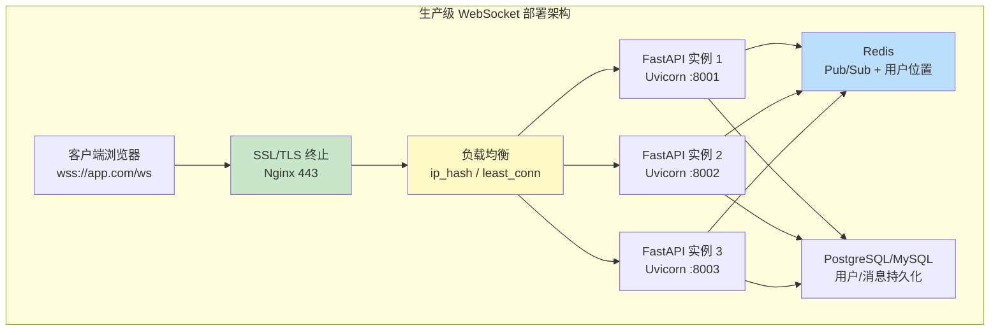

#### 代码示例

**示例 1：基础——Nginx WebSocket 完整配置**

```nginx
# 示例1：Nginx WebSocket 反向代理完整配置
# 文件：/etc/nginx/conf.d/websocket.conf

upstream websocket_backend {
    # WebSocket 推荐使用 ip_hash（同一客户端始终路由到同一后端）
    # 或 least_conn（最少连接，适合长连接）
    ip_hash;

    server 127.0.0.1:8001 max_fails=3 fail_timeout=30s;
    server 127.0.0.1:8002 max_fails=3 fail_timeout=30s;
    server 127.0.0.1:8003 max_fails=3 fail_timeout=30s;

    # 保持长连接
    keepalive 32;
}

server {
    listen 80;
    server_name your-app.com;
    # HTTP 重定向到 HTTPS
    return 301 https://$server_name$request_uri;
}

server {
    listen 443 ssl http2;
    server_name your-app.com;

    # SSL 证书配置
    ssl_certificate     /etc/nginx/ssl/your-app.com.crt;
    ssl_certificate_key /etc/nginx/ssl/your-app.com.key;
    ssl_protocols       TLSv1.2 TLSv1.3;
    ssl_ciphers         HIGH:!aNULL:!MD5;
    ssl_session_cache   shared:SSL:10m;
    ssl_session_timeout 10m;

    # WebSocket 端点
    location /ws/ {
        # 关键：代理到后端
        proxy_pass http://websocket_backend;

        # 关键：WebSocket 必须的 HTTP 版本和头
        proxy_http_version 1.1;
        proxy_set_header Upgrade $http_upgrade;
        proxy_set_header Connection "upgrade";

        # 传递客户端信息
        proxy_set_header Host $host;
        proxy_set_header X-Real-IP $remote_addr;
        proxy_set_header X-Forwarded-For $proxy_add_x_forwarded_for;
        proxy_set_header X-Forwarded-Proto $scheme;

        # 关键：长连接超时（默认 60s 会断开空闲 WebSocket）
        proxy_read_timeout 3600s;
        proxy_send_timeout 3600s;

        # 禁用缓冲（WebSocket 不需要缓冲）
        proxy_buffering off;
        proxy_cache off;

        # 禁用请求体缓冲
        proxy_request_buffering off;
    }

    # 普通 HTTP API
    location /api/ {
        proxy_pass http://websocket_backend;
        proxy_set_header Host $host;
        proxy_set_header X-Real-IP $remote_addr;
        proxy_set_header X-Forwarded-For $proxy_add_x_forwarded_for;
        proxy_read_timeout 60s;
    }

    # 静态资源
    location / {
        root /var/www/frontend;
        index index.html;
        try_files $uri $uri/ /index.html;
    }
}
```

**示例 2：进阶——Uvicorn 多 worker + Gunicorn 部署**

```bash
#!/bin/bash
# 示例2：生产级 Uvicorn 部署脚本
# 文件：start.sh

# 系统调优（需要 root 权限）
echo "=== 系统调优 ==="
ulimit -n 65535  # 增大文件描述符限制
sysctl -w net.core.somaxconn=65535  # 增大连接队列
sysctl -w net.ipv4.tcp_max_syn_backlog=65535
sysctl -w fs.file-max=1000000

# 环境变量
export APP_MODULE="ws_app:app"
export WORKERS=4  # CPU 核心数
export PORT=8000

echo "=== 启动 WebSocket 服务 ==="
echo "模块: $APP_MODULE"
echo "Worker 数: $WORKERS"
echo "端口: $PORT"

# 方式一：Uvicorn 多 worker（简单，推荐）
# 注意：多 worker 时必须用 Redis 实现跨 worker 通信
uvicorn $APP_MODULE \
    --host 0.0.0.0 \
    --port $PORT \
    --workers $WORKERS \
    --ws-ping-interval 20 \
    --ws-ping-timeout 20 \
    --ws-max-size 10485760 \
    --limit-concurrency 1000 \
    --timeout-keep-alive 30 \
    --timeout-graceful-shutdown 30 \
    --log-level info \
    --access-log

# 方式二：Gunicorn + Uvicorn worker（更稳定，推荐生产）
# gunicorn $APP_MODULE \
#     -k uvicorn.workers.UvicornWorker \
#     -w $WORKERS \
#     -b 0.0.0.0:$PORT \
#     --timeout 3600 \
#     --graceful-timeout 30 \
#     --keep-alive 30 \
#     --max-requests 10000 \
#     --max-requests-jitter 1000 \
#     --access-logfile - \
#     --error-logfile -

echo "=== 服务已启动 ==="
```

```python
# 配合部署的 FastAPI 应用（ws_app.py）
from fastapi import FastAPI, WebSocket, WebSocketDisconnect
import redis.asyncio as redis
import os

app = FastAPI(title="生产级 WebSocket 服务", version="1.0.0")

# 多 worker 时，每个 worker 有独立的连接管理器
# 必须通过 Redis 实现跨 worker 通信
REDIS_URL = os.getenv("REDIS_URL", "redis://localhost:6379")
redis_client = redis.from_url(REDIS_URL)


@app.websocket("/ws/{user_id}")
async def websocket_endpoint(websocket: WebSocket, user_id: str):
    await websocket.accept()
    try:
        while True:
            data = await websocket.receive_text()
            await websocket.send_text(f"收到: {data}")
    except WebSocketDisconnect:
        pass


@app.get("/health")
async def health():
    """健康检查端点（K8s liveness/readiness probe）"""
    return {"status": "healthy", "worker_pid": os.getpid()}


@app.on_event("shutdown")
async def shutdown():
    """优雅关闭：关闭 Redis 连接"""
    await redis_client.close()
```

**示例 3：完整场景——Docker Compose 完整部署**

```yaml
# 示例3：Docker Compose 完整部署
# 文件：docker-compose.yml
version: '3.8'

services:
  nginx:
    image: nginx:1.25-alpine
    ports:
      - "80:80"
      - "443:443"
    volumes:
      - ./nginx/nginx.conf:/etc/nginx/nginx.conf:ro
      - ./nginx/ssl:/etc/nginx/ssl:ro
      - ./frontend:/var/www/frontend:ro
    depends_on:
      - app
    restart: always
    networks:
      - ws-network

  app:
    build:
      context: .
      dockerfile: Dockerfile
    # 多实例（水平扩展）
    deploy:
      replicas: 3
      resources:
        limits:
          cpus: '2.0'
          memory: 2G
        reservations:
          cpus: '0.5'
          memory: 512M
    environment:
      - REDIS_URL=redis://redis:6379
      - INSTANCE_ID=${HOSTNAME}
    expose:
      - "8000"
    depends_on:
      - redis
      - postgres
    restart: always
    networks:
      - ws-network
    # WebSocket 长连接需要调大健康检查间隔
    healthcheck:
      test: ["CMD", "curl", "-f", "http://localhost:8000/health"]
      interval: 30s
      timeout: 10s
      retries: 3
      start_period: 10s

  redis:
    image: redis:7-alpine
    ports:
      - "6379:6379"
    volumes:
      - redis-data:/data
    command: redis-server --appendonly yes --maxmemory 512mb --maxmemory-policy allkeys-lru
    restart: always
    networks:
      - ws-network

  postgres:
    image: postgres:15-alpine
    environment:
      POSTGRES_DB: ws_app
      POSTGRES_USER: ws_user
      POSTGRES_PASSWORD: ${DB_PASSWORD}
    volumes:
      - pg-data:/var/lib/postgresql/data
    restart: always
    networks:
      - ws-network

volumes:
  redis-data:
  pg-data:

networks:
  ws-network:
    driver: bridge
```

```dockerfile
# Dockerfile
FROM python:3.12-slim

WORKDIR /app

# 安装系统依赖
RUN apt-get update && apt-get install -y --no-install-recommends \
    gcc \
    && rm -rf /var/lib/apt/lists/*

# 安装 Python 依赖
COPY requirements.txt .
RUN pip install --no-cache-dir -r requirements.txt

# 复制应用代码
COPY . .

# 非 root 用户运行
RUN useradd -m appuser
USER appuser

# 启动命令
CMD ["uvicorn", "ws_app:app", "--host", "0.0.0.0", "--port", "8000", \
     "--ws-ping-interval", "20", "--ws-ping-timeout", "20", \
     "--ws-max-size", "10485760", "--timeout-graceful-shutdown", "30"]
```

```text
# requirements.txt
fastapi==0.110.0
uvicorn[standard]==0.29.0
redis==5.0.3
python-jose[cryptography]==3.3.0
pydantic==2.6.4
httpx==0.27.0
```

#### 使用场景与最佳实践

**适用场景**：
- 所有生产环境 WebSocket 服务都需要 Nginx 反向代理（SSL + 负载均衡）
- 多实例部署需要负载均衡（ip_hash 或 least_conn）
- Docker/K8s 容器化部署
- 需要 SSL 终止、静态资源服务的统一入口

**不适用场景**：
- 开发环境（直接 uvicorn --reload 即可）
- 内部服务（不需要 SSL 和负载均衡）

**最佳实践**：
1. **Nginx 必须配置 Upgrade 和 Connection 头**：否则 WebSocket 握手失败
2. **proxy_read_timeout 设为 3600s 或更长**：默认 60s 会断开空闲 WebSocket
3. **负载均衡用 ip_hash 或 least_conn**：round-robin 可能导致用户重连到不同实例
4. **Uvicorn 配置 --ws-ping-interval 20**：协议层心跳，防止代理超时断开
5. **多 worker/多实例必须用 Redis**：内存连接管理器不跨进程/实例共享
6. **优雅关闭：--timeout-graceful-shutdown 30**：服务重启时等待进行中的请求完成
7. **Docker 健康检查不干扰 WebSocket**：用独立的 /health 端点，检查间隔 30s
8. **系统调优：ulimit -n 65535**：增大文件描述符限制，支持更多连接

**性能建议**：
- Nginx 单机可代理 10 万+ WebSocket 连接（受限于文件描述符）
- Uvicorn 单 worker 可处理 1-5 万连接，4 worker 可处理 5-20 万连接
- Redis Pub/Sub 延迟 <1ms，是跨实例通信的最佳选择
- SSL 终止在 Nginx 完成，后端服务用 HTTP（减少后端 CPU 开销）

#### 常见坑点

**坑点 1：Nginx 未配置 Upgrade 头导致 WebSocket 握手失败**

- **错误现象**：前端 `new WebSocket('wss://app.com/ws')` 连接失败，控制台报 `WebSocket handshake: Unexpected response code: 426` 或 `400`
- **根本原因**：Nginx 没有配置 `proxy_set_header Upgrade $http_upgrade` 和 `proxy_set_header Connection "upgrade"`，后端服务收不到 Upgrade 头，无法完成协议升级
- **正确做法**：Nginx location 块中必须配置这三行：`proxy_http_version 1.1; proxy_set_header Upgrade $http_upgrade; proxy_set_header Connection "upgrade";`
- **预防措施**：Nginx 配置模板中固定包含 WebSocket 关键配置，部署时检查

**坑点 2：Uvicorn 多 worker 时连接管理器不共享导致消息丢失**

- **错误现象**：用 `uvicorn --workers 4` 启动后，用户 A 发的广播消息只有部分用户能收到，用户 B 收不到
- **根本原因**：每个 Uvicorn worker 是独立进程，有独立的内存空间和连接管理器。用户 A 连接到 worker 1，用户 B 连接到 worker 2，worker 1 的广播只发给 worker 1 的本地连接，worker 2 的用户收不到
- **正确做法**：多 worker 部署时必须用 Redis Pub/Sub 实现跨 worker 通信，或用 Gunicorn + 单 worker 多实例（每个实例独立端口，Nginx 负载均衡）
- **预防措施**：部署文档中明确说明多 worker 需要 Redis，代码中连接管理器默认集成 Redis

---

### 10.2 压测与性能调优

#### 概念解释

**WebSocket 压测** 是通过模拟大量并发连接和消息流量，测试 WebSocket 服务的连接数上限、消息吞吐量、延迟、稳定性等性能指标，找出性能瓶颈并进行优化。

> 🏠 **生活化比喻**：压测就像消防演习——模拟大量人同时涌入大楼（并发连接），同时大声说话（消息流量），检查大楼的通道是否畅通（吞吐量）、应急响应是否及时（延迟）、是否会坍塌（稳定性）。通过演习发现瓶颈（通道太窄、出口太少），然后优化（加宽通道、增加出口），确保真实大流量时不崩溃。

**核心价值**：在上线前发现性能瓶颈，确定服务的承载能力，优化配置和代码，确保生产环境稳定运行。

> 🎯 **面试高频考点 17**：如何压测 WebSocket 服务？关键性能指标有哪些？
> **答**：压测工具：`websockets` 库写脚本、`k6`（支持 WebSocket）、`artillery`、`Gatling`。关键指标：① 最大并发连接数（服务能保持多少活跃连接）；② 连接建立速率（每秒能建立多少新连接）；③ 消息吞吐量（每秒能处理多少条消息）；④ 端到端延迟（消息从发送到接收的时间）；⑤ 错误率（连接失败/消息丢失比例）；⑥ 内存和 CPU 使用率。压测时逐步增加并发数，观察指标变化，找到拐点（性能急剧下降的点）。

#### 原理说明

WebSocket 压测的核心机制是 **并发连接模拟 + 消息流量生成 + 指标采集分析**。

**为什么这样设计**：WebSocket 是长连接，压测需要同时模拟大量持久连接（不同于 HTTP 的短连接压测），并在连接上持续发送消息。压测客户端本身也需要足够资源（文件描述符、内存、网络带宽）来模拟大量连接。指标采集包括服务端（CPU/内存/连接数）和客户端（延迟/吞吐量/错误率）。

**技术对比**：

| 压测工具 | 语言 | WebSocket 支持 | 脚本复杂度 | 适用场景 |
|---------|------|---------------|-----------|---------|
| websockets 脚本 | Python | 原生 | 低 | 自定义场景 |
| k6 | JavaScript | 支持 | 中 | 现代化压测 |
| artillery | JavaScript | 支持 | 中 | 声明式配置 |
| Gatling | Scala | 支持 | 高 | 企业级压测 |
| JMeter | Java | 插件支持 | 高 | 传统压测 |

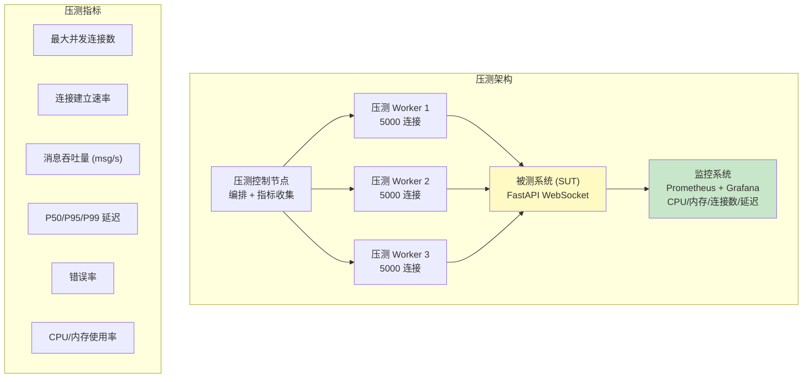

#### 代码示例

**示例 1：基础——Python WebSocket 压测脚本**

```python
"""
示例1：Python WebSocket 压测脚本
安装：pip install websockets
运行：python ws_benchmark.py --connections 1000 --rate 100 --duration 60
"""
import asyncio
import websockets
import time
import argparse
import json
from collections import defaultdict


class WebSocketBenchmark:
    """WebSocket 压测器"""

    def __init__(self, url: str, num_connections: int, connect_rate: int, message_rate: int):
        self.url = url
        self.num_connections = num_connections
        self.connect_rate = connect_rate  # 每秒建立连接数
        self.message_rate = message_rate  # 每秒每连接消息数
        self.connections = []
        self.stats = {
            "connected": 0,
            "failed": 0,
            "messages_sent": 0,
            "messages_received": 0,
            "errors": 0,
            "latencies": [],
        }
        self.lock = asyncio.Lock()
        self.running = True

    async def connect_with_rate_limit(self):
        """按速率限制建立连接"""
        semaphore = asyncio.Semaphore(self.connect_rate)

        async def connect_one(i):
            async with semaphore:
                try:
                    ws = await websockets.connect(self.url, ping_interval=None)
                    self.connections.append(ws)
                    async with self.lock:
                        self.stats["connected"] += 1
                    return ws
                except Exception as e:
                    async with self.lock:
                        self.stats["failed"] += 1
                    return None

        tasks = [connect_one(i) for i in range(self.num_connections)]
        await asyncio.gather(*tasks)
        print(f"连接完成: 成功={self.stats['connected']}, 失败={self.stats['failed']}")

    async def message_loop(self, ws, index):
        """单个连接的消息循环"""
        while self.running:
            try:
                # 发送消息
                start = time.time()
                message = json.dumps({"type": "ping", "index": index, "ts": start})
                await ws.send(message)
                async with self.lock:
                    self.stats["messages_sent"] += 1

                # 接收响应
                response = await asyncio.wait_for(ws.recv(), timeout=5.0)
                latency = (time.time() - start) * 1000  # ms
                async with self.lock:
                    self.stats["messages_received"] += 1
                    self.stats["latencies"].append(latency)

            except asyncio.TimeoutError:
                async with self.lock:
                    self.stats["errors"] += 1
            except Exception as e:
                async with self.lock:
                    self.stats["errors"] += 1
                break

            # 控制消息发送速率
            await asyncio.sleep(1.0 / self.message_rate)

    async def run(self, duration: int):
        """运行压测"""
        print(f"开始压测: {self.url}")
        print(f"连接数: {self.num_connections}, 连接速率: {self.connect_rate}/s")
        print(f"消息速率: {self.message_rate}/s/连接, 持续时间: {duration}s")

        # 建立连接
        await self.connect_with_rate_limit()

        if self.stats["connected"] == 0:
            print("没有成功建立连接，压测终止")
            return

        # 启动消息循环
        print("开始发送消息...")
        message_tasks = [
            asyncio.create_task(self.message_loop(ws, i))
            for i, ws in enumerate(self.connections)
            if ws is not None
        ]

        # 运行指定时间
        await asyncio.sleep(duration)
        self.running = False

        # 等待消息循环结束
        await asyncio.gather(*message_tasks, return_exceptions=True)

        # 关闭连接
        for ws in self.connections:
            if ws:
                await ws.close()

        # 输出统计
        self.print_stats(duration)

    def print_stats(self, duration: int):
        """输出压测统计"""
        latencies = self.stats["latencies"]
        if latencies:
            latencies.sort()
            p50 = latencies[int(len(latencies) * 0.5)]
            p95 = latencies[int(len(latencies) * 0.95)]
            p99 = latencies[int(len(latencies) * 0.99)]
            avg = sum(latencies) / len(latencies)
        else:
            p50 = p95 = p99 = avg = 0

        print("\n" + "=" * 60)
        print("压测结果")
        print("=" * 60)
        print(f"持续时间:       {duration}s")
        print(f"成功连接数:     {self.stats['connected']}")
        print(f"失败连接数:     {self.stats['failed']}")
        print(f"发送消息数:     {self.stats['messages_sent']}")
        print(f"接收消息数:     {self.stats['messages_received']}")
        print(f"错误数:         {self.stats['errors']}")
        print(f"消息吞吐量:     {self.stats['messages_received'] / duration:.0f} msg/s")
        print(f"平均延迟:       {avg:.2f} ms")
        print(f"P50 延迟:       {p50:.2f} ms")
        print(f"P95 延迟:       {p95:.2f} ms")
        print(f"P99 延迟:       {p99:.2f} ms")
        print(f"错误率:         {self.stats['errors'] / max(1, self.stats['messages_sent']) * 100:.2f}%")
        print("=" * 60)


async def main():
    parser = argparse.ArgumentParser(description="WebSocket 压测工具")
    parser.add_argument("--url", default="ws://localhost:8000/ws")
    parser.add_argument("--connections", type=int, default=1000)
    parser.add_argument("--connect-rate", type=int, default=100)
    parser.add_argument("--message-rate", type=float, default=1.0)
    parser.add_argument("--duration", type=int, default=30)
    args = parser.parse_args()

    bench = WebSocketBenchmark(
        url=args.url,
        num_connections=args.connections,
        connect_rate=args.connect_rate,
        message_rate=args.message_rate,
    )
    await bench.run(args.duration)


if __name__ == "__main__":
    asyncio.run(main())

# 预期运行结果：
# 开始压测: ws://localhost:8000/ws
# 连接数: 1000, 连接速率: 100/s
# 连接完成: 成功=1000, 失败=0
# 开始发送消息...
# ============================================================
# 压测结果
# ============================================================
# 持续时间:       30s
# 成功连接数:     1000
# 发送消息数:     30000
# 接收消息数:     29985
# 消息吞吐量:     999 msg/s
# 平均延迟:       2.35 ms
# P50 延迟:       1.80 ms
# P95 延迟:       5.20 ms
# P99 延迟:       12.50 ms
# ============================================================
```

**示例 2：进阶——k6 WebSocket 压测**

```javascript
// 示例2：k6 WebSocket 压测脚本
// 安装：brew install k6 或 https://k6.io/docs/get-started/installation/
// 运行：k6 run ws_k6_test.js

import { check } from 'k6';
import ws from 'k6/ws';
import { Trend, Rate, Counter } from 'k6/metrics';

// 自定义指标
const wsConnectTime = new Trend('ws_connect_time');
const wsMessageLatency = new Trend('ws_message_latency');
const wsErrors = new Rate('ws_errors');
const wsMessagesSent = new Counter('ws_messages_sent');
const wsMessagesReceived = new Counter('ws_messages_received');

export const options = {
  stages: [
    { duration: '30s', target: 500 },   // 30 秒内增加到 500 连接
    { duration: '60s', target: 500 },   // 保持 500 连接 60 秒
    { duration: '30s', target: 1000 },  // 增加到 1000 连接
    { duration: '60s', target: 1000 },  // 保持 1000 连接
    { duration: '30s', target: 0 },     // 逐步减少
  ],
  thresholds: {
    ws_message_latency: ['p(95)<50', 'p(99)<100'],  // P95 < 50ms, P99 < 100ms
    ws_errors: ['rate<0.01'],  // 错误率 < 1%
  },
};

export default function () {
  const url = 'ws://localhost:8000/ws';
  const params = { tags: { my_tag: 'ws_benchmark' } };

  const response = ws.connect(url, params, (socket) => {
    const connectStart = Date.now();

    socket.on('open', () => {
      const connectTime = Date.now() - connectStart;
      wsConnectTime.add(connectTime);
      // console.log(`连接建立: ${connectTime}ms`);
    });

    socket.on('message', (data) => {
      try {
        const msg = JSON.parse(data);
        if (msg.type === 'pong') {
          const latency = Date.now() - msg.timestamp;
          wsMessageLatency.add(latency);
          wsMessagesReceived.add(1);
        }
      } catch (e) {
        // 非 JSON 消息
      }
    });

    socket.on('error', (e) => {
      wsErrors.add(1);
      console.error('WebSocket 错误:', e.error());
    });

    socket.on('close', () => {
      // 连接关闭
    });

    // 定时发送消息
    socket.setInterval(() => {
      const message = JSON.stringify({
        type: 'ping',
        timestamp: Date.now(),
        vu: __VU,
        iter: __ITER,
      });
      socket.send(message);
      wsMessagesSent.add(1);
    }, 1000);  // 每秒发送 1 条消息

    // 每个虚拟用户运行 30 秒后断开
    socket.setTimeout(() => {
      socket.close();
    }, 30000);
  });

  check(response, {
    '连接状态正确': (r) => r && r.status === 101,
  });
}

// 预期输出：
#  execution: local
#     script: ws_k6_test.js
#     output: -
#
# scenarios: (100.00%) 1 scenario, 1000 max VUs, 3m30s max duration
#
#      ws_connect_time ............: avg=15.2ms  min=2ms  med=12ms  p(90)=28ms  p(95)=35ms
#      ws_message_latency .........: avg=3.5ms   min=0ms  med=2ms   p(90)=8ms   p(95)=12ms
#      ws_errors ..................: 0.23%  ✓ 0.00%  ✗ 1.00%
#      ws_messages_sent ...........: 180000  3000/s
#      ws_messages_received .......: 179500  2991/s
```

**示例 3：完整场景——性能调优配置清单**

```python
"""
示例3：WebSocket 性能调优完整配置
包含：Uvicorn 参数、系统调优、应用层优化
"""

# ============ 1. Uvicorn 启动参数优化 ============
"""
uvicorn main:app \
    --host 0.0.0.0 \
    --port 8000 \
    --workers 4 \
    --loop uvloop \              # 使用 uvloop（比默认 asyncio 快 2-4 倍）
    --http httptools \           # 使用 httptools（更快的 HTTP 解析）
    --ws-ping-interval 20 \      # WebSocket 心跳间隔
    --ws-ping-timeout 20 \       # 心跳超时
    --ws-max-size 10485760 \     # 最大消息大小 10MB
    --limit-concurrency 1000 \   # 并发限制
    --limit-max-requests 1000000 \ # 最大请求数（0=无限）
    --timeout-keep-alive 30 \    # Keep-Alive 超时
    --timeout-graceful-shutdown 30 \ # 优雅关闭超时
    --no-access-log              # 生产环境关闭访问日志（减少 IO）
"""

# ============ 2. 系统调优（Linux）============
"""
# /etc/sysctl.conf
# 增大文件描述符限制
fs.file-max = 1000000
fs.nr_open = 1000000

# 网络调优
net.core.somaxconn = 65535
net.core.netdev_max_backlog = 65535
net.ipv4.tcp_max_syn_backlog = 65535
net.ipv4.tcp_fin_timeout = 15
net.ipv4.tcp_tw_reuse = 1
net.ipv4.ip_local_port_range = 1024 65535

# 内存调优
net.core.rmem_max = 16777216
net.core.wmem_max = 16777216
net.ipv4.tcp_rmem = 4096 87380 16777216
net.ipv4.tcp_wmem = 4096 65536 16777216

# /etc/security/limits.conf
* soft nofile 65535
* hard nofile 65535
* soft nproc 65535
* hard nproc 65535
"""

# ============ 3. 应用层优化 ============

# 3.1 使用 uvloop（更快的事件循环）
import asyncio
try:
    import uvloop
    asyncio.set_event_loop_policy(uvloop.EventLoopPolicy())
except ImportError:
    pass

# 3.2 连接管理器优化：预分配 + 批量操作
class OptimizedConnectionManager:
    def __init__(self):
        self.connections = {}  # user_id -> websocket
        self._broadcast_buffer = []  # 批量发送缓冲

    async def broadcast_batched(self, message: dict, batch_size: int = 200):
        """批量广播：减少事件循环切换"""
        conns = list(self.connections.values())
        for i in range(0, len(conns), batch_size):
            batch = conns[i:i + batch_size]
            await asyncio.gather(*[ws.send_json(message) for ws in batch], return_exceptions=True)
            if i + batch_size < len(conns):
                await asyncio.sleep(0)  # 让出事件循环

# 3.3 消息预序列化
import json
def prepare_broadcast_message(data: dict) -> str:
    """预序列化广播消息，避免每个连接重复序列化"""
    return json.dumps(data, ensure_ascii=False)

# 3.4 使用 orjson 替代 json（更快的 JSON 序列化）
try:
    import orjson
    def fast_json_dumps(data):
        return orjson.dumps(data).decode()
    def fast_json_loads(data):
        return orjson.loads(data)
except ImportError:
    def fast_json_dumps(data):
        return json.dumps(data, ensure_ascii=False)
    def fast_json_loads(data):
        return json.loads(data)

# ============ 4. 监控指标（Prometheus）============
"""
from prometheus_client import Counter, Histogram, Gauge

# 连接数
active_connections = Gauge('websocket_active_connections', '活跃 WebSocket 连接数')
# 消息数
messages_total = Counter('websocket_messages_total', '消息总数', ['direction', 'type'])
# 延迟
message_latency = Histogram('websocket_message_latency_seconds', '消息延迟', buckets=[0.001, 0.005, 0.01, 0.05, 0.1, 0.5, 1.0])
# 错误数
errors_total = Counter('websocket_errors_total', '错误总数', ['type'])
"""
```

#### 使用场景与最佳实践

**适用场景**：
- 上线前的性能验证
- 性能瓶颈定位和优化
- 容量规划（确定需要多少实例）
- 持续性能监控（防止回归）

**不适用场景**：
- 开发环境（不需要压测）
- 低并发内部服务（<100 连接）

**最佳实践**：
1. **逐步增加负载**：从 100 连接开始，逐步增加到目标值，找到性能拐点
2. **压测客户端资源充足**：压测机本身需要足够的文件描述符和带宽，建议多机分布式压测
3. **监控服务端资源**：压测时同时监控 CPU、内存、网络、文件描述符使用
4. **关注 P95/P99 延迟而非平均延迟**：平均延迟可能掩盖长尾问题
5. **区分连接建立和消息传输**：分别测试最大连接数和消息吞吐量
6. **压测后恢复配置**：压测时的系统调优参数在生产环境也需要配置
7. **使用 uvloop + httptools**：比默认实现快 2-4 倍
8. **关闭 access log**：生产环境高并发时访问日志会成为 IO 瓶颈

**性能建议**：
- 单 Uvicorn worker（uvloop）可处理 1-5 万连接，消息吞吐量 5-10 万 msg/s
- 4 worker 可处理 5-20 万连接，需要 Redis 跨 worker 通信
- 延迟目标：P95 < 50ms，P99 < 100ms（局域网内）
- 带宽估算：每条消息 200 字节，1 万连接每秒 1 条 = 2MB/s 带宽

#### 常见坑点

**坑点 1：压测客户端本身资源不足导致压测结果不准**

- **错误现象**：压测到 5000 连接时延迟急剧上升，但服务端 CPU/内存使用率很低，怀疑是服务端瓶颈
- **根本原因**：压测客户端的文件描述符限制（默认 1024）或网络带宽不足，导致压测机无法建立更多连接或发送消息，瓶颈在压测端而非服务端
- **正确做法**：① 压测机调大文件描述符（`ulimit -n 65535`）；② 多机分布式压测（每台 5000 连接）；③ 监控压测机的 CPU/内存/网络；④ 压测机和服务端在同一内网（减少网络延迟影响）
- **预防措施**：压测前检查压测机资源，先用小负载验证压测环境正常

**坑点 2：压测时未调大系统文件描述符限制导致连接失败**

- **错误现象**：压测到约 1000 连接时，新连接全部失败，服务端日志出现 `Too many open files` 错误
- **根本原因**：Linux 默认文件描述符限制为 1024（`ulimit -n`），每个 WebSocket 连接占用一个文件描述符，超过限制后无法建立新连接
- **正确做法**：① 临时调大：`ulimit -n 65535`；② 永久调大：修改 `/etc/security/limits.conf`；③ 系统级：`sysctl -w fs.file-max=1000000`；④ Nginx 和 Uvicorn 都需要调大
- **预防措施**：部署文档中包含系统调优步骤，压测前验证 `ulimit -n` 的值

---

> 💡 **深度讲解**：Redis Pub/Sub 是 WebSocket 多实例扩展的核心——本地连接直接发送（低延迟），跨实例通过 Redis 转发，instance_id 防止消息重复。用户位置用 Redis Hash 存储（user_id → instance_id），实现精准点对点路由。Pub/Sub 适合实时通知（发后即忘），Streams 适合可靠投递（持久化+ACK）。生产部署需要 Nginx 反向代理（Upgrade头+长超时+负载均衡）、Uvicorn 多 worker（需Redis跨进程）、Docker/K8s 容器化。压测是上线前的必要步骤，关注最大连接数、消息吞吐量、P95/P99延迟、错误率，用 uvloop+httptools+批量广播优化性能。系统调优（文件描述符、网络参数）是高并发的基础。
>
> **📝 精简总结**：
> 1. Redis Pub/Sub 分布式架构：本地直发 + Redis 跨实例转发 + instance_id 防重复
> 2. 用户位置路由：Redis Hash 存储 user_id → instance_id，点对点消息精准路由
> 3. Pub/Sub（实时，不持久化）vs Streams（可靠，持久化+ACK），按需选择
> 4. Nginx 关键配置：proxy_http_version 1.1 + Upgrade/Connection 头 + proxy_read_timeout 3600s
> 5. 负载均衡用 ip_hash 或 least_conn，不用 round-robin
> 6. 多 worker/多实例必须用 Redis，内存连接管理器不跨进程共享
> 7. 压测指标：最大连接数、连接速率、消息吞吐量、P50/P95/P99延迟、错误率
> 8. 性能优化：uvloop + httptools + 批量广播 + 预序列化 + orjson + 关闭 access log
> 9. 系统调优：ulimit -n 65535 + sysctl 网络参数
>
> **🎯 梯度练习题**：
> - **基础 1**：配置 Nginx 反向代理 WebSocket，包含所有关键参数
> - **基础 2**：解释 Redis Pub/Sub 如何实现跨实例 WebSocket 消息转发
> - **基础 3**：写出 Uvicorn 生产环境启动命令，包含 WebSocket 相关参数
> - **进阶 1**：实现基于 Redis Streams 的可靠消息投递，包含 ACK 机制
> - **进阶 2**：编写 Python WebSocket 压测脚本，输出连接数、吞吐量、延迟统计
> - **实战 1**：搭建完整的 Docker Compose 部署（Nginx + 3个FastAPI实例 + Redis + PostgreSQL），并进行压测

---

## 11. WebSocket 前端集成完整实战

### 11.1 原生 WebSocket API 与封装

#### 概念解释

**前端 WebSocket 集成** 是在浏览器端使用原生 `WebSocket` API 或封装库与 FastAPI 后端建立连接、收发消息、处理重连、管理状态的完整方案，是实时应用用户体验的关键环节。

> 🏠 **生活化比喻**：前端 WebSocket 集成就像装修房子时的电话系统——原生 WebSocket API 是裸电话线（能打电话但功能简陋），封装库是智能电话系统（自动重拨、来电显示、语音留言、通话录音）。好的封装让用户感觉不到网络波动（自动重连），消息不丢失（消息队列），状态清晰（连接指示器）。

**核心价值**：完善的前端封装提供自动重连、消息队列、状态管理、心跳检测等能力，确保在网络不稳定时用户体验流畅，是生产级实时应用的必要组件。

> 🎯 **面试高频考点 18**：前端 WebSocket 有哪些状态？如何处理连接断开和重连？
> **答**：WebSocket 有 4 种状态：CONNECTING(0) 连接中、OPEN(1) 已连接、CLOSING(2) 关闭中、CLOSED(3) 已关闭。处理断开重连：① 监听 `onclose` 事件，根据关闭码判断是否重连（1006 网络异常重连，1008 认证失败不重连）；② 指数退避重连（1s→2s→4s→最大30s）+ 随机抖动；③ 重连期间消息存入队列，连接恢复后自动发送；④ 显示连接状态指示器（已连接/重连中/已断开）；⑤ 心跳检测，长时间无消息时主动关闭重连。

#### 原理说明

前端 WebSocket 集成的核心机制是 **状态机管理 + 自动重连 + 消息队列 + 事件分发**。

**为什么这样设计**：浏览器原生 WebSocket API 只提供基础的连接/收发/关闭功能，没有自动重连、消息队列、状态管理。生产环境中网络不稳定（移动网络、WiFi 切换），需要封装层处理重连和消息缓存。事件分发将不同类型的消息路由到不同处理函数，避免单一 `onmessage` 中写大量 if-else。

**技术对比**：

| 方案 | 自动重连 | 消息队列 | 心跳 | 体积 | 适用场景 |
|------|---------|---------|------|------|---------|
| 原生 WebSocket | 否 | 否 | 手动 | 0 | 简单 demo |
| 自定义封装 | 是 | 是 | 是 | ~5KB | 生产推荐 |
| Socket.IO 客户端 | 是 | 是 | 是 | ~50KB | Socket.IO 服务端 |
| ReconnectingWebSocket | 是 | 否 | 否 | ~2KB | 轻量重连 |

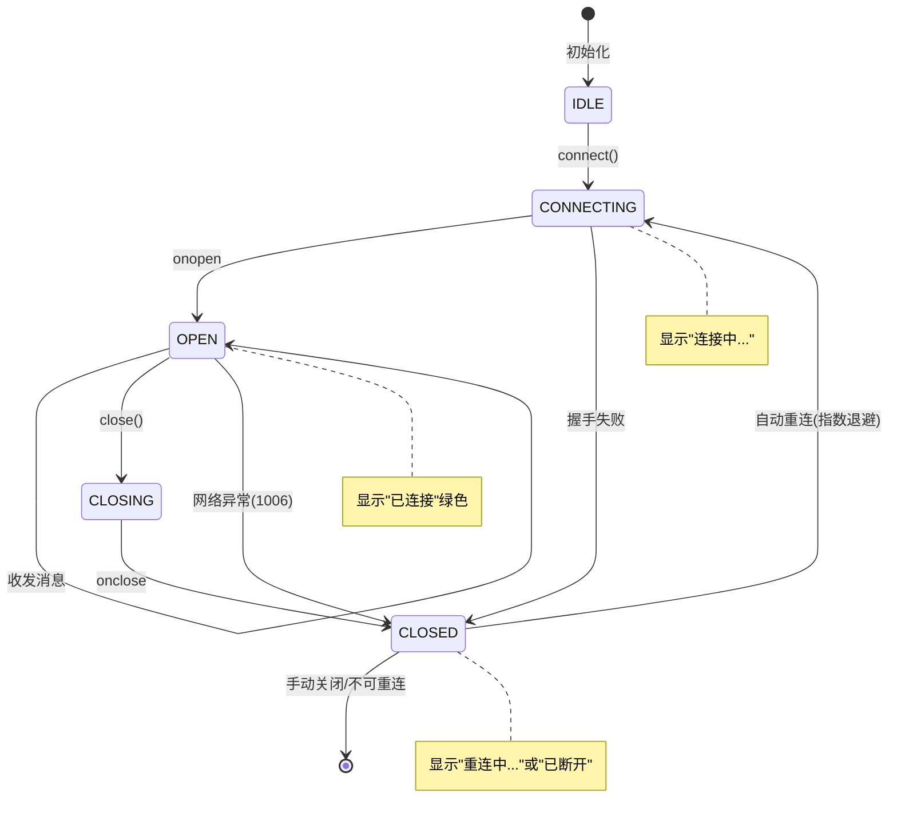

#### 代码示例

**示例 1：基础——原生 WebSocket API 使用**

```javascript
/**
 * 示例1：原生 WebSocket API 基础使用
 * 适合简单场景和学习理解
 */

// 1. 创建连接
const ws = new WebSocket('ws://localhost:8000/ws/alice');

// 2. 事件监听
ws.onopen = (event) => {
  console.log('连接已建立', ws.readyState); // readyState=1 (OPEN)
  // 连接建立后发送消息
  ws.send(JSON.stringify({ type: 'chat', content: '你好' }));
};

ws.onmessage = (event) => {
  // event.data 可能是字符串或 Blob/ArrayBuffer
  if (typeof event.data === 'string') {
    const data = JSON.parse(event.data);
    console.log('收到文本消息:', data);
  } else {
    // 二进制消息
    console.log('收到二进制消息:', event.data);
  }
};

ws.onerror = (error) => {
  console.error('WebSocket 错误:', error);
};

ws.onclose = (event) => {
  console.log('连接关闭:', {
    code: event.code,      // 关闭码
    reason: event.reason,  // 关闭原因
    wasClean: event.wasClean, // 是否干净关闭
  });
};

// 3. 发送消息
ws.send('纯文本消息');
ws.send(JSON.stringify({ type: 'chat', content: 'JSON 消息' }));

// 发送二进制（ArrayBuffer）
const buffer = new ArrayBuffer(8);
const view = new Float32Array(buffer);
view[0] = 3.14;
ws.send(buffer);

// 4. 关闭连接
ws.close(1000, '用户主动关闭');

// 5. 状态常量
console.log(WebSocket.CONNECTING); // 0
console.log(WebSocket.OPEN);       // 1
console.log(WebSocket.CLOSING);    // 2
console.log(WebSocket.CLOSED);     // 3

// 预期运行结果：
// 连接已建立 1
// 收到文本消息: {type: 'chat', content: '你好'}
// 连接关闭: {code: 1000, reason: '用户主动关闭', wasClean: true}
```

**示例 2：进阶——生产级 WebSocket 客户端封装**

```javascript
/**
 * 示例2：生产级 WebSocket 客户端封装
 * 特性：自动重连、消息队列、心跳、状态管理、事件分发
 */
class WebSocketClient {
  constructor(url, options = {}) {
    this.url = url;
    this.options = {
      reconnect: true,
      baseDelay: 1000,
      maxDelay: 30000,
      maxRetries: Infinity,
      heartbeatInterval: 25000,
      heartbeatTimeout: 10000,
      messageQueueSize: 100,
      ...options,
    };

    this.ws = null;
    this.retryCount = 0;
    this.manualClose = false;
    this.messageQueue = [];
    this.eventHandlers = {};
    this.state = 'disconnected'; // disconnected | connecting | connected | reconnecting
    this.heartbeatTimer = null;
    this.heartbeatTimeoutTimer = null;
    this.reconnectTimer = null;
    this.stateListeners = [];
  }

  // ===== 状态管理 =====
  getState() {
    return this.state;
  }

  onStateChange(callback) {
    this.stateListeners.push(callback);
  }

  setState(newState) {
    this.state = newState;
    this.stateListeners.forEach(cb => cb(newState));
  }

  // ===== 事件分发 =====
  on(event, handler) {
    if (!this.eventHandlers[event]) this.eventHandlers[event] = [];
    this.eventHandlers[event].push(handler);
  }

  off(event, handler) {
    if (this.eventHandlers[event]) {
      this.eventHandlers[event] = this.eventHandlers[event].filter(h => h !== handler);
    }
  }

  emit(event, data) {
    (this.eventHandlers[event] || []).forEach(handler => handler(data));
    // 通配符
    (this.eventHandlers['*'] || []).forEach(handler => handler(event, data));
  }

  // ===== 连接管理 =====
  connect() {
    if (this.ws?.readyState === WebSocket.OPEN || this.ws?.readyState === WebSocket.CONNECTING) {
      return;
    }

    this.setState(this.retryCount > 0 ? 'reconnecting' : 'connecting');
    this.ws = new WebSocket(this.url);

    this.ws.onopen = () => {
      this.retryCount = 0;
      this.setState('connected');
      this.startHeartbeat();
      this.flushQueue();
      this.emit('open', {});
    };

    this.ws.onmessage = (event) => {
      this.resetHeartbeatTimeout();
      try {
        const data = JSON.parse(event.data);
        if (data.type === 'ping') {
          this.send({ type: 'pong', timestamp: data.timestamp });
          return;
        }
        if (data.type === 'pong') return;
        this.emit(data.type || 'message', data);
      } catch {
        this.emit('message', event.data);
      }
    };

    this.ws.onclose = (event) => {
      this.stopHeartbeat();
      this.emit('close', { code: event.code, reason: event.reason });

      if (this.options.reconnect && !this.manualClose && this.isReconnectable(event.code)) {
        if (this.retryCount < this.options.maxRetries) {
          this.scheduleReconnect();
        } else {
          this.setState('disconnected');
          this.emit('maxRetriesExceeded', {});
        }
      } else {
        this.setState('disconnected');
      }
    };

    this.ws.onerror = (error) => {
      this.emit('error', error);
    };
  }

  isReconnectable(code) {
    return ![1000, 1001, 1008].includes(code);
  }

  scheduleReconnect() {
    const delay = Math.min(
      this.options.baseDelay * Math.pow(2, this.retryCount),
      this.options.maxDelay
    );
    const jitter = delay * 0.3 * Math.random();
    const finalDelay = delay + jitter;

    this.retryCount++;
    this.setState('reconnecting');
    this.emit('reconnecting', { attempt: this.retryCount, delay: finalDelay });

    this.reconnectTimer = setTimeout(() => this.connect(), finalDelay);
  }

  // ===== 消息发送 =====
  send(data) {
    const message = typeof data === 'string' ? data : JSON.stringify(data);
    if (this.ws?.readyState === WebSocket.OPEN) {
      this.ws.send(message);
    } else {
      // 连接未建立，加入队列
      if (this.messageQueue.length < this.options.messageQueueSize) {
        this.messageQueue.push(message);
      }
    }
  }

  flushQueue() {
    while (this.messageQueue.length > 0 && this.ws?.readyState === WebSocket.OPEN) {
      this.ws.send(this.messageQueue.shift());
    }
  }

  // ===== 心跳 =====
  startHeartbeat() {
    this.stopHeartbeat();
    this.heartbeatTimer = setInterval(() => {
      if (this.ws?.readyState === WebSocket.OPEN) {
        this.send({ type: 'ping', timestamp: Date.now() });
        this.heartbeatTimeoutTimer = setTimeout(() => {
          console.warn('心跳超时，关闭连接');
          this.ws?.close(4000, '心跳超时');
        }, this.options.heartbeatTimeout);
      }
    }, this.options.heartbeatInterval);
  }

  resetHeartbeatTimeout() {
    if (this.heartbeatTimeoutTimer) {
      clearTimeout(this.heartbeatTimeoutTimer);
      this.heartbeatTimeoutTimer = null;
    }
  }

  stopHeartbeat() {
    if (this.heartbeatTimer) clearInterval(this.heartbeatTimer);
    if (this.heartbeatTimeoutTimer) clearTimeout(this.heartbeatTimeoutTimer);
    this.heartbeatTimer = null;
    this.heartbeatTimeoutTimer = null;
  }

  // ===== 关闭 =====
  close(code = 1000, reason = '客户端主动关闭') {
    this.manualClose = true;
    if (this.reconnectTimer) clearTimeout(this.reconnectTimer);
    this.stopHeartbeat();
    this.ws?.close(code, reason);
    this.setState('disconnected');
  }
}

// 使用示例：
/*
const client = new WebSocketClient('ws://localhost:8000/ws/alice', {
  baseDelay: 1000,
  maxDelay: 30000,
});

client.onStateChange((state) => {
  console.log('状态变化:', state);
  // 更新 UI：已连接(绿)/重连中(黄)/已断开(红)
});

client.on('chat', (data) => {
  console.log('聊天消息:', data);
  // 更新聊天 UI
});

client.on('reconnecting', ({ attempt, delay }) => {
  console.log(`重连中: 第${attempt}次, ${delay}ms后`);
});

client.connect();
client.send({ type: 'chat', content: '你好' });  // 连接未建立时自动排队
*/
```

**示例 3：完整场景——React + WebSocket 实时聊天应用**

```jsx
/**
 * 示例3：React + WebSocket 实时聊天组件
 * 使用自定义 Hook 封装 WebSocket 逻辑
 */
import { useState, useEffect, useRef, useCallback } from 'react';

// ===== WebSocket Hook =====
function useWebSocket(url, options = {}) {
  const [messages, setMessages] = useState([]);
  const [connectionState, setConnectionState] = useState('disconnected');
  const [onlineUsers, setOnlineUsers] = useState([]);
  const wsRef = useRef(null);
  const reconnectCount = useRef(0);

  const connect = useCallback(() => {
    const ws = new WebSocket(url);
    wsRef.current = ws;
    setConnectionState('connecting');

    ws.onopen = () => {
      reconnectCount.current = 0;
      setConnectionState('connected');
    };

    ws.onmessage = (event) => {
      try {
        const data = JSON.parse(event.data);
        if (data.type === 'chat') {
          setMessages(prev => [...prev, {
            id: Date.now() + Math.random(),
            from: data.from,
            content: data.content,
            timestamp: data.timestamp,
          }]);
        } else if (data.type === 'system') {
          setOnlineUsers(data.users || []);
        }
      } catch (e) {
        console.error('消息解析失败:', e);
      }
    };

    ws.onclose = (event) => {
      setConnectionState('disconnected');
      // 自动重连
      if (event.code !== 1000 && reconnectCount.current < 10) {
        reconnectCount.current++;
        const delay = Math.min(1000 * Math.pow(2, reconnectCount.current), 30000);
        setTimeout(connect, delay);
      }
    };

    ws.onerror = () => {
      setConnectionState('error');
    };
  }, [url]);

  useEffect(() => {
    connect();
    return () => {
      wsRef.current?.close(1000, '组件卸载');
    };
  }, [connect]);

  const sendMessage = useCallback((content) => {
    if (wsRef.current?.readyState === WebSocket.OPEN) {
      wsRef.current.send(JSON.stringify({ type: 'chat', content }));
    }
  }, []);

  return { messages, connectionState, onlineUsers, sendMessage };
}

// ===== 聊天组件 =====
function ChatApp({ userId }) {
  const [input, setInput] = useState('');
  const messagesEndRef = useRef(null);
  const { messages, connectionState, onlineUsers, sendMessage } = useWebSocket(
    `ws://localhost:8000/ws/${userId}`
  );

  // 自动滚动到底部
  useEffect(() => {
    messagesEndRef.current?.scrollIntoView({ behavior: 'smooth' });
  }, [messages]);

  const handleSubmit = (e) => {
    e.preventDefault();
    if (input.trim()) {
      sendMessage(input.trim());
      setInput('');
    }
  };

  const stateColors = {
    connected: 'bg-green-500',
    connecting: 'bg-yellow-500',
    reconnecting: 'bg-yellow-500',
    disconnected: 'bg-red-500',
    error: 'bg-red-500',
  };

  const stateText = {
    connected: '已连接',
    connecting: '连接中...',
    reconnecting: '重连中...',
    disconnected: '已断开',
    error: '连接错误',
  };

  return (
    <div className="flex h-screen">
      {/* 侧边栏：在线用户 */}
      <div className="w-64 bg-gray-100 p-4 border-r">
        <div className="flex items-center gap-2 mb-4">
          <span className={`w-3 h-3 rounded-full ${stateColors[connectionState]}`}></span>
          <span className="text-sm">{stateText[connectionState]}</span>
        </div>
        <h3 className="font-bold mb-2">在线用户 ({onlineUsers.length})</h3>
        <ul>
          {onlineUsers.map(user => (
            <li key={user} className="py-1 text-sm text-gray-700">{user}</li>
          ))}
        </ul>
      </div>

      {/* 主聊天区 */}
      <div className="flex-1 flex flex-col">
        {/* 消息列表 */}
        <div className="flex-1 overflow-y-auto p-4 space-y-2">
          {messages.map(msg => (
            <div key={msg.id} className={`flex ${msg.from === userId ? 'justify-end' : 'justify-start'}`}>
              <div className={`max-w-xs px-4 py-2 rounded-lg ${
                msg.from === userId ? 'bg-blue-500 text-white' : 'bg-gray-200'
              }`}>
                <div className="text-xs opacity-70">{msg.from}</div>
                <div>{msg.content}</div>
              </div>
            </div>
          ))}
          <div ref={messagesEndRef} />
        </div>

        {/* 输入区 */}
        <form onSubmit={handleSubmit} className="p-4 border-t flex gap-2">
          <input
            type="text"
            value={input}
            onChange={(e) => setInput(e.target.value)}
            placeholder="输入消息..."
            className="flex-1 px-4 py-2 border rounded-lg focus:outline-none focus:ring-2 focus:ring-blue-500"
            disabled={connectionState !== 'connected'}
          />
          <button
            type="submit"
            className="px-6 py-2 bg-blue-500 text-white rounded-lg hover:bg-blue-600 disabled:opacity-50"
            disabled={connectionState !== 'connected' || !input.trim()}
          >
            发送
          </button>
        </form>
      </div>
    </div>
  );
}

// 使用：<ChatApp userId="alice" />
```

#### 使用场景与最佳实践

**适用场景**：
- 所有浏览器端 WebSocket 应用都需要封装（原生 API 太简陋）
- 网络不稳定的移动应用（需要自动重连）
- 需要消息可靠性的应用（消息队列）
- React/Vue/Angular 框架集成（自定义 Hook）

**不适用场景**：
- 简单 demo/学习（原生 API 即可）
- Node.js 服务端客户端（用 `ws` 库，有重连插件）

**最佳实践**：
1. **封装 WebSocket 客户端类**：提供自动重连、消息队列、心跳、事件分发
2. **指数退避 + 随机抖动**：防止重连风暴，1s→2s→4s→...→30s，±30% 抖动
3. **连接状态指示器**：UI 显示已连接/重连中/已断开，让用户知道当前状态
4. **消息队列**：连接断开期间发送的消息存入队列，重连后自动发送
5. **事件分发**：按消息 type 路由到不同处理函数，避免巨型 onmessage
6. **心跳检测**：25 秒间隔，10 秒超时，超时后关闭重连
7. **区分可重连和不可重连关闭码**：1000/1001/1008 不重连，1006 自动重连
8. **组件卸载时关闭连接**：React useEffect cleanup 中调用 `ws.close()`

**性能建议**：
- 前端 WebSocket 连接数限制：浏览器通常限制每个域名 6-10 个 WebSocket 连接
- 消息序列化：JSON 足够，高频消息可用 MessagePack（需要 msgpack-lite 库）
- 减少 UI 重渲染：消息列表用虚拟滚动（react-window），大量消息时不卡顿
- 防抖/节流：高频消息（如鼠标位置）用节流（100ms）减少 UI 更新

#### 常见坑点

**坑点 1：前端未处理 1006 异常断开导致连接永久丢失**

- **错误现象**：网络切换（WiFi→4G）或电脑休眠后，WebSocket 连接断开，但前端没有自动重连，用户需要刷新页面才能恢复
- **根本原因**：原生 WebSocket 的 `onclose` 事件中没有重连逻辑，或重连条件判断错误（如所有关闭码都不重连）
- **正确做法**：① `onclose` 中检查关闭码，1006（异常关闭）自动重连；② 实现指数退避重连；③ 监听 `online`/`offline` 事件，网络恢复时主动重连
- **预防措施**：使用封装好的 WebSocket 客户端类，内置自动重连逻辑

**坑点 2：React 组件中 WebSocket 连接未正确清理导致内存泄漏**

- **错误现象**：React 组件卸载后，WebSocket 仍在运行，收到消息后尝试更新已卸载组件的 state，控制台报 `Can't perform a React state update on an unmounted component`
- **根本原因**：`useEffect` 中创建 WebSocket 但没有在 cleanup 函数中关闭连接，组件卸载后连接和事件监听器仍然存在
- **正确做法**：`useEffect` 返回 cleanup 函数，在其中调用 `ws.close(1000, '组件卸载')`，并清除所有定时器
- **预防措施**：封装 `useWebSocket` Hook，内部管理连接生命周期，组件卸载时自动清理

---

## 12. WebSocket vs SSE 选型与综合实战

### 12.1 WebSocket 与 SSE 深度对比

#### 概念解释

**SSE（Server-Sent Events）** 是基于 HTTP 长连接的服务器单向推送技术，客户端通过 `EventSource` API 建立连接，服务端通过 `text/event-stream` 持续推送数据。与 WebSocket 的双向全双工不同，SSE 只支持服务端→客户端单向通信。

> 🏠 **生活化比喻**：WebSocket 就像对讲机——双方都能随时说话（双向），需要专门的频道（ws://协议）。SSE 就像广播电台——只有电台能播音，听众只能听（单向），用普通的收音机（HTTP协议）就能接收。如果你需要双向对话（聊天、游戏），用对讲机；如果你只需要听新闻/音乐（通知、AI流式输出），用广播电台更简单。

**核心价值**：正确选择 WebSocket 或 SSE 可以简化架构、降低成本、提升性能。SSE 基于 HTTP 实现简单、自动重连，适合纯推送场景；WebSocket 双向通信，适合需要客户端频繁发送的场景。

> 🎯 **面试高频考点 19**：WebSocket 和 SSE 有什么区别？AI 流式输出为什么选 SSE 而不是 WebSocket？
> **答**：区别：① 通信方向：WebSocket 双向全双工，SSE 单向（服务端→客户端）；② 协议：WebSocket 是独立协议（ws://），SSE 基于 HTTP（text/event-stream）；③ 自动重连：SSE 浏览器自动重连，WebSocket 需手动实现；④ 二进制支持：WebSocket 支持二进制帧，SSE 只支持文本；⑤ 实现复杂度：SSE 更低（普通 HTTP 响应），WebSocket 需要连接管理。AI 流式输出选 SSE 的原因：① 大模型输出是单向的（服务端推送 Token，客户端不需要频繁发送）；② SSE 基于 HTTP，无需维护长连接状态，实现更简单；③ 浏览器 EventSource 自动重连；④ 与 CDN/代理兼容性更好（HTTP 协议）；⑤ 不需要连接管理器，无状态设计更易扩展。

#### 原理说明

WebSocket vs SSE 的核心区别是 **双向 vs 单向、独立协议 vs HTTP 协议、有状态 vs 无状态**。

**为什么这样设计**：SSE 基于 HTTP，复用现有 HTTP 基础设施（代理、缓存、认证），实现简单，但只能单向推送。WebSocket 是独立协议，需要 Upgrade 握手和连接管理，但支持双向通信和二进制。选择时根据通信方向和复杂度决定。

**技术对比**：

| 维度 | WebSocket | SSE |
|------|-----------|-----|
| 通信方向 | 双向全双工 | 单向（服务端→客户端） |
| 协议 | WebSocket（ws://） | HTTP（text/event-stream） |
| 数据格式 | 文本/二进制帧 | `data: ...\n\n` 文本 |
| 自动重连 | 需手动实现 | 浏览器自动重连 |
| 二进制支持 | 支持 | 不支持（需 Base64） |
| 实现复杂度 | 中（需连接管理） | 低（普通 HTTP 响应） |
| 连接管理 | 需要连接管理器 | 无状态，不需要 |
| 多实例扩展 | 需要 Redis Pub/Sub | 无状态，天然支持 |
| 客户端 API | WebSocket | EventSource |
| 浏览器支持 | 所有现代浏览器 | 所有现代浏览器（IE 不支持） |
| 适用场景 | 聊天、游戏、协作 | 通知、AI流式、实时数据 |

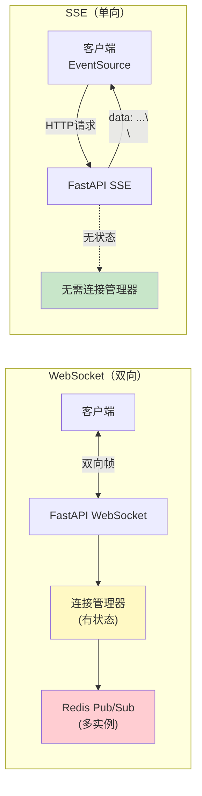

#### 代码示例

**示例 1：基础——SSE 基础实现（对比 WebSocket）**

```python
"""
示例1：SSE 基础实现，与 WebSocket 对比
运行：uvicorn sse_basic:app --reload
"""
from fastapi import FastAPI
from fastapi.responses import StreamingResponse
import asyncio
import json
import time

app = FastAPI(title="SSE 基础", version="1.0.0")


@app.get("/sse/time")
async def sse_time():
    """SSE 推送当前时间（单向推送）"""
    async def event_generator():
        while True:
            # SSE 格式：data: {json}\n\n
            data = json.dumps({
                "type": "time",
                "time": time.strftime("%H:%M:%S"),
                "timestamp": time.time(),
            }, ensure_ascii=False)
            yield f"data: {data}\n\n"
            await asyncio.sleep(1)

    return StreamingResponse(
        event_generator(),
        media_type="text/event-stream",
        headers={
            "Cache-Control": "no-cache",
            "Connection": "keep-alive",
            "X-Accel-Buffering": "no",  # 禁用 Nginx 缓冲
        },
    )


@app.get("/sse/notifications")
async def sse_notifications(user_id: str):
    """SSE 推送用户通知"""
    async def event_generator():
        # 发送初始连接确认
        yield f"data: {json.dumps({'type': 'connected', 'user_id': user_id})}\n\n"

        # 模拟通知推送
        notifications = [
            {"type": "notification", "title": "新消息", "content": "你有一条新消息"},
            {"type": "notification", "title": "订单更新", "content": "订单已发货"},
            {"type": "notification", "title": "系统公告", "content": "系统将于今晚维护"},
        ]

        for i, notification in enumerate(notifications):
            # SSE 支持事件类型和 ID
            yield f"event: notification\n"
            yield f"id: {i + 1}\n"
            yield f"data: {json.dumps(notification, ensure_ascii=False)}\n\n"
            await asyncio.sleep(3)

        # 发送结束标记
        yield f"data: {json.dumps({'type': 'done'})}\n\n"

    return StreamingResponse(
        event_generator(),
        media_type="text/event-stream",
        headers={"Cache-Control": "no-cache", "X-Accel-Buffering": "no"},
    )


# 前端 EventSource 使用：
"""
// SSE 客户端（浏览器原生 EventSource）
const es = new EventSource('/sse/time');
es.onmessage = (event) => {
  const data = JSON.parse(event.data);
  console.log('时间:', data.time);
};

// 监听特定事件类型
const es2 = new EventSource('/sse/notifications?user_id=alice');
es2.addEventListener('notification', (event) => {
  const data = JSON.parse(event.data);
  console.log('通知:', data.title, data.content);
  console.log('消息 ID:', event.lastEventId);  // 用于断线重连
});

// 错误处理
es.onerror = (e) => {
  console.log('SSE 错误，浏览器会自动重连');
};

// 关闭连接
es.close();
"""

# 对比：同样功能用 WebSocket 实现需要连接管理器，而 SSE 不需要
```

**示例 2：进阶——SSE 与 WebSocket 混合架构**

```python
"""
示例2：SSE + WebSocket 混合架构
SSE 用于服务端推送（AI 流式输出、通知），WebSocket 用于双向通信（聊天）
运行：uvicorn hybrid_arch:app --reload
"""
from fastapi import FastAPI, WebSocket, WebSocketDisconnect
from fastapi.responses import StreamingResponse
from typing import Dict
import asyncio
import json
import time

app = FastAPI(title="混合架构", version="1.0.0")

# WebSocket 连接管理器（仅用于双向通信）
class ConnectionManager:
    def __init__(self):
        self.connections: Dict[str, WebSocket] = {}
        self.lock = asyncio.Lock()

    async def connect(self, user_id: str, websocket: WebSocket):
        await websocket.accept()
        async with self.lock:
            self.connections[user_id] = websocket

    async def disconnect(self, user_id: str):
        async with self.lock:
            self.connections.pop(user_id, None)

    async def send_to_user(self, user_id: str, message: dict):
        ws = self.connections.get(user_id)
        if ws:
            try:
                await ws.send_json(message)
            except Exception:
                await self.disconnect(user_id)


ws_manager = ConnectionManager()


# ===== SSE：AI 流式输出（单向推送）=====
@app.post("/api/ai/stream")
async def ai_stream(request: dict):
    """AI 流式生成（SSE 单向推送）"""
    prompt = request.get("prompt", "")

    async def generate():
        # 模拟大模型逐 Token 输出
        tokens = ["这是", "一个", "AI", "流式", "输出", "的", "示例", "。",
                  "它通过", "SSE", "协议", "逐字", "推送", "给", "客户端", "。"]
        for token in tokens:
            yield f"data: {json.dumps({'content': token}, ensure_ascii=False)}\n\n"
            await asyncio.sleep(0.1)  # 模拟生成延迟
        yield f"data: {json.dumps({'done': True}, ensure_ascii=False)}\n\n"

    return StreamingResponse(
        generate(),
        media_type="text/event-stream",
        headers={"Cache-Control": "no-cache", "X-Accel-Buffering": "no"},
    )


# ===== SSE：实时通知（单向推送）=====
@app.get("/api/notifications/stream")
async def notification_stream(user_id: str):
    """用户通知流（SSE）"""
    async def event_generator():
        # 连接建立
        yield f"data: {json.dumps({'type': 'connected', 'user_id': user_id})}\n\n"

        # 模拟实时通知推送
        count = 0
        while count < 10:
            count += 1
            yield f"data: {json.dumps({
                'type': 'notification',
                'id': count,
                'title': f'通知 {count}',
                'content': f'这是第 {count} 条通知',
                'timestamp': time.time(),
            }, ensure_ascii=False)}\n\n"
            await asyncio.sleep(5)

    return StreamingResponse(
        event_generator(),
        media_type="text/event-stream",
        headers={"Cache-Control": "no-cache", "X-Accel-Buffering": "no"},
    )


# ===== WebSocket：实时聊天（双向通信）=====
@app.websocket("/ws/chat/{user_id}")
async def websocket_chat(websocket: WebSocket, user_id: str):
    await ws_manager.connect(user_id, websocket)
    try:
        while True:
            data = await websocket.receive_text()
            msg = json.loads(data)
            # 聊天消息需要双向：客户端发送 → 服务端广播 → 其他客户端接收
            for uid, ws in ws_manager.connections.items():
                if uid != user_id:
                    try:
                        await ws.send_json({
                            "type": "chat",
                            "from": user_id,
                            "content": msg.get("content", ""),
                        })
                    except Exception:
                        pass
    except WebSocketDisconnect:
        await ws_manager.disconnect(user_id)


# 前端架构：
"""
// 页面加载时同时建立 SSE 和 WebSocket
// 1. SSE：接收 AI 流式输出和通知（单向，自动重连）
const aiSource = new EventSource('/api/ai/stream');
aiSource.onmessage = (e) => {
  const data = JSON.parse(e.data);
  if (data.content) appendToUI(data.content);
};

const notifySource = new EventSource('/api/notifications/stream?user_id=alice');
notifySource.onmessage = (e) => {
  const data = JSON.parse(e.data);
  showNotification(data.title, data.content);
};

// 2. WebSocket：实时聊天（双向，手动重连）
const ws = new WebSocket('ws://localhost:8000/ws/chat/alice');
ws.onmessage = (e) => {
  const data = JSON.parse(e.data);
  appendChatMessage(data.from, data.content);
};
ws.send(JSON.stringify({type: 'chat', content: '你好'}));
"""
```

**示例 3：完整场景——选型决策树与综合实战**

```python
"""
示例3：实时技术选型决策与综合实战
根据场景选择 WebSocket、SSE 或轮询
"""

# 选型决策表
DECISION_TABLE = """
┌─────────────────────────────────────────────────────────────┐
│              实时通信技术选型决策树                          │
├─────────────────────────────────────────────────────────────┤
│                                                             │
│  需要客户端频繁发送数据？                                    │
│  ├── 是 → 需要双向通信                                      │
│  │    ├── 消息频率高（>1次/秒）→ WebSocket                  │
│  │    └── 消息频率低 → WebSocket 或 HTTP POST                │
│  └── 否 → 只需要服务端推送                                   │
│       ├── 需要二进制数据 → WebSocket                        │
│       ├── 需要自动重连 → SSE（浏览器原生支持）               │
│       ├── 实现简单优先 → SSE                                 │
│       └── 已有 WebSocket 基础设施 → WebSocket               │
│                                                             │
│  典型场景选择：                                              │
│  ├── AI 流式输出 → SSE（单向、实现简单）                     │
│  ├── 实时通知 → SSE（单向、自动重连）                        │
│  ├── 实时聊天 → WebSocket（双向）                            │
│  ├── 在线游戏 → WebSocket（双向、高频、二进制）              │
│  ├── 协作编辑 → WebSocket（双向、高频）                      │
│  ├── 股票行情 → SSE 或 WebSocket（单向推送为主）             │
│  ├── 监控仪表盘 → SSE（单向、数据推送）                      │
│  └── 文件上传 → HTTP（不适合长连接）                         │
│                                                             │
└─────────────────────────────────────────────────────────────┘
"""

print(DECISION_TABLE)


# 综合实战：一个应用同时使用 SSE 和 WebSocket
"""
架构设计：
- SSE 端点：
  - /api/ai/stream        → AI 流式输出
  - /api/notifications/stream → 实时通知
  - /api/metrics/stream    → 监控指标推送

- WebSocket 端点：
  - /ws/chat/{user_id}     → 实时聊天
  - /ws/collab/{doc_id}    → 文档协作
  - /ws/game/{room_id}     → 游戏状态同步

- HTTP 端点：
  - /api/messages          → 历史消息（REST）
  - /api/upload            → 文件上传
  - /api/users             → 用户管理

优势：
1. 每种技术用在最适合的场景，避免"一把锤子钉所有钉子"
2. SSE 端点无状态，天然支持水平扩展（不需要连接管理器）
3. WebSocket 端点有状态，用 Redis Pub/Sub 扩展
4. 前端根据需求选择对应的连接方式
"""
```

#### 使用场景与最佳实践

**适用场景**：
- SSE：AI 流式输出、实时通知、股票行情、监控数据、日志流
- WebSocket：实时聊天、在线游戏、协作编辑、白板、远程控制
- 混合架构：AI 应用（SSE 流式输出 + WebSocket 聊天）、社交应用（SSE 通知 + WebSocket 聊天）

**不适用场景**：
- SSE：需要客户端频繁发送数据、需要二进制传输、需要双向通信
- WebSocket：纯推送场景（SSE 更简单）、无状态 API（HTTP 更合适）

**最佳实践**：
1. **纯推送场景优先选 SSE**：实现简单、无状态、自动重连、易扩展
2. **双向通信选 WebSocket**：聊天、游戏、协作等需要客户端发送的场景
3. **AI 流式输出用 SSE**：大模型输出是单向的，SSE 是最佳选择
4. **混合架构按需选择**：一个应用可以同时有 SSE 和 WebSocket 端点
5. **SSE 必须设置 `X-Accel-Buffering: no`**：禁用 Nginx 缓冲，否则流式失效
6. **SSE 用 `EventSource` 或 `fetch + ReadableStream`**：EventSource 只支持 GET，需要 POST 用 fetch
7. **WebSocket 用封装客户端**：自动重连、心跳、消息队列

**性能建议**：
- SSE 连接数：与 WebSocket 类似，单进程可处理数万连接
- SSE 无状态，多实例部署不需要 Redis（比 WebSocket 更易扩展）
- SSE 内存开销更低（不需要连接管理器）
- WebSocket 双向通信延迟更低（不需要 HTTP 请求开销）

#### 常见坑点

**坑点 1：SSE 流式不生效，数据缓冲后一次性返回**

- **错误现象**：SSE 接口返回 200，但前端 `EventSource` 收不到逐块数据，而是等所有数据生成完后一次性收到
- **根本原因**：Nginx/反向代理默认启用 `proxy_buffering`，将 SSE 响应缓冲完整后再发送给客户端。或者没有设置 `X-Accel-Buffering: no` 响应头
- **正确做法**：① 响应头加 `X-Accel-Buffering: no`（推荐，不需要改 Nginx 配置）；② Nginx 配置 `proxy_buffering off;`；③ 同时设置 `proxy_read_timeout 300s` 防止长连接超时
- **预防措施**：所有 SSE 端点的 `StreamingResponse` 必须包含 `X-Accel-Buffering: no` 头

**坑点 2：EventSource 不支持 POST 请求和自定义 Header**

- **错误现象**：用 `EventSource` 发送 SSE 请求时，无法传递 POST 请求体（如聊天消息列表）和 Authorization Header，导致认证失败
- **根本原因**：浏览器原生 `EventSource` API 只支持 GET 请求，不支持 POST 和自定义 Header（设计上的限制）
- **正确做法**：① 简单参数用 Query 字符串（`/sse?user_id=xxx`）；② 需要 POST 请求体时用 `fetch + ReadableStream` 替代 EventSource；③ Token 用 Query 参数或 Cookie 传递
- **预防措施**：SSE 端点设计时考虑 EventSource 的限制，需要复杂请求体时用 fetch + ReadableStream

---

> 💡 **深度讲解**：前端集成是 WebSocket 应用用户体验的关键。原生 WebSocket API 只提供基础功能，生产环境需要封装客户端类，提供自动重连（指数退避+抖动）、消息队列（断连期间缓存）、心跳检测（25s间隔+10s超时）、事件分发（按type路由）、状态管理（连接指示器）。React/Vue 中用自定义 Hook 封装，组件卸载时必须关闭连接防止内存泄漏。技术选型方面，SSE 和 WebSocket 各有适用场景——SSE 基于HTTP、单向、无状态、自动重连，适合AI流式输出和通知；WebSocket 双向、有状态、支持二进制，适合聊天游戏协作。生产应用常采用混合架构，SSE 用于推送，WebSocket 用于双向通信。正确选型可以简化架构、降低成本。
>
> **📝 精简总结**：
> 1. 前端 WebSocket 封装：自动重连（指数退避+抖动）+ 消息队列 + 心跳 + 事件分发 + 状态管理
> 2. WebSocket 4种状态：CONNECTING(0)、OPEN(1)、CLOSING(2)、CLOSED(3)
> 3. React 中用 useEffect cleanup 关闭连接，防止内存泄漏
> 4. SSE vs WebSocket：SSE 单向/HTTP/无状态/自动重连，WebSocket 双向/独立协议/有状态/二进制
> 5. AI 流式输出选 SSE：单向、实现简单、无状态易扩展
> 6. 聊天游戏选 WebSocket：双向通信、高频消息
> 7. SSE 必须设置 `X-Accel-Buffering: no`，否则 Nginx 缓冲导致流式失效
> 8. EventSource 只支持 GET，需要 POST 用 fetch + ReadableStream
> 9. 混合架构：SSE 用于推送（AI/通知），WebSocket 用于双向（聊天/协作）
>
> **🎯 梯度练习题**：
> - **基础 1**：列出 WebSocket 的 4 种状态及其含义
> - **基础 2**：实现前端 WebSocket 自动重连（指数退避）
> - **基础 3**：用 SSE 实现一个实时时钟推送接口
> - **进阶 1**：实现生产级 WebSocket 客户端类，包含消息队列、心跳、事件分发
> - **进阶 2**：实现 React useWebSocket Hook，包含连接状态、消息列表、自动重连
> - **实战 1**：设计一个混合架构应用，用 SSE 做 AI 流式输出、WebSocket 做实时聊天，写出完整的前后端代码

---

## 全文总结

> 💡 **深度讲解**：本文档从 WebSocket 协议原理（握手、帧、关闭码）出发，逐步深入 FastAPI WebSocket 基础用法、连接管理器（多客户端/广播/房间）、认证安全、异常处理与重连、异步并发、二进制传输、Redis Pub/Sub 分布式扩展、生产级架构部署、前端集成，最终到 SSE 选型对比。全文遵循"入门篇→进阶篇→实战篇"三层递进体系，每个知识点包含概念解释、原理图解、可运行代码、最佳实践和常见坑点。掌握这些内容后，可以独立构建支持数万连接、多实例部署、安全可靠的生产级实时应用。WebSocket 的核心是"全双工长连接 + 连接管理器 + 异步事件循环"，生产级的关键是"认证安全 + 异常处理 + 心跳重连 + Redis 扩展 + Nginx 部署"。
>
> **📝 全文精简总结**：
> 1. WebSocket = HTTP Upgrade 握手（101）+ 全双工帧通信，对比 HTTP 轮询大幅降低开销
> 2. 数据帧：2-14 字节头部，opcode 定义帧类型（文本/二进制/Ping/Pong/Close）
> 3. FastAPI 三段式：accept() → try/while receive → except WebSocketDisconnect
> 4. 连接管理器：全局单例 + Dict[user_id, List[ws]] + asyncio.Lock + 生命周期管理
> 5. 广播优化：预序列化 + 分批并发 + 批次间让出事件循环
> 6. 认证：首条消息认证（推荐）+ Origin 校验 + wss:// 加密
> 7. 安全：消息大小限制 + 频率限制 + Pydantic 校验 + 输出转义
> 8. 心跳：Uvicorn --ws-ping-interval 20 或应用层 ping/pong，间隔为代理超时 1/3
> 9. 前端重连：指数退避（1s→2s→4s→30s）+ 随机抖动 + 消息队列
> 10. 多实例：Redis Pub/Sub，本地直发 + 跨实例转发 + instance_id 防重复
> 11. Nginx：Upgrade/Connection 头 + proxy_read_timeout 3600s + ip_hash 负载均衡
> 12. SSE vs WebSocket：SSE 单向/HTTP/无状态适合AI流式，WebSocket 双向/有状态适合聊天游戏
> 13. 所有 IO 必须异步，asyncio 单线程可处理 1-5 万连接
> 14. 二进制帧比文本帧节省 30-50% 带宽，高频消息用 MessagePack/Protobuf
> 15. 压测关注：最大连接数、消息吞吐量、P95/P99 延迟、错误率

---

## 🔗 关联笔记

- [[FastAPI-路由与依赖注入]] — FastAPI 基础，WebSocket 依赖注入的基础
- [[FastAPI-中间件与异常处理]] — FastAPI 横切关注点，WebSocket 中间件配置
- [[FastAPI-封装LLM流式接口]] — SSE 流式输出，与 WebSocket 对比选型
- [[Python-异步编程asyncio]] — asyncio 事件循环，WebSocket 异步驱动的基础
- [[Celery-异步任务队列]] — WebSocket 触发耗时任务的异步处理
- [[Redis-Python客户端与缓存策略]] — WebSocket 多实例扩展的 Redis Pub/Sub
- [[HTMX与Python后端配合]] — HTMX 的 WebSocket 支持，前端配合方案

## 📖 前置知识

- [[FastAPI-路由与依赖注入]] — FastAPI 路由和依赖注入基础
- [[Python-异步编程asyncio]] — asyncio 异步编程基础

## 🏷️ 相关标签

`#Python` `#FastAPI` `#Web框架` `#实时通信` `#异步` `#WebSocket` `#核心`

---

[[Home|🏠 返回首页]] · [[MOC-Python全栈|📚 返回分类]]
