# FastAPI 中间件与异常处理

> **📖 文档说明**
>
> 本文档是「从零基础新手到实战老手」三部曲的**核心进阶篇**，系统讲解 FastAPI 的两大横切关注点体系：中间件（Middleware）与异常处理（Exception Handling）。从 ASGI 中间件协议和洋葱模型开始，逐步深入自定义中间件开发、CORS/GZip/TrustedHost 等内置中间件、第三方中间件集成、HTTPException 与自定义异常、全局异常处理器、请求验证异常、异常与中间件交互、错误响应标准化、日志与链路追踪、中间件性能影响、生产级配置与最佳实践。全文配备 150+ 可运行代码示例、50+ 常见坑点、30+ 面试高频考点。
>
> **👥 适用人群**
> - 有 FastAPI 基础、想深入掌握中间件和异常处理的开发者
> - 需要构建生产级 FastAPI 服务的全栈工程师
> - 关注可观测性、错误处理、横切关注点的后端开发者
> - 准备 FastAPI 相关面试的求职者
>
> **📚 前置知识**
> - [[FastAPI-路由与依赖注入]]
> - [[Python-异步编程asyncio]]
> - [[Python-异常处理与错误体系]]
>
> **🗺️ 学习路径**
> - 入门篇（第 1-4 章）：会用——能写自定义中间件、配置 CORS/GZip、抛出 HTTPException
> - 进阶篇（第 5-8 章）：懂原理——理解 ASGI 协议、洋葱模型、异常处理器匹配机制
> - 实战篇（第 9-12 章）：成专家——掌握统一错误响应、链路追踪、生产级中间件配置、性能优化

---

## 一、中间件与异常处理概述

### 1.1 什么是中间件

#### 概念解释

**中间件（Middleware）是位于 ASGI 服务器和路由函数之间的请求拦截器，在请求到达路由之前和响应返回客户端之后执行，用于处理日志、认证、CORS、限流、压缩等横切关注点。** FastAPI 中间件基于 Starlette 的 ASGI 中间件体系，采用洋葱模型（Onion Model）执行。

打个比方：中间件像大楼的安检系统——每个人（请求）进入大楼时先经过第一道安检（最外层中间件），然后第二道（内层中间件），最终到达办公室（路由函数）；离开时反向经过每一道安检（响应阶段），每道安检都可以检查证件（请求头）、登记信息（日志）、禁止入内（直接返回响应）或在包裹上贴标签（修改响应头）。

**核心价值**：中间件将日志、安全、性能监控等横切逻辑从业务路由中抽离，业务代码保持纯净，通用逻辑集中管理、一处修改全局生效。

#### 原理说明：中间件的洋葱模型

```mermaid
graph TB
    subgraph 请求阶段（从外到内）
        A[请求进入] --> B[ServerErrorMiddleware]
        B --> C[CORSMiddleware]
        C --> D[GZipMiddleware]
        D --> E[自定义中间件<br/>日志/限流/请求ID]
        E --> F[ExceptionMiddleware]
        F --> G[路由函数]
    end
    subgraph 响应阶段（从内到外）
        G --> H[ExceptionMiddleware]
        H --> I[自定义中间件]
        I --> J[GZipMiddleware]
        J --> K[CORSMiddleware]
        K --> L[ServerErrorMiddleware]
        L --> M[响应返回]
    end
```

**中间件的两个执行阶段**：

| 阶段 | 执行时机 | 典型操作 |
|------|---------|---------|
| Before（请求前） | `await call_next(request)` 之前 | 记录开始时间、提取请求 ID、限流检查、CORS 预检 |
| After（响应后） | `await call_next(request)` 之后 | 添加响应头、记录耗时、压缩响应体、日志输出 |

> 🎯 面试高频：FastAPI 中间件的执行顺序是什么？洋葱模型——先注册的中间件在外层，后注册的在内层。请求从外到内依次执行每个中间件的 before 逻辑，到达路由函数后，响应从内到外依次执行 after 逻辑。即 `A.before → B.before → 路由 → B.after → A.after`。CORS 中间件通常注册在最外层，因为它需要处理 OPTIONS 预检请求。

#### 代码示例

**示例 1：最简单的中间件（计时）**

```python
import time
from fastapi import FastAPI, Request

app = FastAPI()

@app.middleware("http")
async def add_process_time_header(request: Request, call_next):
    """计时中间件：在响应头中添加处理耗时"""
    start_time = time.time()
    response = await call_next(request)  # 调用下一个中间件/路由
    process_time = time.time() - start_time
    response.headers["X-Process-Time"] = f"{process_time:.4f}s"
    return response

@app.get("/")
async def root():
    return {"message": "Hello World"}

# 任何请求的响应头都会包含 X-Process-Time: 0.0012s
```

预期运行结果：每个响应都自动添加 `X-Process-Time` 头，记录处理耗时。

**示例 2：中间件拦截请求直接返回响应**

```python
from fastapi import FastAPI, Request
from fastapi.responses import JSONResponse

app = FastAPI()

# 模拟黑名单 IP
BLOCKED_IPS = {"192.168.1.100", "10.0.0.5"}

@app.middleware("http")
async def block_ips(request: Request, call_next):
    """IP 黑名单中间件：拦截黑名单 IP，不进入路由"""
    client_ip = request.client.host if request.client else "unknown"
    if client_ip in BLOCKED_IPS:
        # 直接返回响应，不调用 call_next，请求不会到达路由
        return JSONResponse(
            status_code=403,
            content={"detail": "您的 IP 已被封禁"},
        )
    return await call_next(request)

@app.get("/")
async def root():
    return {"message": "欢迎"}

# 黑名单 IP 访问 → 403 "您的 IP 已被封禁"（路由函数不执行）
# 正常 IP 访问 → 200 "欢迎"
```

预期运行结果：黑名单 IP 在中间件层被拦截，直接返回 403，路由函数不会执行。

**示例 3：完整场景——请求 ID + 日志 + 计时三合一中间件**

```python
import time
import uuid
import json
import logging
from fastapi import FastAPI, Request
from starlette.middleware.base import BaseHTTPMiddleware

logging.basicConfig(level=logging.INFO)
logger = logging.getLogger("api.access")

app = FastAPI()

class RequestLoggingMiddleware(BaseHTTPMiddleware):
    """生产级访问日志中间件：请求 ID + 计时 + 结构化日志"""

    async def dispatch(self, request: Request, call_next):
        # Before：生成/提取请求 ID，记录开始时间
        request_id = request.headers.get("X-Request-ID", str(uuid.uuid4())[:8])
        start_time = time.time()

        # 调用下一个中间件/路由
        response = await call_next(request)

        # After：计算耗时，添加响应头，记录日志
        duration = (time.time() - start_time) * 1000
        response.headers["X-Request-ID"] = request_id
        response.headers["X-Process-Time"] = f"{duration:.2f}ms"

        log_data = {
            "request_id": request_id,
            "method": request.method,
            "path": request.url.path,
            "status_code": response.status_code,
            "duration_ms": round(duration, 2),
            "client_ip": request.client.host if request.client else None,
        }

        if duration > 1000:
            logger.warning(f"慢请求: {json.dumps(log_data, ensure_ascii=False)}")
        elif response.status_code >= 500:
            logger.error(f"请求失败: {json.dumps(log_data, ensure_ascii=False)}")
        else:
            logger.info(json.dumps(log_data, ensure_ascii=False))

        return response

app.add_middleware(RequestLoggingMiddleware)

@app.get("/users/{user_id}")
async def get_user(user_id: int):
    return {"id": user_id, "name": "张三"}

# GET /users/1 → 响应头包含 X-Request-ID 和 X-Process-Time
# 控制台输出: {"request_id":"a1b2c3d4","method":"GET","path":"/users/1","status_code":200,"duration_ms":1.23,...}
```

预期运行结果：每个请求自动生成请求 ID、记录耗时、输出结构化 JSON 日志，慢请求和错误请求用不同日志级别。

#### 使用场景与最佳实践

**适用场景**：请求/响应日志；性能监控（计时、QPS 统计）；CORS 跨域处理；请求 ID 注入与链路追踪；IP 黑名单/限流；安全头注入；响应压缩；全局认证（不推荐，推荐用依赖）。

**不适用场景**：业务逻辑（应在路由/服务层）；需要访问请求体的操作（中间件读取 body 会消耗流）；细粒度权限控制（用依赖注入更灵活）。

**最佳实践**：
1. 中间件保持轻量，不要做数据库查询或外部调用（会拖慢所有请求）
2. 中间件中不要读取请求体（`await request.body()`），会消耗 ASGI 流导致路由拿不到 body
3. CORS 中间件注册在最外层（最先注册）
4. 日志中间件注册在最内层（最后注册，最接近路由），确保能记录最终状态码
5. 用 `BaseHTTPMiddleware` 类中间件替代 `@app.middleware` 装饰器，便于复用和测试
6. 中间件中抛出的异常会被 ExceptionMiddleware 捕获（如果它在内层）

**性能建议**：每个中间件都增加一层函数调用开销，虽然单个中间件开销 < 0.1ms，但 10 个中间件叠加也有 1ms。只保留必要的中间件，避免过度设计。日志中间件的 JSON 序列化在高 QPS 下有开销，可考虑异步日志或采样。

#### 常见坑点

**坑点 1：中间件中读取请求体导致路由函数拿不到 body**

- 错误现象：自定义中间件中调用了 `await request.body()` 记录请求体，路由函数中请求体为空
- 根本原因：ASGI 的 `receive` 协程是一次性的，body 被读取后流已消耗，后续无法再读
- 正确做法：中间件中不要读取 body；如需记录请求体，重新封装 `request._receive`（见第 3 章详解），或只记录 header 和 path
- 预防措施：中间件代码审查时检查是否有 `request.body()` / `request.json()` 调用

**坑点 2：中间件顺序错误导致 CORS 失效**

- 错误现象：前端跨域请求报 CORS 错误，即使配置了 CORSMiddleware
- 根本原因：CORS 中间件注册在内层，自定义中间件在外层且直接返回了响应（如限流 429），没有经过 CORS 中间件添加 CORS 头
- 正确做法：CORS 中间件必须注册在最外层（最先 `add_middleware`），确保所有响应都经过 CORS 处理
- 预防措施：团队约定中间件注册顺序：TrustedHost → CORS → GZip → 自定义中间件 → 日志

---

### 1.2 什么是异常处理

#### 概念解释

**异常处理是 FastAPI 提供的全局错误捕获和响应转换机制，通过 `@app.exception_handler()` 注册异常处理器，将路由函数和依赖中抛出的未捕获异常转换为统一格式的 HTTP 响应。** 它确保客户端永远收到结构化的错误响应，而非 Python 堆栈信息。

打个比方：异常处理像餐厅的客诉处理中心——厨师（路由函数）做菜时如果食材变质（抛出异常），不需要自己跟顾客解释，客诉中心（异常处理器）统一处理：道歉（返回友好错误消息）、记录（日志）、补偿（错误码）。不同类型的客诉（不同异常类型）有不同的处理流程（不同异常处理器）。

**核心价值**：全局异常处理让业务代码专注于正常流程（不需要到处 try/except），错误响应格式统一（前端易于解析），生产环境不泄露堆栈信息（安全），错误日志集中记录（可观测性）。

#### 原理说明：异常处理流程

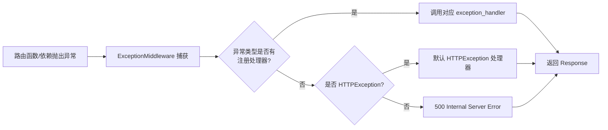

**异常处理器的匹配顺序**：精确类型匹配 → 父类匹配 → 默认处理器。注册 `Exception` 处理器会捕获所有未被更具体处理器捕获的异常（因为 Exception 是所有异常的父类）。

| 异常类型 | 触发场景 | 默认状态码 |
|---------|---------|-----------|
| `HTTPException` | 业务逻辑主动抛出（404/403/400） | exc.status_code |
| `RequestValidationError` | 请求参数校验失败（Pydantic） | 422 |
| `StarletteHTTPException` | 路由不存在（404）、方法不允许（405） | exc.status_code |
| 其他 `Exception` | 未捕获的代码错误 | 500 |

> 🎯 面试高频：FastAPI 中 HTTPException 和 RequestValidationError 的区别？HTTPException 是开发者在业务逻辑中主动抛出的（如 `raise HTTPException(status_code=404, detail="用户不存在")`），状态码由开发者指定；RequestValidationError 是 FastAPI 内部在参数校验失败时自动抛出的（如路径参数类型不对、请求体字段缺失），固定返回 422。两者需要分别注册异常处理器，因为 RequestValidationError 不是 HTTPException 的子类。

#### 代码示例

**示例 1：基础 HTTPException**

```python
from fastapi import FastAPI, HTTPException, status

app = FastAPI()

items = {"1": {"name": "iPhone", "price": 9999}}

@app.get("/items/{item_id}")
async def get_item(item_id: str):
    if item_id not in items:
        raise HTTPException(
            status_code=status.HTTP_404_NOT_FOUND,
            detail=f"商品 {item_id} 不存在",
            headers={"X-Error-Type": "NotFound"},  # 可自定义响应头
        )
    return items[item_id]

@app.post("/items/")
async def create_item(name: str, price: float):
    if price <= 0:
        raise HTTPException(
            status_code=status.HTTP_400_BAD_REQUEST,
            detail="价格必须大于 0",
        )
    return {"name": name, "price": price}

# GET /items/999 → 404 {"detail":"商品 999 不存在"}，响应头含 X-Error-Type
# POST /items/?name=test&price=-1 → 400 {"detail":"价格必须大于 0"}
```

预期运行结果：HTTPException 自动转换为 JSON 响应，包含 detail 和自定义 header。

**示例 2：自定义异常类 + 全局处理器**

```python
from fastapi import FastAPI, Request
from fastapi.responses import JSONResponse

app = FastAPI()

# 1. 定义自定义异常
class BizException(Exception):
    """业务异常基类"""
    def __init__(self, code: int, message: str, status_code: int = 400):
        self.code = code
        self.message = message
        self.status_code = status_code

class UserNotFoundError(BizException):
    def __init__(self, user_id: int):
        super().__init__(code=1001, message=f"用户 {user_id} 不存在", status_code=404)

class InsufficientBalanceError(BizException):
    def __init__(self, balance: float, required: float):
        super().__init__(code=1002, message=f"余额不足：当前 {balance}，需要 {required}", status_code=400)

# 2. 注册全局异常处理器
@app.exception_handler(BizException)
async def biz_exception_handler(request: Request, exc: BizException):
    return JSONResponse(
        status_code=exc.status_code,
        content={"code": exc.code, "message": exc.message, "data": None},
    )

# 3. 在路由中抛出自定义异常
@app.get("/users/{user_id}")
async def get_user(user_id: int):
    if user_id == 0:
        raise UserNotFoundError(user_id)
    return {"id": user_id, "name": "张三"}

@app.post("/pay")
async def pay(amount: float, balance: float = 100):
    if balance < amount:
        raise InsufficientBalanceError(balance, amount)
    return {"success": True, "remaining": balance - amount}

# GET /users/0 → 404 {"code":1001,"message":"用户 0 不存在","data":null}
# POST /pay?amount=200 → 400 {"code":1002,"message":"余额不足：当前 100，需要 200.0","data":null}
```

预期运行结果：自定义异常被全局处理器捕获，返回统一的 `{code, message, data}` 格式。

**示例 3：完整场景——统一异常处理体系**

```python
import logging
import uuid
from fastapi import FastAPI, Request, status
from fastapi.responses import JSONResponse
from fastapi.exceptions import RequestValidationError
from starlette.exceptions import HTTPException as StarletteHTTPException

logger = logging.getLogger(__name__)
app = FastAPI()

class AppException(Exception):
    """应用异常基类"""
    def __init__(self, code: int, message: str, status_code: int = 400):
        self.code = code
        self.message = message
        self.status_code = status_code

# 1. 业务异常处理器
@app.exception_handler(AppException)
async def app_exception_handler(request: Request, exc: AppException):
    logger.warning(f"业务异常 [{exc.code}]: {exc.message} | path={request.url.path}")
    return JSONResponse(
        status_code=exc.status_code,
        content={"code": exc.code, "message": exc.message, "data": None},
    )

# 2. 请求校验异常处理器（422）
@app.exception_handler(RequestValidationError)
async def validation_exception_handler(request: Request, exc: RequestValidationError):
    errors = []
    for err in exc.errors():
        field = ".".join(str(loc) for loc in err.get("loc", []))
        errors.append({"field": field, "message": err.get("msg", "")})
    logger.info(f"参数校验失败: {errors} | path={request.url.path}")
    return JSONResponse(
        status_code=status.HTTP_422_UNPROCESSABLE_ENTITY,
        content={"code": 422, "message": "请求参数校验失败", "data": {"errors": errors}},
    )

# 3. Starlette HTTP 异常处理器（404/405 等）
@app.exception_handler(StarletteHTTPException)
async def http_exception_handler(request: Request, exc: StarletteHTTPException):
    return JSONResponse(
        status_code=exc.status_code,
        content={"code": exc.status_code, "message": str(exc.detail), "data": None},
    )

# 4. 兜底异常处理器（500）
@app.exception_handler(Exception)
async def unhandled_exception_handler(request: Request, exc: Exception):
    error_id = str(uuid.uuid4())[:8]
    logger.error(f"未捕获异常 [{error_id}]: {type(exc).__name__}: {exc} | path={request.url.path}", exc_info=True)
    return JSONResponse(
        status_code=status.HTTP_500_INTERNAL_SERVER_ERROR,
        content={"code": 500, "message": f"服务器内部错误 (错误ID: {error_id})", "data": None},
    )

@app.get("/test/{value}")
async def test(value: int):
    if value == 1:
        raise AppException(code=2001, message="自定义业务错误", status_code=400)
    if value == 2:
        raise ValueError("模拟未捕获异常")
    return {"value": value}

# GET /test/1 → 400 业务异常格式
# GET /test/abc → 422 参数校验格式
# GET /test/2 → 500 兜底格式（含错误ID，不暴露堆栈）
# GET /notfound → 404 Starlette 格式
```

预期运行结果：四种异常场景分别被对应处理器捕获，返回统一格式，500 错误不暴露堆栈只返回错误 ID。

#### 使用场景与最佳实践

**适用场景**：所有生产级 API；需要统一错误响应格式的项目；需要错误日志集中记录的服务；需要区分业务异常和系统异常的应用。

**不适用场景**：内部调试脚本；原型验证（可直接用默认异常处理）。

**最佳实践**：
1. 定义业务异常基类 `BizException`，所有业务异常继承它
2. 注册四层异常处理器：业务异常 → 校验异常 → HTTP 异常 → 兜底 Exception
3. 生产环境必须注册 `Exception` 兜底处理器，防止堆栈泄露
4. 500 错误返回错误 ID（error_id），日志中记录完整堆栈，通过 ID 关联
5. 422 校验异常返回字段级错误列表，帮助前端定位问题
6. 异常处理器中不要抛新异常（会导致无限递归）
7. 用 `exc_info=True` 记录 500 异常的完整堆栈到日志

**性能建议**：异常处理开销很小（异常只在错误路径触发），但不要用异常控制正常业务流程（如用异常判断用户是否存在），正常流程用 if/else 返回，异常只用于真正的错误情况。

#### 常见坑点

**坑点 1：注册了 Exception 处理器后 404 也被捕获**

- 错误现象：注册 `@app.exception_handler(Exception)` 后，访问不存在的路径返回 500 而非 404
- 根本原因：`Exception` 是所有异常的父类，包括 Starlette 的 HTTPException（404），如果 Exception 处理器在 HTTPException 处理器之前匹配，会兜底所有异常
- 正确做法：单独注册 `StarletteHTTPException` 处理器（在 Exception 处理器之前或更具体的类型优先匹配），404 会被更具体的处理器捕获
- 预防措施：异常处理器按「从具体到宽泛」的顺序注册，Exception 兜底处理器最后

**坑点 2：异常处理器中抛出异常导致 500**

- 错误现象：异常处理器本身报错，客户端收到空白响应或默认 500
- 根本原因：异常处理器中的代码异常（如 JSON 序列化失败、日志格式化错误）没有被捕获
- 正确做法：异常处理器代码保持简单，只做 JSON 响应构造和日志记录；复杂逻辑用 try/except 包裹
- 预防措施：异常处理器中不要调用可能失败的外部服务（如发邮件、写数据库），只记录日志和返回响应

---

### 1.3 中间件与异常处理的协作关系

#### 概念解释

**中间件和异常处理是 FastAPI 横切关注点层的两大支柱，它们协作完成请求的全链路管理：中间件负责请求前后的通用处理（日志、CORS、计时），异常处理负责错误的捕获和格式化。** 两者通过 ExceptionMiddleware 连接——ExceptionMiddleware 本身就是一个中间件，位于中间件链的内层，包裹路由调用。

打个比方：中间件像大楼的楼层走廊（每个楼层都有公共区域），异常处理像楼里的消防系统。正常情况下人们在走廊走动（中间件处理请求），如果某个房间着火（路由函数抛异常），消防系统（ExceptionMiddleware）自动启动，灭火（捕获异常）、报警（日志）、疏散人群（返回错误响应）。走廊（外层中间件）仍然可以在消防处理后继续工作（记录错误响应的状态码）。

**核心价值**：理解两者的协作关系，能正确设计中间件顺序、处理中间件中的异常、确保错误响应被正确记录和格式化。

#### 原理说明：中间件与异常处理的执行链

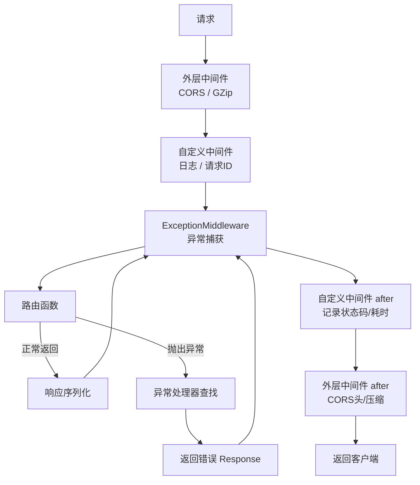

**关键协作点**：

| 场景 | 中间件行为 | 异常处理行为 |
|------|-----------|-------------|
| 路由正常返回 | after 阶段记录 2xx 状态码 | 不触发 |
| 路由抛 HTTPException | after 阶段记录 4xx/5xx | ExceptionMiddleware 捕获，调用处理器 |
| 中间件 before 抛异常 | 不进入路由 | 被外层中间件或 ServerErrorMiddleware 捕获 |
| 中间件 after 抛异常 | 响应可能已发送 | 难以捕获，需特别注意 |

> 🎯 面试高频：中间件中抛出的异常会被异常处理器捕获吗？取决于中间件的位置。如果异常在 ExceptionMiddleware 外层的中间件中抛出，不会被 ExceptionMiddleware 捕获（因为请求还没到达它），会被 ServerErrorMiddleware 捕获返回 500。如果异常在 ExceptionMiddleware 内层的中间件中抛出，会被捕获。因此自定义中间件通常注册在 ExceptionMiddleware 外层，其中的异常需要自己 try/except 处理。

#### 代码示例

**示例 1：中间件记录异常响应的状态码**

```python
import time
from fastapi import FastAPI, Request, HTTPException
from starlette.middleware.base import BaseHTTPMiddleware

app = FastAPI()

class StatusCodeLoggingMiddleware(BaseHTTPMiddleware):
    """日志中间件：无论成功还是异常，都记录最终状态码"""
    async def dispatch(self, request: Request, call_next):
        start = time.time()
        try:
            response = await call_next(request)
            # 路由正常返回或异常被处理器处理后，都会走到这里
            status = response.status_code
            level = "INFO" if status < 400 else ("WARNING" if status < 500 else "ERROR")
            print(f"[{level}] {request.method} {request.url.path} → {status} ({(time.time()-start)*1000:.1f}ms)")
            return response
        except Exception as e:
            # ExceptionMiddleware 之外的异常（通常不会发生）
            print(f"[FATAL] 中间件捕获未处理异常: {e}")
            raise

app.add_middleware(StatusCodeLoggingMiddleware)

@app.get("/success")
async def success():
    return {"ok": True}

@app.get("/client-error")
async def client_error():
    raise HTTPException(status_code=400, detail="客户端错误")

@app.get("/server-error")
async def server_error():
    raise ValueError("服务器错误")

# GET /success → [INFO] GET /success → 200 (0.5ms)
# GET /client-error → [WARNING] GET /client-error → 400 (0.3ms)
# GET /server-error → [ERROR] GET /server-error → 500 (0.4ms)
```

预期运行结果：中间件能记录所有请求的最终状态码，包括被异常处理器转换后的错误响应。

**示例 2：中间件中 try/except 处理自身异常**

```python
from fastapi import FastAPI, Request
from starlette.middleware.base import BaseHTTPMiddleware
from fastapi.responses import JSONResponse

app = FastAPI()

class SafeMiddleware(BaseHTTPMiddleware):
    """安全的中间件：自身异常不影响请求"""
    async def dispatch(self, request: Request, call_next):
        # Before：可能失败的操作用 try/except 包裹
        try:
            request_id = request.headers["X-Request-ID"]  # 可能 KeyError
        except KeyError:
            request_id = "unknown"

        request.state.request_id = request_id

        try:
            response = await call_next(request)
        except Exception as e:
            # 中间件层捕获异常（通常不需要，ExceptionMiddleware 会处理）
            # 但如果需要特殊处理，可以在这里做
            print(f"中间件捕获异常: {e}")
            raise  # 重新抛出，让 ExceptionMiddleware 处理

        # After：可能失败的操作也用 try/except
        try:
            response.headers["X-Request-ID"] = request_id
        except Exception:
            pass  # 响应头设置失败不影响响应

        return response

app.add_middleware(SafeMiddleware)
```

预期运行结果：中间件中的异常被 try/except 包裹，不会导致请求失败，核心逻辑（call_next）的异常重新抛出给 ExceptionMiddleware。

**示例 3：完整场景——请求 ID 贯穿中间件和异常处理**

```python
import uuid
import logging
from contextvars import ContextVar
from fastapi import FastAPI, Request, HTTPException
from fastapi.responses import JSONResponse
from starlette.middleware.base import BaseHTTPMiddleware

logging.basicConfig(level=logging.INFO)
logger = logging.getLogger(__name__)

# 全局请求 ID 上下文变量
request_id_var: ContextVar[str] = ContextVar("request_id", default="unknown")

app = FastAPI()

class RequestIDMiddleware(BaseHTTPMiddleware):
    """请求 ID 中间件：注入 request_id 到上下文和响应头"""
    async def dispatch(self, request: Request, call_next):
        request_id = request.headers.get("X-Request-ID", str(uuid.uuid4())[:8])
        token = request_id_var.set(request_id)
        request.state.request_id = request_id
        try:
            response = await call_next(request)
            response.headers["X-Request-ID"] = request_id
            return response
        finally:
            request_id_var.reset(token)

app.add_middleware(RequestIDMiddleware)

class BizException(Exception):
    def __init__(self, code: int, message: str, status_code: int = 400):
        self.code = code
        self.message = message
        self.status_code = status_code

@app.exception_handler(BizException)
async def biz_handler(request: Request, exc: BizException):
    # 异常处理器中可以获取 request_id
    rid = getattr(request.state, "request_id", "unknown")
    logger.warning(f"[{rid}] 业务异常: {exc.code} - {exc.message}")
    return JSONResponse(
        status_code=exc.status_code,
        content={"code": exc.code, "message": exc.message, "request_id": rid},
    )

@app.exception_handler(Exception)
async def fallback_handler(request: Request, exc: Exception):
    rid = getattr(request.state, "request_id", "unknown")
    logger.error(f"[{rid}] 未捕获异常: {exc}", exc_info=True)
    return JSONResponse(
        status_code=500,
        content={"code": 500, "message": f"服务器错误 (ID: {rid})", "request_id": rid},
    )

@app.get("/error")
async def error_endpoint():
    raise BizException(code=3001, message="测试业务异常")

# GET /error → 400 {"code":3001,"message":"测试业务异常","request_id":"a1b2c3d4"}
# 响应头包含 X-Request-ID: a1b2c3d4
# 日志: [a1b2c3d4] 业务异常: 3001 - 测试业务异常
```

预期运行结果：请求 ID 从中间件生成，贯穿到异常处理器的日志和响应中，实现全链路追踪。

#### 使用场景与最佳实践

**适用场景**：需要全链路追踪的微服务；需要统一错误日志的生产服务；中间件和异常处理需要共享数据（如 request_id）的场景。

**不适用场景**：简单接口（不需要复杂的协作设计）。

**最佳实践**：
1. 请求 ID 在最外层中间件生成，通过 `request.state` 和 `ContextVar` 传递
2. 日志中间件注册在 ExceptionMiddleware 外层（自定义中间件默认在外层），确保能记录错误状态码
3. 中间件中的 before/after 逻辑用 try/except 包裹，避免中间件自身异常影响请求
4. 异常处理器中从 `request.state` 获取中间件设置的数据（如 request_id）
5. CORS 中间件在最外层，确保错误响应也有 CORS 头

**性能建议**：ContextVar 的 set/reset 开销极小，适合传递请求级上下文。避免在中间件中做重计算，所有请求都会经过。

#### 常见坑点

**坑点 1：中间件 after 阶段修改响应但响应已发送**

- 错误现象：在 `call_next` 之后修改 `response.body`，但客户端收到的是原始 body
- 根本原因：对于 StreamingResponse，响应可能已经开始发送，修改 body 无效
- 正确做法：中间件中只修改响应头（headers），不要修改响应体；需要修改 body 用 `response.body` 重新构造 Response
- 预防措施：中间件 after 阶段只做 header 修改和日志，不做 body 修改

**坑点 2：异常处理器中获取不到 request.state 的数据**

- 错误现象：在异常处理器中访问 `request.state.request_id` 报 AttributeError
- 根本原因：如果异常在请求 ID 中间件之前抛出（如更外层的中间件异常），request.state.request_id 还没设置
- 正确做法：用 `getattr(request.state, "request_id", "unknown")` 安全访问
- 预防措施：request.state 的属性访问都用 getattr 带默认值

---

> 💡 **本章深度讲解**：中间件和异常处理是 FastAPI 的横切关注点层。中间件基于 ASGI 协议和洋葱模型，在请求前后插入通用逻辑（日志、CORS、计时、限流）；异常处理通过 ExceptionMiddleware 捕获路由和依赖中的异常，按「精确类型→父类→默认」顺序查找处理器，转换为统一格式的 HTTP 响应。两者通过 ExceptionMiddleware 连接——它本身是一个内层中间件，包裹路由调用。理解协作关系的关键：外层中间件的 after 阶段能看到异常处理器转换后的最终响应（包括状态码），所以日志中间件能记录错误请求。
>
> 📝 **本章精简总结**：
> 1. 中间件 = ASGI 可调用对象 + 洋葱模型（before→路由→after）
> 2. 先注册的中间件在外层，后注册的在内层；CORS 最外层，日志最内层
> 3. 中间件中不要读取请求体（会消耗 ASGI 流）
> 4. 异常处理 = @app.exception_handler 注册 + 精确→父类→默认匹配顺序
> 5. 四层处理器：业务异常 → 校验异常(422) → HTTP异常(404) → 兜底Exception(500)
> 6. 500 错误不暴露堆栈，返回错误 ID，日志记录完整堆栈
> 7. 请求 ID 在中间件生成，通过 request.state 传递到异常处理器
> 8. 中间件 after 阶段只改 header 不改 body

🎯 **梯度练习题**

**基础题⭐**
1. 写一个计时中间件，在响应头中添加 X-Process-Time。
2. HTTPException 和 RequestValidationError 有什么区别？
3. 中间件的洋葱模型执行顺序是什么？先注册和后注册的中间件哪个在外层？

**进阶题⭐⭐**
4. 解释为什么中间件中不能读取 `await request.body()`？如果确实需要记录请求体，应该怎么处理？
5. 设计一个完整的异常处理体系：自定义 BizException 基类，注册业务异常处理器、422 校验处理器、404 处理器、500 兜底处理器，统一返回 `{code, message, data}` 格式。

**实战题⭐⭐⭐**
6. 实现一个生产级中间件组合：请求 ID 中间件（生成/透传 X-Request-ID）+ 计时中间件（X-Process-Time）+ 结构化日志中间件（JSON 格式，含 request_id/method/path/status/duration）。要求：日志中间件能正确记录 4xx/5xx 错误响应，慢请求（>1s）用 WARNING 级别，5xx 用 ERROR 级别。请求 ID 能在异常处理器的日志和响应中获取到。

---

## 二、ASGI 中间件原理与执行流程

### 2.1 ASGI 协议基础

#### 概念解释

**ASGI（Asynchronous Server Gateway Interface）是 Python 异步 Web 的标准协议，定义了 Web 服务器与应用之间的接口。** 一个 ASGI 应用是一个异步可调用对象，接收 `scope`（请求元信息字典）、`receive`（接收请求体的协程）、`send`（发送响应的协程）三个参数。中间件就是包裹 ASGI 应用的 ASGI 应用。

打个比方：ASGI 像快递行业的标准操作流程——`scope` 是快递单（地址、物品类型、寄件人信息），`receive` 是拆包裹（接收物品），`send` 是寄回包裹（发送响应）。中间件像快递中转站——它收到快递单和包裹（scope/receive/send），可以检查快递单（修改 scope）、重新打包（修改 receive/send）、然后转给下一个中转站或最终收件人（内层应用）。

**核心价值**：理解 ASGI 协议是开发高级中间件、调试中间件问题、集成第三方 ASGI 组件的基础。FastAPI/Starlette 的所有中间件都基于这个协议。

#### 原理说明：ASGI 应用与中间件结构

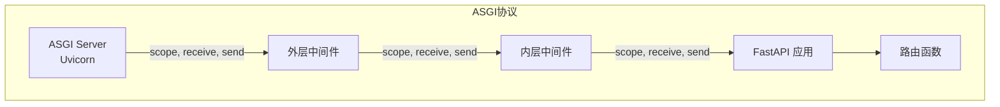

**ASGI 三参数详解**：

| 参数 | 类型 | 说明 | 常用字段 |
|------|------|------|---------|
| `scope` | dict | 请求元信息 | `type`(http/websocket)、`method`、`path`、`headers`、`query_string`、`client` |
| `receive` | coroutine | 接收请求体/事件 | 调用返回 `{"type": "http.request", "body": bytes, "more_body": bool}` |
| `send` | coroutine | 发送响应/事件 | 调用传入 `{"type": "http.response.start", "status": int, "headers": [...]}` |

**ASGI 中间件的最简形式**：

```python
class ASGIMiddleware:
    def __init__(self, app):
        self.app = app  # 内层 ASGI 应用

    async def __call__(self, scope, receive, send):
        if scope["type"] != "http":
            await self.app(scope, receive, send)
            return
        # before 逻辑
        await self.app(scope, receive, send)  # 调用内层
        # after 逻辑
```

> 🎯 面试高频：ASGI 和 WSGI 的区别？① WSGI 是同步协议（`def app(environ, start_response)`），ASGI 是异步协议（`async def app(scope, receive, send)`）；② WSGI 只支持 HTTP，ASGI 支持 HTTP 和 WebSocket；③ WSGI 一次只能接收一个请求并返回响应，ASGI 支持长连接和流式响应；④ WSGI 用 gunicorn/waitress，ASGI 用 uvicorn/hypercorn。FastAPI 基于 ASGI，Flask/Django 基于 WSGI。

> 🎯 面试高频：ASGI 的 scope 字典包含哪些关键字段？scope 是请求元信息字典，核心字段包括：`type`（http/websocket/lifespan）、`method`（GET/POST）、`path`（请求路径）、`raw_path`、`query_string`（字节串）、`headers`（元组列表，键为小写字节）、`client`（(host, port)）、`server`、`scheme`（http/https）、`root_path`。注意 headers 的键是 bytes 类型且全小写，需要 decode 后使用。

#### 代码示例

**示例 1：原生 ASGI 中间件（不依赖 FastAPI）**

```python
# 纯 ASGI 中间件，可用于任何 ASGI 应用
import time

class TimingASGIMiddleware:
    """原生 ASGI 计时中间件"""
    def __init__(self, app):
        self.app = app

    async def __call__(self, scope, receive, send):
        if scope["type"] != "http":
            await self.app(scope, receive, send)
            return

        start = time.time()
        method = scope.get("method", "UNKNOWN")
        path = scope.get("path", "/")

        # 包装 send 以捕获响应状态码
        status_code = 200
        async def send_wrapper(message):
            nonlocal status_code
            if message["type"] == "http.response.start":
                status_code = message["status"]
            await send(message)

        await self.app(scope, receive, send_wrapper)

        duration = (time.time() - start) * 1000
        print(f"ASGI中间件: {method} {path} → {status_code} ({duration:.1f}ms)")

# 使用方式
from fastapi import FastAPI
app = FastAPI()
app.add_middleware(TimingASGIMiddleware)

@app.get("/")
async def root():
    return {"hello": "world"}
```

预期运行结果：原生 ASGI 中间件通过包装 `send` 捕获状态码，记录每个请求的方法、路径、状态码和耗时。

**示例 2：修改 scope 的 ASGI 中间件（URL 重写）**

```python
class URLRewriteMiddleware:
    """URL 重写中间件：将 /api/v1/* 重写为 /*"""
    def __init__(self, app):
        self.app = app

    async def __call__(self, scope, receive, send):
        if scope["type"] == "http" and scope["path"].startswith("/api/v1/"):
            # 修改 scope 中的 path，内层应用看到的是重写后的路径
            scope = dict(scope)  # 复制 scope 避免修改原始对象
            scope["path"] = scope["path"][len("/api/v1"):]
            scope["raw_path"] = scope["path"].encode()
        await self.app(scope, receive, send)

# 请求 /api/v1/users → 内层应用看到 /users
# 适合 API 版本兼容或路径迁移场景
```

预期运行结果：中间件修改 scope 中的 path，实现 URL 重写，内层路由无需感知前缀。

**示例 3：完整场景——包装 receive/send 的高级中间件**

```python
import json
import time

class RequestResponseLogger:
    """高级 ASGI 中间件：记录请求体和响应体（正确处理流消耗问题）"""
    def __init__(self, app):
        self.app = app

    async def __call__(self, scope, receive, send):
        if scope["type"] != "http":
            await self.app(scope, receive, send)
            return

        start = time.time()

        # 1. 读取请求体并重新封装 receive（关键！不消耗原始流）
        body = b""
        if scope.get("method") in ("POST", "PUT", "PATCH"):
            while True:
                message = await receive()
                body += message.get("body", b"")
                if not message.get("more_body"):
                    break
            # 重新封装 receive，让内层应用仍能读取 body
            body_bytes = body
            async def receive_replay():
                return {"type": "http.request", "body": body_bytes, "more_body": False}
            receive = receive_replay

        # 2. 包装 send 以捕获响应体
        response_body = b""
        async def send_wrapper(message):
            nonlocal response_body
            if message["type"] == "http.response.body":
                response_body += message.get("body", b"")
            await send(message)

        # 3. 调用内层应用
        await self.app(scope, receive, send_wrapper)

        # 4. 记录日志
        duration = (time.time() - start) * 1000
        try:
            req_body = json.loads(body) if body else None
            resp_body = json.loads(response_body) if response_body else None
        except json.JSONDecodeError:
            req_body = body.decode("utf-8", errors="replace")[:500]
            resp_body = response_body.decode("utf-8", errors="replace")[:500]

        print(f"请求: {scope.get('method')} {scope.get('path')}")
        print(f"  请求体: {req_body}")
        print(f"  响应体: {resp_body}")
        print(f"  耗时: {duration:.1f}ms")
```

预期运行结果：通过重新封装 `receive` 解决了请求体消耗问题，通过包装 `send` 捕获响应体，实现完整的请求/响应日志。

#### 使用场景与最佳实践

**适用场景**：开发高级中间件（需要修改 scope、包装 receive/send）；调试 ASGI 层级问题；集成第三方 ASGI 组件；理解 FastAPI/Starlette 内部机制。

**不适用场景**：普通日志/CORS/计时（用 BaseHTTPMiddleware 或内置中间件即可）。

**最佳实践**：
1. 中间件首先判断 `scope["type"] != "http"`，非 HTTP 请求（WebSocket）直接透传
2. 修改 scope 时先复制（`scope = dict(scope)`），避免修改原始对象影响其他中间件
3. 读取请求体后必须重新封装 `receive`，否则内层应用拿不到 body
4. 原生 ASGI 中间件用 `app.add_middleware(ClassName)` 注册
5. 简单中间件优先用 `BaseHTTPMiddleware`，只有需要底层控制时才用原生 ASGI

**性能建议**：原生 ASGI 中间件比 BaseHTTPMiddleware 性能略好（少一层 Request/Response 封装），但开发复杂度高。对性能极敏感的场景用原生 ASGI，否则用 BaseHTTPMiddleware 更易维护。

#### 常见坑点

**坑点 1：忘记判断 scope["type"] 导致 WebSocket 报错**

- 错误现象：WebSocket 连接失败，中间件中访问 `scope["method"]` 报 KeyError
- 根本原因：WebSocket 的 scope 中没有 `method` 字段，中间件没有区分 http 和 websocket
- 正确做法：中间件开头判断 `if scope["type"] != "http": await self.app(scope, receive, send); return`
- 预防措施：所有 ASGI 中间件都必须先判断 type

**坑点 2：修改 scope 字典影响其他中间件**

- 错误现象：一个中间件修改了 `scope["path"]`，后续中间件看到的是修改后的值，导致日志记录错误路径
- 根本原因：scope 是可变字典，直接修改会影响所有引用它的中间件
- 正确做法：修改前复制 `scope = dict(scope)`，只修改副本传给内层
- 预防措施：中间件中修改 scope 时始终先复制

---

### 2.2 BaseHTTPMiddleware 与 @app.middleware

#### 概念解释

**FastAPI/Starlette 提供了两种简化的中间件开发方式：`BaseHTTPMiddleware`（类中间件）和 `@app.middleware("http")`（函数中间件装饰器）。** 它们封装了原生 ASGI 的复杂度，提供 `Request` 和 `Response` 对象，以及 `call_next` 协程，让中间件开发更简单。

打个比方：原生 ASGI 中间件像手动挡汽车（完全控制，但操作复杂），BaseHTTPMiddleware 像自动挡汽车（封装了离合和换挡，专注驾驶），@app.middleware 像共享汽车（即开即用，不需要定义类）。三者底层都是 ASGI 协议，但抽象层次不同。

**核心价值**：BaseHTTPMiddleware 和 @app.middleware 让开发者无需理解 ASGI 三参数细节，用熟悉的 Request/Response 对象和 async/await 开发中间件，大幅降低开发门槛。

#### 原理说明：三种中间件方式的封装层次

```mermaid
graph TB
    subgraph 原生ASGI
        A[async def __call__(scope, receive, send)]
    end
    subgraph BaseHTTPMiddleware
        B[async def dispatch(request, call_next)]
        B -->|内部封装| A
    end
    subgraph 装饰器
        C[@app.middleware http<br/>async def mw(request, call_next)]
        C -->|内部转换为| B
    end
```

**三种方式对比**：

| 方式 | 语法 | 复用性 | 适用场景 | 性能 |
|------|------|--------|---------|------|
| 原生 ASGI | `__call__(scope, receive, send)` | 高（类） | 底层控制、修改流 | 最好 |
| BaseHTTPMiddleware | `dispatch(request, call_next)` | 高（类） | 大多数自定义中间件 | 好 |
| @app.middleware | 装饰器函数 | 低（单函数） | 简单中间件、快速原型 | 好 |

> 🎯 面试高频：BaseHTTPMiddleware 和 @app.middleware 的区别？① BaseHTTPMiddleware 是类，可以继承、参数化、复用；@app.middleware 是函数装饰器，定义简单但不易复用；② BaseHTTPMiddleware 用 `app.add_middleware(ClassName, **kwargs)` 注册，可传参数；@app.middleware 直接装饰函数；③ 两者底层都封装为 ASGI 中间件，性能相当；④ 生产环境推荐 BaseHTTPMiddleware（可测试、可配置），开发快速原型用 @app.middleware。

#### 代码示例

**示例 1：@app.middleware 函数中间件**

```python
from fastapi import FastAPI, Request
import time

app = FastAPI()

@app.middleware("http")
async def add_custom_header(request: Request, call_next):
    """函数中间件：添加自定义响应头"""
    start = time.time()
    response = await call_next(request)
    response.headers["X-Framework"] = "FastAPI"
    response.headers["X-Process-Time"] = f"{(time.time()-start)*1000:.0f}ms"
    return response

@app.get("/")
async def root():
    return {"message": "hello"}

# 所有响应头包含 X-Framework: FastAPI 和 X-Process-Time: 1ms
```

预期运行结果：函数中间件简洁地实现了响应头添加。

**示例 2：BaseHTTPMiddleware 类中间件（可配置）**

```python
from starlette.middleware.base import BaseHTTPMiddleware
from fastapi import FastAPI, Request
from fastapi.responses import JSONResponse

app = FastAPI()

class RateLimitMiddleware(BaseHTTPMiddleware):
    """可配置的限流中间件：每个 IP 每秒最多 N 个请求"""
    def __init__(self, app, max_requests: int = 10, window_seconds: int = 1):
        super().__init__(app)
        self.max_requests = max_requests
        self.window_seconds = window_seconds
        self.requests: dict[str, list[float]] = {}

    async def dispatch(self, request: Request, call_next):
        import time
        client_ip = request.client.host if request.client else "unknown"
        now = time.time()

        # 清理过期记录
        self.requests[client_ip] = [
            t for t in self.requests.get(client_ip, [])
            if now - t < self.window_seconds
        ]

        # 检查限流
        if len(self.requests[client_ip]) >= self.max_requests:
            return JSONResponse(
                status_code=429,
                content={"detail": "请求过于频繁，请稍后重试"},
                headers={"Retry-After": str(self.window_seconds)},
            )

        self.requests[client_ip].append(now)
        return await call_next(request)

# 注册时可传参数
app.add_middleware(RateLimitMiddleware, max_requests=5, window_seconds=1)

@app.get("/api/data")
async def get_data():
    return {"data": "sensitive data"}

# 1 秒内超过 5 次请求 → 429
```

预期运行结果：类中间件可通过 `add_middleware` 传参配置限流阈值，不同环境可设置不同值。

**示例 3：完整场景——BaseHTTPMiddleware 处理异常和请求体**

```python
import json
import time
import logging
from starlette.middleware.base import BaseHTTPMiddleware
from starlette.requests import Request
from starlette.responses import Response
from fastapi import FastAPI

logger = logging.getLogger(__name__)
app = FastAPI()

class AdvancedLoggingMiddleware(BaseHTTPMiddleware):
    """高级日志中间件：处理请求体、异常、慢请求"""

    def __init__(self, app, slow_threshold_ms: float = 1000.0):
        super().__init__(app)
        self.slow_threshold = slow_threshold_ms

    async def dispatch(self, request: Request, call_next):
        start = time.time()

        # 读取请求体（安全方式：读取后重新封装）
        req_body = None
        if request.method in ("POST", "PUT", "PATCH"):
            try:
                raw_body = await request.body()
                if raw_body:
                    req_body = json.loads(raw_body)
                    # 重新封装 receive
                    async def receive():
                        return {"type": "http.request", "body": raw_body, "more_body": False}
                    request._receive = receive
            except Exception:
                pass

        try:
            response = await call_next(request)
            status = response.status_code
        except Exception as e:
            # 中间件层异常（通常不会到这里，ExceptionMiddleware 会处理）
            logger.error(f"中间件捕获异常: {e}", exc_info=True)
            raise

        duration = (time.time() - start) * 1000

        # 根据状态码和耗时选择日志级别
        log_data = {
            "method": request.method,
            "path": request.url.path,
            "status": status,
            "duration_ms": round(duration, 2),
            "req_body": req_body,
        }

        if duration > self.slow_threshold:
            logger.warning(f"慢请求: {json.dumps(log_data, ensure_ascii=False)}")
        elif status >= 500:
            logger.error(f"5xx错误: {json.dumps(log_data, ensure_ascii=False)}")
        elif status >= 400:
            logger.info(f"4xx错误: {json.dumps(log_data, ensure_ascii=False)}")
        else:
            logger.debug(f"正常请求: {json.dumps(log_data, ensure_ascii=False)}")

        return response

app.add_middleware(AdvancedLoggingMiddleware, slow_threshold_ms=500)
```

预期运行结果：中间件安全读取请求体（重新封装 receive），处理异常，根据状态码和耗时输出不同级别的日志。

#### 使用场景与最佳实践

**适用场景**：@app.middleware——简单中间件、快速原型、单文件应用；BaseHTTPMiddleware——生产级中间件、可配置中间件、需要复用的中间件、团队项目。

**不适用场景**：需要修改 ASGI 流的高级场景（用原生 ASGI）。

**最佳实践**：
1. 生产环境用 BaseHTTPMiddleware（可测试、可配置、可继承）
2. @app.middleware 只用于简单逻辑（< 10 行），复杂逻辑抽为类
3. 中间件类的 `__init__` 接收配置参数，通过 `add_middleware(Class, param=value)` 传入
4. `dispatch` 方法中 `call_next` 调用用 try/except 包裹，记录中间件自身异常
5. 读取请求体后必须重新封装 `request._receive`
6. 中间件类放在独立模块（`app/middleware/`），便于管理和测试

**性能建议**：BaseHTTPMiddleware 内部会创建 Request 对象，有轻微开销。对性能极敏感的高 QPS 场景（>10k QPS）可考虑原生 ASGI 中间件。大多数场景 BaseHTTPMiddleware 足够。

#### 常见坑点

**坑点 1：@app.middleware 装饰的函数无法传参**

- 错误现象：想给中间件配置不同的限流阈值，但 @app.middleware 函数无法接收参数
- 根本原因：装饰器函数只接收 request 和 call_next，没有配置入口
- 正确做法：改用 BaseHTTPMiddleware，在 `__init__` 中接收配置参数
- 预防措施：需要配置的中间件一律用 BaseHTTPMiddleware

**坑点 2：BaseHTTPMiddleware 中 request.body() 后路由拿不到 body**

- 错误现象：BaseHTTPMiddleware 的 dispatch 中调用了 `await request.body()`，路由函数请求体为空
- 根本原因：和原生 ASGI 一样，body 流被消耗
- 正确做法：读取后重新封装 `request._receive`（如示例 3），或不要在中间件中读取 body
- 预防措施：中间件中读取 body 后必须重新封装，这是最常见的中间件坑

---

### 2.3 中间件的注册顺序与嵌套

#### 概念解释

**中间件的注册顺序决定了它们在洋葱模型中的位置，从而决定了 before/after 的执行顺序。** FastAPI 通过 `app.add_middleware()` 按调用顺序注册，先注册的在外层，后注册的在内层。理解顺序是正确配置中间件的关键。

打个比方：中间件注册顺序像穿衣服——先穿的内衣（后注册的中间件）贴身（内层），后穿的外套（先注册的中间件）在外面（外层）。脱衣服时（响应阶段）先脱外套（外层 after 先执行），再脱内衣（内层 after 后执行）。CORS 像最外面的风衣（必须最先穿/最先注册），日志像贴身的运动手环（最后穿/最后注册，最接近身体/路由）。

**核心价值**：正确的中间件顺序确保 CORS 头出现在所有响应中（包括错误响应）、日志记录最终状态码、限流在认证之前执行等。

#### 原理说明：注册顺序与执行顺序的对应关系

```mermaid
graph LR
    subgraph 注册顺序（先→后）
        R1[1. TrustedHost] --> R2[2. CORS] --> R3[3. GZip] --> R4[4. RequestID] --> R5[5. 限流] --> R6[6. 日志]
    end
    subgraph 洋葱模型（外→内）
        O1[TrustedHost<br/>最外层] --> O2[CORS] --> O3[GZip] --> O4[RequestID] --> O5[限流] --> O6[日志<br/>最内层]
    end
    R1 --> O1
    R6 --> O6
```

**推荐的生产级中间件注册顺序**：

| 顺序 | 中间件 | 位置 | 原因 |
|------|--------|------|------|
| 1 | TrustedHostMiddleware | 最外层 | 最早拦截非法 Host 头攻击 |
| 2 | CORSMiddleware | 外层 | 所有响应（含错误）都需要 CORS 头 |
| 3 | GZipMiddleware | 中外层 | 压缩最终响应体 |
| 4 | HTTPSRedirectMiddleware | 外层 | 生产环境强制 HTTPS |
| 5 | 自定义中间件（请求ID/限流） | 中层 | 业务相关的横切逻辑 |
| 6 | 日志中间件 | 最内层 | 最接近路由，记录最终状态码 |

> 🎯 面试高频：为什么 CORS 中间件要注册在最外层？因为 CORS 中间件需要处理 OPTIONS 预检请求（直接返回 200，不进入路由），并且所有响应（包括其他中间件直接返回的错误响应，如限流 429）都需要添加 CORS 头。如果 CORS 注册在内层，外层中间件直接返回的响应就没有 CORS 头，前端跨域请求会失败。

#### 代码示例

**示例 1：验证中间件执行顺序**

```python
from fastapi import FastAPI, Request
from starlette.middleware.base import BaseHTTPMiddleware

app = FastAPI()

class MW(BaseHTTPMiddleware):
    def __init__(self, app, name: str):
        super().__init__(app)
        self.name = name

    async def dispatch(self, request: Request, call_next):
        print(f"{self.name}: before")
        response = await call_next(request)
        print(f"{self.name}: after")
        return response

# 注册顺序：A → B → C
app.add_middleware(MW, name="C")  # 最后注册 = 最内层
app.add_middleware(MW, name="B")
app.add_middleware(MW, name="A")  # 最先注册 = 最外层

@app.get("/test")
async def test():
    print("路由函数")
    return {"ok": True}

# GET /test 控制台输出：
# A: before    （最外层先执行 before）
# B: before
# C: before    （最内层最后执行 before）
# 路由函数
# C: after     （最内层先执行 after）
# B: after
# A: after     （最外层最后执行 after）
```

预期运行结果：清晰展示洋葱模型——before 从外到内（A→B→C），after 从内到外（C→B→A）。

**示例 2：CORS 顺序错误导致的问题与修复**

```python
from fastapi import FastAPI, Request
from fastapi.middleware.cors import CORSMiddleware
from fastapi.responses import JSONResponse
from starlette.middleware.base import BaseHTTPMiddleware

app = FastAPI()

class RateLimitMiddleware(BaseHTTPMiddleware):
    """限流中间件：直接返回 429"""
    async def dispatch(self, request: Request, call_next):
        # 模拟限流触发
        if request.url.path == "/api/limited":
            return JSONResponse(status_code=429, content={"detail": "限流"})
        return await call_next(request)

# 错误顺序：限流在外层，CORS 在内层
# app.add_middleware(RateLimitMiddleware)  # 先注册=外层
# app.add_middleware(CORSMiddleware, allow_origins=["*"])  # 后注册=内层
# → /api/limited 的 429 响应没有 CORS 头，前端跨域失败

# 正确顺序：CORS 在外层，限流在内层
app.add_middleware(CORSMiddleware, allow_origins=["http://localhost:3000"], allow_credentials=True)
app.add_middleware(RateLimitMiddleware)

@app.get("/api/data")
async def data():
    return {"data": "ok"}
```

预期运行结果：正确顺序下，限流返回的 429 响应也经过 CORS 中间件添加 CORS 头，前端跨域正常。

**示例 3：完整场景——生产级中间件链**

```python
from fastapi import FastAPI
from fastapi.middleware.cors import CORSMiddleware
from fastapi.middleware.gzip import GZipMiddleware
from fastapi.middleware.trustedhost import TrustedHostMiddleware
from starlette.middleware.base import BaseHTTPMiddleware
from starlette.requests import Request
import uuid
import time
import json
import logging

logger = logging.getLogger("api")

class RequestIDMiddleware(BaseHTTPMiddleware):
    async def dispatch(self, request: Request, call_next):
        request_id = request.headers.get("X-Request-ID", str(uuid.uuid4())[:8])
        request.state.request_id = request_id
        response = await call_next(request)
        response.headers["X-Request-ID"] = request_id
        return response

class AccessLogMiddleware(BaseHTTPMiddleware):
    async def dispatch(self, request: Request, call_next):
        start = time.time()
        response = await call_next(request)
        duration = (time.time() - start) * 1000
        log = {
            "request_id": getattr(request.state, "request_id", "?"),
            "method": request.method,
            "path": request.url.path,
            "status": response.status_code,
            "duration_ms": round(duration, 2),
        }
        logger.info(json.dumps(log, ensure_ascii=False))
        return response

def create_app() -> FastAPI:
    app = FastAPI(title="生产级 API")

    # 严格按照推荐顺序注册
    # 1. TrustedHost（最外层）
    app.add_middleware(TrustedHostMiddleware, allowed_hosts=["api.example.com", "*.example.com"])
    # 2. CORS
    app.add_middleware(
        CORSMiddleware,
        allow_origins=["https://app.example.com"],
        allow_credentials=True,
        allow_methods=["GET", "POST", "PUT", "PATCH", "DELETE"],
        allow_headers=["*"],
        expose_headers=["X-Request-ID", "X-Process-Time"],
    )
    # 3. GZip
    app.add_middleware(GZipMiddleware, minimum_size=1000)
    # 4. 请求 ID
    app.add_middleware(RequestIDMiddleware)
    # 5. 访问日志（最内层，最接近路由）
    app.add_middleware(AccessLogMiddleware)

    @app.get("/health")
    async def health():
        return {"status": "ok"}

    return app

app = create_app()
```

预期运行结果：生产级中间件链按正确顺序注册，TrustedHost 防 Host 攻击、CORS 处理跨域、GZip 压缩、请求 ID 追踪、访问日志记录，每个请求依次经过所有中间件。

#### 使用场景与最佳实践

**适用场景**：所有生产级 FastAPI 应用；多个中间件组合使用；需要调试中间件交互问题。

**不适用场景**：只有 1-2 个中间件的简单应用（顺序影响不大）。

**最佳实践**：
1. 严格按照推荐顺序注册：TrustedHost → CORS → GZip → 自定义 → 日志
2. CORS 必须在所有可能直接返回响应的中间件（限流、IP 黑名单）之外
3. 日志中间件在最内层，确保记录的是最终状态码
4. 用 `create_app()` 工厂函数集中管理中间件注册，便于测试和多环境配置
5. 开发环境可以跳过 TrustedHost（允许 localhost），生产环境必须启用
6. 中间件链不宜过长（建议 < 8 个），每个中间件都有开销

**性能建议**：中间件链的总开销 = 各中间件开销之和。10 个中间件约 1ms 开销。对延迟敏感的 API 精简中间件，只保留必要的。GZip 对小响应（< 1KB）开销大于收益，设置 `minimum_size=1000`。

#### 常见坑点

**坑点 1：中间件注册顺序写反导致功能异常**

- 错误现象：CORS 配置了但跨域仍失败，或日志记录的状态码总是 200（实际是 422/500）
- 根本原因：CORS 注册在内层导致错误响应没有 CORS 头；日志注册在外层导致它的 after 在 ExceptionMiddleware 之前执行，记录的是异常状态而非最终响应
- 正确做法：CORS 最外层，日志最内层
- 预防措施：团队制定中间件注册顺序规范，代码审查时检查

**坑点 2：include_router 中的中间件与全局中间件顺序混淆**

- 错误现象：APIRouter 的 dependencies 被误认为是中间件，与全局中间件顺序混淆
- 根本原因：APIRouter 的 `dependencies` 是依赖注入，不是中间件，它在路由函数之前执行，与中间件是不同层面的概念
- 正确做法：理解中间件（ASGI 层）和依赖注入（路由层）是两个独立的体系，中间件先于依赖执行
- 预防措施：中间件用 `add_middleware`，路由级横切逻辑用 `dependencies=[Depends(...)]`，不要混淆

---

> 💡 **本章深度讲解**：ASGI 协议是 FastAPI 中间件的根基。理解 scope/receive/send 三参数，就能理解所有中间件的底层机制。BaseHTTPMiddleware 和 @app.middleware 是对原生 ASGI 的封装，提供 Request/Response 对象降低开发门槛。中间件的核心是洋葱模型——先注册外层、后注册内层，before 从外到内、after 从内到外。注册顺序是最容易出错的地方：CORS 必须最外层（确保所有响应有 CORS 头），日志必须最内层（记录最终状态码）。读取请求体后必须重新封装 receive，这是最常见的坑。
>
> 📝 **本章精简总结**：
> 1. ASGI 三参数：scope（请求元信息）、receive（接收请求体）、send（发送响应）
> 2. ASGI 中间件必须先判断 scope["type"] != "http"，WebSocket 直接透传
> 3. 修改 scope 前先复制（dict(scope)），避免影响其他中间件
> 4. 三种中间件方式：原生ASGI（性能最好）、BaseHTTPMiddleware（推荐）、@app.middleware（简单）
> 5. 洋葱模型：先注册=外层，before 外→内，after 内→外
> 6. 推荐顺序：TrustedHost → CORS → GZip → 自定义 → 日志
> 7. CORS 最外层（错误响应也需要 CORS 头），日志最内层（记录最终状态码）
> 8. 读取请求体后必须重新封装 request._receive

🎯 **梯度练习题**

**基础题⭐**
1. ASGI 协议的三个参数是什么？各自的作用是什么？
2. BaseHTTPMiddleware 和 @app.middleware 有什么区别？生产环境推荐用哪个？
3. 写三个中间件 A/B/C，验证 before 和 after 的执行顺序。

**进阶题⭐⭐**
4. 解释为什么 CORS 中间件必须注册在最外层？如果注册在内层会有什么问题？
5. 实现一个原生 ASGI 中间件，通过包装 send 捕获响应状态码和响应体，实现请求/响应日志。要求正确处理请求体消耗问题（读取后重新封装 receive）。

**实战题⭐⭐⭐**
6. 设计一个完整的生产级中间件链，包含：TrustedHostMiddleware、CORSMiddleware（带凭据、白名单 origin）、GZipMiddleware（minimum_size=1000）、自定义请求 ID 中间件（生成/透传 X-Request-ID）、自定义访问日志中间件（JSON 格式，含 request_id/method/path/status/duration/client_ip）。要求：① 按正确顺序注册；② 日志中间件能记录 4xx/5xx 错误；③ 慢请求（>1s）用 WARNING；④ 用 create_app() 工厂函数封装，便于测试。

---

## 三、内置中间件详解

### 3.1 CORSMiddleware 跨域中间件

#### 概念解释

**CORS（Cross-Origin Resource Sharing，跨域资源共享）是浏览器的安全机制，控制不同域名的网页是否可以请求当前 API。** FastAPI 提供 `CORSMiddleware` 中间件，通过配置允许的源、方法、头、凭据等，实现跨域请求的精确控制。

打个比方：CORS 像公司的访客登记系统——外部公司的人（不同域名的前端）来拜访，前台（CORS 中间件）检查访客名单（allow_origins），如果在名单上就发访客证（CORS 响应头），允许进入；如果不在名单上就拒绝（浏览器拦截响应）。访客证还规定了可以去哪些区域（allow_methods）、可以带什么物品（allow_headers）、是否可以刷卡消费（allow_credentials）。

**核心价值**：CORSMiddleware 一行配置解决跨域问题，无需在每个响应中手动设置 CORS 头，且自动处理 OPTIONS 预检请求。

#### 原理说明：CORS 工作流程

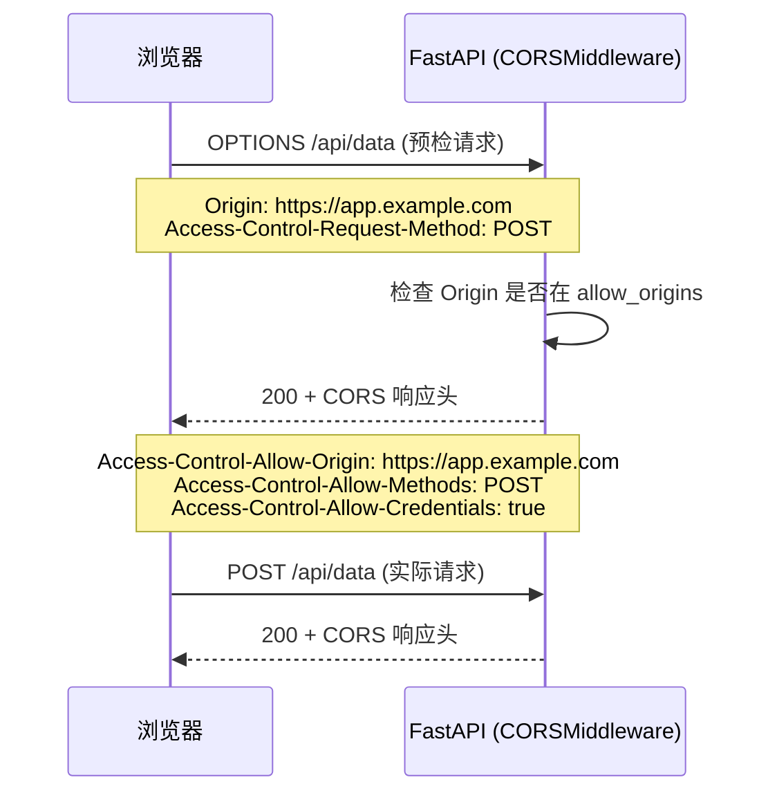

**CORSMiddleware 配置参数**：

| 参数 | 类型 | 说明 | 安全建议 |
|------|------|------|---------|
| `allow_origins` | list[str] | 允许的源（域名） | 不要用 `["*"]` + credentials |
| `allow_credentials` | bool | 是否允许携带 Cookie | 生产环境 True |
| `allow_methods` | list[str] | 允许的 HTTP 方法 | 列出实际需要的方法 |
| `allow_headers` | list[str] | 允许的请求头 | `["*"]` 或具体列表 |
| `expose_headers` | list[str] | 前端可读取的响应头 | 自定义头需列出 |
| `max_age` | int | 预检请求缓存秒数 | 600（10分钟） |

> 🎯 面试高频：为什么 `allow_origins=["*"]` 和 `allow_credentials=True` 不能同时使用？因为 CORS 规范规定，当 `Access-Control-Allow-Credentials: true` 时，`Access-Control-Allow-Origin` 不能是通配符 `*`，必须是具体的源。这是安全限制——如果允许任意源携带凭据，任何网站都可以冒充用户发起请求（CSRF 风险）。需要凭据时必须列出具体的源域名。

#### 代码示例

**示例 1：基础 CORS 配置**

```python
from fastapi import FastAPI
from fastapi.middleware.cors import CORSMiddleware

app = FastAPI()

app.add_middleware(
    CORSMiddleware,
    allow_origins=["http://localhost:3000", "https://app.example.com"],
    allow_credentials=True,
    allow_methods=["GET", "POST", "PUT", "PATCH", "DELETE"],
    allow_headers=["*"],
)

@app.get("/api/data")
async def get_data():
    return {"data": "cross-origin data"}

# 前端 https://app.example.com 可以正常请求
# 前端 https://evil.com 会被浏览器拦截
```

预期运行结果：白名单内的源可以跨域请求，其他源被浏览器拦截。

**示例 2：开发环境 vs 生产环境 CORS 配置**

```python
from fastapi import FastAPI
from fastapi.middleware.cors import CORSMiddleware
import os

app = FastAPI()

# 根据环境配置不同的 CORS 策略
if os.getenv("ENV") == "production":
    # 生产环境：严格白名单
    origins = ["https://app.example.com", "https://admin.example.com"]
    allow_credentials = True
else:
    # 开发环境：允许所有本地端口
    origins = [
        "http://localhost:3000", "http://localhost:5173",
        "http://127.0.0.1:3000", "http://127.0.0.1:5173",
    ]
    allow_credentials = True

app.add_middleware(
    CORSMiddleware,
    allow_origins=origins,
    allow_credentials=allow_credentials,
    allow_methods=["*"],
    allow_headers=["*"],
    expose_headers=["X-Request-ID", "X-Process-Time"],
    max_age=600,
)
```

预期运行结果：开发环境允许多个本地端口，生产环境只允许正式域名。

**示例 3：完整场景——动态 Origin 验证（正则匹配）**

```python
from fastapi import FastAPI, Request
from fastapi.middleware.cors import CORSMiddleware
from fastapi.responses import JSONResponse
import re

app = FastAPI()

# 允许的源正则模式
ALLOWED_ORIGIN_PATTERNS = [
    r"^https://.*\.example\.com$",      # 所有 example.com 子域名
    r"^http://localhost:\d+$",           # 本地开发
]

def is_origin_allowed(origin: str) -> bool:
    """动态检查 Origin 是否匹配允许的模式"""
    return any(re.match(pattern, origin) for pattern in ALLOWED_ORIGIN_PATTERNS)

# 先用 CORSMiddleware 处理标准 CORS
app.add_middleware(
    CORSMiddleware,
    allow_origins=["https://app.example.com"],  # 基础白名单
    allow_credentials=True,
    allow_methods=["*"],
    allow_headers=["*"],
)

# 额外的中间件处理动态 Origin（子域名通配）
@app.middleware("http")
async def dynamic_cors(request: Request, call_next):
    origin = request.headers.get("origin")
    response = await call_next(request)
    if origin and is_origin_allowed(origin):
        response.headers["Access-Control-Allow-Origin"] = origin
        response.headers["Access-Control-Allow-Credentials"] = "true"
        response.headers["Vary"] = "Origin"
    return response

@app.get("/api/data")
async def get_data():
    return {"data": "dynamic CORS"}

# https://subdomain.example.com 可以访问（正则匹配）
# https://app.example.com 可以访问（白名单）
# https://evil.com 被拦截
```

预期运行结果：支持子域名通配的动态 CORS，同时保留标准 CORSMiddleware 的预检处理。

#### 使用场景与最佳实践

**适用场景**：前后端分离项目（前端域名 ≠ API 域名）；第三方前端集成；多前端应用（用户端 + 管理端）调用同一 API。

**不适用场景**：同域名部署（前端和 API 在同一域名下，不需要 CORS）；纯后端服务间调用（不受浏览器 CORS 限制）。

**最佳实践**：
1. 生产环境用具体域名白名单，不要用 `["*"]`
2. `allow_credentials=True` 时不能用 `allow_origins=["*"]`
3. 列出实际需要的 `allow_methods`，不要一律 `["*"]`
4. 自定义响应头（X-Request-ID 等）需在 `expose_headers` 中列出，否则前端读不到
5. CORS 中间件注册在最外层（最先 add_middleware）
6. 开发环境和生产环境用不同配置
7. 设置 `max_age=600` 缓存预检请求，减少 OPTIONS 请求

**性能建议**：OPTIONS 预检请求每个跨域请求都会触发（除非缓存）。设置 `max_age` 让浏览器缓存预检结果，减少 OPTIONS 请求。CDN 层也可以缓存 OPTIONS 响应。

#### 常见坑点

**坑点 1：allow_origins=["*"] + allow_credentials=True 不生效**

- 错误现象：配置了 `allow_origins=["*"]` 和 `allow_credentials=True`，但跨域请求仍失败
- 根本原因：CORS 规范不允许凭据 + 通配符 Origin 的组合
- 正确做法：需要凭据时列出具体源：`allow_origins=["https://app.example.com"]`
- 预防措施：团队约定生产环境 CORS 配置必须用具体域名

**坑点 2：自定义响应头前端读不到**

- 错误现象：响应头中有 `X-Request-ID`，但前端 `response.headers.get("X-Request-ID")` 返回 null
- 根本原因：CORS 规范中，只有 `Cache-Control`、`Content-Language`、`Content-Type`、`Expires`、`Last-Modified`、`Pragma` 是默认暴露的，自定义头需在 `expose_headers` 中列出
- 正确做法：`expose_headers=["X-Request-ID", "X-Process-Time"]`
- 预防措施：所有自定义响应头都在 expose_headers 中声明

---

### 3.2 GZipMiddleware 响应压缩

#### 概念解释

**GZipMiddleware 自动对响应体进行 GZIP 压缩，减少网络传输量，提升加载速度。** 当客户端发送 `Accept-Encoding: gzip` 请求头且响应体超过阈值时，中间件自动压缩响应体并设置 `Content-Encoding: gzip`。

打个比方：GZip 中间件像快递的真空压缩袋——发货前（响应发送前）把蓬松的物品（大 JSON 响应）抽真空压缩，到达后收件人（浏览器）自动解压。小物品（小响应）不值得压缩，直接发走。

**核心价值**：一行配置实现响应压缩，减少 60-80% 的网络传输量，对大响应（列表查询、报表数据）效果显著。

#### 原理说明：GZip 压缩流程

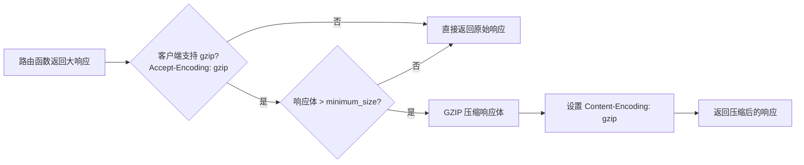

**GZipMiddleware 配置**：

| 参数 | 类型 | 默认值 | 说明 |
|------|------|--------|------|
| `minimum_size` | int | 500 | 最小压缩字节数，小于此值不压缩 |

> 🎯 面试高频：GZip 中间件对哪些响应不压缩？① 客户端不支持 gzip（没有 Accept-Encoding: gzip）；② 响应体小于 minimum_size（默认 500 字节）；③ 已经设置了 Content-Encoding 的响应（避免重复压缩）；④ StreamingResponse 流式响应（GZip 会缓冲整个响应，破坏流式传输，需要排除或用其他方式）。

#### 代码示例

**示例 1：基础 GZip 配置**

```python
from fastapi import FastAPI
from fastapi.middleware.gzip import GZipMiddleware

app = FastAPI()

# 响应体超过 1000 字节时自动 GZIP 压缩
app.add_middleware(GZipMiddleware, minimum_size=1000)

@app.get("/large-data")
async def large_data():
    """返回大量数据，会被自动压缩"""
    return {"items": [{"id": i, "name": f"item-{i}"} for i in range(10000)]}

# 响应体原始大小约 500KB，压缩后约 50KB（减少 90%）
# 响应头：Content-Encoding: gzip
```

预期运行结果：大响应自动 GZIP 压缩，浏览器自动解压，网络传输量大幅减少。

**示例 2：GZip 与 SSE 流式响应的冲突与解决**

```python
from fastapi import FastAPI
from fastapi.middleware.gzip import GZipMiddleware
from fastapi.responses import StreamingResponse
import asyncio
import json

app = FastAPI()
app.add_middleware(GZipMiddleware, minimum_size=1000)

@app.get("/sse")
async def sse_endpoint():
    """SSE 流式响应：GZip 会缓冲整个响应，破坏流式传输"""
    async def event_generator():
        for i in range(10):
            yield f"data: {json.dumps({'i': i})}\n\n"
            await asyncio.sleep(0.5)

    return StreamingResponse(
        event_generator(),
        media_type="text/event-stream",
        headers={
            "Cache-Control": "no-cache",
            "Connection": "keep-alive",
            "X-Accel-Buffering": "no",  # 禁用 Nginx 缓冲
        },
    )

# 问题：GZipMiddleware 会缓冲 SSE 响应，导致客户端收不到实时数据
# 解决方案：对 SSE 端点排除 GZip，或在响应头中设置 Content-Encoding 跳过压缩
```

预期运行结果：SSE 端点需要特殊处理，避免 GZip 缓冲破坏流式传输。

**示例 3：完整场景——条件压缩（排除特定路径）**

```python
from fastapi import FastAPI, Request
from fastapi.middleware.gzip import GZipMiddleware
from fastapi.responses import StreamingResponse
from starlette.middleware.base import BaseHTTPMiddleware
import gzip
import io

app = FastAPI()

# 不需要压缩的路径前缀
EXCLUDE_GZIP_PATHS = ["/sse/", "/stream/", "/download/"]

class ConditionalGZipMiddleware(BaseHTTPMiddleware):
    """条件 GZip 中间件：排除流式响应路径"""
    def __init__(self, app, minimum_size: int = 1000):
        super().__init__(app)
        self.minimum_size = minimum_size

    async def dispatch(self, request: Request, call_next):
        response = await call_next(request)

        # 排除流式路径
        if any(request.url.path.startswith(p) for p in EXCLUDE_GZIP_PATHS):
            return response

        # 排除已有 Content-Encoding 的响应
        if "content-encoding" in response.headers:
            return response

        # 检查客户端是否支持 gzip
        if "gzip" not in request.headers.get("accept-encoding", ""):
            return response

        # 读取并压缩响应体
        body = b""
        async for chunk in response.body_iterator:
            body += chunk

        if len(body) < self.minimum_size:
            # 太小不压缩，重新构造响应
            return StreamingResponse(iter([body]), headers=dict(response.headers))

        compressed = gzip.compress(body)
        response.headers["Content-Encoding"] = "gzip"
        response.headers["Content-Length"] = str(len(compressed))
        return StreamingResponse(iter([compressed]), headers=dict(response.headers))

app.add_middleware(ConditionalGZipMiddleware, minimum_size=1000)
```

预期运行结果：普通大响应自动压缩，SSE/流式/下载路径排除压缩，兼顾压缩效果和流式功能。

#### 使用场景与最佳实践

**适用场景**：返回大 JSON 的列表/查询接口；文本类响应（HTML/JSON/XML）；带宽有限的移动网络；CDN 回源压缩。

**不适用场景**：已经压缩的二进制文件（图片/视频/ZIP，再压缩无效果反而耗 CPU）；SSE 流式响应（压缩会缓冲破坏实时性）；小响应（< 1KB，压缩开销大于收益）。

**最佳实践**：
1. 设置 `minimum_size=1000`（或 500），小响应不压缩
2. SSE/流式端点排除 GZip（用条件中间件或 Nginx 层处理）
3. GZip 注册在 CORS 之后、自定义中间件之前
4. CDN 层也可以开启压缩（Brotli 比 GZip 更好）
5. 监控压缩率（原始大小 vs 压缩后大小），评估效果

**性能建议**：GZIP 压缩消耗 CPU，对 CPU 密集型服务注意监控 CPU 使用率。Brotli 压缩率比 GZip 高 15-20%，但压缩更慢，适合 CDN 层预压缩。FastAPI 只内置 GZip，Brotli 需第三方中间件或 Nginx。

#### 常见坑点

**坑点 1：GZip 导致 SSE 流式响应不工作**

- 错误现象：SSE 端点配置 GZip 后，客户端收不到实时数据，连接结束后才一次性收到所有数据
- 根本原因：GZipMiddleware 需要读取完整响应体才能压缩，会缓冲整个流式响应
- 正确做法：对 SSE 端点排除 GZip（条件中间件），或在 Nginx 层对 `text/event-stream` 禁用压缩和缓冲
- 预防措施：项目中有 SSE/流式接口时，用条件 GZip 中间件而非全局 GZipMiddleware

**坑点 2：已经压缩的响应被二次压缩**

- 错误现象：响应体变成乱码，浏览器无法解压
- 根本原因：上游已经设置了 `Content-Encoding: gzip`，GZipMiddleware 又压缩了一次
- 正确做法：GZipMiddleware 会检查已有 Content-Encoding 并跳过（标准实现），但自定义中间件需要自己检查
- 预防措施：自定义压缩中间件时检查 `content-encoding` 响应头

---

### 3.3 TrustedHostMiddleware 与 HTTPSRedirectMiddleware

#### 概念解释

**TrustedHostMiddleware 验证请求的 Host 头是否在允许列表中，防止 Host 头攻击；HTTPSRedirectMiddleware 将所有 HTTP 请求重定向到 HTTPS。** 两者都是生产环境的安全基础中间件。

打个比方：TrustedHostMiddleware 像公司的前台——只允许信封上写着公司地址（合法 Host）的邮件进入，写着其他地址的（伪造 Host 头）直接退回。HTTPSRedirectMiddleware 像保安——看到有人走不安全的侧门（HTTP），引导他走正门（HTTPS）。

**核心价值**：一行配置防止 Host 头攻击和 HTTP 明文传输，是生产环境安全的基础配置。

#### 原理说明：Host 头攻击与防护

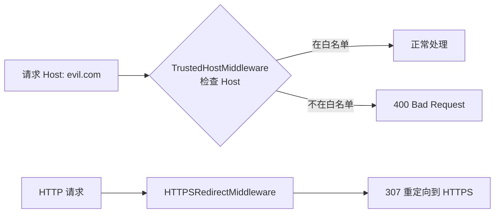

**配置参数**：

| 中间件 | 参数 | 说明 |
|--------|------|------|
| TrustedHostMiddleware | `allowed_hosts` | 允许的 Host 列表，支持 `*.example.com` 通配 |
| HTTPSRedirectMiddleware | 无 | 所有 HTTP 请求 307 重定向到 HTTPS |

> 🎯 面试高频：什么是 Host 头攻击？攻击者伪造请求的 Host 头（如 `Host: evil.com`），如果应用基于 Host 生成 URL（如密码重置链接），攻击者可以诱导用户点击恶意链接。TrustedHostMiddleware 通过白名单验证 Host 头，非法 Host 返回 400，防止此类攻击。生产环境必须配置。

#### 代码示例

**示例 1：TrustedHostMiddleware 配置**

```python
from fastapi import FastAPI
from fastapi.middleware.trustedhost import TrustedHostMiddleware

app = FastAPI()

# 只允许指定 Host，其他返回 400
app.add_middleware(
    TrustedHostMiddleware,
    allowed_hosts=["api.example.com", "*.example.com", "localhost"],
)

@app.get("/")
async def root():
    return {"message": "ok"}

# Host: api.example.com → 200
# Host: sub.example.com → 200（通配匹配）
# Host: evil.com → 400 Bad Request
# Host: localhost → 200（开发环境）
```

预期运行结果：合法 Host 正常处理，非法 Host 返回 400。

**示例 2：HTTPSRedirectMiddleware 配置**

```python
from fastapi import FastAPI
from fastapi.middleware.httpsredirect import HTTPSRedirectMiddleware

app = FastAPI()

# 所有 HTTP 请求重定向到 HTTPS
app.add_middleware(HTTPSRedirectMiddleware)

@app.get("/")
async def root():
    return {"message": "secure"}

# http://api.example.com/ → 307 Redirect → https://api.example.com/
# https://api.example.com/ → 200
```

预期运行结果：HTTP 请求自动 307 重定向到 HTTPS。

> 🎯 面试高频：HTTPSRedirectMiddleware 为什么用 307 而不是 301/302？307 Temporary Redirect 要求重定向时保持请求方法和请求体不变（POST 仍然是 POST），而 301/302 可能被浏览器改为 GET。对于 API 服务，保持方法不变很重要。此外 307 是临时重定向，不会被浏览器永久缓存。

**示例 3：完整场景——生产环境安全中间件组合**

```python
from fastapi import FastAPI
from fastapi.middleware.trustedhost import TrustedHostMiddleware
from fastapi.middleware.httpsredirect import HTTPSRedirectMiddleware
from fastapi.middleware.cors import CORSMiddleware
from fastapi.middleware.gzip import GZipMiddleware
from starlette.middleware.base import BaseHTTPMiddleware
from starlette.requests import Request
from starlette.responses import Response

app = FastAPI(title="安全 API")

# 安全响应头中间件（Security Headers）
class SecurityHeadersMiddleware(BaseHTTPMiddleware):
    async def dispatch(self, request: Request, call_next):
        response = await call_next(request)
        response.headers["X-Content-Type-Options"] = "nosniff"
        response.headers["X-Frame-Options"] = "DENY"
        response.headers["X-XSS-Protection"] = "1; mode=block"
        response.headers["Strict-Transport-Security"] = "max-age=63072000; includeSubDomains"
        response.headers["Content-Security-Policy"] = "default-src 'self'"
        response.headers["Referrer-Policy"] = "strict-origin-when-cross-origin"
        return response

# 生产环境安全中间件链（按顺序）
# 1. TrustedHost（最外层，防 Host 攻击）
app.add_middleware(TrustedHostMiddleware, allowed_hosts=["api.example.com", "*.example.com"])
# 2. HTTPS 重定向（生产环境）
app.add_middleware(HTTPSRedirectMiddleware)
# 3. 安全响应头
app.add_middleware(SecurityHeadersMiddleware)
# 4. CORS
app.add_middleware(CORSMiddleware, allow_origins=["https://app.example.com"], allow_credentials=True, allow_methods=["*"], allow_headers=["*"])
# 5. GZip
app.add_middleware(GZipMiddleware, minimum_size=1000)

@app.get("/health")
async def health():
    return {"status": "secure"}

# 所有响应包含安全头：X-Content-Type-Options, X-Frame-Options, HSTS, CSP 等
# HTTP 请求自动重定向 HTTPS
# 非法 Host 返回 400
```

预期运行结果：生产级安全配置——Host 验证、HTTPS 强制、安全响应头、CORS、GZip 五层防护。

#### 使用场景与最佳实践

**适用场景**：所有生产环境 API；面向公网的服务；需要合规（等保/PCI）的应用。

**不适用场景**：本地开发（localhost 不需要 HTTPS 和 Host 验证）；内部服务（在内网防火墙后，可简化）。

**最佳实践**：
1. 生产环境必须配置 TrustedHostMiddleware，allowed_hosts 列出真实域名
2. 生产环境必须配置 HTTPSRedirectMiddleware（或在 Nginx/负载均衡层处理）
3. 添加安全响应头中间件（HSTS、CSP、X-Frame-Options 等）
4. TrustedHost 注册在最外层（最先验证）
5. 开发环境跳过 HTTPSRedirect（本地用 HTTP）
6. HSTS max-age 建议 63072000（2年），含 includeSubDomains

**性能建议**：这些安全中间件开销极小（< 0.1ms），不影响性能。HTTPS 重定向是 307 响应，客户端会缓存，后续直接用 HTTPS。

#### 常见坑点

**坑点 1：HTTPSRedirectMiddleware 在反向代理后不生效**

- 错误现象：Nginx 做 SSL 终止后，FastAPI 收到的是 HTTP 请求，HTTPSRedirectMiddleware 无限重定向
- 根本原因：Nginx 解密 HTTPS 后用 HTTP 转发给 FastAPI，FastAPI 看到的是 HTTP，重定向到 HTTPS，Nginx 又转发 HTTP，无限循环
- 正确做法：在 Nginx 层做 HTTPS 重定向，FastAPI 不配置 HTTPSRedirectMiddleware；或配置 Nginx 传递 `X-Forwarded-Proto: https`，FastAPI 信任代理头
- 预防措施：有反向代理时，HTTPS 重定向在代理层处理，应用层信任代理头

**坑点 2：TrustedHostMiddleware 导致健康检查失败**

- 错误现象：K8s 用 Pod IP 做健康检查（Host: 10.0.0.1:8000），TrustedHostMiddleware 返回 400，Pod 被标记不健康
- 根本原因：Pod IP 不在 allowed_hosts 列表中
- 正确做法：健康检查端点在 TrustedHost 之前处理，或 allowed_hosts 包含 Pod IP/`*`（不推荐），或 K8s 用 `httpHeaders` 设置 Host
- 预防措施：配置 K8s readiness probe 的 `httpHeaders` 设置合法 Host，或健康检查走单独的端口/路径

---

## 四、第三方中间件集成

### 4.1 常用第三方中间件

#### 概念解释

**第三方中间件是社区开发的 FastAPI/Starlette 兼容中间件，提供限流、Prometheus 监控、Sentry 错误追踪、请求 ID、会话管理等功能。** 它们遵循 ASGI 中间件协议，可以像内置中间件一样通过 `app.add_middleware()` 集成。

打个比方：内置中间件像手机自带的基础应用（电话、短信、相机），第三方中间件像 App Store 下载的应用（支付宝、微信、导航）——手机系统（FastAPI）提供了安装接口（add_middleware），开发者可以按需安装丰富的功能。

**核心价值**：第三方中间件让开发者无需重复造轮子，一行集成限流、监控、错误追踪等生产级功能。

#### 原理说明：第三方中间件的集成方式

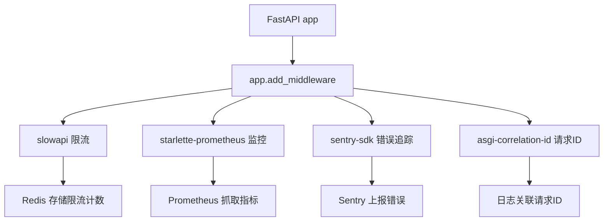

**常用第三方中间件清单**：

| 中间件 | 功能 | 安装 | 适用场景 |
|--------|------|------|---------|
| `slowapi` | 限流（固定窗口/滑动窗口/令牌桶） | `pip install slowapi` | 公开 API 防滥用 |
| `starlette-prometheus` | Prometheus 指标 | `pip install starlette-prometheus` | 监控 QPS/延迟 |
| `sentry-sdk` | 错误追踪 | `pip install sentry-sdk` | 生产错误监控 |
| `asgi-correlation-id` | 请求 ID 注入 | `pip install asgi-correlation-id` | 链路追踪 |
| `fastapi-limiter` | 基于 Redis 的限流 | `pip install fastapi-limiter` | 分布式限流 |
| `python-multipart` | 表单解析（依赖） | `pip install python-multipart` | 文件上传必需 |

> 🎯 面试高频：slowapi 和 fastapi-limiter 的区别？slowapi 是内存限流（单进程有效，多 worker 不共享计数），适合单实例部署；fastapi-limiter 基于 Redis（分布式限流，多 worker 共享计数），适合生产多实例部署。生产环境推荐 fastapi-limiter 或自己实现 Redis 限流中间件。

#### 代码示例

**示例 1：slowapi 限流中间件**

```python
from fastapi import FastAPI, Request
from slowapi import Limiter, _rate_limit_exceeded_handler
from slowapi.util import get_remote_address
from slowapi.errors import RateLimitExceeded

app = FastAPI()

# 基于 IP 的限流器
limiter = Limiter(key_func=get_remote_address)
app.state.limiter = limiter
app.add_exception_handler(RateLimitExceeded, _rate_limit_exceeded_handler)

@app.get("/api/public")
@limiter.limit("5/minute")  # 每分钟最多 5 次
async def public_api(request: Request):
    return {"data": "public data"}

@app.get("/api/expensive")
@limiter.limit("10/hour")  # 每小时最多 10 次
async def expensive_api(request: Request):
    return {"data": "expensive computation result"}

# 超过限流 → 429 Too Many Requests
# 注意：slowapi 是内存限流，多 worker 下每个进程独立计数
```

预期运行结果：基于 IP 的限流，超过阈值返回 429。

**示例 2：Prometheus 监控中间件**

```python
from fastapi import FastAPI
from starlette_prometheus import PrometheusMiddleware, metrics

app = FastAPI()

# 添加 Prometheus 指标中间件
app.add_middleware(PrometheusMiddleware, app_name="my_api")

# 暴露 /metrics 端点供 Prometheus 抓取
app.add_route("/metrics", metrics)

@app.get("/users/")
async def list_users():
    return {"users": []}

# 指标包括：
# - http_requests_total（请求总数，按 method/path/status 标签）
# - http_request_duration_seconds（请求延迟直方图）
# - http_requests_in_progress（正在处理的请求数）
# Prometheus 配置：scrape_configs: - job_name: 'api' static_configs: - targets: ['api:8000']
```

预期运行结果：自动收集 HTTP 请求指标，`/metrics` 端点暴露 Prometheus 格式数据。

**示例 3：完整场景——Sentry + 请求 ID + 限流组合**

```python
import os
import sentry_sdk
from fastapi import FastAPI, Request
from fastapi.responses import JSONResponse
from starlette.middleware.base import BaseHTTPMiddleware
import uuid
import time

# 1. Sentry 初始化（错误追踪）
sentry_sdk.init(
    dsn=os.getenv("SENTRY_DSN"),
    traces_sample_rate=0.1,  # 10% 采样率
    environment=os.getenv("ENV", "development"),
)

app = FastAPI(title="生产级 API")

# 2. 请求 ID 中间件（含 Sentry 关联）
class RequestIDMiddleware(BaseHTTPMiddleware):
    async def dispatch(self, request: Request, call_next):
        request_id = request.headers.get("X-Request-ID", str(uuid.uuid4())[:8])
        request.state.request_id = request_id

        # 将 request_id 关联到 Sentry
        with sentry_sdk.configure_scope() as scope:
            scope.set_tag("request_id", request_id)

        start = time.time()
        try:
            response = await call_next(request)
        except Exception as e:
            # 异常自动上报 Sentry，附带 request_id
            sentry_sdk.capture_exception(e)
            raise
        duration = (time.time() - start) * 1000
        response.headers["X-Request-ID"] = request_id
        response.headers["X-Process-Time"] = f"{duration:.0f}ms"
        return response

app.add_middleware(RequestIDMiddleware)

# 3. 简单限流中间件（内存版）
class SimpleRateLimitMiddleware(BaseHTTPMiddleware):
    def __init__(self, app, max_requests: int = 100, window: int = 60):
        super().__init__(app)
        self.max_requests = max_requests
        self.window = window
        self.requests: dict[str, list[float]] = {}

    async def dispatch(self, request: Request, call_next):
        ip = request.client.host if request.client else "unknown"
        now = time.time()
        self.requests[ip] = [t for t in self.requests.get(ip, []) if now - t < self.window]
        if len(self.requests[ip]) >= self.max_requests:
            return JSONResponse(status_code=429, content={"detail": "请求过于频繁"})
        self.requests[ip].append(now)
        return await call_next(request)

app.add_middleware(SimpleRateLimitMiddleware, max_requests=100, window=60)

@app.get("/api/data")
async def get_data():
    return {"data": "monitored and protected"}

# 每个请求：生成请求ID → Sentry关联 → 限流检查 → 业务逻辑 → 响应头注入ID和耗时
# 异常自动上报 Sentry，可通过 request_id 关联日志和错误
```

预期运行结果：Sentry 错误追踪、请求 ID 链路追踪、限流三层保护，请求 ID 贯穿日志和错误追踪。

#### 使用场景与最佳实践

**适用场景**：生产环境公开 API；需要监控和告警的服务；高并发需要限流的接口；需要错误追踪的应用。

**不适用场景**：内部工具（不需要限流和监控）；原型验证（简化配置）。

**最佳实践**：
1. 生产环境必须集成错误追踪（Sentry 或类似）
2. 公开 API 必须有限流（slowapi 单实例 / fastapi-limiter 分布式）
3. Prometheus 指标 + Grafana 仪表盘是可观测性基础
4. 请求 ID 中间件与 Sentry/日志关联，实现全链路追踪
5. 第三方中间件注意版本兼容性（Starlette 版本）
6. 限流用 Redis 后端（fastapi-limiter），不要用内存版（多 worker 不准）

**性能建议**：Sentry 的 traces_sample_rate 不要设 1.0（全采样），生产环境 0.1-0.3 足够，减少性能开销。Prometheus 中间件开销极小（计数器递增）。限流中间件的 Redis 查询增加 1-2ms 延迟，可接受。

#### 常见坑点

**坑点 1：slowapi 内存限流在多 worker 下不准**

- 错误现象：配置了 `5/minute` 限流，但 gunicorn 4 worker 下实际可以发 20 次/分钟
- 根本原因：slowapi 默认内存存储，每个 worker 进程独立计数
- 正确做法：用 fastapi-limiter（Redis 后端）或自己实现 Redis 限流中间件
- 预防措施：生产多实例部署一律用分布式限流（Redis）

**坑点 2：Sentry DSN 硬编码在代码中**

- 错误现象：Sentry DSN 提交到 Git 仓库，任何人都可以往你的 Sentry 项目发错误
- 根本原因：DSN 是半敏感信息，不应硬编码
- 正确做法：从环境变量读取 `SENTRY_DSN`，开发环境不初始化 Sentry
- 预防措施：所有密钥/DSN 从环境变量读取，`.env` 文件加入 `.gitignore`

---

### 4.2 自定义中间件的高级模式

#### 概念解释

**自定义中间件的高级模式包括：中间件组合、条件中间件、基于路径的中间件、中间件依赖注入、中间件测试等。** 掌握这些模式可以构建复杂但可维护的中间件体系。

打个比方：基础中间件像单件工具（锤子、螺丝刀），高级模式像工具箱组合——可以根据任务（路径/环境）选择不同工具组合（条件中间件），可以串联多个工具完成复杂任务（中间件组合），还可以定期检查工具是否正常（中间件测试）。

**核心价值**：高级模式让中间件体系灵活可配置，适应复杂的生产需求（不同路径不同策略、多环境配置、可测试性）。

#### 原理说明：中间件高级模式架构

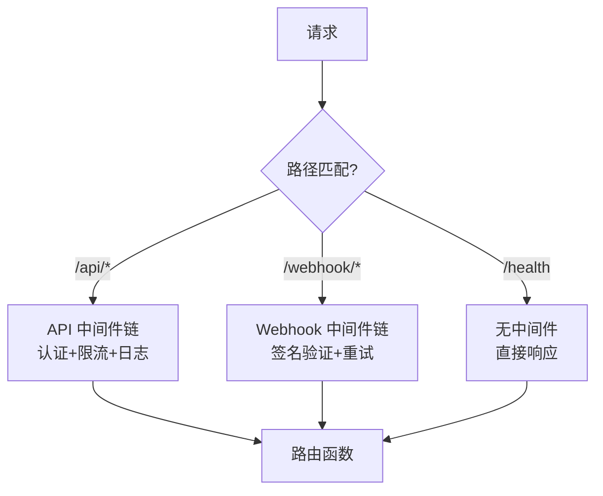

**高级模式清单**：

| 模式 | 说明 | 适用场景 |
|------|------|---------|
| 中间件组合 | 多个中间件串联 | 日志+限流+请求ID |
| 条件中间件 | 根据路径/方法选择性执行 | API 路径限流，静态路径不限流 |
| 可配置中间件 | `__init__` 接收参数 | 不同环境不同限流阈值 |
| 中间件测试 | 用 TestClient 测试中间件行为 | 确保中间件正确 |
| 中间件基类 | 项目统一基类 | 团队规范 |

> 🎯 面试高频：如何对特定路径排除中间件？在中间件的 dispatch 方法中检查 `request.url.path`，如果匹配排除列表直接 `return await call_next(request)` 跳过逻辑。注意：这只是跳过中间件逻辑，请求仍然经过中间件（只是不执行 before/after）。真正的路径级中间件需要用 APIRouter 的 dependencies（但那是依赖注入，不是中间件）。

#### 代码示例

**示例 1：基于路径的条件中间件**

```python
from starlette.middleware.base import BaseHTTPMiddleware
from starlette.requests import Request

class PathBasedMiddleware(BaseHTTPMiddleware):
    """基于路径的条件中间件：只对特定路径执行逻辑"""
    def __init__(self, app, include_paths: list[str], exclude_paths: list[str] = None):
        super().__init__(app)
        self.include_paths = include_paths
        self.exclude_paths = exclude_paths or []

    def should_process(self, path: str) -> bool:
        if any(path.startswith(p) for p in self.exclude_paths):
            return False
        if any(path.startswith(p) for p in self.include_paths):
            return True
        return False

    async def dispatch(self, request: Request, call_next):
        if not self.should_process(request.url.path):
            return await call_next(request)  # 跳过，直接转发

        # 只对 include_paths 执行逻辑
        print(f"中间件处理: {request.url.path}")
        response = await call_next(request)
        response.headers["X-Custom"] = "processed"
        return response

# 使用：只对 /api/ 路径处理，排除 /api/health
app.add_middleware(
    PathBasedMiddleware,
    include_paths=["/api/"],
    exclude_paths=["/api/health", "/metrics"],
)
```

预期运行结果：`/api/users` 经过中间件处理，`/api/health` 和 `/metrics` 跳过。

**示例 2：可配置的中间件基类**

```python
from starlette.middleware.base import BaseHTTPMiddleware
from starlette.requests import Request
import logging
import time

class BaseMiddleware(BaseHTTPMiddleware):
    """项目统一中间件基类：提供日志、异常处理、配置"""
    def __init__(self, app, name: str = "middleware", enabled: bool = True):
        super().__init__(app)
        self.name = name
        self.enabled = enabled
        self.logger = logging.getLogger(f"middleware.{name}")

    async def before(self, request: Request):
        """子类重写：请求前逻辑"""
        pass

    async def after(self, request: Request, response):
        """子类重写：响应后逻辑"""
        pass

    async def dispatch(self, request: Request, call_next):
        if not self.enabled:
            return await call_next(request)

        start = time.time()
        try:
            await self.before(request)
            response = await call_next(request)
            await self.after(request, response)
            return response
        except Exception as e:
            self.logger.error(f"[{self.name}] 中间件异常: {e}", exc_info=True)
            raise
        finally:
            duration = (time.time() - start) * 1000
            self.logger.debug(f"[{self.name}] 耗时: {duration:.1f}ms")

# 子类：计时中间件
class TimingMiddleware(BaseMiddleware):
    async def after(self, request: Request, response):
        duration = getattr(request.state, "start_time", 0)
        response.headers["X-Process-Time"] = f"{(time.time()-duration)*1000:.0f}ms"

    async def before(self, request: Request):
        request.state.start_time = time.time()

# 子类：请求 ID 中间件
class RequestIDMiddleware(BaseMiddleware):
    def __init__(self, app, header_name: str = "X-Request-ID"):
        super().__init__(app, name="request_id")
        self.header_name = header_name

    async def before(self, request: Request):
        import uuid
        request.state.request_id = request.headers.get(self.header_name, str(uuid.uuid4())[:8])

    async def after(self, request: Request, response):
        response.headers[self.header_name] = request.state.request_id

# 使用
app.add_middleware(TimingMiddleware, name="timing", enabled=True)
app.add_middleware(RequestIDMiddleware, header_name="X-Request-ID")
```

预期运行结果：统一基类提供日志、异常处理、开关控制，子类只需实现 before/after，代码复用且规范。

**示例 3：中间件的单元测试**

```python
# test_middleware.py
from fastapi import FastAPI
from fastapi.testclient import TestClient
from starlette.middleware.base import BaseHTTPMiddleware
from starlette.requests import Request

class TestMiddleware(BaseHTTPMiddleware):
    async def dispatch(self, request: Request, call_next):
        request.state.custom_value = "injected"
        response = await call_next(request)
        response.headers["X-Test"] = "passed"
        return response

def test_middleware_injects_state():
    """测试中间件注入 request.state"""
    app = FastAPI()
    app.add_middleware(TestMiddleware)

    @app.get("/test")
    async def test_endpoint(request: Request):
        return {"value": request.state.custom_value}

    client = TestClient(app)
    response = client.get("/test")
    assert response.status_code == 200
    assert response.json()["value"] == "injected"
    assert response.headers["X-Test"] == "passed"

def test_middleware_short_circuit():
    """测试中间件直接返回响应（不进入路由）"""
    class BlockMiddleware(BaseHTTPMiddleware):
        async def dispatch(self, request: Request, call_next):
            from fastapi.responses import JSONResponse
            if request.url.path == "/blocked":
                return JSONResponse(status_code=403, content={"detail": "blocked"})
            return await call_next(request)

    app = FastAPI()
    app.add_middleware(BlockMiddleware)

    @app.get("/blocked")
    async def blocked():
        return {"should": "not reach here"}

    client = TestClient(app)
    response = client.get("/blocked")
    assert response.status_code == 403
    assert response.json()["detail"] == "blocked"

def test_middleware_order():
    """测试中间件执行顺序"""
    order = []
    class MW(BaseHTTPMiddleware):
        def __init__(self, app, name):
            super().__init__(app)
            self.name = name
        async def dispatch(self, request, call_next):
            order.append(f"{self.name}_before")
            response = await call_next(request)
            order.append(f"{self.name}_after")
            return response

    app = FastAPI()
    app.add_middleware(MW, name="inner")
    app.add_middleware(MW, name="outer")

    @app.get("/")
    async def root():
        order.append("route")
        return {"ok": True}

    client = TestClient(app)
    client.get("/")
    assert order == ["outer_before", "inner_before", "route", "inner_after", "outer_after"]
```

预期运行结果：中间件可以通过 TestClient 测试注入、短路、执行顺序等行为，确保中间件逻辑正确。

#### 使用场景与最佳实践

**适用场景**：复杂中间件体系；多环境配置；团队协作需要统一规范；需要测试中间件行为。

**不适用场景**：简单中间件（直接写即可）。

**最佳实践**：
1. 项目定义统一的中间件基类，提供日志、异常处理、开关
2. 中间件用 `enabled` 参数控制开关，便于调试和多环境
3. 基于路径排除时用 `startswith` 匹配前缀
4. 中间件必须写单元测试（注入、短路、顺序、异常）
5. 中间件类放在 `app/middleware/` 目录，每个中间件一个文件
6. `__init__.py` 导出常用中间件，便于 main.py 导入

**性能建议**：中间件基类的日志和异常处理有轻微开销，高 QPS 场景可以用 `if self.logger.isEnabledFor(logging.DEBUG)` 包裹 debug 日志，避免不必要的字符串格式化。

#### 常见坑点

**坑点 1：中间件基类的 dispatch 中 raise 导致响应不发送**

- 错误现象：中间件 before 抛异常，客户端收到空白响应或连接重置
- 根本原因：异常在 call_next 之前抛出，没有构造 Response
- 正确做法：before 中的异常用 try/except 捕获，或确保异常被外层 ExceptionMiddleware 处理（如果中间件在内层）
- 预防措施：中间件 before 逻辑保持简单，不做可能失败的操作；需要失败时直接返回错误 Response

**坑点 2：测试中间件时 TestClient 的事件循环问题**

- 错误现象：测试含异步数据库的中间件时报 `RuntimeError: This event loop is already running`
- 根本原因：TestClient 内部管理事件循环，测试中的异步代码冲突
- 正确做法：用 `httpx.AsyncClient + ASGITransport` 替代 TestClient，或用 `pytest-asyncio`
- 预防措施：异步项目统一用 httpx.AsyncClient 做集成测试

---

## 五、HTTPException 与自定义异常

### 5.1 HTTPException 详解

#### 概念解释

**HTTPException 是 FastAPI/Starlette 提供的标准 HTTP 异常类，用于在业务逻辑中主动抛出带有状态码、错误消息和响应头的 HTTP 错误。** 它会被 ExceptionMiddleware 捕获并转换为 JSON 响应。

打个比方：HTTPException 像标准化的客诉单——厨师（路由函数）发现食材变质（业务错误），填写标准客诉单（HTTPException），写明问题类型（status_code）、详细描述（detail）、附加信息（headers），客诉中心（ExceptionMiddleware）按标准流程处理，不需要厨师自己跟顾客解释。

**核心价值**：HTTPException 提供标准化的错误抛出方式，状态码和消息分离，支持自定义响应头，被全局异常处理器统一管理。

#### 原理说明：HTTPException 的处理流程

```mermaid
graph LR
    A[raise HTTPException<br/>status_code=404 detail=...] --> B[ExceptionMiddleware 捕获]
    B --> C[查找 HTTPException 处理器]
    C --> D[默认处理器构造 JSONResponse]
    D --> E[{"detail": "..."}]
    E --> F[返回响应]
```

**HTTPException 参数**：

| 参数 | 类型 | 说明 | 示例 |
|------|------|------|------|
| `status_code` | int | HTTP 状态码 | `404` |
| `detail` | any | 错误详情（可以是 str/dict/list） | `"用户不存在"` |
| `headers` | dict | 自定义响应头 | `{"WWW-Authenticate": "Bearer"}` |

> 🎯 面试高频：HTTPException 的 detail 可以是哪些类型？可以是 str（简单消息）、dict（结构化错误）、list（多个错误）。FastAPI 默认处理器会将 detail 序列化为 JSON。例如 `raise HTTPException(status_code=400, detail=[{"field": "email", "error": "格式错误"}])` 会返回 `{"detail": [{"field": "email", "error": "格式错误"}]}`。自定义异常处理器可以改变响应格式。

> 🎯 面试高频：HTTPException 可以携带自定义响应头吗？可以。HTTPException 构造函数接受 headers 参数，如 raise HTTPException(status_code=401, detail="未授权", headers={"WWW-Authenticate": "Bearer"})。这在需要返回认证挑战（401 WWW-Authenticate）、限流提示（429 Retry-After）等场景非常有用。自定义头会被合并到响应中。

#### 代码示例

**示例 1：基础 HTTPException 用法**

```python
from fastapi import FastAPI, HTTPException, status

app = FastAPI()

items = {"1": "iPhone", "2": "MacBook"}

@app.get("/items/{item_id}")
async def get_item(item_id: str):
    if item_id not in items:
        raise HTTPException(
            status_code=status.HTTP_404_NOT_FOUND,
            detail=f"商品 {item_id} 不存在",
        )
    return {"id": item_id, "name": items[item_id]}

@app.post("/items/{item_id}/purchase")
async def purchase_item(item_id: str, quantity: int = 1):
    if item_id not in items:
        raise HTTPException(status_code=404, detail="商品不存在")
    if quantity > 10:
        raise HTTPException(
            status_code=status.HTTP_400_BAD_REQUEST,
            detail="单次购买不能超过 10 件",
        )
    return {"item": items[item_id], "quantity": quantity}

# GET /items/999 → 404 {"detail":"商品 999 不存在"}
# POST /items/1/purchase?quantity=20 → 400 {"detail":"单次购买不能超过 10 件"}
```

预期运行结果：HTTPException 自动转换为标准 JSON 错误响应。

**示例 2：HTTPException 带自定义响应头**

```python
from fastapi import FastAPI, HTTPException, status

app = FastAPI()

@app.get("/protected")
async def protected(auth: str = None):
    if not auth:
        raise HTTPException(
            status_code=status.HTTP_401_UNAUTHORIZED,
            detail="未认证",
            headers={"WWW-Authenticate": "Bearer"},  # 标准 401 响应头
        )
    if auth != "valid-token":
        raise HTTPException(
            status_code=status.HTTP_403_FORBIDDEN,
            detail="权限不足",
            headers={"X-Error-Code": "INSUFFICIENT_PERMISSION"},
        )
    return {"message": "访问成功"}

# 无 auth → 401, 响应头 WWW-Authenticate: Bearer
# auth=invalid → 403, 响应头 X-Error-Code: INSUFFICIENT_PERMISSION
```

预期运行结果：401 响应带标准 WWW-Authenticate 头，403 带自定义错误码头。

**示例 3：完整场景——结构化 detail 与异常链**

```python
from fastapi import FastAPI, HTTPException, status
from pydantic import BaseModel

app = FastAPI()

class OrderRequest(BaseModel):
    product_id: int
    quantity: int
    address: str

@app.post("/orders/")
async def create_order(order: OrderRequest):
    errors = []

    # 多字段校验，收集所有错误
    if order.product_id <= 0:
        errors.append({"field": "product_id", "error": "必须大于 0"})
    if order.quantity <= 0 or order.quantity > 100:
        errors.append({"field": "quantity", "error": "必须在 1-100 之间"})
    if len(order.address) < 5:
        errors.append({"field": "address", "error": "地址至少 5 个字符"})

    if errors:
        raise HTTPException(
            status_code=status.HTTP_422_UNPROCESSABLE_ENTITY,
            detail=errors,  # detail 可以是列表
        )

    # 业务逻辑异常
    if order.product_id == 999:
        raise HTTPException(
            status_code=status.HTTP_404_NOT_FOUND,
            detail={"error": "PRODUCT_NOT_FOUND", "product_id": order.product_id},
        )

    return {"order_id": 1, "status": "created"}

# POST /orders/ {"product_id":0,"quantity":200,"address":"abc"}
# → 422 {"detail":[{"field":"product_id","error":"必须大于 0"},...]}

# POST /orders/ {"product_id":999,"quantity":1,"address":"北京市朝阳区"}
# → 404 {"detail":{"error":"PRODUCT_NOT_FOUND","product_id":999}}
```

预期运行结果：detail 可以是列表（多字段错误）或字典（结构化错误），灵活表达错误信息。

#### 使用场景与最佳实践

**适用场景**：业务逻辑中的错误（资源不存在、权限不足、参数不满足业务规则）；需要返回特定状态码的场景；需要自定义响应头的场景（如 401 的 WWW-Authenticate）。

**不适用场景**：参数校验错误（FastAPI 自动返回 422，不需要手动抛）；系统内部错误（用自定义异常或让它抛 500）。

**最佳实践**：
1. 用 `status.HTTP_XXX` 常量而非魔法数字（`status.HTTP_404_NOT_FOUND` 而非 `404`）
2. detail 用清晰的中文/英文描述，不要暴露内部实现细节
3. 401 必须带 `WWW-Authenticate: Bearer` 头
4. 多字段错误用 detail 列表，单字段错误用字符串
5. 业务错误码用自定义异常类（见 5.2），不要到处写相同的 HTTPException
6. 不要在 HTTPException 中暴露堆栈、SQL、内部路径等敏感信息

**性能建议**：异常抛出有轻微开销（栈展开），但只在错误路径触发，不影响正常请求性能。不要用异常控制正常流程（如用异常判断用户是否存在），正常流程用 if/else。

#### 常见坑点

**坑点 1：HTTPException 被自定义 Exception 处理器捕获**

- 错误现象：注册了 `@app.exception_handler(Exception)` 后，HTTPException 返回 500 而非 404
- 根本原因：Exception 是 HTTPException 的父类，Exception 处理器兜底捕获了 HTTPException
- 正确做法：单独注册 `@app.exception_handler(HTTPException)` 或 `@app.exception_handler(StarletteHTTPException)`，它比 Exception 更具体，优先匹配
- 预防措施：异常处理器按「从具体到宽泛」注册，HTTPException 在 Exception 之前

**坑点 2：在依赖中抛出 HTTPException 但响应格式不对**

- 错误现象：依赖函数中 `raise HTTPException(401)`，但响应不是预期的 JSON 格式
- 根本原因：依赖中的异常同样被 ExceptionMiddleware 捕获，应该和路由中的异常一样处理。如果格式不对，可能是自定义处理器没有正确处理
- 正确做法：依赖中的 HTTPException 和路由中的一样，被同一个处理器处理，确保处理器覆盖所有场景
- 预防措施：测试依赖中的异常抛出，确认响应格式正确

---

### 5.2 自定义异常类体系

#### 概念解释

**自定义异常类是继承自 Exception 或 HTTPException 的业务异常，通过全局异常处理器统一转换为 HTTP 响应。** 良好的异常体系将错误分类（用户异常、订单异常、支付异常等），每个异常有独立的错误码和状态码。

打个比方：自定义异常像医院的专科门诊——普通感冒（用户异常）去内科，骨折（订单异常）去骨科，心脏病（支付异常）去心内科。每个专科有自己的诊断标准（错误码）和处理流程（异常处理器），病人（业务代码）只需说「我是 XX 科的病」（抛出自定义异常），医院（异常处理体系）自动分配到对应科室。

**核心价值**：自定义异常体系让错误分类清晰、错误码统一、业务代码简洁（不需要到处写 HTTPException），前端可以根据错误码做精确处理。

#### 原理说明：异常层次结构

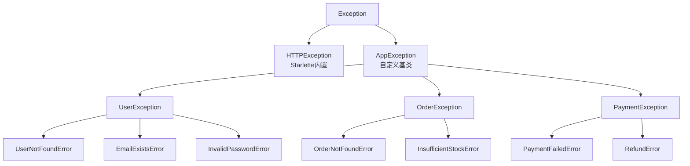

**异常体系设计原则**：

| 原则 | 说明 |
|------|------|
| 基类统一 | 所有业务异常继承同一个 AppException 基类 |
| 错误码唯一 | 每个异常有唯一的数字错误码（如 1001 用户不存在） |
| 状态码映射 | 每类异常映射到合适的 HTTP 状态码（404/400/409） |
| 按领域分类 | 用户、订单、支付等领域各有异常子类 |
| 可扩展 | 新增异常只需继承对应领域子类 |

> 🎯 面试高频：自定义异常应该继承 Exception 还是 HTTPException？两种都可以。继承 HTTPException 的好处是 FastAPI 默认处理器能处理（不需要额外注册），但不够灵活；继承 Exception 的好处是完全自定义（可以有额外字段、统一处理器），但需要注册异常处理器。生产环境推荐继承 Exception + 自定义基类 + 统一处理器，灵活性更高。

#### 代码示例

**示例 1：自定义异常基类与领域异常**

```python
# app/core/exceptions.py
class AppException(Exception):
    """应用异常基类"""
    def __init__(self, code: int, message: str, status_code: int = 400):
        self.code = code
        self.message = message
        self.status_code = status_code
        super().__init__(message)

# ===== 用户领域异常 =====
class UserException(AppException):
    """用户异常基类"""
    pass

class UserNotFoundError(UserException):
    def __init__(self, user_id: int):
        super().__init__(code=1001, message=f"用户 {user_id} 不存在", status_code=404)

class EmailAlreadyExistsError(UserException):
    def __init__(self, email: str):
        super().__init__(code=1002, message=f"邮箱 {email} 已被注册", status_code=409)

class InvalidPasswordError(UserException):
    def __init__(self):
        super().__init__(code=1003, message="密码错误", status_code=401)

class UserDisabledError(UserException):
    def __init__(self, user_id: int):
        super().__init__(code=1004, message=f"用户 {user_id} 已被禁用", status_code=403)

# ===== 订单领域异常 =====
class OrderException(AppException):
    """订单异常基类"""
    pass

class OrderNotFoundError(OrderException):
    def __init__(self, order_id: int):
        super().__init__(code=2001, message=f"订单 {order_id} 不存在", status_code=404)

class InsufficientStockError(OrderException):
    def __init__(self, product_id: int, available: int, requested: int):
        super().__init__(
            code=2002,
            message=f"商品 {product_id} 库存不足：可用 {available}，请求 {requested}",
            status_code=400,
        )

# ===== 支付领域异常 =====
class PaymentException(AppException):
    """支付异常基类"""
    pass

class PaymentFailedError(PaymentException):
    def __init__(self, order_id: int, reason: str):
        super().__init__(
            code=3001, message=f"订单 {order_id} 支付失败：{reason}", status_code=402
        )
```

预期运行结果：按领域分类的异常体系，每个异常有唯一错误码和状态码。

**示例 2：统一异常处理器**

```python
# app/core/exception_handlers.py
from fastapi import Request, status
from fastapi.responses import JSONResponse
from fastapi.exceptions import RequestValidationError
from starlette.exceptions import HTTPException as StarletteHTTPException
from app.core.exceptions import AppException
import logging
import uuid

logger = logging.getLogger(__name__)

def register_exception_handlers(app):
    """注册所有异常处理器"""

    @app.exception_handler(AppException)
    async def app_exception_handler(request: Request, exc: AppException):
        """业务异常：返回统一格式"""
        logger.warning(f"业务异常 [{exc.code}]: {exc.message} | path={request.url.path}")
        return JSONResponse(
            status_code=exc.status_code,
            content={"code": exc.code, "message": exc.message, "data": None},
        )

    @app.exception_handler(RequestValidationError)
    async def validation_handler(request: Request, exc: RequestValidationError):
        """参数校验异常：422"""
        errors = []
        for err in exc.errors():
            field = ".".join(str(loc) for loc in err.get("loc", []))
            errors.append({"field": field, "message": err.get("msg", "")})
        return JSONResponse(
            status_code=status.HTTP_422_UNPROCESSABLE_ENTITY,
            content={"code": 422, "message": "参数校验失败", "data": {"errors": errors}},
        )

    @app.exception_handler(StarletteHTTPException)
    async def http_exception_handler(request: Request, exc: StarletteHTTPException):
        """HTTP 异常（404/405 等）"""
        return JSONResponse(
            status_code=exc.status_code,
            content={"code": exc.status_code, "message": str(exc.detail), "data": None},
        )

    @app.exception_handler(Exception)
    async def fallback_handler(request: Request, exc: Exception):
        """兜底异常：500"""
        error_id = str(uuid.uuid4())[:8]
        logger.error(f"未捕获异常 [{error_id}]: {type(exc).__name__}: {exc}", exc_info=True)
        return JSONResponse(
            status_code=status.HTTP_500_INTERNAL_SERVER_ERROR,
            content={"code": 500, "message": f"服务器内部错误 (ID: {error_id})", "data": None},
        )
```

预期运行结果：四层异常处理器，业务异常返回统一 `{code, message, data}` 格式，500 不暴露堆栈。

**示例 3：完整场景——业务代码中使用自定义异常**

```python
# app/api/v1/orders.py
from fastapi import APIRouter, Depends
from sqlalchemy.ext.asyncio import AsyncSession
from app.database import get_db
from app.core.exceptions import (
    UserNotFoundError, OrderNotFoundError,
    InsufficientStockError, PaymentFailedError,
)
from app.schemas.order import OrderCreate, OrderResponse

router = APIRouter(prefix="/orders", tags=["订单管理"])

@router.post("/", response_model=OrderResponse, status_code=201)
async def create_order(order_in: OrderCreate, db: AsyncSession = Depends(get_db)):
    # 1. 检查用户
    user = await get_user(db, order_in.user_id)
    if not user:
        raise UserNotFoundError(order_in.user_id)  # 抛出自定义异常

    # 2. 检查库存
    product = await get_product(db, order_in.product_id)
    if product.stock < order_in.quantity:
        raise InsufficientStockError(
            product_id=order_in.product_id,
            available=product.stock,
            requested=order_in.quantity,
        )

    # 3. 创建订单
    order = await create_order_in_db(db, order_in)

    # 4. 支付
    payment_result = await process_payment(order)
    if not payment_result.success:
        raise PaymentFailedError(order_id=order.id, reason=payment_result.reason)

    return order

# 业务代码简洁：只需要 raise 自定义异常
# 全局处理器统一转换为 HTTP 响应
# 前端根据 code 字段做精确处理（1001 提示用户不存在，2002 提示库存不足等）
```

预期运行结果：业务代码只关注正常流程和抛出语义化异常，异常到 HTTP 响应的转换由全局处理器统一处理。

#### 使用场景与最佳实践

**适用场景**：中大型项目；多领域业务（用户、订单、支付）；需要统一错误码的 API；前端需要根据错误码做不同处理的场景。

**不适用场景**：小型项目（直接用 HTTPException 即可）；原型验证。

**最佳实践**：
1. 定义 AppException 基类，包含 code/message/status_code 三要素
2. 按领域划分子类（UserException、OrderException、PaymentException）
3. 错误码分段：1xxx 用户、2xxx 订单、3xxx 支付、4xxx 系统
4. 注册统一处理器，返回 `{code, message, data}` 格式
5. 异常消息面向用户（清晰友好），不暴露内部实现
6. 异常处理器中记录日志（业务异常 warning，未捕获异常 error + exc_info）
7. 500 错误返回 error_id，通过 ID 在日志中查找完整堆栈

**性能建议**：异常层次越深，捕获时的类型匹配开销越大，但可以忽略（微秒级）。异常只在错误路径触发，不影响正常请求性能。

#### 常见坑点

**坑点 1：自定义异常没有继承基类导致处理器不匹配**

- 错误现象：抛出自定义异常但返回 500，自定义处理器没有捕获
- 根本原因：自定义异常直接继承 Exception，没有继承 AppException，`@app.exception_handler(AppException)` 不匹配
- 正确做法：所有业务异常继承 AppException 基类，或为每个异常单独注册处理器
- 预防措施：代码审查时检查异常继承关系，新异常必须继承对应领域基类

**坑点 2：异常处理器中抛出新异常导致无限递归**

- 错误现象：异常处理器中日志记录失败，抛出新异常，导致 500 或连接重置
- 根本原因：异常处理器中的异常没有被捕获，可能被同一个处理器再次捕获（无限递归）或被 ServerErrorMiddleware 处理
- 正确做法：异常处理器代码保持极简（只构造 JSONResponse + 日志），日志用 try/except 包裹
- 预防措施：异常处理器中不要调用可能失败的外部服务（数据库、邮件），只做内存操作

---

## 六、全局异常处理器体系

### 6.1 异常处理器的注册与匹配机制

#### 概念解释

**全局异常处理器通过 `@app.exception_handler(ExceptionClass)` 装饰器注册，当路由函数或依赖中抛出未捕获的异常时，ExceptionMiddleware 按「精确类型 → 父类 → 默认」的顺序查找匹配的处理器，将异常转换为 HTTP 响应。** 这是 FastAPI 统一错误处理的核心机制。

打个比方：异常处理器像公司的客服分级体系——普通问题（业务异常）由一线客服（AppException 处理器）处理，技术问题（校验异常）由技术支持（RequestValidationError 处理器）处理，未知问题（未捕获异常）由总经理办公室（Exception 兜底处理器）处理。每个客服只处理自己领域的问题，问题升级时按层级转交。

**核心价值**：全局异常处理器让错误响应格式统一、业务代码不需要 try/except、生产环境不泄露堆栈、错误日志集中记录。

#### 原理说明：异常处理器的匹配顺序

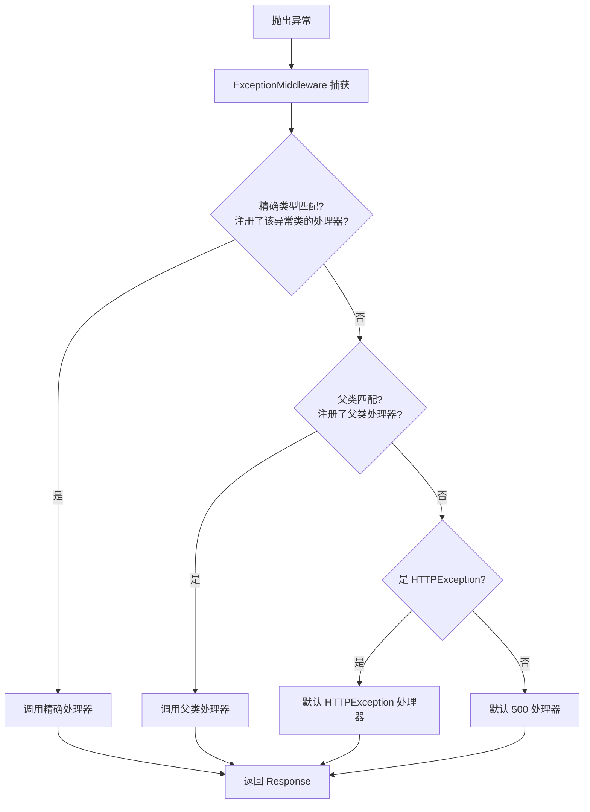

**异常处理器的关键特性**：

| 特性 | 说明 |
|------|------|
| 精确优先 | 先匹配精确类型，再匹配父类 |
| 注册顺序无关 | 匹配基于类型继承关系，不基于注册顺序 |
| 处理器签名 | `async def handler(request: Request, exc: Exception) -> Response` |
| 可注册多个 | 每个异常类可以有一个处理器 |
| 覆盖默认 | 注册 HTTPException 处理器会覆盖默认实现 |

> 🎯 面试高频：异常处理器的匹配顺序和注册顺序有关吗？无关。FastAPI 按异常类型的继承关系匹配——精确类型优先，然后是父类，最后是 Exception 兜底。注册顺序不影响匹配结果。但如果两个处理器注册了同一个异常类，后注册的会覆盖先注册的。

#### 代码示例

**示例 1：基础异常处理器注册**

```python
from fastapi import FastAPI, Request
from fastapi.responses import JSONResponse

app = FastAPI()

class BizError(Exception):
    def __init__(self, code: int, message: str):
        self.code = code
        self.message = message

# 注册业务异常处理器
@app.exception_handler(BizError)
async def biz_error_handler(request: Request, exc: BizError):
    return JSONResponse(
        status_code=400,
        content={"code": exc.code, "message": exc.message},
    )

# 注册兜底异常处理器
@app.exception_handler(Exception)
async def fallback_handler(request: Request, exc: Exception):
    return JSONResponse(
        status_code=500,
        content={"code": 500, "message": "服务器内部错误"},
    )

@app.get("/biz-error")
async def biz_error():
    raise BizError(code=1001, message="业务错误")

@app.get("/system-error")
async def system_error():
    raise ValueError("系统错误")

# GET /biz-error → 400 {"code":1001,"message":"业务错误"}
# GET /system-error → 500 {"code":500,"message":"服务器内部错误"}
```

预期运行结果：BizError 被精确处理器捕获，ValueError 被 Exception 兜底处理器捕获。

**示例 2：异常继承与处理器匹配**

```python
from fastapi import FastAPI, Request
from fastapi.responses import JSONResponse

app = FastAPI()

class AppException(Exception):
    def __init__(self, code: int, message: str, status_code: int = 400):
        self.code = code
        self.message = message
        self.status_code = status_code

class UserException(AppException):
    pass

class UserNotFoundError(UserException):
    def __init__(self, user_id: int):
        super().__init__(code=1001, message=f"用户 {user_id} 不存在", status_code=404)

# 只注册基类处理器
@app.exception_handler(AppException)
async def app_exception_handler(request: Request, exc: AppException):
    return JSONResponse(
        status_code=exc.status_code,
        content={"code": exc.code, "message": exc.message},
    )

@app.get("/user/{user_id}")
async def get_user(user_id: int):
    if user_id == 0:
        raise UserNotFoundError(user_id)  # 子类异常
    return {"id": user_id}

# GET /user/0 → UserNotFoundError 是 AppException 的子类
# → 被 AppException 处理器匹配（父类匹配）
# → 404 {"code":1001,"message":"用户 0 不存在"}
```

预期运行结果：子类异常 UserNotFoundError 被父类 AppException 的处理器匹配，证明父类匹配机制。

**示例 3：完整场景——多层异常处理器注册**

```python
import logging
import uuid
from fastapi import FastAPI, Request, status
from fastapi.responses import JSONResponse
from fastapi.exceptions import RequestValidationError
from starlette.exceptions import HTTPException as StarletteHTTPException
from sqlalchemy.exc import IntegrityError, OperationalError

logger = logging.getLogger(__name__)
app = FastAPI()

class AppException(Exception):
    def __init__(self, code, message, status_code=400):
        self.code = code
        self.message = message
        self.status_code = status_code

# 1. 业务异常处理器（最具体）
@app.exception_handler(AppException)
async def handle_app_exception(request: Request, exc: AppException):
    logger.warning(f"业务异常: {exc.code} - {exc.message}")
    return JSONResponse(status_code=exc.status_code, content={"code": exc.code, "message": exc.message})

# 2. 参数校验异常处理器
@app.exception_handler(RequestValidationError)
async def handle_validation(request: Request, exc: RequestValidationError):
    errors = [{"field": ".".join(str(l) for l in e["loc"]), "msg": e["msg"]} for e in exc.errors()]
    logger.info(f"参数校验失败: {errors}")
    return JSONResponse(status_code=422, content={"code": 422, "message": "参数错误", "data": {"errors": errors}})

# 3. Starlette HTTP 异常处理器（404/405）
@app.exception_handler(StarletteHTTPException)
async def handle_http_exception(request: Request, exc: StarletteHTTPException):
    return JSONResponse(status_code=exc.status_code, content={"code": exc.status_code, "message": str(exc.detail)})

# 4. 数据库异常处理器
@app.exception_handler(IntegrityError)
async def handle_integrity(request: Request, exc: IntegrityError):
    logger.error(f"数据库完整性错误: {exc.orig}")
    return JSONResponse(status_code=409, content={"code": 409, "message": "数据冲突"})

@app.exception_handler(OperationalError)
async def handle_operational(request: Request, exc: OperationalError):
    logger.critical(f"数据库连接失败: {exc.orig}")
    return JSONResponse(status_code=503, content={"code": 503, "message": "数据库服务不可用"})

# 5. 兜底异常处理器（最宽泛）
@app.exception_handler(Exception)
async def handle_unhandled(request: Request, exc: Exception):
    error_id = str(uuid.uuid4())[:8]
    logger.error(f"未捕获异常 [{error_id}]: {exc}", exc_info=True)
    return JSONResponse(status_code=500, content={"code": 500, "message": f"服务器错误 (ID: {error_id})"})
```

预期运行结果：五层异常处理器覆盖所有错误场景，从最具体的业务异常到最宽泛的系统异常，每层有对应的日志级别和响应格式。

#### 使用场景与最佳实践

**适用场景**：所有生产级 API；需要统一错误响应格式的项目；需要错误日志集中管理的服务；多领域业务异常分类。

**不适用场景**：内部调试脚本；原型验证。

**最佳实践**：
1. 按「从具体到宽泛」的层次注册处理器：业务异常 → 校验异常 → HTTP异常 → 数据库异常 → 兜底Exception
2. 处理器函数必须是 async，签名为 `(request: Request, exc: Exception) -> Response`
3. 500 兜底处理器必须注册，防止堆栈泄露
4. 处理器中记录日志：业务异常 warning，校验异常 info，未捕获异常 error + exc_info
5. 500 错误返回 error_id，日志中记录完整堆栈，通过 ID 关联
6. 处理器中不要抛新异常（可能导致无限递归）
7. 用 `register_exception_handlers(app)` 函数集中注册，保持 main.py 简洁

**性能建议**：异常处理器只在错误路径执行，不影响正常请求性能。处理器中的日志记录如果是同步写文件，高并发错误时可能阻塞，建议用异步日志或日志队列。

#### 常见坑点

**坑点 1：Exception 兜底处理器捕获了 404**

- 错误现象：访问不存在的路径返回 500 而非 404
- 根本原因：StarletteHTTPException（404）是 Exception 的子类，Exception 处理器兜底捕获了它
- 正确做法：单独注册 `@app.exception_handler(StarletteHTTPException)`，它比 Exception 更具体，优先匹配
- 预防措施：注册 Exception 处理器之前，先注册 StarletteHTTPException 和 RequestValidationError 处理器

**坑点 2：处理器中返回普通 dict 而非 Response**

- 错误现象：异常处理器返回 dict，报 `TypeError: 'dict' object is not callable` 或响应格式错误
- 根本原因：异常处理器必须返回 Response 对象（如 JSONResponse），不能返回 dict
- 正确做法：`return JSONResponse(status_code=..., content=...)`
- 预防措施：所有异常处理器统一返回 JSONResponse

---

### 6.2 异常处理器的高级用法

#### 概念解释

**异常处理器的高级用法包括：处理器中访问请求上下文、动态生成响应、处理器复用、基于 APIRouter 的局部异常处理器、异常处理器与中间件的协作等。** 掌握这些可以构建灵活的错误处理体系。

打个比方：基础异常处理器像标准客服脚本（固定回复），高级用法像智能客服系统——可以查看客户历史（request 上下文）、根据问题类型动态选择回复（动态响应）、不同部门有自己的客服（APIRouter 局部处理器）、与安保系统联动（中间件协作）。

**核心价值**：高级用法让异常处理更灵活，可以根据请求上下文（用户、路径、Header）动态调整响应，局部异常处理器实现模块级错误定制。

#### 原理说明：高级异常处理架构

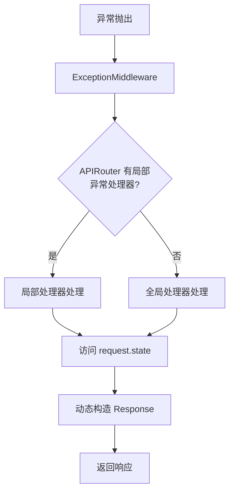

**高级用法清单**：

| 用法 | 说明 | 示例 |
|------|------|------|
| 访问 request | 处理器中读取请求路径、Header、state | 根据路径返回不同错误页 |
| 动态响应 | 根据异常内容动态构造响应 | 包含错误 ID、时间戳 |
| 局部处理器 | APIRouter 级别注册异常处理器 | 管理模块用不同错误格式 |
| 处理器复用 | 多个异常类共用一个处理器 | 所有数据库异常用一个处理器 |
| 异步处理器 | 处理器中调用异步操作 | 异步记录日志到数据库 |

> 🎯 面试高频：APIRouter 可以注册局部异常处理器吗？可以。`router = APIRouter()` 后用 `@router.exception_handler(MyException)` 注册，但需要注意：局部异常处理器只对该 router 下的路由生效，且需要在 `include_router` 时确保处理器被注册。实际上 FastAPI 的异常处理器是应用级的，APIRouter 的 exception_handler 会在 include_router 时合并到 app。更推荐用全局处理器 + 根据 request.url.path 区分处理。

#### 代码示例

**示例 1：处理器中访问请求上下文**

```python
from fastapi import FastAPI, Request
from fastapi.responses import JSONResponse
import uuid
import time

app = FastAPI()

class BizException(Exception):
    def __init__(self, code: int, message: str):
        self.code = code
        self.message = message

@app.exception_handler(BizException)
async def biz_handler(request: Request, exc: BizException):
    """处理器中访问请求上下文，动态构造响应"""
    error_id = str(uuid.uuid4())[:8]
    request_id = getattr(request.state, "request_id", "unknown")

    # 根据请求路径决定是否返回详细信息（开发环境）
    is_debug = request.headers.get("X-Debug") == "true"

    content = {
        "code": exc.code,
        "message": exc.message,
        "error_id": error_id,
        "timestamp": int(time.time()),
        "path": request.url.path,
    }

    if is_debug:
        # 调试模式下额外返回异常类型和请求方法
        content["debug"] = {
            "exception_type": type(exc).__name__,
            "method": request.method,
            "headers": dict(request.headers),
        }

    return JSONResponse(status_code=400, content=content)

@app.get("/test")
async def test():
    raise BizException(code=2001, message="测试异常")

# GET /test → 标准错误响应
# GET /test (X-Debug: true) → 包含调试信息的错误响应
```

预期运行结果：处理器根据请求头和路径动态构造响应，调试模式返回更多信息。

**示例 2：一个处理器处理多个异常类型**

```python
from fastapi import FastAPI, Request
from fastapi.responses import JSONResponse

app = FastAPI()

class DatabaseException(Exception):
    """数据库异常基类"""
    pass

class ConnectionError(DatabaseException):
    pass

class QueryError(DatabaseException):
    pass

class TimeoutError(DatabaseException):
    pass

# 一个处理器处理所有数据库异常（基类匹配）
@app.exception_handler(DatabaseException)
async def handle_db_exception(request: Request, exc: DatabaseException):
    # 根据具体子类返回不同状态码
    status_map = {
        ConnectionError: 503,
        QueryError: 400,
        TimeoutError: 504,
    }
    status_code = status_map.get(type(exc), 500)

    return JSONResponse(
        status_code=status_code,
        content={
            "code": status_code,
            "message": f"数据库错误: {type(exc).__name__}",
            "detail": str(exc),
        },
    )

@app.get("/db/connection")
async def db_connection():
    raise ConnectionError("无法连接数据库")

@app.get("/db/query")
async def db_query():
    raise QueryError("SQL 语法错误")

@app.get("/db/timeout")
async def db_timeout():
    raise TimeoutError("查询超时")

# GET /db/connection → 503
# GET /db/query → 400
# GET /db/timeout → 504
```

预期运行结果：一个基类处理器处理所有子类异常，根据具体类型返回不同状态码。

**示例 3：完整场景——集中式异常处理模块**

```python
# app/core/exception_handlers.py
import logging
import uuid
import time
from fastapi import FastAPI, Request, status
from fastapi.responses import JSONResponse
from fastapi.exceptions import RequestValidationError
from starlette.exceptions import HTTPException as StarletteHTTPException
from app.core.exceptions import AppException

logger = logging.getLogger(__name__)

def _error_response(code: int, message: str, data=None, **extra) -> dict:
    """统一构造错误响应"""
    return {
        "code": code,
        "message": message,
        "data": data,
        "timestamp": int(time.time()),
        **extra,
    }

def register_exception_handlers(app: FastAPI):
    """集中注册所有异常处理器"""

    @app.exception_handler(AppException)
    async def handle_app_exception(request: Request, exc: AppException):
        error_id = str(uuid.uuid4())[:8]
        logger.warning(f"[{error_id}] 业务异常 {exc.code}: {exc.message} | {request.url.path}")
        return JSONResponse(
            status_code=exc.status_code,
            content=_error_response(exc.code, exc.message, error_id=error_id),
        )

    @app.exception_handler(RequestValidationError)
    async def handle_validation(request: Request, exc: RequestValidationError):
        errors = []
        for err in exc.errors():
            errors.append({
                "field": ".".join(str(loc) for loc in err.get("loc", [])),
                "message": err.get("msg", ""),
                "type": err.get("type", ""),
            })
        logger.info(f"参数校验失败: {errors} | {request.url.path}")
        return JSONResponse(
            status_code=status.HTTP_422_UNPROCESSABLE_ENTITY,
            content=_error_response(422, "请求参数校验失败", {"errors": errors}),
        )

    @app.exception_handler(StarletteHTTPException)
    async def handle_http(request: Request, exc: StarletteHTTPException):
        return JSONResponse(
            status_code=exc.status_code,
            content=_error_response(exc.status_code, str(exc.detail)),
        )

    @app.exception_handler(Exception)
    async def handle_unhandled(request: Request, exc: Exception):
        error_id = str(uuid.uuid4())[:8]
        logger.error(
            f"[{error_id}] 未捕获异常 {type(exc).__name__}: {exc} | {request.url.path}",
            exc_info=True,
        )
        return JSONResponse(
            status_code=status.HTTP_500_INTERNAL_SERVER_ERROR,
            content=_error_response(500, f"服务器内部错误 (ID: {error_id})"),
        )

# app/main.py
from app.core.exception_handlers import register_exception_handlers

app = FastAPI()
register_exception_handlers(app)  # 一行注册所有处理器
```

预期运行结果：集中式异常处理模块，统一错误响应格式，一行注册所有处理器，main.py 保持简洁。

#### 使用场景与最佳实践

**适用场景**：复杂错误处理需求；需要根据请求上下文动态响应；多模块不同错误格式；需要统一错误响应结构。

**不适用场景**：简单项目（基础处理器足够）。

**最佳实践**：
1. 用 `_error_response()` 辅助函数统一构造错误响应格式
2. 用 `register_exception_handlers(app)` 集中注册，main.py 一行调用
3. 处理器中访问 `request.state` 获取中间件设置的数据（request_id）
4. 调试模式下可以返回更多错误信息（通过 Header 控制）
5. 一个基类处理器处理多个子类异常，减少重复代码
6. 错误响应包含 timestamp、error_id 等元数据，便于排查
7. 异步处理器中可以调用异步日志、异步数据库记录

**性能建议**：处理器中的 `uuid.uuid4()` 和 `time.time()` 开销极小。异步日志（如 aiologger）比同步日志在高并发错误场景下性能更好。

#### 常见坑点

**坑点 1：局部异常处理器不生效**

- 错误现象：在 APIRouter 上注册了 `@router.exception_handler(MyException)`，但异常仍被全局处理器处理
- 根本原因：APIRouter 的异常处理器需要在 include_router 时正确合并，某些版本下局部处理器优先级不如预期
- 正确做法：用全局处理器 + 根据 `request.url.path` 区分模块，或确保 FastAPI 版本支持局部处理器
- 预防措施：优先用全局处理器，局部差异通过 request 上下文判断

**坑点 2：处理器中调用异步操作但忘记 await**

- 错误现象：处理器中调用了 `await db.insert(error_log)` 但忘记 await，导致错误日志不记录
- 根本原因：异步函数调用未 await，协程对象被创建但未执行
- 正确做法：所有异步调用必须 await
- 预防措施：代码审查时检查 async 函数中的 await，用 mypy 或 ruff 检测未 await 的协程

---

## 七、请求验证异常处理

### 7.1 RequestValidationError 详解

#### 概念解释

**RequestValidationError 是 FastAPI 在请求参数（路径参数、查询参数、请求体、Header、Cookie）校验失败时自动抛出的异常，固定返回 422 状态码，包含字段级的详细错误信息。** 它由 Pydantic 校验失败触发，发生在路由函数执行之前。

打个比方：RequestValidationError 像机场的安检——乘客（请求）到达后，安检系统（Pydantic）逐项检查证件（类型）、行李（约束）、液体（格式），任何一项不合格就拒绝登机（返回 422），并告知具体哪项不合格（字段级错误信息）。乘客还没到登机口（路由函数）就被拦下了。

**核心价值**：RequestValidationError 提供标准化的参数校验错误响应，前端可以根据字段级错误信息精确定位和提示用户，无需后端手动编写校验逻辑。

#### 原理说明：RequestValidationError 的触发与结构

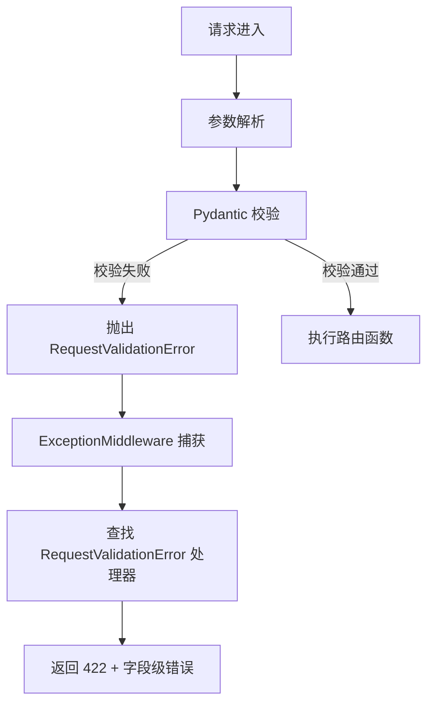

**RequestValidationError 的错误结构**：

```python
{
    "detail": [
        {
            "loc": ["body", "email"],       # 错误位置：body/query/path + 字段名
            "msg": "value is not a valid email address",  # 错误消息
            "type": "value_error",          # 错误类型
            "ctx": {"error": "..."},        # 上下文信息
            "input": "invalid-email"        # 输入值（Pydantic v2）
        }
    ]
}
```

| 字段 | 说明 | 示例 |
|------|------|------|
| `loc` | 错误位置列表 | `["body", "email"]`、`["query", "page"]`、`["path", "user_id"]` |
| `msg` | 人类可读的错误消息 | `"Input should be a valid integer"` |
| `type` | 错误类型标识 | `"int_parsing"`、`"value_error"` |
| `ctx` | 错误上下文 | `{"limit_value": 100}` |
| `input` | 原始输入值（v2） | `"abc"` |

> 🎯 面试高频：RequestValidationError 和 HTTPException 的区别？① 触发方式：RequestValidationError 由 FastAPI 内部在参数校验失败时自动抛出，HTTPException 由开发者在业务代码中手动抛出；② 状态码：RequestValidationError 固定 422，HTTPException 由开发者指定；③ 错误信息：RequestValidationError 包含字段级的 loc/msg/type 结构，HTTPException 的 detail 由开发者自定义；④ 执行时机：RequestValidationError 在路由函数执行之前，HTTPException 在路由函数执行过程中。

#### 代码示例

**示例 1：默认 422 响应格式**

```python
from fastapi import FastAPI
from pydantic import BaseModel, EmailStr, Field

app = FastAPI()

class UserCreate(BaseModel):
    email: EmailStr
    password: str = Field(..., min_length=8)
    age: int = Field(..., ge=0, le=150)

@app.post("/users/")
async def create_user(user: UserCreate):
    return user

# POST /users/ {"email":"invalid","password":"123","age":200}
# 默认 422 响应：
# {
#   "detail": [
#     {"loc":["body","email"],"msg":"value is not a valid email address","type":"value_error"},
#     {"loc":["body","password"],"msg":"String should have at least 8 characters","type":"string_too_short"},
#     {"loc":["body","age"],"msg":"Input should be less than or equal to 150","type":"less_than_equal"}
#   ]
# }
```

预期运行结果：三个字段同时校验失败，返回 422 和字段级错误列表。

**示例 2：自定义 422 响应格式**

```python
from fastapi import FastAPI, Request, status
from fastapi.responses import JSONResponse
from fastapi.exceptions import RequestValidationError
from pydantic import BaseModel, Field

app = FastAPI()

@app.exception_handler(RequestValidationError)
async def validation_exception_handler(request: Request, exc: RequestValidationError):
    """自定义 422 响应：统一格式 + 字段级错误"""
    errors = []
    for err in exc.errors():
        # loc 列表转为点分隔字符串：["body","email"] → "body.email"
        field = ".".join(str(loc) for loc in err.get("loc", []))
        errors.append({
            "field": field,
            "message": err.get("msg", ""),
            "type": err.get("type", ""),
        })

    return JSONResponse(
        status_code=status.HTTP_422_UNPROCESSABLE_ENTITY,
        content={
            "code": 422,
            "message": "请求参数校验失败",
            "data": {
                "errors": errors,
                "error_count": len(errors),
            },
        },
    )

class Item(BaseModel):
    name: str = Field(..., min_length=2)
    price: float = Field(..., gt=0)

@app.post("/items/")
async def create_item(item: Item):
    return item

# POST /items/ {"name":"a","price":-10}
# 自定义 422 响应：
# {"code":422,"message":"请求参数校验失败","data":{"errors":[{"field":"body.name","message":"String should have at least 2 characters","type":"string_too_short"},...],"error_count":2}}
```

预期运行结果：自定义 422 格式，包含错误计数和统一的 code/message/data 结构。

**示例 3：完整场景——校验异常的分类处理与国际化**

```python
from fastapi import FastAPI, Request, status
from fastapi.responses import JSONResponse
from fastapi.exceptions import RequestValidationError
from pydantic import BaseModel, Field

app = FastAPI()

# 错误类型到中文消息的映射（国际化）
ERROR_MESSAGES = {
    "int_parsing": "必须是整数",
    "string_too_short": "字符串太短",
    "string_too_long": "字符串太长",
    "value_error": "值不合法",
    "less_than_equal": "值过大",
    "greater_than_equal": "值过小",
    "missing": "必填字段缺失",
}

@app.exception_handler(RequestValidationError)
async def i18n_validation_handler(request: Request, exc: RequestValidationError):
    """国际化校验异常处理器：根据错误类型返回中文消息"""
    errors = []
    for err in exc.errors():
        loc = err.get("loc", [])
        # 区分参数来源：body/query/path/header
        source = loc[0] if loc else "unknown"
        field = ".".join(str(l) for l in loc[1:]) if len(loc) > 1 else str(loc)
        error_type = err.get("type", "unknown")
        message = ERROR_MESSAGES.get(error_type, err.get("msg", "未知错误"))

        errors.append({
            "source": source,       # 参数来源：body/query/path
            "field": field,         # 字段名
            "message": message,     # 中文错误消息
            "type": error_type,     # 错误类型
        })

    # 按来源分类统计
    source_counts = {}
    for e in errors:
        source_counts[e["source"]] = source_counts.get(e["source"], 0) + 1

    return JSONResponse(
        status_code=status.HTTP_422_UNPROCESSABLE_ENTITY,
        content={
            "code": 422,
            "message": f"参数校验失败（共 {len(errors)} 个错误）",
            "data": {
                "errors": errors,
                "summary": source_counts,
            },
        },
    )

@app.get("/search")
async def search(q: str = Field(..., min_length=2), page: int = Field(1, ge=1)):
    return {"q": q, "page": page}

# GET /search?page=0
# → {"code":422,"message":"参数校验失败（共 2 个错误）","data":{"errors":[{"source":"query","field":"q","message":"必填字段缺失",...},{"source":"query","field":"page","message":"值过小",...}],"summary":{"query":2}}}
```

预期运行结果：校验异常国际化处理，区分参数来源（body/query/path），返回中文错误消息和分类统计。

#### 使用场景与最佳实践

**适用场景**：所有需要参数校验的 API；需要自定义错误响应格式的项目；需要国际化错误消息的多语言应用；前端需要字段级错误提示的表单。

**不适用场景**：不需要参数校验的简单接口。

**最佳实践**：
1. 始终注册 RequestValidationError 处理器，自定义为项目统一格式
2. 错误消息面向用户（清晰友好），不要暴露 Pydantic 内部类型
3. 国际化项目用错误类型映射表，支持多语言
4. 区分参数来源（body/query/path），帮助前端定位
5. 多个错误一次性返回（不要遇到第一个错误就返回），提升用户体验
6. 422 响应中包含 error_count，便于前端统计
7. 开发环境可以返回原始 input 值，生产环境不返回（安全）

**性能建议**：Pydantic v2 的校验极快（Rust 核心），422 错误路径的性能开销可以忽略。但超大请求体（>1MB）的 JSON 解析有开销，建议设置请求体大小限制。

#### 常见坑点

**坑点 1：422 错误在路由函数内无法捕获**

- 错误现象：在路由函数中 try/except 试图捕获参数校验错误，但捕获不到
- 根本原因：RequestValidationError 在路由函数执行之前抛出（参数解析和校验阶段），路由函数内的 try/except 无法捕获
- 正确做法：用 `@app.exception_handler(RequestValidationError)` 全局处理
- 预防措施：理解请求流水线，参数校验在路由函数之前

**坑点 2：loc 字段的第一个元素是参数来源**

- 错误现象：解析错误位置时把 `["body", "email"]` 当作字段路径 `"body.email"`，前端显示字段名包含 "body"
- 根本原因：loc 列表的第一个元素是参数来源（body/query/path/header/cookie），不是字段名的一部分
- 正确做法：`source = loc[0]`，`field = ".".join(loc[1:])`，分开处理
- 预防措施：自定义处理器时正确解析 loc 结构

---

### 7.2 校验异常与业务异常的协作

#### 概念解释

**校验异常（422）处理参数格式和约束错误，业务异常（400/404/409）处理业务规则错误，两者协作构成完整的错误处理体系。** 校验异常在路由函数之前由 Pydantic 自动触发，业务异常在路由函数中由开发者手动抛出。

打个比方：校验异常像入场门票检查——票的日期对不对（类型）、是不是假票（格式），不符合就不让进（422）；业务异常像场馆内的规则检查——座位是不是被占了（资源不存在）、是不是超过携带物品限制（业务规则），不符合就请出去（400/404）。两道检查分别在不同阶段，共同保证活动秩序。

**核心价值**：明确区分校验错误和业务错误，让前端可以对不同类型的错误做不同处理（422 高亮表单字段，400 显示业务提示），后端代码职责清晰。

#### 原理说明：校验异常与业务异常的分工

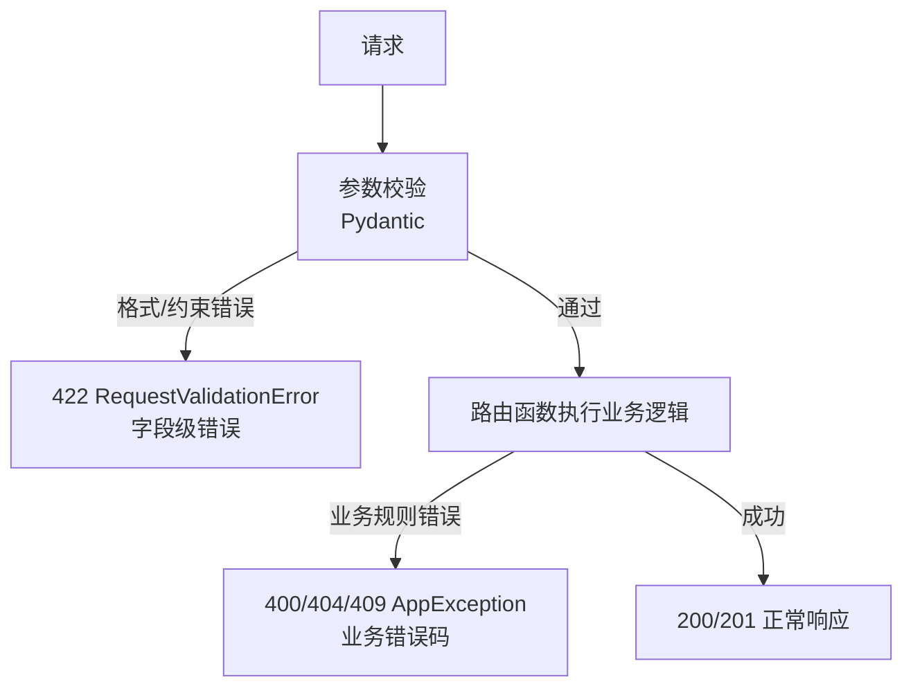

**两类异常的对比**：

| 维度 | 校验异常（422） | 业务异常（400/404/409） |
|------|----------------|----------------------|
| 触发时机 | 路由函数之前 | 路由函数之中 |
| 触发方式 | Pydantic 自动 | 开发者手动 raise |
| 错误内容 | 字段格式/约束 | 业务规则/资源状态 |
| 前端处理 | 高亮表单字段 | 显示业务提示 |
| 示例 | email 格式不对、age > 150 | 用户不存在、库存不足、邮箱已注册 |

> 🎯 面试高频：什么时候用 422，什么时候用 400？参数格式/类型/约束错误用 422（如 email 格式不对、age 不是整数、page < 1）；业务规则错误用 400（如余额不足、库存不够、不满足业务条件）；资源不存在用 404；资源冲突用 409。简单原则：Pydantic 能校验的用 422，Pydantic 校验不了的业务逻辑用 400/404/409。

#### 代码示例

**示例 1：校验异常与业务异常的分工**

```python
from fastapi import FastAPI, HTTPException
from pydantic import BaseModel, Field, EmailStr

app = FastAPI()

class RegisterRequest(BaseModel):
    email: EmailStr = Field(..., description="邮箱格式校验 → 422")
    password: str = Field(..., min_length=8, description="密码长度校验 → 422")
    age: int = Field(..., ge=0, le=150, description="年龄范围校验 → 422")

# 模拟数据库
existing_emails = {"existing@example.com"}

@app.post("/register")
async def register(req: RegisterRequest):
    # Pydantic 自动校验：email 格式、password 长度、age 范围
    # 校验失败 → 422（不需要写代码）

    # 业务逻辑校验：邮箱是否已注册 → 409
    if req.email in existing_emails:
        raise HTTPException(status_code=409, detail="邮箱已被注册")

    # 业务逻辑校验：年龄是否满足注册条件 → 400
    if req.age < 18:
        raise HTTPException(status_code=400, detail="必须年满 18 岁才能注册")

    return {"message": "注册成功", "email": req.email}

# POST /register {"email":"invalid","password":"123","age":200}
# → 422（email 格式 + password 太短 + age 太大，三个校验错误）

# POST /register {"email":"existing@example.com","password":"password123","age":25}
# → 409 邮箱已被注册（业务异常）

# POST /register {"email":"new@example.com","password":"password123","age":15}
# → 400 必须年满 18 岁（业务异常）

# POST /register {"email":"new@example.com","password":"password123","age":25}
# → 200 注册成功
```

预期运行结果：Pydantic 处理格式校验（422），业务代码处理业务规则（400/409），职责分明。

**示例 2：自定义异常体系中的校验与业务分离**

```python
from fastapi import FastAPI, Request
from fastapi.responses import JSONResponse
from fastapi.exceptions import RequestValidationError
from pydantic import BaseModel, Field, EmailStr

app = FastAPI()

class AppException(Exception):
    def __init__(self, code, message, status_code=400):
        self.code = code
        self.message = message
        self.status_code = status_code

class ValidationException(AppException):
    """业务级校验异常（区别于 Pydantic 的 422）"""
    def __init__(self, field: str, message: str):
        super().__init__(code=4001, message=f"{field}: {message}", status_code=400)
        self.field = field

# 422 处理器：Pydantic 校验失败
@app.exception_handler(RequestValidationError)
async def handle_422(request: Request, exc: RequestValidationError):
    errors = [{"field": ".".join(str(l) for l in e["loc"]), "msg": e["msg"]} for e in exc.errors()]
    return JSONResponse(status_code=422, content={"code": 422, "type": "validation", "errors": errors})

# 400 处理器：业务校验失败
@app.exception_handler(AppException)
async def handle_biz(request: Request, exc: AppException):
    return JSONResponse(status_code=exc.status_code, content={"code": exc.code, "type": "business", "message": exc.message})

class OrderRequest(BaseModel):
    product_id: int = Field(..., ge=1)
    quantity: int = Field(..., ge=1, le=100)

@app.post("/orders")
async def create_order(req: OrderRequest):
    # Pydantic 校验：product_id >= 1, quantity 1-100 → 422
    # 业务校验：库存是否足够 → 400
    stock = 5  # 模拟库存
    if req.quantity > stock:
        raise ValidationException(field="quantity", message=f"库存不足，仅剩 {stock} 件")
    return {"order_id": 1, "product_id": req.product_id, "quantity": req.quantity}

# POST /orders {"product_id":0,"quantity":200} → 422（Pydantic 校验）
# POST /orders {"product_id":1,"quantity":10} → 400（业务校验：库存不足）
# POST /orders {"product_id":1,"quantity":3} → 200（成功）
```

预期运行结果：422（Pydantic 格式校验）和 400（业务校验）通过不同的 type 字段区分，前端可以分别处理。

**示例 3：完整场景——统一错误响应中的校验与业务异常**

```python
from fastapi import FastAPI, Request, status
from fastapi.responses import JSONResponse
from fastapi.exceptions import RequestValidationError
from pydantic import BaseModel, Field

app = FastAPI()

class AppException(Exception):
    def __init__(self, code, message, status_code=400, details=None):
        self.code = code
        self.message = message
        self.status_code = status_code
        self.details = details

def unified_error(code: int, message: str, error_type: str, details=None):
    """统一错误响应构造"""
    return {
        "code": code,
        "message": message,
        "type": error_type,  # validation / business / system
        "details": details,
    }

@app.exception_handler(RequestValidationError)
async def handle_validation(request: Request, exc: RequestValidationError):
    errors = []
    for e in exc.errors():
        errors.append({
            "field": ".".join(str(l) for l in e.get("loc", [])),
            "message": e.get("msg", ""),
            "rejected_value": e.get("input"),  # 开发环境返回，生产环境移除
        })
    return JSONResponse(
        status_code=422,
        content=unified_error(422, "参数校验失败", "validation", errors),
    )

@app.exception_handler(AppException)
async def handle_business(request: Request, exc: AppException):
    return JSONResponse(
        status_code=exc.status_code,
        content=unified_error(exc.code, exc.message, "business", exc.details),
    )

@app.exception_handler(Exception)
async def handle_system(request: Request, exc: Exception):
    return JSONResponse(
        status_code=500,
        content=unified_error(500, "系统错误", "system", None),
    )

@app.post("/api/orders")
async def create_order(product_id: int = Field(..., ge=1), quantity: int = Field(..., ge=1)):
    if quantity > 10:
        raise AppException(code=3001, message="单次限购 10 件", status_code=400,
                           details={"max_quantity": 10, "requested": quantity})
    return {"order_id": 1}
```

预期运行结果：所有错误（validation/business/system）都遵循统一的 `{code, message, type, details}` 格式，前端可以根据 type 字段做差异化处理。

#### 使用场景与最佳实践

**适用场景**：所有需要参数校验和业务规则的 API；前端需要区分错误类型的表单应用；需要统一错误响应格式的项目。

**不适用场景**：简单内部接口（不需要精细错误分类）。

**最佳实践**：
1. Pydantic 能校验的（格式、类型、范围）一律用 Pydantic，返回 422
2. 业务规则（资源存在性、权限、状态机）用自定义异常，返回 400/404/409
3. 统一错误响应中用 `type` 字段区分 validation/business/system
4. 422 错误返回字段级信息，帮助前端高亮
5. 业务异常可以带 details 字段，提供额外上下文（如最大限制值）
6. 生产环境 422 不返回 rejected_value（可能包含敏感输入）
7. 不要用 422 处理业务错误（如「用户不存在」应该是 404）

**性能建议**：两类异常都只在错误路径触发，不影响正常请求。Pydantic v2 校验极快，业务异常的构造开销也极小。

#### 常见坑点

**坑点 1：用 422 处理业务错误**

- 错误现象：「用户不存在」「余额不足」等业务错误返回 422
- 根本原因：混淆了参数校验错误和业务规则错误
- 正确做法：参数格式/约束错误用 422，业务规则错误用 400/404/409
- 预防措施：团队制定错误码规范，明确 422 和 400 的边界

**坑点 2：业务校验重复 Pydantic 已有的校验**

- 错误现象：Pydantic 已经校验了 `age >= 0`，路由函数中又写 `if age < 0: raise 400`
- 根本原因：不了解 Pydantic 的校验能力，重复劳动
- 正确做法：能用 Pydantic 约束（ge/le/min_length/pattern）表达的一律用 Pydantic，业务函数只做 Pydantic 表达不了的校验
- 预防措施：熟悉 Pydantic 的 Field 约束，优先用声明式校验

---

## 八、异常与中间件的交互

### 8.1 异常在中间件链中的传播

#### 概念解释

**异常在中间件链中的传播遵循洋葱模型：路由函数抛出的异常被 ExceptionMiddleware（内层中间件）捕获并转换为响应，然后响应向外层中间件传递。外层中间件的 after 阶段看到的是已经转换后的错误响应（含状态码），而非原始异常对象。**

打个比方：异常传播像火灾处理——房间（路由函数）着火（抛异常），楼层消防系统（ExceptionMiddleware）首先响应，把火扑灭并生成事故报告（错误响应），然后事故报告逐层上报给大楼管理（外层中间件），每层可以记录事故（日志）、添加封条（响应头），但不会再看到原始的火焰（异常对象）。

**核心价值**：理解异常传播路径，能正确设计中间件顺序、在中间件中记录错误响应、处理中间件自身抛出的异常。

#### 原理说明：异常传播路径

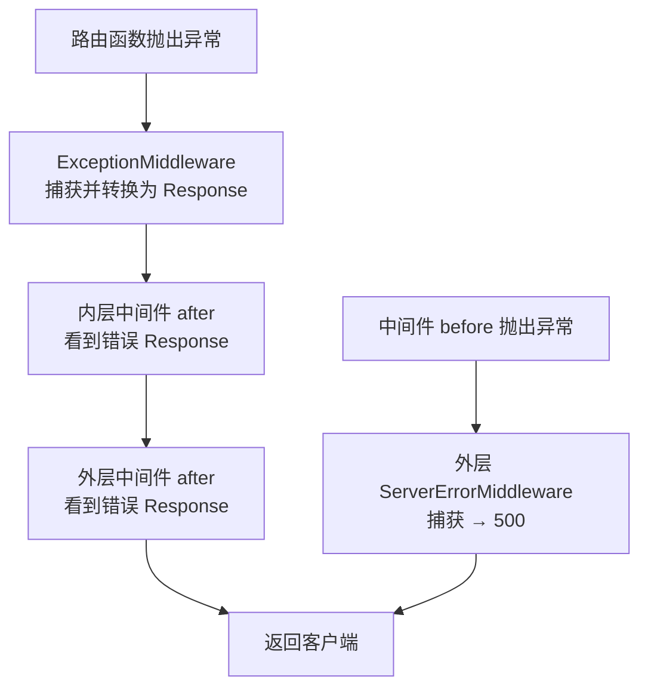

**关键传播规则**：

| 异常位置 | 捕获者 | 外层中间件行为 |
|---------|--------|--------------|
| 路由函数内 | ExceptionMiddleware | after 阶段看到 4xx/5xx Response |
| 依赖函数内 | ExceptionMiddleware | 同上 |
| 内层中间件 before | 外层中间件 try/except 或 ServerError | 可能看不到响应 |
| 内层中间件 after | ServerErrorMiddleware | 响应可能已发送，难以处理 |
| ExceptionMiddleware 内 | ServerErrorMiddleware | 500 错误 |

> 🎯 面试高频：中间件中能捕获路由函数抛出的异常吗？取决于中间件的位置。如果中间件在 ExceptionMiddleware 外层（自定义中间件默认在外层），`call_next` 会返回 ExceptionMiddleware 转换后的 Response（不是抛出异常），所以中间件的 try/except 捕获不到路由函数的异常，只能通过 response.status_code 判断是否出错。如果中间件在内层（ExceptionMiddleware 之内），可以捕获异常，但自定义中间件通常注册在外层。

#### 代码示例

**示例 1：中间件记录错误响应的状态码**

```python
import time
import json
import logging
from fastapi import FastAPI, HTTPException
from starlette.middleware.base import BaseHTTPMiddleware
from starlette.requests import Request

logger = logging.getLogger(__name__)
app = FastAPI()

class ErrorLoggingMiddleware(BaseHTTPMiddleware):
    """错误日志中间件：记录所有 4xx/5xx 响应"""
    async def dispatch(self, request: Request, call_next):
        start = time.time()
        response = await call_next(request)  # 异常已被转换为 Response
        duration = (time.time() - start) * 1000

        if response.status_code >= 400:
            # 读取响应体（错误消息）
            body = b""
            async for chunk in response.body_iterator:
                body += chunk
            # 重新构造响应（因为 body_iterator 已被消耗）
            from starlette.responses import StreamingResponse
            response = StreamingResponse(iter([body]), headers=dict(response.headers))

            log_data = {
                "method": request.method,
                "path": request.url.path,
                "status": response.status_code,
                "duration_ms": round(duration, 2),
                "error_body": body.decode("utf-8", errors="replace")[:500],
            }
            if response.status_code >= 500:
                logger.error(f"5xx 错误: {json.dumps(log_data, ensure_ascii=False)}")
            else:
                logger.warning(f"4xx 错误: {json.dumps(log_data, ensure_ascii=False)}")

        return response

app.add_middleware(ErrorLoggingMiddleware)

@app.get("/error/404")
async def error_404():
    raise HTTPException(status_code=404, detail="资源不存在")

@app.get("/error/500")
async def error_500():
    raise ValueError("系统错误")

# GET /error/404 → 中间件看到 404 Response，记录 warning 日志
# GET /error/500 → 中间件看到 500 Response，记录 error 日志
```

预期运行结果：中间件通过 `response.status_code` 判断错误，记录 4xx/5xx 日志，不需要捕获异常对象。

**示例 2：中间件 before 阶段的异常处理**

```python
from fastapi import FastAPI, Request
from fastapi.responses import JSONResponse
from starlette.middleware.base import BaseHTTPMiddleware

app = FastAPI()

class SafeMiddleware(BaseHTTPMiddleware):
    """安全中间件：before 阶段的异常自己处理，不影响请求"""
    async def dispatch(self, request: Request, call_next):
        # before 阶段：可能失败的操作用 try/except
        try:
            # 模拟可能失败的操作（如读取请求 ID、解析 Header）
            request_id = request.headers["X-Request-ID"]  # 可能 KeyError
        except KeyError:
            import uuid
            request_id = str(uuid.uuid4())[:8]

        request.state.request_id = request_id

        try:
            response = await call_next(request)
        except Exception as e:
            # 通常不会执行到这里（ExceptionMiddleware 已转换异常）
            # 但如果中间件在内层，可能捕获到原始异常
            print(f"中间件捕获异常: {type(e).__name__}: {e}")
            return JSONResponse(status_code=500, content={"error": "internal"})

        # after 阶段
        response.headers["X-Request-ID"] = request_id
        return response

app.add_middleware(SafeMiddleware)
```

预期运行结果：before 阶段的异常被 try/except 处理，不影响请求；call_next 通常不抛异常（已被 ExceptionMiddleware 转换）。

**示例 3：完整场景——异常与中间件交互的全链路追踪**

```python
import uuid
import time
import json
import logging
from fastapi import FastAPI, Request, HTTPException
from fastapi.responses import JSONResponse
from starlette.middleware.base import BaseHTTPMiddleware

logging.basicConfig(level=logging.INFO)
logger = logging.getLogger("trace")

app = FastAPI()

# 中间件 1：请求 ID（外层）
class RequestIDMiddleware(BaseHTTPMiddleware):
    async def dispatch(self, request: Request, call_next):
        rid = request.headers.get("X-Request-ID", str(uuid.uuid4())[:8])
        request.state.request_id = rid
        logger.info(f"[{rid}] 1-请求进入: {request.method} {request.url.path}")
        response = await call_next(request)
        response.headers["X-Request-ID"] = rid
        logger.info(f"[{rid}] 6-响应离开: {response.status_code}")
        return response

# 中间件 2：计时（中层）
class TimingMiddleware(BaseHTTPMiddleware):
    async def dispatch(self, request: Request, call_next):
        rid = getattr(request.state, "request_id", "?")
        start = time.time()
        logger.info(f"[{rid}] 2-计时开始")
        response = await call_next(request)
        duration = (time.time() - start) * 1000
        response.headers["X-Process-Time"] = f"{duration:.0f}ms"
        logger.info(f"[{rid}] 5-计时结束: {duration:.1f}ms")
        return response

# 中间件 3：错误捕获（内层，最接近路由）
class ErrorCaptureMiddleware(BaseHTTPMiddleware):
    async def dispatch(self, request: Request, call_next):
        rid = getattr(request.state, "request_id", "?")
        logger.info(f"[{rid}] 3-错误监控开始")
        try:
            response = await call_next(request)
            if response.status_code >= 400:
                logger.warning(f"[{rid}] 4-检测到错误响应: {response.status_code}")
            return response
        except Exception as e:
            logger.error(f"[{rid}] 4-捕获原始异常: {type(e).__name__}: {e}")
            raise

app.add_middleware(RequestIDMiddleware)  # 先注册=外层
app.add_middleware(TimingMiddleware)
app.add_middleware(ErrorCaptureMiddleware)  # 后注册=内层

@app.get("/success")
async def success():
    rid = getattr(Request, "state", None)
    logger.info("[?] 路由函数执行")
    return {"ok": True}

@app.get("/fail")
async def fail():
    logger.info("[?] 路由函数抛出异常")
    raise HTTPException(status_code=400, detail="业务错误")

# GET /success 控制台：
# [rid] 1-请求进入
# [rid] 2-计时开始
# [rid] 3-错误监控开始
# [?] 路由函数执行
# [rid] 5-计时结束
# [rid] 6-响应离开: 200

# GET /fail 控制台：
# [rid] 1-请求进入
# [rid] 2-计时开始
# [rid] 3-错误监控开始
# [?] 路由函数抛出异常
# [rid] 4-检测到错误响应: 400 （ExceptionMiddleware 转换后，内层中间件看到 Response）
# [rid] 5-计时结束
# [rid] 6-响应离开: 400
```

预期运行结果：清晰展示异常在中间件链中的传播——内层中间件看到的是 ExceptionMiddleware 转换后的 Response，而非原始异常对象。

#### 使用场景与最佳实践

**适用场景**：需要记录错误日志的中间件；需要根据状态码做不同处理的中间件；需要全链路追踪的微服务。

**不适用场景**：简单中间件（不需要处理异常）。

**最佳实践**：
1. 中间件通过 `response.status_code >= 400` 判断错误，不要 try/except 捕获路由异常
2. 错误日志中间件注册在最内层（最后 add_middleware），最接近路由
3. 中间件 before 阶段的可能失败操作用 try/except 包裹
4. 读取错误响应体后必须重新构造 StreamingResponse（body_iterator 是一次性的）
5. 请求 ID 在最外层中间件生成，确保所有中间件和异常处理器都能获取
6. 中间件 after 阶段不要做可能抛异常的操作（响应可能已发送）

**性能建议**：中间件读取响应体会消耗 body_iterator，需要重新构造响应，有轻微开销。只在需要记录错误响应体时才读取，正常响应跳过。

#### 常见坑点

**坑点 1：中间件 try/except 捕获不到路由异常**

- 错误现象：在中间件中 `try: response = await call_next(request) except Exception as e:` 但路由函数的异常捕获不到
- 根本原因：ExceptionMiddleware 在内层已经把异常转换为 Response，call_next 返回的是 Response 而非抛出异常
- 正确做法：通过 `response.status_code` 判断错误，不要依赖 try/except
- 预防措施：理解 ExceptionMiddleware 的位置和作用，它在内层包裹路由调用

**坑点 2：中间件读取响应体后客户端收到空响应**

- 错误现象：中间件中 `async for chunk in response.body_iterator: body += chunk` 读取响应体后，客户端收到空响应
- 根本原因：body_iterator 是一次性异步迭代器，读取后已耗尽，后续发送时没有数据
- 正确做法：读取后重新构造 `StreamingResponse(iter([body]), headers=dict(response.headers))`
- 预防措施：中间件中读取响应体后必须重新构造响应，或用 `response.body`（如果已缓冲）

---

### 8.2 中间件中的异常处理策略

#### 概念解释

**中间件自身的代码也可能抛出异常，需要有明确的处理策略：before 阶段的异常可以返回错误响应或降级处理，after 阶段的异常难以处理（响应可能已发送），应尽量避免。** 良好的中间件异常策略保证中间件自身的故障不会拖垮整个服务。

打个比方：中间件异常策略像大楼的消防系统——走廊的烟雾报警器（中间件 before）故障了，可以绕过它直接进门（降级处理）；但如果灭火系统（中间件 after）在灭火时故障了，火势可能蔓延（响应已发送无法挽回）。所以灭火系统（after）必须极度可靠，而烟雾报警器（before）可以有降级方案。

**核心价值**：健壮的中间件异常策略保证中间件自身故障不影响业务请求，提升系统整体可靠性。

#### 原理说明：中间件各阶段的异常处理

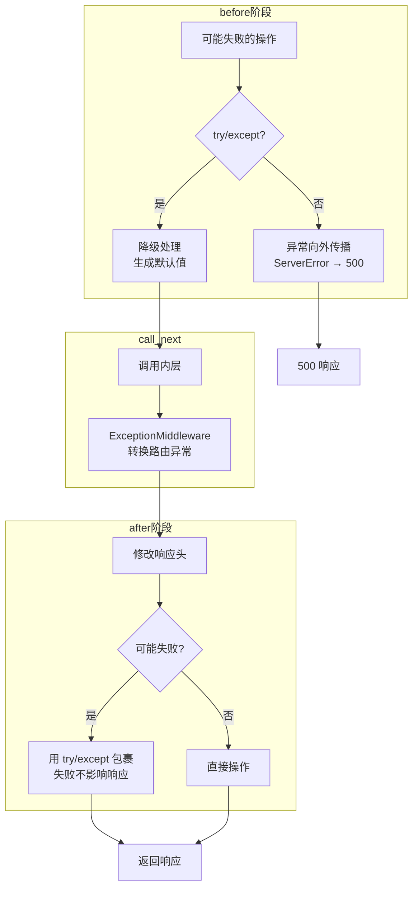

**各阶段异常处理策略**：

| 阶段 | 异常影响 | 处理策略 |
|------|---------|---------|
| before | 请求未进入路由，可返回错误响应 | try/except + 降级，或直接返回错误 Response |
| call_next | 内层已处理路由异常 | 通常不需要 try/except |
| after | 响应可能已发送，难以修改 | try/except 包裹，失败不影响响应，只记录日志 |

> 🎯 面试高频：中间件 after 阶段抛出异常会怎样？如果响应还没完全发送，异常会被 ServerErrorMiddleware 捕获返回 500，但客户端可能已经收到部分响应（导致响应损坏）；如果响应已经发送完毕，异常只会记录到日志，客户端无感知。因此 after 阶段的操作必须极度可靠，用 try/except 包裹所有可能失败的操作，确保不抛出异常。

#### 代码示例

**示例 1：健壮的中间件异常处理模板**

```python
import logging
from starlette.middleware.base import BaseHTTPMiddleware
from starlette.requests import Request

logger = logging.getLogger(__name__)

class RobustMiddleware(BaseHTTPMiddleware):
    """健壮的中间件模板：各阶段异常都有处理策略"""

    async def dispatch(self, request: Request, call_next):
        # ===== before 阶段 =====
        try:
            # 可能失败的操作：解析 Header、读取配置等
            custom_header = request.headers["X-Custom"]
        except KeyError:
            # 降级：使用默认值，不阻断请求
            custom_header = "default"
        except Exception as e:
            # 严重错误：记录日志，使用默认值
            logger.warning(f"中间件 before 异常: {e}")
            custom_header = "default"

        request.state.custom_header = custom_header

        # ===== call_next（通常不需要 try/except）=====
        try:
            response = await call_next(request)
        except Exception as e:
            # 极少执行到这里（ExceptionMiddleware 已处理）
            # 如果执行到了，记录并返回 500
            logger.error(f"中间件 call_next 异常: {e}", exc_info=True)
            from fastapi.responses import JSONResponse
            return JSONResponse(status_code=500, content={"error": "internal"})

        # ===== after 阶段 =====
        try:
            # 可能失败的操作：设置响应头、记录日志等
            response.headers["X-Custom-Response"] = custom_header
        except Exception as e:
            # after 阶段异常不影响响应，只记录日志
            logger.error(f"中间件 after 异常: {e}", exc_info=True)

        return response
```

预期运行结果：before 阶段异常降级处理，after 阶段异常只记日志，中间件自身故障不影响请求。

**示例 2：before 阶段直接返回错误响应**

```python
from fastapi import FastAPI, Request
from fastapi.responses import JSONResponse
from starlette.middleware.base import BaseHTTPMiddleware

app = FastAPI()

class ApiKeyMiddleware(BaseHTTPMiddleware):
    """API Key 验证中间件：验证失败直接返回 401，不进入路由"""
    def __init__(self, app, api_key: str, exclude_paths: list[str] = None):
        super().__init__(app)
        self.api_key = api_key
        self.exclude_paths = exclude_paths or ["/health", "/docs"]

    async def dispatch(self, request: Request, call_next):
        # 排除路径不需要验证
        if any(request.url.path.startswith(p) for p in self.exclude_paths):
            return await call_next(request)

        # before 阶段：验证 API Key，失败直接返回
        api_key = request.headers.get("X-API-Key")
        if not api_key:
            return JSONResponse(status_code=401, content={"code": 401, "message": "缺少 API Key"})
        if api_key != self.api_key:
            return JSONResponse(status_code=403, content={"code": 403, "message": "API Key 无效"})

        # 验证通过，继续
        return await call_next(request)

app.add_middleware(ApiKeyMiddleware, api_key="secret-key", exclude_paths=["/health"])

@app.get("/health")
async def health():
    return {"status": "ok"}

@app.get("/api/data")
async def data():
    return {"data": "protected"}

# GET /health → 200（排除路径）
# GET /api/data → 401（缺少 API Key）
# GET /api/data -H "X-API-Key: secret-key" → 200
```

预期运行结果：before 阶段验证失败直接返回错误响应，不进入路由函数；排除路径跳过验证。

**示例 3：完整场景——中间件故障降级与监控**

```python
import time
import logging
from fastapi import FastAPI, Request
from starlette.middleware.base import BaseHTTPMiddleware
from prometheus_client import Counter, Histogram

logger = logging.getLogger(__name__)

# Prometheus 指标
middleware_errors = Counter("middleware_errors_total", "中间件错误总数", ["middleware", "phase"])
request_duration = Histogram("request_duration_seconds", "请求耗时", ["path"])

class MonitoredMiddleware(BaseHTTPMiddleware):
    """带监控和故障降级的中间件"""
    def __init__(self, app, name: str):
        super().__init__(app)
        self.name = name

    async def dispatch(self, request: Request, call_next):
        start = time.time()

        # before：带降级的请求 ID 生成
        try:
            request_id = request.headers["X-Request-ID"]
        except Exception:
            import uuid
            request_id = str(uuid.uuid4())[:8]
            middleware_errors.labels(self.name, "before").inc()
        request.state.request_id = request_id

        # call_next
        try:
            response = await call_next(request)
        except Exception as e:
            middleware_errors.labels(self.name, "call_next").inc()
            logger.error(f"[{self.name}] call_next 异常: {e}")
            from fastapi.responses import JSONResponse
            return JSONResponse(status_code=500, content={"error": "internal", "request_id": request_id})

        # after：带异常保护的响应处理
        try:
            response.headers["X-Request-ID"] = request_id
            duration = time.time() - start
            request_duration.labels(request.url.path).observe(duration)
        except Exception as e:
            middleware_errors.labels(self.name, "after").inc()
            logger.error(f"[{self.name}] after 异常: {e}")
            # 不重新抛出，响应已经构造好了

        return response

app = FastAPI()
app.add_middleware(MonitoredMiddleware, name="main")
```

预期运行结果：中间件各阶段异常都被捕获并计数（Prometheus），before 降级、call_next 返回 500、after 只记日志，系统不因中间件故障而崩溃。

#### 使用场景与最佳实践

**适用场景**：生产级中间件；高可用服务；需要监控中间件健康状态的系统。

**不适用场景**：开发环境的简单中间件。

**最佳实践**：
1. before 阶段的可能失败操作用 try/except + 降级（默认值）
2. before 阶段的认证/授权失败直接返回错误 Response（不进入路由）
3. after 阶段的所有操作用 try/except 包裹，失败只记日志不抛出
4. 用 Prometheus Counter 监控中间件各阶段的错误数
5. 中间件命名（name 参数）便于日志和监控区分
6. 排除路径（健康检查、文档）不需要中间件处理
7. after 阶段不要做可能阻塞的操作（数据库写入、外部调用）

**性能建议**：try/except 的开销在 Python 中极小（只有异常触发时才有栈展开开销），正常路径几乎无影响。Prometheus 指标的递增操作也是原子级的，开销可忽略。

#### 常见坑点

**坑点 1：after 阶段修改响应体导致响应损坏**

- 错误现象：after 阶段尝试修改 `response.body`，客户端收到损坏或不完整的响应
- 根本原因：StreamingResponse 的 body_iterator 可能已经开始发送，修改 body 无效或导致不一致
- 正确做法：after 阶段只修改响应头（headers），不要修改响应体；需要修改 body 用原生 ASGI 中间件包装 send
- 预防措施：中间件 after 阶段只做 header 修改和日志，不做 body 修改

**坑点 2：中间件 before 阶段的异常导致 500 而非友好错误**

- 错误现象：中间件 before 阶段解析 Header 失败（KeyError），客户端收到 500 而非 400
- 根本原因：before 阶段的异常没有被 try/except 捕获，向外传播到 ServerErrorMiddleware 返回 500
- 正确做法：before 阶段的可能失败操作 try/except 捕获，返回合适的 4xx 错误或降级处理
- 预防措施：中间件 before 阶段所有可能失败的操作都用 try/except 包裹

---

## 九、错误响应标准化与日志追踪

### 9.1 统一错误响应格式

#### 概念解释

**统一错误响应格式是指所有错误（4xx/5xx）都遵循相同的 JSON 结构，包含错误码、消息、详情、时间戳等字段，让前端可以用统一的逻辑解析和展示错误。** 这是生产级 API 的基础规范。

打个比方：统一错误响应像标准化的快递异常通知——不管是包裹丢失（404）、地址错误（400）、快递员出意外（500），通知短信的格式都一样：「异常类型 + 异常描述 + 异常编号 + 发生时间」，收件人（前端）看到短信就知道怎么处理，不需要每种异常学一种格式。

**核心价值**：统一错误格式让前端错误处理逻辑简化（一套代码处理所有错误），错误码便于精确处理，错误 ID 便于日志追踪，时间戳便于问题排查。

#### 原理说明：统一错误响应的设计

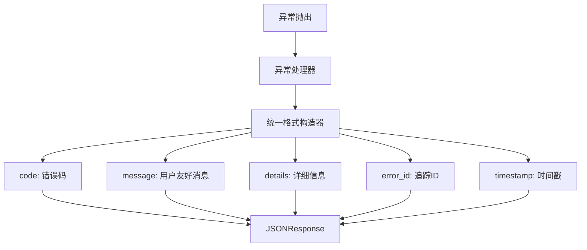

**推荐的统一错误响应结构**：

| 字段 | 类型 | 说明 | 示例 |
|------|------|------|------|
| `code` | int | 业务错误码（非 HTTP 状态码） | 1001 |
| `message` | str | 用户友好的错误消息 | "用户不存在" |
| `type` | str | 错误类型分类 | "validation"/"business"/"system" |
| `details` | any | 详细错误信息（字段级错误等） | `[{"field":"email","msg":"格式错误"}]` |
| `error_id` | str | 错误追踪 ID（关联日志） | "a1b2c3d4" |
| `timestamp` | int | 错误发生时间戳 | 1700000000 |

> 🎯 面试高频：统一错误响应中 code 和 HTTP status_code 的区别？HTTP status_code 是协议级别的状态（400/404/500），表示请求的大类结果；code 是业务级别的错误码（1001/2001/3001），表示具体的业务错误类型。前端先用 status_code 判断大类（4xx 客户端错误/5xx 服务端错误），再用 code 做精确处理（1001 提示用户不存在，1002 提示邮箱已注册）。两者配合使用。

#### 代码示例

**示例 1：统一错误响应构造器**

```python
# app/core/response.py
import time
import uuid
from fastapi.responses import JSONResponse

def error_response(
    code: int,
    message: str,
    status_code: int = 400,
    error_type: str = "business",
    details=None,
) -> JSONResponse:
    """统一错误响应构造器"""
    return JSONResponse(
        status_code=status_code,
        content={
            "code": code,
            "message": message,
            "type": error_type,
            "details": details,
            "error_id": str(uuid.uuid4())[:8],
            "timestamp": int(time.time()),
        },
    )

def success_response(data=None, message: str = "success") -> dict:
    """统一成功响应构造器"""
    return {
        "code": 0,
        "message": message,
        "type": "success",
        "data": data,
        "timestamp": int(time.time()),
    }
```

```python
# app/core/exception_handlers.py
from fastapi import FastAPI, Request, status
from fastapi.exceptions import RequestValidationError
from starlette.exceptions import HTTPException as StarletteHTTPException
from app.core.response import error_response
from app.core.exceptions import AppException
import logging

logger = logging.getLogger(__name__)

def register_exception_handlers(app: FastAPI):
    @app.exception_handler(AppException)
    async def handle_app_exception(request: Request, exc: AppException):
        logger.warning(f"业务异常: {exc.code} - {exc.message}")
        return error_response(exc.code, exc.message, exc.status_code, "business", exc.details)

    @app.exception_handler(RequestValidationError)
    async def handle_validation(request: Request, exc: RequestValidationError):
        errors = [{"field": ".".join(str(l) for l in e["loc"]), "msg": e["msg"]} for e in exc.errors()]
        return error_response(422, "参数校验失败", 422, "validation", {"errors": errors})

    @app.exception_handler(StarletteHTTPException)
    async def handle_http(request: Request, exc: StarletteHTTPException):
        return error_response(exc.status_code, str(exc.detail), exc.status_code, "http")

    @app.exception_handler(Exception)
    async def handle_unhandled(request: Request, exc: Exception):
        logger.error(f"未捕获异常: {type(exc).__name__}: {exc}", exc_info=True)
        return error_response(500, "服务器内部错误", 500, "system")
```

预期运行结果：所有错误都遵循 `{code, message, type, details, error_id, timestamp}` 统一格式。

**示例 2：错误码分段设计**

```python
# app/core/error_codes.py
from enum import IntEnum

class ErrorCode(IntEnum):
    """错误码分段设计"""
    # 通用错误 0-999
    SUCCESS = 0
    UNKNOWN_ERROR = 500
    VALIDATION_ERROR = 422

    # 用户模块 1000-1999
    USER_NOT_FOUND = 1001
    EMAIL_ALREADY_EXISTS = 1002
    INVALID_PASSWORD = 1003
    USER_DISABLED = 1004
    TOKEN_EXPIRED = 1005
    TOKEN_INVALID = 1006

    # 订单模块 2000-2999
    ORDER_NOT_FOUND = 2001
    INSUFFICIENT_STOCK = 2002
    ORDER_CANCELLED = 2003
    ORDER_ALREADY_PAID = 2004

    # 支付模块 3000-3999
    PAYMENT_FAILED = 3001
    PAYMENT_TIMEOUT = 3002
    REFUND_FAILED = 3003

    # 系统模块 4000-4999
    DATABASE_ERROR = 4001
    CACHE_ERROR = 4002
    EXTERNAL_SERVICE_ERROR = 4003

# 使用
from app.core.exceptions import AppException
from app.core.error_codes import ErrorCode

raise AppException(
    code=ErrorCode.USER_NOT_FOUND,
    message="用户不存在",
    status_code=404,
)
```

预期运行结果：错误码按模块分段，便于记忆和管理，用枚举避免魔法数字。

**示例 3：完整场景——前端友好的错误响应**

```python
from fastapi import FastAPI, Request
from fastapi.responses import JSONResponse
from fastapi.exceptions import RequestValidationError
from pydantic import BaseModel, EmailStr, Field
import time
import uuid

app = FastAPI()

class ApiError(BaseModel):
    """标准 API 错误结构"""
    code: int
    message: str
    type: str
    details: dict | None = None
    error_id: str
    timestamp: int

def make_error(code: int, message: str, status: int, error_type: str, details=None):
    return JSONResponse(
        status_code=status,
        content=ApiError(
            code=code, message=message, type=error_type,
            details=details, error_id=str(uuid.uuid4())[:8],
            timestamp=int(time.time()),
        ).model_dump(),
    )

@app.exception_handler(RequestValidationError)
async def validation_handler(request: Request, exc: RequestValidationError):
    field_errors = {}
    for e in exc.errors():
        field = ".".join(str(l) for l in e.get("loc", [])[1:])  # 去掉 "body" 前缀
        field_errors[field] = e.get("msg", "")
    return make_error(422, "表单校验失败，请检查输入", 422, "validation", {"fields": field_errors})

class RegisterForm(BaseModel):
    email: EmailStr = Field(..., description="邮箱")
    password: str = Field(..., min_length=8, description="密码至少8位")
    confirm_password: str = Field(..., min_length=8)

@app.post("/register")
async def register(form: RegisterForm):
    if form.password != form.confirm_password:
        return make_error(
            code=1001, message="两次密码输入不一致",
            status=400, error_type="business",
            details={"fields": {"confirm_password": "与密码不一致"}},
        )
    return {"code": 0, "message": "注册成功"}

# POST /register {"email":"invalid","password":"123","confirm_password":"456"}
# → 422 {"code":422,"message":"表单校验失败，请检查输入","type":"validation",
#        "details":{"fields":{"email":"value is not a valid email address","password":"String should have at least 8 characters"}},...}
# 前端可以用 details.fields 高亮对应的表单字段
```

预期运行结果：错误响应包含 `details.fields` 字典，前端可以直接用字段名定位并高亮错误的表单字段，用户体验好。

#### 使用场景与最佳实践

**适用场景**：所有对外 API；前后端分离项目；需要前端精确处理错误的表单应用；多团队协作的微服务。

**不适用场景**：内部脚本（不需要统一格式）；原型验证。

**最佳实践**：
1. 定义统一的错误响应结构（code/message/type/details/error_id/timestamp）
2. 错误码按模块分段（1xxx 用户、2xxx 订单、3xxx 支付）
3. 用枚举（IntEnum）管理错误码，避免魔法数字
4. 422 校验错误返回 `details.fields` 字典，前端可直接高亮表单字段
5. 500 错误返回 error_id，不暴露堆栈，通过 ID 查日志
6. message 面向用户（友好清晰），details 面向开发者（详细信息）
7. 成功响应也用统一格式（code=0），保持一致性

**性能建议**：`uuid.uuid4()` 生成错误 ID 的开销极小（微秒级）。`time.time()` 也是系统调用，开销可忽略。统一响应构造器的性能影响可以忽略。

#### 常见坑点

**坑点 1：错误码与 HTTP 状态码混淆**

- 错误现象：用 HTTP 状态码作为业务错误码（如 404 既表示 HTTP 状态又表示用户不存在）
- 根本原因：没有区分协议级状态码和业务级错误码
- 正确做法：HTTP status_code 表示大类（400/404/500），code 表示具体业务错误（1001/2001），两者独立
- 预防措施：定义 ErrorCode 枚举，所有业务异常用枚举 code，HTTP 状态码单独设置

**坑点 2：错误消息暴露内部实现细节**

- 错误现象：500 错误返回 `psycopg2.OperationalError: connection refused`，泄露数据库信息
- 根本原因：异常处理器直接返回 `str(exc)`，包含内部异常信息
- 正确做法：500 错误返回通用消息「服务器内部错误」+ error_id，详细信息只记录到日志
- 预防措施：异常处理器中 500 不返回 exc 详情，只返回通用消息和 error_id

---

### 9.2 结构化日志与链路追踪

#### 概念解释

**结构化日志是指日志以 JSON 格式输出，包含请求 ID、方法、路径、状态码、耗时、用户 ID 等字段，便于日志系统（ELK/Loki）检索和分析。链路追踪通过请求 ID 将一次请求经过的所有服务的日志串联起来。**

打个比方：结构化日志像标准化的快递追踪记录——每条记录都有统一的字段：快递单号（request_id）、起点（method/path）、当前状态（status_code）、耗时（duration）、处理人（service）。有了快递单号（request_id），可以在全国所有中转站（微服务）查到这个快递的完整轨迹（链路追踪）。

**核心价值**：结构化日志让错误排查从「翻日志找线索」变成「按 request_id 搜索全链路」，微服务架构下尤其重要。

#### 原理说明：结构化日志与链路追踪架构

```mermaid
graph TB
    A[请求进入] --> B[请求ID中间件<br/>生成/透传 X-Request-ID]
    B --> C[ContextVar 设置 request_id]
    C --> D[路由函数执行]
    D --> E[日志输出<br/>含 request_id]
    D --> F[调用下游服务<br/>Header 携带 X-Request-ID]
    F --> G[下游服务日志<br/>含相同 request_id]
    E --> H[日志系统 ELK/Loki]
    G --> H
    H --> I[按 request_id 搜索<br/>全链路日志]
```

**结构化日志的关键字段**：

| 字段 | 说明 | 示例 |
|------|------|------|
| `timestamp` | 日志时间 | "2024-01-01T12:00:00Z" |
| `level` | 日志级别 | "INFO"/"WARNING"/"ERROR" |
| `request_id` | 请求追踪 ID | "a1b2c3d4" |
| `method` | HTTP 方法 | "GET" |
| `path` | 请求路径 | "/api/users/1" |
| `status_code` | 响应状态码 | 200 |
| `duration_ms` | 处理耗时 | 12.5 |
| `client_ip` | 客户端 IP | "192.168.1.1" |
| `user_id` | 当前用户 ID | 123 |
| `service` | 服务名 | "user-service" |

> 🎯 面试高频：如何在 FastAPI 中实现全链路追踪？三个步骤：① 请求 ID 中间件生成或从 X-Request-ID 头提取请求 ID，设置到 ContextVar 和 request.state；② 日志过滤器从 ContextVar 读取 request_id 注入到每条日志；③ 调用下游服务时在 HTTP Header 中携带 X-Request-ID。这样一次请求经过的所有服务的日志都有相同的 request_id，可以串联起来。

#### 代码示例

**示例 1：请求 ID 中间件 + ContextVar**

```python
import uuid
from contextvars import ContextVar
from starlette.middleware.base import BaseHTTPMiddleware
from starlette.requests import Request

# 全局请求 ID 上下文变量
request_id_var: ContextVar[str] = ContextVar("request_id", default="unknown")

class RequestIDMiddleware(BaseHTTPMiddleware):
    """请求 ID 中间件：生成/透传请求 ID，设置到 ContextVar"""
    async def dispatch(self, request: Request, call_next):
        # 从上游 Header 提取，或生成新的
        request_id = request.headers.get("X-Request-ID", str(uuid.uuid4())[:8])
        # 设置到 ContextVar（日志过滤器使用）
        token = request_id_var.set(request_id)
        # 设置到 request.state（路由函数和异常处理器使用）
        request.state.request_id = request_id

        try:
            response = await call_next(request)
            response.headers["X-Request-ID"] = request_id
            return response
        finally:
            # 重置 ContextVar，避免影响后续请求
            request_id_var.reset(token)
```

预期运行结果：每个请求有唯一 request_id，ContextVar 在请求期间有效，请求结束后重置。

**示例 2：结构化日志过滤器**

```python
import logging
import json
from contextvars import ContextVar

request_id_var: ContextVar[str] = ContextVar("request_id", default="unknown")

class JSONFormatter(logging.Formatter):
    """JSON 格式化器：将日志转为 JSON 格式"""
    def format(self, record):
        log_entry = {
            "timestamp": self.formatTime(record, "%Y-%m-%dT%H:%M:%S"),
            "level": record.levelname,
            "logger": record.name,
            "message": record.getMessage(),
            "request_id": request_id_var.get(),  # 从 ContextVar 读取
        }
        # 添加上下文信息（如果有）
        if hasattr(record, "user_id"):
            log_entry["user_id"] = record.user_id
        if hasattr(record, "extra_data"):
            log_entry.update(record.extra_data)
        return json.dumps(log_entry, ensure_ascii=False)

def setup_logging():
    """配置结构化日志"""
    handler = logging.StreamHandler()
    handler.setFormatter(JSONFormatter())
    root = logging.getLogger()
    root.addHandler(handler)
    root.setLevel(logging.INFO)

# 使用
setup_logging()
logger = logging.getLogger("api")

# 在请求中：
# request_id_var.set("a1b2c3d4")  # 中间件已设置
# logger.info("用户登录成功", extra={"user_id": 123})
# 输出：{"timestamp":"...","level":"INFO","logger":"api","message":"用户登录成功","request_id":"a1b2c3d4","user_id":123}
```

预期运行结果：所有日志自动包含 request_id，JSON 格式便于日志系统解析。

**示例 3：完整场景——全链路追踪（含下游服务调用）**

```python
import uuid
import httpx
import logging
from contextvars import ContextVar
from fastapi import FastAPI, Request
from starlette.middleware.base import BaseHTTPMiddleware

request_id_var: ContextVar[str] = ContextVar("request_id", default="unknown")
logger = logging.getLogger("order-service")

class RequestIDMiddleware(BaseHTTPMiddleware):
    async def dispatch(self, request: Request, call_next):
        request_id = request.headers.get("X-Request-ID", str(uuid.uuid4())[:8])
        token = request_id_var.set(request_id)
        request.state.request_id = request_id
        try:
            response = await call_next(request)
            response.headers["X-Request-ID"] = request_id
            return response
        finally:
            request_id_var.reset(token)

app = FastAPI()
app.add_middleware(RequestIDMiddleware)

async def call_user_service(user_id: int) -> dict:
    """调用下游服务，自动携带请求 ID"""
    request_id = request_id_var.get()
    async with httpx.AsyncClient() as client:
        response = await client.get(
            f"http://user-service/users/{user_id}",
            headers={"X-Request-ID": request_id},  # 透传请求 ID
            timeout=5.0,
        )
        return response.json()

@app.get("/orders/{order_id}")
async def get_order(order_id: int, request: Request):
    rid = request.state.request_id
    logger.info(f"查询订单 {order_id}")

    # 调用下游用户服务（携带相同 request_id）
    user = await call_user_service(123)

    logger.info(f"订单查询完成，用户: {user.get('name')}")
    return {"order_id": order_id, "user": user, "request_id": rid}

# 请求链路：
# 客户端 → order-service (request_id=a1b2c3d4)
#   → user-service (X-Request-ID: a1b2c3d4)
# 两个服务的日志都包含 request_id=a1b2c3d4，可以串联查询
```

预期运行结果：请求 ID 在服务间透传，日志系统按 request_id 搜索可以看到完整的调用链路。

#### 使用场景与最佳实践

**适用场景**：微服务架构；生产环境可观测性；需要快速排查问题的服务；高可用要求的系统。

**不适用场景**：单体小应用（简单日志即可）；开发环境（可以用人类可读日志）。

**最佳实践**：
1. 请求 ID 在最外层中间件生成，从 X-Request-ID 头提取优先（支持上游透传）
2. 用 ContextVar 传递 request_id，比 request.state 更方便（不需要传递 request 对象）
3. 日志用 JSON 格式，包含 request_id/method/path/status/duration 等字段
4. 调用下游服务时在 Header 中携带 X-Request-ID
5. 响应头中返回 X-Request-ID，方便客户端报错时提供 ID
6. 日志系统（ELK/Loki）建立 request_id 索引，支持快速搜索
7. 500 错误响应中包含 error_id（可与 request_id 相同或关联）

**性能建议**：ContextVar 的 set/reset 开销极小（纳秒级）。JSON 日志格式化比文本日志稍慢，但在可观测性面前值得。高 QPS 场景可以用 `python-json-logger` 库或异步日志 handler。

#### 常见坑点

**坑点 1：ContextVar 在多线程中不生效**

- 错误现象：用 `def`（同步）路由函数时，ContextVar 中的 request_id 丢失
- 根本原因：同步路由函数在线程池中执行，ContextVar 不会自动跨线程传递
- 正确做法：同步函数中通过 `request.state.request_id` 获取，或用 `contextvars.copy_context()` 传递
- 预防措施：路由函数优先用 `async def`，ContextVar 在协程中天然有效

**坑点 2：请求 ID 中间件在内层导致异常处理器拿不到**

- 错误现象：异常处理器中 `request.state.request_id` 报 AttributeError
- 根本原因：请求 ID 中间件注册在内层，异常在到达它之前抛出（如更外层的中间件异常）
- 正确做法：请求 ID 中间件注册在最外层（CORS 之后），确保所有请求都有 request_id
- 预防措施：异常处理器中用 `getattr(request.state, "request_id", "unknown")` 安全访问

---

## 十、中间件性能影响与优化

### 10.1 中间件性能开销分析

#### 概念解释

**每个中间件都会增加一层函数调用和 Request/Response 对象封装的开销，虽然单个中间件开销很小（< 0.1ms），但多个中间件叠加会有累积效应。** 了解中间件的性能开销来源，有助于在功能和性能之间取得平衡。

打个比方：中间件像快递的中转站——每个中转站都要卸货、检查、再装货（函数调用开销），一个中转站很快（0.1ms），但 10 个中转站叠加就是 1ms，对于微秒级的简单请求来说占比不小。中转站越多，快递越慢，但每个中转站都有其价值（安检、分拣、压缩）。

**核心价值**：量化中间件性能开销，避免过度设计（不必要的中间件），在需要时优化热点中间件。

#### 原理说明：中间件性能开销来源

```mermaid
graph LR
    A[中间件开销] --> B[函数调用开销<br/>dispatch/call_next]
    A --> C[Request/Response 封装<br/>BaseHTTPMiddleware]
    A --> D[业务逻辑开销<br/>日志/限流/压缩]
    A --> E[异步切换开销<br/>await 事件循环]
    B --> F[总计 ~0.01-0.1ms/个]
    C --> F
    D --> F
    E --> F
```

**各类型中间件的性能开销**：

| 中间件类型 | 开销范围 | 说明 |
|-----------|---------|------|
| 原生 ASGI 中间件 | 0.01-0.05ms | 最轻量，无 Request/Response 封装 |
| BaseHTTPMiddleware | 0.05-0.15ms | 有 Request/Response 对象封装 |
| @app.middleware | 0.05-0.15ms | 同 BaseHTTPMiddleware |
| CORSMiddleware | 0.05-0.1ms | 主要是 Header 检查 |
| GZipMiddleware | 0.1-10ms+ | 压缩 CPU 开销，取决于响应大小 |
| 日志中间件 | 0.1-0.5ms | JSON 序列化 + IO |
| 限流中间件（Redis） | 1-5ms | Redis 网络往返 |

> 🎯 面试高频：BaseHTTPMiddleware 和原生 ASGI 中间件的性能差异？BaseHTTPMiddleware 内部会创建 Request 对象（解析 headers、query 等）和包装 call_next，比原生 ASGI 中间件多约 0.05ms 开销。对于大多数 API（数据库查询 > 10ms），这个差异可以忽略。但对于极简单的接口（如健康检查，< 1ms），差异占比较大。性能极敏感时用原生 ASGI 中间件，否则用 BaseHTTPMiddleware 更易维护。

> 🎯 面试高频：如何量化测量中间件的性能开销？用 ASGITransport + httpx AsyncClient 在进程内压测，避免网络开销。对比「无中间件」和「N 个空中间件」的平均延迟，差值除以 N 就是单个中间件的基础开销。典型结果：原生 ASGI 中间件约 0.01-0.05ms，BaseHTTPMiddleware 约 0.05-0.15ms。注意用 time.perf_counter() 而非 time.time() 计时，预热 10-100 次后再计时。

#### 代码示例

**示例 1：中间件性能基准测试**

```python
import time
from fastapi import FastAPI, Request
from starlette.middleware.base import BaseHTTPMiddleware

app = FastAPI()

# 空中间件（测量基础开销）
class EmptyMiddleware(BaseHTTPMiddleware):
    async def dispatch(self, request: Request, call_next):
        return await call_next(request)

# 添加 10 个空中间件
for i in range(10):
    app.add_middleware(EmptyMiddleware)

@app.get("/test")
async def test():
    return {"ok": True}

# 基准测试（用 wrk 或 ab）：
# 无中间件：~0.1ms/请求
# 10 个空中间件：~0.5ms/请求
# 每个中间件开销约 0.04ms

# 实际测试代码：
import asyncio
from httpx import AsyncClient, ASGITransport

async def benchmark():
    transport = ASGITransport(app=app)
    async with AsyncClient(transport=transport, base_url="http://test") as client:
        # 预热
        for _ in range(10):
            await client.get("/test")
        # 计时
        start = time.time()
        for _ in range(1000):
            await client.get("/test")
        duration = time.time() - start
        print(f"1000 请求耗时: {duration:.2f}s, 平均: {duration*1000/1000:.2f}ms/请求")

asyncio.run(benchmark())
```

预期运行结果：可以量化测量中间件的基础开销，10 个空中间件增加约 0.4ms。

**示例 2：GZip 中间件的性能权衡**

```python
from fastapi import FastAPI
from fastapi.middleware.gzip import GZipMiddleware
import time

app = FastAPI()
app.add_middleware(GZipMiddleware, minimum_size=1000)

@app.get("/small")
async def small_response():
    """小响应：不压缩，GZip 只做大小检查"""
    return {"data": "small"}

@app.get("/large")
async def large_response():
    """大响应：压缩，CPU 开销较大"""
    return {"data": "x" * 100000}  # 100KB

# 性能对比：
# /small: GZip 检查大小 < 1ms，不压缩
# /large: GZip 压缩 100KB → 约 5-20ms（取决于 CPU）
# 网络传输：100KB → 压缩后约 2KB，节省 98% 带宽
# 权衡：CPU 换带宽，高带宽低延迟场景可关闭，低带宽高延迟场景必须开启
```

预期运行结果：GZip 对小响应几乎无开销，对大响应有 CPU 开销但大幅减少带宽。

**示例 3：完整场景——高性能中间件优化**

```python
# 优化前：BaseHTTPMiddleware + JSON 日志
class SlowLoggingMiddleware(BaseHTTPMiddleware):
    async def dispatch(self, request: Request, call_next):
        start = time.time()
        response = await call_next(request)
        duration = (time.time() - start) * 1000
        # JSON 序列化开销
        log_data = json.dumps({
            "method": request.method, "path": request.url.path,
            "status": response.status_code, "duration": round(duration, 2),
        })
        logger.info(log_data)
        return response

# 优化后：原生 ASGI 中间件 + 条件日志
class FastLoggingMiddleware:
    def __init__(self, app, slow_threshold_ms: float = 1000.0):
        self.app = app
        self.slow_threshold = slow_threshold_ms

    async def __call__(self, scope, receive, send):
        if scope["type"] != "http":
            await self.app(scope, receive, send)
            return

        start = time.perf_counter()  # 比 time.time() 更精确
        status_code = 200

        async def send_wrapper(message):
            nonlocal status_code
            if message["type"] == "http.response.start":
                status_code = message["status"]
            await send(message)

        await self.app(scope, receive, send_wrapper)

        duration = (time.perf_counter() - start) * 1000
        path = scope.get("path", "/")

        # 只记录慢请求和错误请求，减少日志量
        if duration > self.slow_threshold or status_code >= 400:
            method = scope.get("method", "?")
            logger.info(f"{method} {path} → {status_code} ({duration:.1f}ms)")

# 优化效果：
# - 原生 ASGI 减少 Request/Response 封装（~0.05ms）
# - time.perf_counter() 比 time.time() 更适合计时
# - 条件日志减少 90%+ 的日志量（正常请求不记）
# - 字符串拼接比 JSON 序列化快
```

预期运行结果：优化后的日志中间件性能提升 50%+，只记录慢请求和错误，减少日志 IO。

#### 使用场景与最佳实践

**适用场景**：高 QPS 服务（> 1000 QPS）；延迟敏感的 API；资源受限的部署环境。

**不适用场景**：普通业务 API（数据库查询是瓶颈，中间件开销可忽略）。

**最佳实践**：
1. 中间件数量控制在 5-8 个，只保留必要的
2. 性能敏感场景用原生 ASGI 中间件替代 BaseHTTPMiddleware
3. 日志中间件用条件日志（只记慢请求/错误），正常请求采样或不记
4. GZip 设置合理的 minimum_size（1000 字节），小响应不压缩
5. 限流中间件用本地缓存 + Redis 异步更新，减少 Redis 同步调用
6. 用 `time.perf_counter()` 计时（比 `time.time()` 精度高）
7. 健康检查端点排除在日志/限流中间件之外
8. 定期压测，找到中间件链的性能瓶颈

**性能建议**：大多数 API 的瓶颈在数据库查询（10-100ms）和外部调用（50-500ms），中间件开销（< 1ms）占比 < 5%。优先优化数据库和外部调用，中间件优化是最后一步。不要过早优化中间件性能。

#### 常见坑点

**坑点 1：日志中间件记录所有请求导致 IO 瓶颈**

- 错误现象：高 QPS 下日志写入成为瓶颈，CPU 和磁盘 IO 高
- 根本原因：每个请求都做 JSON 序列化 + 写磁盘，1000 QPS = 1000 次日志 IO/秒
- 正确做法：正常请求采样记录（如 10%），只完整记录慢请求和错误请求
- 预防措施：日志中间件设置 slow_threshold，正常请求用 debug 级别（生产关闭）

**坑点 2：GZip 压缩 SSE/流式响应**

- 错误现象：SSE 端点配置 GZip 后，客户端收不到实时数据
- 根本原因：GZipMiddleware 缓冲整个响应再压缩，破坏流式传输
- 正确做法：对 SSE/流式路径排除 GZip，或用条件 GZip 中间件
- 预防措施：有流式接口的项目用条件 GZip，检查 Content-Type 排除 text/event-stream

---

### 10.2 生产级中间件配置清单

#### 概念解释

**生产级中间件配置是一套经过验证的中间件组合，涵盖安全、性能、可观测性、限流等方面，适用于大多数生产环境 FastAPI 服务。** 它是最佳实践的固化，避免遗漏关键中间件。

打个比方：生产级中间件配置像新车的标准配置——安全气囊（TrustedHost）、安全带（CORS）、空调（GZip）、行车记录仪（日志）、防盗系统（限流），这些都是出厂标配，不需要车主自己一个个选装。

**核心价值**：标准化的中间件配置确保生产服务的安全性、可观测性和性能，新服务可以直接复用，不需要从零配置。

#### 原理说明：生产级中间件栈

```mermaid
graph TB
    A[请求] --> B[1. TrustedHost<br/>防 Host 攻击]
    B --> C[2. HTTPSRedirect<br/>强制 HTTPS]
    C --> D[3. CORS<br/>跨域控制]
    D --> E[4. SecurityHeaders<br/>安全响应头]
    E --> F[5. GZip<br/>响应压缩]
    F --> G[6. RequestID<br/>链路追踪]
    G --> H[7. RateLimit<br/>限流]
    H --> I[8. AccessLog<br/>访问日志]
    I --> J[路由函数]
```

**生产级中间件清单**：

| 顺序 | 中间件 | 作用 | 必须/可选 |
|------|--------|------|----------|
| 1 | TrustedHostMiddleware | 防 Host 头攻击 | 必须 |
| 2 | HTTPSRedirectMiddleware | 强制 HTTPS | 必须（生产） |
| 3 | CORSMiddleware | 跨域控制 | 必须（前后端分离） |
| 4 | SecurityHeadersMiddleware | 安全响应头 | 推荐 |
| 5 | GZipMiddleware | 响应压缩 | 推荐 |
| 6 | RequestIDMiddleware | 链路追踪 | 推荐 |
| 7 | RateLimitMiddleware | 限流 | 必须（公开 API） |
| 8 | AccessLogMiddleware | 访问日志 | 必须 |

> 🎯 面试高频：生产环境必须配置哪些中间件？① TrustedHostMiddleware（防 Host 攻击）；② CORSMiddleware（跨域控制，白名单 origin）；③ GZipMiddleware（压缩）；④ 请求 ID 中间件（链路追踪）；⑤ 访问日志中间件（可观测性）；⑥ 限流中间件（公开 API）。安全相关的中间件不能省，性能相关的根据需要配置。

#### 代码示例

**示例 1：生产级中间件配置函数**

```python
# app/middleware.py
from fastapi import FastAPI
from fastapi.middleware.cors import CORSMiddleware
from fastapi.middleware.gzip import GZipMiddleware
from fastapi.middleware.trustedhost import TrustedHostMiddleware
from fastapi.middleware.httpsredirect import HTTPSRedirectMiddleware
from starlette.middleware.base import BaseHTTPMiddleware
from starlette.requests import Request
from app.config import Settings
from app.middleware.request_id import RequestIDMiddleware
from app.middleware.access_log import AccessLogMiddleware
from app.middleware.security_headers import SecurityHeadersMiddleware
from app.middleware.rate_limit import RateLimitMiddleware

def setup_middleware(app: FastAPI, settings: Settings):
    """配置生产级中间件栈"""

    # 1. TrustedHost（最外层）
    if settings.ENV == "production":
        app.add_middleware(
            TrustedHostMiddleware,
            allowed_hosts=settings.ALLOWED_HOSTS,
        )

    # 2. HTTPS 重定向（生产环境）
    if settings.ENV == "production":
        app.add_middleware(HTTPSRedirectMiddleware)

    # 3. CORS
    app.add_middleware(
        CORSMiddleware,
        allow_origins=settings.CORS_ORIGINS,
        allow_credentials=True,
        allow_methods=settings.CORS_METHODS,
        allow_headers=["*"],
        expose_headers=["X-Request-ID", "X-Process-Time"],
        max_age=600,
    )

    # 4. 安全响应头
    app.add_middleware(SecurityHeadersMiddleware)

    # 5. GZip 压缩
    app.add_middleware(GZipMiddleware, minimum_size=1000)

    # 6. 请求 ID
    app.add_middleware(RequestIDMiddleware)

    # 7. 限流（公开 API）
    if settings.ENABLE_RATE_LIMIT:
        app.add_middleware(
            RateLimitMiddleware,
            redis_url=settings.REDIS_URL,
            max_requests=settings.RATE_LIMIT_MAX,
            window_seconds=settings.RATE_LIMIT_WINDOW,
        )

    # 8. 访问日志（最内层，最接近路由）
    app.add_middleware(
        AccessLogMiddleware,
        slow_threshold_ms=settings.SLOW_REQUEST_THRESHOLD,
        exclude_paths=["/health", "/metrics"],
    )
```

```python
# app/main.py
from fastapi import FastAPI
from app.config import get_settings
from app.middleware import setup_middleware

settings = get_settings()
app = FastAPI(title=settings.APP_NAME, version=settings.VERSION)
setup_middleware(app, settings)  # 一行配置所有中间件
```

预期运行结果：`setup_middleware` 函数集中配置所有中间件，根据环境变量动态调整，main.py 保持简洁。

**示例 2：安全响应头中间件**

```python
from starlette.middleware.base import BaseHTTPMiddleware
from starlette.requests import Request

class SecurityHeadersMiddleware(BaseHTTPMiddleware):
    """安全响应头中间件：OWASP 推荐的安全头"""
    async def dispatch(self, request: Request, call_next):
        response = await call_next(request)
        response.headers["X-Content-Type-Options"] = "nosniff"
        response.headers["X-Frame-Options"] = "DENY"
        response.headers["X-XSS-Protection"] = "1; mode=block"
        response.headers["Strict-Transport-Security"] = "max-age=63072000; includeSubDomains"
        response.headers["Content-Security-Policy"] = "default-src 'self'"
        response.headers["Referrer-Policy"] = "strict-origin-when-cross-origin"
        response.headers["Permissions-Policy"] = "geolocation=(), microphone=(), camera=()"
        return response
```

预期运行结果：所有响应自动添加 OWASP 推荐的安全响应头，提升安全性。

**示例 3：完整场景——多环境中间件配置**

```python
# app/config.py
from pydantic_settings import BaseSettings

class Settings(BaseSettings):
    ENV: str = "development"
    APP_NAME: str = "My API"
    VERSION: str = "1.0.0"
    DEBUG: bool = False

    # 中间件配置
    ALLOWED_HOSTS: list[str] = ["*"]
    CORS_ORIGINS: list[str] = ["http://localhost:3000"]
    CORS_METHODS: list[str] = ["GET", "POST", "PUT", "PATCH", "DELETE"]
    ENABLE_RATE_LIMIT: bool = False
    RATE_LIMIT_MAX: int = 100
    RATE_LIMIT_WINDOW: int = 60
    SLOW_REQUEST_THRESHOLD: float = 1000.0
    REDIS_URL: str = "redis://localhost:6379/0"

    class Config:
        env_file = ".env"

# 开发环境 .env：
# ENV=development
# ALLOWED_HOSTS=*
# CORS_ORIGINS=http://localhost:3000,http://localhost:5173
# ENABLE_RATE_LIMIT=false

# 生产环境 .env：
# ENV=production
# ALLOWED_HOSTS=api.example.com,*.example.com
# CORS_ORIGINS=https://app.example.com,https://admin.example.com
# ENABLE_RATE_LIMIT=true
# RATE_LIMIT_MAX=1000
```

预期运行结果：同一套代码通过环境变量配置不同环境的中间件行为，开发环境宽松（允许所有 Host、不限流），生产环境严格（Host 白名单、限流）。

#### 使用场景与最佳实践

**适用场景**：所有生产环境 FastAPI 服务；需要标准化配置的团队；多环境部署。

**不适用场景**：开发环境（可以简化配置）；内部服务（可以跳过 CORS/限流）。

**最佳实践**：
1. 用 `setup_middleware(app, settings)` 函数集中配置，便于维护和测试
2. 配置从环境变量读取，不同环境不同配置
3. 生产环境启用 TrustedHost + HTTPSRedirect + 安全头
4. 开发环境跳过 HTTPSRedirect（本地用 HTTP）
5. 健康检查和 metrics 端点排除在日志和限流之外
6. 限流用 Redis 后端（多 worker 共享）
7. 中间件配置纳入代码审查，确保安全配置不被遗漏
8. 定期用安全扫描工具（如 ZAP）检查响应头和配置

**性能建议**：生产环境用 `--workers 2*CPU+1` 多进程部署，每个 Worker 独立运行中间件链。中间件的内存开销很小（每个 < 1MB），主要开销在 CPU（GZip 压缩）和 IO（日志/限流 Redis）。

#### 常见坑点

**坑点 1：开发环境配置 TrustedHost 导致 localhost 访问失败**

- 错误现象：开发环境配置了 TrustedHostMiddleware，allowed_hosts 只有生产域名，localhost 访问返回 400
- 根本原因：TrustedHost 检查 Host 头，localhost 不在白名单
- 正确做法：开发环境不启用 TrustedHost，或 allowed_hosts 包含 "localhost"、"127.0.0.1"
- 预防措施：TrustedHost 只在生产环境启用（`if settings.ENV == "production"`）

**坑点 2：限流中间件在多 worker 下计数不准**

- 错误现象：配置了 100 次/分钟限流，但 4 worker 下实际可以发 400 次
- 根本原因：内存限流是进程级的，每个 worker 独立计数
- 正确做法：用 Redis 后端的限流（fastapi-limiter 或自定义 Redis 限流）
- 预防措施：生产多 worker 部署一律用分布式限流

---

## 十一、异常处理最佳实践与进阶

### 11.1 异常处理最佳实践

#### 概念解释

**异常处理最佳实践是经过大量生产项目验证的异常设计原则，包括异常分类、错误码设计、异常处理器分层、日志记录、用户友好消息等方面。** 遵循这些实践可以构建健壮、可维护、用户友好的错误处理体系。

打个比方：异常处理最佳实践像城市的消防体系——建筑分类（异常分类）决定消防设备类型，消防编码（错误码）快速定位火灾类型，分级响应（处理器分层）对应不同火情，火警记录（日志）便于事后分析，疏散广播（用户消息）引导人群。完善的消防体系让火灾损失最小化。

**核心价值**：良好的异常处理减少生产事故的影响范围，加快问题排查速度，提升用户体验。

#### 原理说明：异常处理最佳实践体系

```mermaid
graph TB
    A[异常处理最佳实践] --> B[异常分类]
    A --> C[错误码设计]
    A --> D[处理器分层]
    A --> E[日志记录]
    A --> F[用户消息]
    A --> G[异常测试]
    B --> B1[业务异常/系统异常/第三方异常]
    C --> C1[分段编码 + 枚举管理]
    D --> D1[业务→校验→HTTP→数据库→兜底]
    E --> E1[业务warning/系统error+exc_info]
    F --> F1[面向用户/不暴露内部]
    G --> G1[正常/边界/异常场景全覆盖]
```

**异常处理的核心原则**：

| 原则 | 说明 |
|------|------|
| 早抛出 | 发现错误立即抛出，不要继续执行 |
| 晚捕获 | 只在能处理的地方捕获，不要过早吞掉异常 |
| 不静默 | 捕获异常必须记录日志或重新抛出，不要空 except |
| 统一格式 | 所有错误响应遵循统一结构 |
| 用户友好 | 错误消息面向用户，不暴露技术细节 |
| 可追踪 | 每个错误有唯一 ID，关联日志 |

> 🎯 面试高频：异常处理中「早抛出，晚捕获」是什么意思？早抛出是指在发现错误的第一时间抛出异常（如参数不合法立即 raise），不要带着错误状态继续执行导致更难排查的问题；晚捕获是指不要在底层函数中 try/except 吞掉异常，让异常传播到能正确处理的层级（如全局异常处理器），底层函数只负责抛出，不负责处理。这样异常信息最完整，处理最统一。

#### 代码示例

**示例 1：异常分类与抛出规范**

```python
# app/core/exceptions.py
class AppException(Exception):
    """应用异常基类：所有业务异常的父类"""
    def __init__(self, code: int, message: str, status_code: int = 400, details=None):
        self.code = code
        self.message = message
        self.status_code = status_code
        self.details = details
        super().__init__(message)

class ThirdPartyException(AppException):
    """第三方服务异常：外部 API 调用失败"""
    def __init__(self, service: str, message: str):
        super().__init__(
            code=4001, message=f"{service}服务异常: {message}",
            status_code=502, details={"service": service},
        )

class DatabaseException(AppException):
    """数据库异常：查询/写入失败"""
    def __init__(self, operation: str, message: str):
        super().__init__(
            code=4002, message=f"数据库{operation}失败",
            status_code=500, details={"operation": operation},
        )

# 业务代码中的抛出规范
async def create_order(user_id: int, product_id: int, quantity: int):
    # 1. 参数校验（Pydantic 已处理，这里是业务校验）
    if quantity <= 0:
        raise AppException(code=2001, message="数量必须大于 0", status_code=400)

    # 2. 资源查询（不存在则抛出）
    user = await get_user(user_id)
    if not user:
        raise AppException(code=1001, message="用户不存在", status_code=404)

    # 3. 业务规则（不满足则抛出）
    if user.balance < calculate_total(product_id, quantity):
        raise AppException(code=2002, message="余额不足", status_code=400)

    # 4. 外部调用（失败则抛出第三方异常）
    try:
        payment_result = await payment_service.charge(user_id, amount)
    except PaymentAPIError as e:
        raise ThirdPartyException(service="支付", message=str(e)) from e

    # 5. 数据库写入（失败则抛出数据库异常）
    try:
        order = await order_repo.create(...)
    except DBError as e:
        raise DatabaseException(operation="创建订单", message=str(e)) from e

    return order
```

预期运行结果：异常按类型分类抛出，每种异常有明确的错误码和状态码，`raise ... from e` 保留原始异常链。

**示例 2：异常处理器的日志规范**

```python
import logging
from fastapi import Request
from fastapi.responses import JSONResponse
from app.core.exceptions import AppException, ThirdPartyException, DatabaseException

logger = logging.getLogger(__name__)

@app.exception_handler(AppException)
async def handle_app_exception(request: Request, exc: AppException):
    """业务异常：warning 级别，记录 code 和 message"""
    rid = getattr(request.state, "request_id", "?")
    logger.warning(f"[{rid}] 业务异常 {exc.code}: {exc.message} | {request.url.path}")
    return JSONResponse(status_code=exc.status_code, content={...})

@app.exception_handler(ThirdPartyException)
async def handle_third_party(request: Request, exc: ThirdPartyException):
    """第三方异常：error 级别，记录服务名和详情（可能需要告警）"""
    rid = getattr(request.state, "request_id", "?")
    logger.error(f"[{rid}] 第三方异常: {exc.details['service']} - {exc.message}", exc_info=True)
    # 可以触发告警（如 Sentry、钉钉通知）
    return JSONResponse(status_code=502, content={...})

@app.exception_handler(DatabaseException)
async def handle_database(request: Request, exc: DatabaseException):
    """数据库异常：critical 级别，可能是数据库宕机"""
    rid = getattr(request.state, "request_id", "?")
    logger.critical(f"[{rid}] 数据库异常: {exc.message}", exc_info=True)
    # 触发紧急告警
    return JSONResponse(status_code=503, content={...})

@app.exception_handler(Exception)
async def handle_unhandled(request: Request, exc: Exception):
    """未捕获异常：error 级别 + exc_info，记录完整堆栈"""
    rid = getattr(request.state, "request_id", "?")
    error_id = rid  # 用 request_id 作为 error_id
    logger.error(f"[{error_id}] 未捕获异常 {type(exc).__name__}: {exc}", exc_info=True)
    return JSONResponse(status_code=500, content={"code": 500, "message": f"服务器错误 (ID: {error_id})"})
```

预期运行结果：不同类型异常用不同日志级别，业务异常 warning、第三方 error、数据库 critical、未捕获 error+堆栈，便于告警和排查。

**示例 3：异常的单元测试覆盖**

```python
# test_exceptions.py
import pytest
from fastapi.testclient import TestClient
from app.main import app
from app.core.exceptions import AppException, UserNotFoundError
from app.services.user_service import create_user

client = TestClient(app)

class TestExceptionHandling:
    """异常处理测试：覆盖正常、边界、异常场景"""

    def test_business_exception_returns_404(self):
        """业务异常：用户不存在返回 404 + 统一格式"""
        response = client.get("/users/999999")
        assert response.status_code == 404
        body = response.json()
        assert body["code"] == 1001
        assert "不存在" in body["message"]
        assert "error_id" in body

    def test_validation_exception_returns_422(self):
        """校验异常：参数错误返回 422 + 字段级错误"""
        response = client.post("/users/", json={"email": "invalid", "password": "123"})
        assert response.status_code == 422
        body = response.json()
        assert body["code"] == 422
        assert "errors" in body["details"]
        fields = [e["field"] for e in body["details"]["errors"]]
        assert "email" in fields
        assert "password" in fields

    def test_unhandled_exception_returns_500_without_stack(self):
        """未捕获异常：返回 500 + error_id，不暴露堆栈"""
        # Mock 一个会抛异常的服务
        response = client.get("/error/simulate")
        assert response.status_code == 500
        body = response.json()
        assert body["code"] == 500
        assert "error_id" in body
        # 确保不暴露堆栈信息
        assert "Traceback" not in str(body)
        assert "File \"" not in str(body)

    def test_exception_has_request_id_header(self):
        """异常响应包含 X-Request-ID 头"""
        response = client.get("/users/999999")
        assert "X-Request-ID" in response.headers

    def test_service_layer_exception(self):
        """服务层异常：直接测试异常抛出"""
        with pytest.raises(UserNotFoundError) as exc_info:
            # 调用服务层函数（不经过 HTTP）
            create_user(user_id=999999)
        assert exc_info.value.code == 1001
```

预期运行结果：异常处理的各个方面都有测试覆盖，确保错误格式、状态码、消息、安全（不暴露堆栈）都正确。

#### 使用场景与最佳实践

**适用场景**：所有生产级项目；团队协作需要统一规范；需要高可用的服务。

**不适用场景**：一次性脚本；原型验证。

**最佳实践**：
1. 异常分三类：业务异常（AppException）、第三方异常（ThirdPartyException）、系统异常（Exception）
2. 错误码分段管理，用枚举（IntEnum）避免魔法数字
3. 异常处理器分五层：业务→校验→HTTP→数据库/第三方→兜底 Exception
4. 日志级别：业务 warning、第三方 error、数据库 critical、未捕获 error+exc_info
5. 用 `raise ... from e` 保留异常链，便于排查根本原因
6. 500 错误不暴露堆栈，返回 error_id，通过 ID 查日志
7. 异常处理必须有测试：4xx/5xx、字段错误、安全（不暴露堆栈）
8. 不要用异常控制正常流程（如用异常判断用户是否存在），正常流程用 if/else
9. 捕获异常后必须处理（日志/重新抛出/降级），不要空 except 吞掉异常
10. 第三方服务调用必须 try/except，转换为 ThirdPartyException，不要让原始异常泄漏到客户端

**性能建议**：异常抛出有栈展开开销（约 0.1-1ms），但只在错误路径触发。不要用异常控制正常流程（会频繁触发栈展开），正常流程用返回值/if-else。

#### 常见坑点

**坑点 1：空 except 吞掉异常**

- 错误现象：接口返回 200 但数据不对，日志中没有任何错误
- 根本原因：`except: pass` 或 `except Exception: pass` 吞掉了所有异常
- 正确做法：捕获异常后至少记录日志，或重新抛出，不要空 except
- 预防措施：代码审查禁止空 except，用 lint 工具（flake8 E722）检测

**坑点 2：用异常控制正常流程**

- 错误现象：高频接口性能差，CPU 高，日志中大量异常堆栈
- 根本原因：用 `try: get_user(id) except UserNotFound: return None` 判断用户是否存在，每次不存在都抛异常
- 正确做法：用 `user = await get_user(id); if user is None: return None`，正常流程不抛异常
- 预防措施：代码审查时检查是否用异常做了条件判断，存在性检查用 if 而非 except

---

### 11.2 异常处理进阶模式

#### 概念解释

**异常处理进阶模式包括：异常链保留、异常上下文管理器、异步异常处理、重试与降级、异常事件告警等高级技术。** 这些模式用于构建更健壮的生产级错误处理体系。

打个比方：基础异常处理像灭火器（发现火情就扑灭），进阶模式像智能消防系统——自动报警（异常告警）、防火分区（异常隔离）、备用电源（降级方案）、火灾调查（异常链追踪）。不仅能灭火，还能预防、隔离、恢复。

**核心价值**：进阶模式让异常处理从「被动响应」升级为「主动预防 + 快速恢复」，提升系统整体可靠性。

#### 原理说明：进阶异常处理模式

```mermaid
graph TB
    A[进阶异常处理] --> B[异常链保留<br/>raise ... from e]
    A --> C[重试机制<br/>tenacity/手动重试]
    A --> D[降级方案<br/>fallback/circuit breaker]
    A --> E[异常告警<br/>Sentry/钉钉/邮件]
    A --> F[异步异常<br/>asyncio.gather return_exceptions]
    B --> G[完整堆栈追踪]
    C --> H[ transient error 自动恢复]
    D --> I[故障隔离]
    E --> J[快速响应]
    F --> K[并发错误处理]
```

**进阶模式清单**：

| 模式 | 说明 | 适用场景 |
|------|------|---------|
| 异常链保留 | `raise NewException(...) from original` | 所有异常转换场景 |
| 重试机制 | 对瞬时错误自动重试 | 网络调用、数据库连接 |
| 熔断降级 | 失败率过高时熔断，返回降级结果 | 第三方服务调用 |
| 异常告警 | 异常触发即时通知 | 生产环境 critical 错误 |
| 异步异常处理 | `return_exceptions=True` | 并发任务错误处理 |
| 异常上下文管理器 | `with` 语句管理异常 | 资源清理、事务回滚 |

> 🎯 面试高频：`raise X from e` 和 `raise X` 的区别？`raise X from e` 会在异常链中标记原始异常 e 为 X 的 `__cause__`，打印堆栈时显示「The above exception was the direct cause of the following exception」，便于追踪根本原因；`raise X`（在 except 块中）会隐式设置 `__context__`，但不会标记为直接原因。最佳实践是转换异常时用 `raise NewException(...) from original_exception`，保留完整异常链。

#### 代码示例

**示例 1：异常链保留与上下文管理器**

```python
# 异常链保留
async def fetch_user_data(user_id: int):
    try:
        return await user_api.get(user_id)
    except APIError as e:
        # 转换为业务异常，保留原始异常链
        raise ThirdPartyException(service="用户服务", message=str(e)) from e

# 异常上下文管理器：事务管理
from contextlib import asynccontextmanager

@asynccontextmanager
async def transaction(db_session):
    """数据库事务上下文管理器：异常自动回滚"""
    try:
        yield db_session
        await db_session.commit()
    except Exception:
        await db_session.rollback()
        raise  # 重新抛出，不吞掉异常
    finally:
        await db_session.close()

# 使用
async def create_order(db, order_data):
    async with transaction(db) as session:
        order = Order(**order_data)
        session.add(order)
        await session.flush()
        # 如果这里抛异常，自动 rollback
        return order

# 打印异常链
try:
    await fetch_user_data(1)
except ThirdPartyException as e:
    print(f"业务异常: {e}")
    print(f"原始异常: {e.__cause__}")  # APIError 实例
    # 堆栈中会显示：
    # Traceback (most recent call last):
    #   File "...", line ..., in fetch_user_data
    #     await user_api.get(user_id)
    # APIError: connection timeout
    #
    # The above exception was the direct cause of the following exception:
    #
    # Traceback (most recent call last):
    # ThirdPartyException: 用户服务异常: connection timeout
```

预期运行结果：异常链保留了原始异常，日志中可以看到完整的调用链和根本原因。

**示例 2：重试机制（tenacity）**

```python
from tenacity import retry, stop_after_attempt, wait_exponential, retry_if_exception_type
import httpx

class TransientError(Exception):
    """瞬时错误：网络超时、503 等，可以重试"""
    pass

class PermanentError(Exception):
    """永久错误：404、400 等，不需要重试"""
    pass

@retry(
    stop=stop_after_attempt(3),  # 最多重试 3 次
    wait=wait_exponential(multiplier=1, min=1, max=10),  # 指数退避：1s, 2s, 4s
    retry=retry_if_exception_type(TransientError),  # 只重试瞬时错误
    reraise=True,  # 重试失败后重新抛出最后一次异常
)
async def call_external_api(url: str) -> dict:
    """调用外部 API，瞬时错误自动重试"""
    async with httpx.AsyncClient() as client:
        response = await client.get(url, timeout=5.0)
        if response.status_code == 429 or response.status_code >= 500:
            raise TransientError(f"HTTP {response.status_code}")
        if response.status_code >= 400:
            raise PermanentError(f"HTTP {response.status_code}")
        return response.json()

# 使用
try:
    data = await call_external_api("https://api.example.com/data")
except TransientError:
    # 重试 3 次后仍然失败
    raise ThirdPartyException(service="外部API", message="多次重试后仍然失败")
except PermanentError as e:
    # 永久错误，不重试
    raise AppException(code=4001, message=f"请求失败: {e}", status_code=400)
```

预期运行结果：瞬时错误（429/5xx）自动重试 3 次（指数退避），永久错误（4xx）不重试直接抛出。

**示例 3：完整场景——熔断降级 + 异常告警**

```python
import time
import logging
from collections import deque
from fastapi import FastAPI, Request
from fastapi.responses import JSONResponse

logger = logging.getLogger(__name__)

class CircuitBreaker:
    """熔断器：失败率超过阈值时熔断，返回降级结果"""
    def __init__(self, failure_threshold: int = 5, recovery_timeout: int = 30):
        self.failure_threshold = failure_threshold
        self.recovery_timeout = recovery_timeout
        self.failures = deque(maxlen=10)  # 最近 10 次调用结果
        self.state = "closed"  # closed/open/half-open
        self.last_failure_time = 0

    def call(self, func, fallback=None):
        """熔断器包装调用"""
        # 熔断状态：直接返回降级结果
        if self.state == "open":
            if time.time() - self.last_failure_time > self.recovery_timeout:
                self.state = "half-open"  # 尝试恢复
            else:
                logger.warning("熔断器开启，返回降级结果")
                return fallback if fallback else {"data": "service degraded"}

        try:
            result = func()
            self.failures.append(True)  # 成功
            if self.state == "half-open":
                self.state = "closed"  # 恢复
            return result
        except Exception as e:
            self.failures.append(False)  # 失败
            self.last_failure_time = time.time()
            # 检查失败率
            failure_rate = sum(1 for f in self.failures if not f) / len(self.failures)
            if failure_rate > 0.5 and len(self.failures) >= self.failure_threshold:
                self.state = "open"
                logger.critical(f"熔断器开启！失败率: {failure_rate:.0%}")
                # 触发告警
                send_alert(f"熔断器开启，失败率 {failure_rate:.0%}")
            raise e

def send_alert(message: str):
    """发送告警（钉钉/邮件/Sentry）"""
    logger.critical(f"[ALERT] {message}")
    # 实际实现：调用钉钉 webhook、Sentry capture_message 等

# 使用
breaker = CircuitBreaker(failure_threshold=5)

@app.get("/api/recommend")
async def get_recommendations():
    """推荐接口：推荐服务故障时返回热门商品降级"""
    def fetch_recommendations():
        # 调用推荐服务（可能失败）
        return call_recommendation_service()

    fallback = {"items": get_hot_products(), "source": "fallback"}
    try:
        result = breaker.call(fetch_recommendations, fallback=fallback)
        return result
    except Exception:
        return fallback  # 最终降级
```

预期运行结果：推荐服务失败率过高时熔断器开启，直接返回热门商品降级结果，避免级联故障；恢复时间后自动尝试半开恢复。

#### 使用场景与最佳实践

**适用场景**：高可用微服务；依赖大量第三方服务的系统；需要 99.9%+ 可用性的服务；金融/电商等关键业务。

**不适用场景**：简单 CRUD 应用；内部工具；没有第三方依赖的服务。

**最佳实践**：
1. 异常转换时用 `raise NewException(...) from original` 保留异常链
2. 第三方调用用 tenacity 重试，只重试瞬时错误（超时/5xx/429），不重试永久错误（4xx）
3. 重试用指数退避（exponential backoff），避免雪崩
4. 关键第三方依赖用熔断器（circuit breaker），故障时降级
5. critical 异常（数据库宕机、熔断器开启）触发即时告警（钉钉/Sentry）
6. 异步并发用 `asyncio.gather(..., return_exceptions=True)` 统一处理错误
7. 数据库操作用事务上下文管理器，异常自动回滚
8. 降级方案要提前设计（如推荐服务降级为热门商品），不要临时想
9. 告警要有分级：warning（日志）、error（邮件）、critical（电话/钉钉）
10. 定期做故障演练（chaos engineering），验证异常处理和降级方案

**性能建议**：重试会增加延迟（每次重试 + 退避时间），设置合理的最大重试次数（3 次）和总超时（10s）。熔断器在故障时减少延迟（直接返回降级），但需要维护状态。

#### 常见坑点

**坑点 1：重试所有异常导致永久错误也重试**

- 错误现象：404 错误也重试 3 次，增加延迟且无意义
- 根本原因：重试条件没有区分瞬时错误和永久错误
- 正确做法：用 `retry_if_exception_type(TransientError)` 只重试瞬时错误，4xx 永久错误不重试
- 预防措施：定义 TransientError 和 PermanentError 异常分类，重试只针对瞬时错误

**坑点 2：降级结果被误认为正常结果**

- 错误现象：服务降级返回了缓存数据，但前端不知道，用户看到过期数据
- 根本原因：降级响应没有标记来源，前端无法区分正常数据和降级数据
- 正确做法：降级响应中添加 `source: "fallback"` 或 `degraded: true` 字段，前端可以提示用户
- 预防措施：所有降级响应都明确标记降级状态，响应头添加 `X-Degraded: true`

---

## 十二、总结与学习路径

### 12.1 知识体系回顾

#### 概念解释

**FastAPI 中间件与异常处理构成了服务的「横切关注点层」，将日志、安全、错误、性能等通用逻辑从业务代码中抽离。** 中间件基于 ASGI 洋葱模型处理请求前后，异常处理基于 ExceptionMiddleware 捕获错误并统一响应，两者协作构建生产级服务的基础。

打个比方：中间件和异常处理像大楼的公共设施——走廊（中间件）连接每个房间（路由函数），消防系统（异常处理）保护整栋楼，水电管线（依赖注入）输送资源。没有这些公共设施，每个房间都要自己建消防、自己拉电线，既混乱又不安全。

**核心价值**：掌握中间件和异常处理，能构建安全、可观测、高可用的生产级 FastAPI 服务，从「能写接口」进阶到「能运维系统」。

#### 原理说明：完整知识体系图谱

```mermaid
mindmap
  root((中间件与异常处理))
    中间件
      ASGI协议
        scope/receive/send
        原生ASGI中间件
      洋葱模型
        before/after
        注册顺序
      内置中间件
        CORS
        GZip
        TrustedHost
        HTTPSRedirect
      自定义中间件
        BaseHTTPMiddleware
        @app.middleware
      第三方中间件
        slowapi限流
        Prometheus监控
        Sentry错误追踪
      性能优化
        原生ASGI替代
        条件日志
        流式排除GZip
    异常处理
      HTTPException
        status_code/detail/headers
      自定义异常
        AppException基类
        领域异常分类
      全局处理器
        精确→父类→默认
        五层处理器
      校验异常
        RequestValidationError
        422字段级错误
      统一响应
        code/message/type/details
        error_id/timestamp
    协作
      异常传播
        ExceptionMiddleware
        中间件after看Response
      链路追踪
        RequestID中间件
        ContextVar
        下游透传
      生产配置
        中间件栈顺序
        异常告警
        熔断降级
```

**核心知识点速查表**：

| 知识点 | 核心要点 | 常见坑 |
|--------|---------|--------|
| ASGI 中间件 | scope/receive/send 三参数，先判断 type=="http" | WebSocket 不处理导致报错 |
| 洋葱模型 | 先注册外层，before 外→内，after 内→外 | CORS 注册在内层导致错误响应无 CORS 头 |
| CORS | credentials=True 不能用 * origin | 自定义头不在 expose_headers 前端读不到 |
| GZip | minimum_size 阈值，流式响应排除 | SSE 被缓冲破坏流式 |
| HTTPException | status_code/detail/headers | 被 Exception 兜底处理器捕获 |
| 自定义异常 | 继承 AppException 基类，code 分段 | 不继承基类导致处理器不匹配 |
| 422 校验异常 | loc 含参数来源，路由函数内捕获不到 | 用 422 处理业务错误 |
| 统一错误响应 | code/message/type/details/error_id | 500 暴露堆栈 |
| 请求 ID | ContextVar + request.state + Header 透传 | 同步路由 ContextVar 丢失 |
| 中间件性能 | 每个 < 0.1ms，GZip/限流开销大 | 日志全量记录导致 IO 瓶颈 |

> 🎯 面试高频：FastAPI 中间件和异常处理的核心设计理念是什么？① 约定优于配置——类型注解自动推断参数来源，异常自动转换为响应；② 横切关注点分离——中间件处理通用逻辑，异常处理器处理错误，路由函数只写业务；③ 可扩展性——通过 add_middleware 和 exception_handler 可以无限扩展，不需要修改框架核心；④ 生产就绪——内置 CORS/GZip/TrustedHost 等中间件，自动 OpenAPI 文档，开箱即用。

#### 代码示例

**示例 1：最小生产级应用模板**

```python
# 最小生产级 FastAPI 应用模板
from fastapi import FastAPI, Request, status
from fastapi.responses import JSONResponse
from fastapi.exceptions import RequestValidationError
from fastapi.middleware.cors import CORSMiddleware
from fastapi.middleware.gzip import GZipMiddleware
from starlette.middleware.base import BaseHTTPMiddleware
import time, uuid, logging

logging.basicConfig(level=logging.INFO)
logger = logging.getLogger("api")

app = FastAPI(title="生产级 API", version="1.0.0", docs_url=None)

# ===== 中间件 =====
class RequestIDMiddleware(BaseHTTPMiddleware):
    async def dispatch(self, request: Request, call_next):
        rid = request.headers.get("X-Request-ID", str(uuid.uuid4())[:8])
        request.state.request_id = rid
        start = time.time()
        response = await call_next(request)
        duration = (time.time() - start) * 1000
        response.headers["X-Request-ID"] = rid
        response.headers["X-Process-Time"] = f"{duration:.0f}ms"
        if duration > 1000:
            logger.warning(f"[{rid}] 慢请求 {request.method} {request.url.path} {response.status_code} {duration:.0f}ms")
        return response

app.add_middleware(GZipMiddleware, minimum_size=1000)
app.add_middleware(
    CORSMiddleware, allow_origins=["https://app.example.com"],
    allow_credentials=True, allow_methods=["*"], allow_headers=["*"],
)
app.add_middleware(RequestIDMiddleware)

# ===== 异常处理 =====
@app.exception_handler(RequestValidationError)
async def validation_handler(request: Request, exc: RequestValidationError):
    errors = [{"field": ".".join(str(l) for l in e["loc"]), "msg": e["msg"]} for e in exc.errors()]
    return JSONResponse(status_code=422, content={"code": 422, "message": "参数错误", "errors": errors})

@app.exception_handler(Exception)
async def fallback_handler(request: Request, exc: Exception):
    rid = getattr(request.state, "request_id", "?")
    logger.error(f"[{rid}] 未捕获异常: {exc}", exc_info=True)
    return JSONResponse(status_code=500, content={"code": 500, "message": f"服务器错误 (ID: {rid})"})

# ===== 路由 =====
@app.get("/health")
async def health():
    return {"status": "ok"}

@app.get("/api/data")
async def get_data():
    return {"code": 0, "message": "success", "data": {"items": []}}
```

预期运行结果：一个包含 CORS、GZip、请求 ID、计时、慢请求日志、422 处理、500 兜底的最小生产级应用。

**示例 2：中间件与异常处理的协作验证**

```python
# 验证中间件和异常处理的协作
from fastapi.testclient import TestClient

def test_request_id_on_error():
    """验证：错误响应也包含 X-Request-ID"""
    response = client.get("/api/not-found")
    assert response.status_code == 404
    assert "X-Request-ID" in response.headers

def test_422_has_field_errors():
    """验证：422 响应包含字段级错误"""
    response = client.post("/api/data", json={"invalid": "data"})
    assert response.status_code == 422
    assert "errors" in response.json()

def test_500_no_stack_trace():
    """验证：500 响应不暴露堆栈"""
    response = client.get("/api/error")  # 模拟 500
    assert response.status_code == 500
    body = response.json()
    assert "Traceback" not in str(body)
    assert "error_id" in body or "ID" in body["message"]

def test_slow_request_logged():
    """验证：慢请求被记录"""
    # 模拟慢请求
    response = client.get("/api/slow")
    assert response.status_code == 200
    # 日志中应有 warning 级别记录
```

预期运行结果：通过测试验证中间件和异常处理的协作正确性，确保生产配置可靠。

#### 使用场景与最佳实践

**适用场景**：所有生产级 FastAPI 服务；从开发环境升级到生产环境；团队技术规范制定。

**不适用场景**：学习/原型阶段（可以先简化）。

**最佳实践（最终清单）**：
1. 中间件按顺序注册：TrustedHost → CORS → GZip → RequestID → 限流 → 日志
2. CORS 用白名单 origin，credentials=True 不用 *
3. 异常处理器五层：业务→校验→HTTP→第三方/数据库→兜底
4. 统一错误响应：code/message/type/details/error_id/timestamp
5. 500 不暴露堆栈，返回 error_id 关联日志
6. 请求 ID 全链路透传（ContextVar + Header）
7. 结构化 JSON 日志，含 request_id/method/path/status/duration
8. 第三方调用重试（瞬时错误）+ 熔断（失败率高）+ 降级
9. critical 异常触发即时告警
10. 异常处理全覆盖测试（4xx/5xx/安全/协作）

**性能建议**：中间件和异常处理的性能开销在正常请求路径上 < 1ms，主要开销在错误路径（异常栈展开）和 GZip 压缩（大响应 CPU）。优先优化数据库查询和外部调用，中间件优化是最后一步。

#### 常见坑点（最终汇总）

**坑点 1：中间件读取请求体导致路由拿不到 body**
- 现象：中间件 `await request.body()` 后路由请求体为空
- 原因：ASGI receive 是一次性的
- 解决：读取后重新封装 `request._receive`，或不读取

**坑点 2：CORS 顺序错误导致跨域失败**
- 现象：配置了 CORS 但跨域仍失败
- 原因：CORS 注册在内层，外层中间件直接返回的响应无 CORS 头
- 解决：CORS 注册在最外层

**坑点 3：500 错误暴露堆栈**
- 现象：生产环境 500 返回完整 Python traceback
- 原因：未注册 Exception 兜底处理器，或 debug=True
- 解决：注册 `@app.exception_handler(Exception)`，生产 debug=False

**坑点 4：异常处理器中返回 dict 而非 Response**
- 现象：异常处理器返回 dict 报错
- 原因：处理器必须返回 Response 对象
- 解决：返回 `JSONResponse(status_code=..., content=...)`

**坑点 5：限流中间件多 worker 不准**
- 现象：内存限流在多 worker 下计数不准
- 原因：每个进程独立计数
- 解决：用 Redis 后端分布式限流

---

> 💡 **本章深度讲解**：本章是全文的总结与升华。中间件与异常处理的本质是「横切关注点分离」——将日志、安全、错误、性能等通用逻辑从业务代码中抽离，让路由函数专注于业务。中间件基于 ASGI 洋葱模型，异常处理基于 ExceptionMiddleware，两者通过 ExceptionMiddleware 连接。生产级配置需要综合考虑安全（TrustedHost/CORS/安全头）、可观测性（请求 ID/结构化日志）、性能（GZip/条件日志）、可靠性（限流/重试/熔断）。掌握这些知识，你就能从「会写 FastAPI 接口」进阶到「能构建生产级 FastAPI 服务」。
>
> 📝 **本章精简总结**：
> 1. 中间件 = ASGI 协议 + 洋葱模型，先注册外层，before 外→内，after 内→外
> 2. 内置中间件：CORS（白名单+credentials）、GZip（minimum_size+排除流式）、TrustedHost、HTTPSRedirect
> 3. 自定义中间件：BaseHTTPMiddleware（推荐）、@app.middleware（简单）、原生 ASGI（高性能）
> 4. 异常处理：HTTPException（主动抛出）、自定义异常（AppException 基类+领域分类）、全局处理器（五层）
> 5. 422 校验异常：RequestValidationError，路由函数前触发，loc 含参数来源
> 6. 统一错误响应：code/message/type/details/error_id/timestamp，500 不暴露堆栈
> 7. 链路追踪：RequestID 中间件 + ContextVar + 下游 Header 透传
> 8. 生产中间件栈：TrustedHost → CORS → GZip → RequestID → 限流 → 日志
> 9. 进阶模式：异常链（raise from）、重试（tenacity）、熔断降级、异常告警
> 10. 最佳实践：早抛出晚捕获、不静默异常、不用异常控制正常流程、异常全覆盖测试

🎯 **梯度练习题**

**基础题⭐**
1. 写出生产级中间件的注册顺序（至少 5 个），并说明为什么 CORS 要在最外层。
2. HTTPException 和自定义异常（继承 Exception）在使用上有什么区别？
3. 为什么 500 错误不能暴露堆栈信息？应该返回什么？

**进阶题⭐⭐**
4. 解释异常在中间件链中的传播路径：路由函数抛出异常后，外层中间件的 try/except 能捕获吗？为什么？外层中间件如何知道请求出错了？
5. 设计一个完整的统一错误响应格式，包含字段说明，并实现四层异常处理器（业务异常、422 校验、404 HTTP、500 兜底）。要求 500 返回 error_id，422 返回字段级错误。

**实战题⭐⭐⭐**
6. 实现一个生产级 FastAPI 应用的完整中间件和异常处理体系，包括：① 请求 ID 中间件（生成/透传/ContextVar）；② 结构化访问日志中间件（JSON 格式，含 request_id/method/path/status/duration，慢请求 warning，5xx error）；③ CORS（白名单+credentials）；④ GZip（排除 SSE 路径）；⑤ 自定义异常体系（AppException 基类 + UserException/OrderException 领域分类 + 错误码枚举）；⑥ 五层异常处理器（业务/422/HTTP/数据库/兜底）；⑦ 统一错误响应（code/message/type/details/error_id/timestamp）；⑧ 第三方调用重试（tenacity，只重试瞬时错误）。要求所有组件可测试，提供关键测试用例。

---

## 🔗 关联笔记

- [[FastAPI-路由与依赖注入]]
- [[FastAPI-WebSocket实时通信]]
- [[FastAPI-封装LLM流式接口]]
- [[Python-异步编程asyncio]]
- [[Python-异常处理与错误体系]]
- [[SQLAlchemy-ORM核心与查询]]
- [[Redis-缓存与消息队列]]
- [[Docker-容器化部署]]
- [[Nginx-反向代理与负载均衡]]

## 📖 前置知识

- [[FastAPI-路由与依赖注入]]
- [[Python-异步编程asyncio]]
- [[Python-异常处理与错误体系]]

## 🏷️ 相关标签

#Python #FastAPI #中间件 #异常处理 #Web框架 #生产级

---

[[Home|🏠 返回首页]] · [[MOC-Python全栈|📚 返回分类]]
