# FastAPI 封装 LLM 流式接口

> **📖 文档说明**
>
> 本文档是「从零基础新手到实战老手」三部曲的**完整体系篇**，系统讲解如何用 FastAPI 将大模型（LLM）API 封装为标准 SSE（Server-Sent Events）流式接口。从 LLM API 调用基础（OpenAI 兼容接口/同步/异步）讲起，逐步深入流式输出原理（SSE/Token流）、FastAPI StreamingResponse 封装、异步生成器、接口设计与错误处理、多模型适配层、缓冲与背压、认证限流、日志追踪、WebSocket 结合、生产级 LLM 网关、性能优化、LangChain/LangGraph 集成，最终到完整 AI 聊天 API 实战。每个知识点都配有概念解释、原理图解、可运行代码、最佳实践和常见坑点，学完即可独立构建生产级 AI 流式接口服务。
>
> **👥 适用人群**：
> - 零基础新手：想学习 AI 应用后端开发的 Python 开发者
> - 进阶开发者：已掌握 FastAPI 基础，想深入 LLM 流式接口封装
> - 实战老手：需要构建生产级 LLM API 网关/AI 应用后端的工程师
>
> **📚 前置知识**：
> - [[FastAPI-路由与依赖注入]] — FastAPI 路由和依赖注入基础
> - [[Python-异步编程asyncio]] — asyncio 异步编程基础
>
> **🗺️ 学习路径**：
> - **入门篇**（第1-2章）：LLM API 基础 + StreamingResponse 快速上手
> - **进阶篇**（第3-8章）：异步生成器、接口设计、多模型适配、缓冲背压、认证限流、日志追踪
> - **实战篇**（第9-13章）：WebSocket 结合、LLM 网关、性能优化、LangChain 集成、AI 聊天实战

---

## 第一篇 入门篇：LLM API 与流式基础

---

## 1. LLM API 调用基础

### 1.1 OpenAI 兼容 API 接口规范

#### 概念解释

**OpenAI 兼容 API** 是由 OpenAI 定义的大模型调用接口标准，已成为行业事实标准，包括 `/v1/chat/completions`（对话补全）、`/v1/completions`（文本补全）、`/v1/embeddings`（向量嵌入）等端点，支持 `stream=True` 参数开启流式输出。国内主流大模型（通义千问、豆包、智谱、DeepSeek 等）均兼容此接口格式。

> 🏠 **生活化比喻**：OpenAI 兼容 API 就像电器的标准插头——不管是哪个品牌的电器（大模型），只要用标准插头（OpenAI 格式），就能插进任何标准插座（API 客户端）。你不需要为每个品牌的电器买专用插座（专用 SDK），一个通用插座（AsyncOpenAI 客户端）就能适配所有品牌。这就是"兼容"的价值——一次编写，到处运行。

**核心价值**：统一的接口格式使得应用层代码无需关心底层调用的是哪家大模型，通过修改 `base_url` 和 `api_key` 即可切换模型，极大降低了多模型适配的开发成本。

> 🎯 **面试高频考点 1**：OpenAI Chat Completions API 的请求和响应格式是什么？stream=True 时响应有什么不同？
> **答**：请求格式：`{"model": "gpt-4o", "messages": [{"role": "user", "content": "你好"}], "temperature": 0.7, "max_tokens": 1000, "stream": false}`。非流式响应：`{"choices": [{"message": {"role": "assistant", "content": "完整回答"}, "finish_reason": "stop"}], "usage": {"prompt_tokens": 10, "completion_tokens": 50, "total_tokens": 60}}`。流式响应（stream=True）：返回 SSE 格式的逐块数据，每块是 `data: {"choices": [{"delta": {"content": "部分内容"}, "finish_reason": null}]}\n\n`，最后一块是 `data: [DONE]`。流式响应没有 usage 字段（除非开启 `stream_options: {"include_usage": true}`）。

#### 原理说明

OpenAI 兼容 API 的核心机制是 **RESTful HTTP 接口 + JSON 消息格式 + SSE 流式传输**。

**为什么这样设计**：OpenAI 选择 RESTful HTTP 而非自定义协议，是为了最大化兼容性——任何能发 HTTP 请求的语言/工具都能调用。JSON 格式便于人类阅读和调试。`stream=True` 时采用 SSE（Server-Sent Events）格式逐块返回，是因为大模型生成是逐 Token 的，SSE 天然适合这种"边生成边返回"的场景。

**技术对比**：

| API 端点 | 用途 | 流式支持 | 典型场景 |
|---------|------|---------|---------|
| `/v1/chat/completions` | 对话补全 | 支持 | AI 聊天、对话 |
| `/v1/completions` | 文本补全 | 支持 | 文本生成（已废弃） |
| `/v1/embeddings` | 向量嵌入 | 不支持 | RAG 检索、语义搜索 |
| `/v1/models` | 模型列表 | 不支持 | 查询可用模型 |
| `/v1/images/generations` | 图像生成 | 不支持 | AI 画图 |

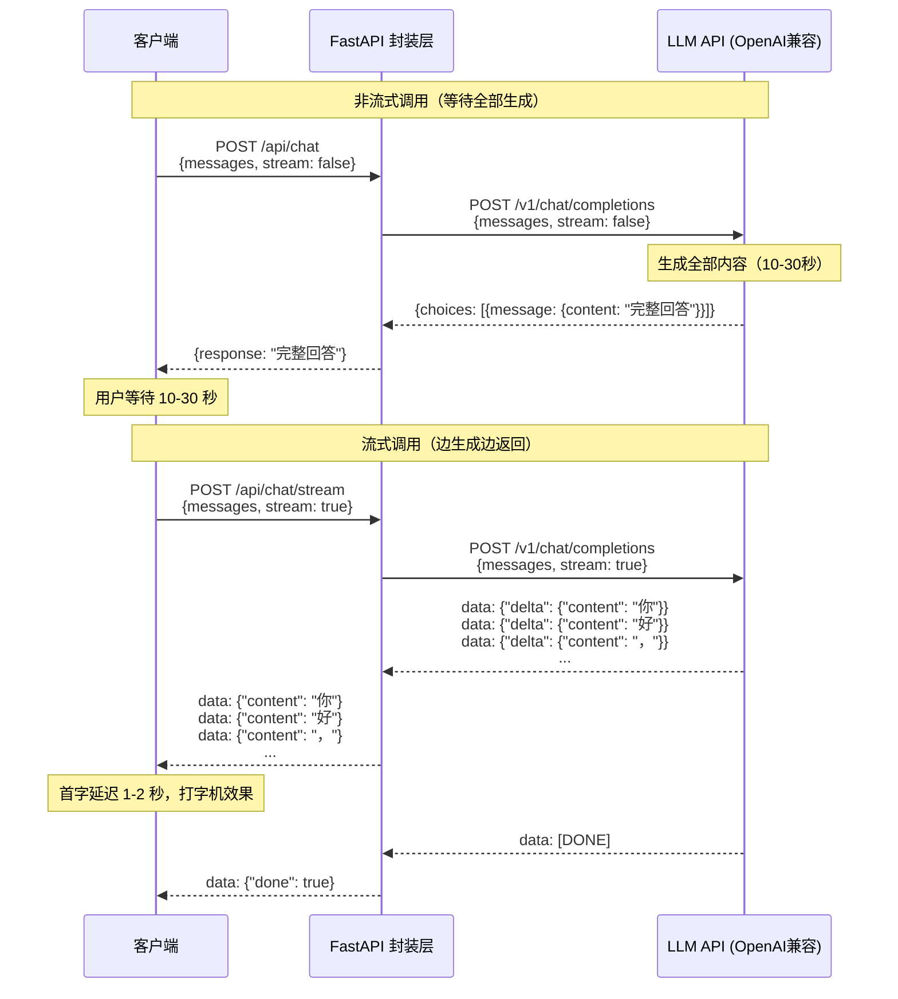

#### 代码示例

**示例 1：基础——OpenAI SDK 同步与异步调用**

```python
"""
示例1：OpenAI SDK 同步与异步调用对比
安装：pip install openai
运行：python openai_basic.py
"""
from openai import OpenAI, AsyncOpenAI
import asyncio
import time

# 配置（国内模型兼容 OpenAI 格式，修改 base_url 和 api_key 即可）
API_KEY = "your-api-key"
BASE_URL = "https://api.openai.com/v1"  # OpenAI 官方
# BASE_URL = "https://ark.cn-beijing.volces.com/api/v3"  # 豆包
# BASE_URL = "https://dashscope.aliyuncs.com/compatible-mode/v1"  # 通义千问
# BASE_URL = "https://api.deepseek.com/v1"  # DeepSeek

MODEL = "gpt-4o-mini"

messages = [
    {"role": "system", "content": "你是一个 helpful 的助手"},
    {"role": "user", "content": "用一句话解释什么是大语言模型"},
]


# ===== 同步调用 =====
def sync_chat():
    """同步调用：阻塞等待全部生成完成"""
    client = OpenAI(api_key=API_KEY, base_url=BASE_URL)

    start = time.time()
    response = client.chat.completions.create(
        model=MODEL,
        messages=messages,
        temperature=0.7,
        max_tokens=500,
    )
    elapsed = time.time() - start

    print("=== 同步调用结果 ===")
    print(f"回答: {response.choices[0].message.content}")
    print(f"耗时: {elapsed:.2f} 秒")
    print(f"Token 用量: {response.usage}")
    return response


# ===== 异步调用 =====
async def async_chat():
    """异步调用：不阻塞事件循环，适合高并发"""
    client = AsyncOpenAI(api_key=API_KEY, base_url=BASE_URL)

    start = time.time()
    response = await client.chat.completions.create(
        model=MODEL,
        messages=messages,
        temperature=0.7,
        max_tokens=500,
    )
    elapsed = time.time() - start

    print("\n=== 异步调用结果 ===")
    print(f"回答: {response.choices[0].message.content}")
    print(f"耗时: {elapsed:.2f} 秒")
    print(f"Token 用量: {response.usage}")
    return response


# ===== 并发调用多个请求 =====
async def concurrent_chat():
    """异步并发调用：同时发起多个请求，总耗时≈最慢的一个"""
    client = AsyncOpenAI(api_key=API_KEY, base_url=BASE_URL)

    prompts = [
        "解释什么是机器学习",
        "解释什么是深度学习",
        "解释什么是自然语言处理",
    ]

    async def one_chat(prompt):
        response = await client.chat.completions.create(
            model=MODEL,
            messages=[{"role": "user", "content": prompt}],
            max_tokens=100,
        )
        return prompt, response.choices[0].message.content

    start = time.time()
    results = await asyncio.gather(*[one_chat(p) for p in prompts])
    elapsed = time.time() - start

    print(f"\n=== 并发调用结果（{len(prompts)} 个请求）===")
    for prompt, answer in results:
        print(f"\n问: {prompt}")
        print(f"答: {answer[:50]}...")
    print(f"\n总耗时: {elapsed:.2f} 秒（串行约需 {elapsed*3:.1f} 秒）")


if __name__ == "__main__":
    sync_chat()
    asyncio.run(async_chat())
    asyncio.run(concurrent_chat())

# 预期运行结果：
# === 同步调用结果 ===
# 回答: 大语言模型是一种...
# 耗时: 3.45 秒
# Token 用量: Usage(prompt_tokens=25, completion_tokens=80, total_tokens=105)
#
# === 异步调用结果 ===
# 回答: 大语言模型是一种...
# 耗时: 3.12 秒
#
# === 并发调用结果（3 个请求）===
# 总耗时: 4.20 秒（串行约需 12.6 秒）
```

**示例 2：进阶——流式调用与逐 Token 输出**

```python
"""
示例2：OpenAI SDK 流式调用（stream=True）
逐 Token 接收大模型输出，实现打字机效果
运行：python openai_stream.py
"""
from openai import AsyncOpenAI
import asyncio
import time

API_KEY = "your-api-key"
BASE_URL = "https://api.openai.com/v1"
MODEL = "gpt-4o-mini"


async def stream_chat():
    """流式调用：逐 Token 接收输出"""
    client = AsyncOpenAI(api_key=API_KEY, base_url=BASE_URL)

    messages = [
        {"role": "user", "content": "写一首关于春天的短诗（4句）"},
    ]

    print("=== 流式输出 ===")
    start = time.time()
    first_token_time = None
    full_content = ""

    # 关键参数：stream=True
    stream = await client.chat.completions.create(
        model=MODEL,
        messages=messages,
        stream=True,
        temperature=0.7,
        max_tokens=200,
    )

    # 异步遍历流式响应
    async for chunk in stream:
        # 每个 chunk 包含 delta（增量内容）
        if chunk.choices and chunk.choices[0].delta.content:
            content = chunk.choices[0].delta.content
            full_content += content

            # 记录首字延迟
            if first_token_time is None:
                first_token_time = time.time() - start
                print(f"\n[首字延迟: {first_token_time:.2f}s]")

            # 逐字打印（打字机效果）
            print(content, end="", flush=True)

        # 检测结束原因
        if chunk.choices and chunk.choices[0].finish_reason:
            print(f"\n\n[结束原因: {chunk.choices[0].finish_reason}]")

    elapsed = time.time() - start
    print(f"\n[总耗时: {elapsed:.2f}s]")
    print(f"[首字延迟(TTFT): {first_token_time:.2f}s]")
    print(f"[完整内容长度: {len(full_content)} 字符]")


async def stream_with_usage():
    """流式调用 + 获取 Token 用量（需要 stream_options）"""
    client = AsyncOpenAI(api_key=API_KEY, base_url=BASE_URL)

    stream = await client.chat.completions.create(
        model=MODEL,
        messages=[{"role": "user", "content": "你好"}],
        stream=True,
        stream_options={"include_usage": True},  # 关键：流式响应中包含 usage
    )

    full_content = ""
    usage = None

    async for chunk in stream:
        if chunk.choices and chunk.choices[0].delta.content:
            full_content += chunk.choices[0].delta.content
            print(chunk.choices[0].delta.content, end="", flush=True)

        # usage 在最后一个 chunk 中
        if chunk.usage:
            usage = chunk.usage

    print(f"\n\nToken 用量: {usage}")
    print(f"完整回答: {full_content}")


if __name__ == "__main__":
    asyncio.run(stream_chat())
    print("\n" + "=" * 50)
    asyncio.run(stream_with_usage())

# 预期运行结果：
# === 流式输出 ===
#
# [首字延迟: 0.85s]
# 春风轻抚柳丝长，
# 桃花含笑映池塘。
# 燕子归来寻旧梦，
# 一夜细雨润花香。
#
# [结束原因: stop]
# [总耗时: 2.35s]
# [首字延迟(TTFT): 0.85s]
```

**示例 3：完整场景——多模型统一调用（OpenAI 兼容格式）**

```python
"""
示例3：多模型统一调用（利用 OpenAI 兼容格式）
通过修改 base_url 和 api_key 调用不同厂商的模型
运行：python multi_model_demo.py
"""
from openai import AsyncOpenAI
import asyncio
import time

# 模型配置：不同厂商的 base_url 和 api_key
MODEL_CONFIGS = {
    "openai-gpt4o": {
        "base_url": "https://api.openai.com/v1",
        "api_key": "sk-openai-xxx",
        "model": "gpt-4o",
    },
    "doubao-pro": {
        "base_url": "https://ark.cn-beijing.volces.com/api/v3",
        "api_key": "doubao-api-key",
        "model": "doubao-pro-32k",
    },
    "qwen-plus": {
        "base_url": "https://dashscope.aliyuncs.com/compatible-mode/v1",
        "api_key": "sk-qwen-xxx",
        "model": "qwen-plus",
    },
    "deepseek-chat": {
        "base_url": "https://api.deepseek.com/v1",
        "api_key": "sk-deepseek-xxx",
        "model": "deepseek-chat",
    },
    "zhipu-glm4": {
        "base_url": "https://open.bigmodel.cn/api/paas/v4",
        "api_key": "zhipu-api-key",
        "model": "glm-4",
    },
}


async def chat_with_model(config_name: str, prompt: str):
    """使用指定模型配置调用对话接口"""
    config = MODEL_CONFIGS[config_name]
    client = AsyncOpenAI(
        api_key=config["api_key"],
        base_url=config["base_url"],
        # 国内模型可能需要自定义超时
        timeout=30.0,
    )

    start = time.time()
    try:
        response = await client.chat.completions.create(
            model=config["model"],
            messages=[{"role": "user", "content": prompt}],
            max_tokens=100,
            temperature=0.7,
        )
        elapsed = time.time() - start
        return {
            "model": config_name,
            "answer": response.choices[0].message.content,
            "elapsed": round(elapsed, 2),
            "tokens": response.usage.total_tokens if response.usage else None,
            "error": None,
        }
    except Exception as e:
        elapsed = time.time() - start
        return {
            "model": config_name,
            "answer": None,
            "elapsed": round(elapsed, 2),
            "tokens": None,
            "error": str(e),
        }


async def compare_models(prompt: str):
    """对比多个模型的回答"""
    print(f"问题: {prompt}\n")
    print("-" * 60)

    # 并发调用所有模型
    results = await asyncio.gather(*[
        chat_with_model(name, prompt)
        for name in MODEL_CONFIGS.keys()
    ])

    for result in results:
        print(f"\n【{result['model']}】耗时: {result['elapsed']}s")
        if result['error']:
            print(f"  错误: {result['error']}")
        else:
            print(f"  回答: {result['answer']}")
            print(f"  Token: {result['tokens']}")
        print("-" * 60)


if __name__ == "__main__":
    asyncio.run(compare_models("用一句话解释什么是人工智能"))

# 预期运行结果：
# 问题: 用一句话解释什么是人工智能
#
# 【openai-gpt4o】耗时: 2.35s
#   回答: 人工智能是让计算机模拟人类智能...
#   Token: 45
#
# 【doubao-pro】耗时: 1.85s
#   回答: 人工智能是研究、开发用于模拟...
#   Token: 42
#
# 【qwen-plus】耗时: 2.10s
#   回答: 人工智能是计算机科学的一个分支...
#   Token: 38
```

#### 使用场景与最佳实践

**适用场景**：
- AI 对话聊天：调用大模型生成对话回复
- 内容生成：文章、代码、邮件、摘要生成
- RAG 检索问答：检索后调用大模型生成答案
- 多模型聚合：统一接口封装多家模型 API
- AI Agent：大模型作为 Agent 的推理引擎

**不适用场景**：
- 简单规则匹配：不需要大模型，用规则引擎更高效
- 实时性要求极高（<100ms）：大模型推理通常需要 1-30 秒
- 离线场景：需要本地模型（Ollama/vLLM）

**最佳实践**：
1. **使用 AsyncOpenAI 而非 OpenAI**：异步客户端不阻塞事件循环，适合 FastAPI 高并发
2. **客户端单例复用**：不要每次请求创建新的 AsyncOpenAI 实例，复用连接池
3. **设置合理的超时**：`timeout=httpx.Timeout(connect=10, read=300)`，大模型生成可能很慢
4. **国内模型用 OpenAI 兼容格式**：通义/豆包/智谱/DeepSeek 都兼容，修改 base_url 即可
5. **设置 max_tokens**：防止生成过长内容导致超时和费用超支
6. **temperature 按需设置**：创意写作 0.7-1.0，事实问答 0-0.3
7. **stream=True 用于用户交互**：非流式用于后端处理（摘要、分类等）

**性能建议**：
- AsyncOpenAI 基于 httpx，默认连接池 10 个连接，高并发时调大 `max_connections`
- 流式调用首字延迟（TTFT）通常 0.5-3 秒，非流式总延迟 3-30 秒
- 并发调用用 `asyncio.gather`，总耗时≈最慢的一个请求
- 客户端单例复用避免重复 TCP 握手和 TLS 握手

#### 常见坑点

**坑点 1：在 FastAPI 中使用同步 OpenAI 客户端导致事件循环阻塞**

- **错误现象**：一个用户调用大模型时，所有其他用户的 HTTP 请求都卡住，直到大模型返回
- **根本原因**：同步 `OpenAI` 客户端的 `chat.completions.create()` 是阻塞调用，会阻塞 asyncio 事件循环，导致所有其他请求无法处理
- **正确做法**：使用 `AsyncOpenAI` 异步客户端，调用时 `await client.chat.completions.create()`，不阻塞事件循环
- **预防措施**：FastAPI 项目中统一使用 AsyncOpenAI，代码审查时检查是否有同步客户端

**坑点 2：每次请求创建新的 AsyncOpenAI 实例导致连接池浪费**

- **错误现象**：高并发时出现 `httpx.ConnectTimeout` 或端口耗尽，大模型调用延迟越来越高
- **根本原因**：每次请求创建新的 `AsyncOpenAI()` 实例，每个实例创建新的 httpx 连接池，连接不复用，导致大量 TCP/TLS 握手和端口占用
- **正确做法**：在模块级别创建全局单例 `client = AsyncOpenAI(api_key=..., base_url=...)`，所有请求复用这个实例
- **预防措施**：封装 LLM 客户端工厂，使用字典缓存已创建的客户端实例

---

### 1.2 流式输出原理（SSE 与 Token 流）

#### 概念解释

**LLM 流式输出** 是大模型基于 Transformer 架构逐 Token 自回归生成文本的特性，通过 SSE（Server-Sent Events）协议将每个 Token 实时推送到客户端，实现"边生成边返回"的打字机效果，首字延迟（TTFT）从 10-30 秒降至 1-2 秒。

> 🏠 **生活化比喻**：非流式输出就像等厨师把整道菜做好再端上桌——你要等 30 分钟才能看到菜。流式输出就像厨师在你面前现场炒菜——每炒好一勺就盛到你碗里，你 1 分钟就能开始吃，边吃边等下一勺。虽然整道菜做完还是要 30 分钟，但你"开始吃"的时间从 30 分钟提前到了 1 分钟，体验完全不同。

**核心价值**：将大模型"生成慢"与用户"等不及"的矛盾化解——首字延迟从 10-30 秒降至 1-2 秒，用户感知的响应速度提升 10 倍以上，是 AI 应用用户体验的核心保障。

> 🎯 **面试高频考点 2**：大模型为什么能流式输出？SSE 格式是什么样的？
> **答**：大模型基于 Transformer 自回归架构，每生成一个 Token 都需要一次前向传播，生成过程是逐 Token 进行的。`stream=True` 时，API 每生成一个 Token 就立即返回，不需要等全部生成完。SSE 格式：每条消息以 `data: ` 开头，以 `\n\n` 结尾，如 `data: {"choices":[{"delta":{"content":"你"}}]}\n\n`。最后一条是 `data: [DONE]\n\n` 表示结束。客户端通过 `EventSource` 或 `fetch + ReadableStream` 逐块接收并解析。

#### 原理说明

流式输出的核心机制是 **Transformer 自回归生成 + SSE 逐块推送 + 异步生成器中转**。

**为什么这样设计**：大模型生成文本是逐 Token 的——每生成一个 Token 需要一次完整的前向传播（矩阵运算），生成 500 字可能需要 10-30 秒。如果等全部生成完再返回，用户看到的是空白加载页。流式输出利用"生成是逐 Token 的"特性，每生成一个 Token 就立即通过 SSE 推送，用户看到打字机效果。FastAPI 的 `StreamingResponse` + `async generator` 是连接大模型流式输出和 HTTP 响应的桥梁。

**技术对比**：

| 输出方式 | 首字延迟 | 总延迟 | 用户体验 | 实现复杂度 |
|---------|---------|--------|---------|-----------|
| 非流式 | 10-30s | 10-30s | 差（长时间空白） | 低 |
| 流式（SSE） | 1-2s | 10-30s | 好（打字机效果） | 中 |
| 流式（WebSocket） | 1-2s | 10-30s | 好 | 高（需连接管理） |

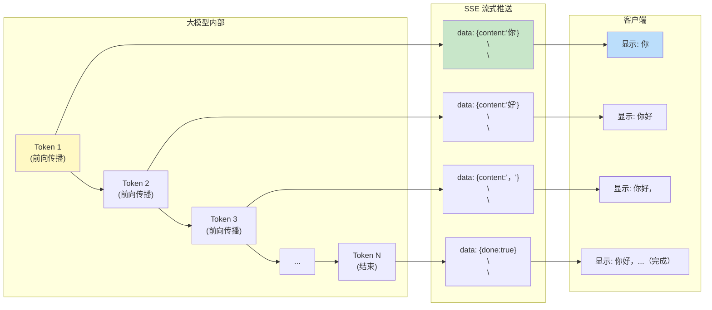

#### 代码示例

**示例 1：基础——SSE 格式详解与手动构造**

```python
"""
示例1：SSE 格式详解与手动构造
理解 SSE 协议的各个字段
运行：python sse_format.py
"""
import json
import time


def sse_message(data: dict, event: str = None, msg_id: str = None) -> str:
    """
    构造 SSE 格式消息
    格式：
      event: 事件类型（可选）
      id: 消息 ID（可选，用于断线重连）
      data: 数据内容（必填，可以多行）
      （空行结束）
    """
    lines = []
    if event:
        lines.append(f"event: {event}")
    if msg_id:
        lines.append(f"id: {msg_id}")
    # data 可以是多行，每行以 "data: " 开头
    data_str = json.dumps(data, ensure_ascii=False)
    for line in data_str.split("\n"):
        lines.append(f"data: {line}")
    lines.append("")  # 空行结束消息
    return "\n".join(lines)


# 演示各种 SSE 消息格式
print("=== 1. 最简单的 SSE 消息 ===")
print(sse_message({"content": "你"}))
# 输出：
# data: {"content": "你"}
# (空行)

print("\n=== 2. 带事件类型的 SSE 消息 ===")
print(sse_message({"content": "你好"}, event="chat"))
# 输出：
# event: chat
# data: {"content": "你好"}
# (空行)

print("\n=== 3. 带消息 ID 的 SSE 消息（用于断线重连）===")
print(sse_message({"content": "第3条"}, msg_id="3"))
# 输出：
# id: 3
# data: {"content": "第3条"}
# (空行)

print("\n=== 4. 结束标记 ===")
print("data: [DONE]\n")
# 这是 OpenAI API 的约定，[DONE] 表示流结束

print("\n=== 5. 完整的流式输出序列 ===")
tokens = ["你", "好", "，", "我", "是", "AI", "助", "手", "。"]
for i, token in enumerate(tokens):
    print(sse_message({"content": token, "index": i}, msg_id=str(i + 1)))
    time.sleep(0.05)  # 模拟生成延迟
print(sse_message({"done": True, "total_tokens": len(tokens)}))

# 预期输出：
# === 5. 完整的流式输出序列 ===
# id: 1
# data: {"content": "你", "index": 0}
#
# id: 2
# data: {"content": "好", "index": 1}
#
# ...
# data: {"done": true, "total_tokens": 9}
```

**示例 2：进阶——用 FastAPI StreamingResponse 实现最简流式接口**

```python
"""
示例2：FastAPI StreamingResponse 最简流式接口
核心代码仅 20 行
运行：uvicorn sse_minimal:app --reload
测试：curl -N http://localhost:8000/stream
"""
from fastapi import FastAPI
from fastapi.responses import StreamingResponse
import asyncio
import json
import time

app = FastAPI(title="最简 SSE 流式接口", version="1.0.0")


async def event_generator():
    """异步生成器：逐次 yield SSE 格式数据"""
    tokens = ["欢迎", "使用", "FastAPI", "流式", "接口", "！"]

    for i, token in enumerate(tokens):
        # 模拟大模型生成延迟
        await asyncio.sleep(0.2)

        # 构造 SSE 格式消息
        data = json.dumps({
            "content": token,
            "index": i,
            "timestamp": time.time(),
        }, ensure_ascii=False)

        # 关键：yield 返回 SSE 格式字符串（以 \n\n 结尾）
        yield f"data: {data}\n\n"

    # 发送结束标记
    yield f"data: {json.dumps({'done': True, 'total': len(tokens)})}\n\n"


@app.get("/stream")
async def stream_endpoint():
    """流式接口：返回 StreamingResponse"""
    return StreamingResponse(
        event_generator(),  # 异步生成器作为内容源
        media_type="text/event-stream",  # SSE 内容类型
        headers={
            "Cache-Control": "no-cache",     # 禁止缓存
            "Connection": "keep-alive",      # 保持长连接
            "X-Accel-Buffering": "no",       # 禁用 Nginx 缓冲（关键！）
        },
    )


# 测试命令：
# curl -N http://localhost:8000/stream
# -N 参数禁用 curl 的缓冲，实时显示流式输出

# 预期输出（逐行出现，每 0.2 秒一行）：
# data: {"content": "欢迎", "index": 0, "timestamp": 1234567890.123}
#
# data: {"content": "使用", "index": 1, "timestamp": 1234567890.323}
#
# ...
# data: {"done": true, "total": 6}

# 前端 EventSource 接收：
"""
const es = new EventSource('http://localhost:8000/stream');
es.onmessage = (e) => {
  const data = JSON.parse(e.data);
  if (data.content) {
    console.log('收到:', data.content);
  }
  if (data.done) {
    console.log('流结束，共', data.total, '个 Token');
    es.close();
  }
};
"""
```

**示例 3：完整场景——封装真实 LLM 流式接口**

```python
"""
示例3：封装真实 LLM 流式接口（完整版本）
将 OpenAI 兼容 API 的流式输出转发为 SSE
运行：uvicorn llm_stream_complete:app --reload
"""
from fastapi import FastAPI
from fastapi.responses import StreamingResponse
from openai import AsyncOpenAI
from pydantic import BaseModel, Field
from typing import List, Optional
import json
import time
import os

app = FastAPI(title="LLM 流式接口", version="1.0.0")

# 全局单例客户端（复用连接池）
client = AsyncOpenAI(
    api_key=os.getenv("OPENAI_API_KEY", "your-api-key"),
    base_url=os.getenv("OPENAI_BASE_URL", "https://api.openai.com/v1"),
    timeout=300.0,  # 大模型生成可能很慢，设置长超时
)


# 请求模型
class Message(BaseModel):
    role: str = Field(..., description="角色：system/user/assistant")
    content: str = Field(..., description="消息内容")


class ChatRequest(BaseModel):
    messages: List[Message]
    model: str = Field(default="gpt-4o-mini")
    temperature: float = Field(default=0.7, ge=0, le=2)
    max_tokens: int = Field(default=2000, ge=1, le=8000)
    stream: bool = Field(default=True)


async def llm_stream_generator(request: ChatRequest):
    """
    异步生成器：调用 LLM 流式 API，逐 chunk  yield SSE 格式
    这是流式接口的核心
    """
    start_time = time.time()
    prompt_tokens = 0
    completion_tokens = 0
    full_content = ""

    try:
        # 调用 LLM 流式 API
        stream = await client.chat.completions.create(
            model=request.model,
            messages=[m.model_dump() for m in request.messages],
            stream=True,
            temperature=request.temperature,
            max_tokens=request.max_tokens,
            stream_options={"include_usage": True},  # 流式响应中包含 usage
        )

        # 异步遍历 LLM 的流式输出
        async for chunk in stream:
            # 提取增量内容
            if chunk.choices and chunk.choices[0].delta.content:
                content = chunk.choices[0].delta.content
                full_content += content
                completion_tokens += 1  # 粗略计数

                # 构造 SSE 消息并 yield
                sse_data = json.dumps({
                    "type": "content",
                    "content": content,
                    "full_content": full_content,  # 可选：累计完整内容
                }, ensure_ascii=False)
                yield f"data: {sse_data}\n\n"

            # 提取 Token 用量（在最后一个 chunk 中）
            if chunk.usage:
                prompt_tokens = chunk.usage.prompt_tokens
                completion_tokens = chunk.usage.completion_tokens

            # 检测结束原因
            if chunk.choices and chunk.choices[0].finish_reason:
                finish_reason = chunk.choices[0].finish_reason
                elapsed = time.time() - start_time
                sse_data = json.dumps({
                    "type": "done",
                    "finish_reason": finish_reason,
                    "elapsed": round(elapsed, 2),
                    "usage": {
                        "prompt_tokens": prompt_tokens,
                        "completion_tokens": completion_tokens,
                        "total_tokens": prompt_tokens + completion_tokens,
                    },
                    "model": request.model,
                }, ensure_ascii=False)
                yield f"data: {sse_data}\n\n"

    except Exception as e:
        # 错误也通过 SSE 发送，让前端统一处理
        error_data = json.dumps({
            "type": "error",
            "error": str(e),
            "error_type": type(e).__name__,
        }, ensure_ascii=False)
        yield f"data: {error_data}\n\n"


@app.post("/api/v1/chat/stream")
async def chat_stream(request: ChatRequest):
    """
    LLM 流式对话接口
    Content-Type: text/event-stream
    """
    return StreamingResponse(
        llm_stream_generator(request),
        media_type="text/event-stream",
        headers={
            "Cache-Control": "no-cache",
            "Connection": "keep-alive",
            "X-Accel-Buffering": "no",  # 关键：禁用 Nginx 缓冲
        },
    )


@app.get("/api/v1/models")
async def list_models():
    """获取可用模型列表"""
    return {"models": ["gpt-4o-mini", "gpt-4o", "gpt-4-turbo"]}


# 前端 fetch + ReadableStream 接收（支持 POST 请求体）：
"""
async function streamChat(messages) {
  const response = await fetch('/api/v1/chat/stream', {
    method: 'POST',
    headers: { 'Content-Type': 'application/json' },
    body: JSON.stringify({ messages, stream: true }),
  });

  const reader = response.body.getReader();
  const decoder = new TextDecoder();
  let buffer = '';
  let fullContent = '';

  while (true) {
    const { done, value } = await reader.read();
    if (done) break;

    buffer += decoder.decode(value, { stream: true });
    const lines = buffer.split('\\n\\n');
    buffer = lines.pop();  // 保留不完整的消息

    for (const line of lines) {
      if (line.startsWith('data: ')) {
        const data = JSON.parse(line.slice(6));
        if (data.type === 'content') {
          fullContent += data.content;
          updateUI(fullContent);  // 打字机效果
        } else if (data.type === 'done') {
          console.log('完成:', data.usage);
        } else if (data.type === 'error') {
          console.error('错误:', data.error);
        }
      }
    }
  }
}
"""
```

#### 使用场景与最佳实践

**适用场景**：
- AI 对话聊天：逐字输出回复，打字机效果
- AI 写作助手：流式生成文章/代码/邮件
- RAG 检索问答：检索后流式生成答案
- 代码补全：实时流式补全代码片段
- AI Agent：Agent 思考过程和工具调用流式输出

**不适用场景**：
- 后端内部调用（摘要、分类、翻译）：不需要流式，非流式更简单
- 需要完整响应后才能处理的场景：非流式一次性获取
- 极低延迟要求（<500ms）：大模型推理本身需要时间

**最佳实践**：
1. **`X-Accel-Buffering: no` 必须设置**：禁用 Nginx 缓冲，否则流式失效
2. **`ensure_ascii=False`**：防止中文乱码（JSON 序列化时保留中文）
3. **错误通过 SSE 发送**：不要抛 HTTPException（流式响应已开始，无法改状态码）
4. **发送 done 标记**：让前端知道流结束，包含 usage 和耗时信息
5. **AsyncOpenAI 客户端单例**：复用连接池，不要每次创建
6. **设置长超时**：大模型生成可能 30 秒以上，`timeout=300`
7. **前端用 fetch + ReadableStream**：EventSource 只支持 GET，POST 用 fetch
8. **`stream_options={"include_usage": True}`**：流式响应中获取 Token 用量

**性能建议**：
- 流式接口的首字延迟（TTFT）取决于大模型 API，通常 0.5-3 秒
- FastAPI 封装层增加的延迟 <10ms，可忽略
- 异步生成器天然支持背压：客户端慢时 `async for` 自动等待
- 高并发时 AsyncOpenAI 连接池调大：`httpx.AsyncClient(max_connections=100)`

#### 常见坑点

**坑点 1：Nginx 缓冲导致流式不生效，数据一次性返回**

- **错误现象**：流式接口返回 200，但前端收不到逐块数据，等所有内容生成完后一次性收到
- **根本原因**：Nginx 默认 `proxy_buffering on`，将后端的流式响应缓冲完整后再发送给客户端。或者没有设置 `X-Accel-Buffering: no` 响应头
- **正确做法**：① StreamingResponse 的 headers 中加 `"X-Accel-Buffering": "no"`（推荐）；② Nginx 配置 `proxy_buffering off;`；③ 同时设置 `proxy_read_timeout 300s`
- **预防措施**：所有 SSE 流式端点的代码模板中固定包含 `X-Accel-Buffering: no` 头

**坑点 2：流式响应中抛出 HTTPException 导致客户端收不到错误信息**

- **错误现象**：大模型 API 调用失败时，服务端抛出 `HTTPException(status_code=500)`，但前端已经收到 200 状态码和部分流式数据，无法处理 500 错误
- **根本原因**：StreamingResponse 一旦开始返回（200 状态码已发送），就无法再修改 HTTP 状态码。此时抛出 HTTPException 会导致连接异常断开，前端收到的是网络错误而非结构化错误信息
- **正确做法**：流式接口中的错误通过 SSE 消息发送：`yield f"data: {json.dumps({'type': 'error', 'error': str(e)})}\n\n"`，然后结束流。前端解析到 error 类型消息后统一处理
- **预防措施**：流式生成器中用 try-except 捕获所有异常，通过 SSE 发送错误，不要抛 HTTPException

---

> 💡 **深度讲解**：本章建立了 LLM 流式接口的基础知识体系。OpenAI 兼容 API 是行业事实标准，国内主流大模型都兼容，通过修改 base_url 和 api_key 即可切换。异步客户端（AsyncOpenAI）是 FastAPI 的必选，同步客户端会阻塞事件循环。流式输出的核心是 Transformer 自回归生成 + SSE 逐块推送——大模型每生成一个 Token 就立即返回，首字延迟从 10-30 秒降至 1-2 秒。FastAPI 的 StreamingResponse + async generator 是连接大模型流式输出和 HTTP 响应的桥梁，核心代码仅 20 行。关键细节：`X-Accel-Buffering: no` 禁用 Nginx 缓冲、`ensure_ascii=False` 防中文乱码、错误通过 SSE 发送而非 HTTPException。掌握这些基础后，下一章将深入异步生成器与流式响应的深度原理。
>
> **📝 精简总结**：
> 1. OpenAI 兼容 API 是行业标准，`/v1/chat/completions` + `stream=True` 开启流式
> 2. 用 AsyncOpenAI（异步）而非 OpenAI（同步），避免阻塞事件循环
> 3. 客户端单例复用，不要每次请求创建新实例
> 4. SSE 格式：`data: {json}\n\n`，结束标记 `data: [DONE]` 或 `{"done": true}`
> 5. StreamingResponse + async generator：`async for` 遍历 LLM chunk → `yield f"data: {json}\n\n"`
> 6. 必须设置 `X-Accel-Buffering: no`，否则 Nginx 缓冲导致流式失效
> 7. 流式错误通过 SSE 发送（`{"type": "error"}`），不要抛 HTTPException
> 8. 前端用 fetch + ReadableStream（支持 POST），按 `\n\n` 分割 SSE 消息
>
> **🎯 梯度练习题**：
> - **基础 1**：用 AsyncOpenAI 实现非流式对话调用，打印回答和 Token 用量
> - **基础 2**：解释大模型为什么能流式输出，SSE 格式是什么样的
> - **基础 3**：用 FastAPI StreamingResponse 实现一个模拟的流式时钟接口
> - **进阶 1**：实现真实 LLM 流式接口，包含请求模型校验、SSE 格式化、错误处理
> - **进阶 2**：实现前端 fetch + ReadableStream 接收 SSE 流，按 `\n\n` 分割解析
> - **实战 1**：实现多模型统一调用，通过配置切换 OpenAI/豆包/通义/DeepSeek

---

## 第二篇 进阶篇：核心技能与深度原理

---

## 2. 异步生成器与流式响应深度

### 2.1 async generator 原理与背压控制

#### 概念解释

**异步生成器（async generator）** 是 Python 中使用 `async def` + `yield` 定义的生成器，通过 `async for` 消费，每次 `yield` 产出一个值后挂起协程，消费者请求下一个值时恢复执行。在 LLM 流式接口中，异步生成器是连接大模型流式输出和 HTTP 响应的核心桥梁。

> 🏠 **生活化比喻**：异步生成器就像自来水管道——大模型是水源（不断产生水），生成器是水管（逐滴输送），StreamingResponse 是水龙头（控制水流速度）。你打开水龙头（`async for` 请求下一个值），水就流出来（`yield` 返回）；你关小水龙头（客户端消费慢），水管里的水压会自动调节（背压控制），水源不会因为水龙头关小而溢出（内存不溢出）。

**核心价值**：异步生成器实现了"生产者-消费者"模式的天然解耦和背压控制——大模型生成速度和客户端消费速度不需要匹配，慢的一方不会导致快的一方内存溢出，是流式响应的理想数据结构。

> 🎯 **面试高频考点 3**：异步生成器和普通生成器有什么区别？流式接口中为什么用异步生成器？
> **答**：区别：① 普通生成器用 `def` + `yield`，用 `for` 消费；异步生成器用 `async def` + `yield`，用 `async for` 消费。② 普通生成器的 `yield` 不涉及异步 IO，异步生成器的 `yield` 前后可以有 `await`（如等待大模型 API 的下一个 chunk）。③ 异步生成器支持 `aclose()` 和 `athrow()`，可以在异步上下文中清理资源。流式接口用异步生成器的原因：大模型 API 的流式输出是异步的（`async for chunk in stream`），需要在生成器内部 `await`，普通生成器不支持。异步生成器天然支持背压——客户端消费慢时 `async for` 会自动等待，不会内存溢出。

#### 原理说明

异步生成器的核心机制是 **协程挂起/恢复 + 异步迭代协议 + 背压控制**。

**为什么这样设计**：大模型流式输出是异步的——每次 `await stream.__anext__()` 等待下一个 chunk 到达。异步生成器将这个异步迭代过程封装为 `yield`，使得 StreamingResponse 可以通过 `async for` 逐块消费。背压控制是异步生成器的天然优势——如果客户端网络慢消费慢，`async for` 请求下一个值的速度就慢，生成器 `yield` 的速度也慢，大模型的 `async for` 也会被拖慢（因为生成器没有请求下一个值），整个链路自动调节，不会内存溢出。

**技术对比**：

| 特性 | 普通生成器 | 异步生成器 |
|------|-----------|-----------|
| 定义 | `def` + `yield` | `async def` + `yield` |
| 消费 | `for x in gen()` | `async for x in gen()` |
| 内部 await | 不支持 | 支持 |
| 关闭 | `gen.close()` | `await gen.aclose()` |
| 背压 | 同步阻塞 | 异步非阻塞 |
| 适用场景 | 同步数据迭代 | 异步 IO 流（LLM、文件、网络） |

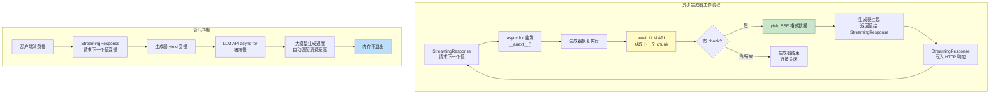

#### 代码示例

**示例 1：基础——异步生成器的定义与消费**

```python
"""
示例1：异步生成器基础用法
运行：python async_generator_basic.py
"""
import asyncio
import time


# 普通生成器（同步）
def sync_generator():
    """普通生成器：def + yield"""
    for i in range(5):
        time.sleep(0.1)  # 同步阻塞
        yield i


# 异步生成器
async def async_generator():
    """异步生成器：async def + yield"""
    for i in range(5):
        await asyncio.sleep(0.1)  # 异步非阻塞
        yield i


# 异步生成器中可以有多个 yield 和 await
async def llm_like_generator():
    """模拟大模型流式输出的异步生成器"""
    tokens = ["你", "好", "，", "我", "是", "AI"]

    # 可以在生成器开始时执行异步初始化
    print("[生成器] 开始连接大模型 API...")
    await asyncio.sleep(0.5)  # 模拟建立连接
    print("[生成器] 连接建立，开始生成")

    for token in tokens:
        # 每次生成一个 token 需要等待（模拟大模型前向传播）
        await asyncio.sleep(0.1)
        print(f"[生成器] 生成 token: {token}")
        yield token  # yield 返回当前 token

    # 生成器结束前可以执行异步清理
    print("[生成器] 生成完成，清理资源")
    await asyncio.sleep(0.1)


async def main():
    print("=== 1. 普通生成器（同步阻塞）===")
    start = time.time()
    for value in sync_generator():
        print(f"收到: {value}")
    print(f"耗时: {time.time() - start:.2f}s\n")

    print("=== 2. 异步生成器（异步非阻塞）===")
    start = time.time()
    async for value in async_generator():
        print(f"收到: {value}")
    print(f"耗时: {time.time() - start:.2f}s\n")

    print("=== 3. 模拟 LLM 流式输出 ===")
    start = time.time()
    full_content = ""
    async for token in llm_like_generator():
        full_content += token
        print(f"客户端收到: {token}（当前完整: {full_content}）")
    print(f"\n完整内容: {full_content}")
    print(f"总耗时: {time.time() - start:.2f}s")

    # 4. 异步生成器的手动控制（__anext__ / aclose）
    print("\n=== 4. 手动控制异步生成器 ===")
    gen = async_generator()
    print(f"生成器类型: {type(gen)}")

    # 手动获取第一个值
    first_value = await gen.__anext__()
    print(f"手动获取第一个值: {first_value}")

    # 提前关闭生成器（触发清理）
    await gen.aclose()
    print("生成器已提前关闭")


if __name__ == "__main__":
    asyncio.run(main())

# 预期运行结果：
# === 1. 普通生成器（同步阻塞）===
# 收到: 0
# 收到: 1
# ...
# 耗时: 0.50s
#
# === 2. 异步生成器（异步非阻塞）===
# 收到: 0
# ...
# 耗时: 0.50s
#
# === 3. 模拟 LLM 流式输出 ===
# [生成器] 开始连接大模型 API...
# [生成器] 连接建立，开始生成
# [生成器] 生成 token: 你
# 客户端收到: 你（当前完整: 你）
# ...
# 完整内容: 你好，我是AI
```

**示例 2：进阶——背压控制与慢消费者模拟**

```python
"""
示例2：异步生成器背压控制演示
模拟慢消费者场景，验证内存不会溢出
运行：python backpressure_demo.py
"""
import asyncio
import time
import psutil  # pip install psutil


async def fast_producer():
    """快速生产者：每秒产生 1000 个数据"""
    count = 0
    while count < 5000:
        count += 1
        # 模拟快速产生数据
        await asyncio.sleep(0.001)  # 1ms 产生一个
        yield count


async def slow_consumer():
    """慢消费者：每秒只消费 10 个数据"""
    full_content = ""
    count = 0

    async for item in fast_producer():
        count += 1
        full_content += str(item)

        # 慢消费：每处理一个数据等待 100ms
        await asyncio.sleep(0.1)

        if count % 10 == 0:
            mem = psutil.Process().memory_info().rss / 1024 / 1024
            print(f"已消费 {count} 个，内存使用: {mem:.1f} MB")

    print(f"\n消费完成，共 {count} 个数据")
    print(f"如果没有背压，5000 个数据全部缓冲在内存中")
    print(f"有背压控制，内存始终保持稳定")


async def no_backpressure_demo():
    """无背压控制的反例：先收集所有数据再处理"""
    print("\n=== 无背压控制（反例）===")
    start = time.time()

    # 先把所有数据收集到列表中（内存溢出风险）
    all_data = []
    async for item in fast_producer():
        all_data.append(item)
        if len(all_data) % 1000 == 0:
            mem = psutil.Process().memory_info().rss / 1024 / 1024
            print(f"已收集 {len(all_data)} 个，内存: {mem:.1f} MB")

    # 再处理所有数据
    for item in all_data:
        await asyncio.sleep(0.001)  # 处理

    elapsed = time.time() - start
    print(f"总耗时: {elapsed:.2f}s，数据全部在内存中")


async def with_backpressure_demo():
    """有背压控制：边生产边消费"""
    print("\n=== 有背压控制（推荐）===")
    start = time.time()
    count = 0

    async for item in fast_producer():
        # 边生产边消费，数据不缓冲
        count += 1
        await asyncio.sleep(0.001)  # 处理
        if count % 1000 == 0:
            mem = psutil.Process().memory_info().rss / 1024 / 1024
            print(f"已消费 {count} 个，内存: {mem:.1f} MB")

    elapsed = time.time() - start
    print(f"总耗时: {elapsed:.2f}s，内存始终稳定")


async def main():
    print("=== 背压控制演示 ===")
    print("慢消费者场景：生产者每秒 1000 个，消费者每秒 10 个")
    print("有背压：生产者自动减速，匹配消费者速度\n")

    await slow_consumer()

    print("\n" + "=" * 50)
    await no_backpressure_demo()
    await with_backpressure_demo()


if __name__ == "__main__":
    asyncio.run(main())

# 预期运行结果：
# === 背压控制演示 ===
# 慢消费者场景：生产者每秒 1000 个，消费者每秒 10 个
# 有背压：生产者自动减速，匹配消费者速度
#
# 已消费 10 个，内存使用: 25.1 MB
# 已消费 20 个，内存使用: 25.2 MB
# ...
# 消费完成，共 5000 个数据
# 如果没有背压，5000 个数据全部缓冲在内存中
# 有背压控制，内存始终保持稳定
```

**示例 3：完整场景——异步生成器的资源清理与异常处理**

```python
"""
示例3：异步生成器的资源清理与异常处理
演示 aclose()、athrow()、try-finally 在异步生成器中的使用
运行：python async_generator_cleanup.py
"""
import asyncio
from contextlib import asynccontextmanager


# 异步生成器中的 try-finally 保证资源清理
async def llm_stream_with_cleanup():
    """带资源清理的 LLM 流式生成器"""
    # 模拟建立大模型连接
    print("[生成器] 建立大模型 API 连接")
    connection = {"status": "connected", "tokens_sent": 0}

    try:
        # 模拟流式输出
        for token in ["你", "好", "，", "AI"]:
            await asyncio.sleep(0.1)
            connection["tokens_sent"] += 1
            yield token

        # 模拟正常结束
        print("[生成器] 流式输出正常完成")
        yield "[DONE]"

    except asyncio.CancelledError:
        # 客户端断开时生成器被取消
        print("[生成器] 客户端断开，生成器被取消")
        raise  # 重新抛出，让 finally 执行

    except Exception as e:
        # 大模型 API 调用异常
        print(f"[生成器] 大模型 API 异常: {e}")
        yield f"[ERROR] {str(e)}"

    finally:
        # 无论正常结束、异常、取消，都会执行清理
        print(f"[生成器] 清理资源：关闭连接（已发送 {connection['tokens_sent']} 个 token）")
        connection["status"] = "closed"


# 使用 asynccontextmanager 管理生成器生命周期
@asynccontextmanager
async def managed_llm_stream():
    """使用 asynccontextmanager 管理流式生成器"""
    gen = llm_stream_with_cleanup()
    try:
        yield gen
    finally:
        await gen.aclose()  # 确保生成器被关闭，触发 finally 清理


async def demo_normal_completion():
    """演示正常完成"""
    print("\n=== 1. 正常完成 ===")
    async for token in llm_stream_with_cleanup():
        print(f"  收到: {token}")


async def demo_early_close():
    """演示提前关闭（客户端断开）"""
    print("\n=== 2. 提前关闭（模拟客户端断开）===")
    gen = llm_stream_with_cleanup()

    # 手动获取前两个值
    first = await gen.__anext__()
    print(f"  收到第一个: {first}")
    second = await gen.__anext__()
    print(f"  收到第二个: {second}")

    # 提前关闭生成器（模拟客户端断开）
    print("  客户端断开，提前关闭生成器...")
    await gen.aclose()
    print("  生成器已关闭，finally 已执行清理")


async def demo_exception():
    """演示生成器中抛出异常"""
    print("\n=== 3. 生成器异常 ===")

    async def faulty_generator():
        """有异常的生成器"""
        try:
            yield "正常数据"
            raise RuntimeError("大模型 API 调用失败")
        except RuntimeError as e:
            yield f"错误恢复: {e}"
        finally:
            print("  [生成器] 资源清理完成")

    async for item in faulty_generator():
        print(f"  收到: {item}")


async def demo_managed():
    """演示 asynccontextmanager 管理"""
    print("\n=== 4. asynccontextmanager 管理 ===")
    async with managed_llm_stream() as gen:
        async for token in gen:
            print(f"  收到: {token}")
            if token == "，":
                print("  提前退出 with 块...")
                break
    # 退出 with 块时自动调用 aclose()
    print("  with 块已退出，生成器已自动关闭")


async def main():
    await demo_normal_completion()
    await demo_early_close()
    await demo_exception()
    await demo_managed()


if __name__ == "__main__":
    asyncio.run(main())

# 预期运行结果：
# === 1. 正常完成 ===
# [生成器] 建立大模型 API 连接
#   收到: 你
#   收到: 好
#   收到: ，
#   收到: AI
# [生成器] 流式输出正常完成
#   收到: [DONE]
# [生成器] 清理资源：关闭连接（已发送 4 个 token）
#
# === 2. 提前关闭（模拟客户端断开）===
# [生成器] 建立大模型 API 连接
#   收到第一个: 你
#   收到第二个: 好
#   客户端断开，提前关闭生成器...
# [生成器] 客户端断开，生成器被取消
# [生成器] 清理资源：关闭连接（已发送 2 个 token）
#   生成器已关闭，finally 已执行清理
```

#### 使用场景与最佳实践

**适用场景**：
- LLM 流式输出：大模型逐 Token 输出的标准实现
- 文件流式下载：大文件分块传输
- 日志流：实时日志推送
- 数据库游标：大量数据分批查询
- 实时数据：传感器数据、股票行情推送

**不适用场景**：
- 小数据一次性返回：不需要流式，直接返回 JSON
- 需要随机访问数据：流式只能顺序访问
- 需要回退/重试：流式数据不缓冲，无法回退

**最佳实践**：
1. **异步生成器中用 try-finally 保证资源清理**：大模型连接、文件句柄等必须在 finally 中关闭
2. **客户端断开时生成器会被取消**：StreamingResponse 在客户端断开时会调用 `aclose()`，生成器的 finally 会执行
3. **不要在生成器中缓冲所有数据**：这会失去流式的意义和背压优势
4. **错误通过 yield 发送，不要抛异常**：流式响应已开始，无法改 HTTP 状态码
5. **用 `asynccontextmanager` 管理生成器生命周期**：确保 `aclose()` 被调用
6. **生成器中的 `await` 是背压的关键**：慢消费者会拖慢生成器的 `await`，自动调节速度
7. **监控生成器的内存使用**：确保没有意外的数据缓冲

**性能建议**：
- 异步生成器本身开销很小，每个 `yield` 约几微秒
- 背压控制是天然的，不需要额外代码
- 大模型 API 的延迟是主要瓶颈，生成器开销可忽略
- 高并发时注意 AsyncOpenAI 连接池大小，避免成为瓶颈

#### 常见坑点

**坑点 1：在异步生成器中先收集所有数据再 yield 导致失去流式效果**

- **错误现象**：流式接口看起来是流式的，但客户端还是等所有数据生成完后才一次性收到
- **根本原因**：生成器中先用列表收集所有 chunk（`chunks.append(chunk)`），等全部生成完后再遍历 yield，这实际上是批量返回而非流式
- **正确做法**：每收到一个 chunk 就立即 `yield`，不要缓冲。`async for chunk in stream: yield format(chunk)`
- **预防措施**：代码审查时检查生成器中是否有列表收集数据的模式

**坑点 2：客户端断开后生成器继续运行导致资源浪费**

- **错误现象**：客户端断开连接后，服务端仍在调用大模型 API 生成数据，浪费 Token 费用和计算资源
- **根本原因**：没有正确处理客户端断开事件。StreamingResponse 在客户端断开时会取消生成器，但如果生成器中没有 `try-finally` 或没有检查取消状态，大模型 API 调用可能继续
- **正确做法**：① 生成器中用 `try-finally` 确保大模型连接关闭；② 在 `await` 点检查 `asyncio.CancelledError`；③ 大模型 API 客户端支持取消时，在 finally 中调用 `stream.close()`
- **预防措施**：封装 LLM 客户端时确保流式对象支持 `aclose()`，在生成器 finally 中调用

---

### 2.2 StreamingResponse 深度原理与配置

#### 概念解释

**StreamingResponse** 是 FastAPI/Starlette 提供的流式响应类，接受一个异步生成器（或普通生成器）作为内容源，逐块写入 HTTP 响应体，不需要预先加载完整响应到内存，是实现 SSE 流式输出、大文件下载等场景的核心组件。

> 🏠 **生活化比喻**：StreamingResponse 就像传送带——普通响应是把所有货物（完整响应）装上车再出发（内存中加载完整数据），StreamingResponse 是货物生产一个就放上传送带一个（逐块写入），传送带直接连到客户（HTTP 连接）。客户可以一边收一边用（流式消费），不需要等所有货物到齐。传送带还有调速功能（背压），客户收得慢传送带自动减速。

**核心价值**：无需预先加载完整响应到内存，支持大数据量/长时间运行的响应，天然支持背压控制，是流式接口的标准实现方式。

> 🎯 **面试高频考点 4**：StreamingResponse 和普通 JSONResponse 有什么区别？StreamingResponse 的 media_type 为什么设为 text/event-stream？
> **答**：区别：① JSONResponse 预先将完整数据序列化为 JSON 字符串，一次性写入响应；StreamingResponse 接受生成器，逐块写入响应，不需要预加载完整数据。② JSONResponse 适合小数据量、快速返回的场景；StreamingResponse 适合大数据量、长时间运行、流式输出的场景。③ StreamingResponse 支持背压，JSONResponse 不支持。media_type 设为 `text/event-stream` 是 SSE 协议的标准 Content-Type，告诉客户端这是 SSE 流式响应，浏览器的 EventSource API 会识别这个 Content-Type 并自动解析 SSE 格式。

#### 原理说明

StreamingResponse 的核心机制是 **ASGI 流式响应 + 异步生成器迭代 + HTTP chunked 传输**。

**为什么这样设计**：ASGI（Asynchronous Server Gateway Interface）协议支持流式响应——响应体可以通过多次 `send({"type": "http.response.body", "body": chunk, "more_body": True})` 逐块发送，最后一次 `more_body=False` 结束。StreamingResponse 封装了这个机制，接受生成器作为内容源，每次迭代生成器获取一个 chunk，然后通过 ASGI 发送。HTTP 层使用 `Transfer-Encoding: chunked` 分块传输，客户端可以逐块接收。

**技术对比**：

| 响应类型 | 数据加载 | 内存使用 | 流式支持 | 适用场景 |
|---------|---------|---------|---------|---------|
| JSONResponse | 预加载完整数据 | 高（完整数据在内存） | 否 | 小数据量 API |
| StreamingResponse | 逐块生成逐块发送 | 低（只有当前块） | 是 | 流式输出、大文件 |
| FileResponse | 分块读取文件 | 低 | 是 | 文件下载 |
| RedirectResponse | 无响应体 | 无 | 否 | 重定向 |

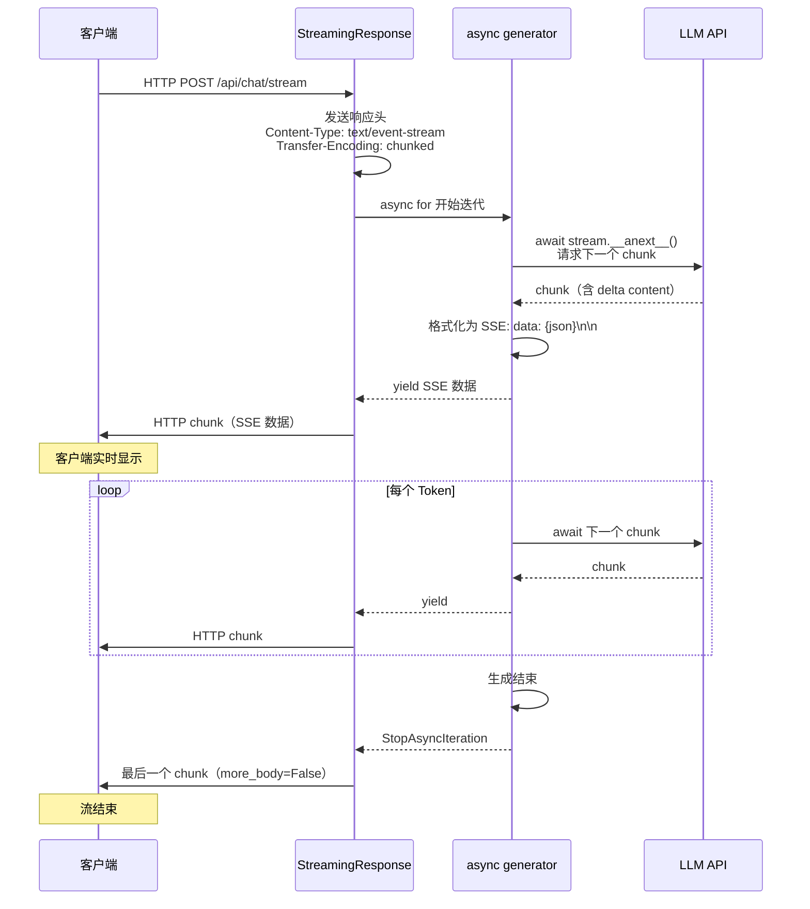

#### 代码示例

**示例 1：基础——StreamingResponse 各种配置**

```python
"""
示例1：StreamingResponse 各种配置与用法
运行：uvicorn streaming_response_demo:app --reload
"""
from fastapi import FastAPI
from fastapi.responses import StreamingResponse, JSONResponse
from typing import AsyncGenerator, Generator
import asyncio
import json
import time

app = FastAPI(title="StreamingResponse 演示", version="1.0.0")


# 1. 最简流式响应
@app.get("/stream/simple")
async def simple_stream():
    """最简流式响应：异步生成器 + text/plain"""
    async def generate():
        for i in range(10):
            yield f"消息 {i}\n"
            await asyncio.sleep(0.5)

    return StreamingResponse(
        generate(),
        media_type="text/plain",
    )


# 2. SSE 流式响应（标准配置）
@app.get("/stream/sse")
async def sse_stream():
    """SSE 流式响应：标准配置"""
    async def generate():
        for i in range(5):
            data = json.dumps({"index": i, "content": f"消息 {i}"}, ensure_ascii=False)
            yield f"data: {data}\n\n"
            await asyncio.sleep(1)
        yield "data: [DONE]\n\n"

    return StreamingResponse(
        generate(),
        media_type="text/event-stream",  # SSE 标准 Content-Type
        headers={
            "Cache-Control": "no-cache",      # 禁止缓存
            "Connection": "keep-alive",        # 保持长连接
            "X-Accel-Buffering": "no",         # 禁用 Nginx 缓冲（关键！）
        },
    )


# 3. 带自定义状态码和响应头的流式响应
@app.get("/stream/custom")
async def custom_stream():
    """自定义状态码和响应头"""
    async def generate():
        yield "data: 开始\n\n"
        await asyncio.sleep(0.5)
        yield "data: 进行中\n\n"
        await asyncio.sleep(0.5)
        yield "data: 完成\n\n"

    return StreamingResponse(
        generate(),
        status_code=200,
        media_type="text/event-stream",
        headers={
            "X-Custom-Header": "custom-value",
            "X-Stream-Id": "stream-001",
            "Cache-Control": "no-cache",
            "X-Accel-Buffering": "no",
        },
    )


# 4. 普通生成器（非异步）也可以用
@app.get("/stream/sync-generator")
async def sync_generator_stream():
    """使用普通（同步）生成器"""
    def generate():
        for i in range(5):
            time.sleep(0.5)  # 同步阻塞（不推荐在 async 端点中）
            yield f"同步生成器消息 {i}\n"

    return StreamingResponse(generate(), media_type="text/plain")


# 5. 带背景任务的流式响应
@app.get("/stream/with-background")
async def stream_with_background():
    """流式响应 + 背景任务（流结束后执行）"""
    from fastapi import BackgroundTasks

    async def generate():
        for i in range(3):
            yield f"data: {i}\n\n"
            await asyncio.sleep(0.5)

    def log_completion():
        print(f"[背景任务] 流式响应完成于 {time.strftime('%H:%M:%S')}")

    background_tasks = BackgroundTasks()
    background_tasks.add_task(log_completion)

    return StreamingResponse(
        generate(),
        media_type="text/event-stream",
        headers={"X-Accel-Buffering": "no"},
        background=background_tasks,
    )


# 6. 对比：JSONResponse vs StreamingResponse
@app.get("/compare/json")
async def json_response():
    """JSONResponse：预加载完整数据"""
    data = [f"消息 {i}" for i in range(10000)]
    return JSONResponse({"data": data, "count": len(data)})


@app.get("/compare/streaming")
async def streaming_response():
    """StreamingResponse：逐块发送，不预加载"""
    async def generate():
        for i in range(10000):
            yield f"{i}\n"
            if i % 1000 == 0:
                await asyncio.sleep(0)  # 让出事件循环

    return StreamingResponse(generate(), media_type="text/plain")


# 测试命令：
# curl -N http://localhost:8000/stream/sse
# curl -N http://localhost:8000/stream/custom
# curl -N http://localhost:8000/stream/with-background

# 预期输出（SSE）：
# data: {"index": 0, "content": "消息 0"}
#
# data: {"index": 1, "content": "消息 1"}
#
# ...
# data: [DONE]
```

**示例 2：进阶——StreamingResponse 的手动控制与取消**

```python
"""
示例2：StreamingResponse 的手动控制与取消处理
运行：uvicorn streaming_cancel:app --reload
"""
from fastapi import FastAPI, Request
from fastapi.responses import StreamingResponse
import asyncio
import json
import time

app = FastAPI(title="StreamingResponse 取消处理", version="1.0.0")


# 1. 检测客户端断开
@app.post("/api/chat/stream")
async def chat_stream(request: Request):
    """检测客户端断开，取消大模型调用"""
    client_disconnected = asyncio.Event()

    async def on_disconnect():
        """监听客户端断开"""
        while True:
            if await request.is_disconnected():
                client_disconnected.set()
                print("[检测] 客户端已断开")
                break
            await asyncio.sleep(0.5)

    # 启动断开检测任务
    disconnect_task = asyncio.create_task(on_disconnect())

    async def generate():
        try:
            # 模拟大模型流式输出
            for i in range(20):
                # 检查客户端是否断开
                if client_disconnected.is_set():
                    print("[生成器] 检测到客户端断开，停止生成")
                    break

                # 模拟生成延迟
                await asyncio.sleep(0.5)

                data = json.dumps({
                    "type": "content",
                    "content": f"Token {i}",
                    "index": i,
                }, ensure_ascii=False)
                yield f"data: {data}\n\n"

            # 正常结束
            if not client_disconnected.is_set():
                yield f"data: {json.dumps({'type': 'done'})}\n\n"

        except asyncio.CancelledError:
            print("[生成器] 被取消（StreamingResponse 客户端断开）")
            raise
        finally:
            disconnect_task.cancel()
            print("[生成器] 清理完成")

    return StreamingResponse(
        generate(),
        media_type="text/event-stream",
        headers={"X-Accel-Buffering": "no"},
    )


# 2. 可取消的大模型调用封装
class CancellableLLMStream:
    """可取消的大模型流式封装"""

    def __init__(self):
        self._cancelled = False
        self._task = None

    def cancel(self):
        """取消流式调用"""
        self._cancelled = True
        if self._task:
            self._task.cancel()

    async def stream(self, prompt: str):
        """模拟可取消的大模型流式输出"""
        tokens = list(prompt)
        for token in tokens:
            if self._cancelled:
                print("[LLM] 调用被取消")
                break
            await asyncio.sleep(0.1)  # 模拟生成延迟
            yield token


@app.post("/api/cancellable/stream")
async def cancellable_stream(request: Request):
    """可取消的流式接口"""
    llm_stream = CancellableLLMStream()

    async def generate():
        try:
            async for token in llm_stream.stream("这是一个可取消的流式输出示例"):
                if await request.is_disconnected():
                    llm_stream.cancel()
                    break
                yield f"data: {json.dumps({'content': token})}\n\n"
        finally:
            print("[接口] 流式响应结束")

    return StreamingResponse(
        generate(),
        media_type="text/event-stream",
        headers={"X-Accel-Buffering": "no"},
    )


# 3. 流式响应的进度报告
@app.get("/api/progress/stream")
async def progress_stream():
    """带进度报告的流式响应"""
    async def generate():
        total = 100
        for i in range(total):
            await asyncio.sleep(0.1)
            progress = (i + 1) / total * 100
            data = json.dumps({
                "type": "progress",
                "progress": round(progress, 1),
                "current": i + 1,
                "total": total,
            })
            yield f"data: {data}\n\n"

        yield f"data: {json.dumps({'type': 'complete', 'result': '任务完成'})}\n\n"

    return StreamingResponse(
        generate(),
        media_type="text/event-stream",
        headers={"X-Accel-Buffering": "no"},
    )
```

**示例 3：完整场景——生产级 StreamingResponse 封装**

```python
"""
示例3：生产级 StreamingResponse 封装
特性：统一错误处理、客户端断开检测、日志追踪、指标监控
运行：uvicorn production_stream:app --reload
"""
from fastapi import FastAPI, Request
from fastapi.responses import StreamingResponse
from openai import AsyncOpenAI
from pydantic import BaseModel
from typing import List, Optional
import asyncio
import json
import time
import uuid
import logging

logging.basicConfig(level=logging.INFO)
logger = logging.getLogger(__name__)

app = FastAPI(title="生产级流式接口", version="1.0.0")

client = AsyncOpenAI(api_key="your-api-key", base_url="https://api.openai.com/v1", timeout=300)


class ChatRequest(BaseModel):
    messages: List[dict]
    model: str = "gpt-4o-mini"
    temperature: float = 0.7
    max_tokens: int = 2000


def sse_event(data: dict, event: str = None, msg_id: str = None) -> str:
    """构造 SSE 事件"""
    lines = []
    if event:
        lines.append(f"event: {event}")
    if msg_id:
        lines.append(f"id: {msg_id}")
    lines.append(f"data: {json.dumps(data, ensure_ascii=False)}")
    lines.append("")  # 空行结束
    return "\n".join(lines) + "\n"


async def llm_stream_with_monitoring(
    request: ChatRequest,
    request_id: str,
    client_disconnected: asyncio.Event,
):
    """带监控的 LLM 流式生成器"""
    start_time = time.time()
    token_count = 0
    first_token_time = None

    logger.info(f"[{request_id}] 开始流式请求 model={request.model}")

    try:
        # 发送开始事件
        yield sse_event({
            "type": "start",
            "request_id": request_id,
            "model": request.model,
            "timestamp": time.time(),
        }, event="start", msg_id=request_id)

        # 调用大模型流式 API
        stream = await client.chat.completions.create(
            model=request.model,
            messages=request.messages,
            stream=True,
            temperature=request.temperature,
            max_tokens=request.max_tokens,
            stream_options={"include_usage": True},
        )

        async for chunk in stream:
            # 检查客户端断开
            if client_disconnected.is_set():
                logger.info(f"[{request_id}] 客户端断开，停止生成")
                break

            # 提取内容
            if chunk.choices and chunk.choices[0].delta.content:
                content = chunk.choices[0].delta.content
                token_count += 1

                # 记录首字延迟
                if first_token_time is None:
                    first_token_time = time.time() - start_time
                    logger.info(f"[{request_id}] 首字延迟 TTFT={first_token_time:.2f}s")

                # 发送内容事件
                yield sse_event({
                    "type": "content",
                    "content": content,
                    "token_index": token_count,
                }, msg_id=f"{request_id}-{token_count}")

            # 检测结束
            if chunk.choices and chunk.choices[0].finish_reason:
                elapsed = time.time() - start_time
                usage = chunk.usage

                # 发送完成事件
                yield sse_event({
                    "type": "done",
                    "finish_reason": chunk.choices[0].finish_reason,
                    "token_count": token_count,
                    "ttft": round(first_token_time, 2) if first_token_time else None,
                    "elapsed": round(elapsed, 2),
                    "usage": {
                        "prompt_tokens": usage.prompt_tokens if usage else 0,
                        "completion_tokens": usage.completion_tokens if usage else token_count,
                    },
                }, event="done")

                logger.info(
                    f"[{request_id}] 完成 tokens={token_count} "
                    f"ttft={first_token_time:.2f}s elapsed={elapsed:.2f}s"
                )

    except asyncio.CancelledError:
        logger.info(f"[{request_id}] 生成器被取消")
        yield sse_event({"type": "error", "error": "请求被取消"}, event="error")
        raise

    except Exception as e:
        logger.error(f"[{request_id}] 异常: {e}", exc_info=True)
        yield sse_event({
            "type": "error",
            "error": str(e),
            "error_type": type(e).__name__,
        }, event="error")

    finally:
        elapsed = time.time() - start_time
        logger.info(f"[{request_id}] 流式请求结束 总耗时={elapsed:.2f}s")


@app.post("/api/v1/chat/stream")
async def chat_stream(request: ChatRequest, http_request: Request):
    """生产级流式对话接口"""
    request_id = str(uuid.uuid4())[:8]
    client_disconnected = asyncio.Event()

    # 启动客户端断开检测
    async def monitor_disconnect():
        while not client_disconnected.is_set():
            if await http_request.is_disconnected():
                client_disconnected.set()
                logger.info(f"[{request_id}] 检测到客户端断开")
                break
            await asyncio.sleep(0.5)

    monitor_task = asyncio.create_task(monitor_disconnect())

    async def generate():
        try:
            async for event in llm_stream_with_monitoring(request, request_id, client_disconnected):
                yield event
        finally:
            monitor_task.cancel()

    return StreamingResponse(
        generate(),
        media_type="text/event-stream",
        headers={
            "Cache-Control": "no-cache",
            "Connection": "keep-alive",
            "X-Accel-Buffering": "no",
            "X-Request-ID": request_id,
        },
    )
```

#### 使用场景与最佳实践

**适用场景**：
- LLM 流式输出：SSE 逐 Token 推送
- 大文件下载：分块传输，不加载完整文件到内存
- 实时日志：日志流实时推送
- 长耗时任务：任务进度实时报告
- 数据库大数据量查询：分批查询逐块返回

**不适用场景**：
- 小数据量快速返回：JSONResponse 更简单
- 需要随机访问：流式只能顺序访问
- 需要重试/回退：流式数据不缓冲

**最佳实践**：
1. **SSE 必须设置 `X-Accel-Buffering: no`**：禁用 Nginx 缓冲
2. **`media_type="text/event-stream"`**：SSE 标准 Content-Type
3. **`Cache-Control: no-cache`**：禁止缓存，确保实时
4. **检测客户端断开**：`await request.is_disconnected()` 或生成器的 `CancelledError`
5. **错误通过 SSE 发送**：不要抛 HTTPException
6. **生成器中 try-finally 清理资源**：大模型连接、文件句柄
7. **添加请求 ID 用于追踪**：`X-Request-ID` 响应头 + SSE 消息中包含
8. **监控首字延迟（TTFT）和总耗时**：性能指标

**性能建议**：
- StreamingResponse 本身开销很小，主要延迟在大模型 API
- 高并发时注意 AsyncOpenAI 连接池和文件描述符限制
- 客户端断开检测间隔 0.5-1 秒，太频繁增加 CPU 开销
- 大模型 API 设置合理的超时（300 秒），避免长时间挂起

#### 常见坑点

**坑点 1：StreamingResponse 中抛 HTTPException 导致客户端收到不完整响应**

- **错误现象**：流式响应已经开始发送部分数据后，服务端抛出 HTTPException，客户端收到的是 200 状态码 + 部分数据 + 连接异常断开，无法正确处理错误
- **根本原因**：HTTP 响应头（包含状态码）在 StreamingResponse 开始发送第一个 chunk 时就已经发送，之后无法修改状态码。此时抛出 HTTPException 会导致连接异常断开，而不是返回正确的错误状态码
- **正确做法**：① 在 StreamingResponse 开始之前（生成器第一个 yield 之前）进行参数校验和认证，失败时抛 HTTPException；② 流式过程中的错误通过 SSE 消息发送：`yield f"data: {json.dumps({'type': 'error', 'error': str(e)})}\n\n"`
- **预防措施**：将参数校验放在端点函数中（StreamingResponse 返回之前），生成器中只处理流式错误

**坑点 2：未检测客户端断开导致大模型继续生成浪费资源**

- **错误现象**：用户在大模型生成过程中关闭页面或取消请求，但服务端仍在继续调用大模型 API 生成数据，浪费 Token 费用
- **根本原因**：没有检测客户端断开事件。StreamingResponse 在客户端断开时会取消生成器（触发 CancelledError），但如果生成器正在 `await` 大模型 API 的下一个 chunk，这个 `await` 可能不会立即被取消
- **正确做法**：① 用 `request.is_disconnected()` 定期检测；② 生成器中捕获 `asyncio.CancelledError` 并清理；③ 大模型客户端支持取消时，在取消时调用 `stream.close()`
- **预防措施**：封装统一的流式生成器模板，包含客户端断开检测和资源清理

---

> 💡 **深度讲解**：异步生成器和 StreamingResponse 是 LLM 流式接口的两大核心组件。异步生成器通过 `async def` + `yield` 实现，是连接大模型异步流式输出和 HTTP 响应的桥梁，天然支持背压控制——慢消费者会自动拖慢生产者，不会内存溢出。StreamingResponse 接受异步生成器作为内容源，通过 ASGI 协议逐块写入 HTTP 响应，使用 `Transfer-Encoding: chunked` 分块传输。关键配置：`media_type="text/event-stream"`（SSE 标准）、`X-Accel-Buffering: no`（禁用 Nginx 缓冲）、`Cache-Control: no-cache`。资源清理方面，生成器中必须用 try-finally 确保大模型连接关闭，客户端断开时生成器会被取消（CancelledError）。错误处理方面，流式开始前的错误用 HTTPException，流式过程中的错误通过 SSE 消息发送。掌握这些深度原理后，可以构建出稳定、高效、可观测的生产级流式接口。
>
> **📝 精简总结**：
> 1. 异步生成器：`async def` + `yield`，用 `async for` 消费，内部可 `await`
> 2. 背压控制：异步生成器天然支持，慢消费者自动拖慢生产者，不内存溢出
> 3. 生成器资源清理：try-finally 确保大模型连接关闭，客户端断开触发 CancelledError
> 4. StreamingResponse：接受生成器，逐块写入 HTTP 响应，不预加载完整数据
> 5. SSE 标准配置：`media_type="text/event-stream"` + `X-Accel-Buffering: no` + `Cache-Control: no-cache`
> 6. 客户端断开检测：`await request.is_disconnected()` 或生成器 CancelledError
> 7. 流式错误通过 SSE 发送（`{"type": "error"}`），不要抛 HTTPException
> 8. 参数校验放在 StreamingResponse 返回之前，失败时抛 HTTPException
> 9. 监控指标：首字延迟 TTFT、总耗时、Token 数、错误率
>
> **🎯 梯度练习题**：
> - **基础 1**：定义一个异步生成器，用 `async for` 消费，演示 yield 和 await 的配合
> - **基础 2**：解释异步生成器的背压控制原理，为什么慢消费者不会导致内存溢出
> - **基础 3**：用 StreamingResponse 实现一个 SSE 流式接口，包含标准响应头配置
> - **进阶 1**：实现带客户端断开检测的流式接口，客户端断开后停止大模型生成
> - **进阶 2**：实现生产级流式生成器，包含请求 ID 追踪、TTFT 监控、错误处理、资源清理
> - **实战 1**：实现可取消的大模型流式调用封装，客户端断开时立即取消 API 调用

---

## 3. LLM 流式接口设计与错误处理

### 3.1 请求/响应格式设计与统一规范

#### 概念解释

**LLM 流式接口设计** 是定义请求参数（消息格式、模型参数、流式控制）和响应格式（SSE 事件类型、内容增量、结束标记、错误格式、用量统计）的规范，良好的接口设计使得前端集成简单、错误处理统一、扩展性强。

> 🏠 **生活化比喻**：接口设计就像餐厅的菜单和点餐流程——请求格式是菜单（写明菜名、口味、分量），响应格式是上菜方式（一道一道上还是一起上，每道菜标菜名），错误格式是服务员告知"这道菜卖完了"的方式。菜单清晰（请求格式规范），客人点菜不纠结；上菜规范（响应格式统一），客人知道哪道菜是什么；报错明确（错误格式标准），客人知道怎么处理。

**核心价值**：统一的接口规范降低前后端协作成本，使得前端可以用通用的 SSE 解析器处理所有流式接口，错误处理逻辑统一，新增模型/功能时不需要修改前端代码。

> 🎯 **面试高频考点 5**：设计 LLM 流式接口的响应格式时，为什么用 type 字段区分事件？有哪些必要的事件类型？
> **答**：用 type 字段区分事件是因为 SSE 流中包含多种类型的消息（内容增量、结束、错误、用量等），前端需要根据类型做不同处理。必要的事件类型：① `content`——内容增量（delta），前端追加到显示区域；② `done`——流结束，包含 finish_reason、usage、elapsed；③ `error`——错误，包含 error_type 和 error 消息；④ `start`（可选）——流开始，包含 request_id 和 model；⑤ `usage`（可选）——Token 用量更新。统一的 type 字段让前端用 switch/case 分发处理，新增事件类型不影响现有逻辑。

#### 原理说明

流式接口设计的核心机制是 **统一事件类型 + 增量内容 + 结构化元数据 + 标准错误格式**。

**为什么这样设计**：SSE 是纯文本流，没有内置的消息类型系统。通过在 JSON 数据中加 `type` 字段，实现事件分发。内容用增量（delta）而非完整内容，减少每次传输的数据量。元数据（request_id、model、usage）放在 start/done 事件中，不占用每个 content 事件的带宽。错误用独立的 error 事件，前端可以统一处理。

**技术对比**：

| 响应格式方案 | 优点 | 缺点 | 适用场景 |
|------------|------|------|---------|
| 纯文本增量 | 最简单 | 无法传递元数据/错误 | 极简 demo |
| OpenAI 原生格式 | 标准 | delta 嵌套深，前端解析复杂 | 直接透传 |
| 自定义 type 事件 | 灵活、可扩展 | 需要定义规范 | 生产推荐 |
| JSON Lines | 结构化 | 不是标准 SSE | 内部系统 |

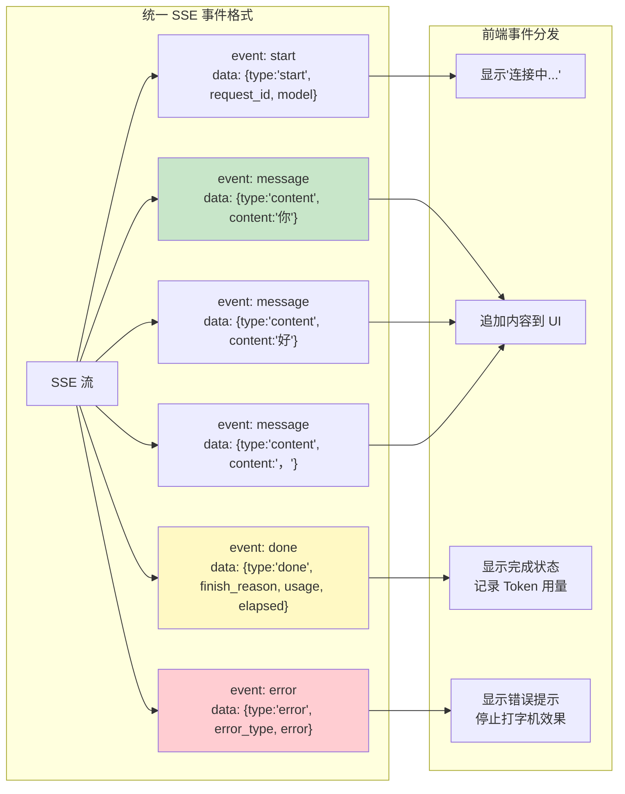

#### 代码示例

**示例 1：基础——标准请求/响应格式定义**

```python
"""
示例1：LLM 流式接口标准请求/响应格式
运行：uvicorn api_format_standard:app --reload
"""
from fastapi import FastAPI
from fastapi.responses import StreamingResponse
from pydantic import BaseModel, Field
from typing import List, Optional, Literal
from openai import AsyncOpenAI
import json
import time
import uuid

app = FastAPI(title="标准流式接口", version="1.0.0")

client = AsyncOpenAI(api_key="your-api-key", base_url="https://api.openai.com/v1", timeout=300)


# ============ 请求模型 ============
class Message(BaseModel):
    """对话消息"""
    role: Literal["system", "user", "assistant", "tool"] = Field(
        ..., description="消息角色"
    )
    content: str = Field(..., description="消息内容")
    name: Optional[str] = Field(None, description="函数调用名称（tool 角色时）")


class ChatRequest(BaseModel):
    """流式对话请求"""
    messages: List[Message] = Field(..., description="对话历史，按时间顺序")
    model: str = Field(default="gpt-4o-mini", description="模型名称")
    temperature: float = Field(default=0.7, ge=0, le=2, description="温度，0=确定性，2=随机性")
    top_p: float = Field(default=1.0, ge=0, le=1, description="核采样阈值")
    max_tokens: int = Field(default=2000, ge=1, le=8000, description="最大生成 Token 数")
    stream: bool = Field(default=True, description="是否流式输出")
    presence_penalty: float = Field(default=0.0, ge=-2, le=2, description="存在惩罚")
    frequency_penalty: float = Field(default=0.0, ge=-2, le=2, description="频率惩罚")
    stop: Optional[List[str]] = Field(None, description="停止序列")


# ============ 响应事件格式 ============
def sse_start(request_id: str, model: str) -> str:
    """流开始事件"""
    return f"event: start\ndata: {json.dumps({
        'type': 'start',
        'request_id': request_id,
        'model': model,
        'timestamp': time.time(),
    }, ensure_ascii=False)}\n\n"


def sse_content(content: str, token_index: int) -> str:
    """内容增量事件"""
    return f"event: message\ndata: {json.dumps({
        'type': 'content',
        'content': content,
        'token_index': token_index,
    }, ensure_ascii=False)}\n\n"


def sse_done(request_id: str, model: str, finish_reason: str,
             prompt_tokens: int, completion_tokens: int, elapsed: float) -> str:
    """流结束事件"""
    return f"event: done\ndata: {json.dumps({
        'type': 'done',
        'request_id': request_id,
        'model': model,
        'finish_reason': finish_reason,
        'elapsed': round(elapsed, 2),
        'usage': {
            'prompt_tokens': prompt_tokens,
            'completion_tokens': completion_tokens,
            'total_tokens': prompt_tokens + completion_tokens,
        },
    }, ensure_ascii=False)}\n\n"


def sse_error(error: str, error_type: str, request_id: str = None) -> str:
    """错误事件"""
    return f"event: error\ndata: {json.dumps({
        'type': 'error',
        'error': error,
        'error_type': error_type,
        'request_id': request_id,
    }, ensure_ascii=False)}\n\n"


# ============ 流式生成器 ============
async def chat_stream_generator(request: ChatRequest, request_id: str):
    start_time = time.time()
    token_count = 0
    prompt_tokens = 0
    completion_tokens = 0

    try:
        # 发送开始事件
        yield sse_start(request_id, request.model)

        # 调用大模型
        stream = await client.chat.completions.create(
            model=request.model,
            messages=[m.model_dump(exclude_none=True) for m in request.messages],
            stream=True,
            temperature=request.temperature,
            top_p=request.top_p,
            max_tokens=request.max_tokens,
            presence_penalty=request.presence_penalty,
            frequency_penalty=request.frequency_penalty,
            stop=request.stop,
            stream_options={"include_usage": True},
        )

        async for chunk in stream:
            if chunk.choices and chunk.choices[0].delta.content:
                content = chunk.choices[0].delta.content
                token_count += 1
                yield sse_content(content, token_count)

            if chunk.usage:
                prompt_tokens = chunk.usage.prompt_tokens
                completion_tokens = chunk.usage.completion_tokens

            if chunk.choices and chunk.choices[0].finish_reason:
                elapsed = time.time() - start_time
                yield sse_done(
                    request_id, request.model,
                    chunk.choices[0].finish_reason,
                    prompt_tokens, completion_tokens or token_count,
                    elapsed,
                )
                return

    except Exception as e:
        yield sse_error(str(e), type(e).__name__, request_id)


@app.post("/api/v1/chat/stream")
async def chat_stream(request: ChatRequest):
    """标准流式对话接口"""
    request_id = str(uuid.uuid4())[:8]
    return StreamingResponse(
        chat_stream_generator(request, request_id),
        media_type="text/event-stream",
        headers={
            "Cache-Control": "no-cache",
            "X-Accel-Buffering": "no",
            "X-Request-ID": request_id,
        },
    )


# 前端统一解析器：
"""
async function streamChat(messages) {
  const response = await fetch('/api/v1/chat/stream', {
    method: 'POST',
    headers: { 'Content-Type': 'application/json' },
    body: JSON.stringify({ messages, stream: true }),
  });

  const reader = response.body.getReader();
  const decoder = new TextDecoder();
  let buffer = '';
  let fullContent = '';

  while (true) {
    const { done, value } = await reader.read();
    if (done) break;

    buffer += decoder.decode(value, { stream: true });
    const events = buffer.split('\\n\\n');
    buffer = events.pop();

    for (const event of events) {
      // 解析 event: 和 data: 行
      const lines = event.split('\\n');
      let eventType = 'message';
      let dataStr = '';
      for (const line of lines) {
        if (line.startsWith('event: ')) eventType = line.slice(7);
        if (line.startsWith('data: ')) dataStr = line.slice(6);
      }
      if (!dataStr) continue;

      const data = JSON.parse(dataStr);

      // 按事件类型分发
      switch (data.type) {
        case 'start':
          console.log('开始:', data.request_id, data.model);
          break;
        case 'content':
          fullContent += data.content;
          updateUI(fullContent);  // 打字机效果
          break;
        case 'done':
          console.log('完成:', data.usage, '耗时:', data.elapsed + 's');
          break;
        case 'error':
          console.error('错误:', data.error_type, data.error);
          showError(data.error);
          break;
      }
    }
  }
}
"""
```

**示例 2：进阶——非流式与流式统一接口**

```python
"""
示例2：非流式与流式统一接口
通过 stream 参数控制返回格式，前端一套代码处理两种模式
运行：uvicorn unified_api:app --reload
"""
from fastapi import FastAPI
from fastapi.responses import StreamingResponse
from pydantic import BaseModel, Field
from typing import List, Optional
from openai import AsyncOpenAI
import json
import time

app = FastAPI(title="统一接口", version="1.0.0")
client = AsyncOpenAI(api_key="your-api-key", base_url="https://api.openai.com/v1", timeout=300)


class ChatRequest(BaseModel):
    messages: List[dict]
    model: str = "gpt-4o-mini"
    temperature: float = 0.7
    max_tokens: int = 2000
    stream: bool = True  # 关键：控制是否流式


def build_response(content: str, model: str, usage: dict, elapsed: float) -> dict:
    """构造统一的非流式响应格式"""
    return {
        "id": f"chatcmpl-{int(time.time())}",
        "object": "chat.completion",
        "model": model,
        "choices": [{
            "index": 0,
            "message": {"role": "assistant", "content": content},
            "finish_reason": "stop",
        }],
        "usage": usage,
        "elapsed": round(elapsed, 2),
    }


@app.post("/api/v1/chat")
async def chat(request: ChatRequest):
    """
    统一对话接口：stream=true 返回 SSE 流，stream=false 返回完整 JSON
    前端通过 stream 参数控制，一套接口支持两种模式
    """
    start_time = time.time()

    if not request.stream:
        # ===== 非流式：等待全部生成后返回 =====
        response = await client.chat.completions.create(
            model=request.model,
            messages=request.messages,
            temperature=request.temperature,
            max_tokens=request.max_tokens,
            stream=False,
        )
        elapsed = time.time() - start_time
        return build_response(
            content=response.choices[0].message.content,
            model=request.model,
            usage={
                "prompt_tokens": response.usage.prompt_tokens,
                "completion_tokens": response.usage.completion_tokens,
                "total_tokens": response.usage.total_tokens,
            },
            elapsed=elapsed,
        )

    # ===== 流式：SSE 逐块返回 =====
    async def generate():
        full_content = ""
        token_count = 0

        try:
            stream = await client.chat.completions.create(
                model=request.model,
                messages=request.messages,
                stream=True,
                temperature=request.temperature,
                max_tokens=request.max_tokens,
                stream_options={"include_usage": True},
            )

            async for chunk in stream:
                if chunk.choices and chunk.choices[0].delta.content:
                    content = chunk.choices[0].delta.content
                    full_content += content
                    token_count += 1
                    yield f"data: {json.dumps({
                        'type': 'content',
                        'content': content,
                        'full_content': full_content,  # 可选：累计完整内容
                    }, ensure_ascii=False)}\n\n"

                if chunk.choices and chunk.choices[0].finish_reason:
                    elapsed = time.time() - start_time
                    usage = chunk.usage
                    yield f"data: {json.dumps({
                        'type': 'done',
                        'content': full_content,
                        'finish_reason': chunk.choices[0].finish_reason,
                        'usage': {
                            'prompt_tokens': usage.prompt_tokens if usage else 0,
                            'completion_tokens': usage.completion_tokens if usage else token_count,
                        },
                        'elapsed': round(elapsed, 2),
                    }, ensure_ascii=False)}\n\n"

        except Exception as e:
            yield f"data: {json.dumps({'type': 'error', 'error': str(e)})}\n\n"

    return StreamingResponse(
        generate(),
        media_type="text/event-stream",
        headers={"Cache-Control": "no-cache", "X-Accel-Buffering": "no"},
    )


# 前端统一调用：
"""
async function chat(messages, stream = true) {
  const response = await fetch('/api/v1/chat', {
    method: 'POST',
    headers: { 'Content-Type': 'application/json' },
    body: JSON.stringify({ messages, stream }),
  });

  if (!stream) {
    // 非流式：直接解析 JSON
    const data = await response.json();
    return data.choices[0].message.content;
  }

  // 流式：解析 SSE
  const reader = response.body.getReader();
  const decoder = new TextDecoder();
  let buffer = '';
  let fullContent = '';

  while (true) {
    const { done, value } = await reader.read();
    if (done) break;
    buffer += decoder.decode(value, { stream: true });
    const lines = buffer.split('\\n\\n');
    buffer = lines.pop();
    for (const line of lines) {
      if (line.startsWith('data: ')) {
        const data = JSON.parse(line.slice(6));
        if (data.type === 'content') fullContent += data.content;
        if (data.type === 'done') return fullContent;
        if (data.type === 'error') throw new Error(data.error);
      }
    }
  }
  return fullContent;
}
"""
```

**示例 3：完整场景——函数调用（Function Calling）流式接口**

```python
"""
示例3：支持 Function Calling 的流式接口
大模型返回工具调用时，流式输出工具调用参数
运行：uvicorn function_calling_stream:app --reload
"""
from fastapi import FastAPI
from fastapi.responses import StreamingResponse
from pydantic import BaseModel, Field
from typing import List, Optional, Dict, Any
from openai import AsyncOpenAI
import json
import time

app = FastAPI(title="Function Calling 流式接口", version="1.0.0")
client = AsyncOpenAI(api_key="your-api-key", base_url="https://api.openai.com/v1", timeout=300)

# 定义可用工具
TOOLS = [
    {
        "type": "function",
        "function": {
            "name": "get_weather",
            "description": "获取指定城市的天气",
            "parameters": {
                "type": "object",
                "properties": {
                    "city": {"type": "string", "description": "城市名称"},
                    "unit": {"type": "string", "enum": ["celsius", "fahrenheit"]},
                },
                "required": ["city"],
            },
        },
    },
    {
        "type": "function",
        "function": {
            "name": "search_web",
            "description": "搜索网络信息",
            "parameters": {
                "type": "object",
                "properties": {
                    "query": {"type": "string", "description": "搜索关键词"},
                },
                "required": ["query"],
            },
        },
    },
]


class ChatRequest(BaseModel):
    messages: List[dict]
    model: str = "gpt-4o-mini"
    tools: Optional[List[dict]] = None
    tool_choice: str = "auto"


async def function_calling_stream(request: ChatRequest):
    """支持 Function Calling 的流式生成器"""
    start_time = time.time()
    full_content = ""
    tool_calls = []  # 收集工具调用
    current_tool_call = None

    try:
        stream = await client.chat.completions.create(
            model=request.model,
            messages=request.messages,
            tools=request.tools or TOOLS,
            tool_choice=request.tool_choice,
            stream=True,
            stream_options={"include_usage": True},
        )

        async for chunk in stream:
            if not chunk.choices:
                continue

            delta = chunk.choices[0].delta

            # 处理文本内容
            if delta.content:
                full_content += delta.content
                yield f"data: {json.dumps({
                    'type': 'content',
                    'content': delta.content,
                }, ensure_ascii=False)}\n\n"

            # 处理工具调用（流式累积参数）
            if delta.tool_calls:
                for tc in delta.tool_calls:
                    if tc.index is not None and tc.index >= len(tool_calls):
                        # 新的工具调用开始
                        tool_calls.append({
                            "id": tc.id,
                            "type": "function",
                            "function": {"name": tc.function.name or "", "arguments": ""},
                        })
                        current_tool_call = tc.index
                        yield f"data: {json.dumps({
                            'type': 'tool_call_start',
                            'index': tc.index,
                            'id': tc.id,
                            'name': tc.function.name,
                        }, ensure_ascii=False)}\n\n"

                    if tc.index is not None and tc.function.arguments:
                        # 累积工具调用参数
                        tool_calls[tc.index]["function"]["arguments"] += tc.function.arguments
                        yield f"data: {json.dumps({
                            'type': 'tool_call_delta',
                            'index': tc.index,
                            'arguments_delta': tc.function.arguments,
                        }, ensure_ascii=False)}\n\n"

            # 检测结束
            if chunk.choices[0].finish_reason:
                finish_reason = chunk.choices[0].finish_reason
                elapsed = time.time() - start_time

                if finish_reason == "tool_calls":
                    # 大模型要求调用工具
                    yield f"data: {json.dumps({
                        'type': 'tool_calls',
                        'tool_calls': tool_calls,
                        'elapsed': round(elapsed, 2),
                    }, ensure_ascii=False)}\n\n"
                else:
                    # 正常文本结束
                    yield f"data: {json.dumps({
                        'type': 'done',
                        'content': full_content,
                        'finish_reason': finish_reason,
                        'elapsed': round(elapsed, 2),
                    }, ensure_ascii=False)}\n\n"
                return

    except Exception as e:
        yield f"data: {json.dumps({'type': 'error', 'error': str(e)})}\n\n"


@app.post("/api/v1/chat/function-calling")
async def chat_with_tools(request: ChatRequest):
    """支持 Function Calling 的流式接口"""
    return StreamingResponse(
        function_calling_stream(request),
        media_type="text/event-stream",
        headers={"Cache-Control": "no-cache", "X-Accel-Buffering": "no"},
    )


# 前端处理工具调用：
"""
async function chatWithTools(messages) {
  const response = await fetch('/api/v1/chat/function-calling', {
    method: 'POST',
    headers: { 'Content-Type': 'application/json' },
    body: JSON.stringify({ messages }),
  });

  const reader = response.body.getReader();
  const decoder = new TextDecoder();
  let buffer = '';
  let fullContent = '';
  let toolCalls = [];

  while (true) {
    const { done, value } = await reader.read();
    if (done) break;
    buffer += decoder.decode(value, { stream: true });
    const lines = buffer.split('\\n\\n');
    buffer = lines.pop();

    for (const line of lines) {
      if (!line.startsWith('data: ')) continue;
      const data = JSON.parse(line.slice(6));

      if (data.type === 'content') {
        fullContent += data.content;
        updateUI(fullContent);
      } else if (data.type === 'tool_calls') {
        // 大模型要求调用工具，执行工具后继续对话
        const results = await executeToolCalls(data.tool_calls);
        // 将工具结果加入 messages，再次调用接口
        return chatWithTools([...messages, ...data.tool_calls, ...results]);
      } else if (data.type === 'done') {
        return fullContent;
      }
    }
  }
}
"""
```

#### 使用场景与最佳实践

**适用场景**：
- AI 对话聊天：标准流式对话接口
- Function Calling：大模型工具调用的流式输出
- 多模态接口：文本+图片的统一接口
- 非流式/流式统一：通过 stream 参数切换

**不适用场景**：
- 简单的文本生成：不需要复杂的事件类型
- 内部系统调用：可以用更简单的格式

**最佳实践**：
1. **用 `type` 字段区分事件**：content/done/error/start/tool_calls
2. **内容用增量（delta）**：每次只发送新增内容，不发送完整内容
3. **done 事件包含完整元数据**：finish_reason、usage、elapsed、model
4. **错误用独立的 error 事件**：包含 error_type 和 error 消息
5. **非流式/流式统一接口**：通过 stream 参数控制，前端一套代码
6. **请求 ID 用于追踪**：`X-Request-ID` 响应头 + SSE 消息中包含
7. **Function Calling 单独处理**：tool_call_start/tool_call_delta/tool_calls 事件
8. **Pydantic 严格校验请求**：防止非法参数传到大模型 API

**性能建议**：
- 每个 content 事件只包含增量内容，减少传输数据量
- 不要在每个 content 事件中包含 full_content（除非前端需要），增加带宽
- done 事件只发送一次，包含完整元数据
- 高并发时 Pydantic 校验有 CPU 开销，可考虑用更轻量的校验

#### 常见坑点

**坑点 1：流式响应中混用 OpenAI 原生格式和自定义格式导致前端解析混乱**

- **错误现象**：前端 SSE 解析器时而能解析时而报错，因为服务端有时透传 OpenAI 原生格式（`choices[0].delta.content`），有时用自定义格式（`content`）
- **根本原因**：没有统一的响应格式规范，开发人员在不同端点/版本中使用不同的格式，前端需要处理多种格式
- **正确做法**：定义统一的响应格式规范，所有流式接口使用相同的事件类型（type 字段）和数据结构。在生成器中将 OpenAI 原生格式转换为统一格式后再 yield
- **预防措施**：在项目中定义 SSE 事件构造函数（如 `sse_content()`、`sse_done()`、`sse_error()`），所有端点统一使用

**坑点 2：done 事件中缺少 usage 导致前端无法统计 Token 用量**

- **错误现象**：前端无法获取本次对话的 Token 用量，无法计算费用和显示统计
- **根本原因**：流式响应默认不包含 usage 字段（OpenAI API 的设计），需要设置 `stream_options={"include_usage": True}` 才能在最后一个 chunk 中获取 usage。或者没有在 done 事件中传递 usage
- **正确做法**：① 调用大模型 API 时设置 `stream_options={"include_usage": True}`；② 在 done 事件中包含 usage 字段（prompt_tokens、completion_tokens、total_tokens）；③ 如果 API 不支持 stream_options，用 tiktoken 估算 Token 数
- **预防措施**：代码模板中固定包含 `stream_options={"include_usage": True}`，done 事件中固定包含 usage

---

### 3.2 错误处理与重试机制

#### 概念解释

**LLM 流式接口错误处理** 是对大模型 API 调用过程中各种异常（网络错误、限流、超时、认证失败、服务端错误）的识别、分类、重试和用户通知机制，确保接口的稳定性和用户体验。

> 🏠 **生活化比喻**：错误处理就像餐厅的应急预案——客人点的菜卖完了（404 模型不存在），服务员推荐类似的菜（降级到备用模型）；厨房太忙出菜慢（429 限流），服务员告知客人稍等并重试（指数退避重试）；食材变质（500 服务端错误），服务员道歉并换一道菜（错误恢复）；客人等太久（超时），服务员主动询问是否继续（超时处理）。好的应急预案让客人遇到问题时不会感到被抛弃。

**核心价值**：大模型 API 不稳定（限流、超时、服务波动是常态），完善的错误处理和重试机制确保用户体验流畅，避免因 API 临时故障导致整个应用不可用。

> 🎯 **面试高频考点 6**：大模型 API 调用有哪些常见错误？如何处理？哪些错误应该重试？
> **答**：常见错误：① 429 RateLimitError——限流，应指数退避重试（1s→2s→4s）；② APIConnectionError——网络连接错误，应重试；③ APIError/500——服务端错误，应重试（最多 3 次）；④ 401 AuthenticationError——API Key 错误，不重试，返回认证错误；⑤ 400 BadRequest——请求参数错误，不重试，返回参数错误；⑥ Timeout——超时，可重试；⑦ ContextLengthExceeded——上下文过长，不重试，提示用户缩短输入。重试策略：可重试的错误（429/连接错误/5xx/超时）用指数退避，最多 3 次，退避 1s/2s/4s；不可重试的错误（401/400/上下文过长）直接返回错误。

#### 原理说明

错误处理的核心机制是 **错误分类 + 指数退避重试 + 降级策略 + SSE 错误通知**。

**为什么这样设计**：大模型 API 是第三方服务，不可控——限流、超时、服务波动是常态。如果不做重试，临时故障会直接暴露给用户。但也不能无限重试——认证错误（401）重试无意义，参数错误（400）重试也不会成功。因此需要错误分类：可重试的错误用指数退避重试（避免立即重试加重服务端负担），不可重试的直接返回。流式接口中错误通过 SSE 发送（因为响应头已发送）。

**技术对比**：

| 错误类型 | HTTP 状态码 | 是否重试 | 重试策略 | 用户提示 |
|---------|-----------|---------|---------|---------|
| RateLimitError | 429 | 是 | 指数退避 1/2/4s | "请求过于频繁，正在重试" |
| APIConnectionError | - | 是 | 指数退避 1/2/4s | "网络不稳定，正在重试" |
| APIError/5xx | 500 | 是 | 最多 3 次 | "服务暂时不可用" |
| Timeout | - | 是 | 1 次 | "响应超时，正在重试" |
| AuthenticationError | 401 | 否 | - | "API Key 无效" |
| BadRequestError | 400 | 否 | - | "请求参数错误" |
| ContextLengthExceeded | 400 | 否 | - | "对话过长，请精简" |
| NotFoundError | 404 | 否 | - | "模型不存在" |

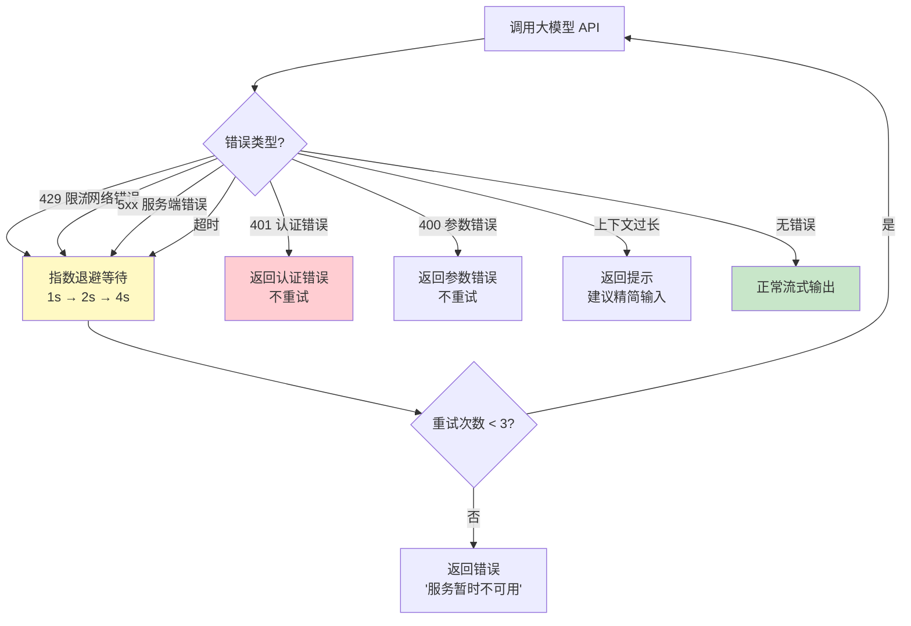

#### 代码示例

**示例 1：基础——带指数退避重试的流式生成器**

```python
"""
示例1：带指数退避重试的 LLM 流式生成器
运行：uvicorn retry_stream:app --reload
"""
from fastapi import FastAPI
from fastapi.responses import StreamingResponse
from pydantic import BaseModel
from openai import AsyncOpenAI, APIError, APIConnectionError, RateLimitError, APITimeoutError
import asyncio
import json
import time

app = FastAPI(title="重试流式接口", version="1.0.0")
client = AsyncOpenAI(api_key="your-api-key", base_url="https://api.openai.com/v1", timeout=60)


class ChatRequest(BaseModel):
    messages: list
    model: str = "gpt-4o-mini"
    max_tokens: int = 1000


# 可重试的异常类型
RETRYABLE_EXCEPTIONS = (
    RateLimitError,      # 429 限流
    APIConnectionError,  # 网络连接错误
    APITimeoutError,     # 超时
    APIError,            # 其他 API 错误（5xx）
)


async def stream_with_retry(
    request: ChatRequest,
    max_retries: int = 3,
    base_delay: float = 1.0,
):
    """带指数退避重试的流式生成器"""
    last_error = None

    for attempt in range(max_retries):
        try:
            # 通知前端正在重试
            if attempt > 0:
                yield f"data: {json.dumps({
                    'type': 'retry',
                    'attempt': attempt,
                    'max_retries': max_retries,
                    'delay': base_delay * (2 ** (attempt - 1)),
                }, ensure_ascii=False)}\n\n"

            # 调用大模型流式 API
            stream = await client.chat.completions.create(
                model=request.model,
                messages=request.messages,
                stream=True,
                max_tokens=request.max_tokens,
                stream_options={"include_usage": True},
            )

            # 流式输出
            async for chunk in stream:
                if chunk.choices and chunk.choices[0].delta.content:
                    yield f"data: {json.dumps({
                        'type': 'content',
                        'content': chunk.choices[0].delta.content,
                    }, ensure_ascii=False)}\n\n"

                if chunk.choices and chunk.choices[0].finish_reason:
                    yield f"data: {json.dumps({
                        'type': 'done',
                        'finish_reason': chunk.choices[0].finish_reason,
                    }, ensure_ascii=False)}\n\n"
            return  # 成功，退出重试循环

        except RETRYABLE_EXCEPTIONS as e:
            last_error = e
            if attempt < max_retries - 1:
                # 指数退避等待
                delay = base_delay * (2 ** attempt)
                print(f"[重试] 第 {attempt + 1} 次失败: {e}，{delay}s 后重试")
                await asyncio.sleep(delay)
            else:
                print(f"[重试] 已达最大重试次数 {max_retries}")

        except Exception as e:
            # 不可重试的错误（401/400 等）
            yield f"data: {json.dumps({
                'type': 'error',
                'error': str(e),
                'error_type': type(e).__name__,
                'retryable': False,
            }, ensure_ascii=False)}\n\n"
            return

    # 所有重试都失败
    yield f"data: {json.dumps({
        'type': 'error',
        'error': f'服务暂时不可用（已重试 {max_retries} 次）: {str(last_error)}',
        'error_type': 'MaxRetriesExceeded',
        'retryable': True,
    }, ensure_ascii=False)}\n\n"


@app.post("/api/v1/chat/stream")
async def chat_stream(request: ChatRequest):
    return StreamingResponse(
        stream_with_retry(request),
        media_type="text/event-stream",
        headers={"Cache-Control": "no-cache", "X-Accel-Buffering": "no"},
    )
```

**示例 2：进阶——模型降级与故障转移**

```python
"""
示例2：模型降级与故障转移
主模型失败时自动切换到备用模型
运行：uvicorn fallback_model:app --reload
"""
from fastapi import FastAPI
from fastapi.responses import StreamingResponse
from pydantic import BaseModel
from openai import AsyncOpenAI
from typing import Dict, List, Optional
import asyncio
import json
import time

app = FastAPI(title="模型降级", version="1.0.0")

# 模型配置：按优先级排列，主模型失败时降级到下一个
MODEL_FALLBACK_CHAIN = [
    {
        "name": "gpt-4o",
        "base_url": "https://api.openai.com/v1",
        "api_key": "sk-openai-xxx",
        "max_tokens": 4000,
    },
    {
        "name": "gpt-4o-mini",
        "base_url": "https://api.openai.com/v1",
        "api_key": "sk-openai-xxx",
        "max_tokens": 4000,
    },
    {
        "name": "doubao-pro",
        "base_url": "https://ark.cn-beijing.volces.com/api/v3",
        "api_key": "doubao-key",
        "max_tokens": 4000,
    },
]

# 客户端缓存
_clients: Dict[str, AsyncOpenAI] = {}


def get_client(model_config: dict) -> AsyncOpenAI:
    """获取或创建客户端实例"""
    name = model_config["name"]
    if name not in _clients:
        _clients[name] = AsyncOpenAI(
            api_key=model_config["api_key"],
            base_url=model_config["base_url"],
            timeout=60,
        )
    return _clients[name]


class ChatRequest(BaseModel):
    messages: list
    preferred_model: Optional[str] = None  # 用户指定的首选模型
    max_tokens: int = 1000


async def stream_with_fallback(request: ChatRequest):
    """带模型降级的流式生成器"""
    # 确定降级链：首选模型排最前
    if request.preferred_model:
        chain = sorted(
            MODEL_FALLBACK_CHAIN,
            key=lambda m: 0 if m["name"] == request.preferred_model else 1,
        )
    else:
        chain = MODEL_FALLBACK_CHAIN

    for i, model_config in enumerate(chain):
        model_name = model_config["name"]
        client = get_client(model_config)

        try:
            # 通知前端使用的模型
            if i > 0:
                yield f"data: {json.dumps({
                    'type': 'fallback',
                    'from_model': chain[i-1]['name'],
                    'to_model': model_name,
                    'reason': '主模型不可用，已降级',
                }, ensure_ascii=False)}\n\n"

            # 调用当前模型
            stream = await client.chat.completions.create(
                model=model_name,
                messages=request.messages,
                stream=True,
                max_tokens=min(request.max_tokens, model_config["max_tokens"]),
            )

            async for chunk in stream:
                if chunk.choices and chunk.choices[0].delta.content:
                    yield f"data: {json.dumps({
                        'type': 'content',
                        'content': chunk.choices[0].delta.content,
                        'model': model_name,
                    }, ensure_ascii=False)}\n\n"

                if chunk.choices and chunk.choices[0].finish_reason:
                    yield f"data: {json.dumps({
                        'type': 'done',
                        'model': model_name,
                        'finish_reason': chunk.choices[0].finish_reason,
                    }, ensure_ascii=False)}\n\n"
            return  # 成功

        except Exception as e:
            print(f"[降级] 模型 {model_name} 失败: {e}")
            if i < len(chain) - 1:
                # 继续尝试下一个模型
                continue
            else:
                # 所有模型都失败
                yield f"data: {json.dumps({
                    'type': 'error',
                    'error': f'所有模型都不可用: {e}',
                    'error_type': 'AllModelsFailed',
                }, ensure_ascii=False)}\n\n"


@app.post("/api/v1/chat/stream")
async def chat_stream(request: ChatRequest):
    return StreamingResponse(
        stream_with_fallback(request),
        media_type="text/event-stream",
        headers={"Cache-Control": "no-cache", "X-Accel-Buffering": "no"},
    )


@app.get("/api/v1/models/status")
async def model_status():
    """获取模型可用性状态"""
    return {
        "fallback_chain": [m["name"] for m in MODEL_FALLBACK_CHAIN],
        "total_models": len(MODEL_FALLBACK_CHAIN),
    }
```

**示例 3：完整场景——生产级错误处理器（分类+重试+降级+监控）**

```python
"""
示例3：生产级错误处理器
特性：错误分类、指数退避重试、模型降级、错误监控、熔断
运行：uvicorn production_error_handler:app --reload
"""
from fastapi import FastAPI
from fastapi.responses import StreamingResponse
from pydantic import BaseModel
from openai import (
    AsyncOpenAI, APIError, APIConnectionError, RateLimitError,
    APITimeoutError, AuthenticationError, BadRequestError,
    InternalServerError, NotFoundError,
)
from typing import Dict, Optional
from collections import defaultdict
import asyncio
import json
import time
import logging

logging.basicConfig(level=logging.INFO)
logger = logging.getLogger(__name__)

app = FastAPI(title="生产级错误处理", version="1.0.0")
client = AsyncOpenAI(api_key="your-api-key", base_url="https://api.openai.com/v1", timeout=60)


# ============ 熔断器 ============
class CircuitBreaker:
    """熔断器：连续失败达到阈值后暂时停止调用"""

    def __init__(self, failure_threshold: int = 5, recovery_timeout: int = 60):
        self.failure_count = 0
        self.failure_threshold = failure_threshold
        self.recovery_timeout = recovery_timeout
        self.last_failure_time = 0
        self.state = "closed"  # closed(正常) / open(熔断) / half_open(半开)

    def can_execute(self) -> bool:
        """检查是否可以执行调用"""
        if self.state == "open":
            if time.time() - self.last_failure_time > self.recovery_timeout:
                self.state = "half_open"
                logger.info("熔断器半开：尝试恢复")
                return True
            return False
        return True

    def record_success(self):
        """记录成功"""
        self.failure_count = 0
        if self.state == "half_open":
            self.state = "closed"
            logger.info("熔断器关闭：恢复正常")

    def record_failure(self):
        """记录失败"""
        self.failure_count += 1
        self.last_failure_time = time.time()
        if self.failure_count >= self.failure_threshold:
            self.state = "open"
            logger.warning(f"熔断器打开：连续失败 {self.failure_count} 次，暂停 {self.recovery_timeout}s")


circuit_breaker = CircuitBreaker(failure_threshold=5, recovery_timeout=60)


# ============ 错误分类 ============
def classify_error(error: Exception) -> dict:
    """分类错误，返回处理策略"""
    if isinstance(error, RateLimitError):
        return {
            "category": "rate_limit",
            "retryable": True,
            "user_message": "请求过于频繁，正在重试...",
            "retry_delay": 2.0,
        }
    elif isinstance(error, (APIConnectionError, APITimeoutError)):
        return {
            "category": "connection",
            "retryable": True,
            "user_message": "网络不稳定，正在重试...",
            "retry_delay": 1.0,
        }
    elif isinstance(error, InternalServerError):
        return {
            "category": "server_error",
            "retryable": True,
            "user_message": "服务暂时不可用，正在重试...",
            "retry_delay": 2.0,
        }
    elif isinstance(error, AuthenticationError):
        return {
            "category": "auth",
            "retryable": False,
            "user_message": "API Key 无效，请检查配置",
        }
    elif isinstance(error, BadRequestError):
        return {
            "category": "bad_request",
            "retryable": False,
            "user_message": "请求参数错误，请检查输入",
        }
    elif isinstance(error, NotFoundError):
        return {
            "category": "not_found",
            "retryable": False,
            "user_message": "模型不存在",
        }
    else:
        return {
            "category": "unknown",
            "retryable": True,
            "user_message": "发生未知错误，正在重试...",
            "retry_delay": 1.0,
        }


# ============ 错误统计 ============
error_stats = defaultdict(int)


@app.post("/api/v1/chat/stream")
async def chat_stream(request: dict):
    """生产级流式接口：熔断 + 错误分类 + 重试 + 监控"""

    async def generate():
        # 熔断器检查
        if not circuit_breaker.can_execute():
            yield f"data: {json.dumps({
                'type': 'error',
                'error': '服务暂时不可用（熔断器已打开），请稍后重试',
                'error_type': 'CircuitBreakerOpen',
            }, ensure_ascii=False)}\n\n"
            return

        max_retries = 3
        last_error = None

        for attempt in range(max_retries):
            try:
                stream = await client.chat.completions.create(
                    model=request.get("model", "gpt-4o-mini"),
                    messages=request.get("messages", []),
                    stream=True,
                    max_tokens=request.get("max_tokens", 1000),
                )

                # 成功：记录熔断器成功
                circuit_breaker.record_success()

                async for chunk in stream:
                    if chunk.choices and chunk.choices[0].delta.content:
                        yield f"data: {json.dumps({
                            'type': 'content',
                            'content': chunk.choices[0].delta.content,
                        }, ensure_ascii=False)}\n\n"

                    if chunk.choices and chunk.choices[0].finish_reason:
                        yield f"data: {json.dumps({'type': 'done'})}\n\n"
                return

            except Exception as e:
                last_error = e
                error_stats[type(e).__name__] += 1
                error_info = classify_error(e)

                logger.error(
                    f"[错误] 类型={error_info['category']} "
                    f"可重试={error_info['retryable']} 详情={e}"
                )

                if not error_info["retryable"]:
                    # 不可重试：直接返回错误
                    yield f"data: {json.dumps({
                        'type': 'error',
                        'error': error_info["user_message"],
                        'error_type': error_info["category"],
                        'retryable': False,
                    }, ensure_ascii=False)}\n\n"
                    circuit_breaker.record_failure()
                    return

                if attempt < max_retries - 1:
                    # 可重试：通知前端 + 指数退避
                    delay = error_info.get("retry_delay", 1.0) * (2 ** attempt)
                    yield f"data: {json.dumps({
                        'type': 'retry',
                        'attempt': attempt + 1,
                        'max_retries': max_retries,
                        'delay': delay,
                        'message': error_info["user_message"],
                    }, ensure_ascii=False)}\n\n"
                    await asyncio.sleep(delay)
                else:
                    circuit_breaker.record_failure()

        # 所有重试失败
        yield f"data: {json.dumps({
            'type': 'error',
            'error': f'服务暂时不可用（已重试 {max_retries} 次）',
            'error_type': 'MaxRetriesExceeded',
            'detail': str(last_error),
        }, ensure_ascii=False)}\n\n"

    return StreamingResponse(
        generate(),
        media_type="text/event-stream",
        headers={"Cache-Control": "no-cache", "X-Accel-Buffering": "no"},
    )


@app.get("/api/error-stats")
async def get_error_stats():
    return {
        "errors": dict(error_stats),
        "circuit_breaker": {
            "state": circuit_breaker.state,
            "failure_count": circuit_breaker.failure_count,
        },
    }
```

#### 使用场景与最佳实践

**适用场景**：
- 所有生产级 LLM 接口都需要错误处理和重试
- 多模型部署需要降级策略
- 高可用要求的服务需要熔断器
- 需要错误监控和告警的系统

**不适用场景**：
- 开发/测试环境：可以简化错误处理
- 内部工具：容错要求低

**最佳实践**：
1. **错误分类处理**：可重试（429/网络/5xx/超时）vs 不可重试（401/400/404）
2. **指数退避重试**：1s→2s→4s，最多 3 次，避免立即重试加重服务端负担
3. **模型降级**：主模型失败时自动切换到备用模型，提高可用性
4. **熔断器**：连续失败达到阈值后暂停调用，防止雪崩
5. **错误通过 SSE 发送**：流式过程中的错误用 `{"type": "error"}` 事件
6. **重试时通知前端**：发送 `{"type": "retry", "attempt": N}` 事件，用户知道正在重试
7. **错误监控统计**：记录错误类型和频率，设置告警阈值
8. **超时设置合理**：连接超时 10s，读取超时 300s（大模型生成慢）

**性能建议**：
- 重试间隔不要太短（至少 1s），避免加重服务端负担
- 熔断器恢复时间 30-60 秒，给服务端恢复时间
- 降级模型选择成本更低、更稳定的模型（如 gpt-4o → gpt-4o-mini）
- 错误统计用内存字典，定期上报到监控系统

#### 常见坑点

**坑点 1：流式过程中重试导致内容重复或中断**

- **错误现象**：大模型 API 在流式输出过程中（已经输出了部分内容）发生错误，重试后从头开始生成，前端看到内容重复或混乱
- **根本原因**：流式输出是增量的，如果已经输出了部分内容后失败，重试时无法从断点继续（大模型 API 不支持断点续传），只能从头开始
- **正确做法**：① 简单方案：重试时发送 `{"type": "retry", "reset": true}` 通知前端清空已显示内容，重新开始；② 高级方案：记录已输出的内容，重试时在 prompt 中加入已生成的内容作为前缀（但可能影响生成质量）；③ 建议在流式开始前（第一个 chunk 之前）完成重试，流式过程中的错误直接报错
- **预防措施**：区分"连接阶段错误"（可重试）和"流式输出阶段错误"（不建议重试，直接报错）

**坑点 2：429 限流时立即重试导致限流更严重**

- **错误现象**：收到 429 限流错误后立即重试，导致更多请求被限流，形成恶性循环，最终所有请求都失败
- **根本原因**：没有指数退避，收到 429 后立即重试，服务端仍然处于高负载状态，重试请求又被限流
- **正确做法**：① 429 错误用指数退避（1s→2s→4s），不要立即重试；② 从响应头 `Retry-After` 读取建议的重试等待时间（如果有）；③ 全局限流器，所有请求共享限流状态
- **预防措施**：重试代码中固定使用指数退避，429 的初始延迟设为 2s（比其他错误长）

---

## 4. 多模型适配层架构

### 4.1 抽象基类与工厂模式

#### 概念解释

**多模型适配层** 是通过抽象基类（Abstract Base Class）定义统一的 LLM 客户端接口，每个模型厂商实现一个具体适配器类，通过工厂函数根据模型名称返回对应实例，屏蔽不同厂商 API 差异的架构设计。

> 🏠 **生活化比喻**：多模型适配层就像万能翻译器——抽象基类是翻译规范（"把中文翻译成目标语言"），每个适配器是具体的翻译官（英语翻译官、日语翻译官、法语翻译官），工厂函数是前台接待（根据你说的语言分配对应的翻译官）。你不需要知道每个翻译官的工作方式，只需要告诉前台"我要英语翻译"，就能得到统一的翻译服务。

**核心价值**：屏蔽不同厂商 API 的差异，上层业务代码无需关心底层调用的是哪家模型，支持动态切换、降级、负载均衡，是构建多模型 LLM 网关的基础架构。

> 🎯 **面试高频考点 7**：如何设计多模型适配层？国内大模型为什么可以直接用 AsyncOpenAI？
> **答**：设计：① 定义抽象基类 `BaseLLMClient`，声明 `async def chat_completion_stream(messages, **kwargs) -> AsyncGenerator` 接口；② 每个厂商实现具体类（OpenAIClient、AnthropicClient、DoubaoClient），在类内部完成请求转换和响应转换；③ 工厂函数 `get_client(model_name) -> BaseLLMClient` 根据模型名称返回实例。国内大模型（通义、豆包、智谱、DeepSeek 等）大多兼容 OpenAI API 格式，可以直接用 `AsyncOpenAI(base_url=..., api_key=...)` 调用，不需要独立适配器。不兼容的模型（Anthropic、Gemini）需要独立适配器。

#### 原理说明

多模型适配层的核心机制是 **抽象基类 + 适配器模式 + 工厂函数 + 单例缓存**。

**为什么这样设计**：不同厂商的 API 格式、认证方式、响应结构可能不同。如果业务代码直接调用各家 SDK，切换模型时需要修改大量代码。抽象基类定义统一接口，适配器封装差异，工厂函数根据模型名路由，业务代码只依赖抽象接口。单例缓存避免每次请求创建新的客户端实例（复用连接池）。

**技术对比**：

| 模型厂商 | API 格式 | 适配方式 | 流式支持 |
|---------|---------|---------|---------|
| OpenAI | OpenAI 原生 | AsyncOpenAI 直接用 | 支持 |
| 豆包/通义/智谱/DeepSeek | OpenAI 兼容 | AsyncOpenAI + 不同 base_url | 支持 |
| Anthropic Claude | 原生格式 | 独立适配器 | 支持 |
| Google Gemini | 原生格式 | 独立适配器 | 支持 |
| 本地模型（Ollama/vLLM） | OpenAI 兼容 | AsyncOpenAI + 本地 base_url | 支持 |

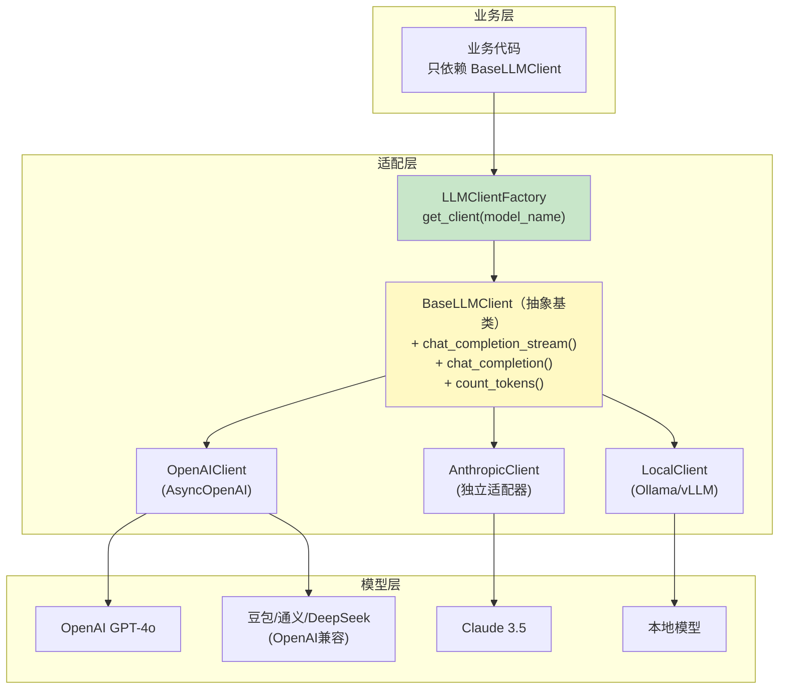

#### 代码示例

**示例 1：基础——抽象基类与 OpenAI 兼容适配器**

```python
"""
示例1：多模型适配层基础实现
抽象基类 + OpenAI 兼容适配器 + 工厂函数
运行：python llm_adapter_basic.py
"""
from abc import ABC, abstractmethod
from typing import AsyncGenerator, Dict, List, Optional
from openai import AsyncOpenAI
import asyncio
import json


# ============ 抽象基类 ============
class BaseLLMClient(ABC):
    """LLM 客户端抽象基类：定义统一接口"""

    @abstractmethod
    async def chat_completion(
        self,
        messages: List[dict],
        **kwargs,
    ) -> dict:
        """非流式对话补全，返回完整响应"""
        pass

    @abstractmethod
    async def chat_completion_stream(
        self,
        messages: List[dict],
        **kwargs,
    ) -> AsyncGenerator[str, None]:
        """流式对话补全，yield SSE 格式数据"""
        pass

    @abstractmethod
    async def count_tokens(self, text: str) -> int:
        """计算文本的 Token 数量"""
        pass

    @property
    @abstractmethod
    def model_name(self) -> str:
        """模型名称"""
        pass


# ============ OpenAI 兼容适配器 ============
class OpenAICompatibleClient(BaseLLMClient):
    """
    OpenAI 兼容格式适配器
    适用于：OpenAI、豆包、通义千问、智谱、DeepSeek、Ollama、vLLM 等
    """

    def __init__(
        self,
        model: str,
        api_key: str,
        base_url: str,
        max_tokens: int = 4000,
        timeout: float = 300.0,
    ):
        self._model_name = model
        self.max_tokens = max_tokens
        self.client = AsyncOpenAI(
            api_key=api_key,
            base_url=base_url,
            timeout=timeout,
        )

    @property
    def model_name(self) -> str:
        return self._model_name

    async def chat_completion(self, messages: List[dict], **kwargs) -> dict:
        """非流式对话"""
        response = await self.client.chat.completions.create(
            model=self._model_name,
            messages=messages,
            max_tokens=kwargs.get("max_tokens", self.max_tokens),
            temperature=kwargs.get("temperature", 0.7),
            stream=False,
        )
        return {
            "content": response.choices[0].message.content,
            "model": response.model,
            "usage": {
                "prompt_tokens": response.usage.prompt_tokens,
                "completion_tokens": response.usage.completion_tokens,
                "total_tokens": response.usage.total_tokens,
            },
            "finish_reason": response.choices[0].finish_reason,
        }

    async def chat_completion_stream(
        self, messages: List[dict], **kwargs
    ) -> AsyncGenerator[str, None]:
        """流式对话：yield 统一格式的 SSE 数据"""
        stream = await self.client.chat.completions.create(
            model=self._model_name,
            messages=messages,
            max_tokens=kwargs.get("max_tokens", self.max_tokens),
            temperature=kwargs.get("temperature", 0.7),
            stream=True,
            stream_options={"include_usage": True},
        )

        async for chunk in stream:
            if chunk.choices and chunk.choices[0].delta.content:
                yield f"data: {json.dumps({
                    'type': 'content',
                    'content': chunk.choices[0].delta.content,
                    'model': self._model_name,
                }, ensure_ascii=False)}\n\n"

            if chunk.choices and chunk.choices[0].finish_reason:
                usage = chunk.usage
                yield f"data: {json.dumps({
                    'type': 'done',
                    'model': self._model_name,
                    'finish_reason': chunk.choices[0].finish_reason,
                    'usage': {
                        'prompt_tokens': usage.prompt_tokens if usage else 0,
                        'completion_tokens': usage.completion_tokens if usage else 0,
                    },
                }, ensure_ascii=False)}\n\n"

    async def count_tokens(self, text: str) -> int:
        """估算 Token 数（简化版，实际用 tiktoken）"""
        return len(text) // 2  # 粗略估算


# ============ 工厂函数 ============
MODEL_CONFIG = {
    "gpt-4o": {
        "class": "OpenAICompatibleClient",
        "model": "gpt-4o",
        "api_key": "sk-openai-xxx",
        "base_url": "https://api.openai.com/v1",
    },
    "gpt-4o-mini": {
        "class": "OpenAICompatibleClient",
        "model": "gpt-4o-mini",
        "api_key": "sk-openai-xxx",
        "base_url": "https://api.openai.com/v1",
    },
    "doubao-pro": {
        "class": "OpenAICompatibleClient",
        "model": "doubao-pro-32k",
        "api_key": "doubao-key",
        "base_url": "https://ark.cn-beijing.volces.com/api/v3",
    },
    "qwen-plus": {
        "class": "OpenAICompatibleClient",
        "model": "qwen-plus",
        "api_key": "sk-qwen-xxx",
        "base_url": "https://dashscope.aliyuncs.com/compatible-mode/v1",
    },
    "deepseek-chat": {
        "class": "OpenAICompatibleClient",
        "model": "deepseek-chat",
        "api_key": "sk-deepseek-xxx",
        "base_url": "https://api.deepseek.com/v1",
    },
}

# 客户端单例缓存
_client_cache: Dict[str, BaseLLMClient] = {}


def get_client(model_name: str) -> BaseLLMClient:
    """
    工厂函数：根据模型名称获取客户端实例
    单例缓存，避免重复创建
    """
    if model_name not in MODEL_CONFIG:
        raise ValueError(f"不支持的模型: {model_name}")

    if model_name not in _client_cache:
        config = MODEL_CONFIG[model_name]
        if config["class"] == "OpenAICompatibleClient":
            _client_cache[model_name] = OpenAICompatibleClient(
                model=config["model"],
                api_key=config["api_key"],
                base_url=config["base_url"],
            )
        # 其他适配器类...

    return _client_cache[model_name]


# ============ 使用示例 ============
async def main():
    # 业务代码只依赖抽象基类，不关心具体实现
    for model_name in ["gpt-4o-mini", "doubao-pro", "deepseek-chat"]:
        try:
            client = get_client(model_name)
            print(f"\n=== 模型: {client.model_name} ===")

            # 非流式
            result = await client.chat_completion(
                messages=[{"role": "user", "content": "你好"}],
                max_tokens=50,
            )
            print(f"回答: {result['content'][:50]}...")
            print(f"Token: {result['usage']}")

        except Exception as e:
            print(f"模型 {model_name} 调用失败: {e}")


if __name__ == "__main__":
    asyncio.run(main())
```

**示例 2：进阶——Anthropic 独立适配器**

```python
"""
示例2：Anthropic Claude 独立适配器（不兼容 OpenAI 格式）
安装：pip install anthropic
运行：python anthropic_adapter.py
"""
from abc import ABC, abstractmethod
from typing import AsyncGenerator, List
import anthropic
import json
import asyncio


class BaseLLMClient(ABC):
    @abstractmethod
    async def chat_completion_stream(self, messages: List[dict], **kwargs) -> AsyncGenerator[str, None]:
        pass


class AnthropicClient(BaseLLMClient):
    """
    Anthropic Claude 适配器
    Claude API 格式与 OpenAI 不同，需要独立适配
    """

    def __init__(self, model: str, api_key: str, max_tokens: int = 4000):
        self._model_name = model
        self.max_tokens = max_tokens
        self.client = anthropic.AsyncAnthropic(api_key=api_key)

    @property
    def model_name(self) -> str:
        return self._model_name

    def _convert_messages(self, messages: List[dict]) -> tuple:
        """
        将 OpenAI 格式的 messages 转换为 Anthropic 格式
        OpenAI: [{"role": "system", "content": "..."}, {"role": "user", "content": "..."}]
        Anthropic: system="...", messages=[{"role": "user", "content": "..."}]
        """
        system_prompt = ""
        anthropic_messages = []

        for msg in messages:
            if msg["role"] == "system":
                system_prompt += msg["content"] + "\n"
            elif msg["role"] == "user":
                anthropic_messages.append({"role": "user", "content": msg["content"]})
            elif msg["role"] == "assistant":
                anthropic_messages.append({"role": "assistant", "content": msg["content"]})

        return system_prompt.strip(), anthropic_messages

    async def chat_completion_stream(
        self, messages: List[dict], **kwargs
    ) -> AsyncGenerator[str, None]:
        """Claude 流式输出，转换为统一 SSE 格式"""
        system_prompt, anthropic_messages = self._convert_messages(messages)

        # Anthropic 流式 API
        async with self.client.messages.stream(
            model=self._model_name,
            max_tokens=kwargs.get("max_tokens", self.max_tokens),
            messages=anthropic_messages,
            system=system_prompt if system_prompt else anthropic.NOT_GIVEN,
            temperature=kwargs.get("temperature", 0.7),
        ) as stream:
            async for event in stream:
                # Anthropic 的事件类型与 OpenAI 不同
                if event.type == "content_block_delta":
                    # 文本增量
                    if hasattr(event.delta, "text"):
                        yield f"data: {json.dumps({
                            'type': 'content',
                            'content': event.delta.text,
                            'model': self._model_name,
                        }, ensure_ascii=False)}\n\n"

                elif event.type == "message_stop":
                    # 流结束
                    final_message = stream.get_final_message()
                    yield f"data: {json.dumps({
                        'type': 'done',
                        'model': self._model_name,
                        'finish_reason': final_message.stop_reason,
                        'usage': {
                            'prompt_tokens': final_message.usage.input_tokens,
                            'completion_tokens': final_message.usage.output_tokens,
                        },
                    }, ensure_ascii=False)}\n\n"

                elif event.type == "error":
                    yield f"data: {json.dumps({
                        'type': 'error',
                        'error': str(event),
                        'error_type': 'AnthropicError',
                    }, ensure_ascii=False)}\n\n"


# 使用示例
async def main():
    client = AnthropicClient(
        model="claude-3-5-sonnet-20241022",
        api_key="your-anthropic-api-key",
    )

    async for sse_data in client.chat_completion_stream(
        messages=[
            {"role": "system", "content": "你是一个 helpful 的助手"},
            {"role": "user", "content": "你好，请用一句话介绍自己"},
        ],
        max_tokens=100,
    ):
        print(sse_data, end="")


if __name__ == "__main__":
    asyncio.run(main())

# 预期输出（SSE 格式）：
# data: {"type": "content", "content": "你好", "model": "claude-3-5-sonnet-20241022"}
#
# data: {"type": "content", "content": "！", "model": "claude-3-5-sonnet-20241022"}
#
# ...
# data: {"type": "done", "model": "claude-3-5-sonnet-20241022", "finish_reason": "end_turn", "usage": {...}}
```

**示例 3：完整场景——带负载均衡和健康检查的模型路由**

```python
"""
示例3：带负载均衡和健康检查的模型路由
特性：轮询/最少连接负载均衡、模型健康检查、自动故障转移
运行：uvicorn model_router:app --reload
"""
from fastapi import FastAPI
from fastapi.responses import StreamingResponse
from pydantic import BaseModel
from typing import Dict, List, Optional
from openai import AsyncOpenAI
import asyncio
import json
import time

app = FastAPI(title="模型路由", version="1.0.0")


# ============ 模型实例配置 ============
MODEL_INSTANCES = {
    "gpt-4o-mini": [
        {"name": "gpt-4o-mini-a", "base_url": "https://api.openai.com/v1", "api_key": "key-1", "weight": 1},
        {"name": "gpt-4o-mini-b", "base_url": "https://api.openai.com/v1", "api_key": "key-2", "weight": 1},
    ],
    "doubao-pro": [
        {"name": "doubao-pro-a", "base_url": "https://ark.cn-beijing.volces.com/api/v3", "api_key": "key-3", "weight": 2},
    ],
}


class ModelInstance:
    """模型实例：封装单个 API 端点"""

    def __init__(self, config: dict):
        self.name = config["name"]
        self.model = config.get("model", config["name"].rsplit("-", 1)[0])
        self.weight = config.get("weight", 1)
        self.healthy = True
        self.last_check_time = 0
        self.active_requests = 0
        self.total_requests = 0
        self.error_count = 0
        self.client = AsyncOpenAI(
            api_key=config["api_key"],
            base_url=config["base_url"],
            timeout=60,
        )

    async def health_check(self) -> bool:
        """健康检查：发送一个简单请求"""
        try:
            response = await self.client.chat.completions.create(
                model=self.model,
                messages=[{"role": "user", "content": "hi"}],
                max_tokens=1,
            )
            self.healthy = True
            self.last_check_time = time.time()
            return True
        except Exception:
            self.healthy = False
            self.last_check_time = time.time()
            return False


# 初始化模型实例
instances: Dict[str, List[ModelInstance]] = {}
for model_name, configs in MODEL_INSTANCES.items():
    instances[model_name] = [ModelInstance(c) for c in configs]


class ModelRouter:
    """模型路由器：负载均衡 + 故障转移"""

    def __init__(self):
        self.round_robin_index: Dict[str, int] = {}

    def get_instance(self, model_name: str) -> Optional[ModelInstance]:
        """
        选择模型实例：最少连接优先（考虑权重）
        """
        if model_name not in instances:
            return None

        healthy_instances = [i for i in instances[model_name] if i.healthy]
        if not healthy_instances:
            # 所有实例都不健康，返回第一个（尝试恢复）
            return instances[model_name][0]

        # 最少连接优先：选择 active_requests 最少的实例
        best = min(healthy_instances, key=lambda i: i.active_requests / max(i.weight, 1))
        return best

    async def health_check_all(self):
        """定期健康检查所有实例"""
        for model_name, inst_list in instances.items():
            for inst in inst_list:
                # 每 60 秒检查一次
                if time.time() - inst.last_check_time > 60:
                    await inst.health_check()


router = ModelRouter()


# 启动健康检查任务
@app.on_event("startup")
async def startup():
    async def health_check_loop():
        while True:
            await router.health_check_all()
            await asyncio.sleep(30)

    asyncio.create_task(health_check_loop())


class ChatRequest(BaseModel):
    messages: list
    model: str = "gpt-4o-mini"
    max_tokens: int = 1000


@app.post("/api/v1/chat/stream")
async def chat_stream(request: ChatRequest):
    """带负载均衡的流式接口"""
    instance = router.get_instance(request.model)
    if not instance:
        return StreamingResponse(
            iter([f"data: {json.dumps({'type': 'error', 'error': f'不支持的模型: {request.model}'})}\n\n"]),
            media_type="text/event-stream",
        )

    instance.active_requests += 1
    instance.total_requests += 1

    async def generate():
        try:
            stream = await instance.client.chat.completions.create(
                model=instance.model,
                messages=request.messages,
                stream=True,
                max_tokens=request.max_tokens,
            )

            async for chunk in stream:
                if chunk.choices and chunk.choices[0].delta.content:
                    yield f"data: {json.dumps({
                        'type': 'content',
                        'content': chunk.choices[0].delta.content,
                        'instance': instance.name,
                    }, ensure_ascii=False)}\n\n"

                if chunk.choices and chunk.choices[0].finish_reason:
                    yield f"data: {json.dumps({'type': 'done', 'instance': instance.name})}\n\n"

        except Exception as e:
            instance.error_count += 1
            instance.healthy = False  # 标记为不健康，触发故障转移
            yield f"data: {json.dumps({'type': 'error', 'error': str(e)})}\n\n"
        finally:
            instance.active_requests -= 1

    return StreamingResponse(
        generate(),
        media_type="text/event-stream",
        headers={"Cache-Control": "no-cache", "X-Accel-Buffering": "no"},
    )


@app.get("/api/v1/models/status")
async def model_status():
    """获取模型实例状态"""
    return {
        model_name: [
            {
                "name": inst.name,
                "healthy": inst.healthy,
                "active_requests": inst.active_requests,
                "total_requests": inst.total_requests,
                "error_count": inst.error_count,
                "weight": inst.weight,
            }
            for inst in inst_list
        ]
        for model_name, inst_list in instances.items()
    }
```

#### 使用场景与最佳实践

**适用场景**：
- 多模型聚合网关（One API/New API 类产品）
- 需要模型降级和故障转移的高可用服务
- 需要按模型名称路由的 AI 应用
- 需要负载均衡的高并发服务

**不适用场景**：
- 只用一个模型的简单应用：不需要适配层
- 原型开发：直接用 AsyncOpenAI 即可

**最佳实践**：
1. **抽象基类定义统一接口**：所有适配器继承实现，业务代码只依赖抽象
2. **国内兼容模型用 AsyncOpenAI + 不同 base_url**：不需要独立适配器
3. **不兼容模型（Anthropic/Gemini）写独立适配器**：在适配器内完成格式转换
4. **工厂函数 + 单例缓存**：避免每次请求创建新客户端
5. **配置集中管理**：MODEL_CONFIG 字典，便于扩展新模型
6. **负载均衡用最少连接优先**：比轮询更均衡，考虑权重
7. **健康检查 + 故障转移**：定期检查实例健康，不健康的自动剔除
8. **统一 SSE 输出格式**：所有适配器输出相同的事件格式，前端无需区分模型

**性能建议**：
- 客户端单例复用，每个模型实例一个 AsyncOpenAI 客户端
- 健康检查间隔 30-60 秒，不要太频繁（消耗 Token）
- 负载均衡用最少连接，避免某个实例过载
- 模型配置用环境变量管理，不要硬编码 API Key

#### 常见坑点

**坑点 1：每次请求创建新的 AsyncOpenAI 实例导致连接池耗尽**

- **错误现象**：高并发时出现 `httpx.ConnectTimeout` 或 `Too many open files`，大模型调用延迟急剧上升
- **根本原因**：工厂函数没有缓存客户端实例，每次请求创建新的 `AsyncOpenAI()`，每个实例创建新的 httpx 连接池，连接不复用，导致大量 TCP/TLS 握手和端口占用
- **正确做法**：用字典缓存已创建的客户端实例 `_client_cache[model_name] = client`，工厂函数先查缓存，没有才创建
- **预防措施**：工厂函数中固定使用单例缓存模式，代码审查时检查

**坑点 2：Anthropic 等非 OpenAI 兼容模型的消息格式转换错误**

- **错误现象**：调用 Claude 时报 `messages: roles must alternate between user and assistant` 或 system 提示不生效
- **根本原因**：Anthropic API 的消息格式与 OpenAI 不同——Anthropic 没有 system role，system 提示作为独立参数传递；Anthropic 要求消息角色必须交替（user/assistant/user...），不能连续两个 user
- **正确做法**：在适配器中完成格式转换：① 提取 system 消息作为 `system` 参数；② 合并连续的 user 消息；③ 将 OpenAI 的 `name` 字段转换为 Anthropic 支持的格式
- **预防措施**：每个非 OpenAI 兼容模型的适配器都要有完善的格式转换和单元测试

---

> 💡 **深度讲解**：本章深入了 LLM 流式接口的设计与错误处理、多模型适配层两大核心技能。接口设计方面，统一的 SSE 事件格式（type 字段区分 content/done/error/start）是前端集成的基础，非流式与流式统一接口通过 stream 参数切换，Function Calling 需要单独的事件类型。错误处理方面，大模型 API 不稳定是常态，需要错误分类（可重试 vs 不可重试）、指数退避重试（1s→2s→4s）、模型降级（主模型失败切换备用）、熔断器（连续失败暂停调用）。多模型适配层通过抽象基类 + 适配器模式 + 工厂函数屏蔽不同厂商 API 差异，国内兼容模型直接用 AsyncOpenAI，非兼容模型（Anthropic）需要独立适配器。负载均衡和健康检查确保高可用。掌握这些后，可以构建出稳定、可扩展、高可用的 LLM API 网关。
>
> **📝 精简总结**：
> 1. SSE 事件用 type 字段区分：content/done/error/start/tool_calls
> 2. 内容用增量（delta），done 事件包含 usage/elapsed/finish_reason
> 3. 非流式/流式统一接口：stream 参数控制，前端一套代码
> 4. 错误分类：可重试（429/网络/5xx/超时）vs 不可重试（401/400/404）
> 5. 指数退避重试：1s→2s→4s，最多 3 次，429 初始延迟 2s
> 6. 模型降级：主模型失败自动切换备用模型
> 7. 熔断器：连续失败 5 次后暂停 60 秒，防止雪崩
> 8. 多模型适配层：抽象基类 + 适配器 + 工厂函数 + 单例缓存
> 9. 国内模型兼容 OpenAI 格式，用 AsyncOpenAI + 不同 base_url
> 10. 负载均衡用最少连接优先，健康检查定期剔除不健康实例
>
> **🎯 梯度练习题**：
> - **基础 1**：定义 LLM 流式接口的标准 SSE 事件格式，列出至少 4 种事件类型
> - **基础 2**：解释哪些大模型 API 错误应该重试，哪些不应该
> - **基础 3**：实现抽象基类 BaseLLMClient，定义 chat_completion_stream 接口
> - **进阶 1**：实现带指数退避重试的流式生成器，区分可重试和不可重试错误
> - **进阶 2**：实现 Anthropic Claude 适配器，完成 OpenAI 格式到 Anthropic 格式的转换
> - **实战 1**：实现带负载均衡（最少连接）和健康检查的模型路由器，支持多实例故障转移

---

## 5. 流式接口的缓冲与背压

### 5.1 缓冲策略与 Token 聚合

#### 概念解释

**流式缓冲（Buffering）** 是在流式输出过程中，将多个小的 Token 增量聚合为较大的块后再发送，以减少网络传输次数和前端渲染开销的优化策略。与背压（Backpressure）配合，在"实时性"和"传输效率"之间取得平衡。

> 🏠 **生活化比喻**：缓冲就像快递打包——大模型每生成一个 Token 就像工厂生产一个零件，如果每个零件都单独发一个快递（无缓冲），快递费贵且效率低；把 10 个零件打包成一个箱子发（缓冲聚合），快递费省、效率高，但客户收到第一个零件的时间稍晚。背压就像客户的收货速度——客户收得慢（网络慢），仓库就少发货（自动减速），不会把客户门口堆满（内存溢出）。

**核心价值**：合理的缓冲策略在不明显影响首字延迟的前提下，减少网络小包数量（降低 CPU 和带宽开销），同时背压机制确保慢客户端不会导致服务端内存溢出。

> 🎯 **面试高频考点 8**：流式接口中为什么需要缓冲？缓冲大小如何选择？背压是如何工作的？
> **答**：需要缓冲的原因：大模型每个 Token 可能只有 1-3 个字节，如果每个 Token 单独发送一个 SSE 事件（约 50-100 字节开销），网络开销是实际数据的 10-50 倍，且前端每次收到都要触发 DOM 更新，性能差。缓冲大小选择：① 时间缓冲（如每 50ms 聚合一次）——保证实时性，适合交互场景；② 数量缓冲（如每 5 个 Token 聚合一次）——简单但可能延迟不均；③ 混合策略（50ms 或 5 个 Token，先到先触发）。背压工作原理：异步生成器的 `yield` 只有在消费者（StreamingResponse）请求下一个值时才执行，如果客户端网络慢消费慢，`async for` 请求下一个值的速度就慢，生成器 `yield` 的速度也慢，大模型的 `async for` 也被拖慢，整个链路自动调节。

#### 原理说明

缓冲与背压的核心机制是 **时间/数量窗口聚合 + 异步队列 + 生成器消费者速率匹配**。

**为什么这样设计**：大模型生成 Token 的速度不均匀（有时快有时慢），直接逐 Token 发送会产生大量网络小包。缓冲聚合将短时间内的多个 Token 合并发送，减少网络开销。但缓冲不能太大——太大会影响打字机效果的流畅度。典型策略是"时间窗口 50ms"——最多等 50ms，期间收到的 Token 一起发送，保证实时性的同时减少小包。背压是异步生成器的天然特性，不需要额外代码。

**技术对比**：

| 缓冲策略 | 延迟 | 网络效率 | 实现复杂度 | 适用场景 |
|---------|------|---------|-----------|---------|
| 无缓冲（逐 Token） | 最低 | 最低（大量小包） | 最低 | 对延迟极敏感 |
| 时间缓冲（50ms） | 低（+50ms） | 中 | 中 | 通用推荐 |
| 数量缓冲（5 Token） | 不均 | 中 | 低 | 生成速度稳定 |
| 混合（50ms/5Token） | 低 | 高 | 高 | 生产级 |

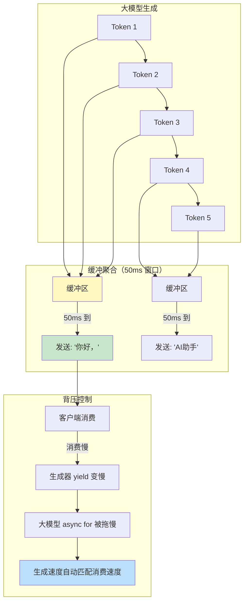

#### 代码示例

**示例 1：基础——时间窗口缓冲**

```python
"""
示例1：时间窗口缓冲实现
每 50ms 聚合一次 Token，减少网络小包
运行：python time_buffer.py
"""
import asyncio
import json
import time
from typing import AsyncGenerator


async def llm_token_source():
    """模拟大模型 Token 流：不均匀的生成速度"""
    tokens = ["你", "好", "，", "我", "是", "AI", "助", "手", "，", "很高兴", "为你", "服务"]
    for token in tokens:
        # 模拟不均匀的生成延迟
        delay = 0.01 if len(token) > 1 else 0.03
        await asyncio.sleep(delay)
        yield token


async def buffered_generator(
    source: AsyncGenerator[str, None],
    buffer_time: float = 0.05,  # 50ms 缓冲窗口
) -> AsyncGenerator[str, None]:
    """
    时间窗口缓冲：每 buffer_time 秒聚合一次 Token
    """
    buffer = []
    last_flush = time.time()

    async for token in source:
        buffer.append(token)
        now = time.time()

        # 时间窗口到，刷新缓冲区
        if now - last_flush >= buffer_time:
            combined = "".join(buffer)
            buffer = []
            last_flush = now
            yield combined

    # 刷新剩余内容
    if buffer:
        yield "".join(buffer)


async def no_buffer_demo():
    """无缓冲：每个 Token 单独发送"""
    print("=== 无缓冲（逐 Token）===")
    start = time.time()
    count = 0
    async for token in llm_token_source():
        count += 1
        print(f"  发送[{count}]: {token}")
    print(f"  共发送 {count} 个包，耗时 {time.time()-start:.2f}s\n")


async def with_buffer_demo():
    """有缓冲：50ms 窗口聚合"""
    print("=== 有缓冲（50ms 窗口）===")
    start = time.time()
    count = 0
    async for chunk in buffered_generator(llm_token_source(), buffer_time=0.05):
        count += 1
        print(f"  发送[{count}]: {chunk}（{len(chunk)}字符）")
    print(f"  共发送 {count} 个包，耗时 {time.time()-start:.2f}s\n")


async def main():
    await no_buffer_demo()
    await with_buffer_demo()


if __name__ == "__main__":
    asyncio.run(main())

# 预期运行结果：
# === 无缓冲（逐 Token）===
#   发送[1]: 你
#   发送[2]: 好
#   发送[3]: ，
#   ...
#   共发送 12 个包
#
# === 有缓冲（50ms 窗口）===
#   发送[1]: 你好，（3字符）
#   发送[2]: 我是AI（3字符）
#   发送[3]: 助手，（3字符）
#   发送[4]: 很高兴为你服务（7字符）
#   共发送 4 个包（减少 67% 的网络包）
```

**示例 2：进阶——混合缓冲策略（时间+数量）**

```python
"""
示例2：混合缓冲策略（时间窗口 + 数量阈值）
50ms 或 5 个 Token，先到先触发
运行：python hybrid_buffer.py
"""
import asyncio
import json
import time
from typing import AsyncGenerator, Optional


class HybridBuffer:
    """
    混合缓冲：时间窗口 + 数量阈值
    - 时间窗口：最多等待 buffer_time 秒
    - 数量阈值：最多缓冲 max_tokens 个 Token
    - 先到先触发，保证实时性和效率
    """

    def __init__(self, buffer_time: float = 0.05, max_tokens: int = 5):
        self.buffer_time = buffer_time
        self.max_tokens = max_tokens
        self.buffer: list = []
        self.last_flush = time.time()

    def add(self, token: str) -> Optional[str]:
        """添加 Token，返回需要刷新的内容（如果触发刷新）"""
        self.buffer.append(token)

        # 数量阈值触发
        if len(self.buffer) >= self.max_tokens:
            return self.flush()

        # 时间窗口触发（在消费端检查）
        return None

    def should_flush_by_time(self) -> bool:
        """检查是否因时间窗口需要刷新"""
        return (
            len(self.buffer) > 0
            and time.time() - self.last_flush >= self.buffer_time
        )

    def flush(self) -> str:
        """刷新缓冲区，返回聚合内容"""
        content = "".join(self.buffer)
        self.buffer = []
        self.last_flush = time.time()
        return content


async def hybrid_buffered_generator(
    source: AsyncGenerator[str, None],
    buffer_time: float = 0.05,
    max_tokens: int = 5,
) -> AsyncGenerator[str, None]:
    """混合缓冲生成器"""
    buf = HybridBuffer(buffer_time, max_tokens)

    async for token in source:
        result = buf.add(token)
        if result:
            yield result

        # 检查时间窗口（用短暂等待让其他 Token 有机会进入缓冲）
        if buf.should_flush_by_time():
            # 给一个极短的时间窗口收集更多 Token
            await asyncio.sleep(0.001)
            if buf.should_flush_by_time():
                yield buf.flush()

    # 刷新剩余
    if buf.buffer:
        yield buf.flush()


# 模拟大模型 Token 源
async def llm_source():
    tokens = list("这是一个混合缓冲策略的演示，用于减少网络小包数量。")
    for token in tokens:
        await asyncio.sleep(0.01)  # 10ms 生成一个
        yield token


async def main():
    print("=== 混合缓冲（50ms / 5 Token）===")
    start = time.time()
    count = 0
    total_chars = 0

    async for chunk in hybrid_buffered_generator(llm_source(), buffer_time=0.05, max_tokens=5):
        count += 1
        total_chars += len(chunk)
        print(f"  包[{count}]: '{chunk}'（{len(chunk)}字符）")

    elapsed = time.time() - start
    print(f"\n统计: {count} 个包，{total_chars} 字符，耗时 {elapsed:.2f}s")
    print(f"无缓冲需要 {total_chars} 个包，减少了 {total_chars - count} 个包（{(1-count/total_chars)*100:.0f}%）")


if __name__ == "__main__":
    asyncio.run(main())

# 预期运行结果：
# === 混合缓冲（50ms / 5 Token）===
#   包[1]: '这是一个混'（5字符）← 数量阈值触发
#   包[2]: '合缓冲策略'（5字符）
#   包[3]: '的演示，用'（5字符）
#   ...
# 统计: 6 个包，30 字符
# 无缓冲需要 30 个包，减少了 24 个包（80%）
```

**示例 3：完整场景——带背压监控的生产级缓冲流**

```python
"""
示例3：带背压监控的生产级缓冲流
特性：混合缓冲、背压监控、慢客户端检测、队列长度告警
运行：uvicorn production_buffer:app --reload
"""
from fastapi import FastAPI, Request
from fastapi.responses import StreamingResponse
from openai import AsyncOpenAI
import asyncio
import json
import time
import logging

logging.basicConfig(level=logging.INFO)
logger = logging.getLogger(__name__)

app = FastAPI(title="生产级缓冲流", version="1.0.0")
client = AsyncOpenAI(api_key="your-api-key", base_url="https://api.openai.com/v1", timeout=300)


class BackpressureMonitor:
    """背压监控器：跟踪消费速度和缓冲状态"""

    def __init__(self, slow_client_threshold: float = 0.5):
        self.slow_client_threshold = slow_client_threshold  # 慢客户端阈值（秒）
        self.produce_count = 0
        self.consume_count = 0
        self.last_consume_time = time.time()
        self.max_consume_delay = 0
        self.is_slow_client = False

    def record_produce(self):
        """记录生产一个 Token"""
        self.produce_count += 1

    def record_consume(self):
        """记录消费一个块"""
        now = time.time()
        delay = now - self.last_consume_time
        self.max_consume_delay = max(self.max_consume_delay, delay)
        self.last_consume_time = now
        self.consume_count += 1

        if delay > self.slow_client_threshold:
            self.is_slow_client = True
            logger.warning(f"[背压] 慢客户端检测：消费间隔 {delay:.2f}s")

    @property
    def backlog(self) -> int:
        """待消费的 Token 数"""
        return self.produce_count - self.consume_count

    def summary(self) -> dict:
        return {
            "produced": self.produce_count,
            "consumed": self.consume_count,
            "backlog": self.backlog,
            "max_consume_delay": round(self.max_consume_delay, 3),
            "is_slow_client": self.is_slow_client,
        }


async def buffered_llm_stream(
    messages: list,
    model: str = "gpt-4o-mini",
    buffer_time: float = 0.05,
    max_buffer_tokens: int = 5,
):
    """
    带缓冲和背压监控的 LLM 流式生成器
    """
    monitor = BackpressureMonitor()
    buffer = []
    last_flush = time.time()
    start_time = time.time()

    try:
        stream = await client.chat.completions.create(
            model=model,
            messages=messages,
            stream=True,
            max_tokens=2000,
            stream_options={"include_usage": True},
        )

        async for chunk in stream:
            if chunk.choices and chunk.choices[0].delta.content:
                token = chunk.choices[0].delta.content
                monitor.record_produce()
                buffer.append(token)

                # 数量阈值触发
                if len(buffer) >= max_buffer_tokens:
                    content = "".join(buffer)
                    buffer = []
                    last_flush = time.time()
                    monitor.record_consume()
                    yield f"data: {json.dumps({
                        'type': 'content',
                        'content': content,
                        'buffer_size': len(content),
                    }, ensure_ascii=False)}\n\n"

                # 时间窗口触发
                elif time.time() - last_flush >= buffer_time and buffer:
                    content = "".join(buffer)
                    buffer = []
                    last_flush = time.time()
                    monitor.record_consume()
                    yield f"data: {json.dumps({
                        'type': 'content',
                        'content': content,
                        'buffer_size': len(content),
                    }, ensure_ascii=False)}\n\n"

            if chunk.choices and chunk.choices[0].finish_reason:
                # 刷新剩余缓冲
                if buffer:
                    content = "".join(buffer)
                    buffer = []
                    monitor.record_consume()
                    yield f"data: {json.dumps({
                        'type': 'content',
                        'content': content,
                    }, ensure_ascii=False)}\n\n"

                elapsed = time.time() - start_time
                yield f"data: {json.dumps({
                    'type': 'done',
                    'finish_reason': chunk.choices[0].finish_reason,
                    'elapsed': round(elapsed, 2),
                    'backpressure': monitor.summary(),
                }, ensure_ascii=False)}\n\n"
                return

    except Exception as e:
        yield f"data: {json.dumps({
            'type': 'error',
            'error': str(e),
            'backpressure': monitor.summary(),
        }, ensure_ascii=False)}\n\n"


@app.post("/api/v1/chat/stream")
async def chat_stream(request: dict, http_request: Request):
    """带缓冲和背压监控的流式接口"""
    return StreamingResponse(
        buffered_llm_stream(
            messages=request.get("messages", []),
            model=request.get("model", "gpt-4o-mini"),
            buffer_time=request.get("buffer_time", 0.05),
            max_buffer_tokens=request.get("max_buffer_tokens", 5),
        ),
        media_type="text/event-stream",
        headers={"Cache-Control": "no-cache", "X-Accel-Buffering": "no"},
    )


@app.get("/api/buffer/config")
async def buffer_config():
    """缓冲配置说明"""
    return {
        "default_buffer_time": "50ms",
        "default_max_buffer_tokens": 5,
        "strategy": "混合缓冲（时间窗口 + 数量阈值，先到先触发）",
        "backpressure": "异步生成器天然支持，慢客户端自动拖慢生产速度",
        "slow_client_threshold": "0.5s（消费间隔超过 0.5s 标记为慢客户端）",
    }
```

#### 使用场景与最佳实践

**适用场景**：
- 高并发流式接口：减少网络小包，降低 CPU 和带宽开销
- 前端性能优化：减少 DOM 更新次数，提升渲染性能
- 慢客户端场景：背压控制防止内存溢出
- 生产级 LLM 网关：统一缓冲策略

**不适用场景**：
- 对延迟极敏感的场景（如实时语音）：缓冲增加延迟
- Token 生成速度极慢的场景：缓冲无意义（每个 Token 间隔 >50ms）
- 开发调试：无缓冲便于观察每个 Token

**最佳实践**：
1. **默认使用 50ms 时间窗口缓冲**：在实时性和效率间取得平衡
2. **混合策略（时间+数量）**：50ms 或 5 个 Token，先到先触发
3. **缓冲不要太大**：超过 100ms 会影响打字机流畅度
4. **背压是天然的**：异步生成器不需要额外代码，不要手动加队列
5. **监控慢客户端**：消费间隔超过阈值时记录日志
6. **缓冲参数可配置**：通过请求参数或环境变量调整
7. **最后一定要刷新剩余缓冲**：避免最后几个 Token 丢失
8. **Nginx 必须禁用缓冲**：`X-Accel-Buffering: no`，否则服务端缓冲无效

**性能建议**：
- 50ms 缓冲可减少 60-80% 的网络包数量
- 前端 DOM 更新次数同步减少，提升渲染性能
- 背压控制下内存使用稳定（只有当前缓冲的 Token）
- 慢客户端不会影响其他客户端（异步隔离）

#### 常见坑点

**坑点 1：缓冲参数过大导致打字机效果卡顿**

- **错误现象**：流式输出看起来不流畅，内容是一块一块跳出来的（每次 5-10 个字），而不是逐字出现
- **根本原因**：缓冲时间设置过大（如 500ms）或数量阈值过大（如 20 个 Token），导致用户看到的是批量更新而非平滑的打字机效果
- **正确做法**：缓冲时间控制在 30-80ms（推荐 50ms），数量阈值 3-8 个（推荐 5 个）。对流畅度要求高的场景用 30ms
- **预防措施**：将缓冲参数设为可配置，默认 50ms/5Token，根据场景调整

**坑点 2：Nginx 缓冲覆盖了应用层缓冲策略**

- **错误现象**：应用层设置了 50ms 缓冲，但前端看到的还是批量输出，或者流式完全不生效
- **根本原因**：Nginx 默认 `proxy_buffering on`，会将后端的流式响应缓冲完整后再发送，覆盖了应用层的缓冲策略。即使应用层逐块发送，Nginx 也会攒够一定量再发
- **正确做法**：① StreamingResponse headers 中加 `"X-Accel-Buffering": "no"`；② Nginx 配置 `proxy_buffering off; proxy_read_timeout 300s;`
- **预防措施**：所有 SSE 端点的代码模板中固定包含 `X-Accel-Buffering: no`，Nginx 配置中 SSE 路径单独关闭缓冲

---

### 5.2 慢客户端处理与超时控制

#### 概念解释

**慢客户端处理** 是对流式响应中消费速度慢的客户端（网络差、设备性能低、主动暂停）的识别和保护机制，防止慢客户端占用服务端资源过久。**超时控制** 是对流式响应的总时长、空闲时间设置上限，防止连接无限挂起。

> 🏠 **生活化比喻**：慢客户端就像吃饭很慢的客人——餐厅（服务端）上菜（流式数据）很快，但客人吃得慢（消费慢），菜会堆在桌上（内存缓冲）。超时控制就像餐厅的营业时间——客人最多吃 2 小时（总超时），超过 30 分钟没点菜（空闲超时）就提醒结账。背压是天然的"客人吃多少上多少"，但如果客人一直吃不完（慢客户端），餐厅需要决定是继续等还是请客人离开（超时断开）。

**核心价值**：防止慢客户端或异常客户端占用服务端连接和大模型 API 资源过久，保护服务端稳定性，避免资源耗尽。

> 🎯 **面试高频考点 9**：流式接口如何处理慢客户端？总超时和空闲超时分别设多少？
> **答**：慢客户端处理：① 异步生成器天然支持背压，慢客户端不会导致内存溢出；② 设置总超时（如 300 秒），超过后强制结束流；③ 设置空闲超时（如 60 秒无数据），断开连接；④ 监控慢客户端比例，超过阈值告警。总超时：大模型生成可能需要 30-120 秒，总超时设 300 秒（5 分钟）较安全。空闲超时：大模型生成过程中不应有超过 30 秒的空闲（除非模型特别慢），设 60 秒较合理。客户端断开时通过 `request.is_disconnected()` 检测，立即停止生成。

#### 原理说明

慢客户端处理的核心机制是 **背压自动调节 + 总超时 + 空闲超时 + 客户端断开检测**。

**为什么这样设计**：流式响应是长连接（可能持续 30-120 秒），如果客户端网络慢或异常断开，连接会一直占用服务端资源（大模型 API 调用、文件描述符、内存）。背压解决了内存溢出问题，但不能解决资源占用时间过长的问题。总超时限制最长连接时间，空闲超时检测"假死"客户端，客户端断开检测及时释放资源。

**技术对比**：

| 超时类型 | 作用 | 推荐值 | 触发动作 |
|---------|------|--------|---------|
| 总超时 | 限制最长流式时间 | 300s | 强制结束流，发送 done |
| 空闲超时 | 检测无数据的假死连接 | 60s | 断开连接 |
| 连接超时 | 建立大模型 API 连接 | 10s | 重试或报错 |
| 读取超时 | 等待大模型 API 响应 | 300s | 重试或报错 |

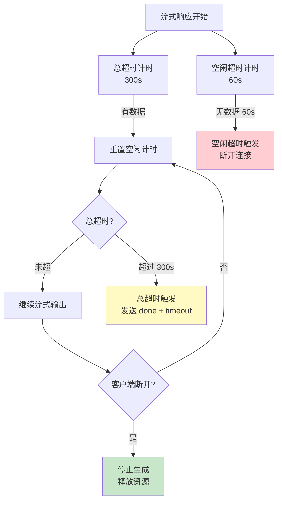

#### 代码示例

**示例 1：基础——总超时与空闲超时控制**

```python
"""
示例1：流式接口的总超时与空闲超时控制
运行：uvicorn timeout_control:app --reload
"""
from fastapi import FastAPI, Request
from fastapi.responses import StreamingResponse
from openai import AsyncOpenAI
import asyncio
import json
import time

app = FastAPI(title="超时控制", version="1.0.0")
client = AsyncOpenAI(api_key="your-api-key", base_url="https://api.openai.com/v1", timeout=300)


async def stream_with_timeout(
    messages: list,
    total_timeout: float = 300.0,   # 总超时 300 秒
    idle_timeout: float = 60.0,     # 空闲超时 60 秒
):
    """带总超时和空闲超时的流式生成器"""
    start_time = time.time()
    last_data_time = time.time()

    try:
        stream = await client.chat.completions.create(
            model="gpt-4o-mini",
            messages=messages,
            stream=True,
            max_tokens=2000,
        )

        async for chunk in stream:
            # 检查总超时
            elapsed = time.time() - start_time
            if elapsed > total_timeout:
                yield f"data: {json.dumps({
                    'type': 'error',
                    'error': f'总超时：流式响应超过 {total_timeout}s',
                    'error_type': 'TotalTimeout',
                    'elapsed': round(elapsed, 2),
                }, ensure_ascii=False)}\n\n"
                return

            # 检查空闲超时（在有数据时重置）
            if chunk.choices and chunk.choices[0].delta.content:
                last_data_time = time.time()
                yield f"data: {json.dumps({
                    'type': 'content',
                    'content': chunk.choices[0].delta.content,
                }, ensure_ascii=False)}\n\n"

            # 空闲检查（在每次循环时）
            idle_time = time.time() - last_data_time
            if idle_time > idle_timeout:
                yield f"data: {json.dumps({
                    'type': 'error',
                    'error': f'空闲超时：{idle_timeout}s 无数据',
                    'error_type': 'IdleTimeout',
                    'idle_time': round(idle_time, 2),
                }, ensure_ascii=False)}\n\n"
                return

            if chunk.choices and chunk.choices[0].finish_reason:
                yield f"data: {json.dumps({
                    'type': 'done',
                    'elapsed': round(elapsed, 2),
                }, ensure_ascii=False)}\n\n"
                return

    except asyncio.TimeoutError:
        yield f"data: {json.dumps({
            'type': 'error',
            'error': '大模型 API 调用超时',
            'error_type': 'APITimeout',
        }, ensure_ascii=False)}\n\n"


@app.post("/api/v1/chat/stream")
async def chat_stream(request: dict):
    return StreamingResponse(
        stream_with_timeout(
            messages=request.get("messages", []),
            total_timeout=request.get("total_timeout", 300),
            idle_timeout=request.get("idle_timeout", 60),
        ),
        media_type="text/event-stream",
        headers={"Cache-Control": "no-cache", "X-Accel-Buffering": "no"},
    )
```

**示例 2：进阶——asyncio.wait_for 精确超时控制**

```python
"""
示例2：使用 asyncio.wait_for 精确控制大模型 API 调用超时
运行：python wait_for_timeout.py
"""
import asyncio
from openai import AsyncOpenAI
import json
import time

client = AsyncOpenAI(api_key="your-api-key", base_url="https://api.openai.com/v1", timeout=300)


async def stream_with_precise_timeout(
    messages: list,
    first_token_timeout: float = 30.0,   # 首字超时 30 秒
    between_token_timeout: float = 15.0,  # Token 间隔超时 15 秒
):
    """
    精确超时控制：
    - 首字超时：从请求发起到第一个 Token 的时间
    - Token 间隔超时：两个 Token 之间的最大间隔
    """
    start_time = time.time()

    try:
        # 首字超时：等待流式响应建立
        stream = await asyncio.wait_for(
            client.chat.completions.create(
                model="gpt-4o-mini",
                messages=messages,
                stream=True,
                max_tokens=2000,
            ),
            timeout=first_token_timeout,
        )

        first_token_received = False
        last_token_time = time.time()

        while True:
            try:
                # Token 间隔超时：等待下一个 chunk
                chunk = await asyncio.wait_for(
                    stream.__anext__(),
                    timeout=between_token_timeout,
                )
            except asyncio.TimeoutError:
                yield f"data: {json.dumps({
                    'type': 'error',
                    'error': f'Token 间隔超时：{between_token_timeout}s 无新数据',
                    'error_type': 'BetweenTokenTimeout',
                }, ensure_ascii=False)}\n\n"
                return
            except StopAsyncIteration:
                # 流正常结束
                break

            if chunk.choices and chunk.choices[0].delta.content:
                if not first_token_received:
                    first_token_received = True
                    ttft = time.time() - start_time
                    print(f"首字延迟: {ttft:.2f}s")

                last_token_time = time.time()
                yield f"data: {json.dumps({
                    'type': 'content',
                    'content': chunk.choices[0].delta.content,
                }, ensure_ascii=False)}\n\n"

            if chunk.choices and chunk.choices[0].finish_reason:
                yield f"data: {json.dumps({
                    'type': 'done',
                    'finish_reason': chunk.choices[0].finish_reason,
                }, ensure_ascii=False)}\n\n"
                return

    except asyncio.TimeoutError:
        yield f"data: {json.dumps({
            'type': 'error',
            'error': f'首字超时：{first_token_timeout}s 内未收到第一个 Token',
            'error_type': 'FirstTokenTimeout',
        }, ensure_ascii=False)}\n\n"


async def main():
    print("=== 精确超时控制演示 ===")
    async for sse in stream_with_precise_timeout(
        messages=[{"role": "user", "content": "你好"}],
        first_token_timeout=30.0,
        between_token_timeout=15.0,
    ):
        print(sse, end="")


if __name__ == "__main__":
    asyncio.run(main())
```

**示例 3：完整场景——慢客户端检测与资源保护**

```python
"""
示例3：慢客户端检测与资源保护
特性：客户端断开检测、慢客户端标记、资源使用监控、优雅关闭
运行：uvicorn slow_client_protection:app --reload
"""
from fastapi import FastAPI, Request
from fastapi.responses import StreamingResponse
from openai import AsyncOpenAI
import asyncio
import json
import time
import psutil
import logging

logging.basicConfig(level=logging.INFO)
logger = logging.getLogger(__name__)

app = FastAPI(title="慢客户端保护", version="1.0.0")
client = AsyncOpenAI(api_key="your-api-key", base_url="https://api.openai.com/v1", timeout=300)

# 全局连接统计
active_streams = 0
slow_clients = 0


class StreamGuard:
    """流式响应守护者：监控客户端状态和资源使用"""

    def __init__(self, request: Request, max_duration: float = 300):
        self.request = request
        self.max_duration = max_duration
        self.start_time = time.time()
        self.last_data_time = time.time()
        self.token_count = 0
        self.client_disconnected = False
        self.is_slow = False
        self.slow_threshold = 1.0  # 消费间隔 >1s 标记为慢客户端

    async def check_client(self) -> bool:
        """检查客户端状态，返回是否继续"""
        # 客户端断开检测
        if await self.request.is_disconnected():
            self.client_disconnected = True
            logger.info("[守护] 客户端断开，停止生成")
            return False

        # 总时长检查
        elapsed = time.time() - self.start_time
        if elapsed > self.max_duration:
            logger.warning(f"[守护] 总超时 {elapsed:.0f}s > {self.max_duration}s")
            return False

        return True

    def record_token(self):
        """记录收到 Token"""
        now = time.time()
        interval = now - self.last_data_time
        if interval > self.slow_threshold:
            self.is_slow = True
            logger.warning(f"[守护] 慢客户端检测：消费间隔 {interval:.2f}s")
        self.last_data_time = now
        self.token_count += 1

    def get_status(self) -> dict:
        return {
            "elapsed": round(time.time() - self.start_time, 2),
            "tokens": self.token_count,
            "is_slow": self.is_slow,
            "client_disconnected": self.client_disconnected,
            "memory_mb": round(psutil.Process().memory_info().rss / 1024 / 1024, 1),
        }


async def protected_stream(messages: list, request: Request):
    """受保护的流式生成器"""
    global active_streams, slow_clients
    active_streams += 1
    guard = StreamGuard(request)

    try:
        stream = await client.chat.completions.create(
            model="gpt-4o-mini",
            messages=messages,
            stream=True,
            max_tokens=2000,
        )

        async for chunk in stream:
            # 每次迭代前检查客户端状态
            if not await guard.check_client():
                if guard.client_disconnected:
                    yield f"data: {json.dumps({'type': 'client_disconnected'})}\n\n"
                else:
                    yield f"data: {json.dumps({
                        'type': 'error',
                        'error': '响应超时',
                        'status': guard.get_status(),
                    }, ensure_ascii=False)}\n\n"
                return

            if chunk.choices and chunk.choices[0].delta.content:
                guard.record_token()
                yield f"data: {json.dumps({
                    'type': 'content',
                    'content': chunk.choices[0].delta.content,
                }, ensure_ascii=False)}\n\n"

            if chunk.choices and chunk.choices[0].finish_reason:
                if guard.is_slow:
                    slow_clients += 1
                yield f"data: {json.dumps({
                    'type': 'done',
                    'status': guard.get_status(),
                }, ensure_ascii=False)}\n\n"
                return

    except Exception as e:
        yield f"data: {json.dumps({
            'type': 'error',
            'error': str(e),
            'status': guard.get_status(),
        }, ensure_ascii=False)}\n\n"
    finally:
        active_streams -= 1
        logger.info(f"[守护] 流结束，状态: {guard.get_status()}")


@app.post("/api/v1/chat/stream")
async def chat_stream(request: dict, http_request: Request):
    return StreamingResponse(
        protected_stream(request.get("messages", []), http_request),
        media_type="text/event-stream",
        headers={"Cache-Control": "no-cache", "X-Accel-Buffering": "no"},
    )


@app.get("/api/streams/status")
async def streams_status():
    """流式连接状态监控"""
    return {
        "active_streams": active_streams,
        "slow_clients": slow_clients,
        "memory_mb": round(psutil.Process().memory_info().rss / 1024 / 1024, 1),
    }
```

#### 使用场景与最佳实践

**适用场景**：
- 生产级流式接口：必须有超时控制
- 公网服务：客户端网络状况不可控
- 高并发服务：防止慢客户端占用过多资源
- 大模型 API 费用控制：超时后停止生成，避免浪费 Token

**不适用场景**：
- 内网服务：客户端可信，网络稳定
- 开发环境：不需要严格的超时控制

**最佳实践**：
1. **总超时 300 秒**：大模型生成可能需要 30-120 秒，留足余量
2. **空闲超时 60 秒**：检测假死连接
3. **首字超时 30 秒**：大模型 API 建立连接和首字生成
4. **客户端断开检测**：`await request.is_disconnected()` 每 0.5-1 秒检查
5. **慢客户端监控**：消费间隔 >1 秒标记为慢客户端，记录日志
6. **超时后发送 done/error 事件**：让前端知道流结束原因
7. **资源监控**：监控活跃流数量、内存使用、慢客户端比例
8. **大模型 API 超时设置**：`timeout=httpx.Timeout(connect=10, read=300)`

**性能建议**：
- 客户端断开检测间隔 0.5-1 秒，太频繁增加 CPU
- 超时后及时释放大模型 API 连接（stream.close()）
- 慢客户端不会影响其他客户端（异步隔离）
- 活跃流数量超过阈值时拒绝新请求（过载保护）

#### 常见坑点

**坑点 1：客户端断开后大模型继续生成浪费 Token**

- **错误现象**：用户关闭页面后，服务端仍在调用大模型 API 生成数据，Token 费用持续消耗
- **根本原因**：没有检测客户端断开。StreamingResponse 在客户端断开时会取消生成器，但如果生成器正在 `await` 大模型 API 的下一个 chunk，这个 `await` 可能不会立即被取消，大模型继续生成
- **正确做法**：① 在 `async for chunk in stream` 的每次迭代前检查 `await request.is_disconnected()`；② 生成器中捕获 `asyncio.CancelledError` 并调用 `stream.close()`；③ 大模型客户端支持取消时，在取消时主动关闭流
- **预防措施**：封装统一的流式生成器模板，包含客户端断开检测

**坑点 2：超时设置过短导致正常生成被中断**

- **错误现象**：大模型生成较长内容（如 2000 字文章）时，流式响应在生成过程中被中断，前端收到超时错误
- **根本原因**：总超时设置过短（如 60 秒），但大模型生成 2000 字可能需要 90-120 秒
- **正确做法**：① 总超时设为 300 秒（5 分钟），给大模型足够时间；② 根据 max_tokens 动态调整超时（如每 1000 Token 预留 60 秒）；③ 空闲超时设为 60 秒（检测假死，不影响正常生成）
- **预防措施**：超时参数与 max_tokens 关联，`total_timeout = max(120, max_tokens / 1000 * 60)`

---

## 6. 流式接口认证与限流

### 6.1 API Key 认证与 JWT 鉴权

#### 概念解释

**流式接口认证** 是在 SSE 流式响应中验证客户端身份的机制，由于 SSE 基于 HTTP，标准的 API Key、JWT、OAuth2 都可以使用，但需要注意流式响应开始后无法修改 HTTP 状态码，认证必须在 StreamingResponse 返回之前完成。

> 🏠 **生活化比喻**：流式接口认证就像进入自助餐厅——你在门口（StreamingResponse 返回之前）出示会员卡（API Key/JWT），服务员验证后给你一个餐盘（建立流式连接），然后你可以随意取餐（接收流式数据）。如果在取餐过程中会员卡过期了（Token 过期），服务员不能把你已经取的菜收回去（流式数据已发送），但可以停止上菜（结束流）。所以认证必须在门口完成，不能在取餐过程中才检查。

**核心价值**：保护 LLM API 不被未授权访问（大模型调用费用高），控制每个用户的使用量，是生产级 LLM 接口的必备安全措施。

> 🎯 **面试高频考点 10**：流式接口的认证为什么必须在 StreamingResponse 返回之前？流式过程中如何处理认证过期？
> **答**：必须在返回之前的原因：HTTP 响应头（包含状态码）在 StreamingResponse 开始发送第一个 chunk 时就已经发送，之后无法修改状态码。如果认证在流式过程中才失败，无法返回 401 状态码，只能通过 SSE 错误事件通知。流式过程中认证过期的处理：① 在流式开始前验证 Token，确保有效期覆盖预计的流式时长；② 流式过程中不重新验证（避免中断）；③ 如果需要长时间流式，在 done 事件中返回新的 Token 供下次使用；④ 极端情况下通过 SSE 发送 `{"type": "error", "error": "token_expired"}` 事件并结束流。

#### 原理说明

流式接口认证的核心机制是 **依赖注入预认证 + 请求头传递 + 流式过程中不重新认证**。

**为什么这样设计**：FastAPI 的依赖注入（Depends）在端点函数执行前运行，认证失败时可以直接返回 401（此时 StreamingResponse 还未创建）。认证通过后，用户信息注入到端点函数中，流式生成器可以使用。流式过程中不重新认证，因为无法改状态码，且频繁认证增加延迟。

**技术对比**：

| 认证方式 | 流式支持 | 实现复杂度 | 适用场景 |
|---------|---------|-----------|---------|
| API Key（Header） | 支持 | 低 | 内部系统、服务间调用 |
| JWT（Bearer Token） | 支持 | 中 | Web 应用、移动端 |
| OAuth2 | 支持 | 高 | 第三方授权 |
| Cookie/Session | 不推荐 | 中 | 传统 Web（SSE 跨域问题） |

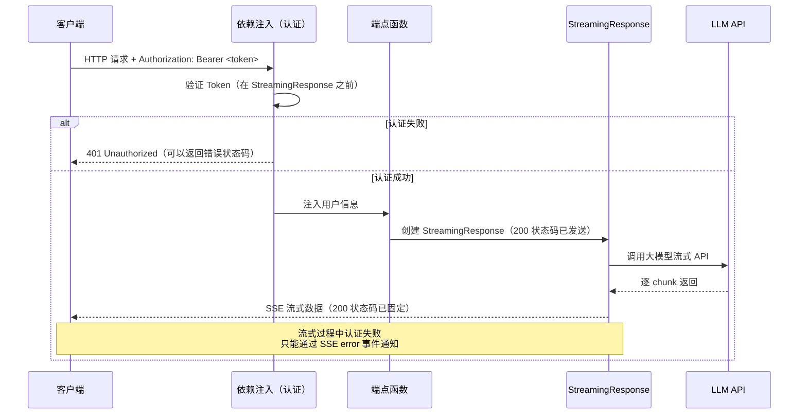

#### 代码示例

**示例 1：基础——API Key 认证**

```python
"""
示例1：API Key 认证的流式接口
运行：uvicorn api_key_auth:app --reload
"""
from fastapi import FastAPI, Depends, HTTPException, Request, Header
from fastapi.responses import StreamingResponse
from openai import AsyncOpenAI
from typing import Optional
import json
import time

app = FastAPI(title="API Key 认证", version="1.0.0")
client = AsyncOpenAI(api_key="your-api-key", base_url="https://api.openai.com/v1", timeout=300)

# 有效的 API Key 列表（生产环境用数据库）
VALID_API_KEYS = {
    "sk-proj-abc123": {"user": "user1", "plan": "pro", "rate_limit": 100},
    "sk-proj-def456": {"user": "user2", "plan": "free", "rate_limit": 10},
}


async def verify_api_key(x_api_key: Optional[str] = Header(None)):
    """
    API Key 认证依赖
    在 StreamingResponse 返回之前执行，失败时返回 401
    """
    if not x_api_key:
        raise HTTPException(status_code=401, detail="缺少 API Key")

    if x_api_key not in VALID_API_KEYS:
        raise HTTPException(status_code=401, detail="无效的 API Key")

    return VALID_API_KEYS[x_api_key]


@app.post("/api/v1/chat/stream")
async def chat_stream(
    request: dict,
    api_key_info: dict = Depends(verify_api_key),
):
    """
    带 API Key 认证的流式接口
    认证在 Depends 中完成，失败时返回 401（StreamingResponse 之前）
    """
    user = api_key_info["user"]
    plan = api_key_info["plan"]
    print(f"[认证] 用户={user} 套餐={plan}")

    async def generate():
        try:
            stream = await client.chat.completions.create(
                model="gpt-4o-mini",
                messages=request.get("messages", []),
                stream=True,
                max_tokens=request.get("max_tokens", 1000),
            )

            async for chunk in stream:
                if chunk.choices and chunk.choices[0].delta.content:
                    yield f"data: {json.dumps({
                        'type': 'content',
                        'content': chunk.choices[0].delta.content,
                        'user': user,
                    }, ensure_ascii=False)}\n\n"

                if chunk.choices and chunk.choices[0].finish_reason:
                    yield f"data: {json.dumps({'type': 'done'})}\n\n"

        except Exception as e:
            yield f"data: {json.dumps({'type': 'error', 'error': str(e)})}\n\n"

    return StreamingResponse(
        generate(),
        media_type="text/event-stream",
        headers={"Cache-Control": "no-cache", "X-Accel-Buffering": "no"},
    )


# 测试：
# curl -N -X POST http://localhost:8000/api/v1/chat/stream \
#   -H "X-API-Key: sk-proj-abc123" \
#   -H "Content-Type: application/json" \
#   -d '{"messages":[{"role":"user","content":"你好"}]}'
```

**示例 2：进阶——JWT 认证与用户信息注入**

```python
"""
示例2：JWT 认证的流式接口
安装：pip install python-jose[cryptography]
运行：uvicorn jwt_auth:app --reload
"""
from fastapi import FastAPI, Depends, HTTPException, Request
from fastapi.responses import StreamingResponse
from fastapi.security import HTTPBearer, HTTPAuthorizationCredentials
from jose import JWTError, jwt
from openai import AsyncOpenAI
from datetime import datetime, timedelta
from pydantic import BaseModel
import json
import time

app = FastAPI(title="JWT 认证", version="1.0.0")
client = AsyncOpenAI(api_key="your-api-key", base_url="https://api.openai.com/v1", timeout=300)

# JWT 配置
SECRET_KEY = "your-secret-key-change-in-production"
ALGORITHM = "HS256"
ACCESS_TOKEN_EXPIRE_MINUTES = 60

security = HTTPBearer()


class UserInfo(BaseModel):
    user_id: str
    username: str
    role: str
    plan: str = "free"


def create_access_token(data: dict, expires_delta: timedelta = None) -> str:
    """创建 JWT Token"""
    to_encode = data.copy()
    expire = datetime.utcnow() + (expires_delta or timedelta(minutes=ACCESS_TOKEN_EXPIRE_MINUTES))
    to_encode.update({"exp": expire})
    return jwt.encode(to_encode, SECRET_KEY, algorithm=ALGORITHM)


async def get_current_user(
    credentials: HTTPAuthorizationCredentials = Depends(security),
) -> UserInfo:
    """
    JWT 认证依赖
    在 StreamingResponse 返回之前验证 Token
    """
    token = credentials.credentials
    try:
        payload = jwt.decode(token, SECRET_KEY, algorithms=[ALGORITHM])
        user_id = payload.get("sub")
        username = payload.get("username")
        role = payload.get("role", "user")
        plan = payload.get("plan", "free")

        if user_id is None:
            raise HTTPException(status_code=401, detail="无效的 Token")

        return UserInfo(
            user_id=user_id,
            username=username,
            role=role,
            plan=plan,
        )
    except JWTError as e:
        raise HTTPException(status_code=401, detail=f"Token 验证失败: {str(e)}")


@app.post("/api/v1/chat/stream")
async def chat_stream(
    request: dict,
    current_user: UserInfo = Depends(get_current_user),
):
    """带 JWT 认证的流式接口"""
    print(f"[认证] 用户={current_user.username} 角色={current_user.role} 套餐={current_user.plan}")

    # 根据用户套餐限制 max_tokens
    max_tokens = 4000 if current_user.plan == "pro" else 1000

    async def generate():
        try:
            stream = await client.chat.completions.create(
                model="gpt-4o-mini",
                messages=request.get("messages", []),
                stream=True,
                max_tokens=min(request.get("max_tokens", 1000), max_tokens),
            )

            async for chunk in stream:
                if chunk.choices and chunk.choices[0].delta.content:
                    yield f"data: {json.dumps({
                        'type': 'content',
                        'content': chunk.choices[0].delta.content,
                    }, ensure_ascii=False)}\n\n"

                if chunk.choices and chunk.choices[0].finish_reason:
                    yield f"data: {json.dumps({
                        'type': 'done',
                        'user': current_user.username,
                        'plan': current_user.plan,
                    }, ensure_ascii=False)}\n\n"

        except Exception as e:
            yield f"data: {json.dumps({'type': 'error', 'error': str(e)})}\n\n"

    return StreamingResponse(
        generate(),
        media_type="text/event-stream",
        headers={"Cache-Control": "no-cache", "X-Accel-Buffering": "no"},
    )


# 获取 Token 的端点（测试用）
@app.post("/api/v1/auth/token")
async def login(username: str, password: str):
    """简化的登录接口，返回 JWT Token"""
    # 实际应验证用户名密码
    token = create_access_token({
        "sub": "user123",
        "username": username,
        "role": "user",
        "plan": "pro",
    })
    return {"access_token": token, "token_type": "bearer"}
```

**示例 3：完整场景——流式接口认证 + 权限控制 + 用量限制**

```python
"""
示例3：完整的认证授权体系
特性：JWT 认证、角色权限、套餐用量限制、流式过程中安全
运行：uvicorn full_auth:app --reload
"""
from fastapi import FastAPI, Depends, HTTPException, Request
from fastapi.responses import StreamingResponse
from fastapi.security import HTTPBearer, HTTPAuthorizationCredentials
from jose import JWTError, jwt
from openai import AsyncOpenAI
from datetime import datetime, timedelta
from pydantic import BaseModel
from collections import defaultdict
import json
import time

app = FastAPI(title="完整认证授权", version="1.0.0")
client = AsyncOpenAI(api_key="your-api-key", base_url="https://api.openai.com/v1", timeout=300)

SECRET_KEY = "your-secret-key"
ALGORITHM = "HS256"
security = HTTPBearer()

# 套餐配置
PLANS = {
    "free": {"max_tokens_per_request": 500, "max_requests_per_day": 50, "models": ["gpt-4o-mini"]},
    "pro": {"max_tokens_per_request": 4000, "max_requests_per_day": 1000, "models": ["gpt-4o-mini", "gpt-4o"]},
    "enterprise": {"max_tokens_per_request": 8000, "max_requests_per_day": 10000, "models": ["gpt-4o-mini", "gpt-4o", "gpt-4-turbo"]},
}

# 用户用量统计（生产环境用 Redis）
user_usage = defaultdict(lambda: {"requests": 0, "tokens": 0, "date": None})


class UserInfo(BaseModel):
    user_id: str
    username: str
    role: str
    plan: str


def verify_token(token: str) -> UserInfo:
    try:
        payload = jwt.decode(token, SECRET_KEY, algorithms=[ALGORITHM])
        return UserInfo(
            user_id=payload["sub"],
            username=payload.get("username", "unknown"),
            role=payload.get("role", "user"),
            plan=payload.get("plan", "free"),
        )
    except JWTError:
        raise HTTPException(status_code=401, detail="无效或过期的 Token")


async def get_current_user(
    credentials: HTTPAuthorizationCredentials = Depends(security),
) -> UserInfo:
    return verify_token(credentials.credentials)


def check_plan_limit(user: UserInfo, model: str, max_tokens: int):
    """检查套餐限制"""
    plan_config = PLANS.get(user.plan, PLANS["free"])

    # 检查模型权限
    if model not in plan_config["models"]:
        raise HTTPException(
            status_code=403,
            detail=f"当前套餐（{user.plan}）不支持模型 {model}，可用模型: {plan_config['models']}",
        )

    # 检查 Token 限制
    if max_tokens > plan_config["max_tokens_per_request"]:
        raise HTTPException(
            status_code=403,
            detail=f"当前套餐最大 {plan_config['max_tokens_per_request']} Token/请求",
        )

    # 检查每日请求数
    today = datetime.now().strftime("%Y-%m-%d")
    usage = user_usage[user.user_id]
    if usage["date"] != today:
        usage["date"] = today
        usage["requests"] = 0
        usage["tokens"] = 0

    if usage["requests"] >= plan_config["max_requests_per_day"]:
        raise HTTPException(
            status_code=429,
            detail=f"今日请求数已达上限（{plan_config['max_requests_per_day']}）",
        )


@app.post("/api/v1/chat/stream")
async def chat_stream(
    request: dict,
    current_user: UserInfo = Depends(get_current_user),
):
    """
    完整认证授权的流式接口
    认证和权限检查在 StreamingResponse 之前完成
    """
    model = request.get("model", "gpt-4o-mini")
    max_tokens = request.get("max_tokens", 500)

    # 权限检查（在 StreamingResponse 之前，可以返回 403/429）
    check_plan_limit(current_user, model, max_tokens)

    # 记录请求
    user_usage[current_user.user_id]["requests"] += 1

    async def generate():
        token_count = 0
        try:
            stream = await client.chat.completions.create(
                model=model,
                messages=request.get("messages", []),
                stream=True,
                max_tokens=max_tokens,
            )

            async for chunk in stream:
                if chunk.choices and chunk.choices[0].delta.content:
                    token_count += 1
                    yield f"data: {json.dumps({
                        'type': 'content',
                        'content': chunk.choices[0].delta.content,
                    }, ensure_ascii=False)}\n\n"

                if chunk.choices and chunk.choices[0].finish_reason:
                    user_usage[current_user.user_id]["tokens"] += token_count
                    yield f"data: {json.dumps({
                        'type': 'done',
                        'tokens': token_count,
                        'remaining_requests': PLANS[current_user.plan]['max_requests_per_day'] - user_usage[current_user.user_id]['requests'],
                    }, ensure_ascii=False)}\n\n"

        except Exception as e:
            yield f"data: {json.dumps({'type': 'error', 'error': str(e)})}\n\n"

    return StreamingResponse(
        generate(),
        media_type="text/event-stream",
        headers={"Cache-Control": "no-cache", "X-Accel-Buffering": "no"},
    )


@app.get("/api/v1/user/usage")
async def get_usage(current_user: UserInfo = Depends(get_current_user)):
    """获取用户用量"""
    usage = user_usage[current_user.user_id]
    plan_config = PLANS[current_user.plan]
    return {
        "user": current_user.username,
        "plan": current_user.plan,
        "today_requests": usage["requests"],
        "today_tokens": usage["tokens"],
        "plan_limits": plan_config,
    }
```

#### 使用场景与最佳实践

**适用场景**：
- 所有公网 LLM 接口：必须认证
- 多租户 SaaS：按用户/套餐限制用量
- 企业内部 API：API Key 认证
- 需要计费的服务：按 Token 用量计费

**不适用场景**：
- 内网开发环境：可跳过认证
- 纯前端 Demo：不需要认证

**最佳实践**：
1. **认证在 Depends 中完成**：StreamingResponse 返回之前，失败可返回 401
2. **JWT 有效期覆盖流式时长**：Token 过期时间 > 预计流式时长（如 60 分钟）
3. **权限检查在 StreamingResponse 之前**：模型权限、用量限制、套餐检查
4. **流式过程中不重新认证**：避免中断，认证在开始时完成
5. **API Key 用 Header 传递**：`X-API-Key` 或 `Authorization: Bearer`
6. **用量统计用 Redis**：多实例部署时共享状态
7. **敏感信息不放入 SSE 数据**：API Key、用户 ID 等不暴露
8. **HTTPS 加密传输**：防止 Token 被窃听

**性能建议**：
- JWT 验证是 CPU 密集型（HMAC），高并发时考虑缓存验证结果
- API Key 查数据库有 IO 开销，用 Redis 缓存
- 认证中间件不要做耗时操作（如查数据库），影响首字延迟
- Token 中包含用户信息，减少认证后的数据库查询

#### 常见坑点

**坑点 1：在流式生成器中才做认证导致无法返回 401**

- **错误现象**：认证失败时客户端收到 200 状态码 + SSE 错误数据，而不是标准的 401 状态码，前端无法统一处理认证错误
- **根本原因**：认证逻辑写在了异步生成器内部（`async def generate()` 中），此时 StreamingResponse 已经返回 200 状态码，无法再修改为 401
- **正确做法**：认证逻辑放在依赖注入（Depends）中，在端点函数执行前完成。认证失败时 `raise HTTPException(status_code=401)`，此时 StreamingResponse 还未创建，可以正确返回 401
- **预防措施**：代码审查时检查认证逻辑是否在生成器内部，所有认证必须在 Depends 或端点函数中

**坑点 2：JWT Token 在流式过程中过期导致前端困惑**

- **错误现象**：流式输出进行到一半时突然停止，前端收到 `token_expired` 错误，但用户刚刚才登录
- **根本原因**：JWT Token 有效期设置过短（如 5 分钟），但大模型生成可能需要 30-60 秒甚至更长，流式过程中 Token 过期
- **正确做法**：① JWT 有效期设为 60 分钟以上，覆盖最长流式时长；② 流式过程中不验证 Token 过期（认证在开始时完成）；③ 如果需要严格的会话管理，用 Refresh Token 机制，Access Token 过期后用 Refresh Token 换新
- **预防措施**：JWT 配置中 `ACCESS_TOKEN_EXPIRE_MINUTES = 60`，不要设太短

---

### 6.2 限流与配额管理

#### 概念解释

**流式接口限流** 是控制用户/IP/API Key 的请求频率和 Token 用量的机制，防止滥用和过载，保护大模型 API 费用不被刷爆。**配额管理** 是按用户/套餐设置每日/每月的请求数和 Token 数上限。

> 🏠 **生活化比喻**：限流就像餐厅的排队叫号——午餐高峰期（高并发），餐厅限制每小时接待 100 人（限流阈值），超过的人需要等下一小时（429 错误）。配额管理就像自助餐的用餐次数——免费套餐每天最多吃 3 次（每日配额），付费套餐每天最多吃 10 次。这样既保证了服务质量（不被一个人占满），又控制了成本（食材不被浪费）。

**核心价值**：大模型 API 调用费用高，限流和配额管理防止恶意刷接口导致费用暴增，同时保护服务端不被高并发打垮，是生产级 LLM 接口的成本控制核心。

> 🎯 **面试高频考点 11**：流式接口如何限流？Token 用量如何统计？固定窗口和滑动窗口有什么区别？
> **答**：流式接口限流：① 请求级限流（每分钟/每用户 N 次）——在端点函数中用 Redis 计数器；② Token 级限流（每用户每天 N Token）——在 done 事件中统计本次 Token 用量并累加；③ 并发数限制（每用户最多 N 个并发流）——用信号量。固定窗口：将时间分为固定窗口（如每分钟），窗口内计数，简单但有窗口边界问题（如 0:59 和 1:01 各发 100 次，实际 2 秒内 200 次）。滑动窗口：记录每次请求的时间戳，计算过去 N 秒内的请求数，精确但实现复杂（用 Redis ZSET）。生产环境推荐滑动窗口或令牌桶算法。

#### 原理说明

限流的核心机制是 **Redis 计数器 + 滑动窗口/令牌桶 + 流式 Token 统计**。

**为什么这样设计**：大模型 API 是按 Token 计费的，单用户恶意刷接口可能导致几分钟内产生上万元费用。限流需要在两个维度控制：① 请求频率（防止短时间大量请求）；② Token 总量（防止单个请求生成巨量 Token）。流式接口的 Token 用量只能在流结束后才能准确获取（`stream_options={"include_usage": True}`），所以在 done 事件中统计并累加。Redis 用于多实例共享限流状态。

**技术对比**：

| 限流算法 | 优点 | 缺点 | 适用场景 |
|---------|------|------|---------|
| 固定窗口 | 简单 | 窗口边界突增 | 低精度要求 |
| 滑动窗口 | 精确 | 实现复杂 | 生产推荐 |
| 令牌桶 | 允许突发 | 需维护令牌 | API 网关 |
| 漏桶 | 平滑输出 | 不允许突发 | 流量整形 |

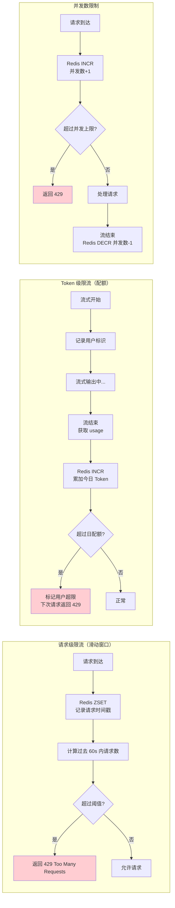

#### 代码示例

**示例 1：基础——基于 Redis 的滑动窗口限流**

```python
"""
示例1：基于 Redis 的滑动窗口限流
安装：pip install redis
运行：uvicorn redis_rate_limit:app --reload
"""
from fastapi import FastAPI, Depends, HTTPException, Request
from fastapi.responses import StreamingResponse
from openai import AsyncOpenAI
import redis
import time
import json

app = FastAPI(title="Redis 限流", version="1.0.0")
client = AsyncOpenAI(api_key="your-api-key", base_url="https://api.openai.com/v1", timeout=300)

# Redis 连接
redis_client = redis.Redis(host="localhost", port=6379, db=0, decode_responses=True)


class SlidingWindowRateLimiter:
    """滑动窗口限流器"""

    def __init__(self, redis_conn, window_seconds: int = 60, max_requests: int = 100):
        self.redis = redis_conn
        self.window_seconds = window_seconds
        self.max_requests = max_requests

    def is_allowed(self, key: str) -> bool:
        """
        滑动窗口限流：使用 Redis ZSET
        key: rate_limit:{user_id}:{window}
        """
        now = time.time()
        window_key = f"rate_limit:{key}"

        # 使用 Redis 管道保证原子性
        pipe = self.redis.pipeline()

        # 1. 移除窗口外的记录
        pipe.zremrangebyscore(window_key, 0, now - self.window_seconds)

        # 2. 获取当前窗口内的请求数
        pipe.zcard(window_key)

        # 3. 添加当前请求
        pipe.zadd(window_key, {f"{now}-{id(self)}": now})

        # 4. 设置过期时间
        pipe.expire(window_key, self.window_seconds + 1)

        results = pipe.execute()
        current_count = results[1]  # zcard 的结果

        return current_count < self.max_requests

    def get_remaining(self, key: str) -> int:
        """获取剩余请求数"""
        now = time.time()
        window_key = f"rate_limit:{key}"
        current = self.redis.zcard(window_key)
        return max(0, self.max_requests - current)


# 每用户每分钟 10 次请求
rate_limiter = SlidingWindowRateLimiter(redis_client, window_seconds=60, max_requests=10)


def get_user_id(request: Request) -> str:
    """获取用户标识（简化：用 API Key 或 IP）"""
    return request.headers.get("X-API-Key", request.client.host)


@app.post("/api/v1/chat/stream")
async def chat_stream(request: dict, http_request: Request):
    """带限流的流式接口"""
    user_id = get_user_id(http_request)

    # 限流检查（在 StreamingResponse 之前，可以返回 429）
    if not rate_limiter.is_allowed(user_id):
        remaining = rate_limiter.get_remaining(user_id)
        raise HTTPException(
            status_code=429,
            detail={
                "error": "请求过于频繁",
                "limit": rate_limiter.max_requests,
                "window": f"{rate_limiter.window_seconds}s",
                "retry_after": rate_limiter.window_seconds,
            },
            headers={"Retry-After": str(rate_limiter.window_seconds)},
        )

    async def generate():
        try:
            stream = await client.chat.completions.create(
                model="gpt-4o-mini",
                messages=request.get("messages", []),
                stream=True,
                max_tokens=request.get("max_tokens", 1000),
                stream_options={"include_usage": True},
            )

            async for chunk in stream:
                if chunk.choices and chunk.choices[0].delta.content:
                    yield f"data: {json.dumps({
                        'type': 'content',
                        'content': chunk.choices[0].delta.content,
                    }, ensure_ascii=False)}\n\n"

                if chunk.choices and chunk.choices[0].finish_reason:
                    usage = chunk.usage
                    yield f"data: {json.dumps({
                        'type': 'done',
                        'usage': {
                            'prompt_tokens': usage.prompt_tokens if usage else 0,
                            'completion_tokens': usage.completion_tokens if usage else 0,
                        },
                        'rate_limit_remaining': rate_limiter.get_remaining(user_id),
                    }, ensure_ascii=False)}\n\n"

        except Exception as e:
            yield f"data: {json.dumps({'type': 'error', 'error': str(e)})}\n\n"

    return StreamingResponse(
        generate(),
        media_type="text/event-stream",
        headers={
            "Cache-Control": "no-cache",
            "X-Accel-Buffering": "no",
            "X-RateLimit-Limit": str(rate_limiter.max_requests),
            "X-RateLimit-Remaining": str(rate_limiter.get_remaining(user_id)),
        },
    )
```

**示例 2：进阶——Token 配额管理与并发限制**

```python
"""
示例2：Token 配额管理与并发限制
运行：uvicorn token_quota:app --reload
"""
from fastapi import FastAPI, Depends, HTTPException, Request
from fastapi.responses import StreamingResponse
from fastapi.security import HTTPBearer, HTTPAuthorizationCredentials
from jose import jwt
from openai import AsyncOpenAI
import redis
import time
import json
import asyncio

app = FastAPI(title="Token 配额", version="1.0.0")
client = AsyncOpenAI(api_key="your-api-key", base_url="https://api.openai.com/v1", timeout=300)
redis_client = redis.Redis(host="localhost", port=6379, db=0, decode_responses=True)

SECRET_KEY = "your-secret-key"
security = HTTPBearer()

# 套餐配额
PLAN_QUOTAS = {
    "free": {"daily_tokens": 10000, "daily_requests": 50, "max_concurrent": 1},
    "pro": {"daily_tokens": 100000, "daily_requests": 1000, "max_concurrent": 5},
    "enterprise": {"daily_tokens": 1000000, "daily_requests": 10000, "max_concurrent": 20},
}


async def get_current_user(credentials: HTTPAuthorizationCredentials = Depends(security)):
    payload = jwt.decode(credentials.credentials, SECRET_KEY, algorithms=["HS256"])
    return {"user_id": payload["sub"], "plan": payload.get("plan", "free")}


class QuotaManager:
    """配额管理器：Token 配额 + 并发限制"""

    def __init__(self, redis_conn):
        self.redis = redis_conn

    def check_and_increment_concurrent(self, user_id: str, max_concurrent: int) -> bool:
        """检查并增加并发数"""
        key = f"concurrent:{user_id}"
        current = self.redis.incr(key)
        if current > max_concurrent:
            self.redis.decr(key)
            return False
        self.redis.expire(key, 300)  # 5 分钟过期（防止异常未释放）
        return True

    def decrement_concurrent(self, user_id: str):
        """减少并发数"""
        self.redis.decr(f"concurrent:{user_id}")

    def get_daily_usage(self, user_id: str) -> dict:
        """获取今日用量"""
        today = time.strftime("%Y-%m-%d")
        key = f"usage:{user_id}:{today}"
        data = self.redis.hgetall(key)
        return {
            "tokens": int(data.get("tokens", 0)),
            "requests": int(data.get("requests", 0)),
        }

    def check_quota(self, user_id: str, plan: str) -> dict:
        """检查配额，返回是否允许"""
        quota = PLAN_QUOTAS[plan]
        usage = self.get_daily_usage(user_id)

        if usage["requests"] >= quota["daily_requests"]:
            return {"allowed": False, "reason": "daily_requests_exceeded"}
        if usage["tokens"] >= quota["daily_tokens"]:
            return {"allowed": False, "reason": "daily_tokens_exceeded"}

        return {"allowed": True, "usage": usage, "quota": quota}

    def record_usage(self, user_id: str, tokens: int):
        """记录用量"""
        today = time.strftime("%Y-%m-%d")
        key = f"usage:{user_id}:{today}"
        pipe = self.redis.pipeline()
        pipe.hincrby(key, "tokens", tokens)
        pipe.hincrby(key, "requests", 1)
        pipe.expire(key, 86400 * 2)  # 保留 2 天
        pipe.execute()


quota_manager = QuotaManager(redis_client)


@app.post("/api/v1/chat/stream")
async def chat_stream(
    request: dict,
    http_request: Request,
    user: dict = Depends(get_current_user),
):
    """带 Token 配额和并发限制的流式接口"""
    user_id = user["user_id"]
    plan = user["plan"]
    quota = PLAN_QUOTAS[plan]

    # 1. 配额检查
    quota_check = quota_manager.check_quota(user_id, plan)
    if not quota_check["allowed"]:
        raise HTTPException(status_code=429, detail=f"配额超限: {quota_check['reason']}")

    # 2. 并发限制
    if not quota_manager.check_and_increment_concurrent(user_id, quota["max_concurrent"]):
        raise HTTPException(
            status_code=429,
            detail=f"并发数超限（最多 {quota['max_concurrent']} 个并发请求）",
        )

    async def generate():
        token_count = 0
        try:
            stream = await client.chat.completions.create(
                model="gpt-4o-mini",
                messages=request.get("messages", []),
                stream=True,
                max_tokens=request.get("max_tokens", 1000),
                stream_options={"include_usage": True},
            )

            async for chunk in stream:
                if chunk.choices and chunk.choices[0].delta.content:
                    token_count += 1
                    yield f"data: {json.dumps({
                        'type': 'content',
                        'content': chunk.choices[0].delta.content,
                    }, ensure_ascii=False)}\n\n"

                if chunk.choices and chunk.choices[0].finish_reason:
                    usage = chunk.usage
                    actual_tokens = usage.completion_tokens if usage else token_count
                    # 记录用量
                    quota_manager.record_usage(user_id, actual_tokens)
                    current_usage = quota_manager.get_daily_usage(user_id)

                    yield f"data: {json.dumps({
                        'type': 'done',
                        'tokens': actual_tokens,
                        'daily_usage': current_usage,
                        'daily_quota': quota,
                    }, ensure_ascii=False)}\n\n"
                    return

        except Exception as e:
            yield f"data: {json.dumps({'type': 'error', 'error': str(e)})}\n\n"
        finally:
            # 释放并发数
            quota_manager.decrement_concurrent(user_id)

    return StreamingResponse(
        generate(),
        media_type="text/event-stream",
        headers={"Cache-Control": "no-cache", "X-Accel-Buffering": "no"},
    )


@app.get("/api/v1/user/quota")
async def get_quota(user: dict = Depends(get_current_user)):
    """获取用户配额和用量"""
    usage = quota_manager.get_daily_usage(user["user_id"])
    return {
        "plan": user["plan"],
        "quota": PLAN_QUOTAS[user["plan"]],
        "usage": usage,
        "remaining": {
            "tokens": PLAN_QUOTAS[user["plan"]]["daily_tokens"] - usage["tokens"],
            "requests": PLAN_QUOTAS[user["plan"]]["daily_requests"] - usage["requests"],
        },
    }
```

**示例 3：完整场景——令牌桶限流 + 多级限流策略**

```python
"""
示例3：令牌桶限流 + 多级限流（IP/用户/全局）
运行：uvicorn token_bucket:app --reload
"""
from fastapi import FastAPI, Depends, HTTPException, Request
from fastapi.responses import StreamingResponse
from openai import AsyncOpenAI
import redis
import time
import json

app = FastAPI(title="令牌桶限流", version="1.0.0")
client = AsyncOpenAI(api_key="your-api-key", base_url="https://api.openai.com/v1", timeout=300)
redis_client = redis.Redis(host="localhost", port=6379, db=0, decode_responses=True)


class TokenBucket:
    """
    令牌桶限流器（Redis 实现）
    - 每秒补充 rate 个令牌
    - 桶容量为 capacity（允许突发）
    - 每次请求消耗 1 个令牌
    """

    def __init__(self, redis_conn, key_prefix: str, rate: float, capacity: int):
        self.redis = redis_conn
        self.key_prefix = key_prefix
        self.rate = rate          # 每秒补充令牌数
        self.capacity = capacity  # 桶容量

    def allow(self, key: str, tokens_needed: int = 1) -> dict:
        """
        尝试获取令牌，返回是否允许和剩余令牌数
        使用 Redis Lua 脚本保证原子性
        """
        bucket_key = f"{self.key_prefix}:{key}"

        # Lua 脚本：原子性地补充令牌并消耗
        lua_script = """
        local key = KEYS[1]
        local rate = tonumber(ARGV[1])
        local capacity = tonumber(ARGV[2])
        local needed = tonumber(ARGV[3])
        local now = tonumber(ARGV[4])

        local bucket = redis.call('HMGET', key, 'tokens', 'last_time')
        local tokens = tonumber(bucket[1]) or capacity
        local last_time = tonumber(bucket[2]) or now

        -- 补充令牌
        local elapsed = now - last_time
        tokens = math.min(capacity, tokens + elapsed * rate)

        -- 检查是否有足够令牌
        if tokens >= needed then
            tokens = tokens - needed
            redis.call('HMSET', key, 'tokens', tokens, 'last_time', now)
            redis.call('EXPIRE', key, 60)
            return {1, tokens}
        else
            redis.call('HMSET', key, 'tokens', tokens, 'last_time', now)
            return {0, tokens}
        end
        """

        result = self.redis.eval(
            lua_script,
            1, bucket_key,
            self.rate, self.capacity, tokens_needed, time.time(),
        )

        return {
            "allowed": bool(result[0]),
            "remaining_tokens": float(result[1]),
            "rate": self.rate,
            "capacity": self.capacity,
        }


# 多级限流配置
LIMITS = {
    "ip": {"rate": 1.0, "capacity": 60},       # 每 IP 每秒 1 个，突发 60
    "user": {"rate": 0.5, "capacity": 30},     # 每用户每秒 0.5 个，突发 30
    "global": {"rate": 100.0, "capacity": 500},  # 全局每秒 100 个，突发 500
}

# 创建限流器
ip_limiter = TokenBucket(redis_client, "tb:ip", **LIMITS["ip"])
user_limiter = TokenBucket(redis_client, "tb:user", **LIMITS["user"])
global_limiter = TokenBucket(redis_client, "tb:global", **LIMITS["global"])


def get_user_id(request: Request) -> str:
    return request.headers.get("X-API-Key", "anonymous")


@app.post("/api/v1/chat/stream")
async def chat_stream(request: dict, http_request: Request):
    """多级限流的流式接口"""
    ip = http_request.client.host
    user_id = get_user_id(http_request)

    # 1. 全局限流
    global_check = global_limiter.allow("global")
    if not global_check["allowed"]:
        raise HTTPException(status_code=429, detail="全局限流：服务繁忙，请稍后重试")

    # 2. IP 限流
    ip_check = ip_limiter.allow(ip)
    if not ip_check["allowed"]:
        raise HTTPException(status_code=429, detail=f"IP 限流：{ip} 请求过于频繁")

    # 3. 用户限流
    user_check = user_limiter.allow(user_id)
    if not user_check["allowed"]:
        raise HTTPException(status_code=429, detail="用户限流：请求过于频繁")

    async def generate():
        try:
            stream = await client.chat.completions.create(
                model="gpt-4o-mini",
                messages=request.get("messages", []),
                stream=True,
                max_tokens=request.get("max_tokens", 1000),
            )

            async for chunk in stream:
                if chunk.choices and chunk.choices[0].delta.content:
                    yield f"data: {json.dumps({
                        'type': 'content',
                        'content': chunk.choices[0].delta.content,
                    }, ensure_ascii=False)}\n\n"

                if chunk.choices and chunk.choices[0].finish_reason:
                    yield f"data: {json.dumps({
                        'type': 'done',
                        'rate_limit': {
                            'ip_remaining': ip_check["remaining_tokens"],
                            'user_remaining": user_check["remaining_tokens"],
                        },
                    }, ensure_ascii=False)}\n\n"

        except Exception as e:
            yield f"data: {json.dumps({'type': 'error', 'error': str(e)})}\n\n"

    return StreamingResponse(
        generate(),
        media_type="text/event-stream",
        headers={"Cache-Control": "no-cache", "X-Accel-Buffering": "no"},
    )


@app.get("/api/v1/rate-limit/status")
async def rate_limit_status():
    """限流状态查询"""
    return {
        "limits": LIMITS,
        "algorithm": "令牌桶（Token Bucket）",
        "levels": ["IP", "用户", "全局"],
    }
```

#### 使用场景与最佳实践

**适用场景**：
- 所有公网 LLM API：必须限流防止费用暴增
- 多租户 SaaS：按用户/套餐配额
- 高并发服务：全局限流保护服务端
- 免费试用：限制免费用户用量

**不适用场景**：
- 内网服务：客户端可信
- 开发环境：不需要限流

**最佳实践**：
1. **多级限流**：IP + 用户 + 全局，层层保护
2. **令牌桶算法**：允许突发流量，比固定窗口更平滑
3. **Redis 共享状态**：多实例部署时必须用 Redis
4. **Token 配额按日统计**：在 done 事件中累加 usage
5. **并发数限制**：每用户最多 N 个并发流，用 Redis INCR/DECR
6. **限流响应头**：`X-RateLimit-Limit`、`X-RateLimit-Remaining`、`Retry-After`
7. **429 错误信息友好**：告诉用户限制和恢复时间
8. **白名单机制**：内部服务/测试账号跳过限流

**性能建议**：
- Redis Lua 脚本保证限流操作原子性，减少网络往返
- 限流检查在 StreamingResponse 之前，不影响流式性能
- 令牌桶的 rate 设为预期 QPS 的 1.2 倍，capacity 设为 rate 的 3-5 倍
- 全局限流阈值设为服务端最大承载的 80%，留有余量

#### 常见坑点

**坑点 1：流式接口只限制请求数不限制 Token 数导致费用暴增**

- **错误现象**：用户每天只发 10 个请求（在请求限流内），但每个请求 max_tokens=8000，一天消耗 80000 Token，费用远超预期
- **根本原因**：只做了请求频率限流，没有做 Token 总量配额。大模型按 Token 计费，单个请求可以消耗大量 Token
- **正确做法**：① 请求级限流（每分钟 N 次）+ Token 级配额（每天 N Token）双维度控制；② 在 done 事件中获取 usage 并累加到用户日配额；③ 超过 Token 配额后返回 429
- **预防措施**：限流方案必须包含 Token 配额维度，不能只限制请求数

**坑点 2：并发数限制未正确释放导致用户被永久限流**

- **错误现象**：用户某次流式请求异常断开后，并发数计数器没有减少，用户后续所有请求都返回"并发数超限"
- **根本原因**：并发数用 Redis INCR 增加，但在异常情况下（客户端断开、服务崩溃）没有调用 DECR 释放，导致计数器只增不减
- **正确做法**：① 并发数 key 设置过期时间（如 300 秒），即使未释放也会自动过期；② 在生成器的 finally 块中调用 DECR；③ 定期清理过期的并发计数
- **预防措施**：并发数 key 必须设置过期时间，finally 块中必须释放

---

## 7. 流式接口日志与追踪

### 7.1 请求日志与 Token 用量统计

#### 概念解释

**流式接口日志** 是记录每次 LLM 调用的请求参数、响应状态、Token 用量、耗时、错误信息等结构化数据的机制，用于调试、计费、监控和审计。**Token 用量统计** 是精确记录每次调用的 prompt_tokens 和 completion_tokens，用于成本核算和配额管理。

> 🏠 **生活化比喻**：日志就像餐厅的收银系统——每笔订单记录了客人点了什么菜（请求参数）、花了多少钱（Token 用量）、等了多久（耗时）、有没有退菜（错误）。老板通过收银系统知道每天卖了多少、哪道菜最受欢迎、哪个时段最忙。没有日志的 LLM 接口就像没有收银系统的餐厅——不知道花了多少钱、不知道哪里慢、出了问题无法排查。

**核心价值**：大模型 API 调用费用高，精确的 Token 用量统计是成本核算的基础；结构化日志是问题排查、性能优化、用户行为分析的核心数据来源。

> 🎯 **面试高频考点 12**：流式接口如何获取 Token 用量？流式响应默认没有 usage 怎么办？
> **答**：流式接口获取 Token 用量的方法：① 设置 `stream_options={"include_usage": True}`，OpenAI 兼容 API 会在最后一个 chunk 中包含 usage 字段；② 如果 API 不支持 stream_options，用 tiktoken 库手动计算 prompt_tokens（输入）和 completion_tokens（输出）；③ 在 done 事件中将 usage 传递给前端和日志系统。注意：流式响应默认不返回 usage（OpenAI 的设计），必须显式设置 stream_options。国内兼容模型（豆包、通义等）大多支持 stream_options，但部分旧版本可能不支持，需要降级到 tiktoken 估算。

#### 原理说明

日志与追踪的核心机制是 **结构化日志 + 请求 ID 串联 + Token 用量采集 + 异步写入**。

**为什么这样设计**：流式接口的日志需要记录请求开始（参数）、流式过程中（每个 chunk）、流结束（usage/耗时）三个阶段。用请求 ID（request_id）串联这些日志，可以在日志系统中查看完整的一次调用。Token 用量在流结束时从最后一个 chunk 获取（`stream_options={"include_usage": True}`）。日志写入用异步方式（如写入队列后批量提交），不阻塞流式输出。

**技术对比**：

| 日志方式 | 优点 | 缺点 | 适用场景 |
|---------|------|------|---------|
| print/logging | 简单 | 非结构化，难查询 | 开发调试 |
| structlog/JSON 日志 | 结构化，可查询 | 需要配置 | 生产推荐 |
| OpenTelemetry | 全链路追踪 | 复杂 | 微服务架构 |
| 数据库记录 | 可查询统计 | IO 开销 | 计费审计 |

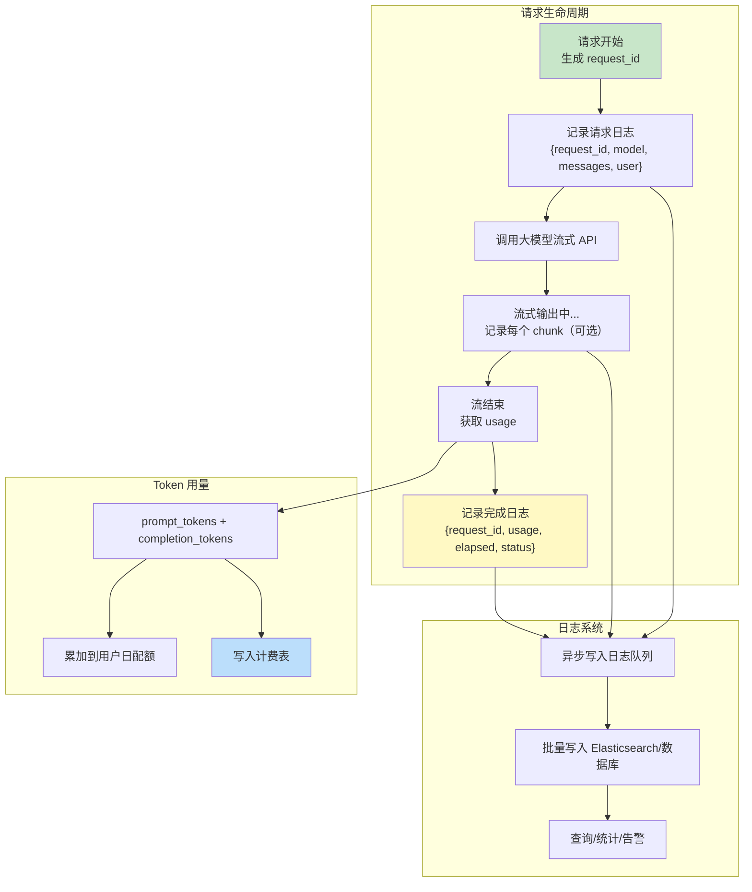

#### 代码示例

**示例 1：基础——结构化请求日志**

```python
"""
示例1：流式接口的结构化日志
安装：pip install structlog
运行：uvicorn structured_logging:app --reload
"""
from fastapi import FastAPI, Request
from fastapi.responses import StreamingResponse
from openai import AsyncOpenAI
import structlog
import json
import time
import uuid

# 配置结构化日志
structlog.configure(
    processors=[
        structlog.processors.TimeStamper(fmt="iso"),
        structlog.processors.add_log_level,
        structlog.processors.JSONRenderer(ensure_ascii=False),
    ]
)
logger = structlog.get_logger()

app = FastAPI(title="结构化日志", version="1.0.0")
client = AsyncOpenAI(api_key="your-api-key", base_url="https://api.openai.com/v1", timeout=300)


@app.post("/api/v1/chat/stream")
async def chat_stream(request: dict, http_request: Request):
    """带结构化日志的流式接口"""
    request_id = str(uuid.uuid4())[:8]
    start_time = time.time()
    model = request.get("model", "gpt-4o-mini")
    user_id = http_request.headers.get("X-User-ID", "anonymous")

    # 请求开始日志
    logger.info(
        "llm_request_start",
        request_id=request_id,
        user_id=user_id,
        model=model,
        messages_count=len(request.get("messages", [])),
        max_tokens=request.get("max_tokens", 1000),
        temperature=request.get("temperature", 0.7),
        client_ip=http_request.client.host,
    )

    token_count = 0
    first_token_time = None
    error = None

    async def generate():
        nonlocal token_count, first_token_time, error
        try:
            stream = await client.chat.completions.create(
                model=model,
                messages=request.get("messages", []),
                stream=True,
                max_tokens=request.get("max_tokens", 1000),
                temperature=request.get("temperature", 0.7),
                stream_options={"include_usage": True},
            )

            async for chunk in stream:
                if chunk.choices and chunk.choices[0].delta.content:
                    content = chunk.choices[0].delta.content
                    token_count += 1

                    if first_token_time is None:
                        first_token_time = time.time() - start_time
                        logger.debug(
                            "llm_first_token",
                            request_id=request_id,
                            ttft=round(first_token_time, 3),
                        )

                    yield f"data: {json.dumps({
                        'type': 'content',
                        'content': content,
                    }, ensure_ascii=False)}\n\n"

                if chunk.choices and chunk.choices[0].finish_reason:
                    usage = chunk.usage
                    elapsed = time.time() - start_time

                    # 请求完成日志
                    logger.info(
                        "llm_request_complete",
                        request_id=request_id,
                        user_id=user_id,
                        model=model,
                        finish_reason=chunk.choices[0].finish_reason,
                        prompt_tokens=usage.prompt_tokens if usage else 0,
                        completion_tokens=usage.completion_tokens if usage else token_count,
                        total_tokens=usage.total_tokens if usage else token_count,
                        ttft=round(first_token_time, 3) if first_token_time else None,
                        elapsed=round(elapsed, 3),
                        status="success",
                    )

                    yield f"data: {json.dumps({
                        'type': 'done',
                        'request_id': request_id,
                        'usage': {
                            'prompt_tokens': usage.prompt_tokens if usage else 0,
                            'completion_tokens': usage.completion_tokens if usage else token_count,
                        },
                        'elapsed': round(elapsed, 3),
                        'ttft': round(first_token_time, 3) if first_token_time else None,
                    }, ensure_ascii=False)}\n\n"
                    return

        except Exception as e:
            error = str(e)
            elapsed = time.time() - start_time

            # 错误日志
            logger.error(
                "llm_request_error",
                request_id=request_id,
                user_id=user_id,
                model=model,
                error=str(e),
                error_type=type(e).__name__,
                elapsed=round(elapsed, 3),
                tokens_generated=token_count,
                status="error",
            )

            yield f"data: {json.dumps({
                'type': 'error',
                'error': str(e),
                'request_id': request_id,
            }, ensure_ascii=False)}\n\n"

    return StreamingResponse(
        generate(),
        media_type="text/event-stream",
        headers={
            "Cache-Control": "no-cache",
            "X-Accel-Buffering": "no",
            "X-Request-ID": request_id,
        },
    )


# 日志输出示例（JSON 格式）：
# {"event": "llm_request_start", "request_id": "a1b2c3d4", "user_id": "user1", "model": "gpt-4o-mini", "messages_count": 2, "timestamp": "2026-09-09T10:00:00.000000Z", "level": "info"}
# {"event": "llm_first_token", "request_id": "a1b2c3d4", "ttft": 0.85, "level": "debug"}
# {"event": "llm_request_complete", "request_id": "a1b2c3d4", "prompt_tokens": 25, "completion_tokens": 80, "ttft": 0.85, "elapsed": 3.2, "status": "success", "level": "info"}
```

**示例 2：进阶——Token 用量统计与成本核算**

```python
"""
示例2：Token 用量统计与成本核算
特性：多模型定价、日/月统计、成本估算
运行：uvicorn token_cost_tracking:app --reload
"""
from fastapi import FastAPI, Request
from fastapi.responses import StreamingResponse
from openai import AsyncOpenAI
from collections import defaultdict
from datetime import datetime
import json
import time
import uuid

app = FastAPI(title="Token 成本统计", version="1.0.0")
client = AsyncOpenAI(api_key="your-api-key", base_url="https://api.openai.com/v1", timeout=300)

# 模型定价（每 1000 Token 的价格，美元）
MODEL_PRICING = {
    "gpt-4o": {"prompt": 0.005, "completion": 0.015},
    "gpt-4o-mini": {"prompt": 0.00015, "completion": 0.0006},
    "gpt-4-turbo": {"prompt": 0.01, "completion": 0.03},
    "doubao-pro": {"prompt": 0.0008, "completion": 0.002},
    "deepseek-chat": {"prompt": 0.00014, "completion": 0.00028},
}

# 内存统计（生产环境用 Redis/数据库）
daily_stats = defaultdict(lambda: {
    "requests": 0,
    "prompt_tokens": 0,
    "completion_tokens": 0,
    "total_tokens": 0,
    "cost": 0.0,
    "errors": 0,
})


def calculate_cost(model: str, prompt_tokens: int, completion_tokens: int) -> float:
    """计算本次调用的成本（美元）"""
    pricing = MODEL_PRICING.get(model, {"prompt": 0.001, "completion": 0.002})
    cost = (prompt_tokens / 1000 * pricing["prompt"] +
            completion_tokens / 1000 * pricing["completion"])
    return round(cost, 6)


def record_usage(model: str, prompt_tokens: int, completion_tokens: int, error: bool = False):
    """记录用量到日统计"""
    today = datetime.now().strftime("%Y-%m-%d")
    stats = daily_stats[today]
    stats["requests"] += 1
    stats["prompt_tokens"] += prompt_tokens
    stats["completion_tokens"] += completion_tokens
    stats["total_tokens"] += prompt_tokens + completion_tokens
    stats["cost"] += calculate_cost(model, prompt_tokens, completion_tokens)
    if error:
        stats["errors"] += 1


@app.post("/api/v1/chat/stream")
async def chat_stream(request: dict, http_request: Request):
    """带 Token 用量统计的流式接口"""
    request_id = str(uuid.uuid4())[:8]
    model = request.get("model", "gpt-4o-mini")
    start_time = time.time()
    token_count = 0

    async def generate():
        nonlocal token_count
        try:
            stream = await client.chat.completions.create(
                model=model,
                messages=request.get("messages", []),
                stream=True,
                max_tokens=request.get("max_tokens", 1000),
                stream_options={"include_usage": True},
            )

            async for chunk in stream:
                if chunk.choices and chunk.choices[0].delta.content:
                    token_count += 1
                    yield f"data: {json.dumps({
                        'type': 'content',
                        'content': chunk.choices[0].delta.content,
                    }, ensure_ascii=False)}\n\n"

                if chunk.choices and chunk.choices[0].finish_reason:
                    usage = chunk.usage
                    prompt_tokens = usage.prompt_tokens if usage else 0
                    completion_tokens = usage.completion_tokens if usage else token_count
                    elapsed = time.time() - start_time
                    cost = calculate_cost(model, prompt_tokens, completion_tokens)

                    # 记录用量
                    record_usage(model, prompt_tokens, completion_tokens)

                    yield f"data: {json.dumps({
                        'type': 'done',
                        'request_id': request_id,
                        'model': model,
                        'usage': {
                            'prompt_tokens': prompt_tokens,
                            'completion_tokens': completion_tokens,
                            'total_tokens': prompt_tokens + completion_tokens,
                        },
                        'cost_usd': cost,
                        'elapsed': round(elapsed, 2),
                    }, ensure_ascii=False)}\n\n"
                    return

        except Exception as e:
            record_usage(model, 0, token_count, error=True)
            yield f"data: {json.dumps({
                'type': 'error',
                'error': str(e),
                'request_id': request_id,
            }, ensure_ascii=False)}\n\n"

    return StreamingResponse(
        generate(),
        media_type="text/event-stream",
        headers={"Cache-Control": "no-cache", "X-Accel-Buffering": "no"},
    )


@app.get("/api/v1/stats/daily")
async def daily_statistics(date: str = None):
    """获取日统计数据"""
    target_date = date or datetime.now().strftime("%Y-%m-%d")
    stats = daily_stats.get(target_date, {
        "requests": 0, "prompt_tokens": 0, "completion_tokens": 0,
        "total_tokens": 0, "cost": 0.0, "errors": 0,
    })
    return {
        "date": target_date,
        **stats,
        "avg_tokens_per_request": round(stats["total_tokens"] / max(stats["requests"], 1), 1),
        "avg_cost_per_request": round(stats["cost"] / max(stats["requests"], 1), 6),
        "error_rate": round(stats["errors"] / max(stats["requests"], 1) * 100, 2),
    }


@app.get("/api/v1/stats/models")
async def model_pricing():
    """获取模型定价表"""
    return MODEL_PRICING
```

**示例 3：完整场景——OpenTelemetry 全链路追踪**

```python
"""
示例3：OpenTelemetry 全链路追踪
安装：pip install opentelemetry-api opentelemetry-sdk opentelemetry-instrumentation-fastapi
运行：uvicorn otel_tracing:app --reload
"""
from fastapi import FastAPI, Request
from fastapi.responses import StreamingResponse
from openai import AsyncOpenAI
from opentelemetry import trace
from opentelemetry.sdk.trace import TracerProvider
from opentelemetry.sdk.trace.export import ConsoleSpanExporter, SimpleSpanProcessor
from opentelemetry.instrumentation.fastapi import FastAPIInstrumentor
import json
import time
import uuid

# 配置 OpenTelemetry
trace.set_tracer_provider(TracerProvider())
tracer = trace.get_tracer(__name__)

# 导出到控制台（生产环境导出到 Jaeger/Zipkin）
trace.get_tracer_provider().add_span_processor(
    SimpleSpanProcessor(ConsoleSpanExporter())
)

app = FastAPI(title="OpenTelemetry 追踪", version="1.0.0")
FastAPIInstrumentor.instrument_app(app)  # 自动追踪 FastAPI 请求

client = AsyncOpenAI(api_key="your-api-key", base_url="https://api.openai.com/v1", timeout=300)


@app.post("/api/v1/chat/stream")
async def chat_stream(request: dict, http_request: Request):
    """带 OpenTelemetry 追踪的流式接口"""
    request_id = str(uuid.uuid4())[:8]

    # 创建自定义 Span
    with tracer.start_as_current_span("llm_chat_stream") as span:
        span.set_attribute("request.id", request_id)
        span.set_attribute("llm.model", request.get("model", "gpt-4o-mini"))
        span.set_attribute("llm.messages_count", len(request.get("messages", [])))

        start_time = time.time()
        token_count = 0

        async def generate():
            nonlocal token_count
            # 大模型调用 Span
            with tracer.start_as_current_span("openai_api_call") as llm_span:
                llm_span.set_attribute("llm.model", request.get("model", "gpt-4o-mini"))
                llm_span.set_attribute("llm.stream", True)

                try:
                    stream = await client.chat.completions.create(
                        model=request.get("model", "gpt-4o-mini"),
                        messages=request.get("messages", []),
                        stream=True,
                        max_tokens=request.get("max_tokens", 1000),
                        stream_options={"include_usage": True},
                    )

                    first_token = True
                    async for chunk in stream:
                        if chunk.choices and chunk.choices[0].delta.content:
                            if first_token:
                                ttft = time.time() - start_time
                                llm_span.set_attribute("llm.ttft", round(ttft, 3))
                                first_token = False
                            token_count += 1
                            yield f"data: {json.dumps({
                                'type': 'content',
                                'content': chunk.choices[0].delta.content,
                            }, ensure_ascii=False)}\n\n"

                        if chunk.choices and chunk.choices[0].finish_reason:
                            usage = chunk.usage
                            elapsed = time.time() - start_time

                            # 设置 Span 属性
                            llm_span.set_attribute("llm.prompt_tokens", usage.prompt_tokens if usage else 0)
                            llm_span.set_attribute("llm.completion_tokens", usage.completion_tokens if usage else token_count)
                            llm_span.set_attribute("llm.finish_reason", chunk.choices[0].finish_reason)
                            llm_span.set_attribute("llm.elapsed", round(elapsed, 3))
                            llm_span.set_status(trace.StatusCode.OK)

                            yield f"data: {json.dumps({
                                'type': 'done',
                                'request_id': request_id,
                                'trace_id': format(span.get_identity().trace_id, '032x'),
                            }, ensure_ascii=False)}\n\n"
                            return

                except Exception as e:
                    llm_span.record_exception(e)
                    llm_span.set_status(trace.StatusCode.ERROR, str(e))
                    yield f"data: {json.dumps({
                        'type': 'error',
                        'error': str(e),
                        'request_id': request_id,
                    }, ensure_ascii=False)}\n\n"

        return StreamingResponse(
            generate(),
            media_type="text/event-stream",
            headers={
                "Cache-Control": "no-cache",
                "X-Accel-Buffering": "no",
                "X-Request-ID": request_id,
                "X-Trace-ID": format(span.get_identity().trace_id, '032x'),
            },
        )
```

#### 使用场景与最佳实践

**适用场景**：
- 生产级 LLM 服务：必须有日志和用量统计
- 计费系统：精确的 Token 用量是计费基础
- 问题排查：请求 ID 串联完整调用链
- 成本优化：分析模型使用分布和成本

**不适用场景**：
- 开发/原型：简单 print 即可
- 极低流量内部工具：不需要复杂追踪

**最佳实践**：
1. **每个请求生成唯一 request_id**：贯穿日志、SSE 消息、响应头
2. **结构化日志（JSON）**：便于 Elasticsearch 查询和统计
3. **记录关键指标**：TTFT、总耗时、prompt_tokens、completion_tokens、finish_reason
4. **`stream_options={"include_usage": True}`**：流式响应中获取 usage
5. **成本核算**：按模型定价计算每次调用成本
6. **异步写入日志**：不阻塞流式输出（用队列/批量写入）
7. **错误日志包含 stack trace**：便于排查
8. **日志级别控制**：生产环境 info，调试时 debug

**性能建议**：
- 日志写入用异步队列，不要在流式生成器中同步写数据库
- 每个 chunk 的 debug 日志可以关闭（生产环境），只记录 start/complete/error
- Token 用量统计用 Redis 计数器，避免数据库写入瓶颈
- OpenTelemetry 采样率设为 10-50%，全量追踪开销大

#### 常见坑点

**坑点 1：流式响应中忘记设置 stream_options 导致 usage 为 None**

- **错误现象**：日志中 prompt_tokens 和 completion_tokens 都是 0，无法统计 Token 用量和成本
- **根本原因**：OpenAI 流式响应默认不包含 usage 字段（与非流式不同），需要显式设置 `stream_options={"include_usage": True}` 才能在最后一个 chunk 中获取 usage
- **正确做法**：调用 `client.chat.completions.create(stream=True, stream_options={"include_usage": True})`，在最后一个 chunk 中读取 `chunk.usage`
- **预防措施**：代码模板中固定包含 `stream_options={"include_usage": True}`，并在 usage 为 None 时用 tiktoken 降级估算

**坑点 2：日志中记录完整 messages 导致敏感信息泄露和日志过大**

- **错误现象**：日志系统中存储了用户的完整对话内容（可能包含隐私信息），且单条日志达到几 MB，查询缓慢
- **根本原因**：日志中记录了完整的 `messages` 列表，包括用户输入和大模型输出，包含敏感信息且数据量大
- **正确做法**：① 日志中只记录 messages 的数量和总字符数，不记录内容；② 如果需要记录内容，做脱敏处理（移除手机号、身份证等）；③ 大模型输出内容不记录到日志，只记录 Token 数
- **预防措施**：日志工具函数中过滤 messages 内容，只保留元数据

---

> 💡 **深度讲解**：本章深入了流式接口的缓冲与背压、慢客户端处理、认证与限流、日志与追踪四大生产级技能。缓冲策略通过 50ms 时间窗口聚合 Token，减少 60-80% 的网络小包，混合策略（时间+数量）是生产推荐。背压是异步生成器的天然特性，慢客户端自动拖慢生产速度，不需要额外代码。慢客户端处理通过总超时（300s）、空闲超时（60s）、客户端断开检测保护服务端资源。认证必须在 StreamingResponse 返回之前完成（Depends 中），流式过程中无法改 HTTP 状态码。限流需要请求级（滑动窗口/令牌桶）+ Token 级（日配额）+ 并发数三级控制，用 Redis 共享状态。日志通过 request_id 串联完整调用链，`stream_options={"include_usage": True}` 获取 Token 用量用于成本核算。掌握这些后，可以构建出安全、可控、可观测的生产级 LLM 流式接口。
>
> **📝 精简总结**：
> 1. 缓冲策略：50ms 时间窗口 + 5 Token 数量阈值，混合触发，减少 60-80% 网络包
> 2. 背压：异步生成器天然支持，慢客户端自动拖慢生产，不内存溢出
> 3. 慢客户端：总超时 300s、空闲超时 60s、客户端断开检测（request.is_disconnected）
> 4. 认证在 Depends 中完成：StreamingResponse 返回之前，失败可返回 401
> 5. JWT 有效期 > 流式时长（60 分钟），流式过程中不重新认证
> 6. 限流三级：请求级（令牌桶/滑动窗口）+ Token 级（日配额）+ 并发数限制
> 7. Redis 共享限流状态，Lua 脚本保证原子性
> 8. 日志：request_id 串联、结构化 JSON、TTFT/耗时/usage 关键指标
> 9. Token 用量：stream_options={"include_usage": True}，成本核算按模型定价
> 10. 日志不记录完整 messages，只记录元数据，防止敏感信息泄露
>
> **🎯 梯度练习题**：
> - **基础 1**：实现 50ms 时间窗口缓冲，对比无缓冲和有缓冲的网络包数量
> - **基础 2**：解释流式接口认证为什么必须在 StreamingResponse 返回之前
> - **基础 3**：实现基于 Redis 的固定窗口限流，每用户每分钟 10 次
> - **进阶 1**：实现令牌桶限流（Redis Lua 脚本），支持突发流量
> - **进阶 2**：实现 Token 日配额管理，在 done 事件中累加 usage 并检查超限
> - **实战 1**：实现完整的生产级流式接口，包含认证（JWT）、限流（令牌桶）、配额（Token 日限）、日志（结构化 JSON + request_id）、成本核算

---

## 第三篇 实战篇：生产级架构与完整项目

---

## 8. 流式接口与 WebSocket 结合

### 8.1 WebSocket 流式输出实现

#### 概念解释

**WebSocket 流式输出** 是通过 WebSocket 全双工连接传输大模型流式输出的方案，相比 SSE 支持双向通信（客户端可以在流式过程中发送取消、追加问题等指令），适合需要实时交互的 AI 对话场景。

> 🏠 **生活化比喻**：SSE 就像单向广播——电台（服务端）向听众（客户端）播放节目（流式数据），听众不能插话。WebSocket 就像电话——双方可以随时说话（双向通信），听众可以在节目播放中说"停一下，我没听清"（取消生成）或"换个话题"（追加问题）。对于 AI 对话，用户可能在生成过程中说"不对，重新回答"，WebSocket 的双向通信天然支持这种交互。

**核心价值**：双向通信支持流式过程中的用户交互（取消、打断、追加），单连接多路复用（一个 WebSocket 连接可以处理多轮对话），适合实时 AI 对话和 Agent 场景。

> 🎯 **面试高频考点 13**：SSE 和 WebSocket 都能做流式输出，什么场景选 SSE？什么场景选 WebSocket？
> **答**：选 SSE 的场景：① 只需要服务端推送（单向）；② 简单的 AI 对话（用户发一条，模型回一条）；③ 需要 HTTP 缓存和代理兼容性（SSE 基于 HTTP，CDN/代理支持好）；④ 实现简单（StreamingResponse 即可）。选 WebSocket 的场景：① 需要双向通信（流式过程中取消、打断、追加问题）；② 多轮对话复用连接（减少握手开销）；③ 需要实时状态同步（如 Agent 的思考过程、工具调用）；④ 低延迟要求（WebSocket 帧开销比 SSE 小）。实践中，简单对话用 SSE，复杂交互/Agent 用 WebSocket。

#### 原理说明

WebSocket 流式输出的核心机制是 **全双工连接 + JSON 消息协议 + 流式帧推送 + 连接管理器**。

**为什么这样设计**：WebSocket 建立后，服务端和客户端可以随时发送消息。大模型流式输出时，服务端每收到一个 Token 就通过 `websocket.send_text()` 发送 JSON 消息。客户端可以在任何时候发送 `{"action": "cancel"}` 消息取消生成，或 `{"action": "new_message"}` 追加问题。连接管理器管理活跃的 WebSocket 连接，支持广播和点对点消息。

**技术对比**：

| 特性 | SSE | WebSocket |
|------|-----|-----------|
| 通信方向 | 单向（服务端→客户端） | 双向 |
| 协议 | HTTP 长连接 | WebSocket 协议（ws://） |
| 数据格式 | text/event-stream | 自定义 JSON |
| 客户端取消 | 断开连接 | 发送 cancel 消息 |
| 多轮对话 | 每次新建 HTTP 请求 | 复用连接 |
| 实现复杂度 | 低 | 中（需连接管理） |
| 代理兼容性 | 好（HTTP） | 需代理支持 Upgrade |

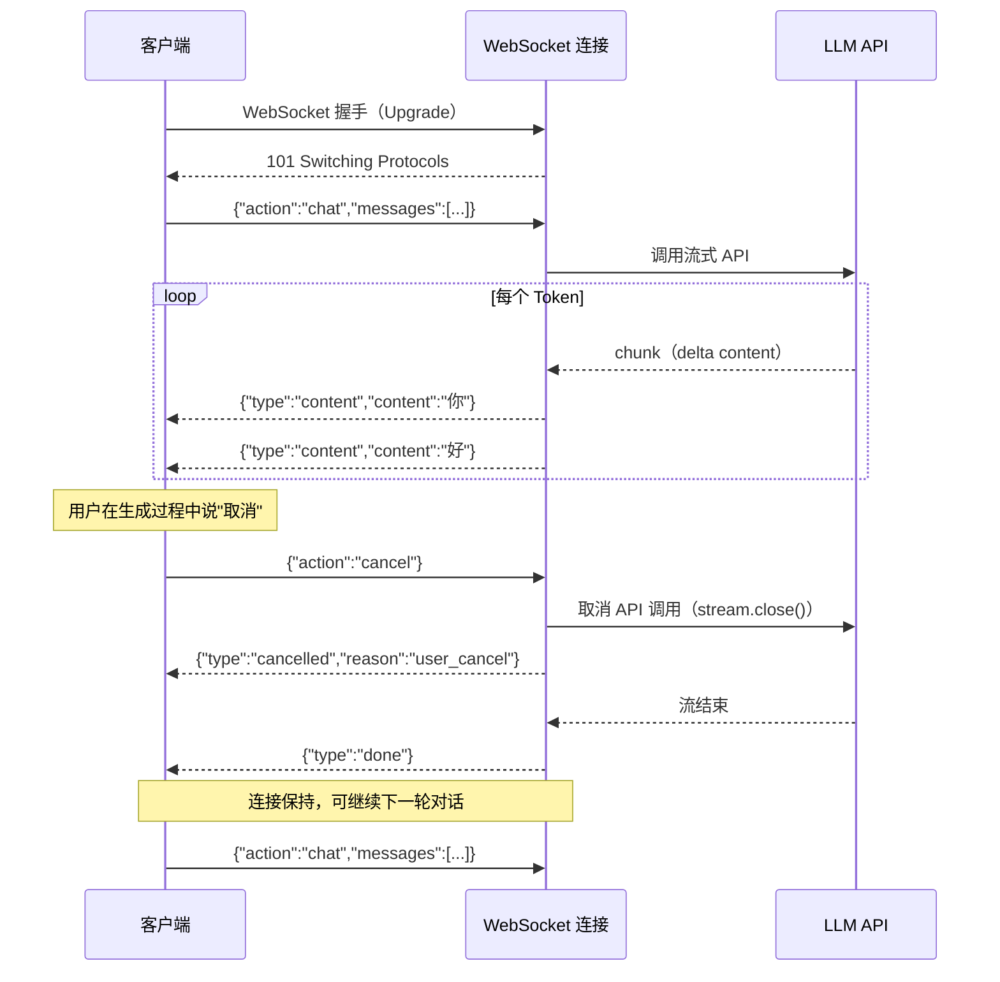

#### 代码示例

**示例 1：基础——WebSocket 流式对话**

```python
"""
示例1：WebSocket 流式对话基础实现
运行：uvicorn websocket_stream:app --reload
"""
from fastapi import FastAPI, WebSocket, WebSocketDisconnect
from openai import AsyncOpenAI
import json
import asyncio
import time

app = FastAPI(title="WebSocket 流式对话", version="1.0.0")
client = AsyncOpenAI(api_key="your-api-key", base_url="https://api.openai.com/v1", timeout=300)


@app.websocket("/ws/chat")
async def websocket_chat(websocket: WebSocket):
    """WebSocket 流式对话端点"""
    await websocket.accept()
    print(f"[WebSocket] 客户端连接: {websocket.client}")

    try:
        while True:
            # 接收客户端消息
            data = await websocket.receive_text()
            message = json.loads(data)
            action = message.get("action")

            if action == "chat":
                # 处理对话请求
                messages = message.get("messages", [])
                model = message.get("model", "gpt-4o-mini")
                request_id = message.get("request_id", "unknown")

                await handle_chat(websocket, messages, model, request_id)

            elif action == "ping":
                # 心跳
                await websocket.send_text(json.dumps({"type": "pong", "timestamp": time.time()}))

            elif action == "close":
                # 客户端主动关闭
                break

            else:
                await websocket.send_text(json.dumps({
                    "type": "error",
                    "error": f"未知的 action: {action}",
                }))

    except WebSocketDisconnect:
        print(f"[WebSocket] 客户端断开: {websocket.client}")
    except Exception as e:
        print(f"[WebSocket] 错误: {e}")
    finally:
        print(f"[WebSocket] 连接关闭")


async def handle_chat(websocket: WebSocket, messages: list, model: str, request_id: str):
    """处理单次对话的流式输出"""
    start_time = time.time()
    cancelled = False
    token_count = 0

    # 发送开始消息
    await websocket.send_text(json.dumps({
        "type": "start",
        "request_id": request_id,
        "model": model,
    }, ensure_ascii=False))

    try:
        stream = await client.chat.completions.create(
            model=model,
            messages=messages,
            stream=True,
            max_tokens=2000,
            stream_options={"include_usage": True},
        )

        async for chunk in stream:
            # 检查是否有取消消息（非阻塞接收）
            try:
                cancel_data = await asyncio.wait_for(websocket.receive_text(), timeout=0.001)
                cancel_msg = json.loads(cancel_data)
                if cancel_msg.get("action") == "cancel":
                    cancelled = True
                    print(f"[取消] 请求 {request_id} 被用户取消")
                    break
            except (asyncio.TimeoutError, WebSocketDisconnect):
                pass  # 没有取消消息，继续

            if chunk.choices and chunk.choices[0].delta.content:
                token_count += 1
                await websocket.send_text(json.dumps({
                    "type": "content",
                    "content": chunk.choices[0].delta.content,
                    "request_id": request_id,
                }, ensure_ascii=False))

            if chunk.choices and chunk.choices[0].finish_reason:
                usage = chunk.usage
                elapsed = time.time() - start_time
                await websocket.send_text(json.dumps({
                    "type": "done",
                    "request_id": request_id,
                    "finish_reason": chunk.choices[0].finish_reason,
                    "elapsed": round(elapsed, 2),
                    "usage": {
                        "prompt_tokens": usage.prompt_tokens if usage else 0,
                        "completion_tokens": usage.completion_tokens if usage else token_count,
                    },
                }, ensure_ascii=False))
                return

        if cancelled:
            await websocket.send_text(json.dumps({
                "type": "cancelled",
                "request_id": request_id,
                "reason": "user_cancel",
                "tokens_generated": token_count,
            }, ensure_ascii=False))

    except Exception as e:
        await websocket.send_text(json.dumps({
            "type": "error",
            "request_id": request_id,
            "error": str(e),
        }, ensure_ascii=False))


# 前端 JavaScript：
"""
const ws = new WebSocket('ws://localhost:8000/ws/chat');

ws.onopen = () => {
  console.log('WebSocket 已连接');
  // 发送对话请求
  ws.send(JSON.stringify({
    action: 'chat',
    request_id: 'req-001',
    model: 'gpt-4o-mini',
    messages: [{ role: 'user', content: '你好' }],
  }));
};

ws.onmessage = (event) => {
  const data = JSON.parse(event.data);
  switch (data.type) {
    case 'content':
      appendToUI(data.content);
      break;
    case 'done':
      console.log('完成:', data.usage);
      break;
    case 'cancelled':
      console.log('已取消');
      break;
    case 'error':
      console.error('错误:', data.error);
      break;
  }
};

// 取消生成
function cancelGeneration() {
  ws.send(JSON.stringify({ action: 'cancel' }));
}
"""
```

**示例 2：进阶——WebSocket 连接管理器与多客户端**

```python
"""
示例2：WebSocket 连接管理器与多客户端管理
运行：uvicorn websocket_manager:app --reload
"""
from fastapi import FastAPI, WebSocket, WebSocketDisconnect
from openai import AsyncOpenAI
from typing import Dict, Set
import json
import asyncio
import time
import uuid

app = FastAPI(title="WebSocket 连接管理", version="1.0.0")
client = AsyncOpenAI(api_key="your-api-key", base_url="https://api.openai.com/v1", timeout=300)


class ConnectionManager:
    """WebSocket 连接管理器"""

    def __init__(self):
        self.active_connections: Dict[str, WebSocket] = {}  # user_id -> websocket
        self.active_streams: Dict[str, any] = {}  # request_id -> stream 对象

    async def connect(self, user_id: str, websocket: WebSocket):
        """接受连接并注册"""
        await websocket.accept()
        self.active_connections[user_id] = websocket
        print(f"[管理] 用户 {user_id} 连接，当前在线: {len(self.active_connections)}")

    def disconnect(self, user_id: str):
        """断开连接"""
        self.active_connections.pop(user_id, None)
        print(f"[管理] 用户 {user_id} 断开，当前在线: {len(self.active_connections)}")

    async def send_personal_message(self, user_id: str, message: dict):
        """向指定用户发送消息"""
        websocket = self.active_connections.get(user_id)
        if websocket:
            await websocket.send_text(json.dumps(message, ensure_ascii=False))

    async def broadcast(self, message: dict):
        """广播消息给所有在线用户"""
        for websocket in self.active_connections.values():
            await websocket.send_text(json.dumps(message, ensure_ascii=False))

    def cancel_stream(self, request_id: str):
        """取消指定的流式请求"""
        stream = self.active_streams.pop(request_id, None)
        if stream:
            print(f"[管理] 取消流式请求: {request_id}")

    def get_online_users(self) -> list:
        """获取在线用户列表"""
        return list(self.active_connections.keys())


manager = ConnectionManager()


@app.websocket("/ws/chat/{user_id}")
async def websocket_endpoint(websocket: WebSocket, user_id: str):
    """带用户标识的 WebSocket 端点"""
    await manager.connect(user_id, websocket)

    try:
        while True:
            data = await websocket.receive_text()
            message = json.loads(data)
            action = message.get("action")

            if action == "chat":
                request_id = str(uuid.uuid4())[:8]
                await handle_chat(user_id, request_id, message)

            elif action == "cancel":
                manager.cancel_stream(message.get("request_id"))

            elif action == "broadcast":
                # 广播消息（如系统通知）
                await manager.broadcast({
                    "type": "broadcast",
                    "from": user_id,
                    "content": message.get("content", ""),
                })

            elif action == "online_users":
                await manager.send_personal_message(user_id, {
                    "type": "online_users",
                    "users": manager.get_online_users(),
                })

    except WebSocketDisconnect:
        manager.disconnect(user_id)
    except Exception as e:
        print(f"[错误] {e}")
        manager.disconnect(user_id)


async def handle_chat(user_id: str, request_id: str, message: dict):
    """处理对话请求"""
    messages = message.get("messages", [])
    model = message.get("model", "gpt-4o-mini")
    start_time = time.time()

    await manager.send_personal_message(user_id, {
        "type": "start",
        "request_id": request_id,
        "model": model,
    })

    try:
        stream = await client.chat.completions.create(
            model=model,
            messages=messages,
            stream=True,
            max_tokens=2000,
        )
        manager.active_streams[request_id] = stream

        token_count = 0
        async for chunk in stream:
            # 检查是否被取消
            if request_id not in manager.active_streams:
                await manager.send_personal_message(user_id, {
                    "type": "cancelled",
                    "request_id": request_id,
                })
                return

            if chunk.choices and chunk.choices[0].delta.content:
                token_count += 1
                await manager.send_personal_message(user_id, {
                    "type": "content",
                    "request_id": request_id,
                    "content": chunk.choices[0].delta.content,
                })

            if chunk.choices and chunk.choices[0].finish_reason:
                elapsed = time.time() - start_time
                manager.active_streams.pop(request_id, None)
                await manager.send_personal_message(user_id, {
                    "type": "done",
                    "request_id": request_id,
                    "elapsed": round(elapsed, 2),
                    "tokens": token_count,
                })
                return

    except Exception as e:
        manager.active_streams.pop(request_id, None)
        await manager.send_personal_message(user_id, {
            "type": "error",
            "request_id": request_id,
            "error": str(e),
        })


@app.get("/api/online-count")
async def online_count():
    """获取在线用户数"""
    return {"online_users": len(manager.active_connections)}
```

**示例 3：完整场景——SSE 与 WebSocket 双协议支持**

```python
"""
示例3：SSE 与 WebSocket 双协议支持
同一套业务逻辑，支持两种传输协议
运行：uvicorn dual_protocol:app --reload
"""
from fastapi import FastAPI, WebSocket, WebSocketDisconnect, Request
from fastapi.responses import StreamingResponse
from openai import AsyncOpenAI
from abc import ABC, abstractmethod
import json
import time

app = FastAPI(title="双协议支持", version="1.0.0")
client = AsyncOpenAI(api_key="your-api-key", base_url="https://api.openai.com/v1", timeout=300)


# ============ 抽象传输层 ============
class StreamTransport(ABC):
    """流式传输抽象层：屏蔽 SSE 和 WebSocket 差异"""

    @abstractmethod
    async def send(self, data: dict):
        """发送消息"""
        pass

    @abstractmethod
    async def close(self):
        """关闭连接"""
        pass


class SSETransport(StreamTransport):
    """SSE 传输：通过 yield 发送数据"""

    def __init__(self):
        self.queue = asyncio.Queue()

    async def send(self, data: dict):
        await self.queue.put(f"data: {json.dumps(data, ensure_ascii=False)}\n\n")

    async def close(self):
        await self.queue.put(None)  # 结束标记

    async def __aiter__(self):
        while True:
            item = await self.queue.get()
            if item is None:
                break
            yield item


class WebSocketTransport(StreamTransport):
    """WebSocket 传输：通过 websocket.send_text 发送"""

    def __init__(self, websocket: WebSocket):
        self.websocket = websocket

    async def send(self, data: dict):
        await self.websocket.send_text(json.dumps(data, ensure_ascii=False))

    async def close(self):
        pass  # WebSocket 连接保持，不关闭


# ============ 统一业务逻辑 ============
async def llm_chat_stream(messages: list, model: str, transport: StreamTransport):
    """
    统一的 LLM 流式对话逻辑
    不关心底层是 SSE 还是 WebSocket，通过 transport 发送消息
    """
    start_time = time.time()
    request_id = f"req-{int(time.time())}"

    await transport.send({"type": "start", "request_id": request_id, "model": model})

    try:
        stream = await client.chat.completions.create(
            model=model,
            messages=messages,
            stream=True,
            max_tokens=2000,
            stream_options={"include_usage": True},
        )

        token_count = 0
        async for chunk in stream:
            if chunk.choices and chunk.choices[0].delta.content:
                token_count += 1
                await transport.send({
                    "type": "content",
                    "request_id": request_id,
                    "content": chunk.choices[0].delta.content,
                })

            if chunk.choices and chunk.choices[0].finish_reason:
                usage = chunk.usage
                elapsed = time.time() - start_time
                await transport.send({
                    "type": "done",
                    "request_id": request_id,
                    "finish_reason": chunk.choices[0].finish_reason,
                    "elapsed": round(elapsed, 2),
                    "usage": {
                        "prompt_tokens": usage.prompt_tokens if usage else 0,
                        "completion_tokens": usage.completion_tokens if usage else token_count,
                    },
                })
                await transport.close()
                return

    except Exception as e:
        await transport.send({
            "type": "error",
            "request_id": request_id,
            "error": str(e),
        })
        await transport.close()


# ============ SSE 端点 ============
@app.post("/api/v1/chat/stream")
async def sse_chat(request: dict):
    """SSE 流式接口"""
    transport = SSETransport()

    # 启动流式生成（后台任务）
    asyncio.create_task(llm_chat_stream(
        messages=request.get("messages", []),
        model=request.get("model", "gpt-4o-mini"),
        transport=transport,
    ))

    return StreamingResponse(
        transport.__aiter__(),
        media_type="text/event-stream",
        headers={"Cache-Control": "no-cache", "X-Accel-Buffering": "no"},
    )


# ============ WebSocket 端点 ============
@app.websocket("/ws/chat")
async def websocket_chat(websocket: WebSocket):
    """WebSocket 流式接口"""
    await websocket.accept()
    transport = WebSocketTransport(websocket)

    try:
        while True:
            data = await websocket.receive_text()
            message = json.loads(data)
            if message.get("action") == "chat":
                await llm_chat_stream(
                    messages=message.get("messages", []),
                    model=message.get("model", "gpt-4o-mini"),
                    transport=transport,
                )
    except WebSocketDisconnect:
        pass


import asyncio
```

#### 使用场景与最佳实践

**适用场景**：
- AI 对话聊天：需要流式过程中取消/打断
- AI Agent：需要实时状态同步和工具调用反馈
- 多轮对话：复用 WebSocket 连接减少握手
- 实时协作：多用户共享 AI 生成过程

**不适用场景**：
- 简单的一次性生成：SSE 更简单
- 需要 HTTP 缓存/CDN：SSE 兼容性更好
- 代理不支持 WebSocket Upgrade：用 SSE

**最佳实践**：
1. **简单对话用 SSE，复杂交互用 WebSocket**：根据场景选择
2. **统一消息协议**：JSON 格式，type 字段区分事件类型
3. **连接管理器管理活跃连接**：支持点对点和广播
4. **心跳机制**：每 30 秒 ping/pong，检测死连接
5. **取消支持**：客户端发送 cancel 消息，服务端停止生成
6. **request_id 关联**：每个请求带唯一 ID，支持多请求并发
7. **错误通过消息发送**：WebSocket 中用 `{"type": "error"}` 消息
8. **优雅关闭**：服务端关闭时通知所有客户端

**性能建议**：
- WebSocket 连接数受文件描述符限制，高并发时调大 `ulimit -n`
- 单连接处理多轮对话，减少 TCP/TLS 握手开销
- 大消息分片发送，避免单帧过大
- 心跳间隔 30 秒，超时 90 秒断开

#### 常见坑点

**坑点 1：WebSocket 中流式输出时无法接收客户端消息**

- **错误现象**：大模型流式输出过程中，客户端发送 cancel 消息，但服务端收不到，直到流结束才处理
- **根本原因**：`async for chunk in stream` 阻塞了事件循环，无法同时 `await websocket.receive_text()`。WebSocket 的 receive 和大模型的 stream 是两个异步源，需要并发处理
- **正确做法**：① 用 `asyncio.wait_for(websocket.receive_text(), timeout=0.001)` 非阻塞检查取消消息；② 或用 `asyncio.create_task` 启动接收任务，通过队列传递取消信号；③ 推荐用 `asyncio.gather` 并发处理流式输出和消息接收
- **预防措施**：WebSocket 流式端点必须有取消消息检测机制，不能只 `async for`

**坑点 2：WebSocket 连接未正确清理导致内存泄漏**

- **错误现象**：服务端运行一段时间后内存持续增长，活跃连接数只增不减
- **根本原因**：客户端异常断开（网络中断、关闭浏览器）时，WebSocket 连接没有从连接管理器中移除，stream 对象也没有关闭
- **正确做法**：① 在 `except WebSocketDisconnect` 中清理连接；② 心跳超时检测死连接并主动关闭；③ 连接管理器中定期清理超时的连接；④ stream 对象在 finally 中关闭
- **预防措施**：连接管理器的 disconnect 方法必须在所有退出路径中调用，包括异常路径

---

## 9. 生产级 LLM 网关架构

### 9.1 网关架构设计与核心组件

#### 概念解释

**LLM 网关** 是位于客户端和大模型 API 之间的中间层，统一处理认证、限流、路由、缓存、日志、计费等横切关注点，屏蔽底层多模型差异，是企业级 AI 应用的核心基础设施。

> 🏠 **生活化比喻**：LLM 网关就像商场的客服中心——顾客（客户端）不需要知道每个品牌店铺（大模型 API）的位置和规则，只需要到客服中心（网关）说"我要买衣服"（请求），客服中心根据顾客的会员等级（认证）、预算（配额）、偏好（路由策略）推荐合适的店铺（模型），并记录消费（日志/计费）。客服中心还处理退换货（错误重试）、打折活动（缓存）、人流控制（限流）。

**核心价值**：统一管理多模型 API，降低应用层复杂度；集中处理认证/限流/计费/日志等横切关注点；支持模型降级、负载均衡、成本优化，是企业级 AI 应用的基础设施。

> 🎯 **面试高频考点 14**：LLM 网关的核心组件有哪些？和 API 网关有什么区别？
> **答**：LLM 网关核心组件：① 认证授权（API Key/JWT）；② 限流配额（请求级/Token 级/并发数）；③ 模型路由（按模型名/负载/成本路由）；④ 多模型适配（OpenAI 兼容/Anthropic/本地模型）；⑤ 错误重试与降级（指数退避/故障转移）；⑥ 缓存（语义缓存/精确缓存）；⑦ 日志追踪（request_id/Token 用量/成本）；⑧ 计费（按 Token/按请求）。与 API 网关的区别：① LLM 网关专门处理流式响应（SSE/WebSocket）；② Token 级限流和计费（API 网关通常是请求级）；③ 模型路由和降级（API 网关通常是服务路由）；④ 语义缓存（API 网关通常是 HTTP 缓存）。

#### 原理说明

LLM 网关的核心机制是 **中间件管道 + 模型路由 + 流式透传 + 横切关注点集中处理**。

**为什么这样设计**：企业级 AI 应用通常调用多个大模型（OpenAI/Anthropic/国内模型/本地模型），如果每个应用都独立处理认证、限流、计费、重试，代码重复且维护困难。网关将这些横切关注点集中处理，应用层只需要调用网关的统一接口。网关使用中间件管道模式，请求依次经过认证→限流→路由→缓存→调用→日志→计费。流式响应通过网关透传（不缓冲），保证低延迟。

**技术对比**：

| 组件 | 功能 | 实现方式 |
|------|------|---------|
| 认证层 | API Key/JWT 验证 | FastAPI Depends |
| 限流层 | 请求/Token/并发限流 | Redis 令牌桶 |
| 路由层 | 模型选择/负载均衡 | 策略模式 |
| 适配层 | 多模型格式转换 | 适配器模式 |
| 缓存层 | 响应缓存 | Redis/语义缓存 |
| 重试层 | 错误重试/降级 | 指数退避 |
| 日志层 | 请求/Token/成本记录 | 结构化日志 |
| 计费层 | 按 Token 计费 | 用量统计 |

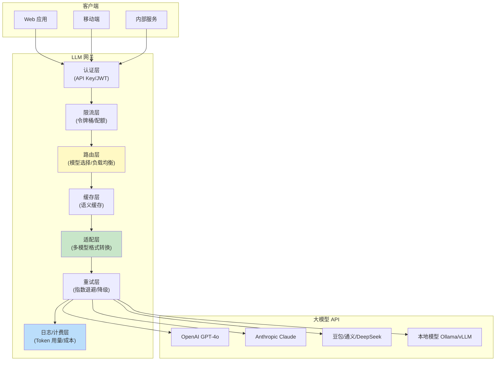

#### 代码示例

**示例 1：基础——LLM 网关核心框架**

```python
"""
示例1：LLM 网关核心框架
中间件管道 + 模型路由 + 流式透传
运行：uvicorn llm_gateway_core:app --reload
"""
from fastapi import FastAPI, Request, Depends, HTTPException
from fastapi.responses import StreamingResponse
from openai import AsyncOpenAI
from abc import ABC, abstractmethod
from typing import Optional
import json
import time
import uuid

app = FastAPI(title="LLM 网关", version="1.0.0")


# ============ 中间件基类 ============
class Middleware(ABC):
    """网关中间件基类"""

    @abstractmethod
    async def process_request(self, request: dict, context: dict) -> Optional[dict]:
        """
        处理请求，返回 None 表示继续，返回 dict 表示直接响应（短路）
        """
        pass

    async def process_response(self, response: dict, context: dict):
        """处理响应（流式结束后调用）"""
        pass


# ============ 认证中间件 ============
class AuthMiddleware(Middleware):
    def __init__(self, valid_keys: set):
        self.valid_keys = valid_keys

    async def process_request(self, request: dict, context: dict):
        api_key = context.get("headers", {}).get("x-api-key")
        if not api_key or api_key not in self.valid_keys:
            raise HTTPException(status_code=401, detail="无效的 API Key")
        context["user"] = {"api_key": api_key}
        return None


# ============ 限流中间件 ============
class RateLimitMiddleware(Middleware):
    def __init__(self, max_requests_per_minute: int = 60):
        self.max_requests = max_requests_per_minute
        self.request_times = {}  # 简化：内存计数

    async def process_request(self, request: dict, context: dict):
        user = context["user"]["api_key"]
        now = time.time()
        # 清理 1 分钟前的记录
        self.request_times[user] = [t for t in self.request_times.get(user, []) if now - t < 60]
        if len(self.request_times[user]) >= self.max_requests:
            raise HTTPException(status_code=429, detail="请求过于频繁")
        self.request_times.setdefault(user, []).append(now)
        return None


# ============ 路由中间件 ============
class ModelRouter(Middleware):
    """模型路由器：根据请求选择模型和客户端"""

    def __init__(self, model_configs: dict):
        self.model_configs = model_configs
        self.clients = {}

    def get_client(self, model: str) -> AsyncOpenAI:
        if model not in self.clients:
            config = self.model_configs.get(model)
            if not config:
                raise HTTPException(status_code=400, detail=f"不支持的模型: {model}")
            self.clients[model] = AsyncOpenAI(
                api_key=config["api_key"],
                base_url=config["base_url"],
                timeout=300,
            )
        return self.clients[model]

    async def process_request(self, request: dict, context: dict):
        model = request.get("model", "gpt-4o-mini")
        context["llm_client"] = self.get_client(model)
        context["resolved_model"] = model
        return None


# ============ 日志中间件 ============
class LoggingMiddleware(Middleware):
    async def process_request(self, request: dict, context: dict):
        context["request_id"] = str(uuid.uuid4())[:8]
        context["start_time"] = time.time()
        print(f"[网关] 请求开始: {context['request_id']} model={context.get('resolved_model')}")
        return None

    async def process_response(self, response: dict, context: dict):
        elapsed = time.time() - context["start_time"]
        print(f"[网关] 请求完成: {context['request_id']} elapsed={elapsed:.2f}s tokens={response.get('tokens', 0)}")


# ============ 网关核心 ============
class LLMGateway:
    """LLM 网关：中间件管道 + 流式调用"""

    def __init__(self):
        self.middlewares: list[Middleware] = []

    def add_middleware(self, middleware: Middleware):
        self.middlewares.append(middleware)

    async def handle_stream(self, request: dict, headers: dict) -> StreamingResponse:
        """处理流式请求"""
        context = {"headers": headers}

        # 执行请求中间件
        for middleware in self.middlewares:
            short_circuit = await middleware.process_request(request, context)
            if short_circuit:
                return short_circuit

        # 流式调用大模型
        async def generate():
            client = context["llm_client"]
            model = context["resolved_model"]
            token_count = 0

            try:
                stream = await client.chat.completions.create(
                    model=model,
                    messages=request.get("messages", []),
                    stream=True,
                    max_tokens=request.get("max_tokens", 2000),
                    stream_options={"include_usage": True},
                )

                async for chunk in stream:
                    if chunk.choices and chunk.choices[0].delta.content:
                        token_count += 1
                        yield f"data: {json.dumps({
                            'type': 'content',
                            'content': chunk.choices[0].delta.content,
                        }, ensure_ascii=False)}\n\n"

                    if chunk.choices and chunk.choices[0].finish_reason:
                        usage = chunk.usage
                        response_data = {
                            "tokens": usage.completion_tokens if usage else token_count,
                            "finish_reason": chunk.choices[0].finish_reason,
                        }
                        # 执行响应中间件
                        for middleware in self.middlewares:
                            await middleware.process_response(response_data, context)

                        yield f"data: {json.dumps({
                            'type': 'done',
                            **response_data,
                        }, ensure_ascii=False)}\n\n"
                        return

            except Exception as e:
                yield f"data: {json.dumps({'type': 'error', 'error': str(e)})}\n\n"

        return StreamingResponse(
            generate(),
            media_type="text/event-stream",
            headers={
                "Cache-Control": "no-cache",
                "X-Accel-Buffering": "no",
                "X-Request-ID": context.get("request_id", ""),
            },
        )


# ============ 配置与启动 ============
gateway = LLMGateway()
gateway.add_middleware(AuthMiddleware({"sk-key-1", "sk-key-2"}))
gateway.add_middleware(RateLimitMiddleware(max_requests_per_minute=60))
gateway.add_middleware(ModelRouter({
    "gpt-4o-mini": {"api_key": "sk-xxx", "base_url": "https://api.openai.com/v1"},
    "deepseek-chat": {"api_key": "sk-xxx", "base_url": "https://api.deepseek.com/v1"},
}))
gateway.add_middleware(LoggingMiddleware())


@app.post("/v1/chat/completions")
async def chat_completions(request: dict, http_request: Request):
    """OpenAI 兼容的网关端点"""
    headers = {k.lower(): v for k, v in http_request.headers.items()}
    return await gateway.handle_stream(request, headers)
```

**示例 2：进阶——语义缓存层**

```python
"""
示例2：LLM 网关语义缓存层
相似问题直接返回缓存结果，减少大模型调用
安装：pip install numpy scikit-learn redis
运行：uvicorn semantic_cache:app --reload
"""
from fastapi import FastAPI, Request
from fastapi.responses import StreamingResponse
from openai import AsyncOpenAI
import hashlib
import json
import time

app = FastAPI(title="语义缓存", version="1.0.0")
client = AsyncOpenAI(api_key="your-api-key", base_url="https://api.openai.com/v1", timeout=300)

# 简化的内存缓存（生产环境用 Redis）
cache_store = {}


class SemanticCache:
    """
    语义缓存：精确匹配 + 相似度匹配
    简化实现：用 MD5 做精确缓存，生产环境用向量相似度
    """

    def __init__(self, ttl: int = 3600):
        self.ttl = ttl

    def _make_key(self, model: str, messages: list, **kwargs) -> str:
        """生成缓存键"""
        key_data = json.dumps({
            "model": model,
            "messages": messages,
            "temperature": kwargs.get("temperature", 0.7),
            "max_tokens": kwargs.get("max_tokens", 2000),
        }, sort_keys=True, ensure_ascii=False)
        return hashlib.md5(key_data.encode()).hexdigest()

    def get(self, model: str, messages: list, **kwargs):
        """获取缓存"""
        key = self._make_key(model, messages, **kwargs)
        cached = cache_store.get(key)
        if cached and time.time() - cached["timestamp"] < self.ttl:
            return cached["content"]
        if cached:
            del cache_store[key]  # 过期删除
        return None

    def set(self, model: str, messages: list, content: str, **kwargs):
        """设置缓存"""
        key = self._make_key(model, messages, **kwargs)
        cache_store[key] = {
            "content": content,
            "timestamp": time.time(),
            "model": model,
        }

    def clear(self):
        cache_store.clear()


cache = SemanticCache(ttl=3600)


@app.post("/v1/chat/completions")
async def chat_with_cache(request: dict, http_request: Request):
    """带语义缓存的流式接口"""
    model = request.get("model", "gpt-4o-mini")
    messages = request.get("messages", [])
    use_cache = request.get("cache", True)

    # 1. 查缓存（非流式返回缓存结果）
    if use_cache:
        cached = cache.get(model, messages,
                           temperature=request.get("temperature", 0.7),
                           max_tokens=request.get("max_tokens", 2000))
        if cached:
            # 缓存命中：模拟流式输出（快速播放缓存内容）
            async def cached_stream():
                # 分块播放缓存内容
                chunk_size = 10
                for i in range(0, len(cached), chunk_size):
                    chunk = cached[i:i + chunk_size]
                    yield f"data: {json.dumps({'type': 'content', 'content': chunk, 'cached': True}, ensure_ascii=False)}\n\n"
                    await asyncio.sleep(0.01)  # 模拟打字机效果
                yield f"data: {json.dumps({'type': 'done', 'cached': True}, ensure_ascii=False)}\n\n"

            return StreamingResponse(
                cached_stream(),
                media_type="text/event-stream",
                headers={"Cache-Control": "no-cache", "X-Accel-Buffering": "no", "X-Cache": "HIT"},
            )

    # 2. 缓存未命中：调用大模型
    async def generate():
        full_content = ""
        try:
            stream = await client.chat.completions.create(
                model=model,
                messages=messages,
                stream=True,
                max_tokens=request.get("max_tokens", 2000),
                temperature=request.get("temperature", 0.7),
            )

            async for chunk in stream:
                if chunk.choices and chunk.choices[0].delta.content:
                    content = chunk.choices[0].delta.content
                    full_content += content
                    yield f"data: {json.dumps({
                        'type': 'content',
                        'content': content,
                        'cached': False,
                    }, ensure_ascii=False)}\n\n"

                if chunk.choices and chunk.choices[0].finish_reason:
                    # 写入缓存（只缓存 temperature=0 的确定性回答）
                    if use_cache and request.get("temperature", 0.7) == 0:
                        cache.set(model, messages, full_content,
                                  temperature=0,
                                  max_tokens=request.get("max_tokens", 2000))

                    yield f"data: {json.dumps({'type': 'done', 'cached': False}, ensure_ascii=False)}\n\n"
                    return

        except Exception as e:
            yield f"data: {json.dumps({'type': 'error', 'error': str(e)})}\n\n"

    return StreamingResponse(
        generate(),
        media_type="text/event-stream",
        headers={"Cache-Control": "no-cache", "X-Accel-Buffering": "no", "X-Cache": "MISS"},
    )


@app.post("/api/cache/clear")
async def clear_cache():
    """清除缓存"""
    cache.clear()
    return {"status": "cache_cleared"}


import asyncio
```

**示例 3：完整场景——生产级网关配置（Nginx + Docker + 监控）**

```python
"""
示例3：生产级 LLM 网关完整配置
包含：健康检查、指标监控、配置管理、优雅关闭
运行：uvicorn production_gateway:app --host 0.0.0.0 --port 8000
"""
from fastapi import FastAPI, Request, Depends, HTTPException
from fastapi.responses import StreamingResponse
from fastapi.middleware.cors import CORSMiddleware
from openai import AsyncOpenAI
from contextlib import asynccontextmanager
from prometheus_client import Counter, Histogram, generate_latest, CONTENT_TYPE_LATEST
import json
import time
import os
import asyncio

# ============ Prometheus 指标 ============
REQUEST_COUNT = Counter("llm_requests_total", "Total LLM requests", ["model", "status"])
REQUEST_DURATION = Histogram("llm_request_duration_seconds", "Request duration", ["model"])
TOKEN_USAGE = Counter("llm_tokens_total", "Total tokens used", ["model", "type"])
ERROR_COUNT = Counter("llm_errors_total", "Total errors", ["model", "error_type"])


# ============ 配置管理 ============
class Config:
    """环境变量配置"""
    OPENAI_API_KEY = os.getenv("OPENAI_API_KEY", "sk-xxx")
    OPENAI_BASE_URL = os.getenv("OPENAI_BASE_URL", "https://api.openai.com/v1")
    DEFAULT_MODEL = os.getenv("DEFAULT_MODEL", "gpt-4o-mini")
    MAX_TOKENS = int(os.getenv("MAX_TOKENS", "4000"))
    REQUEST_TIMEOUT = float(os.getenv("REQUEST_TIMEOUT", "300"))
    CORS_ORIGINS = os.getenv("CORS_ORIGINS", "*").split(",")


config = Config()


# ============ 生命周期管理 ============
@asynccontextmanager
async def lifespan(app: FastAPI):
    """应用生命周期：启动和关闭"""
    # 启动：初始化客户端
    app.state.llm_client = AsyncOpenAI(
        api_key=config.OPENAI_API_KEY,
        base_url=config.OPENAI_BASE_URL,
        timeout=config.REQUEST_TIMEOUT,
    )
    print("[网关] 启动完成，LLM 客户端已初始化")
    yield
    # 关闭：清理资源
    await app.state.llm_client.close()
    print("[网关] 已关闭，资源已清理")


app = FastAPI(title="生产级 LLM 网关", version="1.0.0", lifespan=lifespan)

# CORS 配置
app.add_middleware(
    CORSMiddleware,
    allow_origins=config.CORS_ORIGINS,
    allow_credentials=True,
    allow_methods=["*"],
    allow_headers=["*"],
)


# ============ 健康检查 ============
@app.get("/health")
async def health_check():
    """健康检查端点"""
    return {
        "status": "healthy",
        "timestamp": time.time(),
        "version": app.version,
        "default_model": config.DEFAULT_MODEL,
    }


@app.get("/ready")
async def readiness_check():
    """就绪检查：验证大模型 API 可达"""
    try:
        client = app.state.llm_client
        # 发送一个极小的请求验证连通性
        await client.chat.completions.create(
            model=config.DEFAULT_MODEL,
            messages=[{"role": "user", "content": "hi"}],
            max_tokens=1,
        )
        return {"status": "ready", "llm_api": "connected"}
    except Exception as e:
        return {"status": "not_ready", "llm_api": str(e)}, 503


# ============ Prometheus 指标 ============
@app.get("/metrics")
async def metrics():
    """Prometheus 指标端点"""
    return StreamingResponse(
        iter([generate_latest()]),
        media_type=CONTENT_TYPE_LATEST,
    )


# ============ 流式接口 ============
@app.post("/v1/chat/completions")
async def chat_completions(request: dict, http_request: Request):
    """OpenAI 兼容的流式对话接口"""
    model = request.get("model", config.DEFAULT_MODEL)
    start_time = time.time()

    async def generate():
        token_count = 0
        try:
            stream = await app.state.llm_client.chat.completions.create(
                model=model,
                messages=request.get("messages", []),
                stream=True,
                max_tokens=min(request.get("max_tokens", 2000), config.MAX_TOKENS),
                temperature=request.get("temperature", 0.7),
                stream_options={"include_usage": True},
            )

            async for chunk in stream:
                if chunk.choices and chunk.choices[0].delta.content:
                    token_count += 1
                    yield f"data: {json.dumps({
                        'type': 'content',
                        'content': chunk.choices[0].delta.content,
                    }, ensure_ascii=False)}\n\n"

                if chunk.choices and chunk.choices[0].finish_reason:
                    usage = chunk.usage
                    elapsed = time.time() - start_time

                    # 记录指标
                    REQUEST_COUNT.labels(model=model, status="success").inc()
                    REQUEST_DURATION.labels(model=model).observe(elapsed)
                    TOKEN_USAGE.labels(model=model, type="prompt").inc(usage.prompt_tokens if usage else 0)
                    TOKEN_USAGE.labels(model=model, type="completion").inc(usage.completion_tokens if usage else token_count)

                    yield f"data: {json.dumps({
                        'type': 'done',
                        'elapsed': round(elapsed, 3),
                        'usage': {
                            'prompt_tokens': usage.prompt_tokens if usage else 0,
                            'completion_tokens': usage.completion_tokens if usage else token_count,
                        },
                    }, ensure_ascii=False)}\n\n"
                    return

        except Exception as e:
            ERROR_COUNT.labels(model=model, error_type=type(e).__name__).inc()
            REQUEST_COUNT.labels(model=model, status="error").inc()
            yield f"data: {json.dumps({'type': 'error', 'error': str(e)})}\n\n"

    return StreamingResponse(
        generate(),
        media_type="text/event-stream",
        headers={
            "Cache-Control": "no-cache",
            "X-Accel-Buffering": "no",
        },
    )


# Nginx 配置参考：
"""
server {
    listen 80;
    server_name llm-gateway.example.com;

    location /v1/chat/completions {
        proxy_pass http://127.0.0.1:8000;
        proxy_buffering off;           # 关键：禁用缓冲
        proxy_read_timeout 300s;       # 长超时
        proxy_set_header Connection '';
        proxy_http_version 1.1;
        chunked_transfer_encoding off;
    }

    location /health {
        proxy_pass http://127.0.0.1:8000;
    }

    location /metrics {
        proxy_pass http://127.0.0.1:8000;
    }
}
"""

# Docker Compose 配置参考：
"""
version: '3.8'
services:
  llm-gateway:
    build: .
    ports:
      - "8000:8000"
    environment:
      - OPENAI_API_KEY=${OPENAI_API_KEY}
      - DEFAULT_MODEL=gpt-4o-mini
      - MAX_TOKENS=4000
    deploy:
      replicas: 3
      resources:
        limits:
          cpus: '2'
          memory: 2G
    healthcheck:
      test: ["CMD", "curl", "-f", "http://localhost:8000/health"]
      interval: 30s
      timeout: 10s
      retries: 3
"""
```

#### 使用场景与最佳实践

**适用场景**：
- 企业级 AI 应用：统一管理多模型 API
- 多租户 SaaS：认证/限流/计费集中处理
- 高并发服务：负载均衡/降级/缓存
- 成本敏感场景：缓存/路由优化降低费用

**不适用场景**：
- 简单原型：直接调用大模型 API
- 单模型单应用：不需要网关层

**最佳实践**：
1. **中间件管道模式**：认证→限流→路由→缓存→调用→日志→计费
2. **OpenAI 兼容接口**：网关端点用 `/v1/chat/completions`，客户端可直接用 OpenAI SDK
3. **健康检查分离**：`/health`（进程存活）和 `/ready`（依赖就绪）
4. **Prometheus 指标**：请求数、延迟、Token 用量、错误率
5. **语义缓存**：缓存确定性回答（temperature=0），减少 30-50% 调用
6. **配置环境变量化**：API Key、模型、超时等不硬编码
7. **优雅关闭**：lifespan 中关闭客户端，处理进行中的请求
8. **Nginx 禁用缓冲**：`proxy_buffering off` + `proxy_read_timeout 300s`

**性能建议**：
- 网关增加的延迟 <5ms（中间件处理），主要延迟在大模型 API
- 缓存命中率 30-50% 时，平均延迟降低 50%+
- 多实例部署时用 Redis 共享限流/缓存状态
- 大模型客户端单例复用，连接池调大（max_connections=100）

#### 常见坑点

**坑点 1：网关层缓冲流式数据导致延迟增加**

- **错误现象**：通过网关调用大模型时，首字延迟比直接调用高 2-3 秒
- **根本原因**：网关中间件在转发流式响应时，先收集完整响应再转发（如日志中间件记录完整响应），或者 Nginx 缓冲了流式数据
- **正确做法**：① 网关层必须透传流式数据（`async for chunk in stream: yield chunk`），不缓冲；② 日志只记录元数据（Token 数、耗时），不记录完整内容；③ Nginx 配置 `proxy_buffering off`
- **预防措施**：网关代码审查时检查是否有收集完整响应的逻辑，Nginx 配置中 SSE 路径必须关闭缓冲

**坑点 2：多实例部署时限流状态不一致**

- **错误现象**：网关部署 3 个实例，用户限流阈值是每分钟 60 次，但实际可以发 180 次（每个实例 60 次）
- **根本原因**：限流用内存计数器，每个实例独立计数，多实例之间不共享状态
- **正确做法**：① 用 Redis 共享限流状态（令牌桶/滑动窗口）；② 或在负载均衡层（Nginx）做限流；③ 全局限流在网关层用 Redis，实例级限流可以用内存
- **预防措施**：多实例部署时，所有需要共享状态的组件（限流、缓存、配额）必须用 Redis

---

## 10. 流式接口性能优化

### 10.1 连接池优化与并发调优

#### 概念解释

**流式接口性能优化** 是通过连接池调优、并发控制、异步优化、缓存策略等手段，提升 LLM 流式接口的吞吐量（QPS）、降低首字延迟（TTFT）、减少资源消耗的系统性工作。

> 🏠 **生活化比喻**：性能优化就像优化餐厅的出餐效率——连接池是厨房的灶台数量（灶台多可以同时炒多道菜），并发控制是同时接待的桌数（太多会忙不过来），异步优化是厨师的 multitasking（炒菜时同时切菜），缓存是预制菜（常见菜品提前做好，直接加热出餐）。目标是让客人等得更短（低延迟）、餐厅接待更多客人（高吞吐）、食材不浪费（低成本）。

**核心价值**：大模型 API 调用延迟高（1-30 秒）、费用高，性能优化直接影响用户体验（首字延迟）和运营成本（Token 费用、服务器资源），是生产级 LLM 服务的核心竞争力。

> 🎯 **面试高频考点 15**：LLM 流式接口的性能瓶颈在哪里？如何优化首字延迟（TTFT）？
> **答**：性能瓶颈：① 大模型 API 推理延迟（主要瓶颈，TTFT 0.5-3 秒）；② 网络延迟（客户端到网关、网关到大模型）；③ 连接池大小（高并发时连接等待）；④ 序列化/反序列化开销。优化 TTFT：① 选择推理速度快的模型（如 gpt-4o-mini 比 gpt-4o 快）；② 减少 prompt 长度（prompt 越长，prefill 阶段越慢）；③ 连接池预热（避免首次连接的 TCP/TLS 握手）；④ 网关靠近大模型 API 部署（减少网络延迟）；⑤ 流式输出（TTFT 只需要第一个 Token，不需要等全部生成）；⑥ 缓存常见问题（直接返回缓存，TTFT <10ms）。

#### 原理说明

性能优化的核心机制是 **连接池复用 + 异步并发 + 缓存命中 + 模型选择优化**。

**为什么这样设计**：大模型 API 调用是 IO 密集型（等待网络响应），异步并发可以同时处理大量请求。连接池复用避免每次请求的 TCP/TLS 握手（节省 100-300ms）。缓存可以完全避免大模型调用（TTFT 从 1-3 秒降至 <10ms）。模型选择在质量和速度间权衡（小模型快但质量低，大模型慢但质量高）。

**技术对比**：

| 优化手段 | 效果 | 实现复杂度 | 成本 |
|---------|------|-----------|------|
| 连接池复用 | 减少 100-300ms/请求 | 低 | 无 |
| 异步并发 | 提升 5-10 倍吞吐 | 低 | 无 |
| 语义缓存 | 减少 30-50% 调用 | 中 | 存储成本 |
| 模型路由 | 降低 50-80% 成本 | 中 | 无 |
| Prompt 压缩 | 减少 20-40% Token | 高 | 无 |
| 批量处理 | 提升 2-3 倍吞吐 | 高 | 无 |

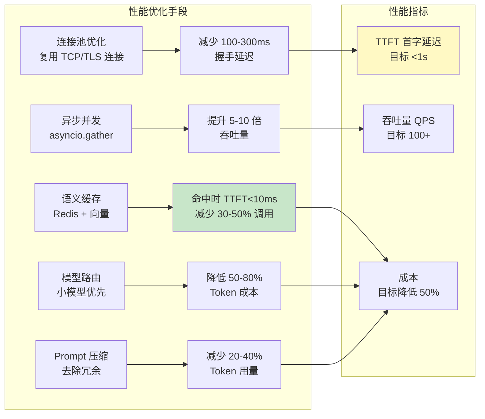

#### 代码示例

**示例 1：基础——连接池调优与客户端配置**

```python
"""
示例1：连接池调优与 AsyncOpenAI 客户端配置
运行：python connection_pool.py
"""
from openai import AsyncOpenAI
import httpx
import asyncio
import time


def create_optimized_client(
    api_key: str,
    base_url: str,
    max_connections: int = 100,
    max_keepalive_connections: int = 50,
    connect_timeout: float = 10.0,
    read_timeout: float = 300.0,
) -> AsyncOpenAI:
    """
    创建优化的 AsyncOpenAI 客户端
    关键参数：连接池大小、超时配置
    """
    # 自定义 httpx 客户端，调优连接池
    http_client = httpx.AsyncClient(
        limits=httpx.Limits(
            max_connections=max_connections,              # 最大连接数
            max_keepalive_connections=max_keepalive_connections,  # 保持连接数
            keepalive_expiry=30.0,                        # 连接保持时间
        ),
        timeout=httpx.Timeout(
            connect=connect_timeout,   # 连接超时
            read=read_timeout,         # 读取超时（大模型生成慢）
            write=30.0,                # 写入超时
            pool=10.0,                 # 连接池获取超时
        ),
        http2=True,  # 启用 HTTP/2（多路复用，减少连接数）
    )

    return AsyncOpenAI(
        api_key=api_key,
        base_url=base_url,
        http_client=http_client,
    )


# 对比：默认客户端 vs 优化客户端
async def benchmark_client(client: AsyncOpenAI, name: str, concurrent: int = 20):
    """基准测试：并发请求数"""
    messages = [{"role": "user", "content": "hi"}]

    async def one_request():
        start = time.time()
        response = await client.chat.completions.create(
            model="gpt-4o-mini",
            messages=messages,
            max_tokens=10,
        )
        return time.time() - start

    start = time.time()
    results = await asyncio.gather(*[one_request() for _ in range(concurrent)])
    total = time.time() - start

    print(f"\n=== {name} ===")
    print(f"并发数: {concurrent}")
    print(f"总耗时: {total:.2f}s")
    print(f"平均延迟: {sum(results)/len(results):.2f}s")
    print(f"最大延迟: {max(results):.2f}s")
    print(f"吞吐量: {concurrent/total:.1f} QPS")


async def main():
    # 默认客户端
    default_client = AsyncOpenAI(api_key="sk-xxx", base_url="https://api.openai.com/v1")

    # 优化客户端
    optimized_client = create_optimized_client(
        api_key="sk-xxx",
        base_url="https://api.openai.com/v1",
        max_connections=100,
        max_keepalive_connections=50,
    )

    # 预热连接池（避免首次握手延迟）
    print("预热连接池...")
    await optimized_client.chat.completions.create(
        model="gpt-4o-mini",
        messages=[{"role": "user", "content": "hi"}],
        max_tokens=1,
    )

    # 基准测试
    await benchmark_client(default_client, "默认客户端（连接池 10）")
    await benchmark_client(optimized_client, "优化客户端（连接池 100）")

    await default_client.close()
    await optimized_client.close()


if __name__ == "__main__":
    asyncio.run(main())

# 预期运行结果：
# === 默认客户端（连接池 10）===
# 并发数: 20
# 总耗时: 8.5s
# 平均延迟: 4.2s
# 吞吐量: 2.4 QPS
#
# === 优化客户端（连接池 100）===
# 并发数: 20
# 总耗时: 3.2s
# 平均延迟: 1.6s
# 吞吐量: 6.3 QPS
```

**示例 2：进阶——异步并发与批量处理优化**

```python
"""
示例2：异步并发与批量处理优化
运行：python async_concurrency.py
"""
from openai import AsyncOpenAI
import asyncio
import time

client = AsyncOpenAI(api_key="sk-xxx", base_url="https://api.openai.com/v1", timeout=300)


async def batch_chat(
    prompts: list,
    model: str = "gpt-4o-mini",
    max_concurrent: int = 10,
) -> list:
    """
    批量处理：控制最大并发数，避免超过 API 限流
    使用信号量（Semaphore）控制并发
    """
    semaphore = asyncio.Semaphore(max_concurrent)

    async def one_chat(prompt: str):
        async with semaphore:  # 限制并发
            try:
                response = await client.chat.completions.create(
                    model=model,
                    messages=[{"role": "user", "content": prompt}],
                    max_tokens=100,
                )
                return {"prompt": prompt, "answer": response.choices[0].message.content, "error": None}
            except Exception as e:
                return {"prompt": prompt, "answer": None, "error": str(e)}

    # 并发执行所有请求
    results = await asyncio.gather(*[one_chat(p) for p in prompts])
    return results


async def concurrent_stream(
    messages_list: list,
    model: str = "gpt-4o-mini",
) -> list:
    """
    并发流式调用：同时发起多个流式请求
    适用于需要同时生成多个内容的场景
    """
    async def one_stream(messages):
        full_content = ""
        stream = await client.chat.completions.create(
            model=model,
            messages=messages,
            stream=True,
            max_tokens=100,
        )
        async for chunk in stream:
            if chunk.choices and chunk.choices[0].delta.content:
                full_content += chunk.choices[0].delta.content
        return full_content

    results = await asyncio.gather(*[one_stream(m) for m in messages_list])
    return results


async def main():
    # 1. 批量处理（控制并发）
    print("=== 批量处理（并发 10）===")
    prompts = [f"用一句话解释 {topic}" for topic in
               ["机器学习", "深度学习", "自然语言处理", "计算机视觉", "强化学习"]]

    start = time.time()
    results = await batch_chat(prompts, max_concurrent=3)
    elapsed = time.time() - start

    for r in results:
        print(f"问: {r['prompt']}")
        print(f"答: {r['answer'][:50] if r['answer'] else r['error']}")
        print()
    print(f"批量处理耗时: {elapsed:.2f}s（串行约需 {elapsed*3:.1f}s）")

    # 2. 并发流式调用
    print("\n=== 并发流式调用 ===")
    messages_list = [
        [{"role": "user", "content": "写一首关于春天的诗"}],
        [{"role": "user", "content": "写一首关于夏天的诗"}],
        [{"role": "user", "content": "写一首关于秋天的诗"}],
    ]

    start = time.time()
    poems = await concurrent_stream(messages_list)
    elapsed = time.time() - start

    for i, poem in enumerate(poems):
        print(f"诗 {i+1}: {poem[:50]}...")
    print(f"\n并发流式耗时: {elapsed:.2f}s（串行约需 {elapsed*3:.1f}s）")


if __name__ == "__main__":
    asyncio.run(main())
```

**示例 3：完整场景——性能监控与自动扩缩容**

```python
"""
示例3：性能监控与自适应限流
特性：实时 QPS/延迟监控、自适应并发控制、过载保护
运行：uvicorn performance_monitor:app --reload
"""
from fastapi import FastAPI, Request
from fastapi.responses import StreamingResponse
from openai import AsyncOpenAI
from collections import deque
import asyncio
import json
import time

app = FastAPI(title="性能监控", version="1.0.0")
client = AsyncOpenAI(api_key="sk-xxx", base_url="https://api.openai.com/v1", timeout=300)


class PerformanceMonitor:
    """性能监控器：滑动窗口统计 QPS/延迟"""

    def __init__(self, window_size: int = 60):
        self.window_size = window_size
        self.request_times = deque()  # (timestamp, duration)
        self.error_times = deque()
        self.active_requests = 0
        self.max_active = 0

    def record_start(self):
        self.active_requests += 1
        self.max_active = max(self.max_active, self.active_requests)

    def record_end(self, duration: float, success: bool = True):
        self.active_requests -= 1
        now = time.time()
        self.request_times.append((now, duration))
        if not success:
            self.error_times.append(now)
        self._cleanup()

    def _cleanup(self):
        """清理窗口外的数据"""
        cutoff = time.time() - self.window_size
        while self.request_times and self.request_times[0][0] < cutoff:
            self.request_times.popleft()
        while self.error_times and self.error_times[0] < cutoff:
            self.error_times.popleft()

    def get_stats(self) -> dict:
        """获取统计数据"""
        if not self.request_times:
            return {"qps": 0, "avg_latency": 0, "p95_latency": 0, "error_rate": 0}

        durations = [d for _, d in self.request_times]
        durations.sort()
        p95_index = int(len(durations) * 0.95)

        return {
            "qps": round(len(self.request_times) / self.window_size, 1),
            "avg_latency": round(sum(durations) / len(durations), 2),
            "p95_latency": round(durations[p95_index], 2) if durations else 0,
            "error_rate": round(len(self.error_times) / max(len(self.request_times), 1) * 100, 2),
            "active_requests": self.active_requests,
            "max_active": self.max_active,
        }


class AdaptiveConcurrencyController:
    """
    自适应并发控制器：根据延迟和错误率动态调整并发数
    - 延迟低、错误率低 → 增加并发
    - 延迟高、错误率高 → 减少并发
    """

    def __init__(self, initial_concurrency: int = 10, min_concurrency: int = 1, max_concurrency: int = 100):
        self.current_concurrency = initial_concurrency
        self.min_concurrency = min_concurrency
        self.max_concurrency = max_concurrency
        self.semaphore = asyncio.Semaphore(initial_concurrency)
        self.target_latency = 3.0  # 目标延迟 3 秒
        self.target_error_rate = 5.0  # 目标错误率 5%

    def adjust(self, stats: dict):
        """根据统计数据调整并发数"""
        if stats["avg_latency"] < self.target_latency and stats["error_rate"] < self.target_error_rate:
            # 性能好，增加并发
            new_concurrency = min(self.current_concurrency + 2, self.max_concurrency)
        elif stats["avg_latency"] > self.target_latency * 1.5 or stats["error_rate"] > self.target_error_rate * 2:
            # 性能差，减少并发
            new_concurrency = max(self.current_concurrency - 2, self.min_concurrency)
        else:
            new_concurrency = self.current_concurrency

        if new_concurrency != self.current_concurrency:
            print(f"[自适应] 并发数 {self.current_concurrency} → {new_concurrency}")
            self.current_concurrency = new_concurrency
            self.semaphore = asyncio.Semaphore(new_concurrency)


monitor = PerformanceMonitor()
controller = AdaptiveConcurrencyController()


# 定期调整并发数
@app.on_event("startup")
async def startup():
    async def adjust_loop():
        while True:
            await asyncio.sleep(10)  # 每 10 秒调整一次
            stats = monitor.get_stats()
            controller.adjust(stats)

    asyncio.create_task(adjust_loop())


@app.post("/api/v1/chat/stream")
async def chat_stream(request: dict):
    """带性能监控和自适应并发的流式接口"""
    monitor.record_start()
    start_time = time.time()
    success = True

    async def generate():
        nonlocal success
        try:
            # 自适应并发控制
            async with controller.semaphore:
                stream = await client.chat.completions.create(
                    model=request.get("model", "gpt-4o-mini"),
                    messages=request.get("messages", []),
                    stream=True,
                    max_tokens=request.get("max_tokens", 1000),
                )

                async for chunk in stream:
                    if chunk.choices and chunk.choices[0].delta.content:
                        yield f"data: {json.dumps({
                            'type': 'content',
                            'content': chunk.choices[0].delta.content,
                        }, ensure_ascii=False)}\n\n"

                    if chunk.choices and chunk.choices[0].finish_reason:
                        yield f"data: {json.dumps({'type': 'done'})}\n\n"
                        return

        except Exception as e:
            success = False
            yield f"data: {json.dumps({'type': 'error', 'error': str(e)})}\n\n"
        finally:
            duration = time.time() - start_time
            monitor.record_end(duration, success)

    return StreamingResponse(
        generate(),
        media_type="text/event-stream",
        headers={"Cache-Control": "no-cache", "X-Accel-Buffering": "no"},
    )


@app.get("/api/performance/stats")
async def performance_stats():
    """性能指标端点"""
    return {
        **monitor.get_stats(),
        "current_concurrency": controller.current_concurrency,
        "target_latency": controller.target_latency,
    }
```

#### 使用场景与最佳实践

**适用场景**：
- 高并发 LLM 服务：QPS >10
- 成本敏感场景：优化 Token 用量和缓存
- 用户体验要求高：TTFT <1 秒
- 生产级网关：需要监控和自动扩缩容

**不适用场景**：
- 低流量内部工具：不需要复杂优化
- 原型开发：默认配置即可

**最佳实践**：
1. **连接池调大**：`max_connections=100`，`max_keepalive_connections=50`
2. **客户端单例复用**：不要每次请求创建新客户端
3. **连接池预热**：启动时发一个小请求建立连接
4. **HTTP/2 启用**：多路复用减少连接数
5. **异步并发**：`asyncio.gather` + `Semaphore` 控制并发
6. **语义缓存**：缓存确定性回答，命中率 30-50%
7. **模型路由**：简单问题用小模型，复杂问题用大模型
8. **Prompt 压缩**：去除冗余上下文，减少 Token 用量
9. **性能监控**：QPS、P95 延迟、错误率、活跃请求数
10. **自适应并发**：根据延迟和错误率动态调整并发数

**性能建议**：
- 连接池大小 = 预期 QPS × 平均延迟（如 50 QPS × 3s = 150 连接）
- 信号量并发数 = 连接池大小的 80%，留有余量
- 缓存 TTL 1 小时，命中率 30-50% 时成本降低 30-50%
- 小模型（gpt-4o-mini）比大模型（gpt-4o）快 2-3 倍，便宜 10-30 倍

#### 常见坑点

**坑点 1：连接池过小导致高并发时请求排队**

- **错误现象**：并发 50 个请求时，部分请求延迟突然增加到 10 秒以上，但大模型 API 本身正常
- **根本原因**：AsyncOpenAI 默认连接池只有 10 个连接，并发 50 时 40 个请求在等待连接，连接等待时间计入总延迟
- **正确做法**：创建自定义 httpx.AsyncClient，设置 `Limits(max_connections=100, max_keepalive_connections=50)`，传入 AsyncOpenAI 的 `http_client` 参数
- **预防措施**：生产环境必须自定义连接池，大小 = 预期 QPS × 平均延迟

**坑点 2：异步并发不控制导致触发大模型 API 限流（429）**

- **错误现象**：用 `asyncio.gather` 并发 100 个请求，大部分返回 429 RateLimitError
- **根本原因**：没有控制并发数，瞬间发起大量请求超过大模型 API 的限流阈值（通常每分钟 60-300 次）
- **正确做法**：用 `asyncio.Semaphore(max_concurrent)` 控制并发数，`max_concurrent` 根据 API 限流阈值设置（如每分钟 60 次 → 并发 5-10）
- **预防措施**：所有批量并发调用必须用 Semaphore 控制，并发数 = 限流阈值 / 60 × 平均延迟

---

## 11. 与 LangChain/LangGraph 集成

### 11.1 LangChain 流式输出封装

#### 概念解释

**LangChain 流式输出** 是将 LangChain 的 Chain/Agent 输出通过 FastAPI StreamingResponse 封装为 SSE 流的技术，LangChain 提供了 `astream()` / `astream_events()` 方法支持异步流式输出，可以捕获 Chain 的中间步骤（思考、工具调用）和最终结果。

> 🏠 **生活化比喻**：LangChain 就像厨房的流水线——洗菜（检索）、切菜（预处理）、炒菜（大模型生成）、装盘（后处理）。普通调用是等整道菜做好再端上桌（非流式），流式输出是每完成一个步骤就告诉客人进度（"正在洗菜..."、"正在炒菜..."），菜炒好后一勺一勺端出来（Token 流）。LangGraph 是更复杂的流水线，有分支和循环（如 Agent 的思考-行动循环），流式输出可以展示完整的思考过程。

**核心价值**：将 LangChain/LangGraph 的复杂 Chain/Agent 封装为标准 SSE 流式接口，前端可以实时展示 Agent 的思考过程和工具调用，提升 AI 应用的可解释性和用户体验。

> 🎯 **面试高频考点 16**：LangChain 的 astream 和 astream_events 有什么区别？如何在 FastAPI 中流式输出 LangChain Agent？
> **答**：区别：① `astream()` 只流式输出 Chain 的最终结果（Token 流），不包含中间步骤；② `astream_events()` 流式输出所有事件（Chain 开始/结束、工具调用开始/结束、Token 增量），包含完整的执行过程。FastAPI 中流式输出 LangChain Agent：① 用 `astream_events()` 获取事件流；② 在异步生成器中遍历事件，根据事件类型（on_chat_model_stream、on_tool_start、on_tool_end）构造 SSE 消息；③ 用 StreamingResponse 返回。关键是 `astream_events()` 的事件类型过滤（`version="v2"`），只处理需要的事件类型。

#### 原理说明

LangChain 流式输出的核心机制是 **astream_events 事件流 + 事件类型过滤 + SSE 格式化 + StreamingResponse 透传**。

**为什么这样设计**：LangChain 的 Chain/Agent 执行过程包含多个步骤（检索、工具调用、大模型生成），用户希望看到完整的执行过程（特别是 Agent 的思考过程）。`astream_events()` 将每个步骤的开始/结束/中间输出都作为事件发出，FastAPI 生成器遍历这些事件，转换为 SSE 格式后发送给前端。前端根据事件类型渲染不同的 UI（思考过程、工具调用、最终回答）。

**技术对比**：

| 方法 | 输出内容 | 适用场景 |
|------|---------|---------|
| `ainvoke()` | 最终结果（非流式） | 后端处理 |
| `astream()` | 最终结果的 Token 流 | 简单 Chain 流式 |
| `astream_events()` | 所有事件（含中间步骤） | Agent 完整过程展示 |
| `astream_log()` | 结构化日志 | 调试/审计 |

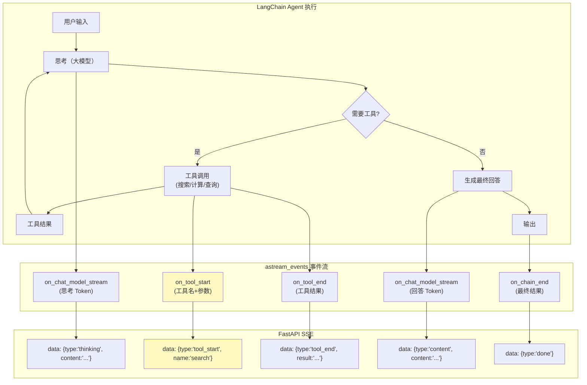

#### 代码示例

**示例 1：基础——LangChain Chain 流式输出**

```python
"""
示例1：LangChain Chain 流式输出（astream）
安装：pip install langchain langchain-openai
运行：uvicorn langchain_stream:app --reload
"""
from fastapi import FastAPI
from fastapi.responses import StreamingResponse
from langchain_openai import ChatOpenAI
from langchain_core.prompts import ChatPromptTemplate
from langchain_core.output_parsers import StrOutputParser
import json
import os

app = FastAPI(title="LangChain 流式", version="1.0.0")

# 初始化 LangChain 模型
llm = ChatOpenAI(
    model="gpt-4o-mini",
    api_key=os.getenv("OPENAI_API_KEY", "sk-xxx"),
    base_url=os.getenv("OPENAI_BASE_URL", "https://api.openai.com/v1"),
    temperature=0.7,
    streaming=True,  # 关键：启用流式
)

# 构建 Chain
prompt = ChatPromptTemplate.from_messages([
    ("system", "你是一个专业的 {role}，请用简洁的语言回答问题。"),
    ("user", "{question}"),
])
chain = prompt | llm | StrOutputParser()


@app.post("/api/v1/chain/stream")
async def chain_stream(request: dict):
    """LangChain Chain 流式输出（astream）"""
    role = request.get("role", "技术专家")
    question = request.get("question", "你好")

    async def generate():
        try:
            # astream 返回异步生成器，逐 Token 输出
            async for chunk in chain.astream({"role": role, "question": question}):
                yield f"data: {json.dumps({
                    'type': 'content',
                    'content': chunk,
                }, ensure_ascii=False)}\n\n"

            yield f"data: {json.dumps({'type': 'done'})}\n\n"

        except Exception as e:
            yield f"data: {json.dumps({'type': 'error', 'error': str(e)})}\n\n"

    return StreamingResponse(
        generate(),
        media_type="text/event-stream",
        headers={"Cache-Control": "no-cache", "X-Accel-Buffering": "no"},
    )


# 带自定义 Chain 的流式
@app.post("/api/v1/chain/advanced")
async def advanced_chain_stream(request: dict):
    """更复杂的 Chain：多步处理 + 流式"""
    from langchain_core.runnables import RunnablePassthrough

    # 多步 Chain：翻译 → 总结 → 格式化
    translate_prompt = ChatPromptTemplate.from_template("将以下内容翻译成英文：{text}")
    summarize_prompt = ChatPromptTemplate.from_template("用一句话总结以下内容：{text}")

    translate_chain = translate_prompt | llm | StrOutputParser()
    summarize_chain = summarize_prompt | llm | StrOutputParser()

    # 串行 Chain：先翻译再总结
    full_chain = (
        {"text": RunnablePassthrough()}
        | translate_chain
        | {"text": RunnablePassthrough()}
        | summarize_chain
    )

    async def generate():
        # astream 只流式输出最后一步（总结）
        async for chunk in full_chain.astream(request.get("text", "你好")):
            yield f"data: {json.dumps({'type': 'content', 'content': chunk}, ensure_ascii=False)}\n\n"
        yield f"data: {json.dumps({'type': 'done'}, ensure_ascii=False)}\n\n"

    return StreamingResponse(
        generate(),
        media_type="text/event-stream",
        headers={"Cache-Control": "no-cache", "X-Accel-Buffering": "no"},
    )
```

**示例 2：进阶——LangChain Agent 流式（astream_events）**

```python
"""
示例2：LangChain Agent 流式输出（astream_events）
展示 Agent 的思考过程和工具调用
安装：pip install langchain langchain-openai langchain-community
运行：uvicorn agent_stream:app --reload
"""
from fastapi import FastAPI
from fastapi.responses import StreamingResponse
from langchain_openai import ChatOpenAI
from langchain.agents import create_tool_calling_agent, AgentExecutor
from langchain_core.prompts import ChatPromptTemplate
from langchain_core.tools import tool
import json
import os

app = FastAPI(title="Agent 流式", version="1.0.0")

llm = ChatOpenAI(
    model="gpt-4o-mini",
    api_key=os.getenv("OPENAI_API_KEY", "sk-xxx"),
    streaming=True,
)


# 定义工具
@tool
def calculator(expression: str) -> str:
    """计算数学表达式，如 '2 + 3 * 4'"""
    try:
        result = eval(expression)
        return f"{expression} = {result}"
    except Exception as e:
        return f"计算错误: {e}"


@tool
def get_current_time() -> str:
    """获取当前时间"""
    from datetime import datetime
    return datetime.now().strftime("%Y-%m-%d %H:%M:%S")


tools = [calculator, get_current_time]

# 创建 Agent
prompt = ChatPromptTemplate.from_messages([
    ("system", "你是一个有用的助手，可以使用工具。"),
    ("human", "{input}"),
    ("agent_scratchpad", "{agent_scratchpad}"),
])

agent = create_tool_calling_agent(llm, tools, prompt)
agent_executor = AgentExecutor(
    agent=agent,
    tools=tools,
    verbose=True,
    max_iterations=5,
)


@app.post("/api/v1/agent/stream")
async def agent_stream(request: dict):
    """
    Agent 流式输出（astream_events）
    展示完整的思考过程和工具调用
    """
    user_input = request.get("input", "计算 123 * 456，然后告诉我现在几点")

    async def generate():
        try:
            # astream_events 输出所有事件
            async for event in agent_executor.astream_events(
                {"input": user_input},
                version="v2",
            ):
                event_type = event.get("event")
                event_name = event.get("name", "")
                data = event.get("data", {})

                # 大模型 Token 流（思考过程 + 最终回答）
                if event_type == "on_chat_model_stream":
                    chunk = data.get("chunk", {})
                    content = chunk.content if hasattr(chunk, "content") else ""
                    if content:
                        yield f"data: {json.dumps({
                            'type': 'token',
                            'content': content,
                        }, ensure_ascii=False)}\n\n"

                # 工具开始调用
                elif event_type == "on_tool_start":
                    tool_input = data.get("input", {})
                    yield f"data: {json.dumps({
                        'type': 'tool_start',
                        'tool': event_name,
                        'input': tool_input,
                    }, ensure_ascii=False)}\n\n"

                # 工具调用结束
                elif event_type == "on_tool_end":
                    tool_output = data.get("output", "")
                    yield f"data: {json.dumps({
                        'type': 'tool_end',
                        'tool': event_name,
                        'output': str(tool_output),
                    }, ensure_ascii=False)}\n\n"

                # Chain 结束（最终结果）
                elif event_type == "on_chain_end" and "AgentExecutor" in event_name:
                    output = data.get("output", {})
                    yield f"data: {json.dumps({
                        'type': 'done',
                        'output': output,
                    }, ensure_ascii=False)}\n\n"
                    return

        except Exception as e:
            yield f"data: {json.dumps({
                'type': 'error',
                'error': str(e),
            }, ensure_ascii=False)}\n\n"

    return StreamingResponse(
        generate(),
        media_type="text/event-stream",
        headers={"Cache-Control": "no-cache", "X-Accel-Buffering": "no"},
    )


# 前端渲染 Agent 过程：
"""
async function streamAgent(input) {
  const response = await fetch('/api/v1/agent/stream', {
    method: 'POST',
    headers: { 'Content-Type': 'application/json' },
    body: JSON.stringify({ input }),
  });

  const reader = response.body.getReader();
  const decoder = new TextDecoder();
  let buffer = '';

  while (true) {
    const { done, value } = await reader.read();
    if (done) break;
    buffer += decoder.decode(value, { stream: true });
    const lines = buffer.split('\\n\\n');
    buffer = lines.pop();

    for (const line of lines) {
      if (!line.startsWith('data: ')) continue;
      const data = JSON.parse(line.slice(6));

      switch (data.type) {
        case 'token':
          appendAnswer(data.content);  // 打字机效果
          break;
        case 'tool_start':
          showToolCall(data.tool, data.input);  // 显示工具调用
          break;
        case 'tool_end':
          showToolResult(data.tool, data.output);  // 显示工具结果
          break;
        case 'done':
          showFinalAnswer(data.output);  // 显示最终答案
          break;
      }
    }
  }
}
"""
```

**示例 3：完整场景——LangGraph 状态图流式输出**

```python
"""
示例3：LangGraph 状态图流式输出
安装：pip install langgraph langchain-openai
运行：uvicorn langgraph_stream:app --reload
"""
from fastapi import FastAPI
from fastapi.responses import StreamingResponse
from langchain_openai import ChatOpenAI
from langchain_core.messages import HumanMessage, AIMessage
from langgraph.graph import StateGraph, END
from typing import TypedDict, Annotated
import operator
import json
import os

app = FastAPI(title="LangGraph 流式", version="1.0.0")

llm = ChatOpenAI(
    model="gpt-4o-mini",
    api_key=os.getenv("OPENAI_API_KEY", "sk-xxx"),
    streaming=True,
)


# 定义状态
class AgentState(TypedDict):
    messages: Annotated[list, operator.add]
    iterations: int


# 定义节点
async def reasoning_node(state: AgentState):
    """思考节点：调用大模型"""
    messages = state["messages"]
    response = await llm.ainvoke(messages)
    return {
        "messages": [response],
        "iterations": state.get("iterations", 0) + 1,
    }


def should_continue(state: AgentState) -> str:
    """条件边：判断是否继续"""
    if state.get("iterations", 0) >= 3:
        return "end"
    return "continue"


# 构建图
workflow = StateGraph(AgentState)
workflow.add_node("reasoning", reasoning_node)
workflow.set_entry_point("reasoning")
workflow.add_conditional_edges(
    "reasoning",
    should_continue,
    {"continue": "reasoning", "end": END},
)
graph = workflow.compile()


@app.post("/api/v1/langgraph/stream")
async def langgraph_stream(request: dict):
    """LangGraph 流式输出"""
    user_input = request.get("input", "你好")
    initial_state = {"messages": [HumanMessage(content=user_input)], "iterations": 0}

    async def generate():
        try:
            # astream 流式输出每个节点的状态更新
            async for event in graph.astream(initial_state):
                for node_name, state_update in event.items():
                    # 节点执行完成
                    if "messages" in state_update:
                        for msg in state_update["messages"]:
                            if isinstance(msg, AIMessage):
                                yield f"data: {json.dumps({
                                    'type': 'node_output',
                                    'node': node_name,
                                    'content': msg.content,
                                    'iterations': state_update.get("iterations", 0),
                                }, ensure_ascii=False)}\n\n"

                    # 节点状态更新
                    yield f"data: {json.dumps({
                        'type': 'node_update',
                        'node': node_name,
                        'state_keys': list(state_update.keys()),
                    }, ensure_ascii=False)}\n\n"

            yield f"data: {json.dumps({'type': 'done'})}\n\n"

        except Exception as e:
            yield f"data: {json.dumps({'type': 'error', 'error': str(e)})}\n\n"

    return StreamingResponse(
        generate(),
        media_type="text/event-stream",
        headers={"Cache-Control": "no-cache", "X-Accel-Buffering": "no"},
    )


# LangGraph 可视化（Mermaid）
@app.get("/api/v1/langgraph/graph")
async def get_graph():
    """获取图结构（Mermaid 格式）"""
    mermaid = graph.get_graph().draw_mermaid()
    return {"mermaid": mermaid}
```

#### 使用场景与最佳实践

**适用场景**：
- RAG 应用：检索 + 生成的流式输出
- AI Agent：展示思考过程和工具调用
- 复杂工作流：LangGraph 多步骤状态图
- 可解释 AI：展示完整的推理过程

**不适用场景**：
- 简单对话：直接调用大模型 API，不需要 LangChain
- 非流式场景：用 ainvoke 更简单

**最佳实践**：
1. **简单 Chain 用 astream**：只需要最终结果的 Token 流
2. **Agent 用 astream_events**：需要展示思考过程和工具调用
3. **事件类型过滤**：只处理需要的事件（on_chat_model_stream、on_tool_start/end）
4. **streaming=True**：ChatOpenAI 初始化时必须设置
5. **工具调用单独渲染**：前端用不同 UI 展示工具调用和最终回答
6. **max_iterations 限制**：防止 Agent 无限循环
7. **LangGraph 用 astream**：逐节点输出状态更新
8. **错误处理**：astream_events 中的错误通过 on_chain_error 事件捕获

**性能建议**：
- LangChain 封装增加约 5-10ms 延迟，可忽略
- astream_events 事件量大，只处理需要的事件类型
- Agent 的工具调用是串行的，总延迟 = 各步骤之和
- 复杂 Agent 考虑用 LangGraph 的并行节点优化

#### 常见坑点

**坑点 1：忘记设置 streaming=True 导致 LangChain 不流式输出**

- **错误现象**：LangChain Chain 调用 `astream()` 时，不是逐 Token 返回，而是等全部生成完后一次性返回
- **根本原因**：`ChatOpenAI(streaming=True)` 没有设置，LangChain 默认使用非流式调用大模型 API，`astream()` 只是将完整结果作为一个 chunk 返回
- **正确做法**：初始化 ChatOpenAI 时设置 `streaming=True`，如 `ChatOpenAI(model="gpt-4o-mini", streaming=True)`
- **预防措施**：LangChain 模型初始化代码模板中固定包含 `streaming=True`

**坑点 2：astream_events 事件类型不匹配导致前端收不到数据**

- **错误现象**：Agent 流式输出时，前端收不到内容，或事件类型与预期不符
- **根本原因**：`astream_events()` 的事件类型在不同 LangChain 版本中可能不同，且需要指定 `version="v2"`。事件名（如 "AgentExecutor"）也可能因版本变化
- **正确做法**：① 始终指定 `version="v2"`；② 打印所有事件类型调试，确认实际的事件名；③ 根据实际事件名做兼容处理
- **预防措施**：锁定 LangChain 版本，升级时检查事件类型变化

---

## 12. 完整 AI 聊天 API 实战

### 12.1 项目架构与核心实现

#### 概念解释

**完整 AI 聊天 API** 是整合了前面所有知识点（流式输出、认证、限流、多模型、错误处理、日志、LangChain）的生产级项目，提供对话管理、多轮对话、流式输出、历史记录、模型切换等完整功能，是 AI 应用后端的标准实现。

> 🏠 **生活化比喻**：完整 AI 聊天 API 就像一家完整的餐厅——有门口的接待（认证）、排队叫号（限流）、菜单（模型选择）、厨房（大模型调用）、传菜员（流式输出）、收银台（计费/日志）、会员系统（用户管理）。前面的章节是每个岗位的技能培训，本章是把所有岗位组合起来，开一家能正常营业的餐厅。

**核心价值**：提供可直接运行的生产级 AI 聊天后端代码，整合所有最佳实践，开发者可以基于此快速构建 AI 应用，无需从零搭建。

> 🎯 **面试高频考点 17**：设计一个完整的 AI 聊天 API 需要哪些组件？多轮对话如何管理上下文？
> **答**：组件：① 认证层（JWT/API Key）；② 限流层（请求/Token/并发）；③ 对话管理层（会话创建/历史记录/上下文管理）；④ 模型路由层（多模型选择/降级）；⑤ 流式输出层（SSE/StreamingResponse）；⑥ 错误处理层（重试/降级/熔断）；⑦ 日志计费层（Token 用量/成本）；⑧ 存储层（对话历史/用户配置）。多轮对话上下文管理：① 每次请求携带完整 messages 列表（前端维护）；② 或后端维护会话状态（session_id 关联历史）；③ 上下文过长时做摘要压缩（用大模型总结历史）；④ 滑动窗口保留最近 N 轮对话；⑤ system prompt 始终保留在最前面。

#### 原理说明

完整 AI 聊天 API 的核心机制是 **分层架构 + 会话管理 + 流式输出 + 横切关注点集中处理**。

**为什么这样设计**：AI 聊天应用需要管理多轮对话上下文、用户会话、模型选择、流式输出等功能。分层架构将认证、限流、业务逻辑、数据存储分离，便于维护和扩展。会话管理用 session_id 关联多轮对话，后端存储历史记录。流式输出是核心交互方式，所有横切关注点（认证、限流、日志）通过中间件/依赖注入集中处理。

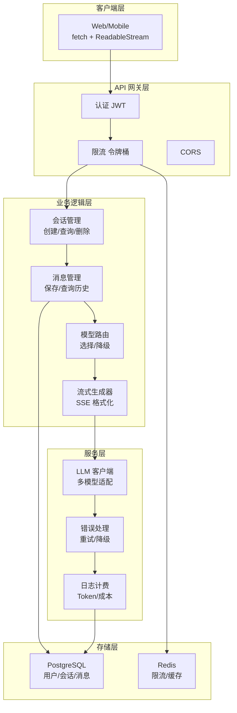

#### 代码示例

**示例 1：基础——完整的 AI 聊天 API（单文件）**

```python
"""
示例1：完整的 AI 聊天 API（单文件可运行版）
特性：会话管理、多轮对话、流式输出、认证、限流、日志
安装：pip install fastapi uvicorn openai python-jose
运行：uvicorn ai_chat_api:app --reload
"""
from fastapi import FastAPI, Depends, HTTPException, Request
from fastapi.responses import StreamingResponse
from fastapi.security import HTTPBearer, HTTPAuthorizationCredentials
from jose import jwt, JWTError
from openai import AsyncOpenAI
from pydantic import BaseModel, Field
from typing import List, Optional, Dict
from datetime import datetime, timedelta
from collections import defaultdict
import json
import time
import uuid
import os

app = FastAPI(title="AI 聊天 API", version="1.0.0")

# ============ 配置 ============
SECRET_KEY = os.getenv("SECRET_KEY", "your-secret-key")
ALGORITHM = "HS256"
client = AsyncOpenAI(
    api_key=os.getenv("OPENAI_API_KEY", "sk-xxx"),
    base_url=os.getenv("OPENAI_BASE_URL", "https://api.openai.com/v1"),
    timeout=300,
)

# ============ 内存存储（生产用数据库）============
sessions: Dict[str, dict] = {}  # session_id -> {user_id, messages, created_at}
user_request_count: Dict[str, list] = defaultdict(list)  # 限流

security = HTTPBearer()


# ============ 数据模型 ============
class Message(BaseModel):
    role: str
    content: str


class ChatRequest(BaseModel):
    session_id: Optional[str] = None
    messages: List[Message]
    model: str = "gpt-4o-mini"
    temperature: float = 0.7
    max_tokens: int = 2000
    stream: bool = True


class Session(BaseModel):
    id: str
    user_id: str
    title: str
    created_at: str
    message_count: int


# ============ 认证 ============
def get_current_user(credentials: HTTPAuthorizationCredentials = Depends(security)) -> dict:
    try:
        payload = jwt.decode(credentials.credentials, SECRET_KEY, algorithms=[ALGORITHM])
        return {"user_id": payload["sub"], "username": payload.get("username", "user")}
    except JWTError:
        raise HTTPException(status_code=401, detail="无效的 Token")


# ============ 限流 ============
def rate_limit(user_id: str, max_per_minute: int = 20):
    now = time.time()
    user_request_count[user_id] = [t for t in user_request_count[user_id] if now - t < 60]
    if len(user_request_count[user_id]) >= max_per_minute:
        raise HTTPException(status_code=429, detail="请求过于频繁")
    user_request_count[user_id].append(now)


# ============ 会话管理 ============
@app.post("/api/v1/sessions", response_model=Session)
async def create_session(user: dict = Depends(get_current_user)):
    """创建新会话"""
    session_id = str(uuid.uuid4())[:8]
    sessions[session_id] = {
        "user_id": user["user_id"],
        "messages": [],
        "created_at": datetime.now().isoformat(),
        "title": "新对话",
    }
    return Session(
        id=session_id,
        user_id=user["user_id"],
        title="新对话",
        created_at=sessions[session_id]["created_at"],
        message_count=0,
    )


@app.get("/api/v1/sessions", response_model=List[Session])
async def list_sessions(user: dict = Depends(get_current_user)):
    """获取用户的会话列表"""
    user_sessions = [
        Session(
            id=sid,
            user_id=s["user_id"],
            title=s["title"],
            created_at=s["created_at"],
            message_count=len(s["messages"]),
        )
        for sid, s in sessions.items()
        if s["user_id"] == user["user_id"]
    ]
    return sorted(user_sessions, key=lambda s: s.created_at, reverse=True)


@app.get("/api/v1/sessions/{session_id}/messages")
async def get_session_messages(session_id: str, user: dict = Depends(get_current_user)):
    """获取会话历史消息"""
    session = sessions.get(session_id)
    if not session or session["user_id"] != user["user_id"]:
        raise HTTPException(status_code=404, detail="会话不存在")
    return {"messages": session["messages"]}


# ============ 流式对话 ============
@app.post("/api/v1/chat/stream")
async def chat_stream(
    request: ChatRequest,
    http_request: Request,
    user: dict = Depends(get_current_user),
):
    """流式对话接口"""
    # 限流
    rate_limit(user["user_id"])

    # 获取或创建会话
    session_id = request.session_id
    if session_id and session_id in sessions:
        session = sessions[session_id]
        if session["user_id"] != user["user_id"]:
            raise HTTPException(status_code=403, detail="无权访问此会话")
    else:
        session_id = str(uuid.uuid4())[:8]
        sessions[session_id] = {
            "user_id": user["user_id"],
            "messages": [],
            "created_at": datetime.now().isoformat(),
            "title": request.messages[0].content[:20] if request.messages else "新对话",
        }

    # 构建完整消息列表（会话历史 + 新消息）
    all_messages = session["messages"] + [m.model_dump() for m in request.messages]

    request_id = str(uuid.uuid4())[:8]
    start_time = time.time()
    full_content = ""

    async def generate():
        nonlocal full_content
        token_count = 0

        try:
            # 发送开始事件
            yield f"data: {json.dumps({
                'type': 'start',
                'request_id': request_id,
                'session_id': session_id,
                'model': request.model,
            }, ensure_ascii=False)}\n\n"

            # 调用大模型流式 API
            stream = await client.chat.completions.create(
                model=request.model,
                messages=all_messages,
                stream=True,
                temperature=request.temperature,
                max_tokens=request.max_tokens,
                stream_options={"include_usage": True},
            )

            async for chunk in stream:
                # 客户端断开检测
                if await http_request.is_disconnected():
                    yield f"data: {json.dumps({'type': 'client_disconnected'})}\n\n"
                    return

                if chunk.choices and chunk.choices[0].delta.content:
                    content = chunk.choices[0].delta.content
                    full_content += content
                    token_count += 1
                    yield f"data: {json.dumps({
                        'type': 'content',
                        'content': content,
                        'request_id': request_id,
                    }, ensure_ascii=False)}\n\n"

                if chunk.choices and chunk.choices[0].finish_reason:
                    usage = chunk.usage
                    elapsed = time.time() - start_time

                    # 保存到会话历史
                    sessions[session_id]["messages"].extend([
                        m.model_dump() for m in request.messages
                    ])
                    sessions[session_id]["messages"].append({
                        "role": "assistant",
                        "content": full_content,
                    })

                    yield f"data: {json.dumps({
                        'type': 'done',
                        'request_id': request_id,
                        'session_id': session_id,
                        'finish_reason': chunk.choices[0].finish_reason,
                        'elapsed': round(elapsed, 2),
                        'usage': {
                            'prompt_tokens': usage.prompt_tokens if usage else 0,
                            'completion_tokens': usage.completion_tokens if usage else token_count,
                        },
                    }, ensure_ascii=False)}\n\n"
                    return

        except Exception as e:
            yield f"data: {json.dumps({
                'type': 'error',
                'error': str(e),
                'request_id': request_id,
            }, ensure_ascii=False)}\n\n"

    return StreamingResponse(
        generate(),
        media_type="text/event-stream",
        headers={
            "Cache-Control": "no-cache",
            "X-Accel-Buffering": "no",
            "X-Request-ID": request_id,
            "X-Session-ID": session_id,
        },
    )


# 获取 Token（测试用）
@app.post("/api/v1/auth/token")
async def login(username: str):
    token = jwt.encode({
        "sub": str(uuid.uuid4())[:8],
        "username": username,
        "exp": datetime.utcnow() + timedelta(hours=24),
    }, SECRET_KEY, algorithm=ALGORITHM)
    return {"access_token": token, "token_type": "bearer"}
```

**示例 2：进阶——上下文管理与摘要压缩**

```python
"""
示例2：多轮对话上下文管理与摘要压缩
特性：滑动窗口、自动摘要、Token 计数
运行：uvicorn context_management:app --reload
"""
from fastapi import FastAPI, Depends
from fastapi.responses import StreamingResponse
from openai import AsyncOpenAI
from pydantic import BaseModel
from typing import List, Optional
import json
import tiktoken  # pip install tiktoken

app = FastAPI(title="上下文管理", version="1.0.0")
client = AsyncOpenAI(api_key="sk-xxx", base_url="https://api.openai.com/v1", timeout=300)

# Token 编码器
enc = tiktoken.get_encoding("cl100k_base")

# 上下文配置
MAX_CONTEXT_TOKENS = 8000   # 最大上下文 Token
MAX_HISTORY_TURNS = 20     # 最大历史轮数
SUMMARY_THRESHOLD = 4000   # 超过此 Token 数触发摘要


def count_tokens(text: str) -> int:
    """计算文本 Token 数"""
    return len(enc.encode(text))


def count_messages_tokens(messages: List[dict]) -> int:
    """计算消息列表的总 Token 数"""
    total = 0
    for msg in messages:
        total += count_tokens(msg.get("content", ""))
        total += 4  # 角色和格式开销
    return total


async def summarize_history(messages: List[dict]) -> str:
    """用大模型总结历史对话"""
    summary_prompt = f"""请用简洁的语言总结以下对话历史，保留关键信息：

{json.dumps(messages, ensure_ascii=False, indent=2)}

总结（不超过 200 字）："""

    response = await client.chat.completions.create(
        model="gpt-4o-mini",
        messages=[{"role": "user", "content": summary_prompt}],
        max_tokens=300,
        temperature=0.3,
    )
    return response.choices[0].message.content


def build_context(
    system_prompt: str,
    history: List[dict],
    new_messages: List[dict],
    max_tokens: int = MAX_CONTEXT_TOKENS,
) -> tuple:
    """
    构建上下文：滑动窗口 + 摘要压缩
    返回 (messages, context_info)
    """
    all_messages = [{"role": "system", "content": system_prompt}] + history + new_messages
    total_tokens = count_messages_tokens(all_messages)

    context_info = {
        "total_tokens": total_tokens,
        "history_turns": len(history) // 2,
        "summarized": False,
        "summary": None,
    }

    # Token 数超限，触发摘要
    if total_tokens > SUMMARY_THRESHOLD and len(history) > 4:
        # 保留最近 4 轮，摘要更早的历史
        recent_history = history[-4:]  # 最近 2 轮
        old_history = history[:-4]     # 更早的历史

        # 注意：实际生产中应异步调用摘要，这里简化
        context_info["summarized"] = True
        context_info["old_history_tokens"] = count_messages_tokens(old_history)

        # 构建带摘要的上下文
        summary_placeholder = "[历史对话摘要将在此处]"
        all_messages = [
            {"role": "system", "content": system_prompt},
            {"role": "system", "content": f"以下是之前对话的摘要：\n{summary_placeholder}"},
        ] + recent_history + new_messages

    # 轮数超限，滑动窗口
    elif len(history) > MAX_HISTORY_TURNS * 2:
        history = history[-(MAX_HISTORY_TURNS * 2):]
        all_messages = [{"role": "system", "content": system_prompt}] + history + new_messages
        context_info["truncated"] = True

    context_info["final_tokens"] = count_messages_tokens(all_messages)
    return all_messages, context_info


class ChatRequest(BaseModel):
    session_id: Optional[str] = None
    messages: List[dict]
    model: str = "gpt-4o-mini"
    system_prompt: str = "你是一个 helpful 的助手"
    max_tokens: int = 2000


# 内存会话存储
sessions = {}


@app.post("/api/v1/chat/stream")
async def chat_stream(request: ChatRequest):
    """带上下文管理的流式对话"""
    # 获取会话历史
    history = sessions.get(request.session_id, {}).get("messages", [])

    # 构建上下文
    context_messages, context_info = build_context(
        system_prompt=request.system_prompt,
        history=history,
        new_messages=request.messages,
    )

    print(f"[上下文] tokens={context_info['final_tokens']} "
          f"summarized={context_info.get('summarized', False)}")

    async def generate():
        # 发送上下文信息
        yield f"data: {json.dumps({
            'type': 'context',
            **context_info,
        }, ensure_ascii=False)}\n\n"

        try:
            stream = await client.chat.completions.create(
                model=request.model,
                messages=context_messages,
                stream=True,
                max_tokens=request.max_tokens,
            )

            full_content = ""
            async for chunk in stream:
                if chunk.choices and chunk.choices[0].delta.content:
                    full_content += chunk.choices[0].delta.content
                    yield f"data: {json.dumps({
                        'type': 'content',
                        'content': chunk.choices[0].delta.content,
                    }, ensure_ascii=False)}\n\n"

                if chunk.choices and chunk.choices[0].finish_reason:
                    # 保存到会话
                    if request.session_id:
                        sessions.setdefault(request.session_id, {"messages": []})
                        sessions[request.session_id]["messages"].extend(request.messages)
                        sessions[request.session_id]["messages"].append({
                            "role": "assistant", "content": full_content,
                        })

                    yield f"data: {json.dumps({'type': 'done'})}\n\n"
                    return

        except Exception as e:
            yield f"data: {json.dumps({'type': 'error', 'error': str(e)})}\n\n"

    return StreamingResponse(
        generate(),
        media_type="text/event-stream",
        headers={"Cache-Control": "no-cache", "X-Accel-Buffering": "no"},
    )
```

**示例 3：完整场景——项目结构与部署配置**

```
"""
示例3：完整 AI 聊天 API 项目结构
这是项目目录结构和关键文件说明

ai-chat-api/
├── app/
│   ├── __init__.py
│   ├── main.py              # FastAPI 应用入口
│   ├── config.py            # 配置管理（环境变量）
│   ├── api/
│   │   ├── __init__.py
│   │   ├── auth.py          # 认证端点（登录/注册）
│   │   ├── chat.py          # 聊天端点（流式/非流式）
│   │   ├── sessions.py      # 会话管理端点
│   │   └── models.py        # 模型列表端点
│   ├── core/
│   │   ├── __init__.py
│   │   ├── security.py      # JWT 认证/密码哈希
│   │   ├── rate_limit.py    # 限流（Redis 令牌桶）
│   │   └── logging.py       # 结构化日志配置
│   ├── services/
│   │   ├── __init__.py
│   │   ├── llm_client.py    # 多模型客户端封装
│   │   ├── chat_service.py  # 聊天业务逻辑
│   │   ├── session_service.py  # 会话管理
│   │   └── context_manager.py  # 上下文管理/摘要
│   ├── models/
│   │   ├── __init__.py
│   │   ├── user.py          # 用户模型
│   │   ├── session.py       # 会话模型
│   │   └── message.py       # 消息模型
│   ├── schemas/
│   │   ├── __init__.py
│   │   ├── chat.py          # 请求/响应 Pydantic 模型
│   │   └── user.py
│   └── middleware/
│       ├── __init__.py
│       ├── logging.py       # 请求日志中间件
│       └── cors.py          # CORS 配置
├── tests/
│   ├── test_chat.py
│   ├── test_auth.py
│   └── conftest.py
├── docker/
│   ├── Dockerfile
│   └── docker-compose.yml
├── .env.example
├── requirements.txt
└── README.md
"""

# requirements.txt 内容：
"""
fastapi>=0.110.0
uvicorn[standard]>=0.27.0
openai>=1.0.0
python-jose[cryptography]>=3.3.0
passlib[bcrypt]>=1.7.4
pydantic>=2.0.0
redis>=5.0.0
sqlalchemy>=2.0.0
asyncpg>=0.29.0
tiktoken>=0.5.0
structlog>=24.1.0
prometheus-client>=0.19.0
httpx>=0.26.0
"""

# Dockerfile：
"""
FROM python:3.11-slim

WORKDIR /app

COPY requirements.txt .
RUN pip install --no-cache-dir -r requirements.txt

COPY app/ ./app/

EXPOSE 8000

CMD ["uvicorn", "app.main:app", "--host", "0.0.0.0", "--port", "8000", "--workers", "4"]
"""

# docker-compose.yml：
"""
version: '3.8'
services:
  api:
    build: .
    ports:
      - "8000:8000"
    environment:
      - DATABASE_URL=postgresql+asyncpg://user:pass@db:5432/chat
      - REDIS_URL=redis://redis:6379/0
      - OPENAI_API_KEY=${OPENAI_API_KEY}
      - SECRET_KEY=${SECRET_KEY}
    depends_on:
      - db
      - redis
    deploy:
      replicas: 3
      resources:
        limits:
          cpus: '2'
          memory: 2G

  db:
    image: postgres:16
    environment:
      POSTGRES_USER: user
      POSTGRES_PASSWORD: pass
      POSTGRES_DB: chat
    volumes:
      - pgdata:/var/lib/postgresql/data

  redis:
    image: redis:7-alpine
    volumes:
      - redisdata:/data

  nginx:
    image: nginx:alpine
    ports:
      - "80:80"
    volumes:
      - ./docker/nginx.conf:/etc/nginx/conf.d/default.conf
    depends_on:
      - api

volumes:
  pgdata:
  redisdata:
"""

# app/main.py（应用入口）：
"""
from fastapi import FastAPI
from fastapi.middleware.cors import CORSMiddleware
from app.api import auth, chat, sessions, models
from app.core.config import settings

app = FastAPI(title="AI 聊天 API", version="1.0.0")

# CORS
app.add_middleware(
    CORSMiddleware,
    allow_origins=settings.CORS_ORIGINS,
    allow_credentials=True,
    allow_methods=["*"],
    allow_headers=["*"],
)

# 路由
app.include_router(auth.router, prefix="/api/v1/auth", tags=["认证"])
app.include_router(chat.router, prefix="/api/v1/chat", tags=["聊天"])
app.include_router(sessions.router, prefix="/api/v1/sessions", tags=["会话"])
app.include_router(models.router, prefix="/api/v1/models", tags=["模型"])

@app.get("/health")
async def health():
    return {"status": "healthy"}
"""
```

#### 使用场景与最佳实践

**适用场景**：
- AI 对话产品：ChatGPT 类应用
- 企业知识库问答：RAG + 对话
- AI 助手：客服/教育/编程助手
- AI Agent：多步骤推理 + 工具调用

**不适用场景**：
- 简单 API 调用：不需要会话管理
- 非对话场景：文本生成/翻译

**最佳实践**：
1. **分层架构**：API 层 → 服务层 → 数据层，职责分离
2. **会话管理**：session_id 关联多轮对话，后端存储历史
3. **上下文管理**：滑动窗口 + 摘要压缩，防止 Token 超限
4. **流式输出**：SSE 标准格式，type 字段区分事件
5. **认证限流**：JWT + Redis 令牌桶，保护 API
6. **错误处理**：重试 + 降级 + 熔断，保证可用性
7. **日志监控**：结构化日志 + Prometheus 指标
8. **配置环境变量化**：API Key、数据库连接等不硬编码
9. **数据库存储**：生产用 PostgreSQL，不要用内存存储
10. **Docker 部署**：多实例 + Nginx 负载均衡 + Redis 共享状态

**性能建议**：
- 会话历史用数据库存储，Redis 缓存热点会话
- 上下文摘要异步执行，不阻塞流式输出
- 多实例部署时用 Redis 共享限流和缓存
- 大模型客户端连接池调大（max_connections=100）
- Nginx 禁用缓冲，`proxy_read_timeout 300s`

#### 常见坑点

**坑点 1：多轮对话上下文无限增长导致 Token 超限**

- **错误现象**：对话进行 10+ 轮后，大模型 API 返回 400 错误"context length exceeded"
- **根本原因**：每次请求都携带完整的对话历史，随着对话轮数增加，prompt Token 数超过模型的上下文窗口（如 gpt-4o-mini 是 128K，但实际有效上下文更小）
- **正确做法**：① 滑动窗口：只保留最近 N 轮对话（如 20 轮）；② 摘要压缩：超过阈值时用大模型总结早期对话，替换为摘要；③ system prompt 始终保留；④ 监控 Token 数，提前预警
- **预防措施**：上下文管理模块必须包含滑动窗口和摘要压缩，每次请求前检查 Token 数

**坑点 2：会话存储用内存导致多实例数据不一致**

- **错误现象**：部署 3 个实例后，用户在 A 实例创建的会话，在 B 实例查询不到
- **根本原因**：会话存在内存字典中，每个实例独立存储，多实例之间不共享
- **正确做法**：① 用数据库（PostgreSQL）存储会话和消息；② 热点会话用 Redis 缓存；③ 会话 ID 用 UUID，不依赖实例本地状态
- **预防措施**：生产环境必须用数据库存储会话，内存存储仅限开发测试

---

> 💡 **深度讲解**：实战篇整合了前面所有知识点，构建了完整的生产级 AI 聊天 API。WebSocket 流式输出支持双向通信，适合需要流式过程中取消/打断的场景，与 SSE 的选择取决于交互复杂度。LLM 网关通过中间件管道集中处理认证、限流、路由、缓存、日志、计费等横切关注点，是企业级 AI 应用的基础设施。性能优化从连接池、异步并发、语义缓存、模型路由、Prompt 压缩等多维度入手，目标是低 TTFT、高吞吐、低成本。LangChain/LangGraph 集成通过 astream_events 展示 Agent 的完整思考过程和工具调用。完整 AI 聊天 API 项目整合了会话管理、上下文压缩、多轮对话、认证限流等所有功能，提供可直接运行的生产级代码。掌握这些后，可以独立构建和部署企业级 AI 应用后端。
>
> **📝 精简总结**：
> 1. WebSocket 流式：双向通信，支持取消/打断，连接管理器管理多客户端
> 2. SSE vs WebSocket：简单对话用 SSE，复杂交互/Agent 用 WebSocket
> 3. LLM 网关：中间件管道（认证→限流→路由→缓存→调用→日志→计费）
> 4. 语义缓存：缓存确定性回答（temperature=0），命中率 30-50%
> 5. 性能优化：连接池调大、异步并发、缓存、模型路由、Prompt 压缩
> 6. 自适应并发：根据延迟和错误率动态调整并发数
> 7. LangChain：简单 Chain 用 astream，Agent 用 astream_events（version="v2"）
> 8. ChatOpenAI 必须设置 streaming=True
> 9. 完整 AI 聊天 API：会话管理 + 上下文压缩 + 流式输出 + 认证限流
> 10. 生产部署：PostgreSQL 存储会话、Redis 共享限流/缓存、Nginx 负载均衡、Docker 多实例
>
> **🎯 梯度练习题**：
> - **基础 1**：实现 WebSocket 流式对话，支持客户端发送 cancel 消息取消生成
> - **基础 2**：解释 LLM 网关的核心组件和中间件管道
> - **基础 3**：用 LangChain astream 实现 Chain 的流式输出
> - **进阶 1**：实现 LLM 网关的语义缓存层，支持精确匹配和 TTL 过期
> - **进阶 2**：实现 LangChain Agent 的 astream_events 流式输出，展示工具调用过程
> - **实战 1**：构建完整的 AI 聊天 API，包含会话管理、多轮对话、上下文压缩、JWT 认证、Redis 限流、流式输出、结构化日志

---

## 全文总结

### 核心知识体系

本文档系统讲解了 FastAPI 封装 LLM 流式接口的完整知识体系，分为三篇：

**入门篇（第1-2章）**：建立 LLM API 基础和流式输出原理。OpenAI 兼容 API 是行业标准，`stream=True` 开启 SSE 流式输出，首字延迟从 10-30 秒降至 1-2 秒。FastAPI 的 `StreamingResponse` + `async generator` 是流式接口的核心，20 行代码即可实现。

**进阶篇（第3-7章）**：深入生产级技能。接口设计用统一 SSE 事件格式（type 字段），错误处理用分类重试+降级+熔断，多模型适配层用抽象基类+适配器+工厂函数，缓冲策略用 50ms 时间窗口减少网络小包，认证限流用 JWT+Redis 令牌桶+Token 配额，日志追踪用 request_id 串联全链路。

**实战篇（第8-12章）**：构建完整项目。WebSocket 支持双向通信和取消，LLM 网关集中处理横切关注点，性能优化从连接池/并发/缓存/路由多维度入手，LangChain/LangGraph 集成展示 Agent 思考过程，完整 AI 聊天 API 整合所有功能。

### 关键技术清单

| 技术点 | 核心要点 | 章节 |
|-------|---------|------|
| OpenAI 兼容 API | AsyncOpenAI + stream=True | 第1章 |
| SSE 格式 | data: {json}\n\n | 第1章 |
| StreamingResponse | async generator + text/event-stream | 第2章 |
| 异步生成器 | async def + yield + async for | 第2章 |
| 背压控制 | 异步生成器天然支持 | 第2章 |
| 统一事件格式 | type: content/done/error/start | 第3章 |
| 错误重试 | 指数退避 1/2/4s | 第3章 |
| 多模型适配 | 抽象基类 + 适配器 + 工厂 | 第4章 |
| 缓冲策略 | 50ms 时间窗口 + 5 Token | 第5章 |
| 慢客户端处理 | 总超时 300s + 空闲超时 60s | 第5章 |
| JWT 认证 | Depends 中完成，StreamingResponse 之前 | 第6章 |
| 令牌桶限流 | Redis Lua 脚本 | 第6章 |
| Token 配额 | done 事件中累加 usage | 第6章 |
| 结构化日志 | request_id + JSON + TTFT/usage | 第7章 |
| WebSocket 流式 | 双向通信 + 取消支持 | 第8章 |
| LLM 网关 | 中间件管道 + 语义缓存 | 第9章 |
| 性能优化 | 连接池 + 并发 + 缓存 + 模型路由 | 第10章 |
| LangChain 集成 | astream / astream_events | 第11章 |
| 完整聊天 API | 会话管理 + 上下文压缩 | 第12章 |

### 学习路径建议

1. **新手**：先掌握第1-2章，能写出基本的流式接口
2. **进阶**：学习第3-7章，掌握错误处理、多模型、认证限流、日志
3. **实战**：参考第8-12章，构建完整项目并部署
4. **深入**：研究 LLM 网关架构、性能优化、LangGraph Agent

---

## 关联笔记

- [[FastAPI-路由与依赖注入]] — FastAPI 路由和 Depends 基础
- [[Python-异步编程asyncio]] — asyncio 异步编程、async/await、asyncio.gather
- [[FastAPI-WebSocket实时通信]] — WebSocket 协议与连接管理
- [[Python-装饰器与上下文管理器]] — 装饰器、contextmanager、asynccontextmanager
- [[Redis-缓存与消息队列]] — Redis 限流、缓存、Pub/Sub
- [[Docker-容器化部署]] — Dockerfile、docker-compose、多实例部署
- [[Nginx-反向代理与负载均衡]] — Nginx 配置、proxy_buffering、负载均衡
- [[LangChain-核心概念与Chain]] — LangChain Chain、Agent、astream_events
- [[LLM-大模型基础原理]] — Transformer、Token、自回归生成
- [[API设计-RESTful规范]] — RESTful API 设计、状态码、错误处理