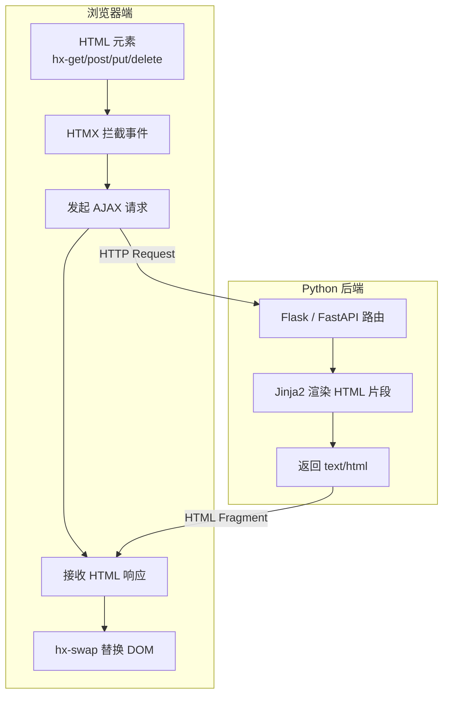
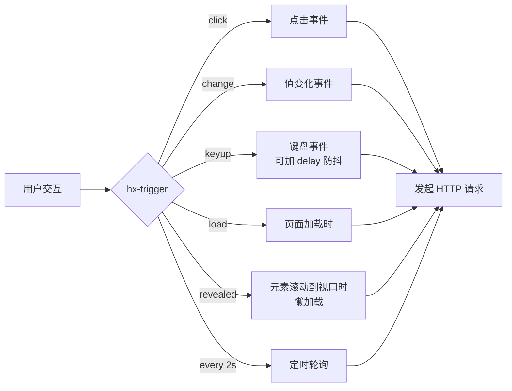

# HTMX 与 Python 后端配合

> **文档说明**：系统讲解 HTMX 超媒体驱动开发模式，包括 hx-get/hx-post/hx-swap/hx-trigger 核心属性、服务器端渲染 HTML 片段、与 Flask/FastAPI 后端的配合模式、SSE/WebSocket 集成、文件上传与表单验证，含完整可运行的 Todo 应用示例。
>
> **适用人群**：希望避免复杂前端框架的全栈开发者、Python 后端开发者、需要快速构建交互页面的独立开发者
>
> **前置知识**：[[Flask-轻量服务架构]]、[[Jinja2-模板引擎]]、[[HTML5语义化与基础标签]]

---

## 一、概述

### 1. 定义与核心价值

HTMX 是一个轻量级 JavaScript 库（~14KB），它扩展了 HTML 的超媒体能力，让任何 HTML 元素都能通过属性声明发起 AJAX 请求、触发事件、更新页面局部内容，而无需编写 JavaScript。核心思想是**"超媒体驱动"（Hypermedia-Driven）**：服务器返回 HTML 片段，浏览器直接替换 DOM，数据和渲染逻辑都在后端。

与传统 SPA（React/Vue）相比，HTMX 不需要构建 API 层、状态管理、前端路由，后端直接返回 HTML，开发效率极高，特别适合内容管理系统、内部工具、表单密集型应用。

### 2. 痛点对比

| 痛点（传统前后端分离） | HTMX 解决方式 |
|---------------------|-------------|
| 需要维护前端项目（React/Vue + 构建工具） | 单个 HTML 文件 + `<script src="htmx.min.js">`，无构建步骤 |
| 需设计 REST API + 前端数据获取 + 状态管理 | 后端直接返回 HTML 片段，无 JSON API 层 |
| 表单验证需前后端各写一遍 | 验证逻辑只在后端，返回包含错误信息的 HTML |
| 局部更新需写 fetch + DOM 操作 | `hx-get="/items" hx-target="#list"` 一行声明 |
| 前后端类型不一致导致 bug | 只有后端一种语言，无类型对齐问题 |
| SEO 需 SSR 额外处理 | 服务端渲染，天然 SEO 友好 |
| 首屏加载需等待 JS  bundle | HTML 直接渲染，首屏极快 |

### 3. HTMX 核心概念


HTMX 的工作流程：
1. 用户交互（点击/输入/页面加载）触发 `hx-trigger` 指定的事件
2. HTMX 发起 `hx-get`/`hx-post` 指定的 HTTP 请求
3. 后端路由处理请求，用 Jinja2 渲染 HTML 片段
4. HTMX 收到 HTML 响应，按 `hx-swap` 策略替换 `hx-target` 指定的 DOM 元素

<div style="background:linear-gradient(135deg,#4facfe,#00f2fe);border-radius:16px;padding:20px;margin:16px 0;font-family:-apple-system,'Segoe UI','PingFang SC','Microsoft YaHei',sans-serif;color:#fff;overflow:hidden;box-shadow:0 8px 28px rgba(0,0,0,.14),0 3px 10px rgba(0,0,0,.08)">
<style>@keyframes flow{0%{transform:translateX(-10px);opacity:0}15%{transform:translateX(0);opacity:1}85%{transform:translateX(0);opacity:1}100%{transform:translateX(10px);opacity:0}}.flow-step{display:inline-block;background:rgba(255,255,255,.2);border:2px solid rgba(255,255,255,.5);border-radius:8px;padding:10px 14px;margin:4px;text-align:center;font-weight:600;font-size:13px;animation:flow 4s ease-in-out infinite;min-width:90px}.flow-step:nth-child(2){animation-delay:.5s}.flow-step:nth-child(4){animation-delay:1s}.flow-step:nth-child(6){animation-delay:1.5s}.flow-step:nth-child(8){animation-delay:2s}.flow-arrow{display:inline-block;font-size:20px;animation:flow 4s ease-in-out infinite;vertical-align:middle}.flow-code{background:rgba(0,0,0,.2);border-radius:6px;box-shadow:0 2px 8px rgba(0,0,0,.06);padding:8px 12px;margin-top:10px;font-family:monospace;font-size:12px;text-align:center}</style>
<div style="text-align:center;font-size:15px;font-weight:700;margin-bottom:14px;padding-bottom:10px;border-bottom:1.5px solid rgba(255,255,255,.22);letter-spacing:1px;text-shadow:0 1px 3px rgba(0,0,0,.12)">HTMX 请求-响应流程</div>
<div style="text-align:center;white-space:nowrap;overflow-x:auto"><span class="flow-step">用户交互</span><span class="flow-arrow">→</span><span class="flow-step">hx-trigger事件</span><span class="flow-arrow">→</span><span class="flow-step">AJAX请求</span><span class="flow-arrow">→</span><span class="flow-step">后端路由</span><span class="flow-arrow">→</span><span class="flow-step">Jinja2渲染HTML</span><span class="flow-arrow">→</span><span class="flow-step">hx-swap替换DOM</span></div>
<div class="flow-code">超媒体驱动：服务器返回HTML片段，浏览器直接替换DOM，无需JSON API层</div>
<div style="text-align:center;font-size:12px;opacity:.85;margin-top:8px">一行属性 hx-get/post + hx-target + hx-swap 实现局部更新</div>
</div>

---


> 💡 **深度讲解**：HTMX 的核心思想是**超媒体驱动（Hypermedia-Driven）**——将 HTML 作为应用状态的载体，服务器返回 HTML 片段而非 JSON，浏览器直接替换 DOM。这与传统前后端分离（SPA）形成鲜明对比：SPA 需要维护前端项目、设计 REST API、管理前端状态、处理前后端类型对齐，而 HTMX 只需在 HTML 元素上添加 hx-get/hx-post/hx-target/hx-swap 属性，后端返回 HTML 片段即可实现交互。这种模式特别适合内容管理系统、内部工具、表单密集型应用——开发效率极高，SEO 友好，首屏加载快。但对于复杂交互（如拖拽、实时协作、富文本编辑器），HTMX 可能不够灵活，需要配合少量 JavaScript。HTMX 与 Python 后端（Flask/FastAPI/Django）配合最佳，因为 Python 后端擅长服务端渲染（Jinja2/Django Templates）。
>
> **📝 精简总结**：HTMX = 14KB JS库 + HTML属性声明（hx-get/post/put/delete + hx-target + hx-swap + hx-trigger）+ 超媒体驱动（服务器返回HTML片段，浏览器直接替换DOM）。无需前端构建、无需JSON API、无需状态管理，适合CMS/内部工具/表单密集型应用。

## 二、底层原理

> 🔍 **知识点深度解析：hx-swap 交换策略**
>
> **作用**：hx-swap 控制 HTMX 如何将服务器返回的 HTML 插入到页面中，是超媒体驱动开发的核心机制，决定了局部更新的行为和用户体验。
>
> **原理**：HTMX 收到服务器返回的 HTML 片段后，根据 hx-swap 属性的值执行不同的 DOM 操作：innerHTML 替换目标元素内容、outerHTML 替换目标元素本身、beforebegin/afterbegin/beforeend/afterend 在目标元素不同位置插入、delete 删除目标元素、none 不更新 DOM。还可以配合 swap  modifier（如 swap:1s）设置延迟，配合 show:top 控制滚动位置。默认策略是 innerHTML。
>
> **用法要点**：① innerHTML 最常用，替换目标元素的子内容 ② outerHTML 替换整个目标元素（包括自身） ③ afterbegin/prepend 在开头插入，beforeend/append 在末尾插入 ④ delete 策略用于删除元素（如删除待办项） ⑤ none 策略用于只触发请求不更新UI（如点赞） ⑥ 配合 hx-swap-oob 支持 Out-of-Band 更新，一次响应更新多个区域

### 1. HTMX 属性体系

| 属性 | 作用 | 示例 |
|------|------|------|
| `hx-get` | 发起 GET 请求 | `<button hx-get="/items">加载</button>` |
| `hx-post` | 发起 POST 请求 | `<form hx-post="/items">` |
| `hx-put` / `hx-delete` | 发起 PUT/DELETE | `<button hx-delete="/items/1">删除</button>` |
| `hx-target` | 指定更新目标（CSS 选择器） | `hx-target="#item-list"` |
| `hx-swap` | 替换策略 | `innerHTML` / `outerHTML` / `beforeend` / `afterend` |
| `hx-trigger` | 触发事件 | `click` / `change` / `keyup delay:500ms` / `load` |
| `hx-params` | 提交哪些参数 | `*` / `none` / `field1,field2` |
| `hx-indicator` | 加载指示器 | `hx-indicator="#spinner"` |
| `hx-confirm` | 确认对话框 | `hx-confirm="确定删除？"` |
| `hx-push-url` | 更新浏览器 URL | `hx-push-url="true"` |
| `hx-vals` | 附加 JSON 参数 | `hx-vals='{"sort": "desc"}'` |
| `hx-headers` | 自定义请求头 | `hx-headers='{"X-CSRF": "token"}'` |

### 2. hx-swap 替换策略

| 策略 | 说明 |
|------|------|
| `innerHTML` | 替换目标元素的内部内容（默认） |
| `outerHTML` | 替换整个目标元素（含标签本身） |
| `beforebegin` | 插入到目标元素之前（兄弟节点） |
| `afterbegin` | 插入到目标元素的第一个子节点之前 |
| `beforeend` | 插入到目标元素的最后一个子节点之后 |
| `afterend` | 插入到目标元素之后（兄弟节点） |
| `delete` | 删除目标元素 |
| `none` | 不替换，仅触发请求 |

### 3. 事件触发机制


### 4. 后端配合模式

HTMX 后端的核心原则是**返回 HTML 片段而非 JSON**。后端路由根据请求来源（普通请求 vs HTMX 请求）返回不同内容：

- 普通请求（直接访问 URL）：返回完整 HTML 页面（含 `<html><head><body>`）
- HTMX 请求（`HX-Request: true` 头）：返回 HTML 片段（仅需要更新的部分）

```python
from flask import request, render_template, render_template_string

@app.route("/items")
def list_items():
    items = Item.query.all()
    if request.headers.get("HX-Request"):
        # HTMX 请求：只返回列表片段
        return render_template("partials/_item_list.html", items=items)
    # 普通请求：返回完整页面
    return render_template("items.html", items=items)
```
---


> 💡 **深度讲解**：本章深入拆解了技术的底层原理和核心机制，包括架构设计、工作流程、关键技术实现细节。理解原理的价值在于：当遇到文档未覆盖的边缘场景或性能问题时，能够基于原理进行推理和调试，而不是依赖试错。建议结合 Mermaid 架构图，在脑中模拟一次完整的请求/数据流转过程，确保每个环节都理解透彻。
>
> **📝 精简总结**：本章深入讲解了技术的核心原理、架构设计、工作流程和关键实现细节，配合架构图帮助理解底层机制。

## 三、实操

### 1. 项目结构

```text
htmx_todo/
├── app.py
├── templates/
│   ├── base.html          # 基础布局
│   ├── index.html         # 主页（完整页面）
│   └── partials/
│       ├── _todo_list.html    # Todo 列表片段
│       ├── _todo_item.html    # 单个 Todo 片段
│       └── _todo_form.html    # 表单片段
├── static/
│   └── htmx.min.js        # 下载到本地
└── requirements.txt
```
### 2. Flask 后端

```python
# app.py
from flask import Flask, render_template, request, redirect, url_for, abort
from flask_sqlalchemy import SQLAlchemy
from datetime import datetime

app = Flask(__name__)
app.config["SQLALCHEMY_DATABASE_URI"] = "sqlite:///todo.db"
app.config["SQLALCHEMY_TRACK_MODIFICATIONS"] = False
db = SQLAlchemy(app)


class Todo(db.Model):
    id = db.Column(db.Integer, primary_key=True)
    title = db.Column(db.String(200), nullable=False)
    completed = db.Column(db.Boolean, default=False)
    created_at = db.Column(db.DateTime, default=datetime.utcnow)

    def to_dict(self):
        return {"id": self.id, "title": self.title, "completed": self.completed}


def is_htmx_request():
    return request.headers.get("HX-Request") == "true"


@app.route("/")
def index():
    """主页：完整页面"""
    todos = Todo.query.order_by(Todo.created_at.desc()).all()
    return render_template("index.html", todos=todos)


@app.route("/todos", methods=["GET"])
def list_todos():
    """HTMX 请求：返回 Todo 列表片段"""
    if not is_htmx_request():
        return redirect(url_for("index"))
    filter_status = request.args.get("filter", "all")
    query = Todo.query
    if filter_status == "active":
        query = query.filter_by(completed=False)
    elif filter_status == "completed":
        query = query.filter_by(completed=True)
    todos = query.order_by(Todo.created_at.desc()).all()
    return render_template("partials/_todo_list.html", todos=todos)


@app.route("/todos", methods=["POST"])
def create_todo():
    """创建 Todo：返回新列表或单个项"""
    title = request.form.get("title", "").strip()
    if not title:
        # 验证失败：返回带错误的表单
        return render_template("partials/_todo_form.html", error="标题不能为空"), 422

    todo = Todo(title=title)
    db.session.add(todo)
    db.session.commit()

    if is_htmx_request():
        # 返回更新后的列表 + 清空表单
        todos = Todo.query.order_by(Todo.created_at.desc()).all()
        response = app.make_response(render_template("partials/_todo_list.html", todos=todos))
        # 通过 HX-Trigger 触发前端事件清空表单
        response.headers["HX-Trigger"] = "todoCreated"
        return response
    return redirect(url_for("index"))


@app.route("/todos/<int:todo_id>/toggle", methods=["POST"])
def toggle_todo(todo_id):
    """切换完成状态：返回更新后的单个项"""
    todo = db.session.get(Todo, todo_id)
    if not todo:
        abort(404)
    todo.completed = not todo.completed
    db.session.commit()
    if is_htmx_request():
        return render_template("partials/_todo_item.html", todo=todo)
    return redirect(url_for("index"))


@app.route("/todos/<int:todo_id>", methods=["DELETE"])
def delete_todo(todo_id):
    """删除 Todo：HTMX 用 outerHTML 替换为空，或返回空内容"""
    todo = db.session.get(Todo, todo_id)
    if not todo:
        abort(404)
    db.session.delete(todo)
    db.session.commit()
    if is_htmx_request():
        return "", 200  # 空响应 + hx-swap="outerHTML" 会删除元素
    return redirect(url_for("index"))


@app.route("/todos/search")
def search_todos():
    """实时搜索：keyup 触发，带防抖"""
    if not is_htmx_request():
        abort(400)
    q = request.args.get("q", "").strip()
    if q:
        todos = Todo.query.filter(Todo.title.contains(q)).all()
    else:
        todos = Todo.query.order_by(Todo.created_at.desc()).all()
    return render_template("partials/_todo_list.html", todos=todos)


if __name__ == "__main__":
    with app.app_context():
        db.create_all()
    app.run(debug=True, port=5000)
```
### 3. 模板文件

```html
<!-- templates/base.html -->
<!DOCTYPE html>
<html lang="zh-CN">
<head>
    <meta charset="UTF-8">
    <meta name="viewport" content="width=device-width, initial-scale=1.0">
    <title>HTMX Todo App</title>
    <script src="{{ url_for('static', filename='htmx.min.js') }}"></script>
    <style>
        body { font-family: system-ui, sans-serif; max-width: 600px; margin: 2rem auto; padding: 0 1rem; }
        .todo-item { display: flex; align-items: center; padding: 0.75rem; border-bottom: 1px solid #eee; }
        .todo-item.completed .title { text-decoration: line-through; color: #999; }
        .title { flex: 1; margin-left: 0.5rem; }
        .delete-btn { color: #e74c3c; background: none; border: none; cursor: pointer; }
        .htmx-indicator { display: none; }
        .htmx-request .htmx-indicator { display: inline; }
        .error { color: #e74c3c; font-size: 0.875rem; margin-top: 0.25rem; }
        .filters { margin: 1rem 0; }
        .filters button { margin-right: 0.5rem; padding: 0.25rem 0.75rem; }
        .filters button.active { background: #3498db; color: white; }
    </style>
</head>
<body>
    
</body>
</html>
```
```html
<!-- templates/index.html -->


<h1>Todo 列表</h1>

<!-- 创建表单 -->
<div id="todo-form-container">
    
</div>

<!-- 搜索框：keyup 防抖 300ms -->
<div style="margin: 1rem 0;">
    <input type="text" name="q" placeholder="搜索..."
           hx-get="/todos/search"
           hx-trigger="keyup changed delay:300ms"
           hx-target="#todo-list"
           hx-indicator="#search-spinner"
           style="width: 100%; padding: 0.5rem;">
    <span id="search-spinner" class="htmx-indicator">搜索中...</span>
</div>

<!-- 过滤器 -->
<div class="filters">
    <button hx-get="/todos?filter=all" hx-target="#todo-list" class="active">全部</button>
    <button hx-get="/todos?filter=active" hx-target="#todo-list">未完成</button>
    <button hx-get="/todos?filter=completed" hx-target="#todo-list">已完成</button>
</div>

<!-- Todo 列表容器 -->
<div id="todo-list">
    
</div>

<!-- 监听 todoCreated 事件清空表单 -->
<script>
document.body.addEventListener('todoCreated', function() {
    document.querySelector('input[name="title"]').value = '';
});
</script>

```
```html
<!-- templates/partials/_todo_form.html -->
<form hx-post="/todos" hx-target="#todo-list" hx-swap="innerHTML">
    <div style="display: flex; gap: 0.5rem;">
        <input type="text" name="title" placeholder="添加新任务..."
               style="flex: 1; padding: 0.5rem;" autofocus>
        <button type="submit" style="padding: 0.5rem 1rem;">添加</button>
    </div>
    <div class="error">{{ error }}</div>
</form>
```
```html
<!-- templates/partials/_todo_list.html -->

    
        
    

    <p style="color: #999; text-align: center; padding: 2rem;">暂无任务</p>

```
```html
<!-- templates/partials/_todo_item.html -->
<div class="todo-item completed" id="todo-{{ todo.id }}">
    <input type="checkbox" checked
           hx-post="/todos/{{ todo.id }}/toggle"
           hx-target="#todo-{{ todo.id }}"
           hx-swap="outerHTML">
    <span class="title">{{ todo.title }}</span>
    <button class="delete-btn"
            hx-delete="/todos/{{ todo.id }}"
            hx-target="#todo-{{ todo.id }}"
            hx-swap="outerHTML"
            hx-confirm="确定删除这个任务？">
        删除
    </button>
</div>
```
### 4. 无限滚动与懒加载

```html
<!-- 无限滚动：元素进入视口时加载下一页 -->
<div id="item-list">
    
</div>

<!-- 最后一页不显示加载触发器 -->

<div hx-get="/items?page={{ next_page }}"
     hx-trigger="revealed"
     hx-target="#item-list"
     hx-swap="beforeend"
     style="text-align: center; padding: 1rem;">
    加载更多...
</div>

```
```python
@app.route("/items")
def list_items():
    page = request.args.get("page", 1, type=int)
    per_page = 20
    pagination = Item.query.paginate(page=page, per_page=per_page)
    if is_htmx_request():
        return render_template("partials/_items_page.html",
                               items=pagination.items,
                               has_next=pagination.has_next,
                               next_page=page + 1)
    return render_template("items.html", pagination=pagination)
```
### 5. SSE 实时更新

```python
# app.py - SSE 端点
from flask import Response
import json
import time

@app.route("/stream")
def stream():
    """Server-Sent Events：实时推送更新"""
    def generate():
        while True:
            # 检查是否有新数据
            latest = Todo.query.order_by(Todo.id.desc()).first()
            if latest:
                # SSE 格式：event: 事件名\ndata: 数据\n\n
                yield f"event: todoUpdate\ndata: {json.dumps(latest.to_dict())}\n\n"
            time.sleep(5)
    return Response(generate(), mimetype="text/event-stream")
```
```html
<!-- 前端：HTMX 原生支持 SSE -->
<div hx-sse="connect:/stream">
    <div hx-sse="swap:todoUpdate" id="latest-todo">
        等待更新...
    </div>
</div>
```
### 6. 文件上传

```html
<form hx-post="/upload" hx-target="#result" hx-encoding="multipart/form-data">
    <input type="file" name="file">
    <button type="submit">上传</button>
</form>
<div id="result"></div>
```
```python
@app.route("/upload", methods=["POST"])
def upload_file():
    if "file" not in request.files:
        return '<div class="error">未选择文件</div>', 422
    f = request.files["file"]
    if f.filename == "":
        return '<div class="error">文件名为空</div>', 422
    # 保存文件
    filepath = f"uploads/{f.filename}"
    f.save(filepath)
    return f'<div class="success">上传成功：{f.filename}</div>'
```
---


> 💡 **深度讲解**：本章提供了从环境搭建到完整项目示例的实操指南，包含可运行的代码示例和最佳实践。实操是掌握技术的关键环节——'纸上得来终觉浅，绝知此事要躬行'。建议按照示例顺序动手实现，每段代码都要理解其作用，而不是简单复制粘贴。遇到报错时，先阅读错误信息再排查，这是提升调试能力的最佳途径。
>
> **📝 精简总结**：本章提供了完整的实操指南，包括环境搭建、快速上手、核心用法、最佳实践和完整项目示例，代码可直接运行。

## 四、常见问题与排查

| 问题现象 | 原因 | 解决方案 |
|---------|------|---------|
| 点击按钮无反应，控制台无请求 | 未引入 htmx.min.js，或属性拼写错误 | 检查 `<script src="htmx.min.js">` 是否加载；确认属性名是 `hx-get` 而非 `hx_get` |
| 请求返回完整 HTML 页面而非片段 | 后端未判断 `HX-Request` 头，返回了完整页面 | 在路由中检查 `request.headers.get("HX-Request")`，HTMX 请求只返回片段 |
| 表单提交后页面跳转 | 表单未加 `hx-post`，走了原生提交 | 给 `<form>` 添加 `hx-post="/url"` 和 `hx-target` |
| 删除元素后页面残留空白 | `hx-swap` 用了 `innerHTML` 而非 `outerHTML` | 删除操作使用 `hx-swap="outerHTML"`，后端返回空响应 |
| 搜索输入时每次按键都发请求 | 未设置防抖延迟 | `hx-trigger="keyup changed delay:300ms"` 添加 delay |
| CSRF 验证失败（Django） | HTMX POST 请求未携带 CSRF Token | 在 `<body hx-headers='{"X-CSRFToken": "{{ csrf_token }}"}'>` 中设置 |
| 页面后退/前进不更新内容 | 使用了 `hx-push-url` 但未处理 popstate | 确保后端能处理直接访问该 URL（返回完整页面） |
| 大列表更新时闪烁 | 每次替换整个列表导致重排 | 使用 `hx-swap="beforeend"` 追加新项，或用 `outerHTML` 只更新变化的项 |
| 文件上传报 415 Unsupported Media Type | 表单未设置 `enctype="multipart/form-data"` | 添加 `hx-encoding="multipart/form-data"` 属性 |
| 移动端点击延迟 | `click` 事件在移动端有 300ms 延迟 | 使用 `hx-trigger="click"` 配合 `<meta name="viewport">`，或用 `touchstart` |

---


> 💡 **深度讲解**：本章汇总了常见错误、性能瓶颈、安全风险和生产环境踩坑记录，采用'问题→原因→方案'的结构帮助快速定位和解决问题。生产环境中的问题往往不是技术本身的问题，而是使用方式不当或边界条件未考虑。建议在项目上线前，对照本章的问题清单逐一检查，提前规避常见陷阱。遇到本章未覆盖的问题时，按照'复现→定位→分析→解决→记录'的流程处理。
>
> **📝 精简总结**：本章汇总了常见错误、性能优化、安全防护和生产踩坑记录，采用问题→原因→方案结构，帮助快速排查解决问题。

## 五、进阶与最佳实践

### 1. HTMX 与 SPA 选型决策

| 场景 | 推荐方案 | 原因 |
|------|---------|------|
| 内容管理系统、后台管理 | HTMX + Jinja2 | 表单密集、CRUD 为主，开发效率极高 |
| 内部工具、运营后台 | HTMX | 不需要复杂交互，快速交付 |
| 高交互前端（画板、视频编辑） | React/Vue SPA | 需要复杂状态管理和客户端渲染 |
| 移动端 App 风格应用 | React/Vue + API | 需要离线能力和原生体验 |
| SEO 敏感的内容站 | HTMX / SSR | 服务端渲染，天然 SEO |
| 实时协作（文档、白板） | React + WebSocket | 需要复杂的客户端状态同步 |

### 2. 项目组织模式

```text
templates/
├── base.html              # 基础布局
├── pages/                 # 完整页面（直接访问时返回）
│   ├── index.html
│   └── dashboard.html
└── partials/              # HTML 片段（HTMX 请求返回）
    ├── _todo_list.html
    ├── _todo_item.html
    ├── _sidebar.html
    └── _pagination.html
```
**命名约定**：片段文件以下划线 `_` 开头，与完整页面区分。

### 3. 渐进增强策略

HTMX 支持**渐进增强**：即使 JS 禁用，表单仍能通过原生提交工作（后端处理重定向）。关键是后端同时处理 HTMX 和普通请求：

```python
@app.route("/todos", methods=["POST"])
def create_todo():
    todo = Todo(title=request.form["title"])
    db.session.add(todo)
    db.session.commit()

    if is_htmx_request():
        return render_template("partials/_todo_item.html", todo=todo)
    # JS 禁用时：重定向回列表页
    return redirect(url_for("index"))
```
### 4. 与 Alpine.js 配合

HTMX 处理服务器交互，Alpine.js 处理客户端状态（下拉菜单、模态框、标签页），两者是黄金搭档：

```html
<!-- Alpine.js 控制模态框显示，HTMX 加载模态框内容 -->
<div x-data="{ open: false }">
    <button @click="open = true"
            hx-get="/modal/content"
            hx-target="#modal-body"
            hx-swap="innerHTML">
        打开模态框
    </button>

    <div x-show="open" class="modal">
        <div id="modal-body">加载中...</div>
        <button @click="open = false">关闭</button>
    </div>
</div>
```

### 5. 性能优化

| 优化手段 | 说明 |
|---------|------|
| **局部更新** | 只更新变化的 DOM 节点，避免整页重渲染 |
| **防抖/节流** | `keyup delay:300ms` 减少搜索请求频率 |
| **懒加载** | `hx-trigger="revealed"` 实现无限滚动 |
| **缓存** | 后端对高频片段做 Redis 缓存 |
| **压缩** | 启用 Gzip/Brotli 压缩 HTML 响应 |
| **预加载** | `hx-preload` 扩展在鼠标悬停时预加载 |
| **WebSocket** | 实时更新用 WebSocket 替代轮询 |
---

> 💡 **深度讲解**：本章介绍了进阶用法、生态工具、技术集成、行业应用和学习资源，为深入学习提供方向。技术的价值不仅在于自身功能，更在于与其他技术的组合使用所产生的协同效应。建议根据项目需求和个人兴趣，选择1-2个拓展方向深入学习，避免浅尝辄止。
>
> **📝 精简总结**：本章介绍了进阶特性、生态工具、技术集成、应用案例和学习资源，为深入学习和技术拓展提供方向。


## 🔗 关联笔记

- [[Flask-轻量服务架构]]
- [[FastAPI-路由与依赖注入]]
- [[Django-ORM与Admin体系]]
- [[Jinja2-模板引擎]]
- [[Tornado-高并发IO模型]]

## 📖 前置知识

- [[Flask-轻量服务架构]]

## 🏷️ 相关标签

#Python #前端 #FastAPI

---

[[Home|🏠 返回首页]] · [[MOC-Python全栈|📚 返回分类]]
