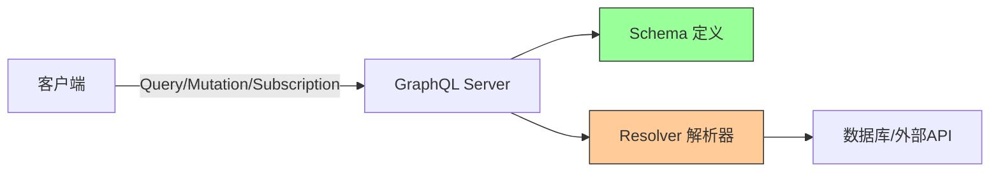

# Python-GraphQL接口开发

> **文档说明**：系统讲解 GraphQL 接口开发，包括核心概念、Python 框架对比、Strawberry + FastAPI 完整实现、Schema 设计、Resolver、认证授权、分页过滤、N+1 问题与 DataLoader，以及最佳实践和常见问题。
>
> **适用人群**：Python 开发者、全栈开发者、需要构建 GraphQL API 的后端开发者
>
> **前置知识**：[[FastAPI-高性能Web框架]]、[[RESTfulAPI设计原则]]、[[Python-模块与包管理原理]]、[[前后端联调规范与流程]]

---

## 一、概述

### 1. 什么是 GraphQL

**GraphQL** 是 Facebook 开源的 API 查询语言和运行时，允许客户端精确请求所需的数据，避免过度获取（Over-fetching）和获取不足（Under-fetching）。

### 2. GraphQL vs REST

| 维度 | REST | GraphQL |
|------|------|---------|
| **数据获取** | 固定端点，返回固定数据 | 单一端点，客户端指定所需字段 |
| **过度获取** | 常见（返回多余字段） | 无（只取所需） |
| **获取不足** | 常见（需多次请求） | 无（一次请求获取关联数据） |
| **端点数量** | 多（每个资源一个端点） | 单一端点 `/graphql` |
| **版本管理** | URL 版本（/v1, /v2） | 字段级演进，无需版本 |
| **类型安全** | 依赖文档 | 强类型 Schema |
| **缓存** | HTTP 缓存天然支持 | 需 persisted queries 等方案 |
| **学习曲线** | 平缓 | 较陡 |
| **适用场景** | 资源型 CRUD、公开 API | 复杂关联数据、移动端、BFF |

### 3. GraphQL 核心概念


| 概念 | 说明 |
|------|------|
| **Schema** | GraphQL API 的类型定义，描述可用的数据和操作 |
| **Query** | 只读数据查询（对应 REST GET） |
| **Mutation** | 数据修改操作（对应 REST POST/PUT/DELETE） |
| **Subscription** | 实时数据订阅（WebSocket） |
| **Resolver** | 每个字段的解析函数，负责获取数据 |
| **Type** | 数据类型定义（Object、Scalar、Enum、Interface、Union） |
| **Scalar** | 标量类型（String、Int、Float、Boolean、ID） |
| **Input** | 输入类型（用于 Mutation 参数） |
| **Fragment** | 可复用的字段集合 |
| **Directive** | 指令（@skip、@include、@deprecated） |

<div style="background:linear-gradient(135deg,#4facfe,#00f2fe);border-radius:16px;padding:20px;margin:16px 0;font-family:-apple-system,'Segoe UI','PingFang SC','Microsoft YaHei',sans-serif;color:#fff;overflow:hidden;box-shadow:0 8px 28px rgba(0,0,0,.14),0 3px 10px rgba(0,0,0,.08)">
<style>@keyframes fadeIn{from{opacity:0;transform:translateY(10px)}to{opacity:1;transform:translateY(0)}}.cmp-col{display:inline-block;width:45%;vertical-align:top;padding:12px;margin:0 2%;background:rgba(255,255,255,.15);border-radius:10px;animation:fadeIn .8s ease-out}.cmp-col h4{margin:0 0 8px 0;text-align:center;border-bottom:1px solid rgba(255,255,255,.3);padding-bottom:6px}.cmp-col ul{margin:0;padding-left:18px;font-size:13px;line-height:1.8}.cmp-vs{display:inline-block;width:4%;text-align:center;font-size:24px;font-weight:700;vertical-align:middle;animation:fadeIn 1s ease-out}</style>
<div style="text-align:center;font-size:15px;font-weight:700;margin-bottom:14px;padding-bottom:10px;border-bottom:1.5px solid rgba(255,255,255,.22);letter-spacing:1px;text-shadow:0 1px 3px rgba(0,0,0,.12)">GraphQL vs REST 数据获取</div>
<div style="text-align:center"><div class="cmp-col"><h4>REST</h4><ul><li>固定端点，返回固定数据</li><li>过度获取（多余字段）</li><li>获取不足（多次请求）</li><li>多端点（每资源一个）</li><li>URL版本管理(/v1,/v2)</li><li>HTTP缓存天然支持</li></ul></div><div class="cmp-vs">VS</div><div class="cmp-col"><h4>GraphQL</h4><ul><li>单一端点，客户端指定字段</li><li>无过度获取（只取所需）</li><li>无获取不足（一次取关联）</li><li>单一端点 /graphql</li><li>字段级演进，无需版本</li><li>需persisted queries方案</li></ul></div></div>
<div style="text-align:center;font-size:12px;opacity:.85;margin-top:10px">GraphQL 适合复杂关联数据/移动端/BFF，REST 适合资源型CRUD/公开API</div>
</div>

---


> 💡 **深度讲解**：GraphQL 是 Facebook 开源的 API 查询语言，核心价值是让客户端精确请求所需数据，避免 REST 的过度获取（Over-fetching）和获取不足（Under-fetching）。与 REST 的固定端点+固定数据不同，GraphQL 使用单一端点 /graphql，客户端通过 Query 语法指定所需字段和关联关系，服务器按 Schema 定义和 Resolver 解析器返回精确数据。这种设计特别适合移动端（减少网络传输）、复杂关联数据（一次请求获取多资源）、BFF（Backend for Frontend）场景。但 GraphQL 也有挑战：N+1 查询问题（需 DataLoader 解决）、缓存不如 REST 直观（需 persisted queries）、学习曲线较陡、需要管理查询复杂度（防止恶意深度查询）。Python 生态中 Strawberry + FastAPI 是最现代的组合，Graphene 是老牌框架。
>
> **📝 精简总结**：GraphQL = 单一端点 + 强类型Schema + Query/Mutation/Subscription + Resolver解析器 + 客户端精确取数。解决REST的过度/获取不足问题，适合复杂关联数据/移动端/BFF。N+1问题用DataLoader解决，Python推荐Strawberry+FastAPI。

> 🔍 **知识点深度解析：Resolver 解析器与 N+1 问题**
>
> **作用**：Resolver 是 GraphQL 每个字段的解析函数，负责获取该字段的数据。N+1 问题是 GraphQL 最常见的性能问题：查询 N 个对象的关联字段时，触发 N+1 次数据库查询。
>
> **原理**：GraphQL 执行时，对每个请求的字段调用对应的 Resolver 函数。如果查询包含关联字段（如文章的作者），Resolver 会逐个获取每个文章的作者，导致 N+1 次查询。DataLoader 是解决 N+1 的标准方案：它在单次事件循环中收集所有 ID，批量查询后通过缓存返回结果。DataLoader 的核心是批处理（batch）和缓存（cache）：同一请求中相同 ID 只查询一次，不同 ID 合并为一次 IN 查询。
>
> **用法要点**：① 每个字段都有对应的 Resolver，未定义时使用默认属性访问 ② N+1 问题根源：嵌套字段的 Resolver 逐个查询关联数据 ③ DataLoader 解决：批量收集 ID → 一次 IN 查询 → 缓存结果 ④ DataLoader 必须按请求创建实例（不能全局共享，否则缓存串数据） ⑤ 用 prefetch_related/select_related 在顶层查询预加载 ⑥ 复杂关联考虑使用 Apollo Federation 或 Schema 拼接

## 二、Python GraphQL 框架

### 1. 框架对比

| 框架 | 特点 | 推荐度 |
|------|------|--------|
| **Strawberry** | 现代、类型注解驱动、支持 FastAPI、活跃维护 | ⭐⭐⭐⭐⭐ |
| **Graphene** | 老牌、生态成熟、与 Django 集成好 | ⭐⭐⭐⭐ |
| **Ariadne** | Schema-first、支持 .graphql 文件 | ⭐⭐⭐ |
| **Tartiflette** | 性能好、Schema-first | ⭐⭐⭐ |
| **GraphQL-Core** | 底层库，不直接使用 | - |

### 2. 为什么选 Strawberry

- [ ] **类型注解驱动**：使用 Python 类型注解定义 Schema，代码即文档
- [ ] **FastAPI 原生集成**：与 FastAPI 无缝集成
- [ ] **现代 Python** | 支持 dataclass、Pydantic、async
- [ ] **活跃社区** | 持续更新，文档完善
- [ ] **代码生成** | 可生成 TypeScript 类型

---

## 三、Strawberry + FastAPI 实现

### 1. 项目初始化

```python
# 安装依赖
pip install strawberry-graphql[fastapi] fastapi uvicorn

# 项目结构
graphql-api/
├── app/
│   ├── __init__.py
│   ├── main.py          # FastAPI 入口
│   ├── schema.py        # GraphQL Schema
│   ├── types.py         # 类型定义
│   ├── resolvers.py     # 解析器
│   ├── mutations.py     # Mutation 定义
│   └── database.py      # 数据库
└── requirements.txt
```
### 2. 类型定义

```python
# app/types.py
import strawberry
from typing import List, Optional
from datetime import datetime

@strawberry.type
class User:
    id: strawberry.ID
    name: str
    email: str
    age: Optional[int] = None
    created_at: datetime
    posts: List["Post"] = strawberry.field(default_factory=list)

@strawberry.type
class Post:
    id: strawberry.ID
    title: str
    content: str
    published: bool
    author: User
    created_at: datetime
    tags: List[str] = strawberry.field(default_factory=list)

@strawberry.type
class UserPagination:
    items: List[User]
    total: int
    page: int
    page_size: int
    has_more: bool

# 输入类型
@strawberry.input
class CreateUserInput:
    name: str
    email: str
    age: Optional[int] = None

@strawberry.input
class UpdateUserInput:
    name: Optional[str] = None
    email: Optional[str] = None
    age: Optional[int] = None

@strawberry.input
class UserFilter:
    name: Optional[str] = None
    min_age: Optional[int] = None
    max_age: Optional[int] = None

# 枚举
@strawberry.enum
class UserRole:
    ADMIN = "admin"
    EDITOR = "editor"
    VIEWER = "viewer"
```
### 3. Query 定义

```python
# app/schema.py
import strawberry
from typing import List, Optional
from .types import User, Post, UserPagination, UserFilter, CreateUserInput, UpdateUserInput
from .resolvers import get_user, list_users, get_post, list_posts
from .mutations import Mutation

@strawberry.type
class Query:
    @strawberry.field(description="根据 ID 获取用户")
    async def user(self, id: strawberry.ID) -> Optional[User]:
        return await get_user(id)

    @strawberry.field(description="用户列表（支持分页和过滤）")
    async def users(
        self,
        page: int = 1,
        page_size: int = 20,
        filter: Optional[UserFilter] = None
    ) -> UserPagination:
        return await list_users(page, page_size, filter)

    @strawberry.field
    async def post(self, id: strawberry.ID) -> Optional[Post]:
        return await get_post(id)

    @strawberry.field
    async def posts(self, author_id: Optional[strawberry.ID] = None) -> List[Post]:
        return await list_posts(author_id)

schema = strawberry.Schema(query=Query, mutation=Mutation)
```
### 4. Resolver 解析器

```python
# app/resolvers.py
from typing import List, Optional
from .types import User, Post, UserPagination, UserFilter
from .database import db

async def get_user(user_id: str) -> Optional[User]:
    user_data = await db.fetchone(
        "SELECT * FROM users WHERE id = %s", (user_id,)
    )
    if not user_data:
        return None
    return User(**user_data)

async def list_users(
    page: int,
    page_size: int,
    filter: Optional[UserFilter]
) -> UserPagination:
    # 构建查询
    conditions = []
    params = []
    if filter:
        if filter.name:
            conditions.append("name LIKE %s")
            params.append(f"%{filter.name}%")
        if filter.min_age:
            conditions.append("age >= %s")
            params.append(filter.min_age)
        if filter.max_age:
            conditions.append("age <= %s")
            params.append(filter.max_age)

    where = " AND ".join(conditions) if conditions else "1=1"

    # 总数
    total = await db.fetchval(f"SELECT COUNT(*) FROM users WHERE {where}", params)

    # 分页查询
    offset = (page - 1) * page_size
    rows = await db.fetch(
        f"SELECT * FROM users WHERE {where} ORDER BY id LIMIT %s OFFSET %s",
        params + [page_size, offset]
    )

    return UserPagination(
        items=[User(**row) for row in rows],
        total=total,
        page=page,
        page_size=page_size,
        has_more=(offset + page_size) < total
    )

# 字段级 Resolver（懒加载关联数据）
@strawberry.type
class User:
    id: strawberry.ID
    name: str
    # ...

    @strawberry.field
    async def posts(self) -> List[Post]:
        # 只有客户端请求 posts 字段时才执行
        return await get_posts_by_author(self.id)
```
### 5. Mutation 定义

```python
# app/mutations.py
import strawberry
from typing import Optional
from .types import User, CreateUserInput, UpdateUserInput
from .database import db

@strawberry.type
class Mutation:
    @strawberry.mutation(description="创建用户")
    async def create_user(self, input: CreateUserInput) -> User:
        # 验证邮箱唯一性
        existing = await db.fetchval(
            "SELECT id FROM users WHERE email = %s", (input.email,)
        )
        if existing:
            raise ValueError("邮箱已存在")

        result = await db.execute(
            "INSERT INTO users (name, email, age) VALUES (%s, %s, %s) RETURNING *",
            (input.name, input.email, input.age)
        )
        return User(**result)

    @strawberry.mutation(description="更新用户")
    async def update_user(
        self,
        id: strawberry.ID,
        input: UpdateUserInput
    ) -> Optional[User]:
        # 动态构建更新语句
        updates = []
        params = []
        if input.name is not None:
            updates.append("name = %s")
            params.append(input.name)
        if input.email is not None:
            updates.append("email = %s")
            params.append(input.email)
        if input.age is not None:
            updates.append("age = %s")
            params.append(input.age)

        if not updates:
            return await get_user(id)

        params.append(id)
        result = await db.fetchone(
            f"UPDATE users SET {', '.join(updates)} WHERE id = %s RETURNING *",
            params
        )
        return User(**result) if result else None

    @strawberry.mutation(description="删除用户")
    async def delete_user(self, id: strawberry.ID) -> bool:
        result = await db.execute("DELETE FROM users WHERE id = %s", (id,))
        return result > 0
```
### 6. FastAPI 集成

```python
# app/main.py
from fastapi import FastAPI
from strawberry.fastapi import GraphQLRouter
from .schema import schema
from .context import get_context

app = FastAPI(title="GraphQL API")

# GraphQL 路由
graphql_app = GraphQLRouter(schema, context_getter=get_context)
app.include_router(graphql_app, prefix="/graphql")

# 健康检查
@app.get("/health")
async def health():
    return {"status": "ok"}
```
```python
# app/context.py
from strawberry.fastapi import BaseContext
from .database import db
from .auth import get_current_user

class CustomContext(BaseContext):
    def __init__(self):
        super().__init__()
        self.db = db
        self.user = None

async def get_context() -> CustomContext:
    ctx = CustomContext()
    # 从请求头获取当前用户
    request = ctx.request
    token = request.headers.get("authorization", "").replace("Bearer ", "")
    if token:
        ctx.user = await get_current_user(token)
    return ctx
```
---

## 四、查询示例

### 1. 基础查询

## 查询单个用户，指定字段
query GetUser($id: ID!) {
  user(id: $id) {
    id
    name
    email
    age
    createdAt
    posts {
      id
      title
      published
```text
    }
  }
}
```

## 变量
{
  "id": "1"
}
### 2. 分页与过滤

query ListUsers($page: Int!, $filter: UserFilter) {
  users(page: $page, pageSize: 10, filter: $filter) {
    items {
      id
      name
      email
    }
    total
    page
    pageSize
    hasMore
```text
  }
}
```

## 变量
{
  "page": 1,
  "filter": {
    "name": "张",
    "minAge": 18,
    "maxAge": 60
```text
  }
}
```
### 3. Mutation

mutation CreateUser($input: CreateUserInput!) {
  createUser(input: $input) {
    id
    name
    email
    createdAt
```text
  }
}
```

## 变量
{
  "input": {
    "name": "张三",
    "email": "zhangsan@example.com",
    "age": 25
```text
  }
}
```
### 4. Fragment 复用

```text
fragment UserFields on User {
  id
  name
  email
  age
}

query GetUser($id: ID!) {
  user(id: $id) {
    ...UserFields
    posts {
      id
      title
    }
  }
}

query ListUsers {
  users(page: 1, pageSize: 10) {
    items {
      ...UserFields
    }
  }
}
```
### 5. 指令（Directive）

```text
query GetUser($id: ID!, $includePosts: Boolean!) {
  user(id: $id) {
    id
    name
    email
    posts @include(if: $includePosts) {
      id
      title
    }
  }
}
```
---


> 💡 **深度讲解**：本章提供了从环境搭建到完整项目示例的实操指南，包含可运行的代码示例和最佳实践。实操是掌握技术的关键环节——'纸上得来终觉浅，绝知此事要躬行'。建议按照示例顺序动手实现，每段代码都要理解其作用，而不是简单复制粘贴。遇到报错时，先阅读错误信息再排查，这是提升调试能力的最佳途径。
>
> **📝 精简总结**：本章提供了完整的实操指南，包括环境搭建、快速上手、核心用法、最佳实践和完整项目示例，代码可直接运行。

## 五、认证授权

### 1. 认证中间件

```python
# app/auth.py
from fastapi import Request
from strawberry.permission import BasePermission
from strawberry.types import Info
import jwt

SECRET_KEY = "your-secret-key"

async def get_current_user(token: str):
    try:
        payload = jwt.decode(token, SECRET_KEY, algorithms=["HS256"])
        return payload
    except jwt.PyJWTError:
        return None

# 自定义权限类
class IsAuthenticated(BasePermission):
    message = "需要登录"

    def has_permission(self, source, info: Info, **kwargs) -> bool:
        return info.context.user is not None

class IsAdmin(BasePermission):
    message = "需要管理员权限"

    def has_permission(self, source, info: Info, **kwargs) -> bool:
        user = info.context.user
        return user is not None and user.get("role") == "admin"
```
### 2. 应用权限

```python
@strawberry.type
class Mutation:
    @strawberry.mutation(permission_classes=[IsAuthenticated])
    async def create_post(self, title: str, content: str, info: Info) -> Post:
        user_id = info.context.user["id"]
        # ...

    @strawberry.mutation(permission_classes=[IsAdmin])
    async def delete_user(self, id: strawberry.ID) -> bool:
        # 只有管理员可删除
        # ...
```
### 3. 字段级权限

```python
@strawberry.type
class User:
    id: strawberry.ID
    name: str
    email: str = strawberry.field(permission_classes=[IsAuthenticated])
    # 邮箱只有登录用户可见
```
---

## 六、N+1 问题与 DataLoader

### 1. N+1 问题

```text
问题场景：
查询 10 个用户的文章：
1. 查询用户列表（1 次查询）
2. 每个用户查询文章（10 次查询）
总共 11 次查询 → N+1 问题
```
### 2. DataLoader 解决方案

```python
# app/dataloaders.py
from strawberry.dataloader import DataLoader

async def load_posts_by_author(keys):
    """批量加载多个作者的文章"""
    placeholders = ",".join(["%s"] * len(keys))
    rows = await db.fetch(
        f"SELECT * FROM posts WHERE author_id IN ({placeholders})",
        tuple(keys)
    )
    # 按 author_id 分组
    grouped = {}
    for row in rows:
        grouped.setdefault(row["author_id"], []).append(Post(**row))
    # 按 keys 顺序返回
    return [grouped.get(key, []) for key in keys]

# 创建 DataLoader
post_loader = DataLoader(load_fn=load_posts_by_author)

# 在 Resolver 中使用
@strawberry.type
class User:
    id: strawberry.ID

    @strawberry.field
    async def posts(self, info: Info) -> List[Post]:
        return await info.context.post_loader.load(self.id)
```
### 3. 上下文注入 DataLoader

```mermaid
class CustomContext(BaseContext):
    def __init__(self):
        super().__init__()
        self.post_loader = DataLoader(load_fn=load_posts_by_author)
```
---


> 💡 **深度讲解**：本章汇总了常见错误、性能瓶颈、安全风险和生产环境踩坑记录，采用'问题→原因→方案'的结构帮助快速定位和解决问题。生产环境中的问题往往不是技术本身的问题，而是使用方式不当或边界条件未考虑。建议在项目上线前，对照本章的问题清单逐一检查，提前规避常见陷阱。遇到本章未覆盖的问题时，按照'复现→定位→分析→解决→记录'的流程处理。
>
> **📝 精简总结**：本章汇总了常见错误、性能优化、安全防护和生产踩坑记录，采用问题→原因→方案结构，帮助快速排查解决问题。

## 七、Subscription 订阅

```python
import strawberry
from typing import AsyncGenerator
import asyncio

@strawberry.type
class Subscription:
    @strawberry.subscription
    async def count_up(self, target: int = 10) -> AsyncGenerator[int, None]:
        for i in range(target):
            yield i
            await asyncio.sleep(1)

    @strawberry.subscription
    async def new_posts(self) -> AsyncGenerator[Post, None]:
        # 监听新文章（如 Redis Pub/Sub）
        pubsub = redis.pubsub()
        await pubsub.subscribe("new_posts")
        async for message in pubsub.listen():
            if message["type"] == "message":
                yield Post(**json.loads(message["data"]))

# Schema 中添加
schema = strawberry.Schema(query=Query, mutation=Mutation, subscription=Subscription)

# FastAPI 需要 WebSocket 支持
from strawberry.fastapi import GraphQLRouter
graphql_app = GraphQLRouter(schema, subscription_protocol=GraphQLWSProtocol)
```

---

## 八、最佳实践

### 1. Schema 设计

- [ ] **单一职责**：每个 Type 代表一个明确的业务实体
- [ ] **字段命名**：camelCase（GraphQL 惯例）
- [ ] **Input 分离**：输入用 Input 类型，不与 Output 类型混用
- [ ] **分页统一**：统一分页结构（items/total/page/pageSize/hasMore）
- [ ] **错误处理**：Mutation 返回包含 success/error 的联合类型
- [ ] **版本演进**：新增字段不破坏旧客户端，废弃字段用 @deprecated
- [ ] **避免过度嵌套**：关联层级不超过 3 层

### 2. 性能优化

- [ ] **DataLoader**：解决 N+1 问题
- [ ] **查询复杂度限制**：限制查询深度和字段数，防止恶意查询
- [ ] **持久化查询**：生产环境使用 persisted queries
- [ ] **缓存**：Resolver 结果缓存、CDN 缓存
- [ ] **批量加载**：数据库批量查询
- [ ] **异步并发**：独立 Resolver 并发执行

### 3. 安全

- [ ] **认证授权**：Query/Mutation/字段级权限
- [ ] **输入验证**：使用 Pydantic 验证输入
- [ ] **速率限制**：防止滥用
- [ ] **查询深度限制**：防止嵌套过深的查询
- [ ] **错误信息脱敏**：不暴露内部错误细节
- [ ] **日志审计**：记录敏感操作

### 4. 开发工具

- [ ] **Apollo Sandbox / GraphiQL**：开发调试
- [ ] **GraphQL Code Generator**：生成前端类型
- [ ] **Apollo Studio**：Schema 管理和监控
- [ ] **Persisted Queries**：生产优化

---


> 💡 **深度讲解**：本章提供了从环境搭建到完整项目示例的实操指南，包含可运行的代码示例和最佳实践。实操是掌握技术的关键环节——'纸上得来终觉浅，绝知此事要躬行'。建议按照示例顺序动手实现，每段代码都要理解其作用，而不是简单复制粘贴。遇到报错时，先阅读错误信息再排查，这是提升调试能力的最佳途径。
>
> **📝 精简总结**：本章提供了完整的实操指南，包括环境搭建、快速上手、核心用法、最佳实践和完整项目示例，代码可直接运行。

## 九、常见问题与排查

| 问题 | 原因 | 解决方案 |
|------|------|---------|
| **N+1 查询** | 字段 Resolver 单独查询 | 使用 DataLoader 批量加载 |
| **查询慢** | 嵌套深 / 无索引 / N+1 | 限制深度、加索引、DataLoader |
| **类型错误** | Python 类型与 Schema 不匹配 | 检查类型注解、Optional 使用 |
| **Mutation 失败** | 输入验证失败 / 权限不足 | 检查 Input 验证、权限类 |
| **Subscription 不工作** | WebSocket 未配置 / 协议不对 | 配置 GraphQLWSProtocol、检查 WS 路由 |
| **上下文丢失** | 异步上下文未正确传递 | 使用 info.context、正确配置 context_getter |
| **文件上传** | GraphQL 默认不支持文件 | 使用 multipart 请求、strawberry.file_upload |
| **缓存难** | POST 请求无法 HTTP 缓存 | 使用 persisted queries、GET 请求 |
| **错误处理混乱** | 直接抛异常 | 统一错误类型、联合类型返回 |
| **前端类型不同步** | 手动维护类型 | 使用 GraphQL Code Generator 自动生成 |
| **Schema 过大** | 所有类型放一个文件 | 按模块拆分 Schema、合并 |
| **权限粒度粗** | 只有接口级权限 | 实现字段级权限、数据级权限 |
| **测试困难** | 集成测试复杂 | 使用 pytest + 测试客户端、mock Resolver |
| **迁移自 REST** | 逐步迁移困难 | 使用 BFF 层、GraphQL 网关聚合 REST |
| **性能监控** | 缺乏可观测性 | 集成 Apollo Studio、OpenTelemetry |

---


> 💡 **深度讲解**：本章汇总了常见错误、性能瓶颈、安全风险和生产环境踩坑记录，采用'问题→原因→方案'的结构帮助快速定位和解决问题。生产环境中的问题往往不是技术本身的问题，而是使用方式不当或边界条件未考虑。建议在项目上线前，对照本章的问题清单逐一检查，提前规避常见陷阱。遇到本章未覆盖的问题时，按照'复现→定位→分析→解决→记录'的流程处理。
>
> **📝 精简总结**：本章汇总了常见错误、性能优化、安全防护和生产踩坑记录，采用问题→原因→方案结构，帮助快速排查解决问题。

## 十、关联笔记

```text
### Python Web
```
- [[FastAPI-高性能Web框架]] · [[RESTfulAPI设计原则]] · [[Python-异步编程asyncio]]
- [[FastAPI-WebSocket实时通信]]

### 前端
- [[Vue3-组合式API设计模式]] · [[Axios网络请求封装]] · [[前后端联调规范与流程]]
- [[CORS跨域解决方案实战]]

### API 设计
- [[API安全最佳实践]] · [[gRPC协议与Protobuf]] · [[接口测试与Postman实战]]

### 导航
- [[MOC-Python全栈]] · [[MOC-前端开发]] · [[全栈+AI工程双轨融合学习路线图]]

> **学习路径建议**：先掌握 [[RESTfulAPI设计原则]] API 设计基础 → 学习 [[FastAPI-高性能Web框架]] Python Web 框架 → 深入本文 GraphQL 接口开发 → 实践 [[前后端联调规范与流程]] 前后端协作 → 研究 [[API安全最佳实践]] API 安全 → 应用于复杂关联数据的 API 构建。
---

## 🔗 关联笔记

- [[MOC-Python全栈]] — Python全栈领域导航
- [[Python-全栈技术枢纽]] — Python全栈技术枢纽

## 📖 前置知识

- [[FastAPI高性能Web框架]]

## 🏷️ 相关标签

#Python #后端 #Strawberry #FastAPI

---

[[Home|🏠 返回首页]] · [[MOC-Python全栈|📚 返回分类]]
