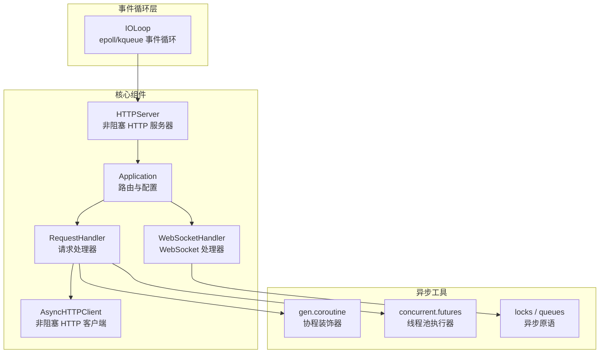
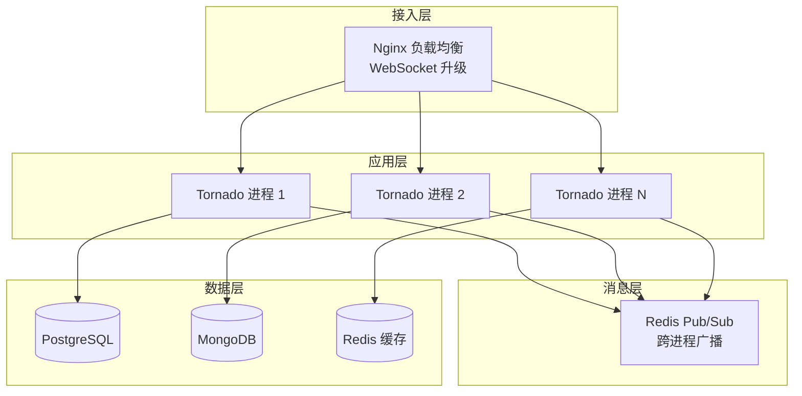

# Tornado 高并发 IO 模型

> **文档说明**：深入讲解 Tornado 异步 Web 框架的核心 IO 模型（epoll/kqueue 事件循环）、协程机制（gen.coroutine / async/await）、非阻塞 HTTP 客户端、WebSocket 实时通信、长连接与高并发架构设计，含可运行的异步 WebSocket 聊天服务和异步 HTTP 客户端代码。
>
> **适用人群**：需要构建高并发长连接服务的 Python 后端开发者、关注异步 IO 底层原理的工程师、从同步框架迁移到异步的开发者
>
> **前置知识**：[[Python-异步编程asyncio]]、[[IO模型与零拷贝]]、[[进程线程与协程]]

---

## 一、概述

### 1. 定义与核心价值

Tornado 是 FriendFeed 开发的异步 Web 框架，核心是一个基于 epoll（Linux）/kqueue（BSD/macOS）的事件循环，实现单线程高并发。与 Flask/Django 等同步 WSGI 框架不同，Tornado 原生支持异步请求处理、长连接（WebSocket/SSE）、非阻塞 HTTP 客户端，单机可支撑数万并发连接。

Tornado 的设计目标是**C10K 问题**：单台服务器处理 10000 个并发连接。它通过事件驱动 + 非阻塞 IO 实现，每个连接只占用一个文件描述符和少量内存，而非一个线程。

### 2. 痛点对比

| 痛点（同步多线程模型） | Tornado 异步模型解决方式 |
|---------------------|----------------------|
| 每个连接一个线程，10K 连接需 10K 线程，内存耗尽 | 单线程事件循环，10K 连接只占用 10K 个 fd，内存占用极低 |
| 线程切换开销大，CPU 消耗在线程调度上 | 事件循环单线程，无线程切换开销 |
| 线程间共享数据需锁，容易死锁 | 单线程无共享数据竞争，无需锁 |
| 长连接（WebSocket）占用线程，连接数受限 | 长连接只注册 fd 到事件循环，不阻塞 |
| 同步 HTTP 客户端调用阻塞整个线程 | `AsyncHTTPClient` 非阻塞，等待响应时处理其他请求 |
| 阻塞 IO（数据库/文件）卡住事件循环 | 异步驱动（motor/aiopg）或线程池执行器 |

### 3. Tornado 架构全景



<div style="background:linear-gradient(135deg,#fa709a,#fee140);border-radius:16px;padding:20px;margin:16px 0;font-family:-apple-system,'Segoe UI','PingFang SC','Microsoft YaHei',sans-serif;color:#fff;overflow:hidden;box-shadow:0 8px 28px rgba(0,0,0,.14),0 3px 10px rgba(0,0,0,.08)">
<style>@keyframes flow{0%{transform:translateX(-10px);opacity:0}15%{transform:translateX(0);opacity:1}85%{transform:translateX(0);opacity:1}100%{transform:translateX(10px);opacity:0}}.flow-step{display:inline-block;background:rgba(255,255,255,.2);border:2px solid rgba(255,255,255,.5);border-radius:8px;padding:10px 14px;margin:4px;text-align:center;font-weight:600;font-size:13px;animation:flow 4s ease-in-out infinite;min-width:90px}.flow-step:nth-child(2){animation-delay:.5s}.flow-step:nth-child(4){animation-delay:1s}.flow-step:nth-child(6){animation-delay:1.5s}.flow-step:nth-child(8){animation-delay:2s}.flow-arrow{display:inline-block;font-size:20px;animation:flow 4s ease-in-out infinite;vertical-align:middle}.flow-code{background:rgba(0,0,0,.2);border-radius:6px;box-shadow:0 2px 8px rgba(0,0,0,.06);padding:8px 12px;margin-top:10px;font-family:monospace;font-size:12px;text-align:center}</style>
<div style="text-align:center;font-size:15px;font-weight:700;margin-bottom:14px;padding-bottom:10px;border-bottom:1.5px solid rgba(255,255,255,.22);letter-spacing:1px;text-shadow:0 1px 3px rgba(0,0,0,.12)">Tornado 事件循环处理流程</div>
<div style="text-align:center;white-space:nowrap;overflow-x:auto"><span class="flow-step">epoll/kqueue监听</span><span class="flow-arrow">→</span><span class="flow-step">IO事件就绪</span><span class="flow-arrow">→</span><span class="flow-step">回调/协程触发</span><span class="flow-arrow">→</span><span class="flow-step">非阻塞处理</span><span class="flow-arrow">→</span><span class="flow-step">注册新fd</span><span class="flow-arrow">→</span><span class="flow-step">继续监听</span></div>
<div class="flow-code">单线程高并发：每个连接只占一个fd，C10K问题的经典解决方案</div>
<div style="text-align:center;font-size:12px;opacity:.85;margin-top:8px">阻塞IO必须用异步驱动或线程池，否则卡住整个事件循环</div>
</div>

---


> 💡 **深度讲解**：Tornado 是为解决 C10K 问题而生的异步 Web 框架，核心是基于 epoll/kqueue 的 IOLoop 事件循环。与 Flask/Django 等同步 WSGI 框架（每个连接一个线程）不同，Tornado 采用单线程事件驱动模型：所有连接注册 fd 到 epoll，事件循环等待 fd 就绪后调用回调，每个连接只占用一个 fd 和少量内存，单机可支撑数万并发连接。Tornado 原生支持异步请求处理（async/await 或 gen.coroutine）、长连接（WebSocket/SSE）、非阻塞 HTTP 客户端（AsyncHTTPClient）。但 Tornado 的劣势是生态不如 Flask/Django 丰富，且开发时必须注意不能有阻塞 IO（否则卡住整个事件循环），数据库必须用异步驱动或线程池。在现代 Python 生态中，FastAPI（基于 Starlette + asyncio）在很多场景下已替代 Tornado，但 Tornado 在长连接和高并发场景仍有优势。
>
> **📝 精简总结**：Tornado = IOLoop事件循环（epoll/kqueue）+ 非阻塞IO + 协程（async/await/gen.coroutine）+ WebSocket长连接。单线程高并发，解决C10K问题。必须避免阻塞IO，用异步驱动或线程池。适合长连接/高并发/实时通信场景。

## 二、底层原理

> 🔍 **知识点深度解析：IOLoop 事件循环与 epoll**
>
> **作用**：IOLoop 是 Tornado 的核心，基于 epoll（Linux）/kqueue（BSD）实现单线程高并发事件循环，是 Tornado 支撑 C10K 的关键。
>
> **原理**：IOLoop 封装了操作系统的 IO 多路复用机制（epoll/kqueue/select）。启动后，IOLoop 进入循环：调用 epoll_wait 等待文件描述符就绪，就绪后调用对应的回调函数或恢复协程，处理完成后继续等待。所有 IO 操作都是非阻塞的——socket 设置为非阻塞模式，读写时如果数据未就绪，注册 fd 到 epoll 并返回，事件循环继续处理其他连接。这种模型下，单线程可以同时管理数万连接，每个连接只占用一个 fd 和少量内存，而非一个线程。
>
> **用法要点**：① IOLoop.current() 获取当前线程的事件循环实例 ② 所有 IO 必须非阻塞，阻塞操作会卡住整个事件循环 ③ 阻塞 IO（数据库/文件）用异步驱动（motor/aiopg）或线程池执行器 ④ 协程用 async/await 或 gen.coroutine 编写 ⑤ IOLoop.start() 启动循环，stop() 停止 ⑥ 生产环境用多进程（每个CPU核心一个IOLoop）+ 负载均衡

### 1. 事件循环与 IO 多路复用

Tornado 的核心是 `IOLoop`，它封装了操作系统的 IO 多路复用机制：

```mermaid
graph LR
    subgraph 事件循环
        A[epoll_wait()<br/>等待事件] --> B{有事件?}
        B -->|是| C[回调对应 handler]
        C --> D[处理完成]
        D --> A
        B -->|否| A
    end

    subgraph 注册的 fd
        E[客户端连接 fd]
        F[数据库连接 fd]
        G[HTTP 客户端 fd]
        H[定时器 fd]
    end

    E --> A
    F --> A
    G --> A
    H --> A
```
```mermaid
# Tornado IOLoop 核心简化版
import select

class IOLoop:
    def __init__(self):
        self._impl = select.epoll()  # Linux 用 epoll
        self._handlers = {}  # {fd: handler}
        self._callbacks = []  # 待执行回调

    def add_handler(self, fd, handler, events):
        """注册文件描述符和事件回调"""
        self._impl.register(fd, events)
        self._handlers[fd] = handler

    def start(self):
        """事件循环主循环"""
        while True:
            # 1. 执行待处理的回调
            while self._callbacks:
                callback = self._callbacks.pop(0)
                callback()

            # 2. 等待 IO 事件（超时 1s 以处理定时器）
            events = self._impl.poll(timeout=1.0)

            # 3. 分发事件到对应 handler
            for fd, event in events:
                handler = self._handlers.get(fd)
                if handler:
                    handler(fd, event)
```
### 2. 协程机制

Tornado 支持两种协程写法：

```python
# 方式 1：gen.coroutine（旧版，兼容 Python 2）
from tornado import gen

@gen.coroutine
def fetch_url(url):
    http_client = AsyncHTTPClient()
    response = yield http_client.fetch(url)  # yield 挂起，等待结果
    return response.body

# 方式 2：async/await（Python 3.5+，推荐）
async def fetch_url(url):
    http_client = AsyncHTTPClient()
    response = await http_client.fetch(url)  # await 挂起
    return response.body
```
**协程执行原理**：`async/await` 本质是 Python 生成器的语法糖。`await` 时协程挂起，将控制权交还给事件循环；等待的 Future 完成时，事件循环恢复协程执行。

### 3. 非阻塞 HTTP 客户端

```mermaid
graph TB
    A[协程调用<br/>await client.fetch(url)] --> B[创建 Future]
    B --> C[注册 fd 到 epoll]
    C --> D[挂起协程<br/>事件循环处理其他请求]
    D --> E{数据到达?}
    E -->|是| F[读取响应]
    F --> G[设置 Future 结果]
    G --> H[恢复协程执行]
    E -->|否| D
```
### 4. 同步与异步对比

| 维度 | 同步模型（Flask+Gunicorn） | 异步模型（Tornado） |
|------|------------------------|-------------------|
| 并发单位 | 线程/进程 | 协程（单线程） |
| 10K 连接内存 | ~8GB（每线程 8MB 栈） | ~200MB（每连接 ~20KB） |
| 阻塞 IO 影响 | 阻塞当前线程 | 阻塞整个事件循环（致命） |
| 上下文切换 | 内核态线程切换（~1μs） | 用户态协程切换（~100ns） |
| 适用场景 | CPU 密集、短连接 | IO 密集、长连接 |
| 编程复杂度 | 低（顺序执行） | 中（需理解异步） |

---


> 💡 **深度讲解**：本章深入拆解了技术的底层原理和核心机制，包括架构设计、工作流程、关键技术实现细节。理解原理的价值在于：当遇到文档未覆盖的边缘场景或性能问题时，能够基于原理进行推理和调试，而不是依赖试错。建议结合 Mermaid 架构图，在脑中模拟一次完整的请求/数据流转过程，确保每个环节都理解透彻。
>
> **📝 精简总结**：本章深入讲解了技术的核心原理、架构设计、工作流程和关键实现细节，配合架构图帮助理解底层机制。

## 三、实操

### 1. 基础异步 Web 服务

```python
# basic_server.py
import tornado.ioloop
import tornado.web
import tornado.gen
from tornado.httpclient import AsyncHTTPClient


class MainHandler(tornado.web.RequestHandler):
    """同步处理器：快速返回"""
    def get(self):
        self.write("Hello, Tornado!")


class AsyncHandler(tornado.web.RequestHandler):
    """异步处理器：调用外部 API 不阻塞事件循环"""
    async def get(self):
        http_client = AsyncHTTPClient()
        try:
            response = await http_client.fetch("https://api.example.com/data")
            self.write(f"外部 API 响应: {response.body.decode()[:100]}")
        except Exception as e:
            self.set_status(502)
            self.write(f"调用失败: {str(e)}")


class SleepHandler(tornado.web.RequestHandler):
    """异步睡眠：不阻塞事件循环"""
    async def get(self):
        seconds = self.get_argument("seconds", "1")
        await tornado.gen.sleep(float(seconds))  # 异步睡眠
        self.write(f"睡眠了 {seconds} 秒")


class ParallelHandler(tornado.web.RequestHandler):
    """并行调用多个外部 API"""
    async def get(self):
        http_client = AsyncHTTPClient()
        urls = [
            "https://api.example.com/users",
            "https://api.example.com/posts",
            "https://api.example.com/comments",
        ]
        # 并行发起所有请求
        responses = await tornado.gen.multi([
            http_client.fetch(url) for url in urls
        ])
        results = [r.body.decode()[:50] for r in responses]
        self.write({"results": results})


def make_app():
    return tornado.web.Application([
        (r"/", MainHandler),
        (r"/async", AsyncHandler),
        (r"/sleep", SleepHandler),
        (r"/parallel", ParallelHandler),
    ], debug=True)


if __name__ == "__main__":
    app = make_app()
    app.listen(8888)
    print("Tornado server started on http://localhost:8888")
    tornado.ioloop.IOLoop.current().start()
```
### 2. WebSocket 实时聊天

```python
# chat_server.py
import tornado.ioloop
import tornado.web
import tornado.websocket
import json
from collections import defaultdict


class ChatWebSocket(tornado.websocket.WebSocketHandler):
    # 类变量：所有连接的客户端，按房间分组
    clients = defaultdict(set)

    def check_origin(self, origin):
        """允许跨域连接（生产环境应限制来源）"""
        return True

    def open(self, room_id):
        """WebSocket 连接建立"""
        self.room_id = room_id
        self.username = self.get_argument("username", "匿名")
        ChatWebSocket.clients[room_id].add(self)
        # 通知房间内其他人
        self.broadcast_to_room(json.dumps({
            "type": "system",
            "message": f"{self.username} 加入了房间",
            "online": len(ChatWebSocket.clients[room_id]),
        }))
        print(f"用户 {self.username} 加入房间 {room_id}")

    def on_message(self, message):
        """收到客户端消息"""
        try:
            data = json.loads(message)
            # 广播到房间内所有客户端
            self.broadcast_to_room(json.dumps({
                "type": "message",
                "username": self.username,
                "content": data.get("content", ""),
                "timestamp": tornado.ioloop.IOLoop.current().time(),
            }))
        except json.JSONDecodeError:
            self.write_message(json.dumps({"type": "error", "message": "无效的消息格式"}))

    def on_close(self):
        """连接关闭"""
        ChatWebSocket.clients[self.room_id].discard(self)
        self.broadcast_to_room(json.dumps({
            "type": "system",
            "message": f"{self.username} 离开了房间",
            "online": len(ChatWebSocket.clients[self.room_id]),
        }))
        print(f"用户 {self.username} 离开房间 {self.room_id}")

    def broadcast_to_room(self, message):
        """向房间内所有客户端广播"""
        for client in ChatWebSocket.clients[self.room_id]:
            if client != self or '"type": "system"' in message:
                client.write_message(message)


class ChatPageHandler(tornado.web.RequestHandler):
    """聊天页面"""
    def get(self, room_id):
        self.render("chat.html", room_id=room_id)


def make_app():
    return tornado.web.Application([
        (r"/chat/(\w+)", ChatPageHandler),
        (r"/ws/(\w+)", ChatWebSocket),
    ], template_path="templates", debug=True)


if __name__ == "__main__":
    app = make_app()
    app.listen(8888)
    print("Chat server started on http://localhost:8888/chat/default")
    tornado.ioloop.IOLoop.current().start()
```
```html
<!-- templates/chat.html -->
<!DOCTYPE html>
<html>
<head>
    <meta charset="UTF-8">
    <title>聊天室 - {{ room_id }}</title>
    <style>
        body { font-family: system-ui; max-width: 600px; margin: 2rem auto; }
        #messages { height: 400px; overflow-y: auto; border: 1px solid #ccc; padding: 1rem; }
        .message { margin: 0.5rem 0; }
        .system { color: #999; font-style: italic; }
        #input { display: flex; gap: 0.5rem; margin-top: 1rem; }
        #input input { flex: 1; padding: 0.5rem; }
    </style>
</head>
<body>
    <h1>房间: {{ room_id }}</h1>
    <div id="messages"></div>
    <div id="input">
        <input type="text" id="msg" placeholder="输入消息..." autofocus>
        <button onclick="sendMessage()">发送</button>
    </div>

    <script>
    const username = prompt("请输入用户名:", "访客" + Math.floor(Math.random()*1000));
    const ws = new WebSocket(`ws://${location.host}/ws/{{ room_id }}?username=${encodeURIComponent(username)}`);

    ws.onmessage = function(event) {
        const data = JSON.parse(event.data);
        const div = document.createElement("div");
        div.className = "message " + (data.type === "system" ? "system" : "");
        if (data.type === "message") {
            div.textContent = `${data.username}: ${data.content}`;
        } else {
            div.textContent = data.message + ` (在线: ${data.online})`;
        }
        document.getElementById("messages").appendChild(div);
        document.getElementById("messages").scrollTop = 999999;
    };

    function sendMessage() {
        const input = document.getElementById("msg");
        if (input.value.trim()) {
            ws.send(JSON.stringify({content: input.value}));
            input.value = "";
        }
    }
    document.getElementById("msg").addEventListener("keypress", e => {
        if (e.key === "Enter") sendMessage();
    });
    </script>
</body>
</html>
```
### 3. 异步数据库操作（Motor + MongoDB）

```python
# async_db_server.py
import tornado.ioloop
import tornado.web
import motor.motor_tornado
from bson import ObjectId
import json

# 异步 MongoDB 客户端
client = motor.motor_tornado.MotorClient("mongodb://localhost:27017")
db = client["tornado_chat"]


class UserHandler(tornado.web.RequestHandler):
    async def get(self, user_id):
        """查询用户：异步不阻塞"""
        user = await db.users.find_one({"_id": ObjectId(user_id)})
        if not user:
            self.set_status(404)
            self.write({"error": "用户不存在"})
            return
        user["_id"] = str(user["_id"])
        self.write(user)

    async def post(self):
        """创建用户"""
        data = json.loads(self.request.body)
        result = await db.users.insert_one({
            "name": data["name"],
            "email": data["email"],
            "created_at": tornado.ioloop.IOLoop.current().time(),
        })
        self.set_status(201)
        self.write({"id": str(result.inserted_id)})


class UserListHandler(tornado.web.RequestHandler):
    async def get(self):
        """分页查询用户列表"""
        page = int(self.get_argument("page", 1))
        per_page = int(self.get_argument("per_page", 20))
        skip = (page - 1) * per_page

        # 异步游标遍历
        cursor = db.users.find().skip(skip).limit(per_page)
        users = []
        async for user in cursor:
            user["_id"] = str(user["_id"])
            users.append(user)

        total = await db.users.count_documents({})
        self.write({
            "items": users,
            "total": total,
            "page": page,
            "per_page": per_page,
        })


def make_app():
    return tornado.web.Application([
        (r"/api/users/(\w+)", UserHandler),
        (r"/api/users", UserListHandler),
    ], debug=True)


if __name__ == "__main__":
    app = make_app()
    app.listen(8888)
    tornado.ioloop.IOLoop.current().start()
```
### 4. 线程池执行阻塞操作

```python
# blocking_ops.py
import tornado.ioloop
import tornado.web
from concurrent.futures import ThreadPoolExecutor
import time
import hashlib


# 线程池：用于执行阻塞操作
executor = ThreadPoolExecutor(max_workers=10)


class HeavyComputeHandler(tornado.web.RequestHandler):
    """CPU 密集型操作放到线程池，避免阻塞事件循环"""
    async def get(self):
        data = self.get_argument("data", "hello")
        # 将阻塞的 CPU 计算提交到线程池
        result = await tornado.ioloop.IOLoop.current().run_in_executor(
            executor, self.heavy_compute, data
        )
        self.write({"result": result})

    @staticmethod
    def heavy_compute(data):
        """阻塞的 CPU 密集计算：模拟密码哈希"""
        result = data
        for _ in range(100000):
            result = hashlib.sha256(result.encode()).hexdigest()
        return result


class SyncDBCallHandler(tornado.web.RequestHandler):
    """同步数据库调用放到线程池"""
    async def get(self):
        result = await tornado.ioloop.IOLoop.current().run_in_executor(
            executor, self.sync_db_query
        )
        self.write(result)

    @staticmethod
    def sync_db_query():
        """模拟同步数据库查询（如使用 psycopg2 而非 asyncpg）"""
        time.sleep(0.5)  # 模拟阻塞
        return {"data": "查询结果"}
```
### 5. 异步 HTTP 客户端高级用法

```python
# async_http_client.py
from tornado.httpclient import AsyncHTTPClient, HTTPRequest
import tornado.ioloop


async def fetch_with_retry(url, max_retries=3):
    """带重试的异步 HTTP 请求"""
    http_client = AsyncHTTPClient()
    for attempt in range(max_retries):
        try:
            request = HTTPRequest(
                url,
                method="GET",
                connect_timeout=5,
                request_timeout=10,
                headers={"User-Agent": "Tornado-AsyncClient/1.0"},
            )
            response = await http_client.fetch(request)
            return response.body.decode()
        except Exception as e:
            if attempt == max_retries - 1:
                raise
            await tornado.gen.sleep(2 ** attempt)  # 指数退避


async def fetch_concurrent(urls):
    """并发请求多个 URL，限制并发数"""
    http_client = AsyncHTTPClient(max_clients=10)  # 限制并发连接数
    responses = await tornado.gen.multi([
        http_client.fetch(url) for url in urls
    ])
    return [r.body for r in responses]
```
---


> 💡 **深度讲解**：本章提供了从环境搭建到完整项目示例的实操指南，包含可运行的代码示例和最佳实践。实操是掌握技术的关键环节——'纸上得来终觉浅，绝知此事要躬行'。建议按照示例顺序动手实现，每段代码都要理解其作用，而不是简单复制粘贴。遇到报错时，先阅读错误信息再排查，这是提升调试能力的最佳途径。
>
> **📝 精简总结**：本章提供了完整的实操指南，包括环境搭建、快速上手、核心用法、最佳实践和完整项目示例，代码可直接运行。

## 四、常见问题与排查

| 问题现象 | 原因 | 解决方案 |
|---------|------|---------|
| 事件循环被阻塞，所有请求卡住 | 在异步 handler 中调用了阻塞函数（time.sleep、同步数据库驱动） | 用 `gen.sleep` 替代 `time.sleep`；用异步驱动（motor/asyncpg）；阻塞操作放 `run_in_executor` |
| WebSocket 连接频繁断开 | Nginx 反向代理未配置 WebSocket 升级，或超时时间过短 | Nginx 配置 `Upgrade` 和 `Connection` 头；增大 `proxy_read_timeout` |
| `RuntimeError: This event loop is already running` | 在已运行的事件循环中调用了 `IOLoop.start()` | 不要重复调用 `start()`；在测试中用 `IOLoop.current().run_sync()` |
| 异步数据库查询比同步还慢 | 连接池过小，或查询本身是瓶颈 | 增大数据库连接池；优化 SQL 查询；考虑缓存 |
| `AsyncHTTPClient` 报 `Stream closed` | 服务器主动关闭连接，或请求超时 | 增大 `request_timeout`；实现重试机制；检查服务器端 |
| 内存持续增长 | 连接未正确关闭，或大响应未释放 | 确保 `WebSocketHandler.on_close` 中清理引用；`AsyncHTTPClient` 用完调用 `close()` |
| 多进程部署时 WebSocket 广播不到其他进程的客户端 | 每个进程有独立的内存，clients 不共享 | 使用 Redis Pub/Sub 或消息队列做跨进程广播 |
| `gen.multi` 中一个请求失败导致全部失败 | `multi` 默认任一失败就抛异常 | 使用 `multi(..., quiet_exceptions=Exception)` 或分别 try/except |
| 静态文件服务慢 | Tornado 自带静态文件处理不适合生产 | 生产环境用 Nginx 托管静态文件，Tornado 只处理动态请求 |
| 协程中异常未被捕获 | `await` 的异常需要 try/except，否则事件循环记录后继续 | 在协程中包裹 try/except；或设置 `IOLoop` 的 `set_exception_handler` |

---


> 💡 **深度讲解**：本章汇总了常见错误、性能瓶颈、安全风险和生产环境踩坑记录，采用'问题→原因→方案'的结构帮助快速定位和解决问题。生产环境中的问题往往不是技术本身的问题，而是使用方式不当或边界条件未考虑。建议在项目上线前，对照本章的问题清单逐一检查，提前规避常见陷阱。遇到本章未覆盖的问题时，按照'复现→定位→分析→解决→记录'的流程处理。
>
> **📝 精简总结**：本章汇总了常见错误、性能优化、安全防护和生产踩坑记录，采用问题→原因→方案结构，帮助快速排查解决问题。

## 五、进阶与最佳实践

### 1. 高并发架构设计


### 2. 多进程部署

```python
# multi_process_server.py
import tornado.ioloop
import tornado.web
import tornado.httpserver

class MainHandler(tornado.web.RequestHandler):
    def get(self):
        self.write("Hello from process!")

app = tornado.web.Application([(r"/", MainHandler)])

if __name__ == "__main__":
    server = tornado.httpserver.HTTPServer(app)
    server.bind(8888)
    server.start(0)  # 0 = 根据 CPU 核心数 fork 子进程
    tornado.ioloop.IOLoop.current().start()
```
**注意**：多进程模式下，每个进程有独立的事件循环和内存。WebSocket 广播需要通过 Redis Pub/Sub 跨进程通信。

### 3. 与 FastAPI 选型对比

| 维度 | Tornado | FastAPI |
|------|---------|---------|
| 异步模型 | 自研事件循环（可与 asyncio 集成） | 基于 asyncio + Starlette |
| WebSocket | 原生支持，成熟稳定 | 原生支持 |
| 生态 | 较小（Tornado 专用扩展少） | 丰富（FastAPI 生态 + Starlette 中间件） |
| 类型提示 | 无 | 强类型（Pydantic） |
| 自动文档 | 无 | 内置 Swagger/ReDoc |
| 性能 | 极高（成熟优化） | 高 |
| 适用场景 | 长连接、实时推送、旧系统维护 | 新建 API 服务、AI 应用 |

### 4. 性能优化清单

| 优化手段 | 说明 |
|---------|------|
| **避免阻塞** | 事件循环中绝不调用阻塞函数，这是 Tornado 的生命线 |
| **连接池** | 数据库/HTTP 客户端使用连接池，避免频繁建连 |
| **异步驱动** | 所有 IO 操作使用异步库（motor/asyncpg/aioredis） |
| **线程池** | 不可避免的阻塞操作用 `run_in_executor` |
| **Gzip 压缩** | 启用 `gzip` 中间件减少传输量 |
| **静态文件 CDN** | 生产环境静态文件由 Nginx/CDN 处理 |
| **多进程** | `server.start(0)` 利用多核 CPU |
| **连接超时** | 设置合理的 `connect_timeout` 和 `request_timeout` |
| **内存监控** | 长连接场景监控内存，防止连接泄漏 |

### 5. 生产环境 Nginx 配置

upstream tornado_backend {
    server 127.0.0.1:8888;
    server 127.0.0.1:8889;
```text
    ## # ip_hash 确保 WebSocket 连接到同一后端
```
    ip_hash;
}

server {
    listen 80;
    server_name api.example.com;

```text
    ## # WebSocket 升级配置
```
    location /ws/ {
        proxy_pass http://tornado_backend;
        proxy_http_version 1.1;
        proxy_set_header Upgrade $http_upgrade;
        proxy_set_header Connection "upgrade";
        proxy_set_header Host $host;
        proxy_set_header X-Real-IP $remote_addr;
        proxy_read_timeout 86400;  # 24 小时，防止 WebSocket 超时
    }

```text
    ## # 普通 HTTP 请求
```
    location / {
        proxy_pass http://tornado_backend;
        proxy_set_header Host $host;
        proxy_set_header X-Real-IP $remote_addr;
        proxy_set_header X-Forwarded-For $proxy_add_x_forwarded_for;
    }

```text
    ## # 静态文件
```
    location /static/ {
        alias /var/www/static/;
        expires 30d;
```text
    }
}
```
---

> 💡 **深度讲解**：本章介绍了进阶用法、生态工具、技术集成、行业应用和学习资源，为深入学习提供方向。技术的价值不仅在于自身功能，更在于与其他技术的组合使用所产生的协同效应。建议根据项目需求和个人兴趣，选择1-2个拓展方向深入学习，避免浅尝辄止。
>
> **📝 精简总结**：本章介绍了进阶特性、生态工具、技术集成、应用案例和学习资源，为深入学习和技术拓展提供方向。


## 🔗 关联笔记

- [[FastAPI-路由与依赖注入]]
- [[FastAPI-WebSocket实时通信]]
- [[Flask-轻量服务架构]]
- [[Django-ORM与Admin体系]]
- [[HTMX与Python后端配合]]

## 📖 前置知识

- [[Python-异步编程asyncio]]

## 🏷️ 相关标签

#Python #Tornado #异步 #IO多路复用 #事件循环 #WebSocket

---

[[Home|🏠 返回首页]] · [[MOC-Python全栈|📚 返回分类]]
