# Python LangChain应用开发

> **📖 文档说明**
>
> 本文档是「从零基础新手到实战老手」三部曲的**完整体系**，涵盖入门篇、进阶篇、实战篇三大阶段。我们将从"LangChain 是什么"开始，一步步带你掌握从环境搭建、LLM 接入、Prompt 工程、Chain 组合、RAG 检索、Agent 智能体，到 FastAPI 部署、生产级架构、完整项目实战的全流程。每个知识点都配有概念解释、原理说明、可运行代码、最佳实践和常见坑点，确保你学完就能独立开发生产级 AI 应用。
>
> **👥 适用人群**
> - 有 Python 基础、想进入 AI 应用开发领域的开发者
> - 了解大语言模型基本概念、想系统学习 LangChain 框架的工程师
> - 已经在用 LangChain 做原型、想提升到生产级部署的全栈开发者
> - 面试备考 AI 应用工程师 / LLM 应用开发岗位的求职者
>
> **📚 前置知识**
> - Python 基础语法（函数、类、装饰器、异步编程）
> - HTTP / REST API 基本概念
> - 大语言模型（LLM）的基本了解（什么是 Prompt、Token、Temperature）
>
> **🗺️ 学习路径提示**
> - **入门篇（第1-4章）**：建立全局认知，跑通第一个 LangChain 应用，掌握 LLM 接入和 Prompt 工程
> - **进阶篇（第5-9章）**：深入 Chain 组合、RAG 检索增强、Agent 智能体、记忆管理，构建复杂应用
> - **实战篇（第10-14章）**：可观测性、FastAPI 部署、错误处理、生产架构、三个完整项目实战
> - 建议按章节顺序学习，每章看完后动手敲一遍代码示例
> - 每章末尾的「梯度练习题」务必尝试完成
> - 学完全部章节后，可独立完成智能客服、代码助手、数据分析 Agent 三个实战项目

---

## 第一篇 入门篇：从零搭建你的第一个 AI 应用

---

## 1. LangChain 全景与核心概念

### 1.1 LangChain 是什么

#### 概念解释

**LangChain 是一个开源的大语言模型（LLM）应用开发框架**，由 Harrison Chase 于 2022 年 10 月创建，提供 Python 和 TypeScript 双语言支持。它的核心目标是**简化 LLM 应用的开发流程**，将大语言模型与外部数据、工具、记忆系统无缝结合，让开发者能够快速构建从简单问答到复杂智能体的各类 AI 应用。

> 🎯 **生活化比喻**：如果把大语言模型比作一个超级聪明但"两耳不闻窗外事"的学者，LangChain 就是给这位学者配了一整套"工作装备"——笔记本（记忆系统）、图书馆（RAG 检索）、工具箱（Agent 工具）、流水线（Chain 组合）和监控仪表盘（回调追踪）。有了这些装备，学者才能真正解决现实世界的复杂问题。

**核心价值**：LangChain 通过统一的抽象接口和声明式的组合方式（LCEL），将 LLM 应用开发从"写一堆胶水代码"转变为"搭积木式的组件编排"，极大提升了开发效率和代码可维护性。

#### 原理说明

LangChain 的设计哲学基于一个核心洞察：**绝大多数 LLM 应用都可以拆解为若干标准化组件的组合**。这些组件包括模型调用、提示词模板、输出解析、文档检索、工具调用、对话记忆等。LangChain 为每类组件定义了统一的 `Runnable` 接口，使得任意组件都可以通过 `|` 运算符（管道符）像 Unix 管道一样串联起来。

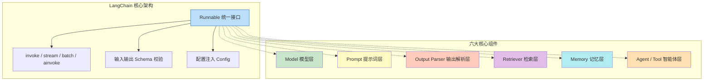

**为什么这样设计**：在 LangChain 出现之前，开发者调用 LLM 通常是直接用 `requests` 库发 HTTP 请求，然后手动拼接 Prompt、解析返回的 JSON、管理对话历史。这种方式存在三个痛点：①每个模型厂商的 API 格式不同，切换模型需要重写大量代码；②应用逻辑（检索、工具调用、记忆）与模型调用逻辑耦合在一起，难以测试和维护；③缺乏统一的流式、异步、批处理、重试机制。LangChain 的 `Runnable` 抽象完美解决了这些问题。

**技术对比**：

| 维度 | 原生 API 调用 | LangChain | LlamaIndex |
|------|-------------|-----------|------------|
| 模型切换 | 需重写请求代码 | 改一行初始化 | 改一行初始化 |
| 组件组合 | 手动胶水代码 | LCEL 管道符声明式 | Query Engine 组合 |
| RAG 支持 | 需自行实现 | 完整 Loader/Splitter/VectorStore | 深度优化的 RAG 管线 |
| Agent 支持 | 需自行实现循环 | 内置 ReAct/Function Calling | 较弱，需扩展 |
| 可观测性 | 需自行埋点 | LangSmith 一键接入 | 需自行集成 |
| 学习曲线 | 低（但代码量大） | 中（抽象多但统一） | 中（RAG 概念多） |
| 适用场景 | 简单调用、原型验证 | 通用 LLM 应用、Agent | 以 RAG 为核心的应用 |

> 🏆 **面试高频考点**：LangChain 的核心抽象是什么？答案是 `Runnable` 接口。它定义了 `invoke`、`stream`、`batch` 及其异步版本，所有组件（Prompt、Model、Parser、Retriever、Tool）都实现了这个接口，因此可以通过 `|` 运算符任意组合。这是 LangChain 与其他框架最本质的区别。

#### 代码示例

**示例1：基础——5 行代码跑通第一个 LangChain 应用**

```python
# src/01_hello_langchain.py
from langchain_openai import ChatOpenAI
from langchain_core.prompts import ChatPromptTemplate
from langchain_core.output_parsers import StrOutputParser

# 1. 创建模型实例
chat = ChatOpenAI(model="gpt-4o-mini", temperature=0.7)

# 2. 创建提示词模板
prompt = ChatPromptTemplate.from_template("用一句话解释{concept}")

# 3. 用管道符组合成 Chain
chain = prompt | chat | StrOutputParser()

# 4. 调用
result = chain.invoke({"concept": "LangChain"})
print(result)
# 预期输出：LangChain 是一个用于构建大语言模型应用的开源框架，通过链式组合简化 AI 应用开发。
```

**示例2：进阶——带 System Prompt 和多轮消息的对话**

```python
# src/02_chat_with_role.py
from langchain_openai import ChatOpenAI
from langchain_core.messages import SystemMessage, HumanMessage, AIMessage
from langchain_core.prompts import ChatPromptTemplate, MessagesPlaceholder
from langchain_core.output_parsers import StrOutputParser

chat = ChatOpenAI(model="gpt-4o-mini", temperature=0.5)

# 构建带角色设定和历史占位的对话模板
prompt = ChatPromptTemplate.from_messages([
    ("system", "你是一位资深 Python 技术专家，回答简洁准确，优先给出代码示例。"),
    MessagesPlaceholder(variable_name="history"),
    ("human", "{question}"),
])

chain = prompt | chat | StrOutputParser()

# 模拟多轮对话历史
history = [
    HumanMessage(content="什么是装饰器？"),
    AIMessage(content="装饰器是一种用于修改函数或类行为的语法糖，本质是接收函数并返回函数的高阶函数。"),
]

# 第一轮：基于历史追问
response1 = chain.invoke({
    "history": history,
    "question": "能给我一个实际例子吗？",
})
print("回答1:", response1)
# 预期输出：包含一个带 @decorator 语法的装饰器代码示例

# 第二轮：继续追问
history.append(HumanMessage(content="能给我一个实际例子吗？"))
history.append(AIMessage(content=response1))
response2 = chain.invoke({
    "history": history,
    "question": "装饰器和闭包有什么关系？",
})
print("回答2:", response2)
# 预期输出：解释装饰器本质上是闭包的一种应用场景
```

**示例3：完整场景——构建一个可配置的多角色问答助手**

```python
# src/03_configurable_assistant.py
from langchain_openai import ChatOpenAI
from langchain_core.prompts import ChatPromptTemplate
from langchain_core.output_parsers import StrOutputParser
from langchain_core.runnables import RunnableConfig
from typing import Dict, Any

class AIAssistant:
    """可配置角色的 AI 助手，支持运行时切换角色和模型参数。"""

    # 预设角色库
    ROLES: Dict[str, str] = {
        "python_expert": "你是一位资深 Python 技术专家，精通 Python 语法、设计模式和性能优化。回答简洁准确，附带代码示例。",
        "product_manager": "你是一位资深产品经理，擅长需求分析、用户体验设计和产品规划。回答从用户价值出发，逻辑清晰。",
        "career_coach": "你是一位职业规划教练，擅长简历优化、面试辅导和职业发展建议。回答鼓励性强，给出可执行建议。",
        "friendly_chat": "你是一个友好的聊天伙伴，语气轻松幽默，善于倾听和回应。",
    }

    def __init__(self, model: str = "gpt-4o-mini", temperature: float = 0.7):
        self.chat = ChatOpenAI(model=model, temperature=temperature)
        self.parser = StrOutputParser()
        self._build_chain()

    def _build_chain(self):
        """构建基础 Chain，角色通过 RunnableConfig 动态注入。"""
        prompt = ChatPromptTemplate.from_messages([
            ("system", "{system_prompt}"),
            ("human", "{user_input}"),
        ])
        self.chain = prompt | self.chat | self.parser

    def chat_with_role(
        self,
        user_input: str,
        role: str = "friendly_chat",
        temperature: float = None,
    ) -> str:
        """
        与指定角色对话。

        Args:
            user_input: 用户输入
            role: 角色名称，从 ROLES 中选择
            temperature: 临时覆盖温度参数

        Returns:
            AI 回复文本
        """
        if role not in self.ROLES:
            raise ValueError(f"未知角色 '{role}'，可选角色：{list(self.ROLES.keys())}")

        config: RunnableConfig = {}
        if temperature is not None:
            config["configurable"] = {"temperature": temperature}

        return self.chain.invoke({
            "system_prompt": self.ROLES[role],
            "user_input": user_input,
        }, config=config)

    def stream_with_role(self, user_input: str, role: str = "friendly_chat"):
        """流式输出，适合前端实时展示。"""
        if role not in self.ROLES:
            raise ValueError(f"未知角色 '{role}'")
        return self.chain.stream({
            "system_prompt": self.ROLES[role],
            "user_input": user_input,
        })


# 使用示例
if __name__ == "__main__":
    assistant = AIAssistant()

    # 用 Python 专家角色提问
    answer = assistant.chat_with_role(
        "如何用 Python 实现单例模式？",
        role="python_expert",
    )
    print("【Python 专家】", answer)

    # 用产品经理角色提问
    answer = assistant.chat_with_role(
        "如何提升一个 AI 聊天产品的用户留存？",
        role="product_manager",
    )
    print("【产品经理】", answer)

    # 流式输出
    print("【职业教练】", end="", flush=True)
    for chunk in assistant.stream_with_role("我刚毕业，如何选择第一份工作？", role="career_coach"):
        print(chunk, end="", flush=True)
    print()
```

#### 使用场景与最佳实践

**适用场景**：
- 需要快速搭建 LLM 应用原型，验证产品想法
- 应用需要集成多种能力（检索、工具调用、对话记忆）
- 需要在多个 LLM 提供商之间灵活切换
- 需要构建可观测、可评估、可迭代的生产级 AI 应用

**不适用场景**：
- 只需要最简单的单次 LLM 调用（直接用 SDK 更轻量）
- 对延迟要求极高（<100ms）且不需要额外组件的场景
- 团队完全不熟悉 Python / TypeScript，且没有学习预算
- 极度定制化、需要完全掌控每一行底层代码的场景

**最佳实践**：
1. **从 LCEL 开始**：新项目一律使用 LCEL（`|` 管道符）组合组件，不要使用已废弃的 `Chain` 类（如 `LLMChain`），LCEL 是 LangChain 0.2+ 的推荐方式，原生支持流式、异步、批处理和追踪。
2. **统一配置管理**：用 `pydantic-settings` 或 `.env` 文件管理 API Key、模型名称、温度等参数，不要硬编码在代码中。
3. **先跑通最小闭环**：先实现 `Prompt | Model | Parser` 的最简链路，验证模型接入和基本功能，再逐步添加 RAG、Agent、记忆等复杂组件。
4. **开启 LangSmith 追踪**：开发阶段就设置 `LANGCHAIN_TRACING_V2=true`，所有调用自动记录到 LangSmith，方便调试和性能分析。
5. **模型参数分层配置**：`temperature` 按场景设置——创意写作 0.7-0.9，事实问答 0.0-0.3，代码生成 0.2-0.5。

**性能建议**：
- 对于重复查询，启用 LLM 缓存（`InMemoryCache` 或 `RedisCache`），可减少 30%-70% 的 API 调用
- 批量处理时使用 `batch()` 方法并设置 `max_concurrency`，比循环 `invoke()` 快 2-5 倍
- 长文本生成使用 `stream()` 流式输出，首字延迟可从 3-5 秒降到 0.5 秒以内

#### 常见坑点

**坑点1：导入路径错误——`from langchain.chains import LLMChain` 报 DeprecationWarning**

- **错误现象**：代码能运行但控制台大量警告 `LLMChain is deprecated`，或某些方法行为异常
- **根本原因**：LangChain 0.2 之后将旧版 `Chain` 类标记为废弃，推荐使用 LCEL 组合。旧版 `LLMChain` 内部仍然可以工作，但不再维护，且与新的 `Runnable` 生态不完全兼容
- **正确做法**：将 `LLMChain(llm=chat, prompt=prompt)` 替换为 `chain = prompt | chat | StrOutputParser()`，调用方式从 `chain.run(input="...")` 改为 `chain.invoke({"input": "..."})`
- **预防措施**：新项目直接参考 LangChain 官方最新文档，遇到 `deprecated` 警告立即重构，不要积累技术债

**坑点2：API Key 未配置导致 `AuthenticationError`**

- **错误现象**：运行时报 `openai.AuthenticationError: Incorrect API key provided` 或 `API key not found`
- **根本原因**：`OPENAI_API_KEY` 环境变量未设置，或 `.env` 文件未被正确加载，或 Key 本身已过期/无余额
- **正确做法**：①在项目根目录创建 `.env` 文件并写入 `OPENAI_API_KEY=sk-xxx`；②在代码入口处调用 `load_dotenv()`；③验证 Key 有效性：`echo $OPENAI_API_KEY`（Linux/macOS）或 `echo %OPENAI_API_KEY%`（Windows）
- **预防措施**：在项目 README 中写明环境变量配置步骤，提供 `.env.example` 模板文件，CI 流水线中检查必要环境变量是否存在

---

### 1.2 LangChain 生态体系

#### 概念解释

**LangChain 生态是围绕 LangChain 核心框架构建的一整套工具链和平台**，包括 LangGraph（有状态多 Actor 应用框架）、LangSmith（调试/测试/评估/监控平台）、LangServe（部署为 REST API 的工具）、LangChain Templates（应用模板库）和 LangChain Hub（Prompt 共享平台）。它们共同构成了从开发、调试、评估到部署、监控的完整 LLM 应用生命周期管理体系。

> 🎯 **生活化比喻**：如果 LangChain 核心框架是"厨房的灶台和锅具"，那么 LangGraph 就是"智能炒菜机器人"（能自动决定先放什么后放什么），LangSmith 是"厨房监控摄像头+菜品评分系统"（记录每一步操作并评估成品质量），LangServe 是"外卖打包配送系统"（把做好的菜送到顾客手中），LangChain Templates 就是"预制菜菜谱"（照着做就能快速出菜）。

**核心价值**：生态体系让开发者不需要自己搭建调试工具、评估平台和部署管线，可以专注于业务逻辑本身，大幅缩短从原型到生产的周期。

#### 原理说明

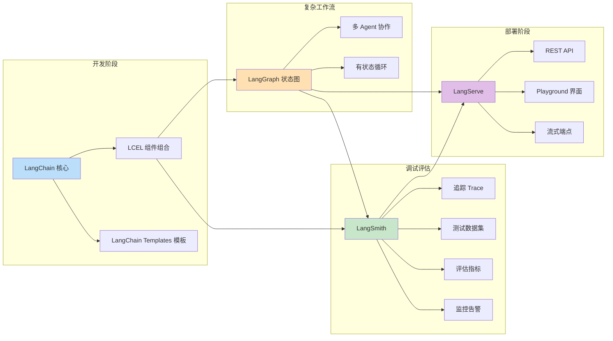

各组件的职责和协作关系：

- **LangChain 核心**：提供 `Runnable` 接口、Model/Prompt/Parser/Retriever/Memory/Tool 等基础组件，是一切的基础
- **LangGraph**：基于 LangChain 核心构建，用状态图（StateGraph）描述多步骤、有循环、有条件分支的复杂工作流，特别适合多 Agent 协作和需要"思考-行动-观察"循环的场景
- **LangSmith**：与 LangChain 核心无缝集成，通过环境变量开启后自动记录所有 `Runnable` 调用的完整 Trace（输入、输出、耗时、Token 用量），支持在线标注、数据集管理、自动化评估和生产监控
- **LangServe**：将任意 `Runnable` 暴露为 REST API，自动生成 `/invoke`、`/stream`、`/batch` 端点和交互式 Playground 页面
- **LangChain Templates**：社区贡献的应用模板，涵盖 RAG 问答、Agent 助手、数据分析等常见场景，可通过 `langchain app new` 一键创建

> 🏆 **面试高频考点**：LangChain 和 LangGraph 的区别是什么？LangChain 是核心框架，提供无状态的组件组合（LCEL），适合线性或简单分支的流水线；LangGraph 是构建在 LangChain 之上的有状态工作流框架，用图结构描述包含循环、条件分支、多 Agent 协作的复杂流程。简单说：LCEL 是"管道"，LangGraph 是"状态机"。

#### 代码示例

**示例1：基础——用 LangServe 一键部署 Chain 为 API**

```python
# src/04_serve_chain.py
from fastapi import FastAPI
from langchain_openai import ChatOpenAI
from langchain_core.prompts import ChatPromptTemplate
from langchain_core.output_parsers import StrOutputParser
from langserve import add_routes

# 构建 Chain
prompt = ChatPromptTemplate.from_template("用{language}解释{concept}，要求{style}")
chat = ChatOpenAI(model="gpt-4o-mini", temperature=0.7)
chain = prompt | chat | StrOutputParser()

# 创建 FastAPI 应用
app = FastAPI(title="LangChain API 服务", version="1.0.0")

# 一键添加路由：自动生成 /invoke, /stream, /batch, /playground
add_routes(app, chain, path="/explain")

if __name__ == "__main__":
    import uvicorn
    uvicorn.run(app, host="0.0.0.0", port=8000)

# 运行后访问：
# - API 文档：http://localhost:8000/docs
# - 交互式 Playground：http://localhost:8000/explain/playground
# - 调用：POST http://localhost:8000/explain/invoke
#         Body: {"input": {"language": "中文", "concept": "闭包", "style": "简洁"}}
```

**示例2：进阶——LangGraph 实现一个简单的有状态问答循环**

```python
# src/05_langgraph_basic.py
from typing import TypedDict, Annotated
from langgraph.graph import StateGraph, END
from langgraph.graph.message import add_messages
from langchain_openai import ChatOpenAI
from langchain_core.messages import HumanMessage, SystemMessage

# 定义状态：消息列表 + 循环计数
class AgentState(TypedDict):
    messages: Annotated[list, add_messages]
    iteration: int

# 初始化模型
chat = ChatOpenAI(model="gpt-4o-mini", temperature=0)

def reason_node(state: AgentState) -> AgentState:
    """推理节点：调用 LLM 生成回答。"""
    system_msg = SystemMessage(content="你是一个严谨的问答助手。如果不确定答案，说'需要更多信息'。")
    response = chat.invoke([system_msg] + state["messages"])
    return {"messages": [response], "iteration": state["iteration"] + 1}

def should_continue(state: AgentState) -> str:
    """条件边：判断是否需要继续（最多3轮）。"""
    last_msg = state["messages"][-1]
    if "需要更多信息" in last_msg.content and state["iteration"] < 3:
        return "continue"
    return "end"

# 构建图
workflow = StateGraph(AgentState)
workflow.add_node("reason", reason_node)
workflow.set_entry_point("reason")
workflow.add_conditional_edges(
    "reason",
    should_continue,
    {"continue": "reason", "end": END},
)

graph = workflow.compile()

# 运行
result = graph.invoke({
    "messages": [HumanMessage(content="量子计算的基本原理是什么？")],
    "iteration": 0,
})
print("最终回答:", result["messages"][-1].content)
print("迭代次数:", result["iteration"])
# 预期输出：LLM 生成的量子计算解释，iteration 通常为 1（一次就回答了）
```

**示例3：完整场景——LangSmith 追踪 + 评估数据集的完整工作流**

```python
# src/06_langsmith_workflow.py
import os
from dotenv import load_dotenv
from langchain_openai import ChatOpenAI
from langchain_core.prompts import ChatPromptTemplate
from langchain_core.output_parsers import StrOutputParser
from langsmith import Client
from langsmith.evaluation import evaluate

load_dotenv()

# 确保 LangSmith 环境变量已设置
# LANGCHAIN_TRACING_V2=true
# LANGCHAIN_API_KEY=lsv2_xxx
# LANGCHAIN_PROJECT=my-first-app

# 1. 构建待评估的 Chain
prompt = ChatPromptTemplate.from_template("""你是一个技术问答助手。
请根据问题给出简洁准确的回答，不超过100字。

问题：{question}
回答：""")
chat = ChatOpenAI(model="gpt-4o-mini", temperature=0)
chain = prompt | chat | StrOutputParser()

# 2. 创建评估数据集
client = Client()
dataset_name = "tech_qa_eval_v1"

# 检查数据集是否存在，不存在则创建
try:
    dataset = client.read_dataset(dataset_name=dataset_name)
except Exception:
    dataset = client.create_dataset(
        dataset_name=dataset_name,
        description="技术问答评估数据集 v1",
    )
    # 添加评估样本
    examples = [
        {"question": "什么是 REST API？", "answer": "REST API 是基于 HTTP 协议、使用标准方法（GET/POST/PUT/DELETE）操作资源的应用程序接口。"},
        {"question": "Python 中 GIL 是什么？", "answer": "GIL（全局解释器锁）是 CPython 中的互斥锁，确保同一时刻只有一个线程执行 Python 字节码，导致多线程无法真正并行执行 CPU 密集型任务。"},
        {"question": "什么是 Docker？", "answer": "Docker 是一个容器化平台，将应用及其依赖打包到轻量级容器中，实现跨环境的一致运行和快速部署。"},
    ]
    for ex in examples:
        client.create_example(
            inputs={"question": ex["question"]},
            outputs={"answer": ex["answer"]},
            dataset_id=dataset.id,
        )

# 3. 定义评估指标：用 LLM 作为评判者（LLM-as-Judge）
judge_prompt = ChatPromptTemplate.from_template("""请评估以下回答的质量，从准确性、简洁性、完整性三个维度打分（1-5分），最后给出总分。

问题：{question}
参考回答：{reference}
待评估回答：{prediction}

请输出 JSON 格式：{{"accuracy": 分数, "conciseness": 分数, "completeness": 分数, "total": 总分}}""")
judge_chat = ChatOpenAI(model="gpt-4o-mini", temperature=0)
judge_chain = judge_prompt | judge_chat | StrOutputParser()

def evaluate_answer(run, example):
    """自定义评估函数：调用 judge LLM 打分。"""
    result = judge_chain.invoke({
        "question": example.inputs["question"],
        "reference": example.outputs["answer"],
        "prediction": run.outputs["output"],
    })
    # 简单解析总分（实际应用中用 JSON 解析器）
    try:
        import json
        score_data = json.loads(result)
        return {"score": score_data.get("total", 0)}
    except Exception:
        return {"score": 0}

# 4. 运行评估
# 注意：需要先将 chain 部署为可调用的目标，这里用 lambda 包装
def target(inputs):
    return {"output": chain.invoke(inputs)}

results = evaluate(
    target,
    data=dataset_name,
    evaluators=[evaluate_answer],
    experiment_prefix="tech_qa_v1_experiment",
)

print("评估完成！查看 LangSmith 项目页面获取详细报告。")
# 预期：在 LangSmith 界面中看到每个样本的评分、平均总分、各维度分布
```

#### 使用场景与最佳实践

**适用场景**：
- 需要多 Agent 协作、有复杂循环和条件分支的应用 → LangGraph
- 需要调试、评估、监控 LLM 应用质量 → LangSmith
- 需要将 Chain 快速暴露为 API 服务 → LangServe
- 需要快速启动项目、参考最佳实践结构 → LangChain Templates

**不适用场景**：
- 简单的线性流水线（用 LCEL 就够了，不需要 LangGraph）
- 已有成熟的 API 网关和部署体系（LangServe 可能不够灵活）
- 对数据隐私要求极高、不能使用云端追踪平台（LangSmith 需自托管或用本地日志替代）

**最佳实践**：
1. **LangSmith 从第一天就接入**：不要等到出问题才加追踪，开发阶段开启后所有调用自动记录，调试效率提升 10 倍
2. **LangGraph 用于复杂状态，LCEL 用于简单流水线**：判断标准——如果流程中有循环（Agent 的思考-行动循环）或需要维护跨步骤的状态，用 LangGraph；如果是线性或简单分支，用 LCEL
3. **评估数据集随代码版本管理**：将评估样本存入 JSON/YAML 文件并纳入 Git，每次 Prompt 或模型变更后自动运行评估，防止回归
4. **LangServe 适合内部工具和 MVP**：生产环境建议用自定义 FastAPI 路由，更灵活地处理认证、限流、日志和自定义错误响应

**性能建议**：
- LangSmith 追踪有轻微性能开销（约 5%-10%），生产环境可采样追踪（设置 `LANGCHAIN_TRACING_SAMPLING_RATE=0.1`）
- LangGraph 的状态序列化有开销，状态对象尽量精简，不要在状态中存储大文档
- LangServe 的 `/stream` 端点使用 SSE（Server-Sent Events），前端用 `EventSource` 或 `fetch` + `ReadableStream` 消费

#### 常见坑点

**坑点1：LangSmith 不显示追踪记录**

- **错误现象**：设置了环境变量但 LangSmith 平台上看不到任何 Trace
- **根本原因**：常见原因有四个——①`LANGCHAIN_TRACING_V2` 未设为 `true`（注意是 V2，不是旧版的 `LANGCHAIN_TRACING`）；②`LANGCHAIN_API_KEY` 错误或过期；③`LANGCHAIN_PROJECT` 项目名不存在（会自动创建但可能延迟）；④环境变量在 Python 进程启动后才设置，未被读取
- **正确做法**：在代码入口处打印验证：`print(os.getenv("LANGCHAIN_TRACING_V2"), os.getenv("LANGCHAIN_API_KEY")[:10] if os.getenv("LANGCHAIN_API_KEY") else "NOT SET")`，确保在 `import langchain` 之前环境变量已加载
- **预防措施**：将 LangSmith 配置写入 `.env` 文件，在 `config.py` 中统一加载并校验，启动时日志输出追踪状态

**坑点2：LangGraph 状态更新时消息重复或丢失**

- **错误现象**：多轮调用后 `state["messages"]` 中出现重复消息，或某些消息丢失
- **根本原因**：`add_messages`  reducer 的工作机制是——如果返回的消息带有与现有消息相同的 `id`，则替换；否则追加。如果手动构造消息时没有设置 `id`，或在节点中返回了完整的消息列表而非增量，会导致重复
- **正确做法**：节点返回值只包含**增量更新**（如 `{"messages": [new_response]}`），不要返回完整的 `state["messages"]`；需要替换消息时设置相同的 `id`
- **预防措施**：在 LangGraph 节点中遵循"只返回变化部分"的原则，用 `print(state["messages"])` 在开发阶段验证状态变化

---

### 1.3 核心抽象：Runnable 接口

#### 概念解释

**Runnable 是 LangChain 中所有组件的统一协议接口**，定义了一套标准的调用方法（`invoke`、`stream`、`batch` 及其异步版本 `ainvoke`、`astream`、`abatch`）和配置注入机制。任何实现了 `Runnable` 接口的对象都可以通过 `|` 运算符串联，形成声明式的处理流水线。这是 LangChain 0.2 版本之后整个框架的基石。

> 🎯 **生活化比喻**：Runnable 就像 USB 接口标准——不管你是 U 盘、鼠标、键盘还是充电器，只要符合 USB 标准，就能插到任何 USB 接口上工作。LangChain 的 Prompt、Model、Parser、Retriever 都是"USB 设备"，`|` 运算符就是"USB 集线器"，把它们串起来就能协同工作，不需要为每种设备写专门的连接线。

**核心价值**：统一接口使得组件可以任意组合、替换和测试，开发者不需要关心每个组件的内部实现，只需要关注输入输出的类型匹配。

#### 原理说明

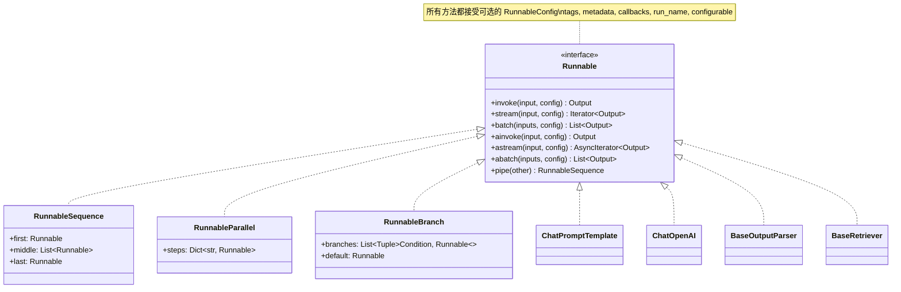

**核心机制**：
1. **`invoke(input, config)`**：同步调用，输入一个对象，输出一个对象。这是最基础的调用方式
2. **`stream(input, config)`**：流式调用，返回一个迭代器，逐步输出结果。适合长文本生成，降低首字延迟
3. **`batch(inputs, config)`**：批量调用，输入一个列表，并发执行后返回结果列表。通过 `config={"max_concurrency": N}` 控制并发度
4. **异步版本**：`ainvoke`、`astream`、`abatch`，在方法名前加 `a`，返回协程，需用 `await` 调用
5. **`pipe(other)` / `|` 运算符**：将两个 Runnable 串联，前一个的输出作为后一个的输入，返回 `RunnableSequence`
6. **`RunnableConfig`**：每次调用可传入配置，包括 `tags`（标签）、`metadata`（元数据）、`callbacks`（回调处理器）、`run_name`（运行名称）、`configurable`（可配置参数）

**为什么这样设计**：传统的 LLM 应用代码中，模型调用、Prompt 构建、结果解析是硬编码在一起的函数调用。当需要添加流式输出、异步支持、重试机制、追踪日志时，每个环节都要修改。Runnable 接口将这些横切关注点（streaming、async、batch、tracing、retry）统一到接口层面，所有实现了接口的组件自动获得这些能力，无需重复实现。

**技术对比**：

| 特性 | Runnable 协议 | 普通函数调用 | 中间件模式（如 Express） |
|------|-------------|------------|------------------------|
| 组合方式 | `\|` 管道符声明式 | 手动嵌套调用 | 注册中间件链 |
| 流式支持 | 原生 `.stream()` | 需自行实现 | 需自行实现 |
| 异步支持 | 原生 `.ainvoke()` | 需自行写 async | 需自行实现 |
| 批量支持 | 原生 `.batch()` | 需循环调用 | 需自行实现 |
| 类型安全 | 输入输出 Schema | 无 | 无 |
| 可观测性 | 自动追踪 | 需手动埋点 | 需手动埋点 |
| 配置注入 | RunnableConfig | 函数参数 | 中间件上下文 |

> 🏆 **面试高频考点**：Runnable 的 `invoke` 和 `stream` 有什么区别？`invoke` 等待完整结果生成后一次性返回，适合短文本或需要完整结果后处理的场景；`stream` 返回迭代器，模型每生成一个 Token 就立即 yield，适合长文本生成和前端实时展示，首字延迟从数秒降到数百毫秒。两者输入参数完全一致，可无缝切换。

#### 代码示例

**示例1：基础——Runnable 的六种调用方式**

```python
# src/07_runnable_methods.py
import asyncio
from langchain_openai import ChatOpenAI
from langchain_core.prompts import ChatPromptTemplate
from langchain_core.output_parsers import StrOutputParser

chat = ChatOpenAI(model="gpt-4o-mini", temperature=0.7)
prompt = ChatPromptTemplate.from_template("列出{count}个{topic}的要点")
chain = prompt | chat | StrOutputParser()

# 1. invoke：同步完整调用
result = chain.invoke({"count": "3", "topic": "Python 特点"})
print("【invoke】", result[:80], "...")

# 2. stream：同步流式调用
print("【stream】", end="")
for chunk in chain.stream({"count": "2", "topic": "Java 特点"}):
    print(chunk, end="", flush=True)
print()

# 3. batch：同步批量调用
inputs = [
    {"count": "2", "topic": "Go 特点"},
    {"count": "2", "topic": "Rust 特点"},
    {"count": "2", "topic": "TypeScript 特点"},
]
results = chain.batch(inputs, config={"max_concurrency": 3})
for i, r in enumerate(results):
    print(f"【batch {i+1}】", r[:60], "...")

# 4. ainvoke：异步完整调用
async def async_invoke():
    result = await chain.ainvoke({"count": "2", "topic": "Kotlin 特点"})
    print("【ainvoke】", result[:60], "...")

# 5. astream：异步流式调用
async def async_stream():
    print("【astream】", end="")
    async for chunk in chain.astream({"count": "2", "topic": "Swift 特点"}):
        print(chunk, end="", flush=True)
    print()

# 6. abatch：异步批量调用
async def async_batch():
    results = await chain.abatch(inputs, config={"max_concurrency": 3})
    print(f"【abatch】完成 {len(results)} 个调用")

# 运行所有异步示例
async def main():
    await async_invoke()
    await async_stream()
    await async_batch()

asyncio.run(main())
```

**示例2：进阶——自定义 Runnable 组件**

```python
# src/08_custom_runnable.py
from langchain_core.runnables import Runnable, RunnableConfig
from langchain_core.prompts import ChatPromptTemplate
from langchain_openai import ChatOpenAI
from langchain_core.output_parsers import StrOutputParser
from typing import Any, Dict, Iterator
import time
import re

class TextCleaner(Runnable):
    """自定义 Runnable：清理文本中的多余空白和特殊字符。"""

    def invoke(self, input: Dict[str, Any], config: RunnableConfig = None) -> Dict[str, Any]:
        text = input.get("text", "")
        # 移除多余空白
        text = re.sub(r'\s+', ' ', text).strip()
        # 移除控制字符
        text = re.sub(r'[\x00-\x1F\x7F]', '', text)
        return {"text": text, "original_length": len(input.get("text", "")), "cleaned_length": len(text)}

    def stream(self, input: Dict[str, Any], config: RunnableConfig = None) -> Iterator[Dict[str, Any]]:
        # 流式版本：分块输出清理后的文本
        result = self.invoke(input, config)
        chunk_size = 20
        text = result["text"]
        for i in range(0, len(text), chunk_size):
            yield {"text": text[i:i+chunk_size], "chunk_index": i // chunk_size}
        yield {"done": True, "total_chunks": (len(text) + chunk_size - 1) // chunk_size}


class TimingDecorator(Runnable):
    """自定义 Runnable：包装另一个 Runnable，记录执行耗时。"""

    def __init__(self, wrapped: Runnable, name: str = "unnamed"):
        self.wrapped = wrapped
        self.name = name

    def invoke(self, input: Any, config: RunnableConfig = None) -> Any:
        start = time.time()
        result = self.wrapped.invoke(input, config)
        elapsed = time.time() - start
        print(f"⏱️  [{self.name}] 耗时: {elapsed:.3f}s")
        return result

    async def ainvoke(self, input: Any, config: RunnableConfig = None) -> Any:
        start = time.time()
        result = await self.wrapped.ainvoke(input, config)
        elapsed = time.time() - start
        print(f"⏱️  [{self.name}] 异步耗时: {elapsed:.3f}s")
        return result


# 使用自定义 Runnable
if __name__ == "__main__":
    # 1. TextCleaner 独立使用
    cleaner = TextCleaner()
    result = cleaner.invoke({"text": "  你好   世界！\n\n\n这是   测试  文本。\t"})
    print("清理结果:", result)
    # 预期：{'text': '你好 世界！这是 测试 文本。', 'original_length': 25, 'cleaned_length': 14}

    # 2. TextCleaner 与 Chain 组合
    prompt = ChatPromptTemplate.from_template("总结以下文本：\n{text}")
    chat = ChatOpenAI(model="gpt-4o-mini", temperature=0)
    summary_chain = cleaner | prompt | chat | StrOutputParser()

    # 注意：cleaner 输出 {"text": "..."}，prompt 需要 {text} 变量，类型匹配
    result = summary_chain.invoke({"text": "  LangChain 是  一个   框架。它  简化了 LLM  应用开发。  "})
    print("总结结果:", result)

    # 3. TimingDecorator 包装 Chain
    timed_chain = TimingDecorator(prompt | chat | StrOutputParser(), name="summary")
    result = timed_chain.invoke({"text": "Python 是一门简洁优雅的编程语言，广泛用于数据分析和 AI 开发。"})
    print("计时结果:", result[:60])
```

**示例3：完整场景——RunnableConfig 动态配置 + 标签 + 元数据**

```python
# src/09_runnable_config.py
from langchain_openai import ChatOpenAI
from langchain_core.prompts import ChatPromptTemplate
from langchain_core.output_parsers import StrOutputParser
from langchain_core.runnables import RunnableConfig
from langchain_core.callbacks import BaseCallbackHandler
from typing import Any, Dict, List

# 自定义回调：根据标签过滤日志
class TagFilterCallback(BaseCallbackHandler):
    def __init__(self, watch_tags: List[str]):
        self.watch_tags = watch_tags

    def on_chain_start(self, serialized: Dict, inputs: Dict, *, tags: List[str] = None, **kwargs):
        if tags and any(t in self.watch_tags for t in tags):
            print(f"[监控] Chain 启动，标签: {tags}, 输入键: {list(inputs.keys())}")

    def on_chain_end(self, outputs: Any, *, tags: List[str] = None, **kwargs):
        if tags and any(t in self.watch_tags for t in tags):
            output_str = str(outputs)[:80]
            print(f"[监控] Chain 结束，标签: {tags}, 输出: {output_str}...")


# 构建 Chain
prompt = ChatPromptTemplate.from_template("你是一个{role}，请回答：{question}")
chat = ChatOpenAI(model="gpt-4o-mini", temperature=0.7)
chain = prompt | chat | StrOutputParser()

# 场景1：通过 tags 标记不同业务场景
result_customer = chain.invoke(
    {"role": "客服代表", "question": "如何退货？"},
    config=RunnableConfig(
        tags=["customer_service", "production"],
        metadata={"user_id": "u_001", "request_id": "req_001"},
    ),
)
print("客服场景:", result_customer[:60])

result_tech = chain.invoke(
    {"role": "技术专家", "question": "什么是微服务？"},
    config=RunnableConfig(
        tags=["tech_support", "production"],
        metadata={"user_id": "u_002", "request_id": "req_002"},
    ),
)
print("技术场景:", result_tech[:60])

# 场景2：通过 callbacks 注入自定义回调
callback = TagFilterCallback(watch_tags=["customer_service"])
result = chain.invoke(
    {"role": "客服代表", "question": "物流查询方式？"},
    config=RunnableConfig(callbacks=[callback], tags=["customer_service"]),
)
# 预期输出：[监控] Chain 启动... [监控] Chain 结束...

# 场景3：通过 configurable 实现运行时参数注入
from langchain_core.runnables import RunnableLambda

def build_prompt(inputs: Dict) -> str:
    """根据 configurable 中的语言参数构建不同语言的提示词。"""
    lang = inputs.get("lang", "zh")
    templates = {
        "zh": "用中文回答：{question}",
        "en": "Answer in English: {question}",
        "ja": "日本語で答えてください：{question}",
    }
    return templates[lang].format(question=inputs["question"])

configurable_chain = (
    RunnableLambda(build_prompt)
    | ChatPromptTemplate.from_template("{prompt_text}")
    | chat
    | StrOutputParser()
)

# 运行时注入语言参数
for lang in ["zh", "en", "ja"]:
    result = configurable_chain.invoke(
        {"question": "什么是人工智能？", "lang": lang},
    )
    print(f"[{lang}]", result[:50])
```

#### 使用场景与最佳实践

**适用场景**：
- 需要将多个处理步骤组合成可复用流水线
- 需要同时支持同步、异步、流式、批量调用
- 需要统一的追踪、日志、回调机制
- 需要自定义处理逻辑并与 LangChain 生态无缝集成

**不适用场景**：
- 极简单次调用（直接用模型 SDK 更轻量）
- 不需要流式/异步/批量等高级特性的简单脚本
- 团队完全不接受声明式编程风格

**最佳实践**：
1. **优先使用内置 Runnable**：`RunnableLambda`、`RunnablePassthrough`、`RunnableParallel`、`RunnableBranch` 覆盖了 90% 的自定义需求，不需要继承 `Runnable` 基类
2. **用 `RunnablePassthrough` 透传数据**：在 Chain 中需要保留原始输入供后续步骤使用时，用 `RunnablePassthrough.assign(...)` 而不是手动构造字典
3. **标签分类调用**：用 `tags` 标记业务场景（如 `["customer_service", "urgent"]`），在 LangSmith 中可按标签筛选和统计
4. **元数据传递上下文**：用 `metadata` 传递 `user_id`、`request_id`、`session_id` 等追踪信息，不要混入业务输入
5. **`configurable` 用于动态参数**：需要在运行时切换模型、温度、提示词语言等参数时，用 `configurable` 而不是创建多个 Chain 实例

**性能建议**：
- `batch()` 的 `max_concurrency` 默认值为模型提供商的限制（OpenAI 通常是 500 RPM），根据实际情况调整，过高会触发限流
- 流式输出时，前端使用 `ReadableStream` 逐块渲染，不要等完整结果再显示
- 自定义 Runnable 的 `invoke` 方法中避免阻塞 IO，如果有 IO 操作务必同时实现 `ainvoke`

#### 常见坑点

**坑点1：`|` 组合时输入输出类型不匹配导致 `KeyError`**

- **错误现象**：`chain.invoke({"question": "..."})` 报 `KeyError: 'context'` 或 `TypeError: expected string, got dict`
- **根本原因**：`|` 运算符将前一个 Runnable 的输出作为后一个的输入。如果前一个输出是 `{"text": "..."}`（字典），而后一个 PromptTemplate 期望的变量是 `{"question": "..."}`，键名不匹配就会报错
- **正确做法**：在两个组件之间插入 `RunnableLambda` 做格式转换，例如 `cleaner | RunnableLambda(lambda x: {"question": x["text"]}) | prompt`，或确保上下游的键名一致
- **预防措施**：组合 Chain 时在脑中"走一遍"数据流，确认每个步骤的输出键名与下一步的输入变量名匹配；用 `chain.input_schema` 和 `chain.output_schema` 查看类型定义

**坑点2：`stream()` 中自定义 Runnable 未实现 `stream` 导致退化为 `invoke`**

- **错误现象**：Chain 中有自定义处理步骤，调用 `stream()` 时该步骤之后的内容不是逐块输出，而是等全部完成后一次性输出
- **根本原因**：自定义 Runnable 只实现了 `invoke`，没有实现 `stream`。LangChain 的默认行为是——如果 Runnable 没有实现 `stream`，就调用 `invoke` 获取完整结果然后一次性 yield，导致流式中断
- **正确做法**：自定义 Runnable 如果处于流式链路中，必须实现 `stream` 方法，将输入流逐块传递或分块输出。简单的无状态转换可以用 `RunnableLambda`，它自动支持流式透传
- **预防措施**：流式链路中的所有自定义步骤优先用 `RunnableLambda` 实现；如果必须继承 `Runnable`，同时实现 `invoke` 和 `stream`（以及异步版本）

---

> 💡 **深度讲解**：本章建立了 LangChain 的全局认知框架。核心要点是理解 `Runnable` 统一接口——它是整个 LangChain 生态的基石，所有组件都实现了这个接口，因此可以通过 `|` 运算符像搭积木一样任意组合。LangChain 不仅仅是一个 LLM 调用库，而是一套涵盖开发（核心框架+Templates）、复杂工作流（LangGraph）、调试评估（LangSmith）、部署（LangServe）的完整生态。掌握了 Runnable 的六种调用方式（invoke/stream/batch 及其异步版本）和配置注入机制，就掌握了 LangChain 的"通用语法"，后续所有组件的学习都会事半功倍。

> 📝 **精简总结**：
> 1. LangChain 是开源 LLM 应用开发框架，核心价值是统一接口 + 声明式组合
> 2. 生态包括 LangChain 核心、LangGraph（有状态工作流）、LangSmith（追踪评估）、LangServe（API 部署）、Templates（模板）
> 3. `Runnable` 是统一接口，定义了 invoke/stream/batch + ainvoke/astream/abatch 六种调用方式
> 4. `|` 运算符将 Runnable 串联，前一个输出作为后一个输入
> 5. `RunnableConfig` 支持 tags（标签）、metadata（元数据）、callbacks（回调）、configurable（动态参数）
> 6. 自定义 Runnable 必须同时实现 invoke 和 stream（流式链路中），否则流式会中断
> 7. 新项目一律使用 LCEL，不要使用已废弃的 LLMChain 等旧版 Chain 类
> 8. 开发阶段就开启 LangSmith 追踪，所有调用自动记录

> 🎯 **梯度练习题**：
> - **基础1**：用 5 行代码实现一个 `Prompt | ChatOpenAI | StrOutputParser` 的最简 Chain，调用并打印结果
> - **基础2**：分别用 `invoke`、`stream`、`batch` 三种方式调用同一个 Chain，观察输出差异
> - **基础3**：给 Chain 调用添加 `tags=["test"]` 和 `metadata={"user": "alice"}`，在 LangSmith 中验证是否能看到
> - **进阶1**：自定义一个 `RunnableLambda`，将输入文本翻译为大写后传给后续 Chain，验证流式输出是否正常
> - **进阶2**：用 `RunnableParallel` 同时调用两个不同角色的 Chain（技术专家 + 产品经理），合并输出结果
> - **实战1**：构建一个完整的可配置 AI 助手类，支持运行时切换角色（通过 configurable）、流式输出、标签追踪，并编写 3 个测试用例验证功能

---

## 2. 环境搭建与项目结构

### 2.1 安装 LangChain 及依赖

#### 概念解释

**LangChain 的安装采用模块化包结构**，核心功能在 `langchain-core`，常用集成在 `langchain` 元包，各模型提供商和第三方集成为独立包（如 `langchain-openai`、`langchain-anthropic`、`langchain-community`）。这种设计使得开发者可以按需安装，避免引入不必要的依赖，同时保证核心包的稳定性和轻量性。

> 🎯 **生活化比喻**：LangChain 的包结构就像"乐高积木"——`langchain-core` 是基础连接板（所有积木都能插上去），`langchain-openai` 是"OpenAI 专用积木块"，`langchain-chroma` 是"Chroma 数据库积木块"。你不需要买一整箱积木，只需要买你要用的那几块，而且每块都能和基础板完美配合。

**核心价值**：模块化安装减少了依赖冲突和包体积，核心包的迭代不会影响集成包的稳定性，开发者可以精确控制项目依赖。

#### 原理说明

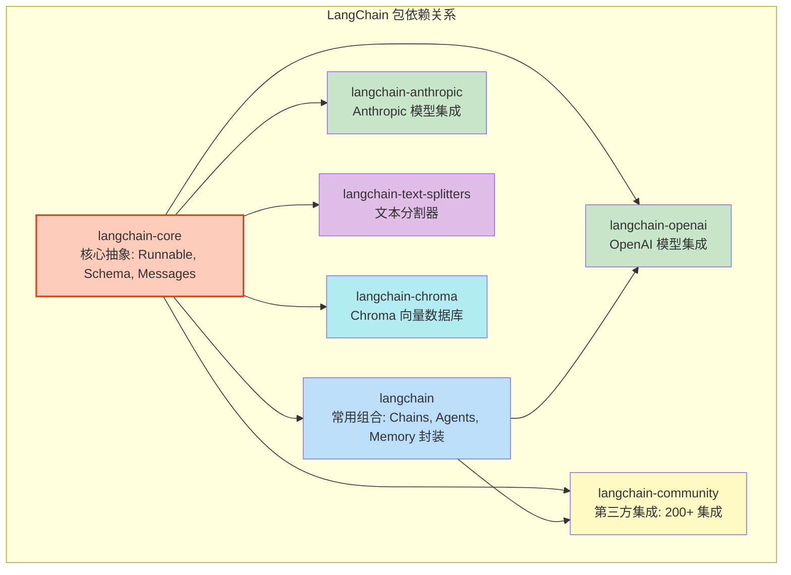

**各包职责**：

| 包名 | 职责 | 必须安装 | 典型场景 |
|------|------|---------|---------|
| `langchain-core` | Runnable 接口、Message 类型、输出解析器、Prompt 模板、回调基类 | 是 | 所有 LangChain 项目 |
| `langchain` | 预构建的 Chain、Agent、Memory 组合封装（LCEL 时代用得少） | 推荐 | 需要旧版 Chain 类或 Agent 封装 |
| `langchain-openai` | ChatOpenAI、OpenAI、OpenAIEmbeddings 等 OpenAI 系列模型 | 按需 | 使用 OpenAI / Azure OpenAI 模型 |
| `langchain-anthropic` | ChatAnthropic 等 Anthropic 模型集成 | 按需 | 使用 Claude 系列模型 |
| `langchain-community` | 200+ 第三方集成（向量库、文档加载器、工具等） | 按需 | 使用 Chroma/FAISS 以外的向量库、特殊文档加载器 |
| `langchain-text-splitters` | RecursiveCharacterTextSplitter 等文本分割器 | RAG 必需 | 文档分块 |
| `langchain-chroma` | Chroma 向量数据库集成 | RAG 按需 | 本地持久化向量存储 |

**为什么这样设计**：早期 LangChain（0.0.x 版本）是一个单体包，包含所有集成，导致包体积大（数百 MB）、依赖冲突频繁、核心功能迭代受集成包质量拖累。0.2 版本之后拆分为模块化结构，核心包只依赖 `pydantic`、`jsonpatch`、`langsmith` 等少量基础库，体积不到 5MB，集成包独立发布和版本管理。

> 🏆 **面试高频考点**：`langchain`、`langchain-core`、`langchain-community` 三个包的区别？`langchain-core` 是最底层的核心抽象（Runnable、Messages、Prompts、OutputParsers），不依赖任何具体模型；`langchain-community` 包含第三方集成（向量数据库、文档加载器、工具等），由社区维护；`langchain` 是更高层的封装，包含预构建的 Chain、Agent、Memory 等组合逻辑，依赖 core 和 community。LCEL 时代推荐直接用 core + 具体集成包，减少不必要的依赖。

#### 代码示例

**示例1：基础——最小化安装与验证**

```bash
# 1. 创建虚拟环境（推荐）
python -m venv .venv

# Windows 激活
.venv\Scripts\activate

# macOS/Linux 激活
# source .venv/bin/activate

# 2. 最小化安装：核心 + OpenAI 集成
pip install langchain-core langchain-openai python-dotenv

# 3. 验证安装
python -c "
import langchain_core
import langchain_openai
print(f'langchain-core 版本: {langchain_core.__version__}')
print(f'langchain-openai 版本: {langchain_openai.__version__}')
"
# 预期输出：
# langchain-core 版本: 0.3.x
# langchain-openai 版本: 0.2.x
```

**示例2：进阶——完整开发环境安装（RAG + Agent + 部署）**

```bash
# 完整安装命令（一次性安装所有常用依赖）
pip install \
  langchain-core>=0.3.0 \
  langchain>=0.3.0 \
  langchain-openai>=0.2.0 \
  langchain-community>=0.3.0 \
  langchain-text-splitters>=0.3.0 \
  langchain-chroma>=0.1.0 \
  langgraph>=0.2.0 \
  langserve>=0.3.0 \
  pypdf>=5.0.0 \
  python-docx>=1.1.0 \
  python-dotenv>=1.0.0 \
  fastapi>=0.115.0 \
  uvicorn>=0.30.0 \
  pydantic>=2.0.0 \
  pydantic-settings>=2.0.0 \
  tenacity>=8.0.0 \
  httpx>=0.27.0

# 验证所有关键包
python -c "
import importlib
packages = [
    'langchain_core', 'langchain', 'langchain_openai',
    'langchain_community', 'langchain_text_splitters',
    'langchain_chroma', 'langgraph', 'langserve',
    'fastapi', 'uvicorn', 'pydantic', 'tenacity'
]
for pkg in packages:
    try:
        mod = importlib.import_module(pkg)
        version = getattr(mod, '__version__', 'installed')
        print(f'✅ {pkg}: {version}')
    except ImportError:
        print(f'❌ {pkg}: NOT INSTALLED')
"
```

**示例3：完整场景——pyproject.toml 项目配置 + 依赖锁定**

```toml
# pyproject.toml —— 现代 Python 项目配置文件
[project]
name = "langchain-ai-app"
version = "1.0.0"
description = "基于 LangChain 的生产级 AI 应用"
readme = "README.md"
requires-python = ">=3.10"
license = { text = "MIT" }
authors = [
    { name = "Your Name", email = "your@email.com" },
]
dependencies = [
    # ===== LangChain 核心 =====
    "langchain-core>=0.3.0,<0.4.0",
    "langchain>=0.3.0,<0.4.0",
    "langchain-openai>=0.2.0,<0.3.0",
    "langchain-community>=0.3.0,<0.4.0",
    "langchain-text-splitters>=0.3.0,<0.4.0",

    # ===== 向量数据库 =====
    "langchain-chroma>=0.1.0",
    "faiss-cpu>=1.8.0",

    # ===== 文档加载 =====
    "pypdf>=5.0.0",
    "python-docx>=1.1.0",
    "beautifulsoup4>=4.12.0",

    # ===== Web 框架与部署 =====
    "fastapi>=0.115.0",
    "uvicorn[standard]>=0.30.0",
    "langserve>=0.3.0",

    # ===== 配置与工具 =====
    "pydantic>=2.0.0",
    "pydantic-settings>=2.0.0",
    "python-dotenv>=1.0.0",
    "tenacity>=8.0.0",
    "httpx>=0.27.0",
]

[project.optional-dependencies]
# 开发依赖：测试、代码质量、调试
dev = [
    "pytest>=8.0.0",
    "pytest-asyncio>=0.23.0",
    "pytest-cov>=5.0.0",
    "black>=24.0.0",
    "ruff>=0.5.0",
    "mypy>=1.10.0",
    "ipython>=8.0.0",
    "jupyter>=1.0.0",
]

# Agent 相关额外依赖
agents = [
    "langgraph>=0.2.0",
    "tavily-python>=0.3.0",
    "google-search-results>=2.4.0",
]

[build-system]
requires = ["hatchling"]
build-backend = "hatchling.build"

[tool.black]
line-length = 100
target-version = ["py310", "py311", "py312"]

[tool.ruff]
line-length = 100
target-version = "py310"
select = ["E", "F", "I", "N", "W", "UP", "B", "SIM"]

[tool.pytest.ini_options]
asyncio_mode = "auto"
testpaths = ["tests"]
python_files = ["test_*.py"]
addopts = "-v --tb=short"
```

```bash
# 使用 pip 安装（含开发依赖）
pip install -e ".[dev,agents]"

# 或使用 uv（更快的现代包管理器）
# uv pip install -e ".[dev,agents]"

# 锁定依赖版本（可复现构建）
pip freeze > requirements-lock.txt
```

#### 使用场景与最佳实践

**适用场景**：
- 新项目初始化，需要确定依赖清单
- 从原型迁移到生产，需要规范依赖管理
- CI/CD 流水线中需要可复现的构建环境

**不适用场景**：
- 临时脚本验证（直接 `pip install` 即可，不需要 pyproject.toml）
- 已有的成熟项目（遵循现有依赖管理方式）

**最佳实践**：
1. **Python 版本 ≥ 3.10**：LangChain 0.3+ 要求 Python 3.9+，但推荐 3.10+ 以获得更好的类型提示和 `match` 语句支持
2. **始终使用虚拟环境**：`python -m venv .venv` 或 `uv venv`，不要将依赖安装到全局 Python 环境
3. **版本范围用 `>=x.y.z,<(x+1).0.0`**：允许补丁和小版本升级，防止大版本 breaking change
4. **生产环境锁定版本**：用 `pip freeze > requirements-lock.txt` 或 `uv lock` 生成锁定文件，部署时安装精确版本
5. **按需安装集成包**：只安装实际用到的模型集成和向量数据库，不要一次性装所有东西

**性能建议**：
- 使用 `uv` 替代 `pip` 安装依赖，速度快 10-100 倍
- Docker 构建时利用层缓存：先复制 `pyproject.toml` 和 `requirements-lock.txt` 安装依赖，再复制代码
- CI 中缓存 `~/.cache/pip` 目录，减少重复下载

#### 常见坑点

**坑点1：`ImportError: cannot import name 'Runnable' from 'langchain.schema'`**

- **错误现象**：升级 LangChain 后旧代码报导入错误
- **根本原因**：LangChain 0.2 之后大量模块路径变更，`langchain.schema` 被拆分为 `langchain_core.runnables`、`langchain_core.messages`、`langchain_core.prompts` 等。旧的导入路径在 0.3 中被移除
- **正确做法**：更新导入路径——`from langchain_core.runnables import Runnable`、`from langchain_core.messages import HumanMessage`、`from langchain_core.prompts import ChatPromptTemplate`
- **预防措施**：关注 LangChain 官方迁移指南，升级大版本前阅读 CHANGELOG；用 `ruff` 的 `UP` 规则自动检测过时导入

**坑点2：虚拟环境未激活导致包安装到全局环境**

- **错误现象**：`pip install` 成功但运行时 `ModuleNotFoundError`，或不同项目之间依赖版本冲突
- **根本原因**：没有激活虚拟环境就执行 `pip install`，包装到了全局 Python；或者 VS Code 没有选择正确的 Python 解释器
- **正确做法**：①每次打开终端先激活虚拟环境（`.venv\Scripts\activate`）；②VS Code 中按 `Ctrl+Shift+P` → "Python: Select Interpreter" → 选择 `.venv` 中的 Python；③验证：`where python`（Windows）或 `which python`（macOS/Linux）确认路径包含 `.venv`
- **预防措施**：在项目 README 中写明激活步骤；使用 `direnv` 或 VS Code 工作区设置自动激活；在 `pyproject.toml` 中指定 `requires-python`

---

### 2.2 环境变量与配置管理

#### 概念解释

**环境变量配置管理是指通过 `.env` 文件和配置类统一管理 API Key、模型参数、数据库连接等敏感信息和运行时参数**，避免硬编码在代码中。LangChain 项目通常使用 `python-dotenv` 加载 `.env` 文件，用 `pydantic-settings` 定义类型安全的配置类，实现配置与代码的分离。

> 🎯 **生活化比喻**：配置管理就像"家里的钥匙串和说明书"——`.env` 文件是钥匙串（存放所有敏感的"钥匙"如 API Key），配置类是说明书（规定每把钥匙开哪把锁、默认值是什么）。你不会把钥匙焊在门上（硬编码），而是放在钥匙串上，需要时取用，换锁时只换钥匙不换门。

**核心价值**：类型安全的配置管理可以在启动时就发现配置错误（而不是运行到一半才崩溃），支持多环境（开发/测试/生产）切换，敏感信息不进入版本控制。

#### 原理说明

```mermaid
graph LR
    A[.env 文件<br/>敏感信息] --> B[load_dotenv()<br/>加载到 os.environ]
    C[环境变量<br/>系统级/容器级] --> B
    B --> D[Settings 类<br/>pydantic-settings]
    D --> E[类型校验<br/>默认值<br/>必填检查]
    E --> F[应用代码<br/>settings.OPENAI_API_KEY]

    G[.env.example<br/>模板文件] -.->|复制为| A
    H[.gitignore<br/>排除 .env] -.->|保护| A

    style A fill:#ffccbc
    style D fill:#c8e6c9
    style F fill:#bbdefb
```

**配置加载优先级**（从高到低）：
1. 代码中显式传入的参数（如 `ChatOpenAI(api_key="...")`）
2. 环境变量（`os.environ`）
3. `.env` 文件（通过 `load_dotenv()` 加载到环境变量）
4. 配置类中的默认值

**为什么这样设计**：十二因子应用（Twelve-Factor App）的第三条原则就是"在环境中存储配置"。将配置与代码分离有三个好处：①敏感信息不进入 Git 历史，防止泄露；②不同环境（开发/测试/生产）使用不同配置，不需要改代码；③配置变更不需要重新部署，只需修改环境变量。

> 🏆 **面试高频考点**：如何安全管理 LLM API Key？最佳实践是：①绝不硬编码在代码中；②使用 `.env` 文件 + `python-dotenv`，并将 `.env` 加入 `.gitignore`；③生产环境使用容器编排平台的 Secret 管理（如 Kubernetes Secret、AWS Secrets Manager）；④代码中通过 `pydantic-settings` 配置类读取，启动时校验必填项；⑤定期轮换 API Key，设置用量告警。

#### 代码示例

**示例1：基础——.env 文件 + python-dotenv**

```bash
# .env 文件（放在项目根目录）
# ===== OpenAI 配置 =====
OPENAI_API_KEY=sk-your-actual-api-key-here
OPENAI_API_BASE=https://api.openai.com/v1
OPENAI_MODEL=gpt-4o-mini
OPENAI_TEMPERATURE=0.7
OPENAI_MAX_TOKENS=2048

# ===== 向量数据库 =====
CHROMA_PERSIST_DIRECTORY=./data/chroma_db
EMBEDDING_MODEL=text-embedding-3-small

# ===== LangSmith 追踪 =====
LANGCHAIN_TRACING_V2=true
LANGCHAIN_API_KEY=lsv2-your-langsmith-key
LANGCHAIN_PROJECT=my-langchain-app

# ===== 应用配置 =====
APP_HOST=0.0.0.0
APP_PORT=8000
APP_DEBUG=true
LOG_LEVEL=INFO
```

```python
# src/config.py —— 基础配置加载
import os
from dotenv import load_dotenv

# 加载 .env 文件（必须在读取环境变量之前调用）
load_dotenv()

# 直接读取环境变量
OPENAI_API_KEY = os.getenv("OPENAI_API_KEY", "")
OPENAI_MODEL = os.getenv("OPENAI_MODEL", "gpt-4o-mini")
OPENAI_TEMPERATURE = float(os.getenv("OPENAI_TEMPERATURE", "0.7"))

# 验证必填配置
if not OPENAI_API_KEY:
    raise ValueError("OPENAI_API_KEY 环境变量未设置，请检查 .env 文件")

print(f"配置加载成功，模型：{OPENAI_MODEL}")
```

**示例2：进阶——pydantic-settings 类型安全配置类**

```python
# src/settings.py —— 生产级配置管理
from pydantic_settings import BaseSettings, SettingsConfigDict
from pydantic import Field, field_validator
from typing import Optional, Literal
import os


class OpenAISettings(BaseSettings):
    """OpenAI 模型配置。"""
    model_config = SettingsConfigDict(env_prefix="OPENAI_", env_file=".env", extra="ignore")

    api_key: str = Field(..., description="OpenAI API Key（必填）")
    api_base: str = Field(default="https://api.openai.com/v1", description="API 基础地址")
    model: str = Field(default="gpt-4o-mini", description="默认模型名称")
    temperature: float = Field(default=0.7, ge=0, le=2, description="温度参数")
    max_tokens: int = Field(default=2048, ge=1, le=128000, description="最大生成 Token 数")
    timeout: int = Field(default=60, ge=1, description="请求超时秒数")
    max_retries: int = Field(default=3, ge=0, le=10, description="最大重试次数")

    @field_validator("api_key")
    @classmethod
    def validate_api_key(cls, v: str) -> str:
        if not v.startswith("sk-"):
            raise ValueError(f"API Key 格式不正确，应以 'sk-' 开头，当前：{v[:5]}...")
        return v


class VectorStoreSettings(BaseSettings):
    """向量数据库配置。"""
    model_config = SettingsConfigDict(env_prefix="VECTOR_", env_file=".env", extra="ignore")

    persist_directory: str = Field(default="./data/chroma_db", description="持久化目录")
    embedding_model: str = Field(default="text-embedding-3-small", description="嵌入模型")
    collection_name: str = Field(default="default", description="集合名称")


class LangSmithSettings(BaseSettings):
    """LangSmith 追踪配置。"""
    model_config = SettingsConfigDict(env_prefix="LANGCHAIN_", env_file=".env", extra="ignore")

    tracing_v2: bool = Field(default=False, description="是否开启 V2 追踪")
    api_key: Optional[str] = Field(default=None, description="LangSmith API Key")
    project: str = Field(default="default", description="项目名称")
    endpoint: str = Field(default="https://api.smith.langchain.com", description="API 端点")


class AppSettings(BaseSettings):
    """应用全局配置。"""
    model_config = SettingsConfigDict(env_file=".env", extra="ignore")

    # 嵌套子配置
    openai: OpenAISettings = Field(default_factory=OpenAISettings)
    vector_store: VectorStoreSettings = Field(default_factory=VectorStoreSettings)
    langsmith: LangSmithSettings = Field(default_factory=LangSmithSettings)

    # 应用配置
    app_name: str = Field(default="LangChain AI App", description="应用名称")
    app_version: str = Field(default="1.0.0", description="应用版本")
    host: str = Field(default="0.0.0.0", description="监听地址")
    port: int = Field(default=8000, ge=1, le=65535, description="监听端口")
    debug: bool = Field(default=False, description="调试模式")
    log_level: Literal["DEBUG", "INFO", "WARNING", "ERROR", "CRITICAL"] = Field(
        default="INFO", description="日志级别"
    )
    environment: Literal["development", "testing", "production"] = Field(
        default="development", description="运行环境"
    )

    def is_production(self) -> bool:
        return self.environment == "production"

    def summary(self) -> str:
        """返回配置摘要（不包含敏感信息）。"""
        return (
            f"应用: {self.app_name} v{self.app_version} | "
            f"环境: {self.environment} | "
            f"模型: {self.openai.model} | "
            f"追踪: {'开启' if self.langsmith.tracing_v2 else '关闭'}"
        )


# 全局单例
settings = AppSettings()

if __name__ == "__main__":
    print(settings.summary())
    # 预期输出：应用: LangChain AI App v1.0.0 | 环境: development | 模型: gpt-4o-mini | 追踪: 开启
```

**示例3：完整场景——多环境配置 + 配置验证 + 日志集成**

```python
# src/app_config.py —— 完整的多环境配置体系
import os
import logging
from pathlib import Path
from typing import Optional
from pydantic_settings import BaseSettings, SettingsConfigDict
from pydantic import Field, model_validator


# 确定项目根目录
PROJECT_ROOT = Path(__file__).resolve().parent.parent


class EnvironmentSpecificSettings(BaseSettings):
    """支持多环境的配置基类。"""
    model_config = SettingsConfigDict(
        env_file=(
            ".env",                        # 通用配置
            f".env.{os.getenv('APP_ENV', 'development')}",  # 环境特定配置
        ),
        env_file_encoding="utf-8",
        extra="ignore",
        case_sensitive=False,
    )


class LLMSettings(EnvironmentSpecificSettings):
    """大语言模型配置，支持多提供商切换。"""
    model_config = SettingsConfigDict(env_prefix="LLM_", env_file=".env", extra="ignore")

    provider: str = Field(default="openai", description="模型提供商: openai/anthropic/google/local")
    api_key: Optional[str] = Field(default=None, description="API Key")
    api_base: Optional[str] = Field(default=None, description="自定义 API 地址（代理/本地模型）")
    model_name: str = Field(default="gpt-4o-mini", description="模型名称")
    temperature: float = Field(default=0.7, ge=0, le=2)
    max_tokens: int = Field(default=2048, ge=1)
    streaming: bool = Field(default=True, description="是否默认使用流式输出")

    @model_validator(mode="after")
    def validate_provider_config(self):
        """根据提供商验证必要配置。"""
        if self.provider == "openai" and not self.api_key:
            raise ValueError("使用 OpenAI 提供商时必须设置 LLM_API_KEY")
        if self.provider == "local" and not self.api_base:
            raise ValueError("使用本地模型时必须设置 LLM_API_BASE（如 http://localhost:8000/v1）")
        return self


class DatabaseSettings(EnvironmentSpecificSettings):
    """数据库配置（用于会话持久化等）。"""
    model_config = SettingsConfigDict(env_prefix="DB_", env_file=".env", extra="ignore")

    url: str = Field(default="sqlite:///./data/app.db", description="数据库连接字符串")
    echo: bool = Field(default=False, description="是否打印 SQL")
    pool_size: int = Field(default=5, ge=1, description="连接池大小")


class RedisSettings(EnvironmentSpecificSettings):
    """Redis 配置（用于缓存和分布式会话）。"""
    model_config = SettingsConfigDict(env_prefix="REDIS_", env_file=".env", extra="ignore")

    url: Optional[str] = Field(default=None, description="Redis 连接字符串，不设置则使用内存缓存")
    cache_ttl: int = Field(default=3600, description="缓存默认过期时间（秒）")


class SecuritySettings(EnvironmentSpecificSettings):
    """安全配置。"""
    model_config = SettingsConfigDict(env_prefix="SECURITY_", env_file=".env", extra="ignore")

    api_key_header: str = Field(default="X-API-Key", description="API Key 请求头名称")
    api_keys: list[str] = Field(default_factory=list, description="允许的 API Key 列表")
    cors_origins: list[str] = Field(default_factory=lambda: ["*"], description="CORS 允许的源")
    rate_limit_per_minute: int = Field(default=60, ge=1, description="每分钟请求限制")


class GlobalSettings(EnvironmentSpecificSettings):
    """全局配置聚合。"""
    llm: LLMSettings = Field(default_factory=LLMSettings)
    db: DatabaseSettings = Field(default_factory=DatabaseSettings)
    redis: RedisSettings = Field(default_factory=RedisSettings)
    security: SecuritySettings = Field(default_factory=SecuritySettings)

    app_env: str = Field(default="development", description="运行环境")
    project_root: Path = Field(default=PROJECT_ROOT)
    data_dir: Path = Field(default=PROJECT_ROOT / "data")

    @model_validator(mode="after")
    def ensure_directories(self):
        """确保必要目录存在。"""
        self.data_dir.mkdir(parents=True, exist_ok=True)
        (self.data_dir / "chroma_db").mkdir(parents=True, exist_ok=True)
        return self


def setup_logging(settings: GlobalSettings) -> logging.Logger:
    """根据配置设置日志。"""
    log_level = getattr(logging, settings.app_env.upper() if settings.app_env != "development" else "DEBUG", logging.INFO)

    logging.basicConfig(
        level=log_level,
        format="%(asctime)s | %(levelname)-8s | %(name)s | %(message)s",
        datefmt="%Y-%m-%d %H:%M:%S",
    )

    logger = logging.getLogger("ai_app")
    logger.info(f"应用启动 | 环境: {settings.app_env} | 模型: {settings.llm.provider}/{settings.llm.model_name}")
    return logger


# 使用
if __name__ == "__main__":
    os.environ.setdefault("APP_ENV", "development")
    settings = GlobalSettings()
    logger = setup_logging(settings)

    logger.info(f"数据目录: {settings.data_dir}")
    logger.info(f"LLM 提供商: {settings.llm.provider}")
    logger.info(f"Redis 缓存: {'启用' if settings.redis.url else '内存缓存'}")
    # 预期输出：带时间戳和级别的日志行
```

#### 使用场景与最佳实践

**适用场景**：
- 所有生产级 LangChain 项目
- 需要多环境部署（开发/测试/生产）
- 需要管理多个 API Key 和敏感信息
- 需要配置类型校验和启动时验证

**不适用场景**：
- 一次性临时脚本（直接硬编码或用 `input()` 输入即可）
- 完全在 Jupyter Notebook 中的探索性实验

**最佳实践**：
1. **`.env.example` 模板文件**：在仓库中提交 `.env.example`（包含所有配置项的键名和说明，但值为空或示例），新成员复制为 `.env` 后填写
2. **`.gitignore` 排除 `.env`**：确保 `.env` 文件永远不会被提交到版本控制
3. **`pydantic-settings` 替代 `os.getenv`**：类型安全、自动校验、支持嵌套配置、默认值管理
4. **环境特定配置文件**：`.env.development`、`.env.production` 分别管理不同环境的配置，通过 `APP_ENV` 环境变量切换
5. **启动时校验必填配置**：在配置类的 `@model_validator` 中检查必填项，应用启动时就失败，而不是运行到某个 API 调用才崩溃

**性能建议**：
- 配置类是单例，在模块加载时初始化一次，不要在每次请求时重新创建
- 生产环境中，敏感配置优先从容器编排平台的 Secret 注入（环境变量），而不是从 `.env` 文件读取
- 日志级别在生产环境设为 `INFO` 或 `WARNING`，`DEBUG` 会产生大量日志并影响性能

#### 常见坑点

**坑点1：`load_dotenv()` 调用时机错误导致环境变量未加载**

- **错误现象**：配置类读取到的 `OPENAI_API_KEY` 为空，但 `.env` 文件中明明有值
- **根本原因**：`load_dotenv()` 在 `import` 配置模块之后才调用，或者在子模块中调用但主模块已经读取了 `os.environ`。Python 的模块导入是惰性的，但 `os.getenv()` 在模块级执行时就会读取当前环境变量
- **正确做法**：在应用入口文件（`main.py` / `app.py`）的**最顶部**、任何 `import` 业务模块之前调用 `load_dotenv()`。或者使用 `pydantic-settings` 的 `env_file=".env"` 参数，它会在实例化时自动读取 `.env` 文件，不依赖 `load_dotenv()`
- **预防措施**：遵循"入口文件第一行就是 `load_dotenv()`"的约定；优先用 `pydantic-settings` 的 `env_file` 配置，减少对调用顺序的依赖

**坑点2：`.env` 文件被意外提交到 Git**

- **错误现象**：`git status` 显示 `.env` 文件被跟踪，或历史记录中能看到 API Key
- **根本原因**：`.gitignore` 中没有添加 `.env` 规则，或者 `.env` 在 `.gitignore` 创建之前就已经被 `git add` 了
- **正确做法**：①将 `.env` 加入 `.gitignore`；②如果已经提交，用 `git rm --cached .env` 从 Git 索引中移除（保留本地文件），然后提交；③如果 API Key 已经泄露到公开仓库，立即在 OpenAI 后台吊销该 Key 并生成新 Key
- **预防措施**：项目初始化时就创建 `.gitignore` 并包含 `.env`、`.env.*`（除了 `.env.example`）；使用 `git secret` 或 `git-crypt` 等工具管理敏感文件；CI 流水线中添加密钥扫描（如 `gitleaks`）

---

### 2.3 项目结构最佳实践

#### 概念解释

**LangChain 项目结构最佳实践是指按照功能分层、模块化组织代码的目录规范**，将配置、模型接入、Chain 定义、Agent、RAG 管线、API 路由、工具函数、测试等分离到不同模块，实现高内聚低耦合，便于团队协作和长期维护。

> 🎯 **生活化比喻**：好的项目结构就像"一家餐厅的后厨布局"——洗菜区（数据加载/清洗）、切菜区（文本分块/处理）、炒菜区（Chain/Agent 逻辑）、出餐区（API 路由）、调料架（配置/工具函数）、冷库（数据存储）各有固定位置。厨师（开发者）不需要到处找东西，新厨师来了也能快速上手，出了问题也知道去哪查。

**核心价值**：清晰的项目结构降低了认知负荷，使得每个模块职责单一、可独立测试和替换，团队成员可以并行开发不同模块而不互相冲突。

#### 原理说明

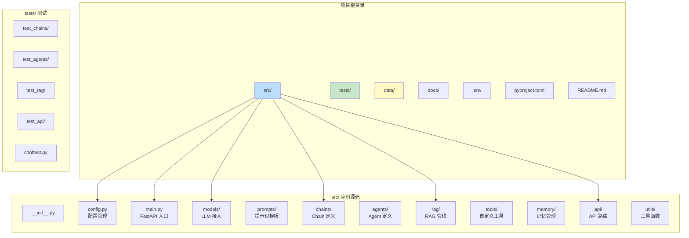

**标准目录结构详解**：

```
langchain-ai-app/
├── src/                          # 应用源码
│   ├── __init__.py
│   ├── config.py                 # 全局配置（pydantic-settings）
│   ├── main.py                   # FastAPI 应用入口
│   ├── models/                   # LLM 模型接入层
│   │   ├── __init__.py
│   │   ├── base.py               # 模型工厂基类
│   │   ├── openai_model.py       # OpenAI 模型封装
│   │   └── local_model.py        # 本地模型封装
│   ├── prompts/                  # 提示词模板管理
│   │   ├── __init__.py
│   │   ├── chat_prompts.py       # 对话类提示词
│   │   ├── rag_prompts.py        # RAG 类提示词
│   │   └── agent_prompts.py      # Agent 类提示词
│   ├── chains/                   # Chain 定义
│   │   ├── __init__.py
│   │   ├── base_chain.py         # Chain 基类
│   │   ├── summary_chain.py      # 摘要 Chain
│   │   └── translation_chain.py  # 翻译 Chain
│   ├── agents/                   # Agent 定义
│   │   ├── __init__.py
│   │   ├── base_agent.py         # Agent 基类
│   │   ├── research_agent.py     # 研究 Agent
│   │   └── coding_agent.py       # 编码 Agent
│   ├── rag/                      # RAG 检索增强
│   │   ├── __init__.py
│   │   ├── loader.py             # 文档加载器
│   │   ├── splitter.py           # 文本分割器
│   │   ├── vectorstore.py        # 向量数据库管理
│   │   ├── retriever.py          # 检索器封装
│   │   └── rag_chain.py          # RAG Chain 组装
│   ├── tools/                    # 自定义工具
│   │   ├── __init__.py
│   │   ├── calculator.py         # 计算器工具
│   │   ├── search.py             # 搜索工具
│   │   └── database.py           # 数据库查询工具
│   ├── memory/                   # 记忆管理
│   │   ├── __init__.py
│   │   ├── session_store.py      # 会话存储
│   │   └── memory_manager.py     # 记忆管理器
│   ├── api/                      # API 路由层
│   │   ├── __init__.py
│   │   ├── deps.py               # 依赖注入
│   │   ├── chat.py               # 聊天接口
│   │   ├── rag.py                # RAG 问答接口
│   │   └── agent.py              # Agent 接口
│   ├── callbacks/                # 回调处理器
│   │   ├── __init__.py
│   │   ├── token_counter.py      # Token 计数回调
│   │   └── logging_callback.py   # 日志回调
│   └── utils/                    # 工具函数
│       ├── __init__.py
│       ├── text_processing.py    # 文本处理
│       └── error_handlers.py     # 错误处理
├── tests/                        # 测试目录
│   ├── __init__.py
│   ├── conftest.py               # pytest 配置和 fixture
│   ├── unit/                     # 单元测试
│   │   ├── test_chains.py
│   │   ├── test_tools.py
│   │   └── test_utils.py
│   ├── integration/              # 集成测试
│   │   ├── test_rag_pipeline.py
│   │   └── test_agent_flow.py
│   └── e2e/                      # 端到端测试
│       └── test_api_endpoints.py
├── data/                         # 数据目录（不入库）
│   ├── chroma_db/                # Chroma 向量数据库
│   ├── documents/                # 原始文档
│   └── app.db                    # SQLite 数据库
├── docs/                         # 文档
│   ├── api.md                    # API 文档
│   ├── architecture.md           # 架构文档
│   └── deployment.md             # 部署文档
├── prompts/                      # 提示词文件（可选，独立管理）
│   ├── system_prompts/
│   └── few_shot_examples/
├── scripts/                      # 脚本
│   ├── ingest_docs.py            # 文档入库脚本
│   ├── evaluate.py               # 评估脚本
│   └── migrate_db.py             # 数据库迁移脚本
├── .env                          # 环境变量（不入库）
├── .env.example                  # 环境变量模板
├── .gitignore
├── pyproject.toml                # 项目配置
├── requirements-lock.txt         # 锁定依赖
├── Dockerfile                    # Docker 构建
├── docker-compose.yml            # 容器编排
├── README.md                     # 项目说明
└── Makefile                      # 常用命令快捷方式
```

**为什么这样设计**：这个结构遵循了几个软件工程原则：①**分层架构**——API 层（接口）→ 业务层（Chain/Agent/RAG）→ 基础设施层（模型/向量库/工具），依赖方向从外到内；②**单一职责**——每个模块只做一件事，如 `rag/loader.py` 只负责文档加载，不关心分块和检索；③**可测试性**——业务逻辑与 API 路由分离，Chain 和 Agent 可以独立单元测试；④**可替换性**——模型接入层抽象后，切换 OpenAI 到 Anthropic 只需改 `models/` 下的一个文件。

> 🏆 **面试高频考点**：LangChain 项目中 Chain 定义和 API 路由为什么要分离？因为 Chain 是纯业务逻辑（输入→输出的转换），不应该依赖 HTTP 框架。分离后：①Chain 可以在非 Web 场景复用（CLI、定时任务、数据分析脚本）；②Chain 可以独立单元测试，不需要启动服务器；③API 层只负责请求解析、认证、流式响应封装等 Web 关注点，符合单一职责原则。

#### 代码示例

**示例1：基础——最小可用项目结构**

```
my-ai-app/
├── .env
├── .env.example
├── .gitignore
├── pyproject.toml
├── README.md
├── src/
│   ├── __init__.py
│   ├── config.py          # 配置
│   ├── main.py            # FastAPI 入口
│   ├── chains.py          # Chain 定义
│   └── prompts.py         # 提示词
└── tests/
    ├── __init__.py
    └── test_chains.py
```

```python
# src/config.py —— 最小配置
from pydantic_settings import BaseSettings, SettingsConfigDict

class Settings(BaseSettings):
    model_config = SettingsConfigDict(env_file=".env", extra="ignore")
    openai_api_key: str
    openai_model: str = "gpt-4o-mini"
    temperature: float = 0.7

settings = Settings()
```

```python
# src/prompts.py —— 提示词集中管理
from langchain_core.prompts import ChatPromptTemplate

CHAT_PROMPT = ChatPromptTemplate.from_messages([
    ("system", "你是一个有帮助的 AI 助手。"),
    ("human", "{question}"),
])

SUMMARY_PROMPT = ChatPromptTemplate.from_template("请总结以下文本，不超过100字：\n{text}")
```

```python
# src/chains.py —— Chain 定义
from langchain_openai import ChatOpenAI
from langchain_core.output_parsers import StrOutputParser
from .config import settings
from .prompts import CHAT_PROMPT, SUMMARY_PROMPT

chat = ChatOpenAI(
    model=settings.openai_model,
    temperature=settings.temperature,
    api_key=settings.openai_api_key,
)

chat_chain = CHAT_PROMPT | chat | StrOutputParser()
summary_chain = SUMMARY_PROMPT | chat | StrOutputParser()
```

```python
# src/main.py —— FastAPI 入口
from fastapi import FastAPI
from pydantic import BaseModel
from .chains import chat_chain, summary_chain

app = FastAPI(title="AI App")

class ChatRequest(BaseModel):
    question: str

class SummaryRequest(BaseModel):
    text: str

@app.post("/chat")
async def chat(req: ChatRequest):
    result = await chat_chain.ainvoke({"question": req.question})
    return {"answer": result}

@app.post("/summary")
async def summary(req: SummaryRequest):
    result = await summary_chain.ainvoke({"text": req.text})
    return {"summary": result}
```

**示例2：进阶——带依赖注入和工厂模式的分层结构**

```python
# src/models/factory.py —— 模型工厂
from langchain_openai import ChatOpenAI
from langchain_anthropic import ChatAnthropic
from langchain_core.language_models import BaseChatModel
from ..config import settings

class ModelFactory:
    """根据配置创建不同的 LLM 实例。"""

    _instances: dict[str, BaseChatModel] = {}

    @classmethod
    def get_chat_model(cls, name: str = "default") -> BaseChatModel:
        """获取或创建聊天模型实例（单例）。"""
        if name not in cls._instances:
            if settings.llm.provider == "openai":
                cls._instances[name] = ChatOpenAI(
                    model=settings.llm.model_name,
                    temperature=settings.llm.temperature,
                    max_tokens=settings.llm.max_tokens,
                    api_key=settings.llm.api_key,
                    base_url=settings.llm.api_base,
                    timeout=settings.llm.timeout,
                    max_retries=settings.llm.max_retries,
                )
            elif settings.llm.provider == "anthropic":
                cls._instances[name] = ChatAnthropic(
                    model=settings.llm.model_name,
                    temperature=settings.llm.temperature,
                    max_tokens=settings.llm.max_tokens,
                    api_key=settings.llm.api_key,
                )
            else:
                raise ValueError(f"不支持的模型提供商: {settings.llm.provider}")
        return cls._instances[name]

    @classmethod
    def reset(cls):
        """重置所有实例（测试用）。"""
        cls._instances.clear()
```

```python
# src/api/deps.py —— FastAPI 依赖注入
from fastapi import Depends, HTTPException, Security
from fastapi.security import APIKeyHeader
from ..config import settings
from ..models.factory import ModelFactory
from ..memory.session_store import SessionStore

# API Key 认证
api_key_header = APIKeyHeader(name="X-API-Key", auto_error=False)

async def verify_api_key(api_key: str = Security(api_key_header)):
    """验证 API Key。"""
    if not settings.security.api_keys:
        return  # 未配置 API Key 时跳过认证（开发环境）
    if api_key not in settings.security.api_keys:
        raise HTTPException(status_code=401, detail="无效的 API Key")
    return api_key

# 依赖：获取模型
def get_chat_model():
    return ModelFactory.get_chat_model()

# 依赖：获取会话存储
def get_session_store():
    return SessionStore.get_instance()

# 依赖：获取当前用户（从 API Key 推断）
async def get_current_user(api_key: str = Depends(verify_api_key)):
    return {"api_key": api_key, "user_id": "anonymous"}
```

```python
# src/api/chat.py —— 聊天 API 路由
from fastapi import APIRouter, Depends
from langchain_core.language_models import BaseChatModel
from ..chains.chat_chain import build_chat_chain
from .deps import get_chat_model, get_session_store
from ..memory.session_store import SessionStore

router = APIRouter(prefix="/chat", tags=["聊天"])

@router.post("/{session_id}")
async def chat(
    session_id: str,
    message: str,
    chat_model: BaseChatModel = Depends(get_chat_model),
    session_store: SessionStore = Depends(get_session_store),
):
    """发送消息并获取回复。"""
    chain = build_chat_chain(chat_model, session_store, session_id)
    response = await chain.ainvoke({"message": message})
    return {"session_id": session_id, "response": response}
```

**示例3：完整场景——Makefile + Docker + 启动脚本**

```makefile
# Makefile —— 常用命令快捷方式
.PHONY: install dev test lint format docker-build docker-run clean

# 安装依赖
install:
	pip install -e ".[dev]"

# 开发模式运行
dev:
	uvicorn src.main:app --reload --host 0.0.0.0 --port 8000

# 运行测试
test:
	pytest tests/ -v --tb=short

# 代码检查
lint:
	ruff check src/ tests/
	mypy src/

# 代码格式化
format:
	black src/ tests/
	ruff check --fix src/ tests/

# Docker 构建
docker-build:
	docker build -t langchain-ai-app .

# Docker 运行
docker-run:
	docker run -p 8000:8000 --env-file .env langchain-ai-app

# 文档入库
ingest:
	python scripts/ingest_docs.py --dir ./data/documents

# 清理缓存
clean:
	find . -type d -name __pycache__ -exec rm -rf {} +
	find . -type f -name "*.pyc" -delete
	rm -rf .pytest_cache .mypy_cache .ruff_cache
```

```dockerfile
# Dockerfile —— 多阶段构建
# 阶段1：构建依赖
FROM python:3.12-slim AS builder

WORKDIR /app

# 安装构建依赖
RUN apt-get update && apt-get install -y --no-install-recommends \
    build-essential \
    && rm -rf /var/lib/apt/lists/*

# 先复制依赖文件，利用 Docker 层缓存
COPY pyproject.toml requirements-lock.txt ./
RUN pip install --no-cache-dir --prefix=/install -r requirements-lock.txt

# 阶段2：运行时
FROM python:3.12-slim AS runtime

WORKDIR /app

# 安装运行时系统依赖
RUN apt-get update && apt-get install -y --no-install-recommends \
    curl \
    && rm -rf /var/lib/apt/lists/*

# 从构建阶段复制已安装的依赖
COPY --from=builder /install /usr/local

# 复制应用代码
COPY src/ ./src/
COPY scripts/ ./scripts/

# 创建非 root 用户
RUN useradd -m appuser && chown -R appuser:appuser /app
USER appuser

# 健康检查
HEALTHCHECK --interval=30s --timeout=10s --start-period=5s --retries=3 \
    CMD curl -f http://localhost:8000/health || exit 1

EXPOSE 8000

CMD ["uvicorn", "src.main:app", "--host", "0.0.0.0", "--port", "8000"]
```

```yaml
# docker-compose.yml
version: "3.8"

services:
  app:
    build: .
    ports:
      - "8000:8000"
    env_file:
      - .env
    volumes:
      - ./data:/app/data
    depends_on:
      - redis
    restart: unless-stopped

  redis:
    image: redis:7-alpine
    ports:
      - "6379:6379"
    volumes:
      - redis_data:/data
    restart: unless-stopped

volumes:
  redis_data:
```

#### 使用场景与最佳实践

**适用场景**：
- 团队协作的中大型 LangChain 项目
- 需要长期维护和迭代的生产级应用
- 需要 CI/CD、测试、部署规范化的项目

**不适用场景**：
- 个人学习的小型原型（简单的 `app.py` 就够了）
- 一次性的数据处理脚本
- Jupyter Notebook 中的探索性实验

**最佳实践**：
1. **提示词集中管理**：所有 Prompt 模板放在 `prompts/` 目录，不要散落在各个 Chain 定义中，便于统一优化和版本管理
2. **Chain 工厂函数**：用 `build_xxx_chain(model, retriever, ...)` 函数创建 Chain 实例，而不是在模块级直接创建，便于测试时注入 Mock
3. **模型单例 + 工厂**：`ChatOpenAI` 实例创建有开销，用工厂模式缓存实例，同时支持运行时切换模型
4. **API 层薄、业务层厚**：API 路由只做请求解析和响应封装，所有业务逻辑在 Chain/Agent 层
5. **测试金字塔**：单元测试（Chain/Tool 独立测试）> 集成测试（RAG 管线/Agent 流程）> E2E 测试（API 端点），比例约 7:2:1

**性能建议**：
- 模块级创建的 Chain 实例（如 `chat_chain = prompt | model | parser`）在应用启动时初始化一次，不要在每次请求时重新构建
- 向量数据库连接池在启动时初始化，作为单例注入到 RAG 模块
- 生产环境用 Gunicorn + Uvicorn worker 运行 FastAPI，worker 数量 = CPU 核心数 × 2 + 1

#### 常见坑点

**坑点1：模块级 Chain 实例导致测试间状态污染**

- **错误现象**：单元测试中修改了 Chain 的配置（如温度），后续测试受到影响；或 Mock 了模型但 Chain 仍然调用真实 API
- **根本原因**：在模块级（如 `chains.py` 顶部）直接创建 `chat_chain = prompt | ChatOpenAI(...) | parser`，这个实例在模块导入时就创建了，测试中无法替换内部的模型组件
- **正确做法**：用工厂函数 `def build_chat_chain(model=None): return prompt | (model or ChatOpenAI(...)) | parser`，测试时传入 Mock 模型；或在 `conftest.py` 中用 `monkeypatch` 替换模块级实例
- **预防措施**：所有需要外部依赖（模型、数据库、API）的 Chain 都用工厂函数创建，依赖通过参数注入，遵循依赖倒置原则

**坑点2：循环导入（ImportError: cannot import name）**

- **错误现象**：`chains.py` 导入 `models.py`，`models.py` 导入 `config.py`，`config.py` 又导入了 `chains.py` 中的某个常量，导致循环导入
- **根本原因**：模块之间的依赖关系形成了环。常见原因是配置类中引用了业务模块的常量，或工具函数模块导入了业务模块
- **正确做法**：①梳理依赖方向，确保依赖是单向的（config → models → chains → api）；②将共享常量移到独立的 `constants.py`；③在函数内部导入（延迟导入）打破循环，但这是下策
- **预防措施**：遵循分层架构的依赖方向——上层可以导入下层，下层不能导入上层；`config.py` 和 `utils.py` 是最底层，不能导入任何业务模块

---

> 💡 **深度讲解**：本章覆盖了 LangChain 项目的工程化基础。模块化包结构（langchain-core / langchain / langchain-community / 各集成包）让你按需安装，避免依赖臃肿；pydantic-settings 配置类提供了类型安全的配置管理，启动时就能发现配置错误而不是运行到一半崩溃；分层项目结构（API 层 → 业务层 → 基础设施层）确保了代码的可测试性、可替换性和可维护性。这三个方面是从"能跑的脚本"到"生产级应用"的关键跨越，很多新手忽视工程化，导致项目稍微变大就难以维护。记住：好的工程结构不是束缚，而是让你在项目变大后依然能快速迭代的保障。

> 📝 **精简总结**：
> 1. LangChain 采用模块化包结构，核心是 langchain-core，按需安装各集成包
> 2. 新项目使用 Python ≥3.10，始终在虚拟环境中开发
> 3. 用 pyproject.toml 管理依赖，生产环境锁定版本
> 4. 配置管理用 pydantic-settings，类型安全、自动校验、支持嵌套
> 5. .env 文件存放敏感信息，必须加入 .gitignore，提供 .env.example 模板
> 6. 项目结构分层：api/（接口层）→ chains/agents/rag/（业务层）→ models/tools/（基础设施层）
> 7. 提示词集中管理在 prompts/ 目录，Chain 用工厂函数创建便于测试
> 8. API 层保持薄，业务逻辑全部在 Chain/Agent 层，便于复用和测试

> 🎯 **梯度练习题**：
> - **基础1**：创建一个虚拟环境，安装 langchain-core、langchain-openai、python-dotenv，验证版本
> - **基础2**：创建 .env 文件和 .env.example，写入 OPENAI_API_KEY，用 python-dotenv 加载并打印
> - **基础3**：按照最小项目结构创建 src/ 目录，包含 config.py、prompts.py、chains.py、main.py
> - **进阶1**：用 pydantic-settings 编写一个包含 OpenAI 配置、向量库配置、应用配置的嵌套配置类，实现启动时校验 API Key 格式
> - **进阶2**：实现模型工厂类，支持通过配置切换 OpenAI / Anthropic / 本地模型，用单例模式缓存实例
> - **实战1**：搭建一个完整的生产级项目骨架，包含分层目录结构、pyproject.toml、Dockerfile、docker-compose.yml、Makefile、.gitignore、.env.example，并编写一个简单的 /chat 接口验证整个链路通

---

## 3. LLM 接入与多模型切换

### 3.1 Chat Model 基础调用

#### 概念解释

**Chat Model（聊天模型）是 LangChain 中对支持对话式消息接口的大语言模型的统一封装**，接收由 `SystemMessage`、`HumanMessage`、`AIMessage`、`ToolMessage` 等组成的消息列表，返回 `AIMessage`。与旧版纯文本 `LLM` 接口不同，Chat Model 原生支持多轮对话、角色设定和工具调用（Function Calling），是当前 LangChain 推荐的主要模型接口。

> 🎯 **生活化比喻**：如果把 LLM 比作一个"写信回复的笔友"（你寄一段文字，他回一段文字），Chat Model 就是"面对面聊天的朋友"——你可以先设定他的身份（SystemMessage："你是一个严谨的律师"），然后你一言我一语地对话（HumanMessage/AIMessage 交替），他还能根据对话上下文决定是否需要"查资料"（ToolMessage）。这种对话式交互更自然，也更适合构建复杂应用。

**核心价值**：Chat Model 统一了不同厂商的对话 API，使得切换模型（如从 GPT-4 换到 Claude 3.5）只需修改一行初始化代码，上层应用逻辑完全不需要改动。

#### 原理说明

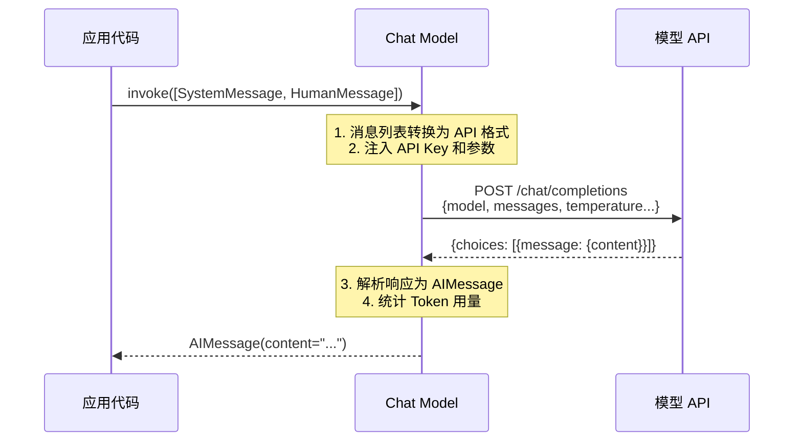

**消息类型体系**：

| 消息类型 | 角色 | 用途 | 示例 |
|---------|------|------|------|
| `SystemMessage` | system | 设定 AI 的角色、行为规则、输出格式 | "你是一个 Python 专家，回答简洁准确" |
| `HumanMessage` | user | 用户输入的消息 | "什么是装饰器？" |
| `AIMessage` | assistant | AI 生成的回复，可包含 tool_calls | "装饰器是...，需要我举例吗？" |
| `ToolMessage` | tool | 工具调用的返回结果 | "计算结果：42" |
| `FunctionMessage` | function | 旧版函数调用返回（已被 ToolMessage 替代） | - |

**核心机制**：
1. **消息列表 → API 请求体**：Chat Model 内部将 LangChain 的 Message 对象转换为对应厂商 API 的 JSON 格式（OpenAI 是 `{"role": "user", "content": "..."}`，Anthropic 格式略有不同）
2. **参数透传**：`temperature`、`max_tokens`、`top_p`、`frequency_penalty` 等参数在初始化时设置，也可在每次 `invoke` 时通过 `kwargs` 覆盖
3. **响应解析**：将 API 返回的 JSON 解析为 `AIMessage` 对象，包含 `content`（文本内容）、`tool_calls`（工具调用列表）、`response_metadata`（原始元数据，含 Token 用量）
4. **Token 统计**：通过 `response_metadata["token_usage"]` 获取 prompt_tokens、completion_tokens、total_tokens

**技术对比**：

| 维度 | Chat Model（推荐） | 旧版 LLM（纯文本） |
|------|-------------------|-------------------|
| 输入 | 消息列表（System/Human/AI） | 纯文本字符串 |
| 输出 | AIMessage 对象 | 字符串 |
| 多轮对话 | 原生支持，消息列表即历史 | 需手动拼接历史文本 |
| 工具调用 | 原生支持 Function/Tool Calling | 不支持 |
| 适用模型 | GPT-4o、Claude、Gemini 等对话模型 | gpt-3.5-turbo-instruct 等补全模型 |
| 未来维护 | 持续维护，LangChain 主推 | 逐步废弃，不推荐新项目使用 |

> 🏆 **面试高频考点**：SystemMessage、HumanMessage、AIMessage 的区别和作用？SystemMessage 是系统消息，用于设定 AI 的角色和行为规则，在整个对话中持续生效；HumanMessage 是用户消息，表示人类用户的输入；AIMessage 是 AI 消息，表示模型的回复，可能包含文本内容和工具调用（tool_calls）。三者按顺序组成对话历史，模型根据所有消息生成下一个回复。

#### 代码示例

**示例1：基础——单轮对话调用**

```python
# src/10_chat_basic.py
from langchain_openai import ChatOpenAI
from langchain_core.messages import SystemMessage, HumanMessage, AIMessage
from dotenv import load_dotenv

load_dotenv()

# 初始化聊天模型
chat = ChatOpenAI(
    model="gpt-4o-mini",
    temperature=0.7,        # 创造性：0=确定性，2=最随机
    max_tokens=1024,        # 最大生成 Token 数
    timeout=60,             # 请求超时（秒）
    max_retries=3,          # 失败重试次数
)

# 方式1：纯文本输入（内部自动包装为 HumanMessage）
response = chat.invoke("你好，请用一句话介绍你自己")
print("回复:", response.content)
print("类型:", type(response).__name__)
print("Token 用量:", response.response_metadata.get("token_usage"))
# 预期输出：
# 回复: 你好！我是一个由 OpenAI 开发的 AI 助手...
# 类型: AIMessage
# Token 用量: {'prompt_tokens': 20, 'completion_tokens': 30, 'total_tokens': 50}

# 方式2：消息列表输入（推荐，支持 System 设定）
messages = [
    SystemMessage(content="你是一个专业的 Python 编程助手，回答简洁准确，优先给出代码示例。"),
    HumanMessage(content="如何用 Python 读取 CSV 文件？"),
]
response = chat.invoke(messages)
print("\nPython 助手回复:")
print(response.content)
# 预期输出：包含 import csv 或 pandas 的代码示例

# 方式3：模拟多轮对话（手动构建历史）
conversation = [
    SystemMessage(content="你是一个友好的聊天伙伴。"),
    HumanMessage(content="我叫小明，我喜欢打篮球"),
    AIMessage(content="你好小明！打篮球是一项很棒的运动，你打什么位置？"),
    HumanMessage(content="我打控球后卫，你觉得我应该怎么提升传球能力？"),
]
response = chat.invoke(conversation)
print("\n多轮对话回复:")
print(response.content)
# 预期输出：AI 记得"小明"和"控球后卫"，给出传球训练建议
```

**示例2：进阶——参数动态调整与响应元数据**

```python
# src/11_chat_advanced.py
from langchain_openai import ChatOpenAI
from langchain_core.messages import SystemMessage, HumanMessage
from dotenv import load_dotenv

load_dotenv()

chat = ChatOpenAI(model="gpt-4o-mini", temperature=0.7)

# 1. 每次调用覆盖参数（通过 bind 或 kwargs）
# 用 .bind() 创建参数固定的新实例
creative_chat = chat.bind(temperature=0.9, max_tokens=500)
deterministic_chat = chat.bind(temperature=0, max_tokens=200)

# 对比不同温度的输出
prompt = [HumanMessage(content="给一个创业公司起一个有创意的名字，只输出名字")]

print("=== 高温度（创造性）===")
for i in range(3):
    resp = creative_chat.invoke(prompt)
    print(f"  尝试{i+1}: {resp.content.strip()}")

print("\n=== 零温度（确定性）===")
for i in range(3):
    resp = deterministic_chat.invoke(prompt)
    print(f"  尝试{i+1}: {resp.content.strip()}")
# 预期：高温度每次输出不同名字；零温度三次输出完全相同

# 2. 访问完整响应元数据
messages = [
    SystemMessage(content="你是一个精确的问答助手。"),
    HumanMessage(content="解释什么是量子纠缠，不超过50字"),
]
response = chat.invoke(messages)

print("\n=== 响应元数据 ===")
print(f"内容: {response.content}")
print(f"角色: {response.type}")  # 'ai'
print(f"完成原因: {response.response_metadata.get('finish_reason')}")  # 'stop'
token_usage = response.response_metadata.get("token_usage", {})
print(f"Prompt Tokens: {token_usage.get('prompt_tokens')}")
print(f"Completion Tokens: {token_usage.get('completion_tokens')}")
print(f"Total Tokens: {token_usage.get('total_tokens')}")
print(f"模型: {response.response_metadata.get('model_name')}")

# 3. 计算单次调用成本（粗略估算）
def estimate_cost(response, model="gpt-4o-mini"):
    """根据 Token 用量估算成本（USD）。"""
    pricing = {
        "gpt-4o-mini": {"input": 0.00015, "output": 0.0006},  # 每 1K Token
        "gpt-4o": {"input": 0.0025, "output": 0.010},
        "gpt-4-turbo": {"input": 0.010, "output": 0.030},
    }
    p = pricing.get(model, pricing["gpt-4o-mini"])
    usage = response.response_metadata.get("token_usage", {})
    input_cost = usage.get("prompt_tokens", 0) / 1000 * p["input"]
    output_cost = usage.get("completion_tokens", 0) / 1000 * p["output"]
    return input_cost + output_cost

cost = estimate_cost(response, "gpt-4o-mini")
print(f"\n估算成本: ${cost:.6f}")
```

**示例3：完整场景——封装一个可复用的 ChatClient 类**

```python
# src/12_chat_client.py
from typing import List, Optional, Dict, Any, AsyncIterator
from langchain_openai import ChatOpenAI
from langchain_core.messages import BaseMessage, SystemMessage, HumanMessage, AIMessage
from langchain_core.outputs import ChatGeneration
from dotenv import load_dotenv
import os
import time
import logging

load_dotenv()
logger = logging.getLogger(__name__)


class ChatClient:
    """
    可复用的聊天模型客户端，封装常用功能。

    特性：
    - 支持系统提示词预设
    - 自动 Token 统计和成本估算
    - 调用耗时记录
    - 同步/异步/流式三种调用方式
    - 对话历史管理
    """

    # 预设角色
    ROLES = {
        "assistant": "你是一个有帮助的 AI 助手。",
        "python_expert": "你是一位资深 Python 技术专家，精通语法、设计模式、性能优化。回答简洁准确，附带代码示例。",
        "code_reviewer": "你是一位严格的代码审查专家，关注代码质量、安全性、性能和可维护性。指出问题并给出修改建议。",
        "translator": "你是一位专业翻译，将输入文本翻译为目标语言，保持原意和语气，不添加额外解释。",
        "summarizer": "你是一位专业的文本摘要专家，提取核心要点，用简洁的语言概括，不添加原文没有的信息。",
    }

    # 模型定价（每 1K Token，USD）
    PRICING = {
        "gpt-4o-mini": {"input": 0.00015, "output": 0.0006},
        "gpt-4o": {"input": 0.0025, "output": 0.010},
    }

    def __init__(
        self,
        model: str = "gpt-4o-mini",
        temperature: float = 0.7,
        max_tokens: int = 2048,
        role: str = "assistant",
        system_prompt: Optional[str] = None,
    ):
        self.model = model
        self.temperature = temperature
        self.max_tokens = max_tokens
        self.system_prompt = system_prompt or self.ROLES.get(role, self.ROLES["assistant"])
        self._chat = ChatOpenAI(
            model=model,
            temperature=temperature,
            max_tokens=max_tokens,
            api_key=os.getenv("OPENAI_API_KEY"),
        )
        self._history: List[BaseMessage] = [SystemMessage(content=self.system_prompt)]

    def chat(self, message: str, **kwargs) -> Dict[str, Any]:
        """
        发送消息并获取回复，自动维护对话历史。

        Returns:
            包含 content, tokens, cost, latency 的字典
        """
        self._history.append(HumanMessage(content=message))
        start = time.time()
        response = self._chat.invoke(self._history, **kwargs)
        latency = time.time() - start

        self._history.append(response)
        usage = response.response_metadata.get("token_usage", {})
        cost = self._estimate_cost(usage)

        result = {
            "content": response.content,
            "prompt_tokens": usage.get("prompt_tokens", 0),
            "completion_tokens": usage.get("completion_tokens", 0),
            "total_tokens": usage.get("total_tokens", 0),
            "cost_usd": cost,
            "latency_seconds": round(latency, 3),
            "finish_reason": response.response_metadata.get("finish_reason"),
        }
        logger.info(f"Chat 完成 | Tokens: {result['total_tokens']} | 耗时: {result['latency_seconds']}s | 成本: ${result['cost_usd']:.6f}")
        return result

    async def achat(self, message: str, **kwargs) -> Dict[str, Any]:
        """异步版本的 chat。"""
        self._history.append(HumanMessage(content=message))
        start = time.time()
        response = await self._chat.ainvoke(self._history, **kwargs)
        latency = time.time() - start
        self._history.append(response)
        usage = response.response_metadata.get("token_usage", {})
        return {
            "content": response.content,
            "total_tokens": usage.get("total_tokens", 0),
            "cost_usd": self._estimate_cost(usage),
            "latency_seconds": round(latency, 3),
        }

    def stream_chat(self, message: str):
        """流式输出，逐 Token 返回。"""
        self._history.append(HumanMessage(content=message))
        full_content = ""
        for chunk in self._chat.stream(self._history):
            full_content += chunk.content
            yield chunk.content
        self._history.append(AIMessage(content=full_content))

    def clear_history(self):
        """清空对话历史，保留系统提示词。"""
        self._history = [SystemMessage(content=self.system_prompt)]

    def get_history(self) -> List[Dict[str, str]]:
        """获取对话历史（序列化格式）。"""
        return [{"role": msg.type, "content": msg.content} for msg in self._history]

    def _estimate_cost(self, usage: Dict[str, int]) -> float:
        p = self.PRICING.get(self.model, self.PRICING["gpt-4o-mini"])
        return (
            usage.get("prompt_tokens", 0) / 1000 * p["input"]
            + usage.get("completion_tokens", 0) / 1000 * p["output"]
        )


# 使用示例
if __name__ == "__main__":
    # 创建 Python 专家角色的客户端
    client = ChatClient(role="python_expert", temperature=0.3)

    # 第一轮
    r1 = client.chat("什么是 Python 的 GIL？")
    print(f"【回答】{r1['content'][:100]}...")
    print(f"【统计】Tokens: {r1['total_tokens']} | 成本: ${r1['cost_usd']:.6f} | 耗时: {r1['latency_seconds']}s")

    # 第二轮（基于历史追问）
    r2 = client.chat("那多线程在 IO 密集型任务中有用吗？")
    print(f"\n【追问回答】{r2['content'][:100]}...")

    # 查看历史
    print(f"\n【对话历史】共 {len(client.get_history())} 条消息")

    # 流式输出示例
    print("\n【流式输出】", end="", flush=True)
    for chunk in client.stream_chat("用一句话总结 GIL 的影响"):
        print(chunk, end="", flush=True)
    print()
```

#### 使用场景与最佳实践

**适用场景**：
- 需要多轮对话的聊天机器人、客服系统
- 需要设定 AI 角色和行为规则的应用
- 需要工具调用（Function Calling）的 Agent 系统
- 需要在多个模型提供商之间切换的应用

**不适用场景**：
- 纯文本补全任务（如代码自动补全），用旧版 `LLM` 接口更直接
- 对延迟要求极高且不需要对话上下文的简单分类任务
- 模型不支持对话式 API 的特殊场景

**最佳实践**：
1. **始终使用 Chat Model 而非旧版 LLM**：LangChain 0.2+ 推荐所有新应用使用 `ChatOpenAI` 等 Chat Model，旧版 `OpenAI`（纯文本）逐步废弃
2. **SystemMessage 放在消息列表第一位**：系统提示词在最前面，确保模型在生成回复前就接收到角色设定
3. **temperature 按场景设置**：事实问答/代码生成用 0-0.3，创意写作用 0.7-0.9，通用对话用 0.5-0.7
4. **利用 `response_metadata` 统计 Token 和成本**：每次调用后记录 Token 用量，用于成本监控和预算控制
5. **对话历史管理要限制长度**：长期对话会导致 Token 累积，需要定期摘要或滑动窗口截断（详见第9章记忆管理）

**性能建议**：
- 对于不需要完整结果的场景（如前端实时展示），使用 `stream()` 流式输出，首字延迟降低 80%
- 批量独立请求使用 `batch()` 并设置合理的 `max_concurrency`，比循环 `invoke()` 快 2-5 倍
- 异步场景使用 `ainvoke()`，配合 `asyncio.gather()` 并发执行多个独立调用
- 模型初始化是轻量级的（只是设置参数），但建议用单例模式复用实例，避免重复创建

#### 常见坑点

**坑点1：`chat.invoke("hello")` 和 `chat.invoke([HumanMessage("hello")])` 的区别被忽视**

- **错误现象**：直接传字符串时某些功能（如 SystemMessage 设定）不生效，或 Token 统计异常
- **根本原因**：`ChatOpenAI.invoke()` 接受字符串时，内部会自动包装为 `[HumanMessage(content=string)]`，但这意味着你无法同时传入 SystemMessage。如果需要角色设定，必须传消息列表
- **正确做法**：需要 SystemMessage 或多轮对话时，始终传消息列表 `[SystemMessage(...), HumanMessage(...)]`；只有最简单的单轮无角色调用才用字符串简写
- **预防措施**：团队代码规范中约定——所有生产代码使用消息列表形式，字符串简写仅限临时调试

**坑点2：`max_tokens` 设置过小导致回复被截断**

- **错误现象**：AI 回复到一半突然停止，或代码示例不完整，`finish_reason` 为 `"length"` 而非 `"stop"`
- **根本原因**：`max_tokens` 限制了模型生成的最大 Token 数，设置过小（如 256）时，长回复会被强制截断。`finish_reason: "length"` 就是截断的标志
- **正确做法**：①根据预期回复长度设置 `max_tokens`（简短问答 512，代码生成 2048，长文写作 4096+）；②检查 `response.response_metadata["finish_reason"]`，如果是 `"length"` 则增大 `max_tokens` 重试；③GPT-4o 支持最大 16384 输出 Token
- **预防措施**：在 ChatClient 封装中自动检测 `finish_reason == "length"` 并记录警告日志；不同任务类型设置不同的默认 `max_tokens`

---

### 3.2 多模型切换与本地模型接入

#### 概念解释

**多模型切换是指通过 LangChain 的统一 Chat Model 接口，在不同 LLM 提供商（OpenAI、Anthropic、Google、本地模型等）之间无缝切换的能力**。由于所有 Chat Model 都实现了相同的 `Runnable` 接口和消息输入/输出协议，上层应用代码（Chain、Agent、RAG）不需要任何修改，只需替换模型实例即可切换底层提供商。这是 LangChain "写一次，跑任何模型"设计理念的核心体现。

> 🎯 **生活化比喻**：多模型切换就像"万能遥控器"——不管你家的电视是索尼、三星还是小米，遥控器上的"开机""换台""调音量"按钮都是一样的。LangChain 的 Chat Model 接口就是这个万能遥控器，OpenAI、Anthropic、Google 的模型就是不同品牌的电视。你按"提问"按钮（invoke），不管接的是哪家的模型，都能得到回答；想换电视？只需把遥控器重新配对一下（改一行初始化代码），按钮功能完全不变。

**核心价值**：模型供应商锁定（Vendor Lock-in）是 AI 应用的最大风险之一。多模型切换能力让你可以根据价格、性能、可用性、数据合规等因素灵活选择模型，甚至实现 A/B 测试和故障自动降级。

#### 原理说明

```mermaid
graph TB
    subgraph "应用层（无需修改）"
        A[Chain / Agent / RAG]
        B[Prompt Template]
        C[Output Parser]
    end

    subgraph "统一接口层"
        D[BaseChatModel<br/>Runnable 接口]
        D -->|invoke| D1[输入: List~BaseMessage~]
        D -->|输出| D2[AIMessage]
    end

    subgraph "模型实现层"
        E[ChatOpenAI<br/>GPT-4o / GPT-4o-mini]
        F[ChatAnthropic<br/>Claude 3.5 Sonnet]
        G[ChatGoogleGenerativeAI<br/>Gemini 1.5 Pro]
        H[ChatOllama<br/>本地 Llama / Qwen]
        I[ChatOpenAI(base_url=...)<br/>兼容 OpenAI 协议的任意模型]
    end

    A --> D
    B --> D
    D --- E
    D --- F
    D --- G
    D --- H
    D --- I

    style D fill:#ffccbc,stroke:#d84315,stroke-width:2px
    style E fill:#bbdefb
    style F fill:#c8e6c9
    style G fill:#fff9c4
    style H fill:#e1bee7
    style I fill:#b2ebf2
```

**各模型提供商接入方式**：

| 提供商 | 安装包 | 类名 | 典型模型 | API Key 环境变量 |
|--------|--------|------|---------|-----------------|
| OpenAI | `langchain-openai` | `ChatOpenAI` | gpt-4o, gpt-4o-mini | `OPENAI_API_KEY` |
| Anthropic | `langchain-anthropic` | `ChatAnthropic` | claude-3-5-sonnet | `ANTHROPIC_API_KEY` |
| Google | `langchain-google-genai` | `ChatGoogleGenerativeAI` | gemini-1.5-pro | `GOOGLE_API_KEY` |
| 本地（Ollama） | `langchain-ollama` | `ChatOllama` | llama3, qwen2 | 无需 Key |
| 兼容 OpenAI 协议 | `langchain-openai` | `ChatOpenAI(base_url=...)` | 任意兼容模型 | 按需 |
| Azure OpenAI | `langchain-openai` | `AzureChatOpenAI` | gpt-4o 等 | `AZURE_OPENAI_API_KEY` |

**为什么这样设计**：LangChain 的 `BaseChatModel` 抽象类定义了统一的接口契约——输入是消息列表，输出是 `AIMessage`。每个提供商的集成包（如 `langchain-openai`）负责将这个统一接口转换为该厂商的特定 API 格式。这种"适配器模式"使得上层应用完全不依赖具体厂商，切换模型时只需替换适配器实例。

> 🏆 **面试高频考点**：如何用 LangChain 接入本地模型？最常用的方式是通过 Ollama 运行本地模型，然后用 `ChatOllama(model="llama3")` 接入；或者如果本地模型服务兼容 OpenAI API 协议（如 vLLM、LM Studio、LocalAI），直接用 `ChatOpenAI(base_url="http://localhost:8000/v1", api_key="dummy")` 接入。本地模型的优势是数据不出境、无 API 调用费用，劣势是性能和能力通常弱于云端大模型。

#### 代码示例

**示例1：基础——三大主流模型提供商切换**

```python
# src/13_multi_provider.py
from langchain_core.messages import SystemMessage, HumanMessage
from dotenv import load_dotenv

load_dotenv()

# 统一的消息输入（所有模型通用）
messages = [
    SystemMessage(content="你是一个简洁的问答助手，用一句话回答。"),
    HumanMessage(content="什么是人工智能？"),
]

# ===== OpenAI =====
from langchain_openai import ChatOpenAI
openai_chat = ChatOpenAI(model="gpt-4o-mini", temperature=0.7)
resp = openai_chat.invoke(messages)
print(f"【OpenAI GPT-4o-mini】{resp.content}")

# ===== Anthropic Claude =====
from langchain_anthropic import ChatAnthropic
anthropic_chat = ChatAnthropic(model="claude-3-5-sonnet-20240620", temperature=0.7)
resp = anthropic_chat.invoke(messages)
print(f"【Anthropic Claude】{resp.content}")

# ===== Google Gemini =====
from langchain_google_genai import ChatGoogleGenerativeAI
google_chat = ChatGoogleGenerativeAI(model="gemini-1.5-pro", temperature=0.7)
resp = google_chat.invoke(messages)
print(f"【Google Gemini】{resp.content}")

# 注意：三个模型接收完全相同的 messages，输出都是 AIMessage
# 上层代码（Chain/Agent）不需要任何修改
```

**示例2：进阶——本地模型接入（Ollama + OpenAI 兼容协议）**

```python
# src/14_local_models.py
from langchain_core.messages import SystemMessage, HumanMessage
from dotenv import load_dotenv

load_dotenv()

messages = [
    SystemMessage(content="你是一个有帮助的助手，用中文回答。"),
    HumanMessage(content="介绍一下你自己"),
]

# ===== 方式1：Ollama 本地模型（推荐）=====
# 前置条件：安装 Ollama (https://ollama.com)，运行 ollama pull qwen2.5:7b
from langchain_ollama import ChatOllama

ollama_chat = ChatOllama(
    model="qwen2.5:7b",        # 本地模型名称
    temperature=0.7,
    num_predict=1024,            # 最大生成 Token
    base_url="http://localhost:11434",  # Ollama 默认地址
)
resp = ollama_chat.invoke(messages)
print(f"【Ollama Qwen2.5-7B】{resp.content[:100]}...")

# ===== 方式2：OpenAI 兼容协议（vLLM / LM Studio / LocalAI / OneAPI）=====
# 这些服务都提供兼容 OpenAI 的 /v1/chat/completions 端点
from langchain_openai import ChatOpenAI

# vLLM 服务（本地部署的开源模型）
vllm_chat = ChatOpenAI(
    model="Qwen/Qwen2.5-7B-Instruct",
    base_url="http://localhost:8000/v1",  # vLLM 默认地址
    api_key="dummy",                         # 本地服务不需要真实 Key
    temperature=0.7,
)
# resp = vllm_chat.invoke(messages)  # 需要先启动 vLLM 服务

# LM Studio（桌面应用，图形界面管理本地模型）
lmstudio_chat = ChatOpenAI(
    model="local-model",
    base_url="http://localhost:1234/v1",   # LM Studio 默认地址
    api_key="lm-studio",
)

# OneAPI / New API（统一管理多个模型的网关）
oneapi_chat = ChatOpenAI(
    model="gpt-4o-mini",
    base_url="http://your-oneapi-host:3000/v1",
    api_key="your-oneapi-key",
)

print("本地模型接入方式配置完成！")
print("提示：需要先启动对应的本地模型服务才能调用")
```

**示例3：完整场景——模型工厂 + 降级策略 + A/B 测试**

```python
# src/15_model_router.py
from typing import Optional, Dict, List, Any
from langchain_core.language_models import BaseChatModel
from langchain_core.messages import BaseMessage
from langchain_openai import ChatOpenAI
from langchain_anthropic import ChatAnthropic
from dotenv import load_dotenv
import os
import random
import logging
import time

load_dotenv()
logger = logging.getLogger(__name__)


class ModelFactory:
    """
    模型工厂：统一创建和管理多模型实例。

    支持：
    - 按名称创建模型实例
    - 模型实例缓存（单例）
    - 降级链（主模型失败自动切换备用模型）
    - A/B 测试（按比例路由到不同模型）
    """

    def __init__(self):
        self._instances: Dict[str, BaseChatModel] = {}

    def create(self, model_name: str, **kwargs) -> BaseChatModel:
        """
        根据模型名称创建 Chat Model 实例。

        支持的名称格式：
        - openai:gpt-4o-mini
        - anthropic:claude-3-5-sonnet-20240620
        - local:qwen2.5:7b
        - azure:gpt-4o
        """
        if ":" not in model_name:
            raise ValueError(f"模型名称格式应为 'provider:model'，收到: {model_name}")

        provider, model = model_name.split(":", 1)
        cache_key = f"{provider}:{model}"

        if cache_key in self._instances:
            return self._instances[cache_key]

        if provider == "openai":
            instance = ChatOpenAI(
                model=model,
                temperature=kwargs.get("temperature", 0.7),
                max_tokens=kwargs.get("max_tokens", 2048),
                api_key=os.getenv("OPENAI_API_KEY"),
            )
        elif provider == "anthropic":
            instance = ChatAnthropic(
                model=model,
                temperature=kwargs.get("temperature", 0.7),
                max_tokens=kwargs.get("max_tokens", 2048),
                api_key=os.getenv("ANTHROPIC_API_KEY"),
            )
        elif provider == "local":
            from langchain_ollama import ChatOllama
            instance = ChatOllama(
                model=model,
                temperature=kwargs.get("temperature", 0.7),
            )
        else:
            raise ValueError(f"不支持的模型提供商: {provider}")

        self._instances[cache_key] = instance
        logger.info(f"创建模型实例: {cache_key}")
        return instance

    def reset(self):
        """清空所有缓存实例（测试用）。"""
        self._instances.clear()


class ModelFallbackChain:
    """
    模型降级链：主模型失败时自动切换到备用模型。

    使用 LangChain 的 with_fallbacks 机制。
    """

    def __init__(self, factory: ModelFactory, primary: str, fallbacks: List[str]):
        self.factory = factory
        primary_model = factory.create(primary)
        fallback_models = [factory.create(f) for f in fallbacks]
        self.chain = primary_model.with_fallbacks(fallback_models)

    def invoke(self, messages: List[BaseMessage]) -> Any:
        return self.chain.invoke(messages)

    async def ainvoke(self, messages: List[BaseMessage]) -> Any:
        return await self.chain.ainvoke(messages)


class ModelABTestRouter:
    """
    A/B 测试路由器：按比例将请求路由到不同模型。

    用于比较不同模型的质量、延迟、成本。
    """

    def __init__(self, factory: ModelFactory, experiments: List[Dict[str, Any]]):
        """
        Args:
            experiments: [{"model": "openai:gpt-4o-mini", "weight": 0.5, "name": "A"}, ...]
        """
        self.factory = factory
        self.experiments = experiments
        self.models = {exp["name"]: factory.create(exp["model"]) for exp in experiments}
        self.weights = [exp["weight"] for exp in experiments]
        self.stats = {exp["name"]: {"count": 0, "total_latency": 0} for exp in experiments}

    def invoke(self, messages: List[BaseMessage]) -> Dict[str, Any]:
        """按权重随机选择模型并调用。"""
        chosen = random.choices(self.experiments, weights=self.weights, k=1)[0]
        model = self.models[chosen["name"]]

        start = time.time()
        response = model.invoke(messages)
        latency = time.time() - start

        self.stats[chosen["name"]]["count"] += 1
        self.stats[chosen["name"]]["total_latency"] += latency

        return {
            "content": response.content,
            "model_group": chosen["name"],
            "model": chosen["model"],
            "latency": round(latency, 3),
        }

    def get_stats(self) -> Dict[str, Any]:
        """获取 A/B 测试统计。"""
        result = {}
        for name, stat in self.stats.items():
            avg_latency = stat["total_latency"] / stat["count"] if stat["count"] > 0 else 0
            result[name] = {
                "count": stat["count"],
                "avg_latency": round(avg_latency, 3),
            }
        return result


# 使用示例
if __name__ == "__main__":
    from langchain_core.messages import HumanMessage

    factory = ModelFactory()

    # 1. 基本使用
    model = factory.create("openai:gpt-4o-mini")
    resp = model.invoke([HumanMessage(content="你好")])
    print(f"基本调用: {resp.content[:50]}")

    # 2. 降级链（主模型失败自动切换）
    fallback_chain = ModelFallbackChain(
        factory=factory,
        primary="openai:gpt-4o",
        fallbacks=["openai:gpt-4o-mini", "local:qwen2.5:7b"],
    )
    resp = fallback_chain.invoke([HumanMessage(content="什么是降级策略？")])
    print(f"降级链调用: {resp.content[:50]}")

    # 3. A/B 测试
    ab_router = ModelABTestRouter(
        factory=factory,
        experiments=[
            {"model": "openai:gpt-4o-mini", "weight": 0.5, "name": "gpt-4o-mini"},
            {"model": "openai:gpt-4o", "weight": 0.5, "name": "gpt-4o"},
        ],
    )

    for i in range(5):
        result = ab_router.invoke([HumanMessage(content=f"问题{i}：什么是 AI？")])
        print(f"  [{result['model_group']}] {result['latency']}s | {result['content'][:30]}...")

    print("\nA/B 测试统计:", ab_router.get_stats())
```

#### 使用场景与最佳实践

**适用场景**：
- 需要在多个模型提供商之间灵活切换，避免供应商锁定
- 需要根据任务类型选择最合适的模型（简单任务用小模型省钱，复杂任务用大模型保质）
- 需要故障降级（主模型不可用时自动切换备用模型）
- 需要 A/B 测试比较不同模型的效果和成本
- 数据合规要求使用本地模型或私有部署模型

**不适用场景**：
- 只使用单一模型且没有切换需求的简单应用
- 对模型特定功能（如 OpenAI 的 Structured Outputs）有强依赖的场景

**最佳实践**：
1. **用工厂模式统一创建模型实例**：不要在代码各处直接 `ChatOpenAI(...)`，集中到工厂类便于管理和切换
2. **生产环境必须配置降级链**：`primary.with_fallbacks([backup1, backup2])`，确保主模型 API 故障时服务不中断
3. **按任务复杂度选择模型**：分类/摘要/翻译用 `gpt-4o-mini`（便宜 10 倍），复杂推理/代码生成用 `gpt-4o` 或 `Claude 3.5`
4. **本地模型用于开发和敏感数据**：开发调试用 Ollama 本地模型省钱，生产涉及敏感数据用私有部署模型
5. **A/B 测试用 LangSmith 的数据集和评估功能**：不要只看延迟，要结合回答质量评估指标

**性能建议**：
- 模型实例创建后缓存复用（单例），不要每次请求都重新初始化
- 降级链会增加延迟（主模型超时后才切换），设置合理的 `timeout`（如 10 秒）避免长时间等待
- 本地模型推理速度取决于硬件，GPU 环境下 7B 模型可达到 30-50 tokens/s，CPU 环境可能只有 5-10 tokens/s
- 多模型 A/B 测试时，用异步并发调用同时请求多个模型，然后比较结果，比串行快

#### 常见坑点

**坑点1：本地模型 API 格式不兼容导致调用失败**

- **错误现象**：用 `ChatOpenAI(base_url="http://localhost:xxxx/v1")` 连接本地模型服务时报 `404 Not Found` 或 `400 Bad Request`，或返回格式解析错误
- **根本原因**：不是所有本地模型服务都完全兼容 OpenAI API 协议。常见问题：①端点路径不同（有些用 `/api/chat` 而非 `/v1/chat/completions`）；②请求体字段名不同；③不支持 `stream` 模式；④返回的 JSON 结构与 OpenAI 有差异
- **正确做法**：①优先使用 Ollama + `ChatOllama`（专门适配 Ollama 协议）；②确认服务文档中的 API 端点和格式；③用 `curl` 手动测试 API：`curl http://localhost:8000/v1/chat/completions -H "Content-Type: application/json" -d '{"model":"test","messages":[{"role":"user","content":"hi"}]}'`
- **预防措施**：在接入新的本地模型服务前，先写一个最小测试脚本验证基本调用和流式输出，确认兼容后再集成到应用中

**坑点2：不同模型的 Token 计数和上下文窗口差异被忽视**

- **错误现象**：同一个 Prompt 在 GPT-4o 上正常运行，切换到 Claude 或本地模型后报 `context length exceeded` 错误，或回复质量明显下降
- **根本原因**：不同模型的上下文窗口不同（GPT-4o: 128K，Claude 3.5: 200K，本地 7B 模型: 4K-32K），且 Token 分词器不同，相同文本的 Token 数可能差异 20%-30%。硬编码的 `max_tokens` 或历史长度在小模型上会超限
- **正确做法**：①根据目标模型设置上下文窗口上限，不要假设所有模型都是 128K；②用模型对应的 Tokenizer 计算 Token 数（OpenAI 用 `tiktoken`，Anthropic 用 `anthropic` SDK 的 token 计数）；③对话历史管理中动态检查 Token 数，超过模型窗口的 70% 时触发摘要或截断
- **预防措施**：在模型工厂中为每个模型注册 `context_window` 和 `tokenizer` 信息，Chain 构建时根据模型能力动态调整参数；切换模型后运行完整的集成测试，特别是长上下文场景

---

> 💡 **深度讲解**：本章深入讲解了 LangChain 的模型接入层。Chat Model 是当前推荐的主要接口，它以消息列表（System/Human/AI/Tool）为输入，以 AIMessage 为输出，原生支持多轮对话和工具调用。多模型切换能力是 LangChain 的核心价值之一——通过统一的 BaseChatModel 接口和适配器模式，你可以在 OpenAI、Anthropic、Google、本地模型之间无缝切换，上层 Chain/Agent/RAG 代码完全不需要修改。生产环境中，模型工厂 + 降级链 + A/B 测试是标准配置：工厂统一管理实例创建，降级链确保高可用，A/B 测试帮助选择性价比最优的模型。记住：不要把模型选择硬编码在业务逻辑中，始终通过配置和工厂来管理。

> 📝 **精简总结**：
> 1. Chat Model 是推荐接口，输入消息列表，输出 AIMessage，原生支持对话和工具调用
> 2. 消息类型：SystemMessage（角色设定）、HumanMessage（用户输入）、AIMessage（AI回复）、ToolMessage（工具结果）
> 3. temperature 按场景设置：事实问答 0-0.3，创意写作 0.7-0.9
> 4. 通过 response_metadata 获取 Token 用量和 finish_reason，finish_reason="length" 表示被截断
> 5. 多模型切换：所有 Chat Model 实现统一接口，切换只需改初始化代码
> 6. 本地模型接入：Ollama 用 ChatOllama，OpenAI 兼容服务用 ChatOpenAI(base_url=...)
> 7. 生产配置：模型工厂（统一创建）+ 降级链（with_fallbacks）+ A/B 测试（按比例路由）
> 8. 不同模型的上下文窗口和 Tokenizer 不同，切换模型后需验证长上下文场景

> 🎯 **梯度练习题**：
> - **基础1**：用 ChatOpenAI 实现一个带 SystemMessage 的对话，设定 AI 为"严格的代码审查专家"，提问一段代码并观察回复风格
> - **基础2**：分别用 temperature=0 和 temperature=1 调用同一个 Prompt 各 3 次，对比输出差异
> - **基础3**：读取 response.response_metadata，打印每次调用的 prompt_tokens、completion_tokens、total_tokens
> - **进阶1**：安装 Ollama 并拉取一个本地模型（如 qwen2.5:7b），用 ChatOllama 接入并与 GPT-4o-mini 对比同一问题的回答
> - **进阶2**：实现模型工厂类，支持通过配置字符串（如 "openai:gpt-4o-mini"）创建模型实例，并实现实例缓存
> - **实战1**：构建一个完整的模型路由系统，包含：模型工厂、降级链（主模型→备用模型→本地模型）、A/B 测试路由器（按 70/30 比例路由）、调用统计（延迟、Token、成本），并编写测试验证降级和 A/B 路由功能

---

## 4. Prompt 工程实战

### 4.1 Prompt Template 基础

#### 概念解释

**Prompt Template（提示词模板）是 LangChain 中用于动态构建提示词的模板系统**，支持变量插值、部分预填充、消息列表模板、少样本示例等功能。它将提示词的固定结构（角色设定、任务描述、格式要求）与动态内容（用户问题、上下文数据、历史消息）分离，使得提示词可以复用、参数化和版本管理，而不是在代码中到处拼接字符串。

> 🎯 **生活化比喻**：Prompt Template 就像"填空题试卷"——试卷上有固定的题目框架（"请用{语言}解释{概念}，要求{风格}"），考试时把具体内容填进去（语言=中文，概念=闭包，风格=简洁）。如果没有模板，你每次都要重新写一整张试卷；有了模板，只需填空即可。而且模板可以复印给很多人用（复用），也可以修改题目框架后重新印刷（版本管理）。

**核心价值**：模板化使得提示词与业务逻辑解耦，可以独立优化和版本管理，同时避免了手动字符串拼接导致的格式错误和安全问题。

#### 原理说明

```mermaid
graph LR
    A[模板字符串<br/>含变量占位符] --> B[PromptTemplate]
    C[变量字典<br/>{role: '专家', question: '...'}] --> B
    B -->|format()| D[完整 Prompt 字符串]
    D --> E[LLM / Chat Model]

    F[消息模板列表] --> G[ChatPromptTemplate]
    H[变量字典] --> G
    G -->|format_messages()| I[消息列表<br/>System/Human/AI]
    I --> E

    style B fill:#bbdefb
    style G fill:#c8e6c9
    style D fill:#fff9c4
    style I fill:#ffe0b2
```

**两种主要模板类型**：

| 模板类型 | 类名 | 输入 | 输出 | 适用场景 |
|---------|------|------|------|---------|
| 字符串模板 | `PromptTemplate` | 变量字典 | 字符串 | 旧版 LLM（纯文本）、简单提示词 |
| 对话模板 | `ChatPromptTemplate` | 变量字典 | 消息列表 | Chat Model（推荐）、多轮对话 |

**核心机制**：
1. **变量插值**：模板中用 `{variable_name}` 标记变量位置，调用 `format(**kwargs)` 或 `invoke({"variable_name": value})` 时替换为实际值
2. **输入变量校验**：`PromptTemplate` 会检查传入的变量是否与 `input_variables` 匹配，缺少或多余都会报错
3. **部分预填充（Partial）**：用 `partial_variables` 预先填充部分变量，剩余变量在调用时传入，适合固定参数（如语言、格式要求）
4. **消息模板**：`ChatPromptTemplate.from_messages([...])` 接受消息元组列表，每个元组为 `(role, template_string)`，支持 `system`、`human`、`ai`、`placeholder` 四种角色

**技术对比**：

| 维度 | PromptTemplate | f-string 拼接 | ChatPromptTemplate |
|------|---------------|---------------|-------------------|
| 类型安全 | 校验变量名 | 无校验 | 校验变量名 |
| 复用性 | 模板可复用 | 每次重写 | 模板可复用 |
| 消息支持 | 仅字符串 | 手动构造 | 原生消息列表 |
| 部分填充 | 支持 partial | 不支持 | 支持 partial |
| 与 LCEL 兼容 | 是（Runnable） | 否 | 是（Runnable） |
| 适用模型 | 旧版 LLM | 任意 | Chat Model |

> 🏆 **面试高频考点**：PromptTemplate 的 `input_variables` 和 `partial_variables` 有什么区别？`input_variables` 是调用时必须传入的变量，缺少会报错；`partial_variables` 是在模板创建时就预填充的变量，调用时不需要再传。典型用法是将固定参数（如语言、格式要求、角色设定）放在 partial_variables 中，将动态参数（如用户问题）放在 input_variables 中，这样每次调用只需传入动态部分。

#### 代码示例

**示例1：基础——字符串模板与变量插值**

```python
# src/16_prompt_basic.py
from langchain_core.prompts import PromptTemplate
from langchain_openai import ChatOpenAI
from langchain_core.output_parsers import StrOutputParser
from dotenv import load_dotenv

load_dotenv()

# 1. 基本模板
template = """你是一个专业的{role}。
请用{language}回答以下问题，要求{style}。

问题：{question}
"""

prompt = PromptTemplate(
    input_variables=["role", "language", "style", "question"],
    template=template,
)

# 格式化模板（不调用 LLM，仅查看生成的 Prompt）
formatted = prompt.format(
    role="Python 开发工程师",
    language="中文",
    style="简洁明了，附带代码示例",
    question="如何处理 Python 中的异常？",
)
print("=== 生成的 Prompt ===")
print(formatted)
print("=== 输入变量 ===")
print(prompt.input_variables)  # ['role', 'language', 'style', 'question']

# 2. 与 LLM 组合成 Chain
chat = ChatOpenAI(model="gpt-4o-mini", temperature=0.7)
chain = prompt | chat | StrOutputParser()

result = chain.invoke({
    "role": "数据科学家",
    "language": "中文",
    "style": "通俗易懂，用生活化比喻",
    "question": "什么是过拟合？",
})
print("\n=== LLM 回复 ===")
print(result)

# 3. from_template 快捷方式（自动解析变量）
prompt2 = PromptTemplate.from_template("用{language}一句话解释{concept}")
print("\n=== 自动解析的变量 ===")
print(prompt2.input_variables)  # ['language', 'concept']
print(prompt2.format(language="中文", concept="递归"))
```

**示例2：进阶——ChatPromptTemplate 与消息模板**

```python
# src/17_chat_prompt.py
from langchain_core.prompts import ChatPromptTemplate, MessagesPlaceholder
from langchain_core.messages import SystemMessage, HumanMessage, AIMessage
from langchain_openai import ChatOpenAI
from langchain_core.output_parsers import StrOutputParser
from dotenv import load_dotenv

load_dotenv()

# 1. from_messages 创建对话模板
chat_prompt = ChatPromptTemplate.from_messages([
    ("system", "你是一个{role}，回答要求{style}。"),
    ("human", "你好，请介绍一下你自己"),
    ("ai", "你好！我是{role}，很高兴为你服务。请问有什么可以帮助你的？"),
    ("human", "{question}"),
])

# 格式化消息列表
messages = chat_prompt.format_messages(
    role="资深全栈工程师",
    style="专业、准确、附带代码示例",
    question="如何设计一个高并发的秒杀系统？",
)
print("=== 生成的消息列表 ===")
for msg in messages:
    print(f"[{msg.type}] {msg.content[:80]}...")

# 2. MessagesPlaceholder：动态插入历史消息
chat_prompt_with_history = ChatPromptTemplate.from_messages([
    ("system", "你是一个友好的助手，记住用户说过的话。"),
    MessagesPlaceholder(variable_name="history"),
    ("human", "{input}"),
])

# 模拟对话历史
history = [
    HumanMessage(content="我叫张三，我喜欢 Python"),
    AIMessage(content="你好张三！Python 是一门很棒的语言。"),
]

messages = chat_prompt_with_history.format_messages(
    history=history,
    input="我叫什么名字？我喜欢什么？",
)
print("\n=== 带历史的消息列表 ===")
for msg in messages:
    print(f"[{msg.type}] {msg.content}")

# 3. 与 Chain 组合
chat = ChatOpenAI(model="gpt-4o-mini", temperature=0.7)
chain = chat_prompt_with_history | chat | StrOutputParser()

result = chain.invoke({
    "history": history,
    "input=": "我叫什么名字？",  # 注意：这里用 input 键
})
# 修正：正确的键名
result = chain.invoke({
    "history": history,
    "input": "我叫什么名字？我喜欢什么编程语言？",
})
print("\n=== AI 回复（应该记得张三和Python）===")
print(result)

# 4. 用 Message 类直接构建（适合复杂场景）
chat_prompt2 = ChatPromptTemplate.from_messages([
    SystemMessage(content="你是一个编程助手，回答只包含代码，不包含解释。"),
    HumanMessage(content="写一个 Python 函数，判断字符串是否为回文"),
])
chain2 = chat_prompt2 | chat | StrOutputParser()
result = chain2.invoke({})
print("\n=== 纯代码回复 ===")
print(result)
```

**示例3：完整场景——Prompt 模板库管理系统**

```python
# src/18_prompt_library.py
from typing import Dict, Any, Optional
from langchain_core.prompts import ChatPromptTemplate, PromptTemplate
from langchain_core.prompts import FewShotPromptTemplate
from dotenv import load_dotenv

load_dotenv()


class PromptLibrary:
    """
    Prompt 模板库：集中管理所有提示词模板。

    特性：
    - 模板注册和获取
    - 模板版本管理
    - 变量校验
    - 模板预览（不调用 LLM）
    """

    def __init__(self):
        self._templates: Dict[str, Dict[str, Any]] = {}

    def register(self, name: str, template: ChatPromptTemplate, version: str = "1.0", description: str = ""):
        """注册一个模板。"""
        if name in self._templates:
            raise ValueError(f"模板 '{name}' 已存在，使用 update() 更新")
        self._templates[name] = {
            "template": template,
            "version": version,
            "description": description,
            "input_variables": template.input_variables,
        }

    def update(self, name: str, template: ChatPromptTemplate, version: str = None, description: str = None):
        """更新已有模板。"""
        if name not in self._templates:
            raise ValueError(f"模板 '{name}' 不存在，使用 register() 注册")
        old = self._templates[name]
        self._templates[name].update({
            "template": template,
            "version": version or old["version"],
            "description": description if description is not None else old["description"],
            "input_variables": template.input_variables,
        })

    def get(self, name: str) -> ChatPromptTemplate:
        """获取模板。"""
        if name not in self._templates:
            raise ValueError(f"模板 '{name}' 不存在，已注册模板: {list(self._templates.keys())}")
        return self._templates[name]["template"]

    def preview(self, name: str, **kwargs) -> str:
        """预览模板格式化后的内容（不调用 LLM）。"""
        template = self.get(name)
        required = set(template.input_variables)
        provided = set(kwargs.keys())
        missing = required - provided
        if missing:
            raise ValueError(f"模板 '{name}' 缺少变量: {missing}")
        messages = template.format_messages(**kwargs)
        return "\n".join(f"[{m.type}] {m.content}" for m in messages)

    def list_templates(self) -> list:
        """列出所有已注册模板。"""
        return [
            {"name": name, "version": info["version"], "description": info["description"],
             "input_variables": info["input_variables"]}
            for name, info in self._templates.items()
        ]


# ===== 注册常用模板 =====
library = PromptLibrary()

# 模板1：通用问答
library.register(
    name="general_qa",
    version="1.0",
    description="通用问答模板，支持角色设定和风格控制",
    template=ChatPromptTemplate.from_messages([
        ("system", "你是一个{role}。请用{language}回答，要求{style}。"),
        ("human", "{question}"),
    ]),
)

# 模板2：代码生成
library.register(
    name="code_generator",
    version="1.2",
    description="代码生成模板，指定语言和需求，输出带注释的代码",
    template=ChatPromptTemplate.from_messages([
        ("system", "你是一个资深{language}开发专家。根据需求生成高质量代码，要求：\n"
                    "1. 代码清晰可读，有适当注释\n"
                    "2. 处理边界情况和错误\n"
                    "3. 遵循{language}最佳实践和命名规范\n"
                    "4. 输出只包含代码，不包含额外解释"),
        ("human", "需求：{requirement}\n\n请生成代码："),
    ]),
)

# 模板3：文本摘要
library.register(
    name="summarizer",
    version="1.0",
    description="文本摘要模板，提取核心要点",
    template=ChatPromptTemplate.from_messages([
        ("system", "你是一个专业的文本摘要专家。请对以下文本进行摘要，要求：\n"
                    "1. 提取 {num_points} 个核心要点\n"
                    "2. 每个要点不超过 {max_length} 字\n"
                    "3. 不添加原文没有的信息\n"
                    "4. 用 {language} 输出"),
        ("human", "文本：\n{text}\n\n摘要："),
    ]),
)

# 模板4：翻译
library.register(
    name="translator",
    version="1.1",
    description="专业翻译模板，保持原意和语气",
    template=ChatPromptTemplate.from_messages([
        ("system", "你是一个专业翻译。将以下文本从{source_language}翻译为{target_language}。\n"
                    "要求：\n1. 保持原意和语气\n2. 专业术语准确\n3. 不添加额外解释\n4. 只输出翻译结果"),
        ("human", "{text}"),
    ]),
)


# 使用示例
if __name__ == "__main__":
    # 列出所有模板
    print("=== 已注册模板 ===")
    for t in library.list_templates():
        print(f"  {t['name']} v{t['version']} - {t['description']}")
        print(f"    变量: {t['input_variables']}")

    # 预览模板
    print("\n=== 预览 code_generator 模板 ===")
    preview = library.preview(
        "code_generator",
        language="Python",
        requirement="实现一个快速排序算法",
    )
    print(preview)

    # 使用模板构建 Chain
    from langchain_openai import ChatOpenAI
    from langchain_core.output_parsers import StrOutputParser

    chat = ChatOpenAI(model="gpt-4o-mini", temperature=0.3)

    # 翻译 Chain
    translate_chain = library.get("translator") | chat | StrOutputParser()
    result = translate_chain.invoke({
        "source_language": "中文",
        "target_language": "英文",
        "text": "人工智能正在改变世界的方方面面。",
    })
    print(f"\n=== 翻译结果 ===")
    print(result)

    # 摘要 Chain
    summary_chain = library.get("summarizer") | chat | StrOutputParser()
    result = summary_chain.invoke({
        "num_points": "3",
        "max_length": "50",
        "language": "中文",
        "text": "LangChain 是一个开源的 LLM 应用开发框架。它提供了统一的模型接口、"
                "提示词模板、输出解析器、链式调用、对话记忆、检索增强和智能体等核心功能。"
                "通过 LCEL 表达式语言，开发者可以用管道符将各个组件组合成复杂的处理流水线。"
                "LangChain 生态还包括 LangGraph（有状态工作流）、LangSmith（追踪评估平台）"
                "和 LangServe（API 部署工具），形成了完整的 LLM 应用开发生命周期管理体系。",
    })
    print(f"\n=== 摘要结果 ===")
    print(result)
```

#### 使用场景与最佳实践

**适用场景**：
- 所有需要动态构建提示词的 LLM 应用
- 需要复用提示词模板的多场景应用
- 需要版本管理和 A/B 测试提示词的生产系统
- 需要将提示词与代码分离的团队协作项目

**不适用场景**：
- 完全静态的提示词（没有变量，直接写字符串即可）
- 极简单次调用（直接传字符串给模型更简单）

**最佳实践**：
1. **始终使用 ChatPromptTemplate 而非 PromptTemplate**：Chat Model 时代，对话模板是标准，字符串模板仅用于旧版 LLM
2. **提示词集中管理**：所有模板放在 `prompts/` 目录或 PromptLibrary 类中，不要散落在业务代码里
3. **System 消息包含角色+任务+格式+约束**：一个好的 System Prompt 包含四个要素——你是谁（角色）、做什么（任务）、输出什么格式（格式）、不要做什么（约束）
4. **用 `partial_variables` 固定参数**：语言、格式要求、角色设定等固定参数用 partial_variables 预填充，调用时只传动态变量
5. **模板版本化**：修改提示词时递增版本号，用 LangSmith 数据集评估新版本效果，不要直接覆盖旧版本

**性能建议**：
- 模板格式化是纯字符串操作，开销极小（<1ms），不需要缓存
- 大模板（含 Few-shot 示例）会增加每次调用的 Prompt Token 数，注意控制总长度
- 动态加载模板时（如从数据库读取），在应用启动时预加载到内存，避免每次请求 IO

#### 常见坑点

**坑点1：模板变量名与传入字典的键不匹配导致 KeyError**

- **错误现象**：`chain.invoke({"question": "..."})` 报 `KeyError: 'role'` 或 `ValidationError: Missing required input`
- **根本原因**：模板中定义了 `{role}` 变量，但调用时传入的字典中没有 `role` 键。LangChain 会严格校验所有 `input_variables` 是否都有对应值
- **正确做法**：①检查模板中的所有 `{variable}` 占位符，确保调用时传入对应键；②用 `prompt.input_variables` 查看需要哪些变量；③固定参数用 `partial_variables` 预填充，减少调用时需要传的变量
- **预防措施**：在 PromptLibrary 中注册模板时记录 `input_variables`，调用前用 `set(kwargs.keys()) >= set(template.input_variables)` 校验；IDE 中用类型提示标注 Chain 的输入类型

**坑点2：MessagesPlaceholder 的 variable_name 与传入键不匹配**

- **错误现象**：带对话历史的 Chain 调用时，AI 回复不包含历史上下文，或报 `KeyError: 'history'`
- **根本原因**：`MessagesPlaceholder(variable_name="history")` 要求传入字典中有 `history` 键且值为消息列表。常见错误：①键名写错（如 `chat_history` vs `history`）；②传入的是字符串而非消息列表；③与 `RunnableWithMessageHistory` 的 `history_messages_key` 配置不一致
- **正确做法**：①确保 `MessagesPlaceholder` 的 `variable_name` 与传入字典的键完全一致；②`history` 的值必须是 `List[BaseMessage]`，不是字符串；③使用 `RunnableWithMessageHistory` 时，`history_messages_key` 参数要与 `variable_name` 一致
- **预防措施**：统一约定历史消息的变量名为 `history`，在代码规范中明确；封装对话 Chain 的工厂函数中自动处理历史消息的注入

---

### 4.2 Few-Shot 提示与输出格式控制

#### 概念解释

**Few-Shot Prompting（少样本提示）是指在提示词中提供几个输入-输出示例，让模型学习任务的模式和格式，然后再处理实际输入的技术**。LangChain 提供了 `FewShotPromptTemplate`（字符串版）和基于 `ChatPromptTemplate` 的消息示例版，支持动态选择示例、示例格式化和示例分隔。与 Zero-Shot（零样本，不给示例直接提问）相比，Few-Shot 能显著提升模型在特定格式、风格和复杂任务上的表现。

> 🎯 **生活化比喻**：Few-Shot 就像"教新员工工作"——你不会只说"去处理客户投诉"，而是会给他看几个之前的优秀案例（"客户说送货慢，我们是这样回复的..."），让他学习回复的语气、格式和处理方式。看了几个例子后，新员工就知道该怎么处理新的投诉了。Zero-Shot 就是只给职位描述不给案例，员工可能做得不够好；Few-Shot 是给了 2-3 个案例，员工的表现会明显提升。

**核心价值**：Few-Shot 是提升模型输出质量和格式一致性的最简单有效的方法，不需要微调模型，只需在 Prompt 中添加示例，就能让模型学会特定的任务模式。

#### 原理说明

```mermaid
graph LR
    A[示例库<br/>输入-输出对] --> B[示例选择器<br/>动态/固定选择]
    B --> C[示例模板<br/>格式化每个示例]
    D[前缀 Prefix<br/>角色/任务说明] --> E[FewShot 模板]
    F[后缀 Suffix<br/>实际输入+格式指令] --> E
    C --> E
    E -->|format()| G[完整 Prompt<br/>前缀+示例+后缀]
    G --> H[LLM]

    style E fill:#bbdefb
    style G fill:#c8e6c9
```

**Few-Shot 模板的组成部分**：

| 组成部分 | 说明 | 示例 |
|---------|------|------|
| `examples` | 示例列表，每个是输入-输出字典 | `[{"input": "...", "output": "..."}]` |
| `example_prompt` | 单个示例的格式化模板 | `PromptTemplate("输入：{input}\n输出：{output}")` |
| `prefix` | 示例前的文本（角色/任务说明） | "你是一个客服助手，以下是对话示例：" |
| `suffix` | 示例后的文本（实际输入+格式指令） | "输入：{user_input}\n输出：" |
| `example_separator` | 示例之间的分隔符 | `"\n\n"` |
| `input_variables` | suffix 中的变量 | `["user_input"]` |

**示例选择器（ExampleSelector）**：
- `FixedExampleSelector`：固定使用所有示例（默认）
- `LengthBasedExampleSelector`：根据输入长度动态选择示例数量（避免超长 Prompt）
- `SemanticSimilarityExampleSelector`：根据语义相似度选择最相关的示例（需要向量数据库）
- `MaxMarginalRelevanceExampleSelector`：MMR 算法，平衡相关性和多样性

**技术对比**：

| 维度 | Zero-Shot | Few-Shot | Fine-tuning（微调） |
|------|-----------|----------|-------------------|
| 示例数量 | 0 | 2-10 个 | 数百-数千个 |
| 实现成本 | 低 | 低 | 高（需训练数据和算力） |
| 格式一致性 | 一般 | 好 | 很好 |
| 任务复杂度 | 简单 | 中等 | 复杂 |
| 灵活性 | 高（随时改 Prompt） | 高（随时改示例） | 低（需重新训练） |
| 额外 Token 开销 | 无 | 少量 | 无（训练后） |
| 适用场景 | 通用问答 | 格式要求严格的任务 | 领域专用、大批量任务 |

> 🏆 **面试高频考点**：Few-Shot 和 Fine-tuning 的区别和选择标准？Few-Shot 是在 Prompt 中提供几个示例，不需要训练，灵活但示例会占用 Token 上下文；Fine-tuning 是用大量数据微调模型参数，需要训练数据和算力，但训练后不需要在 Prompt 中放示例，推理成本更低。选择标准：①示例少（<10个）且任务可能变化 → Few-Shot；②有大量标注数据（>100条）且任务固定 → Fine-tuning；③格式要求严格但数据量中等 → 先用 Few-Shot，效果不够再考虑微调。

#### 代码示例

**示例1：基础——FewShotPromptTemplate 字符串模板**

```python
# src/19_few_shot_basic.py
from langchain_core.prompts import FewShotPromptTemplate, PromptTemplate
from langchain_openai import ChatOpenAI
from langchain_core.output_parsers import StrOutputParser
from dotenv import load_dotenv

load_dotenv()

# 1. 定义示例（输入-输出对）
examples = [
    {"input": "你好", "output": "你好！很高兴见到你。有什么可以帮助你的吗？"},
    {"input": "今天天气怎么样", "output": "我无法获取实时天气信息，建议你查看天气预报应用或网站。"},
    {"input": "谢谢你的帮助", "output": "不客气！如果还有其他问题，随时可以问我。"},
    {"input": "再见", "output": "再见！祝你有美好的一天，期待下次与你交流。"},
]

# 2. 单个示例的格式化模板
example_prompt = PromptTemplate(
    input_variables=["input", "output"],
    template="用户：{input}\n助手：{output}",
)

# 3. 创建 Few-Shot 模板
few_shot_prompt = FewShotPromptTemplate(
    examples=examples,
    example_prompt=example_prompt,
    prefix="你是一个友好、专业的客服助手。以下是一些对话示例，请学习回复风格：",
    suffix="用户：{user_input}\n助手：",
    input_variables=["user_input"],
    example_separator="\n\n",
)

# 4. 查看生成的完整 Prompt
formatted = few_shot_prompt.format(user_input="我想退货")
print("=== 生成的 Few-Shot Prompt ===")
print(formatted)

# 5. 与 LLM 组合
chat = ChatOpenAI(model="gpt-4o-mini", temperature=0.5)
chain = few_shot_prompt | chat | StrOutputParser()

# 测试不同输入
test_inputs = ["我想查询订单状态", "你们的营业时间是什么", "这个产品有保修吗"]
for user_input in test_inputs:
    response = chain.invoke({"user_input": user_input})
    print(f"\n用户：{user_input}")
    print(f"助手：{response}")
```

**示例2：进阶——对话式 Few-Shot + 动态示例选择器**

```python
# src/20_few_shot_advanced.py
from langchain_core.prompts import ChatPromptTemplate, FewShotChatMessagePromptTemplate
from langchain_core.example_selectors import SemanticSimilarityExampleSelector
from langchain_openai import ChatOpenAI, OpenAIEmbeddings
from langchain_community.vectorstores import Chroma
from dotenv import load_dotenv

load_dotenv()

# 1. 对话式 Few-Shot（用 ChatPromptTemplate）
examples = [
    {"input": "Python 中列表和元组的区别", "output": "列表是可变的，用 [] 定义；元组是不可变的，用 () 定义。列表适合需要增删改的场景，元组适合保护数据不被修改的场景。"},
    {"input": "什么是装饰器", "output": "装饰器是一种修改函数或类行为的语法糖，本质是接收函数并返回函数的高阶函数。常用于日志记录、性能监控、权限校验等场景。"},
    {"input": "*args 和 **kwargs 的区别", "output": "*args 接收任意数量的位置参数，打包为元组；**kwargs 接收任意数量的关键字参数，打包为字典。函数定义中 *args 在前，**kwargs 在后。"},
]

# 将示例转换为对话格式
example_prompt = ChatPromptTemplate.from_messages([
    ("human", "{input}"),
    ("ai", "{output}"),
])

few_shot_chat_prompt = FewShotChatMessagePromptTemplate(
    example_prompt=example_prompt,
    examples=examples,
)

# 构建完整的对话模板
final_prompt = ChatPromptTemplate.from_messages([
    ("system", "你是一个 Python 技术专家，回答简洁准确，用中文回答。"),
    few_shot_chat_prompt,  # 插入 Few-Shot 示例
    ("human", "{question}"),
])

# 查看生成的消息
messages = final_prompt.format_messages(question="什么是生成器？")
print("=== 对话式 Few-Shot 消息列表 ===")
for msg in messages:
    print(f"[{msg.type}] {msg.content[:60]}...")

# 2. 语义相似度示例选择器（动态选择最相关的示例）
print("\n=== 语义相似度示例选择器 ===")

# 创建向量数据库存储示例
embeddings = OpenAIEmbeddings(model="text-embedding-3-small")

example_selector = SemanticSimilarityExampleSelector.from_examples(
    examples=examples,
    embeddings=embeddings,
    vectorstore_cls=Chroma,
    k=2,  # 选择最相似的 2 个示例
)

# 测试：查询"装饰器"应该选择装饰器相关的示例
selected = example_selector.select_examples({"input": "如何使用装饰器？"})
print("查询'如何使用装饰器？'选中的示例:")
for ex in selected:
    print(f"  - {ex['input']}")

# 用动态选择器构建 Few-Shot
dynamic_few_shot = FewShotChatMessagePromptTemplate(
    example_prompt=example_prompt,
    example_selector=example_selector,
)

dynamic_prompt = ChatPromptTemplate.from_messages([
    ("system", "你是一个 Python 技术专家。"),
    dynamic_few_shot,
    ("human", "{question}"),
])

# 调用
chat = ChatOpenAI(model="gpt-4o-mini", temperature=0.3)
chain = dynamic_prompt | chat | StrOutputParser()

result = chain.invoke({"question": "生成器和迭代器有什么区别？"})
print(f"\n回答: {result[:100]}...")
```

**示例3：完整场景——输出格式控制（JSON/列表/自定义结构）**

```python
# src/21_output_format_control.py
from langchain_core.prompts import ChatPromptTemplate, FewShotChatMessagePromptTemplate
from langchain_openai import ChatOpenAI
from langchain_core.output_parsers import StrOutputParser, JsonOutputParser
from pydantic import BaseModel, Field
from typing import List
from dotenv import load_dotenv
import json

load_dotenv()

chat = ChatOpenAI(model="gpt-4o-mini", temperature=0)

# ===== 方式1：Few-Shot 控制 JSON 输出格式 =====
json_examples = [
    {
        "input": "分析文本：这个产品太棒了，非常满意！",
        "output": '{"sentiment": "positive", "confidence": 0.95, "keywords": ["太棒了", "满意"]}',
    },
    {
        "input": "分析文本：物流太慢了，等了一周才到，很失望。",
        "output": '{"sentiment": "negative", "confidence": 0.92, "keywords": ["物流太慢", "失望"]}',
    },
    {
        "input": "分析文本：产品还行，就是价格有点贵。",
        "output": '{"sentiment": "neutral", "confidence": 0.75, "keywords": ["还行", "价格贵"]}',
    },
]

json_example_prompt = ChatPromptTemplate.from_messages([
    ("human", "{input}"),
    ("ai", "{output}"),
])

json_few_shot = FewShotChatMessagePromptTemplate(
    example_prompt=json_example_prompt,
    examples=json_examples,
)

json_prompt = ChatPromptTemplate.from_messages([
    ("system", "你是一个情感分析专家。分析文本的情感，输出严格的 JSON 格式，包含 sentiment（positive/negative/neutral）、confidence（0-1）、keywords（关键词列表）。只输出 JSON，不输出其他内容。"),
    json_few_shot,
    ("human", "分析文本：{text}"),
])

json_chain = json_prompt | chat | StrOutputParser()

# 测试
texts = ["这个手机拍照效果真的惊艳！", "客服态度很差，问题一直没解决", "包装一般，东西还可以"]
for text in texts:
    result = json_chain.invoke({"text": text})
    try:
        parsed = json.loads(result)
        print(f"文本: {text}")
        print(f"  情感: {parsed['sentiment']}, 置信度: {parsed['confidence']}, 关键词: {parsed['keywords']}")
    except json.JSONDecodeError:
        print(f"文本: {text} -> JSON 解析失败: {result[:80]}")

# ===== 方式2：Pydantic + JsonOutputParser（推荐，类型安全）=====
print("\n=== Pydantic 结构化输出 ===")

class SentimentResult(BaseModel):
    sentiment: str = Field(description="情感类型: positive/negative/neutral")
    confidence: float = Field(description="置信度 0-1")
    keywords: List[str] = Field(description="关键词列表")
    reason: str = Field(description="判断理由")

parser = JsonOutputParser(pydantic_object=SentimentResult)

pydantic_prompt = ChatPromptTemplate.from_messages([
    ("system", "你是一个情感分析专家。\n{format_instructions}"),
    ("human", "分析文本：{text}"),
])

pydantic_chain = pydantic_prompt | chat | parser

result = pydantic_chain.invoke({
    "text": "这款笔记本电脑性能强劲，续航持久，就是价格偏高。",
    "format_instructions": parser.get_format_instructions(),
})
print(f"情感: {result['sentiment']}")
print(f"置信度: {result['confidence']}")
print(f"关键词: {result['keywords']}")
print(f"理由: {result['reason']}")

# ===== 方式3：列表格式控制 =====
print("\n=== 列表格式输出 ===")

list_prompt = ChatPromptTemplate.from_messages([
    ("system", "你是一个创意专家。根据主题生成 {count} 个{type}，每行一个，用数字编号，不输出其他内容。"),
    ("human", "主题：{theme}"),
])

list_chain = list_prompt | chat | StrOutputParser()

result = list_chain.invoke({
    "count": "5",
    "type": "创业项目名称",
    "theme": "AI + 宠物",
})
print(result)
# 预期输出：5 个带编号的创业项目名称
```

#### 使用场景与最佳实践

**适用场景**：
- 需要严格控制输出格式（JSON、列表、特定结构）的任务
- 模型 Zero-Shot 表现不佳，需要示例引导的任务
- 需要统一回复风格和语气的客服/对话系统
- 分类、提取、转换等模式明确的任务

**不适用场景**：
- 开放式创意写作（示例可能限制创造性）
- 输入长度已经接近模型上下文上限（Few-Shot 会占用额外 Token）
- 任务非常简单，Zero-Shot 已经足够好

**最佳实践**：
1. **示例数量 2-5 个最佳**：太少学不到模式，太多占用 Token 且可能过拟合。一般 3 个示例就能显著提升格式一致性
2. **示例要多样化**：覆盖不同的输入类型和输出模式，不要所有示例都是同一种情况
3. **示例质量 > 数量**：每个示例都应该是高质量的"标准答案"，错误的示例会误导模型
4. **格式要求严格时用 PydanticOutputParser**：Few-Shot 控制格式不够稳定时，结合 Pydantic 定义输出结构，用 `parser.get_format_instructions()` 自动生成格式指令
5. **长输入用动态示例选择器**：当示例库较大时，用 `SemanticSimilarityExampleSelector` 选择最相关的 2-3 个示例，既节省 Token 又提升相关性

**性能建议**：
- Few-Shot 示例会增加每次调用的 Prompt Token，估算成本时要计入
- 固定示例可以在应用启动时预格式化，缓存格式化后的 Prompt 前缀，减少每次调用的字符串拼接开销
- 动态示例选择器需要向量检索，有额外延迟（50-200ms），对延迟敏感的场景用固定示例

#### 常见坑点

**坑点1：Few-Shot 示例后模型仍然输出额外解释文字**

- **错误现象**：明明在 Prompt 中要求"只输出 JSON"，但模型回复包含 "```json" 标记或额外的解释文字，导致 JSON 解析失败
- **根本原因**：①示例中的输出包含了额外文字（如"以下是分析结果："）；②System Prompt 中的格式指令不够明确；③模型温度过高导致创造性输出；④没有使用输出解析器做兜底
- **正确做法**：①确保 Few-Shot 示例的输出严格符合要求格式，不含任何额外文字；②System Prompt 明确写"只输出 JSON，不包含任何解释、标记或额外文字"；③设置 `temperature=0`；④用 `JsonOutputParser` 或 `PydanticOutputParser` 解析，解析失败时自动重试
- **预防措施**：封装一个 `safe_json_parse()` 函数，尝试多种方式解析（直接 json.loads、去除 ```json 标记、提取第一个 { 到最后一个 }），解析失败时记录日志并重试

**坑点2：示例选择器返回的示例与查询不相关**

- **错误现象**：使用 `SemanticSimilarityExampleSelector` 时，返回的示例与当前查询语义不相关，导致模型输出质量下降
- **根本原因**：①嵌入模型与示例文本不匹配（如用英文嵌入模型处理中文示例）；②示例库太小，没有相关示例；③向量数据库的相似度计算有问题（如维度不匹配）；④`k` 值设置过大，返回了不相关的示例
- **正确做法**：①使用与示例语言匹配的嵌入模型（中文用 `text-embedding-3-small` 也可以，但专用中文嵌入模型效果更好）；②确保示例库覆盖主要场景；③验证向量检索结果：手动打印 `selector.select_examples({"input": query})` 检查返回的示例；④`k` 设为 2-3，不要太大
- **预防措施**：在开发阶段对示例选择器做评估——准备一组测试查询，人工判断返回的示例是否相关，准确率低于 80% 时优化示例库或更换嵌入模型

---

> 💡 **深度讲解**：本章覆盖了 Prompt 工程的核心技术。Prompt Template 是提示词的"填空题系统"，将固定结构与动态内容分离，实现复用和版本管理；ChatPromptTemplate 是 Chat Model 时代的标准，支持消息列表和 MessagesPlaceholder 动态注入历史。Few-Shot 是提升输出质量的"案例教学法"，通过 2-5 个示例让模型学会任务模式和格式，不需要微调就能显著提升效果。输出格式控制是生产应用的关键——JSON、列表、结构化数据的稳定输出需要 Few-Shot 示例 + 明确的格式指令 + PydanticOutputParser 三重保障。记住：Prompt 工程是 LLM 应用的"灵魂"，好的 Prompt 能让普通模型产出优秀结果，差的 Prompt 即使最强模型也会输出垃圾。投入时间优化 Prompt，回报率远高于换更大的模型。

> 📝 **精简总结**：
> 1. PromptTemplate 用于字符串模板，ChatPromptTemplate 用于消息列表模板（推荐）
> 2. 模板变量用 {variable} 标记，调用时传入对应键值，LangChain 严格校验变量完整性
> 3. partial_variables 预填充固定参数，input_variables 是调用时必传的动态参数
> 4. MessagesPlaceholder 用于动态注入对话历史，variable_name 必须与传入键一致
> 5. Few-Shot 通过示例引导模型学习格式和风格，2-5 个示例最佳，质量 > 数量
> 6. 动态示例选择器（SemanticSimilarityExampleSelector）根据语义选择最相关示例
> 7. 输出格式控制三重保障：Few-Shot 示例 + 明确格式指令 + PydanticOutputParser
> 8. Prompt 集中管理和版本化，修改后用 LangSmith 评估效果，不要直接覆盖旧版本

> 🎯 **梯度练习题**：
> - **基础1**：用 ChatPromptTemplate 创建一个带角色设定的问答模板，包含 system、human 两种消息，调用并观察结果
> - **基础2**：创建一个 FewShotPromptTemplate，提供 3 个翻译示例，测试新输入的翻译效果
> - **基础3**：用 Pydantic 定义一个包含 title、author、rating 的 Book 结构，用 PydanticOutputParser 解析 LLM 输出
> - **进阶1**：实现一个 PromptLibrary 类，支持注册、获取、预览、版本管理模板，并注册 5 个不同场景的模板
> - **进阶2**：用 SemanticSimilarityExampleSelector 实现动态示例选择，准备 10 个示例，验证不同查询返回的示例相关性
> - **实战1**：构建一个情感分析系统，包含：Few-Shot 示例引导、Pydantic 结构化输出（sentiment/confidence/keywords/reason）、JSON 解析容错（处理 ```json 标记和额外文字）、批量处理和结果统计，并编写测试验证各种边界情况

---

## 第二篇 进阶篇：构建复杂 AI 应用

---

## 5. 输出解析器与结构化输出

### 5.1 输出解析器体系

#### 概念解释

**Output Parser（输出解析器）是 LangChain 中用于将 LLM 的非结构化文本输出转换为结构化数据（JSON、Pydantic 对象、列表、日期等）的组件**。它实现了 `Runnable` 接口，可以直接用 `|` 运算符接在模型后面，同时提供 `get_format_instructions()` 方法生成格式指令，自动注入到 Prompt 中引导模型按指定格式输出。解析器是连接"自然语言生成"和"程序可处理数据"的桥梁。

> 🎯 **生活化比喻**：输出解析器就像"快递分拣员"——LLM 生成的文本是一堆混在一起的包裹（自然语言），分拣员（解析器）按照面单上的格式要求（Pydantic Schema）把包裹分类放到对应的货架上（结构化字段）。如果面单写得不清楚（格式指令不明确），分拣员就会分错（解析失败）；如果面单写得很清楚，分拣员就能准确快速地分类。

**核心价值**：结构化输出使得 LLM 的回复可以被程序直接消费（存入数据库、调用 API、渲染 UI），而不需要手动正则匹配或字符串解析，大幅提升了应用的可靠性和可维护性。

#### 原理说明

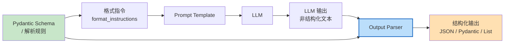

**LangChain 输出解析器家族**：

| 解析器 | 类名 | 输出类型 | 适用场景 |
|--------|------|---------|---------|
| 字符串解析 | `StrOutputParser` | `str` | 通用文本输出，最简单 |
| JSON 解析 | `JsonOutputParser` | `dict` | 需要 JSON 格式的结构化数据 |
| Pydantic 解析 | `PydanticOutputParser` | Pydantic 模型实例 | 类型安全的复杂结构 |
| 逗号分隔列表 | `CommaSeparatedListOutputParser` | `List[str]` | 简单列表输出 |
| 日期时间 | `DatetimeOutputParser` | `datetime` | 日期时间提取 |
| 枚举 | `EnumOutputParser` | 枚举值 | 分类/选择任务 |
| 自动修复 | `OutputFixingParser` | 任意 | 解析失败时自动用 LLM 修复 |
| 重试 | `RetryOutputParser` | 任意 | 解析失败时带错误信息重试 |

**核心机制**：
1. **格式指令生成**：`get_format_instructions()` 根据解析规则（如 Pydantic Schema）生成一段自然语言指令，告诉 LLM 应该按什么格式输出
2. **Prompt 注入**：将格式指令作为 `partial_variables` 注入到 PromptTemplate 中，通常放在 System 消息或用户消息末尾
3. **文本解析**：LLM 返回文本后，解析器按照规则提取和转换数据（JSON 解析、Pydantic 验证、列表分割等）
4. **错误处理**：解析失败时抛出 `OutputParserException`，可以用 `OutputFixingParser` 包装，自动调用 LLM 修复格式

**技术对比**：

| 维度 | 手动正则解析 | JsonOutputParser | PydanticOutputParser |
|------|------------|-----------------|---------------------|
| 类型安全 | 无 | 部分（dict） | 完全（Pydantic 验证） |
| 格式指令 | 手动写 | 自动生成 | 自动生成（含字段描述） |
| 嵌套结构 | 困难 | 支持 | 完美支持 |
| 自动修复 | 无 | 需手动 | 可配合 OutputFixingParser |
| 代码量 | 多 | 少 | 中 |
| 适用场景 | 极简单格式 | 通用 JSON | 生产级复杂结构 |

> 🏆 **面试高频考点**：PydanticOutputParser 和 JsonOutputParser 的区别？JsonOutputParser 输出原始 `dict`，不做类型验证，适合简单结构或需要灵活处理的场景；PydanticOutputParser 输出 Pydantic 模型实例，会做类型验证、默认值填充、字段描述生成，适合生产级应用需要类型安全的场景。两者都能生成格式指令，但 PydanticOutputParser 的格式指令更详细（包含每个字段的 description）。推荐生产环境使用 PydanticOutputParser。

#### 代码示例

**示例1：基础——常用解析器一览**

```python
# src/22_parsers_basic.py
from langchain_core.output_parsers import (
    StrOutputParser,
    JsonOutputParser,
    CommaSeparatedListOutputParser,
    DatetimeOutputParser,
)
from langchain_core.prompts import ChatPromptTemplate
from langchain_openai import ChatOpenAI
from dotenv import load_dotenv
import json

load_dotenv()
chat = ChatOpenAI(model="gpt-4o-mini", temperature=0)

# 1. StrOutputParser：最简单，直接返回字符串
str_chain = ChatPromptTemplate.from_template("用一句话解释{concept}") | chat | StrOutputParser()
result = str_chain.invoke({"concept": "递归"})
print(f"【StrOutputParser】类型: {type(result).__name__}, 值: {result}")

# 2. JsonOutputParser：解析为字典
json_parser = JsonOutputParser()
json_prompt = ChatPromptTemplate.from_template(
    "分析以下文本的情感。\n{format_instructions}\n文本：{text}"
)
json_chain = json_prompt | chat | json_parser
result = json_chain.invoke({
    "text": "这个产品太棒了，非常满意！",
    "format_instructions": json_parser.get_format_instructions(),
})
print(f"\n【JsonOutputParser】类型: {type(result).__name__}, 值: {result}")
print(f"  情感: {result.get('sentiment')}, 置信度: {result.get('confidence')}")

# 3. CommaSeparatedListOutputParser：解析为列表
list_parser = CommaSeparatedListOutputParser()
list_prompt = ChatPromptTemplate.from_template(
    "列出{count}个{topic}的技巧。\n{format_instructions}"
)
list_chain = list_prompt | chat | list_parser
result = list_chain.invoke({
    "count": "5",
    "topic": "Python 编程",
    "format_instructions": list_parser.get_format_instructions(),
})
print(f"\n【CommaSeparatedListOutputParser】类型: {type(result).__name__}, 长度: {len(result)}")
for i, item in enumerate(result, 1):
    print(f"  {i}. {item}")

# 4. DatetimeOutputParser：解析为 datetime 对象
datetime_parser = DatetimeOutputParser()
datetime_prompt = ChatPromptTemplate.from_template(
    "回答以下问题，只输出日期时间。\n{format_instructions}\n问题：{question}"
)
datetime_chain = datetime_prompt | chat | datetime_parser
result = datetime_chain.invoke({
    "question": "中华人民共和国成立于哪一天？",
    "format_instructions": datetime_parser.get_format_instructions(),
})
print(f"\n【DatetimeOutputParser】类型: {type(result).__name__}, 值: {result}")
print(f"  年份: {result.year}, 月份: {result.month}, 日期: {result.day}")
```

**示例2：进阶——PydanticOutputParser 复杂嵌套结构**

```python
# src/23_pydantic_parser.py
from langchain_core.output_parsers import PydanticOutputParser
from langchain_core.prompts import ChatPromptTemplate
from langchain_openai import ChatOpenAI
from pydantic import BaseModel, Field
from typing import List, Optional, Literal
from enum import Enum
from dotenv import load_dotenv

load_dotenv()
chat = ChatOpenAI(model="gpt-4o-mini", temperature=0)

# 1. 定义嵌套的 Pydantic 模型
class PriorityEnum(str, Enum):
    LOW = "low"
    MEDIUM = "medium"
    HIGH = "high"
    CRITICAL = "critical"

class Task(BaseModel):
    """任务项。"""
    title: str = Field(description="任务标题，简洁明了")
    description: str = Field(description="任务详细描述")
    priority: PriorityEnum = Field(description="优先级: low/medium/high/critical")
    estimated_hours: float = Field(description="预估工时（小时）", ge=0, le=1000)
    assignee: Optional[str] = Field(default=None, description="负责人，未分配则为 null")
    tags: List[str] = Field(default_factory=list, description="标签列表")

class ProjectPlan(BaseModel):
    """项目计划。"""
    project_name: str = Field(description="项目名称")
    summary: str = Field(description="项目概述，不超过200字")
    total_estimated_hours: float = Field(description="总预估工时", ge=0)
    tasks: List[Task] = Field(description="任务列表，至少3个任务")
    risks: List[str] = Field(default_factory=list, description="风险列表")
    milestones: List[str] = Field(default_factory=list, description="里程碑列表")

# 2. 创建解析器
parser = PydanticOutputParser(pydantic_object=ProjectPlan)

# 3. 查看自动生成的格式指令
print("=== 自动生成的格式指令 ===")
print(parser.get_format_instructions()[:500])
print("...")

# 4. 构建 Chain
prompt = ChatPromptTemplate.from_messages([
    ("system", "你是一个资深项目管理专家。根据用户描述生成详细的项目计划。\n{format_instructions}"),
    ("human", "{project_description}"),
])

chain = prompt | chat | parser

# 5. 调用并获取结构化结果
result = chain.invoke({
    "project_description": "开发一个基于 LangChain 的智能客服系统，支持多轮对话、RAG 知识库检索、工单自动创建。团队3人，预计2个月完成。",
    "format_instructions": parser.get_format_instructions(),
})

print(f"\n=== 解析结果（类型: {type(result).__name__}）===")
print(f"项目名称: {result.project_name}")
print(f"项目概述: {result.summary[:80]}...")
print(f"总工时: {result.total_estimated_hours} 小时")
print(f"任务数量: {len(result.tasks)}")
print(f"风险数量: {len(result.risks)}")
print(f"里程碑数量: {len(result.milestones)}")

print("\n=== 任务详情 ===")
for i, task in enumerate(result.tasks, 1):
    print(f"\n任务 {i}: {task.title}")
    print(f"  优先级: {task.priority.value}")
    print(f"  预估工时: {task.estimated_hours}h")
    print(f"  负责人: {task.assignee or '未分配'}")
    print(f"  标签: {task.tags}")
    print(f"  描述: {task.description[:60]}...")

# 6. Pydantic 模型的便利方法
print("\n=== Pydantic 模型方法 ===")
print(f"转字典: {type(result.model_dump()).__name__}")
print(f"转 JSON: {result.model_dump_json()[:100]}...")
print(f"Schema: {list(result.model_json_schema()['properties'].keys())}")
```

**示例3：完整场景——OutputFixingParser 自动修复 + 重试机制**

```python
# src/24_parser_robust.py
from langchain_core.output_parsers import (
    PydanticOutputParser,
    OutputFixingParser,
    RetryOutputParser,
)
from langchain_core.prompts import ChatPromptTemplate
from langchain_openai import ChatOpenAI
from langchain_core.exceptions import OutputParserException
from pydantic import BaseModel, Field
from typing import List
from dotenv import load_dotenv
import logging

load_dotenv()
logging.basicConfig(level=logging.INFO)
logger = logging.getLogger(__name__)

chat = ChatOpenAI(model="gpt-4o-mini", temperature=0.7)

# 定义输出结构
class MovieReview(BaseModel):
    title: str = Field(description="电影名称")
    rating: float = Field(description="评分 1-10", ge=1, le=10)
    sentiment: str = Field(description="情感: positive/negative/neutral")
    highlights: List[str] = Field(description="亮点列表，至少2个")
    criticisms: List[str] = Field(description="不足列表")

base_parser = PydanticOutputParser(pydantic_object=MovieReview)

# ===== 方式1：OutputFixingParser（解析失败时用 LLM 修复）=====
print("=== OutputFixingParser ===")

fixing_parser = OutputFixingParser.from_llm(
    parser=base_parser,
    llm=chat,
    max_retries=2,
)

prompt = ChatPromptTemplate.from_messages([
    ("system", "你是一个电影评论分析专家。\n{format_instructions}"),
    ("human", "分析评论：{review}"),
])

# 故意用一个可能导致格式问题的评论
chain = prompt | chat | fixing_parser

try:
    result = chain.invoke({
        "review": "这部电影真的太精彩了！画面美轮美奂，演员演技在线，剧情紧凑不拖沓。"
                  "唯一的不足是结尾有点仓促，配乐也一般。总体来说非常推荐！",
        "format_instructions": base_parser.get_format_instructions(),
    })
    print(f"解析成功: {result.title}, 评分: {result.rating}, 情感: {result.sentiment}")
    print(f"亮点: {result.highlights}")
    print(f"不足: {result.criticisms}")
except OutputParserException as e:
    print(f"解析失败（修复后仍失败）: {e}")

# ===== 方式2：RetryOutputParser（带错误信息重试）=====
print("\n=== RetryOutputParser ===")

retry_parser = RetryOutputParser.from_llm(
    parser=base_parser,
    llm=chat,
    max_retries=2,
)

# RetryOutputParser 需要特殊的调用方式（传入 prompt 和模型）
from langchain_core.prompts import PromptTemplate

retry_prompt = PromptTemplate.from_template(
    "分析评论并输出指定格式。\n{format_instructions}\n评论：{review}"
)

# 手动处理重试逻辑
def parse_with_retry(review_text: str):
    """带重试的解析函数。"""
    format_instructions = base_parser.get_format_instructions()
    prompt_value = retry_prompt.format_prompt(
        review=review_text,
        format_instructions=format_instructions,
    )

    # 第一次尝试
    response = chat.invoke(prompt_value.to_messages())
    try:
        return base_parser.parse(response.content)
    except OutputParserException as e:
        logger.warning(f"第一次解析失败: {e}")
        # 重试：传入错误信息
        result = retry_parser.parse_with_prompt(
            response.content,
            prompt_value,
        )
        return result

result = parse_with_retry("烂片！浪费时间，演员演技尴尬，剧情无聊，特效五毛，千万别去看！")
print(f"重试解析成功: {result.title}, 评分: {result.rating}, 情感: {result.sentiment}")

# ===== 方式3：自定义容错解析（最稳健）=====
print("\n=== 自定义容错解析 ===")
import json
import re

def robust_json_parse(text: str, parser: PydanticOutputParser) -> dict:
    """
    稳健的 JSON 解析：尝试多种方式提取和解析 JSON。

    处理情况：
    1. 直接是 JSON
    2. 被 ```json ... ``` 包裹
    3. 包含在其他文字中
    4. JSON 有轻微格式问题
    """
    # 尝试1：直接解析
    try:
        return json.loads(text)
    except json.JSONDecodeError:
        pass

    # 尝试2：去除 ```json 标记
    cleaned = re.sub(r'```json\s*', '', text)
    cleaned = re.sub(r'\s*```', '', cleaned)
    try:
        return json.loads(cleaned)
    except json.JSONDecodeError:
        pass

    # 尝试3：提取第一个 { 到最后一个 }
    match = re.search(r'\{.*\}', text, re.DOTALL)
    if match:
        try:
            return json.loads(match.group())
        except json.JSONDecodeError:
            pass

    # 尝试4：用 LLM 修复
    fix_prompt = ChatPromptTemplate.from_messages([
        ("system", "你是一个 JSON 修复专家。将以下文本修复为合法的 JSON，只输出 JSON，不输出其他内容。"),
        ("human", "{text}"),
    ])
    fix_chain = fix_prompt | chat | StrOutputParser()
    fixed = fix_chain.invoke({"text": text})
    try:
        return json.loads(fixed)
    except json.JSONDecodeError:
        raise OutputParserException(f"无法解析文本: {text[:100]}")


# 测试各种格式问题
test_cases = [
    '{"title": "电影A", "rating": 8.5, "sentiment": "positive", "highlights": ["画面"], "criticisms": []}',
    '```json\n{"title": "电影B", "rating": 7.0, "sentiment": "neutral", "highlights": ["音乐"], "criticisms": ["剧情"]}\n```',
    '这是分析结果：{"title": "电影C", "rating": 9.0, "sentiment": "positive", "highlights": ["演技", "导演"], "criticisms": ["时长"]} 希望对你有帮助。',
]

for i, case in enumerate(test_cases, 1):
    try:
        parsed = robust_json_parse(case, base_parser)
        result = base_parser.pydantic_object(**parsed)
        print(f"测试 {i}: 成功 - {result.title} ({result.rating}/10)")
    except Exception as e:
        print(f"测试 {i}: 失败 - {e}")
```

#### 使用场景与最佳实践

**适用场景**：
- 需要将 LLM 输出存入数据库或调用下游 API
- 需要严格的数据结构验证（类型、范围、枚举值）
- 需要前端按字段渲染 UI（如卡片、表格、表单）
- 需要批量处理并统计结构化数据

**不适用场景**：
- 纯文本生成（创意写作、对话回复），用 StrOutputParser 即可
- 输出格式极度灵活、无法预定义 Schema 的场景
- 对延迟极度敏感且结构简单（手动解析更快）

**最佳实践**：
1. **生产环境用 PydanticOutputParser**：类型安全、自动验证、格式指令详细，比 JsonOutputParser 更可靠
2. **每个 Field 都加 description**：Pydantic 的 `Field(description="...")` 会被包含在格式指令中，引导模型正确输出，显著提升解析成功率
3. **用 OutputFixingParser 包装**：`OutputFixingParser.from_llm(parser=base_parser, llm=chat)` 自动处理解析失败，将成功率从 90% 提升到 99%+
4. **设置 temperature=0**：结构化输出任务用低温度（0-0.2），减少创造性输出导致的格式偏差
5. **解析失败时记录原始输出**：便于后续分析失败原因，优化 Prompt 或 Schema

**性能建议**：
- OutputFixingParser 在解析失败时会额外调用一次 LLM，增加延迟和成本。优化 Prompt 和 Schema 减少失败率比依赖修复更重要
- 批量处理时，解析是 CPU 操作（JSON 解析），不会成为瓶颈，瓶颈在 LLM 调用
- Pydantic v2 的验证速度比 v1 快 5-50 倍，确保使用 pydantic>=2.0

#### 常见坑点

**坑点1：Pydantic 模型中使用了复杂类型导致模型无法按格式输出**

- **错误现象**：Pydantic 模型中定义了 `Union`、`Dict[str, Any]`、递归类型等复杂字段，LLM 输出的 JSON 无法通过验证，频繁触发 OutputFixingParser
- **根本原因**：LLM 对复杂类型的理解有限，尤其是 Union（需要选择类型）、递归结构（如 `class Node: children: List[Node]`）、无类型 Dict。格式指令中对这些类型的描述不够清晰，模型容易输出错误格式
- **正确做法**：①尽量使用简单类型（str、int、float、bool、List[str]、嵌套的 BaseModel）；②避免 Union，用可选字段（`Optional[str]`）替代；③避免递归类型，展开为固定层级；④复杂结构拆分为多次 LLM 调用（先生成简单结构，再补充细节）
- **预防措施**：定义 Pydantic 模型后，先用 5-10 个测试输入验证解析成功率，低于 95% 时简化 Schema；在 CI 中加入结构化输出的回归测试

**坑点2：format_instructions 注入位置错误导致模型忽略格式要求**

- **错误现象**：明明设置了 PydanticOutputParser 并注入了 format_instructions，但模型输出仍然是自由文本，不包含 JSON
- **根本原因**：①format_instructions 被注入到了 Human 消息的开头，而 System 消息中的角色设定与格式要求冲突；②Prompt 模板中 `{format_instructions}` 占位符放错了位置（如放在了示例中间）；③模型温度过高，创造性输出覆盖了格式约束
- **正确做法**：①format_instructions 放在 System 消息末尾或 Human 消息末尾（紧接实际输入之前）；②System 消息中明确强调"必须严格按照以下格式输出，不要输出任何额外文字"；③设置 temperature=0；④用 Few-Shot 示例强化格式
- **预防措施**：封装一个 `build_structured_chain(prompt, parser, llm)` 工厂函数，统一处理 format_instructions 的注入位置和 System 消息的格式强调；在开发阶段打印完整的格式化 Prompt，人工检查格式指令是否清晰

---

### 5.2 自定义输出解析器

#### 概念解释

**自定义输出解析器是指继承 `BaseOutputParser` 或 `BaseGenerationOutputParser`，实现特定领域的文本解析逻辑的组件**。当 LangChain 内置的解析器（JSON、Pydantic、列表等）无法满足需求时——比如需要解析 Markdown 表格、代码块、特定格式的报告、多段结构化文本——可以通过自定义解析器实现精确的提取和转换。自定义解析器同样实现 `Runnable` 接口，可以直接用 `|` 接入 Chain。

> 🎯 **生活化比喻**：自定义输出解析器就像"定制化分拣机"——标准分拣机（内置解析器）只能处理标准尺寸的包裹（JSON、列表），但如果你需要处理特殊形状的包裹（Markdown 表格、代码块、医学报告），就需要定制一台专门的分拣机。你告诉它"看到这种格式就按这个规则拆分"，它就能准确地把特殊包裹分类到对应货架上。

**核心价值**：自定义解析器让你可以处理任何非标准格式的 LLM 输出，将自然语言生成的复杂文本精确转换为程序可处理的结构化数据，扩展了 LangChain 的应用边界。

#### 原理说明

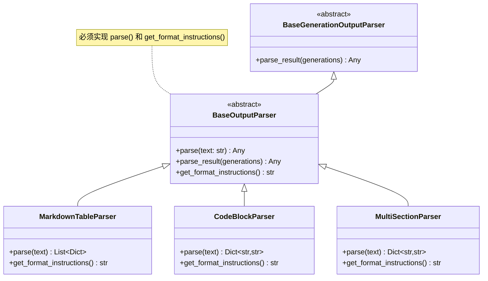

**自定义解析器的两种基类**：
- `BaseOutputParser`：基于文本解析，实现 `parse(text: str) -> Any`，最简单常用
- `BaseGenerationOutputParser`：基于 Generation 对象解析，可以访问完整的生成元数据（如 token 用量、finish_reason）

**必须实现的方法**：
1. `parse(text: str) -> Any`：核心解析逻辑，将文本转换为目标结构
2. `get_format_instructions() -> str`：生成格式指令，注入 Prompt 引导模型输出

**可选方法**：
3. `parse_result(generations: List[Generation]) -> Any`：处理完整的 Generation 列表，默认调用 `parse(generations[0].text)`
4. `raise_on_exception` 属性：解析失败时是否抛出异常

> 🏆 **面试高频考点**：如何自定义一个输出解析器？继承 `BaseOutputParser`，实现两个方法：①`parse(text)`——编写解析逻辑（正则、字符串分割、第三方库解析等），返回结构化数据；②`get_format_instructions()`——返回一段自然语言指令，告诉 LLM 应该按什么格式输出。自定义解析器自动实现 Runnable 接口，可以用 `|` 接入 Chain。解析失败时抛出 `OutputParserException`，可被 OutputFixingParser 捕获并修复。

#### 代码示例

**示例1：基础——Markdown 表格解析器**

```python
# src/25_custom_parser_md.py
from langchain_core.output_parsers import BaseOutputParser
from langchain_core.exceptions import OutputParserException
from langchain_core.prompts import ChatPromptTemplate
from langchain_openai import ChatOpenAI
from typing import List, Dict
import re
from dotenv import load_dotenv

load_dotenv()


class MarkdownTableParser(BaseOutputParser):
    """
    自定义解析器：将 Markdown 表格解析为字典列表。

    支持：
    - 标准 Markdown 表格（| 列1 | 列2 |）
    - 表头自动识别
    - 空单元格处理
    """

    def parse(self, text: str) -> List[Dict[str, str]]:
        # 提取 Markdown 表格（可能被其他文字包围）
        table_pattern = r'\|.*\|\n\|[-: |]+\|\n(?:\|.*\|\n?)+'
        match = re.search(table_pattern, text)
        if not match:
            raise OutputParserException(f"未找到 Markdown 表格，文本: {text[:100]}")

        table_text = match.group()
        lines = [line.strip() for line in table_text.strip().split('\n') if line.strip()]

        if len(lines) < 2:
            raise OutputParserException("表格行数不足")

        # 解析表头
        headers = [h.strip() for h in lines[0].split('|')[1:-1]]

        # 跳过分隔行（第二行），解析数据行
        results = []
        for line in lines[2:]:
            cells = [c.strip() for c in line.split('|')[1:-1]]
            # 补齐缺失的单元格
            while len(cells) < len(headers):
                cells.append("")
            row = {headers[i]: cells[i] for i in range(len(headers))}
            results.append(row)

        return results

    def get_format_instructions(self) -> str:
        return (
            "请以 Markdown 表格格式输出，包含表头和分隔行。\n"
            "格式示例：\n"
            "| 名称 | 年龄 | 城市 |\n"
            "|------|------|------|\n"
            "| 张三 | 25 | 北京 |\n"
            "| 李四 | 30 | 上海 |\n"
            "只输出表格，不输出其他内容。"
        )


# 使用示例
chat = ChatOpenAI(model="gpt-4o-mini", temperature=0)
parser = MarkdownTableParser()

prompt = ChatPromptTemplate.from_messages([
    ("system", "你是一个数据整理专家。\n{format_instructions}"),
    ("human", "列出3个中国一线城市的基本信息（名称、人口、GDP、特色产业）"),
])

chain = prompt | chat | parser

result = chain.invoke({
    "format_instructions": parser.get_format_instructions(),
})

print(f"解析到 {len(result)} 行数据:")
for i, row in enumerate(result, 1):
    print(f"\n行 {i}:")
    for key, value in row.items():
        print(f"  {key}: {value}")
```

**示例2：进阶——代码块解析器（多语言）**

```python
# src/26_custom_parser_code.py
from langchain_core.output_parsers import BaseOutputParser
from langchain_core.exceptions import OutputParserException
from langchain_core.prompts import ChatPromptTemplate
from langchain_openai import ChatOpenAI
from typing import Dict, List, Optional
import re
from dotenv import load_dotenv

load_dotenv()


class CodeBlockParser(BaseOutputParser):
    """
    自定义解析器：从文本中提取代码块。

    支持：
    - 单个或多个代码块
    - 自动识别语言（python、javascript、sql等）
    - 提取代码块前后的说明文字
    """

    def parse(self, text: str) -> Dict[str, any]:
        # 匹配所有代码块：```language\ncode\n```
        pattern = r'```(\w*)\n(.*?)```'
        matches = re.findall(pattern, text, re.DOTALL)

        if not matches:
            raise OutputParserException(f"未找到代码块，文本: {text[:100]}")

        code_blocks = []
        for lang, code in matches:
            code_blocks.append({
                "language": lang or "text",
                "code": code.strip(),
                "line_count": len(code.strip().split('\n')),
            })

        # 提取非代码部分的说明文字
        explanation = re.sub(pattern, '', text, flags=re.DOTALL).strip()

        return {
            "explanation": explanation,
            "code_blocks": code_blocks,
            "block_count": len(code_blocks),
            "primary_language": code_blocks[0]["language"] if code_blocks else None,
        }

    def get_format_instructions(self) -> str:
        return (
            "回答中包含代码时，请用 ```语言名 包裹代码块。\n"
            "可以包含多个代码块，每个代码块前用简短文字说明其作用。\n"
            "示例：\n"
            "这是一个 Python 函数：\n"
            "```python\n"
            "def hello():\n"
            "    print('hello')\n"
            "```"
        )


# 使用示例
chat = ChatOpenAI(model="gpt-4o-mini", temperature=0.3)
parser = CodeBlockParser()

prompt = ChatPromptTemplate.from_messages([
    ("system", "你是一个全栈开发专家。\n{format_instructions}"),
    ("human", "如何用 FastAPI 创建一个简单的 REST API？包含后端代码和调用示例。"),
])

chain = prompt | chat | parser
result = chain.invoke({"format_instructions": parser.get_format_instructions()})

print(f"说明文字: {result['explanation'][:100]}...")
print(f"代码块数量: {result['block_count']}")
print(f"主要语言: {result['primary_language']}")

for i, block in enumerate(result['code_blocks'], 1):
    print(f"\n=== 代码块 {i} ({block['language']}, {block['line_count']}行) ===")
    print(block['code'][:200])
    if len(block['code']) > 200:
        print("...")
```

**示例3：完整场景——多段落报告解析器 + 自定义解析器在 Chain 中的应用**

```python
# src/27_custom_parser_report.py
from langchain_core.output_parsers import BaseOutputParser
from langchain_core.exceptions import OutputParserException
from langchain_core.prompts import ChatPromptTemplate
from langchain_openai import ChatOpenAI
from langchain_core.runnables import RunnableLambda
from typing import Dict, List, Optional
import re
from dotenv import load_dotenv

load_dotenv()


class SectionReportParser(BaseOutputParser):
    """
    自定义解析器：解析多段落结构化报告。

    报告格式：
    ## 章节标题
    章节内容

    支持自动识别章节并提取内容。
    """

    def __init__(self, expected_sections: Optional[List[str]] = None):
        self.expected_sections = expected_sections

    def parse(self, text: str) -> Dict[str, str]:
        # 按 ## 分割章节
        sections = {}
        current_section = "前言"
        current_content = []

        for line in text.split('\n'):
            match = re.match(r'^##\s+(.+)$', line.strip())
            if match:
                # 保存上一个章节
                sections[current_section] = '\n'.join(current_content).strip()
                current_section = match.group(1).strip()
                current_content = []
            else:
                current_content.append(line)

        # 保存最后一个章节
        sections[current_section] = '\n'.join(current_content).strip()

        # 验证必要章节
        if self.expected_sections:
            missing = [s for s in self.expected_sections if s not in sections]
            if missing:
                raise OutputParserException(f"缺少必要章节: {missing}，实际章节: {list(sections.keys())}")

        return sections

    def get_format_instructions(self) -> str:
        sections_str = "\n".join(f"## {s}" for s in self.expected_sections) if self.expected_sections else "## 章节1\n## 章节2"
        return (
            f"请按以下多段落格式输出报告，每个章节以 ## 开头：\n"
            f"{sections_str}\n"
            f"每个章节下写对应的内容，不要输出章节以外的内容。"
        )


# ===== 完整应用：竞品分析报告生成与解析 =====
chat = ChatOpenAI(model="gpt-4o-mini", temperature=0.3)

# 定义报告结构
report_parser = SectionReportParser(
    expected_sections=["产品概述", "核心功能", "优势分析", "不足分析", "市场定位", "建议"]
)

prompt = ChatPromptTemplate.from_messages([
    ("system", "你是一个资深产品分析师，擅长竞品分析。\n{format_instructions}"),
    ("human", "请分析以下产品：{product_name}"),
])

# 构建 Chain
chain = prompt | chat | report_parser

# 调用
result = chain.invoke({
    "product_name": "Notion",
    "format_instructions": report_parser.get_format_instructions(),
})

print("=== 竞品分析报告 ===")
for section, content in result.items():
    print(f"\n## {section}")
    print(content[:150] + "..." if len(content) > 150 else content)

# ===== 后处理：将解析结果转为更结构化的数据 =====
def analyze_report(report: Dict[str, str]) -> Dict:
    """对解析后的报告做进一步分析。"""
    # 统计各章节字数
    word_counts = {k: len(v) for k, v in report.items()}

    # 提取优势和不足的要点（按句号或换行分割）
    advantages = [s.strip() for s in report.get("优势分析", "").split('\n') if s.strip() and len(s.strip()) > 5]
    weaknesses = [s.strip() for s in report.get("不足分析", "").split('\n') if s.strip() and len(s.strip()) > 5]

    return {
        "sections": list(report.keys()),
        "word_counts": word_counts,
        "total_words": sum(word_counts.values()),
        "advantages": advantages[:5],
        "weaknesses": weaknesses[:5],
        "has_recommendations": "建议" in report and len(report["建议"]) > 10,
    }

# 将后处理函数接入 Chain
full_chain = chain | RunnableLambda(analyze_report)

analysis = full_chain.invoke({
    "product_name": "Notion",
    "format_instructions": report_parser.get_format_instructions(),
})

print("\n=== 报告分析统计 ===")
print(f"章节数: {len(analysis['sections'])}")
print(f"总字数: {analysis['total_words']}")
print(f"各章节字数: {analysis['word_counts']}")
print(f"优势要点数: {len(analysis['advantages'])}")
print(f"不足要点数: {len(analysis['weaknesses']}")
print(f"包含建议: {analysis['has_recommendations']}")
```

#### 使用场景与最佳实践

**适用场景**：
- LLM 输出格式不是标准 JSON（如 Markdown 表格、代码块、多段落报告）
- 需要从长文本中提取特定结构（如医学报告、法律文书、技术文档）
- 内置解析器无法满足的定制化需求
- 需要在解析过程中做额外的数据清洗或验证

**不适用场景**：
- 标准 JSON 或 Pydantic 结构（用内置解析器更可靠）
- 极简单格式（手动字符串处理更简单）
- 输出格式可能频繁变化（自定义解析器维护成本高）

**最佳实践**：
1. **优先尝试内置解析器**：JSON/Pydantic 解析器经过充分测试，自定义解析器只在内置的无法满足时使用
2. **解析逻辑要容错**：LLM 输出可能有轻微格式偏差（多余空格、缺失分隔符），解析器要用正则和模糊匹配，不要严格匹配
3. **get_format_instructions 要包含示例**：清晰的格式示例比文字描述更有效，模型看到示例后输出格式的准确率提升 30%+
4. **解析失败时保留原始文本**：在异常信息中包含原始文本的前 200 字符，便于调试和优化
5. **用单元测试覆盖解析逻辑**：准备 5-10 个各种格式的测试用例（标准格式、带多余文字、格式轻微错误），确保解析器稳健

**性能建议**：
- 自定义解析器的解析逻辑是纯 CPU 操作，正则匹配对长文本可能较慢（>10KB 文本时注意优化）
- 复杂解析可以用 `lxml`（HTML/XML）、`markdown`（Markdown）、`beautifulsoup4` 等专用库，比手写正则更可靠
- 解析器是无状态的，可以作为单例复用，不要每次请求都创建

#### 常见坑点

**坑点1：自定义解析器的 parse 方法抛出非 OutputParserException 异常**

- **错误现象**：解析失败时抛出 `AttributeError`、`IndexError`、`KeyError` 等普通异常，而不是 `OutputParserException`，导致 OutputFixingParser 无法捕获和修复
- **根本原因**：自定义解析器中直接访问字典键、列表索引，没有做边界检查和异常转换。LangChain 的 OutputFixingParser 只捕获 `OutputParserException`，其他异常会直接传播到调用方
- **正确做法**：①在 parse 方法中用 try-except 捕获所有可能的异常，转换为 `OutputParserException` 并包含有意义的错误信息；②访问字典用 `.get(key, default)`，访问列表前检查长度；③在解析前验证输入格式（如检查是否包含预期的标记）
- **预防措施**：自定义解析器编写完成后，用各种异常输入（空字符串、格式完全错误、部分缺失）测试，确保都抛出 OutputParserException 而非其他异常

**坑点2：get_format_instructions 不够清晰导致模型输出格式不稳定**

- **错误现象**：自定义解析器在开发时测试通过，但生产环境中频繁解析失败，模型输出的格式与预期有偏差
- **根本原因**：①格式指令只有文字描述，没有具体示例；②格式指令与 System 消息中的其他指令冲突；③模型温度过高导致创造性输出；④没有用 Few-Shot 示例强化格式
- **正确做法**：①格式指令中包含完整的输入输出示例；②将格式指令放在 System 消息末尾，明确强调"必须严格按照以下格式输出"；③设置 temperature=0；④在 Prompt 中添加 1-2 个 Few-Shot 示例
- **预防措施**：封装一个 `format_instructions` 的模板，包含"规则说明 + 完整示例 + 禁止事项"三部分；对每种自定义解析器，准备 10 个测试输入做格式稳定性评估，成功率低于 95% 时优化格式指令

---

> 💡 **深度讲解**：本章深入讲解了 LangChain 的输出解析器体系。输出解析器是连接"自然语言生成"和"程序可处理数据"的关键桥梁——没有它，LLM 的回复只能是一段文字，无法被程序直接消费。内置解析器覆盖了常见场景：StrOutputParser（纯文本）、JsonOutputParser（字典）、PydanticOutputParser（类型安全的复杂结构，生产推荐）、CommaSeparatedListOutputParser（列表）、DatetimeOutputParser（日期时间）。当内置解析器无法满足时，可以继承 BaseOutputParser 自定义解析逻辑，处理 Markdown 表格、代码块、多段落报告等特殊格式。生产环境的关键是稳健性——用 Pydantic 定义 Schema、每个 Field 加 description、用 OutputFixingParser 包装、temperature=0、解析失败时记录原始输出，这些措施组合起来能将解析成功率从 80% 提升到 99%+。

> 📝 **精简总结**：
> 1. OutputParser 实现 Runnable 接口，用 | 接入 Chain，将 LLM 文本输出转为结构化数据
> 2. 生产环境推荐 PydanticOutputParser，类型安全、自动验证、格式指令详细
> 3. 每个 Pydantic Field 都加 description，会被包含在格式指令中引导模型
> 4. OutputFixingParser 包装解析器，解析失败时自动用 LLM 修复，成功率 99%+
> 5. 结构化输出任务设置 temperature=0，减少格式偏差
> 6. 自定义解析器继承 BaseOutputParser，实现 parse() 和 get_format_instructions()
> 7. 自定义解析器的 parse 方法必须将所有异常转换为 OutputParserException
> 8. 格式指令包含完整示例比纯文字描述更有效，准确率提升 30%+

> 🎯 **梯度练习题**：
> - **基础1**：用 PydanticOutputParser 定义一个包含 name、age、email 的 User 结构，调用 LLM 生成并解析
> - **基础2**：用 CommaSeparatedListOutputParser 让 LLM 列出 10 个编程语言，验证解析结果为列表
> - **基础3**：用 OutputFixingParser 包装一个 Pydantic 解析器，故意构造一个格式错误的输出验证修复功能
> - **进阶1**：自定义一个 Markdown 表格解析器，支持表头识别和空单元格处理，编写 3 个测试用例验证
> - **进阶2**：实现一个稳健的 JSON 解析函数，处理直接 JSON、```json 包裹、包含在文字中、格式轻微错误四种情况
> - **实战1**：构建一个简历信息提取系统，定义包含个人信息、教育经历、工作经历、技能列表的嵌套 Pydantic 模型，用 PydanticOutputParser + OutputFixingParser 解析，自定义一个简历段落解析器作为备选方案，并编写 5 份不同格式的测试简历验证解析成功率

---

## 6. Chain 组合开发（LCEL）

### 6.1 LCEL 基础与 Runnable 组合

#### 概念解释

**LCEL（LangChain Expression Language）是 LangChain 的声明式组合语言**，通过 `|`（管道符）运算符将任意 `Runnable` 组件串联成处理流水线，类似于 Unix 管道和函数式编程中的组合运算符。LCEL 是 LangChain 0.2 版本之后的核心组合方式，替代了旧版的 `LLMChain`、`SequentialChain` 等类，提供了统一的、声明式的、类型安全的组件组合体验。任何 LCEL 组合自动获得流式输出、异步调用、批量处理、重试、追踪、日志等能力。

> 🎯 **生活化比喻**：LCEL 就像"乐高积木的拼接系统"——每个 Runnable 组件是一块乐高积木，`|` 运算符是积木之间的卡扣。你可以把"提示词积木"扣在"模型积木"上，再把"解析器积木"扣在后面，组成一条完整的流水线。而且不管你怎么组合，整条流水线都自动具备"流水生产线"的能力（流式输出）、"多线程车间"的能力（异步/批量）、"质检环节"的能力（重试/追踪），不需要额外加装。

**核心价值**：LCEL 将 LLM 应用开发从"写胶水代码"转变为"声明式组合"，代码更简洁、可读性更高、可测试性更强，且自动获得所有横切关注点（流式、异步、批量、重试、追踪）的支持。

#### 原理说明

```mermaid
graph TB
    subgraph "LCEL 组合原理"
        A[Runnable A<br/>输入: X] -->|输出: Y| B[Runnable B<br/>输入: Y]
        B -->|输出: Z| C[Runnable C<br/>输入: Z]
        C -->|输出: W| D[最终输出: W]
    end

    subgraph "自动获得的能力"
        E[.stream() 流式]
        F[.ainvoke() 异步]
        G[.batch() 批量]
        H[.with_retry() 重试]
        I[LangSmith 追踪]
    end

    A -.-> E
    A -.-> F
    A -.-> G
    A -.-> H
    A -.-> I

    style A fill:#bbdefb
    style B fill:#c8e6c9
    style C fill:#fff9c4
    style D fill:#ffe0b2
```

**LCEL 的核心运算符和组合器**：

| 运算符/组合器 | 语法 | 作用 |
|--------------|------|------|
| 管道符 | `a \| b` | 将 a 的输出作为 b 的输入，串联两个 Runnable |
| 并行 | `RunnableParallel(x=a, y=b)` | 并行执行 a 和 b，输出为 `{"x": ..., "y": ...}` |
| 透传 | `RunnablePassthrough()` | 直接传递输入，不做任何处理 |
| 赋值 | `RunnablePassthrough.assign(x=...)` | 在输入字典中添加新键值对，保留原有键 |
| 分支 | `RunnableBranch((cond1, chain1), (cond2, chain2), default)` | 按条件选择执行哪个 Chain |
| Lambda | `RunnableLambda(func)` | 将任意函数包装为 Runnable |
| 重试 | `runnable.with_retry(stop_after_attempt=3)` | 失败时自动重试 |
| 降级 | `runnable.with_fallbacks([backup])` | 失败时切换到备用 Runnable |
| 配置 | `runnable.with_config(tags=[...])` | 绑定配置（标签、回调等） |

**RunnableSequence 的执行机制**：
1. `prompt | model | parser` 被编译为 `RunnableSequence(first=prompt, middle=[model], last=parser)`
2. 调用 `invoke(input)` 时，依次执行：`parser.invoke(model.invoke(prompt.invoke(input)))`
3. 调用 `stream(input)` 时，prompt 输出完整值后传给 model，model 流式输出每个 chunk，parser 逐 chunk 处理（如果 parser 支持流式）
4. 调用 `batch(inputs)` 时，每个步骤都批量执行，利用并发提升吞吐量
5. 每个步骤的输入输出类型由 `input_schema` 和 `output_schema` 定义，LCEL 会在组合时检查类型兼容性

**技术对比**：

| 维度 | LCEL（推荐） | 旧版 Chain 类 | 手动函数调用 |
|------|-------------|-------------|------------|
| 组合方式 | `\|` 管道符声明式 | 类继承和嵌套 | 手动调用 |
| 流式支持 | 原生 | 部分支持 | 需自行实现 |
| 异步支持 | 原生 | 部分支持 | 需自行实现 |
| 批量支持 | 原生 | 不支持 | 需自行实现 |
| 类型安全 | Schema 校验 | 无 | 无 |
| 可观测性 | 自动追踪 | 部分支持 | 需手动埋点 |
| 代码量 | 少 | 中 | 多 |
| 维护状态 | 持续维护 | 已废弃 | - |

> 🏆 **面试高频考点**：LCEL 中 `RunnablePassthrough()` 和 `RunnablePassthrough.assign()` 的区别？`RunnablePassthrough()` 直接将输入原样传递输出，常用于并行组合中需要保留原始输入的场景；`RunnablePassthrough.assign(key=value)` 在输入字典的基础上添加新的键值对，保留原有所有键，常用于在 Chain 中间步骤添加计算结果（如检索到的上下文）而不丢失原始输入。典型用法：`{"context": retriever, "question": RunnablePassthrough()} | prompt`，其中 `RunnablePassthrough()` 保留原始问题字符串。

#### 代码示例

**示例1：基础——LCEL 常用组合器**

```python
# src/28_lcel_basic.py
from langchain_core.prompts import ChatPromptTemplate
from langchain_core.output_parsers import StrOutputParser
from langchain_core.runnables import (
    RunnableParallel,
    RunnablePassthrough,
    RunnableLambda,
)
from langchain_openai import ChatOpenAI
from dotenv import load_dotenv

load_dotenv()
chat = ChatOpenAI(model="gpt-4o-mini", temperature=0.7)
parser = StrOutputParser()

# 1. 基础管道：Prompt | Model | Parser
basic_chain = (
    ChatPromptTemplate.from_template("用一句话解释{concept}")
    | chat
    | parser
)
result = basic_chain.invoke({"concept": "LCEL"})
print(f"【基础管道】{result}")

# 2. RunnableParallel：并行执行多个 Chain
explain_chain = ChatPromptTemplate.from_template("用一句话解释{concept}") | chat | parser
example_chain = ChatPromptTemplate.from_template("给出{concept}的代码示例") | chat | parser

parallel_chain = RunnableParallel(
    explanation=explain_chain,
    code_example=example_chain,
)

result = parallel_chain.invoke({"concept": "Python 装饰器"})
print(f"\n【并行执行】")
print(f"  解释: {result['explanation'][:60]}...")
print(f"  代码: {result['code_example'][:60]}...")

# 3. RunnablePassthrough：透传输入
passthrough_chain = RunnablePassthrough() | ChatPromptTemplate.from_template("回显：{text}") | chat | parser
# 注意：RunnablePassthrough() 输出的是输入本身，如果输入是字典则透传字典
result = passthrough_chain.invoke({"text": "你好世界"})
print(f"\n【透传】{result}")

# 4. RunnablePassthrough.assign：添加新键值对
def get_length(text):
    return len(text)

assign_chain = (
    RunnablePassthrough.assign(length=lambda x: len(x["text"]))
    | ChatPromptTemplate.from_template("文本：{text}，长度：{length}字。请总结。")
    | chat
    | parser
)
result = assign_chain.invoke({"text": "LangChain 是一个强大的 LLM 应用开发框架。"})
print(f"\n【assign 添加键】{result}")

# 5. RunnableLambda：将任意函数包装为 Runnable
def to_uppercase(input_dict):
    return {"text": input_dict["text"].upper()}

lambda_chain = (
    RunnableLambda(to_uppercase)
    | ChatPromptTemplate.from_template("大写文本：{text}")
    | chat
    | parser
)
result = lambda_chain.invoke({"text": "hello world"})
print(f"\n【RunnableLambda】{result}")

# 6. 组合器嵌套：并行 + 透传 + 赋值
complex_chain = (
    RunnableParallel(
        original=RunnablePassthrough(),
        upper=RunnableLambda(lambda x: x["text"].upper()),
        length=RunnableLambda(lambda x: len(x["text"])),
    )
    | RunnableLambda(lambda x: f"原文: {x['original']['text']}\n大写: {x['upper']}\n长度: {x['length']}")
)
result = complex_chain.invoke({"text": "LangChain"})
print(f"\n【复杂组合】\n{result}")
```

**示例2：进阶——RunnableBranch 条件分支与路由**

```python
# src/29_lcel_branch.py
from langchain_core.prompts import ChatPromptTemplate
from langchain_core.output_parsers import StrOutputParser
from langchain_core.runnables import RunnableBranch, RunnablePassthrough, RunnableLambda
from langchain_openai import ChatOpenAI
from dotenv import load_dotenv

load_dotenv()
chat = ChatOpenAI(model="gpt-4o-mini", temperature=0.3)
parser = StrOutputParser()

# 1. 分类 Chain：判断问题类型
classify_prompt = ChatPromptTemplate.from_template(
    "判断以下问题属于哪个类别，只回答类别名称（技术/生活/其他）：\n{question}"
)
classify_chain = classify_prompt | chat | parser

# 2. 不同类别的回答 Chain
tech_chain = ChatPromptTemplate.from_template(
    "作为资深技术专家回答以下问题，要求专业准确，附带技术细节：\n{question}"
) | chat | parser

life_chain = ChatPromptTemplate.from_template(
    "作为生活顾问回答以下问题，要求实用贴心，给出具体建议：\n{question}"
) | chat | parser

other_chain = ChatPromptTemplate.from_template(
    "作为通用助手回答以下问题：\n{question}"
) | chat | parser

# 3. RunnableBranch：按条件路由
branch = RunnableBranch(
    (lambda x: "技术" in x["category"], tech_chain),
    (lambda x: "生活" in x["category"], life_chain),
    other_chain,  # 默认分支
)

# 4. 完整 Chain：分类 → 路由
full_chain = (
    {"category": classify_chain, "question": lambda x: x["question"]}
    | branch
)

# 测试不同类型的问题
test_questions = [
    "如何优化 Python 代码的性能？",
    "如何提高睡眠质量？",
    "你最喜欢的电影是什么？",
]

for q in test_questions:
    category = classify_chain.invoke({"question": q})
    answer = full_chain.invoke({"question": q})
    print(f"问题: {q}")
    print(f"分类: {category}")
    print(f"回答: {answer[:80]}...")
    print()

# 5. 更复杂的路由：基于多个条件
def route_by_complexity(inputs):
    """根据问题复杂度和类型选择处理策略。"""
    category = inputs["category"]
    length = len(inputs["question"])
    if "技术" in category and length > 30:
        return "deep_tech"
    elif "技术" in category:
        return "quick_tech"
    elif "生活" in category:
        return "life"
    else:
        return "general"

deep_tech_chain = ChatPromptTemplate.from_template(
    "作为架构师，深入分析以下技术问题，给出原理、方案和代码示例：\n{question}"
) | chat | parser

quick_tech_chain = ChatPromptTemplate.from_template(
    "简洁回答以下技术问题，不超过100字：\n{question}"
) | chat | parser

complex_branch = RunnableBranch(
    (lambda x: x["route"] == "deep_tech", deep_tech_chain),
    (lambda x: x["route"] == "quick_tech", quick_tech_chain),
    (lambda x: x["route"] == "life", life_chain),
    other_chain,
)

complex_chain = (
    RunnablePassthrough.assign(
        category=classify_chain,
        route=RunnableLambda(route_by_complexity),
    )
    | complex_branch
)

result = complex_chain.invoke({"question": "如何设计一个支持百万并发的微服务架构？请深入分析。"})
print(f"【复杂路由】{result[:100]}...")
```

**示例3：完整场景——RAG Chain 的 LCEL 完整实现**

```python
# src/30_lcel_rag.py
from langchain_core.prompts import ChatPromptTemplate
from langchain_core.output_parsers import StrOutputParser
from langchain_core.runnables import RunnablePassthrough, RunnableLambda, RunnableParallel
from langchain_openai import ChatOpenAI, OpenAIEmbeddings
from langchain_community.vectorstores import Chroma
from langchain_text_splitters import RecursiveCharacterTextSplitter
from langchain_community.document_loaders import TextLoader
from langchain_core.documents import Document
from dotenv import load_dotenv
from typing import List
import tempfile
import os

load_dotenv()

# ===== 准备测试数据 =====
sample_docs = [
    Document(page_content="LangChain 是一个开源的 LLM 应用开发框架，由 Harrison Chase 于 2022 年创建。它提供了统一的模型接口、提示词模板、输出解析器、链式调用、对话记忆、检索增强和智能体等核心功能。", metadata={"source": "intro.md"}),
    Document(page_content="LCEL（LangChain Expression Language）是 LangChain 的声明式组合语言，通过 | 运算符将 Runnable 组件串联。LCEL 组合自动支持流式输出、异步调用、批量处理、重试和追踪。", metadata={"source": "lcel.md"}),
    Document(page_content="RAG（检索增强生成）是一种将外部知识库检索与 LLM 生成结合的技术。流程包括：文档加载、文本分割、向量化、存储、检索、生成。RAG 可以减少模型幻觉，提供可追溯的答案来源。", metadata={"source": "rag.md"}),
    Document(page_content="Agent（智能体）是 LLM 应用的高级形式，LLM 作为推理引擎决定调用哪些工具。Agent 执行思考-行动-观察的循环，直到完成任务。常用工具包括搜索、计算器、数据库查询、API 调用等。", metadata={"source": "agent.md"}),
]

# 创建向量数据库
embeddings = OpenAIEmbeddings(model="text-embedding-3-small")
vectorstore = Chroma.from_documents(
    documents=sample_docs,
    embedding=embeddings,
    persist_directory="./data/lcel_demo_chroma",
)
retriever = vectorstore.as_retriever(search_kwargs={"k": 2})

# ===== 构建 RAG Chain =====
chat = ChatOpenAI(model="gpt-4o-mini", temperature=0)

# 1. 格式化文档
def format_docs(docs: List[Document]) -> str:
    return "\n\n".join(f"[{i+1}] {doc.page_content}" for i, doc in enumerate(docs))

# 2. RAG Prompt
rag_prompt = ChatPromptTemplate.from_template("""你是一个专业的问答助手。请根据以下上下文回答问题。
如果上下文中没有相关信息，请说"根据现有资料无法回答"，不要编造。

上下文：
{context}

问题：{question}

回答：""")

# 3. 基础 RAG Chain（最常见的写法）
rag_chain = (
    {"context": retriever | format_docs, "question": RunnablePassthrough()}
    | rag_prompt
    | chat
    | StrOutputParser()
)

# 调用
print("=== 基础 RAG ===")
answer = rag_chain.invoke("什么是 LCEL？")
print(answer)

# 4. 带来源的 RAG Chain
def format_docs_with_sources(docs: List[Document]) -> dict:
    return {
        "context": "\n\n".join(f"[{i+1}] {doc.page_content}" for i, doc in enumerate(docs)),
        "sources": [doc.metadata.get("source", "未知") for doc in docs],
    }

# 用 RunnableParallel 同时获取上下文和来源
rag_with_sources = (
    RunnableParallel(
        context=retriever | RunnableLambda(lambda docs: "\n\n".join(f"[{i+1}] {d.page_content}" for i, d in enumerate(docs))),
        sources=retriever | RunnableLambda(lambda docs: [d.metadata.get("source", "未知") for d in docs]),
        question=RunnablePassthrough(),
    )
    | RunnablePassthrough.assign(
        answer=lambda x: rag_prompt | chat | StrOutputParser()
    )
)

# 注意：上面的写法有问题，assign 中的 lambda 不会自动 invoke chain
# 正确的写法是分两步：
retrieval_chain = RunnableParallel(
    context=retriever | RunnableLambda(lambda docs: "\n\n".join(f"[{i+1}] {d.page_content}" for i, d in enumerate(docs))),
    sources=retriever | RunnableLambda(lambda docs: [d.metadata.get("source", "未知") for d in docs]),
    question=RunnablePassthrough(),
)

answer_chain = rag_prompt | chat | StrOutputParser()

full_rag_chain = retrieval_chain | RunnablePassthrough.assign(
    answer=lambda x: answer_chain.invoke({"context": x["context"], "question": x["question"]})
)

print("\n=== 带来源的 RAG ===")
result = full_rag_chain.invoke("LangChain 是谁创建的？")
print(f"回答: {result['answer']}")
print(f"来源: {result['sources']}")

# 5. 对话式 RAG（带历史重写）
condense_prompt = ChatPromptTemplate.from_template("""根据对话历史，将用户问题改写为独立的、不含指代的问题。
只输出改写后的问题，不要输出其他内容。

对话历史：
{history}

当前问题：{question}

改写后的问题：""")

condense_chain = condense_prompt | chat | StrOutputParser()

def condense_question(inputs):
    if not inputs.get("history"):
        return inputs["question"]
    return condense_chain.invoke(inputs)

conversational_rag = (
    RunnablePassthrough.assign(
        standalone_question=condense_question,
    )
    | RunnablePassthrough.assign(
        context=lambda x: retriever | format_docs,
    )
    | rag_prompt
    | chat
    | StrOutputParser()
)

# 注意：上面的 lambda 中 retriever | format_docs 是 Runnable，需要被 invoke
# 正确写法：
conversational_rag = (
    RunnablePassthrough.assign(
        standalone_question=condense_question,
    )
    | {
        "context": lambda x: (retriever | format_docs).invoke(x["standalone_question"]),
        "question": lambda x: x["standalone_question"],
    }
    | rag_prompt
    | chat
    | StrOutputParser()
)

print("\n=== 对话式 RAG ===")
# 第一轮
r1 = conversational_rag.invoke({"question": "什么是 RAG？", "history": ""})
print(f"第一轮: {r1[:80]}...")
# 第二轮（指代"它"）
r2 = conversational_rag.invoke({
    "question": "它的主要流程是什么？",
    "history": f"用户: 什么是 RAG？\n助手: {r1}",
})
print(f"第二轮: {r2[:80]}...")
```

#### 使用场景与最佳实践

**适用场景**：
- 所有新 LangChain 项目的 Chain 组合（LCEL 是推荐方式）
- 需要流式输出、异步调用、批量处理的应用
- 复杂的多步骤处理流水线（RAG、Agent、多模型协作）
- 需要可观测性和调试追踪的生产应用

**不适用场景**：
- 维护旧版 LangChain 项目（已有大量 LLMChain 代码，迁移成本高）
- 极简单次调用（直接 `chat.invoke()` 更简单，不需要 Chain）

**最佳实践**：
1. **所有新 Chain 用 LCEL**：不要使用已废弃的 `LLMChain`、`SequentialChain`、`TransformChain` 等旧版类
2. **用 `RunnablePassthrough.assign()` 添加上下文**：RAG Chain 中用 `{"context": retriever | format_docs, "question": RunnablePassthrough()}` 是标准写法
3. **复杂逻辑用 `RunnableLambda`**：需要自定义处理逻辑时，用 `RunnableLambda(func)` 包装函数，不要继承 Runnable 基类
4. **并行执行用 `RunnableParallel`**：多个独立步骤（如同时生成摘要和关键词）用并行，比串行快
5. **Chain 用工厂函数创建**：`def build_rag_chain(retriever, llm): return ...`，便于测试时注入 Mock 和不同配置

**性能建议**：
- `RunnableParallel` 中的步骤自动并发执行，利用 asyncio 事件循环，IO 密集型步骤（多个 LLM 调用）加速明显
- `batch()` 的 `max_concurrency` 根据模型 API 限制设置，OpenAI 默认 500 RPM，过高会触发 429
- 流式输出时，`StrOutputParser` 会自动将每个 chunk 的 content 拼接，不需要手动处理
- 长 Chain 中每个步骤的开销会累积，简单的字符串操作用 `RunnableLambda` 而非额外的 LLM 调用

#### 常见坑点

**坑点1：`RunnablePassthrough.assign()` 中传入 Runnable 而非函数导致不执行**

- **错误现象**：`assign(context=retriever | format_docs)` 后，下游收到的 `context` 是一个 Runnable 对象而非检索结果，导致 Prompt 格式化时出现对象的字符串表示
- **根本原因**：`RunnablePassthrough.assign()` 的参数如果是 Runnable 对象，LCEL 会自动 invoke 它；但如果是在嵌套的字典或 lambda 中，需要手动 invoke。常见错误是在 `assign` 中写 `lambda x: retriever | format_docs`（返回 Runnable 而非结果）
- **正确做法**：①直接传 Runnable：`assign(context=retriever | format_docs)`（LCEL 会自动 invoke）；②在 lambda 中手动 invoke：`assign(context=lambda x: (retriever | format_docs).invoke(x["question"]))`；③用字典形式：`{"context": retriever | format_docs, "question": RunnablePassthrough()}`
- **预防措施**：遵循 RAG Chain 的标准写法模板，不要在 assign 中嵌套 lambda 调用 Runnable；开发阶段用 `chain.invoke()` 后打印中间结果，确认每个字段的类型正确

**坑点2：LCEL 组合时输入输出类型不匹配导致运行时错误**

- **错误现象**：`chain.invoke()` 报 `KeyError`、`TypeError`、`AttributeError`，或 Prompt 格式化时变量值为 `None`
- **根本原因**：`|` 运算符将前一个 Runnable 的输出作为后一个的输入，但开发者没有仔细检查类型。例如：①前一个输出是字符串，后一个 PromptTemplate 期望字典；②前一个输出的字典缺少后一个需要的键；③`RunnableParallel` 输出的字典嵌套层级与预期不符
- **正确做法**：①在脑中"走一遍"数据流，确认每个步骤的输入输出类型；②用 `chain.input_schema` 和 `chain.output_schema` 查看类型定义；③复杂 Chain 分步构建和测试，每一步确认输出正确后再添加下一步
- **预防措施**：封装 Chain 工厂函数时，在函数 docstring 中明确标注输入输出类型；用 Pydantic 模型定义 Chain 的输入输出 Schema，LCEL 会自动校验

---

### 6.2 高级 Chain 模式（转换链、顺序链、路由链）

#### 概念解释

**高级 Chain 模式是指在基础 LCEL 管道之上，利用 Runnable 组合器实现的复杂处理流程**，包括转换链（Transform Chain，在流水线中插入数据转换）、顺序链（Sequential Chain，多个 Chain 按顺序执行，前一个输出作为后一个输入的一部分）、路由链（Router Chain，根据分类结果动态选择下游 Chain）。这些模式覆盖了 LLM 应用中绝大多数复杂流程，是构建生产级应用的必备技能。

> 🎯 **生活化比喻**：高级 Chain 模式就像"工厂的生产线布局"——转换链是生产线上的"加工站"（把原材料切割、打磨成特定形状）；顺序链是"流水线"（第一个工位完成后传给第二个工位，每个工位在上一个的基础上继续加工）；路由链是"分流器"（检测产品类型，电子产品送电子组装线，食品送食品包装线，服装送服装加工线）。不同的生产线布局适用于不同的产品，合理的布局能大幅提升生产效率和产品质量。

**核心价值**：高级 Chain 模式让你可以构建复杂的、多步骤的、有条件分支的 LLM 应用流程，而不需要写大量的控制流代码，保持了声明式编程的简洁性和可维护性。

#### 原理说明

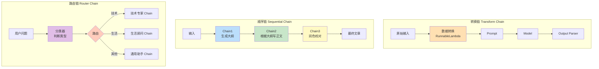

**三种高级模式的对比**：

| 模式 | 核心机制 | 适用场景 | 关键组件 |
|------|---------|---------|---------|
| 转换链 | 在流水线中插入数据转换步骤 | 需要清洗、格式化、增强输入数据 | `RunnableLambda`、`RunnablePassthrough.assign()` |
| 顺序链 | 多个 Chain 按顺序执行，传递部分输出 | 多步骤生成任务（大纲→正文→润色） | `RunnablePassthrough.assign()`、字典组合 |
| 路由链 | 先分类，再根据分类选择下游 Chain | 多领域问答、多风格生成 | `RunnableBranch`、分类 Chain |

**为什么需要这些模式**：
- 基础管道 `prompt | model | parser` 只能处理线性的单步任务
- 实际应用中，输入可能需要预处理（转换链）、任务可能需要多步完成（顺序链）、不同输入可能需要不同处理（路由链）
- LCEL 的组合器（RunnableLambda、RunnablePassthrough、RunnableBranch、RunnableParallel）提供了构建这些模式的原子操作

> 🏆 **面试高频考点**：顺序链（Sequential Chain）和路由链（Router Chain）的区别？顺序链是所有输入都按固定顺序经过相同的多个 Chain，前一个 Chain 的输出作为后一个的输入或输入的一部分，适用于多步骤生成任务；路由链是先对输入分类，然后根据分类结果选择不同的下游 Chain，不同类型的输入走不同的路径，适用于多领域或多风格的应用。简单说：顺序链是"所有人都走相同的多步流程"，路由链是"不同的人走不同的路"。

#### 代码示例

**示例1：基础——转换链（输入预处理 + 输出后处理）**

```python
# src/31_transform_chain.py
from langchain_core.prompts import ChatPromptTemplate
from langchain_core.output_parsers import StrOutputParser
from langchain_core.runnables import RunnableLambda, RunnablePassthrough
from langchain_openai import ChatOpenAI
from dotenv import load_dotenv
import re

load_dotenv()
chat = ChatOpenAI(model="gpt-4o-mini", temperature=0.3)

# ===== 输入转换：清洗和标准化用户输入 =====
def clean_input(text: str) -> str:
    """清洗用户输入：去除多余空白、HTML 标签、特殊字符。"""
    # 去除 HTML 标签
    text = re.sub(r'<[^>]+>', '', text)
    # 去除多余空白
    text = re.sub(r'\s+', ' ', text).strip()
    # 去除控制字符
    text = re.sub(r'[\x00-\x1F\x7F]', '', text)
    return text

# 输入转换 Runnable
input_transform = RunnableLambda(lambda x: {"cleaned_text": clean_input(x["text"]), "original_text": x["text"]})

# ===== 核心处理 Chain =====
analysis_prompt = ChatPromptTemplate.from_template("""分析以下文本的情感和关键信息。

文本：{cleaned_text}

请输出：
1. 情感倾向（正面/负面/中性）
2. 关键词（3-5个）
3. 简要总结（不超过50字）""")

analysis_chain = analysis_prompt | chat | StrOutputParser()

# ===== 输出转换：格式化和增强 =====
def format_output(result: dict) -> dict:
    """格式化输出：添加元数据和时间戳。"""
    from datetime import datetime
    return {
        "analysis": result["analysis"],
        "original_length": len(result["original_text"]),
        "cleaned_length": len(result["cleaned_text"]),
        "processed_at": datetime.now().isoformat(),
        "status": "success",
    }

output_transform = RunnableLambda(format_output)

# ===== 完整转换链 =====
transform_chain = (
    input_transform
    | RunnablePassthrough.assign(analysis=lambda x: analysis_chain.invoke(x))
    | output_transform
)

# 测试
result = transform_chain.invoke({
    "text": "<p>  这个产品   真的太棒了！！！</p>   \n\n 质量很好，物流也快，非常满意！！！"
})

print("=== 转换链结果 ===")
print(f"原始长度: {result['original_length']}")
print(f"清洗后长度: {result['cleaned_length']}")
print(f"处理时间: {result['processed_at']}")
print(f"状态: {result['status']}")
print(f"分析结果:\n{result['analysis']}")

# ===== 更简洁的写法：用 assign 串联 =====
simple_chain = (
    RunnablePassthrough.assign(
        cleaned=lambda x: clean_input(x["text"]),
        word_count=lambda x: len(x["text"].split()),
    )
    | ChatPromptTemplate.from_template("文本：{cleaned}\n词数：{word_count}\n请总结。")
    | chat
    | StrOutputParser()
)

result = simple_chain.invoke({"text": "LangChain 是一个强大的框架，简化了 LLM 应用开发。"})
print(f"\n=== 简洁转换链结果 ===")
print(result)
```

**示例2：进阶——顺序链（多步骤文章生成）**

```python
# src/32_sequential_chain.py
from langchain_core.prompts import ChatPromptTemplate
from langchain_core.output_parsers import StrOutputParser
from langchain_core.runnables import RunnablePassthrough, RunnableLambda
from langchain_openai import ChatOpenAI
from dotenv import load_dotenv

load_dotenv()
chat = ChatOpenAI(model="gpt-4o-mini", temperature=0.7)

# ===== 步骤1：生成大纲 =====
outline_prompt = ChatPromptTemplate.from_template("""为以下主题生成一篇技术文章的大纲，包含3-5个主要章节，每个章节有2-3个子要点。

主题：{topic}

输出格式：
## 章节1：标题
- 子要点1
- 子要点2

## 章节2：标题
...""")

outline_chain = outline_prompt | chat | StrOutputParser()

# ===== 步骤2：根据大纲生成正文 =====
body_prompt = ChatPromptTemplate.from_template("""根据以下大纲，撰写一篇详细的技术文章正文。
要求：
1. 每个章节至少 200 字
2. 包含代码示例（如果适用）
3. 语言专业准确
4. 不要包含大纲本身，直接写正文

主题：{topic}

大纲：
{outline}

正文：""")

body_chain = body_prompt | chat | StrOutputParser()

# ===== 步骤3：润色和校对 =====
polish_prompt = ChatPromptTemplate.from_template("""对以下技术文章进行润色和校对：
1. 修正语法和拼写错误
2. 优化句子结构，提升可读性
3. 确保术语一致性
4. 保持原文的技术内容和结构不变
5. 输出润色后的完整文章

原文：
{body}

润色后：""")

polish_chain = polish_prompt | chat | StrOutputParser()

# ===== 步骤4：生成摘要 =====
summary_prompt = ChatPromptTemplate.from_template("""为以下技术文章生成一个 100 字以内的摘要，提取核心观点和关键信息。

文章：
{polished_body}

摘要：""")

summary_chain = summary_prompt | chat | StrOutputParser()

# ===== 完整顺序链 =====
# 用 RunnablePassthrough.assign() 逐步添加每一步的输出
full_chain = (
    # 输入：{"topic": "..."}
    RunnablePassthrough.assign(outline=outline_chain)
    # 现在有：{"topic": "...", "outline": "..."}
    | RunnablePassthrough.assign(body=body_chain)
    # 现在有：{"topic": "...", "outline": "...", "body": "..."}
    | RunnablePassthrough.assign(polished_body=polish_chain)
    # 现在有：{"topic": "...", "outline": "...", "body": "...", "polished_body": "..."}
    | RunnablePassthrough.assign(summary=summary_chain)
    # 最终包含所有中间结果
)

# 注意：上面的写法中，body_chain 需要的输入是 {"topic": ..., "outline": ...}
# assign(body=body_chain) 会将当前字典（含 topic 和 outline）传给 body_chain
# 这正是我们需要的！

# 调用（注意：这会调用 4 次 LLM，耗时较长）
print("=== 开始生成文章（4步顺序链）===")
result = full_chain.invoke({"topic": "Python 异步编程 asyncio 入门与实践"})

print(f"\n=== 大纲 ===")
print(result["outline"][:200] + "...")

print(f"\n=== 正文（前300字）===")
print(result["body"][:300] + "...")

print(f"\n=== 润色后（前300字）===")
print(result["polished_body"][:300] + "...")

print(f"\n=== 摘要 ===")
print(result["summary"])

# ===== 并行优化：大纲生成后，正文和摘要可以并行 =====
# 注意：摘要需要正文，所以不能完全并行
# 但可以在润色的同时生成元数据（如字数统计）

def get_word_count(text):
    return len(text.split())

optimized_chain = (
    RunnablePassthrough.assign(outline=outline_chain)
    | RunnablePassthrough.assign(body=body_chain)
    | RunnablePassthrough.assign(
        polished_body=polish_chain,
        stats=RunnableLambda(lambda x: {
            "outline_words": get_word_count(x["outline"]),
            "body_words": get_word_count(x["body"]),
        }),
    )
    | RunnablePassthrough.assign(summary=summary_chain)
)

print("\n=== 优化后的顺序链（含统计）===")
result = optimized_chain.invoke({"topic": "FastAPI 高性能 Web 框架详解"})
print(f"大纲字数: {result['stats']['outline_words']}")
print(f"正文字数: {result['stats']['body_words']}")
print(f"摘要: {result['summary'][:80]}...")
```

**示例3：完整场景——路由链（多领域智能问答系统）**

```python
# src/33_router_chain.py
from langchain_core.prompts import ChatPromptTemplate
from langchain_core.output_parsers import StrOutputParser, JsonOutputParser
from langchain_core.runnables import RunnableBranch, RunnablePassthrough, RunnableLambda, RunnableParallel
from langchain_openai import ChatOpenAI
from pydantic import BaseModel, Field
from dotenv import load_dotenv
from typing import Literal

load_dotenv()
chat = ChatOpenAI(model="gpt-4o-mini", temperature=0.3)

# ===== 分类器：判断问题领域 =====
class Classification(BaseModel):
    category: Literal["tech", "finance", "health", "life", "general"] = Field(description="问题分类")
    confidence: float = Field(description="分类置信度 0-1")
    reasoning: str = Field(description="分类理由")

classification_parser = JsonOutputParser(pydantic_object=Classification)

classify_prompt = ChatPromptTemplate.from_messages([
    ("system", "你是一个问题分类专家。将用户问题分类到以下领域之一：tech（技术）、finance（金融）、health（健康）、life（生活）、general（通用）。\n{format_instructions}"),
    ("human", "{question}"),
])

classify_chain = classify_prompt | chat | classification_parser

# ===== 各领域专家 Chain =====
tech_prompt = ChatPromptTemplate.from_template("""你是一位资深全栈技术专家，精通 Python、JavaScript、云原生、AI 开发。
请专业、深入地回答以下技术问题，包含原理说明和代码示例（如适用）。

问题：{question}

回答：""")

finance_prompt = ChatPromptTemplate.from_template("""你是一位资深金融分析师，精通投资、理财、税务、宏观经济。
请客观、严谨地回答以下金融问题，包含数据和风险提示。
注意：不构成投资建议。

问题：{question}

回答：""")

health_prompt = ChatPromptTemplate.from_template("""你是一位健康科普专家，擅长营养学、运动健康、常见疾病预防。
请用通俗易懂的语言回答以下健康问题，包含科学依据和实用建议。
注意：不能替代专业医疗诊断，如有不适请就医。

问题：{question}

回答：""")

life_prompt = ChatPromptTemplate.from_template("""你是一位生活达人，擅长美食、旅行、家居、穿搭。
请热情、实用地回答以下生活问题，给出具体可操作的建议。

问题：{question}

回答：""")

general_prompt = ChatPromptTemplate.from_template("""你是一个通用 AI 助手，请友好、准确地回答以下问题。

问题：{question}

回答：""")

tech_chain = tech_prompt | chat | StrOutputParser()
finance_chain = finance_prompt | chat | StrOutputParser()
health_chain = health_prompt | chat | StrOutputParser()
life_chain = life_prompt | chat | StrOutputParser()
general_chain = general_prompt | chat | StrOutputParser()

# ===== 路由分支 =====
router_branch = RunnableBranch(
    (lambda x: x["classification"]["category"] == "tech", tech_chain),
    (lambda x: x["classification"]["category"] == "finance", finance_chain),
    (lambda x: x["classification"]["category"] == "health", health_chain),
    (lambda x: x["classification"]["category"] == "life", life_chain),
    general_chain,  # 默认
)

# ===== 完整路由链 =====
full_router_chain = (
    # 第一步：分类
    RunnablePassthrough.assign(
        classification=classify_chain,
    )
    # 第二步：路由到对应专家
    | RunnablePassthrough.assign(
        answer=router_branch,
    )
    # 第三步：添加元数据
    | RunnableLambda(lambda x: {
        "question": x["question"],
        "category": x["classification"]["category"],
        "confidence": x["classification"]["confidence"],
        "reasoning": x["classification"]["reasoning"],
        "answer": x["answer"],
    })
)

# ===== 测试多领域问题 =====
test_questions = [
    "如何用 Python 实现一个简单的 Web 服务器？",
    "基金定投和一次性投入哪个收益更好？",
    "每天喝多少水最合适？有什么科学依据？",
    "推荐几个适合周末放松的北京周边景点",
    "你好，你能做什么？",
]

print("=== 多领域路由问答系统 ===")
for q in test_questions:
    result = full_router_chain.invoke({
        "question": q,
        "format_instructions": classification_parser.get_format_instructions(),
    })
    print(f"\n问题: {q}")
    print(f"分类: {result['category']} (置信度: {result['confidence']})")
    print(f"分类理由: {result['reasoning']}")
    print(f"回答: {result['answer'][:100]}...")

# ===== 低置信度降级：置信度低于阈值时用通用回答 =====
def low_confidence_fallback(inputs):
    """置信度低于 0.6 时，用通用 Chain 而非专家 Chain。"""
    if inputs["classification"]["confidence"] < 0.6:
        return general_chain.invoke({"question": inputs["question"]})
    return router_branch.invoke(inputs)

confidence_aware_chain = (
    RunnablePassthrough.assign(classification=classify_chain)
    | RunnablePassthrough.assign(
        answer=RunnableLambda(low_confidence_fallback),
        used_fallback=lambda x: x["classification"]["confidence"] < 0.6,
    )
)

print("\n=== 置信度感知路由 ===")
result = confidence_aware_chain.invoke({
    "question": "量子计算和传统计算的本质区别是什么？",
    "format_instructions": classification_parser.get_format_instructions(),
})
print(f"分类: {result['classification']['category']}")
print(f"置信度: {result['classification']['confidence']}")
print(f"使用降级: {result['used_fallback']}")
print(f"回答: {result['answer'][:80]}...")
```

#### 使用场景与最佳实践

**适用场景**：
- **转换链**：输入需要清洗/标准化/增强，输出需要格式化/添加元数据
- **顺序链**：多步骤生成任务（大纲→正文→润色、分析→方案→评估、提取→转换→加载）
- **路由链**：多领域问答、多风格生成、多语言处理、复杂度分级处理

**不适用场景**：
- 简单的单步问答（基础管道就够了）
- 流程中有循环或复杂状态（应该用 LangGraph 而非 LCEL）
- 步骤间有强依赖且需要人工审核（应该用工作流引擎）

**最佳实践**：
1. **顺序链用 `RunnablePassthrough.assign()` 逐步累积结果**：每一步的输出都添加到字典中，后续步骤可以访问所有之前的结果
2. **路由链的分类器用结构化输出**：分类结果用 Pydantic/JSON 解析，不要用字符串匹配（"技术" in text），避免分类不稳定
3. **转换链的纯逻辑用 `RunnableLambda`**：不需要 LLM 的数据转换用函数包装，避免不必要的 API 调用
4. **路由链添加默认分支**：`RunnableBranch` 的最后一个参数是默认分支，确保所有输入都有处理路径
5. **长顺序链考虑拆分**：超过 5 步的顺序链可以拆分为子 Chain，每个子 Chain 独立测试，提升可维护性

**性能建议**：
- 顺序链的总延迟是各步骤延迟之和，4 步 LLM 调用可能需要 10-20 秒，考虑用流式输出提升用户体验
- 路由链中分类器调用增加了额外延迟（约 1-2 秒），对延迟敏感的场景可以用规则分类（关键词匹配）替代 LLM 分类
- 转换链中的 `RunnableLambda` 是 CPU 操作，开销极小（<1ms），不会成为瓶颈
- 可以用 `RunnableParallel` 在顺序链的某些步骤并行执行独立子任务，减少总延迟

#### 常见坑点

**坑点1：顺序链中后续步骤无法访问前面步骤的输出**

- **错误现象**：`RunnablePassthrough.assign(step2=step2_chain)` 中，step2_chain 需要 step1 的输出，但报 `KeyError: 'step1_output'`
- **根本原因**：没有正确使用 `assign()` 累积结果。如果直接用 `step1_chain | step2_chain`，step1 的输出（可能是字符串）会直接作为 step2 的输入，而不是包含在字典中。只有用 `RunnablePassthrough.assign(step1=step1_chain)` 才能将 step1 的输出作为字典的一个键保留下来
- **正确做法**：①每一步都用 `RunnablePassthrough.assign(step_name=chain)`，将输出添加到字典；②确保每个子 Chain 的输入变量名与字典中的键名匹配；③复杂的多步 Chain 分步构建和测试
- **预防措施**：顺序链的标准写法模板：`RunnablePassthrough.assign(step1=chain1) | RunnablePassthrough.assign(step2=chain2) | ...`，每个 chain 的 Prompt 模板中引用前面步骤的输出变量名

**坑点2：路由链中分类结果不稳定导致路由错误**

- **错误现象**：同一个问题多次调用，有时分类为"tech"，有时分类为"general"，导致回答风格不一致
- **根本原因**：①分类器的 temperature 过高，导致创造性输出；②分类 Prompt 不够明确，类别定义有重叠；③用字符串匹配判断分类（如 `"技术" in category`），而分类输出可能是"技术问题"或"tech"等变体
- **正确做法**：①分类器设置 `temperature=0`；②用 Pydantic 枚举类型定义分类（`Literal["tech", "finance", ...]`），确保输出是标准值；③分类 Prompt 中明确每个类别的定义和边界；④用 `JsonOutputParser` 解析分类结果，直接访问 `result["category"]`
- **预防措施**：对分类器做评估——准备 20-30 个标注好的测试问题，计算分类准确率，低于 90% 时优化分类 Prompt 或调整类别定义；生产环境记录分类结果，定期分析错误分类案例

---

> 💡 **深度讲解**：本章深入讲解了 LCEL 的高级组合模式。基础管道 `prompt | model | parser` 是起点，但实际应用需要更复杂的流程。转换链在流水线中插入数据预处理和后处理，确保输入干净、输出规范；顺序链用 `RunnablePassthrough.assign()` 逐步累积多步结果，适用于大纲→正文→润色这类多步骤生成任务；路由链先用分类器判断输入类型，再用 `RunnableBranch` 动态选择下游专家 Chain，适用于多领域问答系统。这三种模式覆盖了 LLM 应用中绝大多数复杂流程。关键技巧是：始终用字典在步骤间传递数据，用 `assign()` 累积结果，用结构化输出（Pydantic/JSON）做分类和解析，用 `RunnableLambda` 处理纯逻辑转换。掌握了这些模式，你就能构建从简单到复杂的各种 LLM 应用流水线。

> 📝 **精简总结**：
> 1. LCEL 用 | 运算符组合 Runnable，自动获得流式、异步、批量、重试、追踪能力
> 2. RunnableParallel 并行执行多个步骤，RunnablePassthrough 透传输入，assign() 添加新键值对
> 3. RunnableLambda 将任意函数包装为 Runnable，处理纯逻辑转换
> 4. 转换链：在流水线中插入输入清洗和输出格式化，用 RunnableLambda 实现
> 5. 顺序链：用 RunnablePassthrough.assign() 逐步累积多步结果，适用于多步骤生成
> 6. 路由链：分类器 + RunnableBranch，根据分类动态选择下游 Chain
> 7. 分类器用 temperature=0 + Pydantic 枚举 + JsonOutputParser，确保分类稳定
> 8. 复杂流程（循环、状态、多 Agent）用 LangGraph，不要用 LCEL 硬凑

> 🎯 **梯度练习题**：
> - **基础1**：用 RunnableParallel 同时调用两个 Chain（生成摘要和关键词），合并输出结果
> - **基础2**：用 RunnablePassthrough.assign() 构建一个两步 Chain（先翻译，再总结翻译结果）
> - **基础3**：用 RunnableBranch 构建一个简单路由，根据问题长度选择详细回答或简洁回答
> - **进阶1**：构建一个完整的转换链，包含 HTML 清洗、文本标准化、LLM 分析、输出格式化（添加时间戳和元数据）
> - **进阶2**：构建一个三步顺序链（生成文章大纲→根据大纲写正文→润色校对），每步结果都保留在最终输出中
> - **实战1**：构建一个多领域路由问答系统，包含 5 个领域（技术/金融/健康/生活/通用），用 Pydantic 结构化分类，低置信度自动降级到通用回答，并编写 10 个测试问题验证分类准确率和回答质量

---

## 7. RAG 检索增强生成

### 7.1 RAG 全流程：文档加载、分块、向量化、检索、生成

#### 概念解释

**RAG（Retrieval-Augmented Generation，检索增强生成）是一种将外部知识库检索与大语言模型生成相结合的技术架构**。其核心流程包括五个阶段：文档加载（从各种来源读取原始文档）、文本分块（将长文档切分为适合检索的小块）、向量化（用 Embedding 模型将文本块转换为向量并存入向量数据库）、检索（根据用户查询找到最相关的文本块）、生成（将检索到的上下文与用户问题组合成 Prompt 提交给 LLM 生成答案）。RAG 有效解决了 LLM 的知识截止日期限制、幻觉问题和私有数据访问问题。

> 🎯 **生活化比喻**：RAG 就像"开卷考试"——LLM 是一个聪明但记忆力有限的学生（只记得训练时学过的知识，且可能记错），RAG 系统就是在考试时给学生一本参考书（外部知识库）。学生拿到题目后，先翻书找到相关章节（检索），然后结合书本内容和自己的理解写出答案（生成）。这样既利用了学生的理解能力，又保证了答案的准确性和时效性，还能参考书本上没有的私有资料。

**核心价值**：RAG 让 LLM 能够访问私有数据、实时数据和长尾知识，大幅减少幻觉，提供可追溯的答案来源，且不需要微调模型即可扩展知识范围。

#### 原理说明

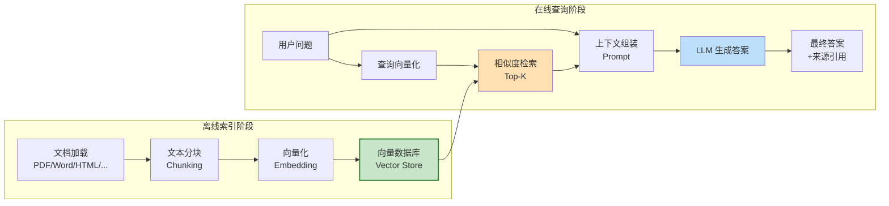

**RAG 五阶段详解**：

| 阶段 | 核心组件 | 关键参数 | 目标 |
|------|---------|---------|------|
| 文档加载 | DocumentLoader | 编码、页码范围 | 从各种来源提取纯文本 |
| 文本分块 | TextSplitter | chunk_size、chunk_overlap、分隔符 | 平衡语义完整性和检索精度 |
| 向量化 | Embeddings | 模型选择、维度 | 将文本转换为可计算相似度的向量 |
| 检索 | Retriever | search_type、k、MMR 参数 | 找到与查询最相关的 Top-K 文本块 |
| 生成 | LLM + Prompt | temperature、上下文组织 | 基于检索上下文生成准确、有引用的答案 |

**核心机制**：
1. **语义相似度检索**：用户查询和文档块都被转换为向量，通过余弦相似度或点积计算相关性，返回最相似的 Top-K 个块
2. **上下文窗口限制**：LLM 的上下文窗口有限（通常 4K-128K Token），因此只能将最相关的几个文本块放入 Prompt
3. **检索质量决定生成质量**：RAG 的效果高度依赖检索质量——如果检索到的上下文不相关，即使最强的 LLM 也无法生成好答案（"Garbage In, Garbage Out"）
4. **可追溯性**：每个答案都可以追溯到具体的文档来源，增强可信度，也便于用户查阅原文

**技术对比**：

| 维度 | RAG | Fine-tuning（微调） | 长上下文（Long Context） |
|------|-----|-------------------|------------------------|
| 知识更新 | 实时（更新文档即可） | 慢（需重新训练） | 受限于上下文窗口 |
| 私有数据 | 支持（文档不上传训练） | 支持（但数据进入模型） | 支持（但每次都要传入） |
| 幻觉控制 | 好（基于检索内容） | 一般 | 一般 |
| 可追溯性 | 好（有来源引用） | 无 | 无 |
| 实现成本 | 中 | 高（需训练数据和算力） | 低 |
| 推理成本 | 中（检索+生成） | 低（无需检索） | 高（长上下文计费） |
| 适用场景 | 知识库问答、文档问答 | 风格迁移、领域专用 | 单文档问答、代码理解 |

> 🏆 **面试高频考点**：RAG 的核心流程是什么？RAG 包括离线索引和在线查询两个阶段。离线阶段：文档加载→文本分块→向量化→存入向量数据库。在线阶段：用户问题向量化→相似度检索 Top-K 文档块→将检索结果与问题组合成 Prompt→LLM 生成答案。关键挑战包括：分块策略（chunk_size 和 overlap 的选择）、检索质量（相似度搜索 vs MMR vs 混合检索）、上下文组装（如何组织检索结果）、答案引用（如何标注来源）。

#### 代码示例

**示例1：基础——完整 RAG 流水线**

```python
# src/34_rag_basic.py
from langchain_community.document_loaders import TextLoader, PyPDFLoader
from langchain_text_splitters import RecursiveCharacterTextSplitter
from langchain_openai import OpenAIEmbeddings, ChatOpenAI
from langchain_community.vectorstores import Chroma
from langchain_core.prompts import ChatPromptTemplate
from langchain_core.output_parsers import StrOutputParser
from langchain_core.runnables import RunnablePassthrough
from langchain_core.documents import Document
from dotenv import load_dotenv
import os

load_dotenv()

# ===== 阶段1：文档加载 =====
print("=== 阶段1：文档加载 ===")

# 创建示例文档
sample_docs = [
    Document(page_content="LangChain 是一个开源的大语言模型应用开发框架，由 Harrison Chase 于 2022 年 10 月创建。它提供 Python 和 TypeScript 两种语言的支持。LangChain 的核心价值在于统一了不同 LLM 提供商的接口，使得开发者可以轻松切换模型。", metadata={"source": "intro.md", "page": 1}),
    Document(page_content="LCEL（LangChain Expression Language）是 LangChain 的声明式组合语言，通过管道符 | 将各个组件串联起来。使用 LCEL 构建的 Chain 自动支持流式输出、异步调用、批量处理和追踪。LCEL 是 LangChain 0.2 版本之后推荐的组合方式。", metadata={"source": "lcel.md", "page": 1}),
    Document(page_content="RAG（检索增强生成）是一种将外部知识库检索与 LLM 生成结合的技术。RAG 的流程包括文档加载、文本分块、向量化、检索和生成五个阶段。RAG 可以有效减少 LLM 的幻觉问题，让模型能够访问私有数据和实时信息。", metadata={"source": "rag.md", "page": 1}),
    Document(page_content="Agent（智能体）是 LLM 应用的高级形式。Agent 使用 LLM 作为推理引擎，决定调用哪些工具来完成任务。Agent 执行思考-行动-观察的循环，直到任务完成。常用的 Agent 工具包括搜索引擎、计算器、数据库查询和 API 调用。", metadata={"source": "agent.md", "page": 1}),
]

print(f"加载了 {len(sample_docs)} 个文档")
for doc in sample_docs:
    print(f"  - {doc.metadata['source']}: {doc.page_content[:50]}...")

# ===== 阶段2：文本分块 =====
print("\n=== 阶段2：文本分块 ===")

text_splitter = RecursiveCharacterTextSplitter(
    chunk_size=200,        # 每块最大字符数
    chunk_overlap=50,       # 块之间重叠字符数
    length_function=len,
    separators=["\n\n", "\n", "。", "！", "？", ".", " ", ""],
)

chunks = text_splitter.split_documents(sample_docs)
print(f"分割为 {len(chunks)} 个块")
for i, chunk in enumerate(chunks):
    print(f"  块{i+1} ({len(chunk.page_content)}字): {chunk.page_content[:40]}...")

# ===== 阶段3：向量化并存入向量数据库 =====
print("\n=== 阶段3：向量化与存储 ===")

embeddings = OpenAIEmbeddings(model="text-embedding-3-small")

# 创建 Chroma 向量数据库
vectorstore = Chroma.from_documents(
    documents=chunks,
    embedding=embeddings,
    persist_directory="./data/rag_demo_chroma",
    collection_name="langchain_docs",
)
print(f"向量数据库创建完成，集合: {vectorstore._collection.name}")
print(f"向量数量: {vectorstore._collection.count()}")

# ===== 阶段4：检索 =====
print("\n=== 阶段4：检索 ===")

retriever = vectorstore.as_retriever(
    search_type="similarity",  # 相似度搜索
    search_kwargs={"k": 2},     # 返回前 2 个最相关的块
)

query = "什么是 LCEL？"
retrieved_docs = retriever.invoke(query)
print(f"查询: {query}")
print(f"检索到 {len(retrieved_docs)} 个相关块:")
for i, doc in enumerate(retrieved_docs):
    print(f"  [{i+1}] 来源: {doc.metadata['source']}")
    print(f"      内容: {doc.page_content[:80]}...")

# ===== 阶段5：生成 =====
print("\n=== 阶段5：生成 ===")

# RAG Prompt
rag_prompt = ChatPromptTemplate.from_template("""你是一个专业的问答助手。请根据以下上下文回答问题。
如果上下文中没有相关信息，请说"根据现有资料无法回答"，不要编造。

上下文：
{context}

问题：{question}

回答：""")

chat = ChatOpenAI(model="gpt-4o-mini", temperature=0)

# 格式化文档
def format_docs(docs):
    return "\n\n".join(f"[{i+1}] {doc.page_content}" for i, doc in enumerate(docs))

# 构建 RAG Chain
rag_chain = (
    {"context": retriever | format_docs, "question": RunnablePassthrough()}
    | rag_prompt
    | chat
    | StrOutputParser()
)

# 调用
answer = rag_chain.invoke("什么是 LCEL？它有什么优势？")
print(f"问题: 什么是 LCEL？它有什么优势？")
print(f"回答: {answer}")

# 测试知识库中没有的问题
answer2 = rag_chain.invoke("火星上有生命吗？")
print(f"\n问题: 火星上有生命吗？")
print(f"回答: {answer2}")
# 预期：应该回答"根据现有资料无法回答"
```

**示例2：进阶——检索策略对比（相似度/MMR/阈值/混合检索）**

```python
# src/35_retrieval_strategies.py
from langchain_openai import OpenAIEmbeddings, ChatOpenAI
from langchain_community.vectorstores import Chroma
from langchain_core.documents import Document
from langchain_core.prompts import ChatPromptTemplate
from langchain_core.output_parsers import StrOutputParser
from langchain_core.runnables import RunnablePassthrough
from dotenv import load_dotenv

load_dotenv()

# 准备更丰富的测试文档
docs = [
    Document(page_content="Python 是一种高级编程语言，以简洁优雅的语法著称。它支持面向对象、函数式和过程式编程范式。Python 广泛用于数据分析、机器学习、Web 开发和自动化运维。", metadata={"source": "python.md", "category": "programming"}),
    Document(page_content="Python 的装饰器是一种修改函数或类行为的语法糖。装饰器本质上是接收函数并返回函数的高阶函数。常用的装饰器包括 @staticmethod、@classmethod、@property 和 functools.lru_cache。", metadata={"source": "python_decorator.md", "category": "programming"}),
    Document(page_content="Python 的 GIL（全局解释器锁）是 CPython 中的一种互斥锁，确保同一时刻只有一个线程执行 Python 字节码。这使得多线程无法真正并行执行 CPU 密集型任务，但 IO 密集型任务仍然可以受益于多线程。", metadata={"source": "python_gil.md", "category": "programming"}),
    Document(page_content="JavaScript 是一种动态类型的脚本语言，主要用于 Web 前端开发。随着 Node.js 的出现，JavaScript 也可以用于服务端开发。JavaScript 支持事件驱动和异步编程，是现代 Web 开发的核心技术之一。", metadata={"source": "javascript.md", "category": "programming"}),
    Document(page_content="机器学习是人工智能的一个分支，研究如何让计算机从数据中学习规律。主要分为监督学习、无监督学习和强化学习三大类。常用的机器学习库包括 scikit-learn、TensorFlow 和 PyTorch。", metadata={"source": "ml.md", "category": "ai"}),
    Document(page_content="深度学习是机器学习的一个子领域，使用多层神经网络来学习数据的复杂表示。深度学习在图像识别、自然语言处理和语音识别等领域取得了突破性进展。常用的深度学习框架包括 TensorFlow、PyTorch 和 Keras。", metadata={"source": "dl.md", "category": "ai"}),
]

embeddings = OpenAIEmbeddings(model="text-embedding-3-small")
vectorstore = Chroma.from_documents(docs, embeddings, persist_directory="./data/retrieval_demo")

query = "Python 的多线程有什么限制？"

# ===== 策略1：相似度搜索（Similarity Search）=====
print("=== 策略1：相似度搜索 ===")
retriever_sim = vectorstore.as_retriever(search_type="similarity", search_kwargs={"k": 3})
results = retriever_sim.invoke(query)
for i, doc in enumerate(results):
    print(f"  [{i+1}] {doc.metadata['source']}: {doc.page_content[:50]}...")

# ===== 策略2：MMR（最大边际相关性）=====
print("\n=== 策略2：MMR（最大边际相关性）===")
retriever_mmr = vectorstore.as_retriever(
    search_type="mmr",
    search_kwargs={"k": 3, "fetch_k": 10, "lambda_mult": 0.5},
)
results = retriever_mmr.invoke(query)
for i, doc in enumerate(results):
    print(f"  [{i+1}] {doc.metadata['source']}: {doc.page_content[:50]}...")
# MMR 平衡相关性和多样性，可能返回更多不同主题的文档

# ===== 策略3：相似度阈值（Similarity Score Threshold）=====
print("\n=== 策略3：相似度阈值 ===")
retriever_threshold = vectorstore.as_retriever(
    search_type="similarity_score_threshold",
    search_kwargs={"score_threshold": 0.4, "k": 5},
)
results = retriever_threshold.invoke(query)
print(f"  检索到 {len(results)} 个超过阈值的文档")
for i, doc in enumerate(results):
    print(f"  [{i+1}] {doc.metadata['source']}: {doc.page_content[:50]}...")
# 阈值过滤掉不相关的文档，可能返回少于 k 个结果

# ===== 策略4：带元数据过滤的检索 =====
print("\n=== 策略4：元数据过滤 ===")
retriever_filtered = vectorstore.as_retriever(
    search_type="similarity",
    search_kwargs={"k": 3, "filter": {"category": "ai"}},
)
results = retriever_filtered.invoke("什么是深度学习？")
print(f"  仅检索 category=ai 的文档:")
for i, doc in enumerate(results):
    print(f"  [{i+1}] {doc.metadata['source']} (category={doc.metadata['category']}): {doc.page_content[:50]}...")

# ===== 不同检索策略对生成质量的影响 =====
print("\n=== 检索策略对生成质量的影响 ===")

rag_prompt = ChatPromptTemplate.from_template("""根据上下文回答问题。如果上下文没有相关信息，说明无法回答。

上下文：{context}

问题：{question}""")

chat = ChatOpenAI(model="gpt-4o-mini", temperature=0)

def format_docs(docs):
    return "\n\n".join(f"[{doc.metadata['source']}] {doc.page_content}" for doc in docs)

for name, retriever in [("相似度", retriever_sim), ("MMR", retriever_mmr)]:
    chain = (
        {"context": retriever | format_docs, "question": RunnablePassthrough()}
        | rag_prompt | chat | StrOutputParser()
    )
    answer = chain.invoke(query)
    print(f"\n【{name}检索】回答: {answer[:100]}...")
```

**示例3：完整场景——带引用溯源的对话式 RAG**

```python
# src/36_conversational_rag.py
from langchain_openai import OpenAIEmbeddings, ChatOpenAI
from langchain_community.vectorstores import Chroma
from langchain_core.prompts import ChatPromptTemplate, MessagesPlaceholder
from langchain_core.output_parsers import StrOutputParser
from langchain_core.runnables import RunnablePassthrough, RunnableLambda
from langchain_core.messages import HumanMessage, AIMessage
from langchain_community.chat_message_histories import ChatMessageHistory
from langchain_core.runnables.history import RunnableWithMessageHistory
from langchain_core.documents import Document
from dotenv import load_dotenv
from typing import List, Dict
import json

load_dotenv()

# 准备文档
docs = [
    Document(page_content="FastAPI 是一个现代、高性能的 Python Web 框架，基于标准 Python 类型提示。它由 Sebastián Ramírez 于 2018 年创建。FastAPI 的特点包括自动生成 OpenAPI 文档、异步支持、依赖注入系统和类型安全。", metadata={"source": "fastapi_intro.md", "page": 1}),
    Document(page_content="FastAPI 的路由定义使用装饰器语法，如 @app.get('/items/{item_id}')。路径参数和查询参数通过函数参数的类型注解自动解析和验证。FastAPI 使用 Pydantic 模型来定义请求体和响应体，自动进行数据验证和序列化。", metadata={"source": "fastapi_routes.md", "page": 2}),
    Document(page_content="FastAPI 的依赖注入系统使用 Depends 关键字。依赖可以是数据库连接、认证、配置等可复用的组件。依赖支持嵌套（依赖的依赖），FastAPI 会自动解析依赖图。依赖还支持缓存（同一请求中相同依赖只执行一次）和作用域（函数级/请求级）。", metadata={"source": "fastapi_deps.md", "page": 3}),
    Document(page_content="FastAPI 的异步支持基于 asyncio。路由函数可以定义为 async def，FastAPI 会自动在事件循环中运行。对于阻塞 IO 操作（如同步数据库驱动），FastAPI 会自动在线程池中运行，避免阻塞事件循环。推荐使用异步数据库驱动（如 asyncpg、aiomysql）以获得最佳性能。", metadata={"source": "fastapi_async.md", "page": 4}),
]

embeddings = OpenAIEmbeddings(model="text-embedding-3-small")
vectorstore = Chroma.from_documents(docs, embeddings, persist_directory="./data/conversational_rag_demo")
retriever = vectorstore.as_retriever(search_kwargs={"k": 3})

chat = ChatOpenAI(model="gpt-4o-mini", temperature=0)

# ===== 问题重写 Chain（结合历史，将指代问题转为独立问题）=====
condense_prompt = ChatPromptTemplate.from_messages([
    ("system", "根据对话历史，将用户的当前问题改写为独立的、不含指代的问题。只输出改写后的问题，不要输出其他内容。如果当前问题不需要改写（如第一轮对话），直接输出原问题。"),
    MessagesPlaceholder(variable_name="history"),
    ("human", "{question}"),
])
condense_chain = condense_prompt | chat | StrOutputParser()

# ===== RAG 回答 Chain（带引用格式）=====
rag_prompt = ChatPromptTemplate.from_messages([
    ("system", """你是一个专业的技术问答助手。请根据以下上下文回答问题。

要求：
1. 基于上下文内容回答，不要编造
2. 回答中引用来源时使用 [来源:文件名] 格式
3. 如果上下文中没有相关信息，明确说"根据现有资料无法回答"
4. 回答简洁准确，技术问题优先给出代码示例

上下文：
{context}"""),
    MessagesPlaceholder(variable_name="history"),
    ("human", "{question}"),
])

def format_docs_with_sources(docs: List[Document]) -> str:
    return "\n\n".join(
        f"[来源:{doc.metadata.get('source', '未知')}]\n{doc.page_content}"
        for doc in docs
    )

# ===== 完整对话式 RAG Chain =====
def build_context(inputs: Dict) -> str:
    """先重写问题，再检索，最后格式化上下文。"""
    # 如果有历史，重写问题
    if inputs.get("history"):
        standalone_question = condense_chain.invoke({
            "history": inputs["history"],
            "question": inputs["question"],
        })
    else:
        standalone_question = inputs["question"]

    # 检索
    retrieved_docs = retriever.invoke(standalone_question)
    return format_docs_with_sources(retrieved_docs)

rag_chain = (
    RunnablePassthrough.assign(context=build_context)
    | rag_prompt
    | chat
    | StrOutputParser()
)

# ===== 带对话历史的包装 =====
store = {}

def get_session_history(session_id: str):
    if session_id not in store:
        store[session_id] = ChatMessageHistory()
    return store[session_id]

conversational_rag = RunnableWithMessageHistory(
    rag_chain,
    get_session_history,
    input_messages_key="question",
    history_messages_key="history",
)

# ===== 测试多轮对话 =====
config = {"configurable": {"session_id": "test_session_1"}}

print("=== 对话式 RAG 多轮测试 ===")

# 第一轮
q1 = "FastAPI 是什么？"
a1 = conversational_rag.invoke({"question": q1}, config=config)
print(f"\n用户: {q1}")
print(f"助手: {a1}")

# 第二轮（指代"它"）
q2 = "它有哪些主要特点？"
a2 = conversational_rag.invoke({"question": q2}, config=config)
print(f"\n用户: {q2}")
print(f"助手: {a2}")

# 第三轮（继续追问）
q3 = "依赖注入系统怎么用？给个例子"
a3 = conversational_rag.invoke({"question": q3}, config=config)
print(f"\n用户: {q3}")
print(f"助手: {a3}")

# 第四轮（知识库外的问题）
q4 = "Django 和 FastAPI 哪个更好？"
a4 = conversational_rag.invoke({"question": q4}, config=config)
print(f"\n用户: {q4}")
print(f"助手: {a4}")
```

#### 使用场景与最佳实践

**适用场景**：
- 企业知识库问答（内部文档、产品手册、FAQ）
- 文档问答（PDF、Word、HTML 等长文档的智能问答）
- 客服系统（基于产品文档和历史工单自动回答）
- 法律/医疗/金融等专业领域的知识问答（需要准确引用来源）
- 代码知识库问答（基于代码仓库和技术文档）

**不适用场景**：
- 开放式创意写作（不需要外部知识）
- 简单的常识问答（LLM 训练数据已经覆盖）
- 实时性要求极高（<1秒）且知识库很小的场景（直接用关键词搜索更快）
- 需要推理和计算的复杂任务（Agent 更合适）

**最佳实践**：
1. **分块策略：chunk_size 500-1000，overlap 10-20%**：平衡语义完整性和检索精度。过小的块缺少上下文，过大的块引入噪音
2. **用 RecursiveCharacterTextSplitter**：递归字符分割器优先在段落、句子边界分割，保持语义完整性，是默认推荐
3. **检索用 MMR 而非纯相似度**：MMR（最大边际相关性）平衡相关性和多样性，避免检索到的 Top-K 都是相似内容
4. **Prompt 中强调"不知道就说不知道"**：明确要求模型在上下文不相关时拒绝回答，减少幻觉
5. **答案带引用来源**：在 Prompt 中要求引用 [来源:文件名]，增强可信度，也便于用户查阅原文
6. **对话式 RAG 必须做问题重写**：多轮对话中用户的问题通常包含指代（"它""这个"），必须结合历史重写为独立问题后再检索

**性能建议**：
- 向量数据库选择：小规模（<10万条）用 Chroma/FAISS，中大规模用 Milvus/Qdrant/Weaviate
- Embedding 模型选择：通用场景用 `text-embedding-3-small`（便宜、快），高精度场景用 `text-embedding-3-large`
- 检索延迟优化：预计算向量并持久化，查询时只做向量相似度计算（通常 <50ms）
- 批量索引：文档入库时用 `batch` 批量向量化，比逐条快 5-10 倍
- 缓存：对相同查询的检索结果和 LLM 回答做缓存，减少重复计算

#### 常见坑点

**坑点1：分块过大或过小导致检索质量差**

- **错误现象**：RAG 回答不准确，要么检索到的内容与问题不相关，要么检索到的块缺少关键上下文
- **根本原因**：①chunk_size 过大（>2000字符），一个块包含多个主题，检索时引入噪音；②chunk_size 过小（<200字符），块缺少上下文，语义不完整；③chunk_overlap 为 0，句子被切断，关键信息丢失；④分隔符设置不当，在单词中间分割
- **正确做法**：①chunk_size 设为 500-1000 字符（约 200-400 Token）；②chunk_overlap 设为 chunk_size 的 10-20%（50-200字符）；③使用 `RecursiveCharacterTextSplitter`，分隔符按优先级 `["\n\n", "\n", "。", "！", "？", ".", " ", ""]`；④对代码文档用专门的代码分割器（`Language` 枚举）
- **预防措施**：分块后人工检查 10-20 个块的质量，确认语义完整；用评估数据集测试不同 chunk_size 的检索准确率，选择最优参数

**坑点2：对话式 RAG 中问题重写缺失导致检索失败**

- **错误现象**：第一轮对话回答正常，第二轮用户问"它有什么特点？"时，检索结果完全不相关，回答错误
- **根本原因**：用户的第二轮问题包含指代（"它"），直接用"它有什么特点？"去检索，向量相似度很低，检索不到相关文档。没有做问题重写（结合历史将"它"替换为具体主题）
- **正确做法**：①在检索前添加问题重写步骤，用 LLM 结合对话历史将当前问题改写为独立的、不含指代的问题；②第一轮对话（没有历史）时跳过重写，直接用原问题检索；③重写 Chain 的 Prompt 明确要求"只输出改写后的问题，不要输出其他内容"
- **预防措施**：对话式 RAG 的标准架构必须包含问题重写环节；在开发阶段打印重写后的问题，验证指代是否被正确解析；对重写质量做评估，准备 10-20 组多轮对话测试用例

---

> 💡 **深度讲解**：本章深入讲解了 RAG（检索增强生成）的完整技术体系。RAG 是当前 LLM 应用中最重要的技术之一，它解决了 LLM 的三大痛点：知识截止日期、幻觉、私有数据访问。核心流程包括五个阶段：文档加载→文本分块→向量化→检索→生成。其中分块策略和检索质量是决定 RAG 效果的关键——分块要平衡语义完整性和检索精度（chunk_size 500-1000，overlap 10-20%），检索要用 MMR 平衡相关性和多样性。对话式 RAG 必须包含问题重写环节，处理多轮对话中的指代问题。生产级 RAG 还需要考虑引用溯源、混合检索（向量+关键词）、重排序（Reranker）、上下文压缩等优化技术。RAG 的效果是"检索质量 × 生成质量"，任何一个环节差都会导致最终效果差。

> 📝 **精简总结**：
> 1. RAG 五阶段：文档加载→文本分块→向量化→检索→生成
> 2. 分块推荐：RecursiveCharacterTextSplitter，chunk_size 500-1000，overlap 10-20%
> 3. 检索策略：相似度搜索（默认）、MMR（平衡相关性和多样性，推荐）、阈值过滤、元数据过滤
> 4. RAG Chain 标准写法：{"context": retriever | format_docs, "question": RunnablePassthrough()} | prompt | model | parser
> 5. 对话式 RAG 必须做问题重写：结合历史将指代问题转为独立问题
> 6. Prompt 中强调"不知道就说不知道"，减少幻觉
> 7. 答案带引用来源 [来源:文件名]，增强可信度
> 8. 向量数据库选择：小规模 Chroma/FAISS，中大规模 Milvus/Qdrant

> 🎯 **梯度练习题**：
> - **基础1**：用 4 个示例文档构建一个完整 RAG 流水线（加载→分块→向量化→检索→生成），测试 2 个问题
> - **基础2**：对比相似度搜索和 MMR 检索的结果差异，用同一个查询观察返回的文档有何不同
> - **基础3**：在 RAG Prompt 中添加引用要求，让回答中包含 [来源:文件名] 格式的引用
> - **进阶1**：实现一个对话式 RAG，包含问题重写环节，测试 3 轮对话（含指代问题），验证重写效果
> - **进阶2**：实现带元数据过滤的检索，支持按文档类别、日期范围过滤，验证过滤效果
> - **实战1**：构建一个完整的文档问答系统，支持 PDF/Markdown/Text 加载、可配置分块参数、MMR 检索、对话式问答、引用溯源、检索结果可视化，并准备 5 份测试文档验证端到端效果

---

## 8. Agent 智能体开发

### 8.1 Agent 基础：工具定义与 ReAct 循环

#### 概念解释

**Agent（智能体）是 LLM 应用的高级形式，使用 LLM 作为推理引擎，自主决定调用哪些工具、以什么顺序调用，直到完成任务**。Agent 的核心是 ReAct（Reasoning + Acting）循环：思考（Thought）→ 行动（Action，调用工具）→ 观察（Observation，工具返回结果）→ 再思考 → ... → 最终答案（Final Answer）。与固定流程的 Chain 不同，Agent 具有动态决策能力，能够根据中间结果调整策略，处理需要多步推理和工具调用的复杂任务。

> 🎯 **生活化比喻**：Agent 就像一个"全能助理"——你告诉它"帮我订一张明天去上海的机票，再查一下上海的天气，推荐一家附近的餐厅"。助理不会直接回答，而是会：①先思考需要做什么（Thought）；②调用机票查询工具查航班（Action）；③看到航班结果（Observation）；④再思考选哪个航班、是否需要查天气（Thought）；⑤调用天气工具（Action）；⑥看到天气结果（Observation）；⑦继续思考推荐餐厅（Thought）；⑧调用餐厅推荐工具（Action）；⑨看到餐厅列表（Observation）；⑩综合所有信息给出最终答案（Final Answer）。这个"思考-行动-观察"的循环就是 ReAct。

**核心价值**：Agent 让 LLM 不再只是"问答机器"，而是能够主动使用工具、多步推理、处理复杂任务的"智能助手"，极大扩展了 LLM 应用的能力边界。

#### 原理说明

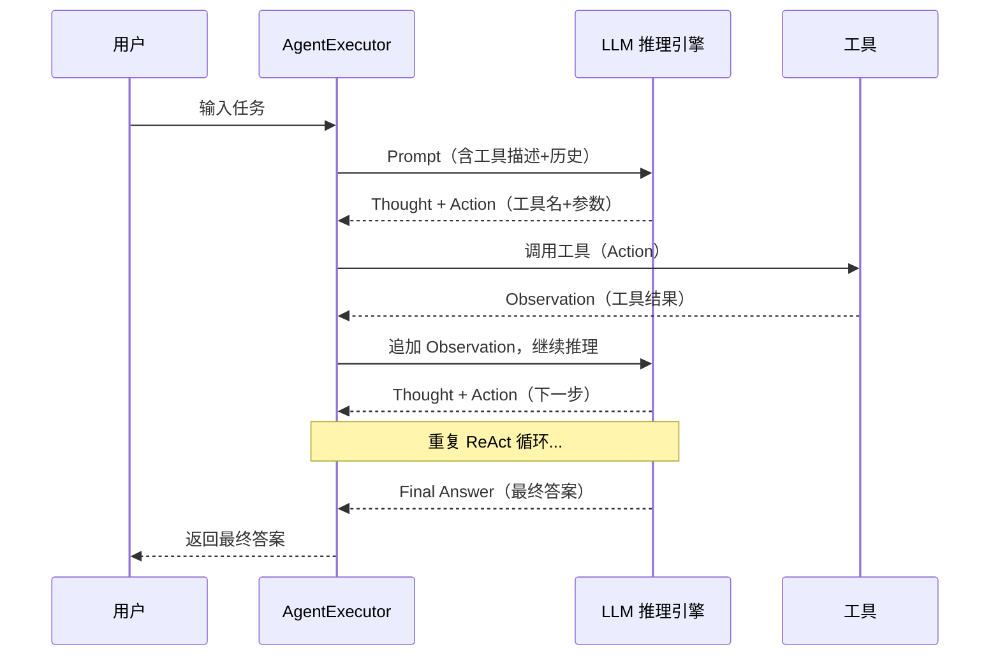

**ReAct 循环的关键组件**：

| 组件 | 说明 | 示例 |
|------|------|------|
| Thought（思考） | LLM 分析当前状态，决定下一步做什么 | "我需要先查询当前时间，然后计算时差" |
| Action（行动） | 选择要调用的工具和参数 | `Action: calculator\nAction Input: 123 * 456` |
| Observation（观察） | 工具返回的结果 | "Observation: 计算结果：56088" |
| Final Answer（最终答案） | 任务完成后的最终回复 | "Final Answer: 123 × 456 = 56088" |

**Agent 的两种主要模式**：
1. **ReAct（文本模式）**：LLM 输出纯文本格式的 Thought/Action/Observation，用正则解析工具调用。兼容性好，但解析不稳定
2. **Function Calling / Tool Calling（结构化模式）**：LLM 原生支持结构化的工具调用（OpenAI Function Calling、Anthropic Tool Use），工具调用以 JSON 格式输出，解析稳定可靠。**推荐使用**

**技术对比**：

| 维度 | Chain（固定流程） | Agent（动态决策） |
|------|-----------------|-----------------|
| 流程控制 | 预定义的固定步骤 | LLM 动态决定步骤 |
| 工具调用 | 固定位置调用固定工具 | 动态选择工具和参数 |
| 适用任务 | 线性、可预测的任务 | 复杂、多步、需要推理的任务 |
| 可控性 | 高（流程固定） | 中（LLM 决策可能不可预测） |
| 延迟 | 低（固定步骤数） | 高（循环次数不确定） |
| 成本 | 可预测 | 不可预测（取决于循环次数） |
| 调试难度 | 低 | 高（需要追踪每一步决策） |

> 🏆 **面试高频考点**：Agent 和 Chain 的区别？Chain 是预定义的固定处理流程，每个步骤的输入输出和执行顺序都是确定的，适合线性可预测的任务；Agent 使用 LLM 作为推理引擎，动态决定调用哪些工具、以什么顺序调用，通过 ReAct 循环（思考-行动-观察）逐步完成任务，适合复杂的、需要多步推理和工具调用的任务。简单说：Chain 是"流水线"，Agent 是"智能工人"。选择标准：任务流程固定用 Chain，任务需要动态决策用 Agent。

#### 代码示例

**示例1：基础——工具定义与简单 Agent**

```python
# src/37_agent_basic.py
from langchain_openai import ChatOpenAI
from langchain_core.tools import tool
from langchain.agents import create_tool_calling_agent, AgentExecutor
from langchain_core.prompts import ChatPromptTemplate
from dotenv import load_dotenv
import math
from datetime import datetime

load_dotenv()

# ===== 定义工具 =====
@tool
def calculator(expression: str) -> str:
    """
    计算数学表达式。支持加减乘除、幂运算、平方根等。

    Args:
        expression: 数学表达式字符串，如 '2 + 3 * 4' 或 'sqrt(16)'

    Returns:
        计算结果的字符串描述
    """
    try:
        # 安全的数学计算命名空间
        safe_namespace = {
            'sqrt': math.sqrt,
            'pow': math.pow,
            'abs': abs,
            'round': round,
            'min': min,
            'max': max,
            'pi': math.pi,
            'e': math.e,
        }
        result = eval(expression, {"__builtins__": {}}, safe_namespace)
        return f"计算结果：{result}"
    except Exception as e:
        return f"计算错误：{str(e)}"

@tool
def get_current_time(timezone: str = "Asia/Shanghai") -> str:
    """
    获取指定时区的当前日期和时间。

    Args:
        timezone: 时区名称，如 'Asia/Shanghai'、'America/New_York'、'UTC'

    Returns:
        当前日期时间字符串
    """
    try:
        from zoneinfo import ZoneInfo
        now = datetime.now(ZoneInfo(timezone))
        return f"当前时间（{timezone}）：{now.strftime('%Y-%m-%d %H:%M:%S %A')}"
    except Exception as e:
        return f"获取时间错误：{str(e)}"

@tool
def unit_converter(value: float, from_unit: str, to_unit: str) -> str:
    """
    单位换算器。支持长度、重量、温度的常见单位换算。

    Args:
        value: 数值
        from_unit: 原始单位（如 'km'、'mile'、'kg'、'lb'、'celsius'、'fahrenheit'）
        to_unit: 目标单位

    Returns:
        换算结果
    """
    # 长度换算（基准：米）
    length_to_meter = {
        'km': 1000, 'm': 1, 'cm': 0.01, 'mm': 0.001,
        'mile': 1609.34, 'yard': 0.9144, 'foot': 0.3048, 'inch': 0.0254,
    }
    # 重量换算（基准：千克）
    weight_to_kg = {
        'kg': 1, 'g': 0.001, 'mg': 0.000001,
        'lb': 0.453592, 'oz': 0.0283495, 'ton': 1000,
    }

    try:
        if from_unit in length_to_meter and to_unit in length_to_meter:
            meters = value * length_to_meter[from_unit]
            result = meters / length_to_meter[to_unit]
            return f"{value} {from_unit} = {result:.4f} {to_unit}"
        elif from_unit in weight_to_kg and to_unit in weight_to_kg:
            kg = value * weight_to_kg[from_unit]
            result = kg / weight_to_kg[to_unit]
            return f"{value} {from_unit} = {result:.4f} {to_unit}"
        elif from_unit == 'celsius' and to_unit == 'fahrenheit':
            return f"{value}°C = {value * 9/5 + 32:.2f}°F"
        elif from_unit == 'fahrenheit' and to_unit == 'celsius':
            return f"{value}°F = {(value - 32) * 5/9:.2f}°C"
        else:
            return f"不支持的单位换算：{from_unit} -> {to_unit}"
    except Exception as e:
        return f"换算错误：{str(e)}"

tools = [calculator, get_current_time, unit_converter]

# ===== 创建 Agent =====
prompt = ChatPromptTemplate.from_messages([
    ("system", "你是一个有用的助手，可以使用工具来回答问题。如果需要计算、查询时间或单位换算，请使用对应的工具。回答要简洁准确。"),
    ("human", "{input}"),
    ("placeholder", "{agent_scratchpad}"),
])

chat = ChatOpenAI(model="gpt-4o-mini", temperature=0)
agent = create_tool_calling_agent(chat, tools, prompt)
agent_executor = AgentExecutor(
    agent=agent,
    tools=tools,
    verbose=True,
    max_iterations=5,
    handle_parsing_errors=True,
    return_intermediate_steps=True,  # 返回中间步骤，便于调试
)

# ===== 测试 =====
print("=== 测试1：计算 ===")
result = agent_executor.invoke({"input": "123 * 456 等于多少？再开平方是多少？"})
print(f"最终答案: {result['output']}")
print(f"中间步骤数: {len(result['intermediate_steps'])}")

print("\n=== 测试2：多工具组合 ===")
result = agent_executor.invoke({"input": "现在北京时间是几点？纽约呢？两地时差是多少小时？"})
print(f"最终答案: {result['output']}")

print("\n=== 测试3：单位换算 ===")
result = agent_executor.invoke({"input": "100 公里等于多少英里？100 摄氏度等于多少华氏度？"})
print(f"最终答案: {result['output']}")
```

**示例2：进阶——搜索 Agent 与 RAG 工具结合**

```python
# src/38_agent_search_rag.py
from langchain_openai import ChatOpenAI
from langchain_core.tools import tool, Tool
from langchain.agents import create_tool_calling_agent, AgentExecutor
from langchain_core.prompts import ChatPromptTemplate
from langchain_community.tools.tavily_search import TavilySearchResults
from langchain_community.vectorstores import Chroma
from langchain_openai import OpenAIEmbeddings
from langchain_core.documents import Document
from dotenv import load_dotenv
from typing import List

load_dotenv()

# ===== 工具1：网络搜索（Tavily）=====
search_tool = TavilySearchResults(max_results=3)

# ===== 工具2：知识库检索（RAG as Tool）=====
kb_docs = [
    Document(page_content="公司产品 A 是一款面向中小企业的 SaaS 平台，定价 99 元/月/用户，支持 14 天免费试用。核心功能包括项目管理、团队协作、数据分析。", metadata={"source": "product_a.md"}),
    Document(page_content="公司产品 B 是一款面向大型企业的私有化部署方案，定价根据用户数定制，起价 10 万元/年。提供 7x24 小时专属客服和定制化开发服务。", metadata={"source": "product_b.md"}),
    Document(page_content="公司退款政策：购买后 7 天内可申请全额退款，7-30 天内退款 50%，超过 30 天不予退款。年度套餐可按剩余月份比例退款。", metadata={"source": "refund_policy.md"}),
    Document(page_content="公司技术支持渠道：1. 在线客服（工作日 9:00-18:00）2. 邮件支持（support@company.com，24小时内回复）3. 帮助中心（24/7 自助查询）4. 企业版专属客户经理。", metadata={"source": "support.md"}),
]

embeddings = OpenAIEmbeddings(model="text-embedding-3-small")
vectorstore = Chroma.from_documents(kb_docs, embeddings, persist_directory="./data/agent_kb")
retriever = vectorstore.as_retriever(search_kwargs={"k": 2})

@tool
def search_knowledge_base(query: str) -> str:
    """
    搜索公司内部知识库，获取产品信息、定价、退款政策、技术支持等内部资料。

    Args:
        query: 搜索查询

    Returns:
        相关的知识库内容
    """
    docs = retriever.invoke(query)
    if not docs:
        return "知识库中未找到相关信息。"
    return "\n\n".join(f"[来源:{doc.metadata['source']}]\n{doc.page_content}" for doc in docs)

# ===== 工具3：自定义结构化工具（Pydantic Schema）=====
from pydantic import BaseModel, Field

class OrderInput(BaseModel):
    order_id: str = Field(description="订单编号，格式如 ORD-2024-001")
    customer_email: str = Field(description="客户邮箱，用于验证订单归属")

@tool(args_schema=OrderInput)
def check_order_status(order_id: str, customer_email: str) -> str:
    """
    查询客户订单状态。需要提供订单编号和客户邮箱进行验证。

    Args:
        order_id: 订单编号
        customer_email: 客户邮箱

    Returns:
        订单状态信息
    """
    # 模拟数据库查询
    mock_orders = {
        "ORD-2024-001": {"email": "alice@example.com", "status": "已发货", "tracking": "SF1234567890"},
        "ORD-2024-002": {"email": "bob@example.com", "status": "处理中", "tracking": None},
    }
    order = mock_orders.get(order_id)
    if not order:
        return f"订单 {order_id} 不存在。"
    if order["email"] != customer_email:
        return f"邮箱验证失败，无法查询订单 {order_id} 的状态。"
    tracking_info = f"，物流单号：{order['tracking']}" if order["tracking"] else ""
    return f"订单 {order_id} 状态：{order['status']}{tracking_info}"

# ===== 组装 Agent =====
tools = [search_tool, search_knowledge_base, check_order_status]

prompt = ChatPromptTemplate.from_messages([
    ("system", """你是一个智能客服助手，可以使用以下工具帮助用户：
1. 网络搜索：查询实时信息、新闻、通用知识
2. 知识库检索：查询公司产品、定价、退款政策、技术支持等内部信息
3. 订单查询：查询客户订单状态（需要订单号和邮箱验证）

回答规则：
- 涉及公司内部信息优先用知识库检索
- 涉及实时信息用网络搜索
- 涉及订单状态用订单查询工具
- 回答简洁专业，不确定时说明需要更多信息"""),
    ("human", "{input}"),
    ("placeholder", "{agent_scratchpad}"),
])

chat = ChatOpenAI(model="gpt-4o-mini", temperature=0)
agent = create_tool_calling_agent(chat, tools, prompt)
agent_executor = AgentExecutor(
    agent=agent,
    tools=tools,
    verbose=True,
    max_iterations=5,
    handle_parsing_errors=True,
)

# ===== 测试 =====
print("=== 测试1：知识库查询 ===")
result = agent_executor.invoke({"input": "产品 A 的定价是多少？有免费试用吗？"})
print(f"回答: {result['output']}")

print("\n=== 测试2：订单查询 ===")
result = agent_executor.invoke({"input": "帮我查一下订单 ORD-2024-001 的状态，我的邮箱是 alice@example.com"})
print(f"回答: {result['output']}")

print("\n=== 测试3：退款政策 ===")
result = agent_executor.invoke({"input": "我买了产品 A 10 天了，现在想退款，能退多少？"})
print(f"回答: {result['output']}")
```

**示例3：完整场景——多工具协作的研究 Agent**

```python
# src/39_research_agent.py
from langchain_openai import ChatOpenAI
from langchain_core.tools import tool
from langchain.agents import create_tool_calling_agent, AgentExecutor
from langchain_core.prompts import ChatPromptTemplate
from langchain_community.tools.tavily_search import TavilySearchResults
from dotenv import load_dotenv
from typing import List, Dict
import json

load_dotenv()

# ===== 工具定义 =====
search_tool = TavilySearchResults(max_results=3)

@tool
def summarize_articles(articles: str, focus: str = "关键发现") -> str:
    """
    对搜索到的多篇文章进行总结，提取关键信息。

    Args:
        articles: 文章内容（JSON 格式的列表，每篇含 title 和 content）
        focus: 总结重点，如 '关键发现'、'数据统计'、'争议观点'

    Returns:
        结构化的总结
    """
    try:
        article_list = json.loads(articles)
    except:
        article_list = [{"title": "文章", "content": articles}]

    # 用 LLM 总结（这里简化处理，实际应用中调用 LLM）
    summary_parts = [f"总结重点：{focus}\n"]
    for i, article in enumerate(article_list[:5], 1):
        title = article.get("title", f"文章{i}")
        content = article.get("content", "")[:200]
        summary_parts.append(f"{i}. {title}\n   要点：{content}...\n")

    return "\n".join(summary_parts)

@tool
def compare_viewpoints(topic: str, viewpoints: str) -> str:
    """
    对比分析同一话题的不同观点，找出共识和分歧。

    Args:
        topic: 讨论话题
        viewpoints: 多个观点（JSON 格式列表，每个含 source 和 opinion）

    Returns:
        对比分析结果
    """
    try:
        vp_list = json.loads(viewpoints)
    except:
        vp_list = [{"source": "观点1", "opinion": viewpoints}]

    result = [f"话题：{topic}\n", "共识与分歧分析：\n"]
    for i, vp in enumerate(vp_list, 1):
        source = vp.get("source", f"观点{i}")
        opinion = vp.get("opinion", "")[:150]
        result.append(f"{i}. [{source}] {opinion}")

    result.append(f"\n共分析 {len(vp_list)} 个观点，建议结合多方信息综合判断。")
    return "\n".join(result)

@tool
def generate_report(topic: str, research_notes: str, report_type: str = "简报") -> str:
    """
    根据研究笔记生成结构化研究报告。

    Args:
        topic: 研究主题
        research_notes: 研究笔记（汇总的搜索结果和分析）
        report_type: 报告类型，'简报'（300字以内）或 '详细报告'（1000字以上）

    Returns:
        结构化研究报告
    """
    # 实际应用中这里调用 LLM 生成报告
    word_limit = "300字以内" if report_type == "简报" else "1000字以上"
    return f"""# {topic} 研究报告（{report_type}）

## 摘要
基于以下研究笔记生成的{word_limit}报告。

## 研究笔记
{research_notes[:500]}...

## 结论
（注：完整报告应由 LLM 根据研究笔记生成，此处为框架示例）

## 参考来源
- 搜索结果中的相关链接
"""

tools = [search_tool, summarize_articles, compare_viewpoints, generate_report]

# ===== 创建研究 Agent =====
prompt = ChatPromptTemplate.from_messages([
    ("system", """你是一个资深研究分析师，擅长多步骤研究任务。你的工作流程：

1. 理解用户的研究主题和要求
2. 使用网络搜索工具收集相关信息
3. 使用总结工具整理搜索结果
4. 如有不同观点，使用对比工具分析
5. 使用报告生成工具输出最终研究报告

要求：
- 至少进行 2 轮搜索以确保信息全面
- 引用信息来源
- 报告结构清晰，包含摘要、正文、结论
- 不确定的信息标注"待验证" """),
    ("human", "{input}"),
    ("placeholder", "{agent_scratchpad}"),
])

chat = ChatOpenAI(model="gpt-4o-mini", temperature=0.3)
agent = create_tool_calling_agent(chat, tools, prompt)
agent_executor = AgentExecutor(
    agent=agent,
    tools=tools,
    verbose=True,
    max_iterations=8,
    handle_parsing_errors=True,
)

# ===== 执行研究任务 =====
print("=== 研究 Agent 执行任务 ===")
result = agent_executor.invoke({
    "input": "研究 2024 年人工智能领域的重大进展，重点关注大模型和多模态方向，生成一份 500 字的研究简报。"
})
print(f"\n=== 最终报告 ===")
print(result["output"])
```

#### 使用场景与最佳实践

**适用场景**：
- 需要多步推理和工具调用的复杂任务（研究分析、数据查询、任务规划）
- 需要动态决策的场景（根据中间结果调整策略）
- 多工具协作（搜索+计算+数据库+API）
- 自动化任务执行（自动订票、自动发邮件、自动处理工单）

**不适用场景**：
- 简单的单步问答（用 Chain 更简单、更可控）
- 对延迟要求极高（Agent 循环可能需要多次 LLM 调用）
- 对成本敏感（Agent 的 Token 消耗不可预测）
- 需要严格控制流程的合规场景（Agent 决策不可预测）

**最佳实践**：
1. **使用 Tool Calling 而非 ReAct 文本模式**：`create_tool_calling_agent` 使用结构化工具调用，解析更稳定，是推荐方式
2. **工具描述要清晰准确**：`@tool` 装饰器的 docstring 是 LLM 选择工具的依据，要包含工具用途、参数说明、返回值说明
3. **限制工具数量**：Agent 同时可用的工具不超过 5-8 个，太多工具会降低选择准确率。可以按场景动态加载工具
4. **设置 max_iterations**：防止 Agent 无限循环，通常设为 3-8 次
5. **handle_parsing_errors=True**：工具调用解析失败时自动处理，避免 Agent 崩溃
6. **Human-in-the-loop**：关键操作（如发送邮件、修改数据库）需要人工确认后再执行
7. **工具参数用 Pydantic Schema**：`@tool(args_schema=MySchema)` 提供结构化参数定义，提升工具调用准确率

**性能建议**：
- Agent 的延迟 = 循环次数 × 单次 LLM 调用延迟，通常 3-5 次循环需要 10-30 秒
- 用流式输出（`agent_executor.stream()`）逐步骤展示 Agent 的思考和行动，提升用户体验
- 简单工具（计算、字符串处理）直接在本地执行，不要用 LLM 调用
- 缓存常用工具的查询结果（如搜索结果缓存 1 小时），减少重复调用

#### 常见坑点

**坑点1：Agent 不调用工具或调用错误的工具**

- **错误现象**：Agent 直接回答问题而不调用工具，或调用了错误的工具/参数
- **根本原因**：①工具描述（docstring）不清晰，LLM 不知道何时使用；②工具太多，LLM 选择困难；③工具参数描述不明确，LLM 传错参数；④System Prompt 没有明确说明何时使用工具
- **正确做法**：①每个工具的 docstring 包含"什么时候用这个工具"的明确说明；②限制同时可用的工具数量（5-8个）；③用 Pydantic Schema 定义参数，每个字段加 description；④System Prompt 中明确列出工具使用规则和优先级
- **预防措施**：开发阶段用 `verbose=True` 观察 Agent 的每一步决策，分析工具选择错误的原因；准备 10-20 个测试用例评估工具选择准确率

**坑点2：Agent 无限循环或超过最大迭代次数**

- **错误现象**：Agent 反复调用同一个工具，或在多个工具之间来回切换，最终触发 `max_iterations` 限制返回不完整答案
- **根本原因**：①工具返回结果不明确，LLM 无法判断是否完成任务；②任务过于复杂，Agent 规划能力不足；③工具之间有循环依赖（A 工具的输出需要 B 工具，B 工具又需要 A 工具）；④System Prompt 没有给出明确的完成条件
- **正确做法**：①设置合理的 `max_iterations`（3-8次）；②工具返回结果要包含明确的状态信息（成功/失败/部分完成）；③复杂任务拆分为子任务，用 LangGraph 管理状态；④System Prompt 中明确"当信息足够时直接给出 Final Answer"
- **预防措施**：监控 Agent 的平均迭代次数和循环率，超过阈值时优化工具设计或 System Prompt；用 LangSmith 追踪 Agent 的完整执行轨迹，分析循环原因

---

### 8.2 自定义 Agent 与 LangGraph 进阶

#### 概念解释

**自定义 Agent 是指不使用 LangChain 预定义的 `create_tool_calling_agent`，而是通过 LangGraph 手动构建 Agent 的状态图和执行逻辑**。LangGraph 是构建在 LangChain 之上的有状态图框架，用 `StateGraph` 定义节点（处理步骤）和边（执行路径），支持循环、条件分支、多 Agent 协作等复杂流程。自定义 Agent 适用于需要精细控制执行流程、多 Agent 协作、人工介入（Human-in-the-loop）、复杂状态管理等场景，是构建生产级 Agent 系统的推荐方式。

> 🎯 **生活化比喻**：预定义 Agent 就像"全自动洗衣机"——按一个按钮就自动完成洗衣全过程，简单方便但无法自定义每个环节。自定义 Agent（LangGraph）就像"开放式厨房"——你可以自己设计洗菜、切菜、炒菜、装盘的每个步骤，决定什么时候尝味道（人工检查）、什么时候加调料（动态调整）、甚至可以两个人同时做不同的菜（多 Agent 协作）。灵活性更高，但需要你自己设计流程。

**核心价值**：LangGraph 提供了比预定义 Agent 更精细的控制能力，支持复杂的状态管理、条件路由、循环控制、人工介入和多 Agent 协作，是构建生产级、企业级 Agent 系统的基础。

#### 原理说明

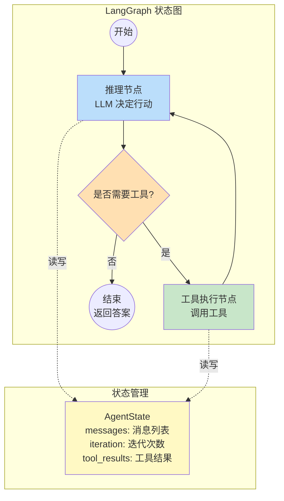

**LangGraph 核心概念**：

| 概念 | 说明 | 类比 |
|------|------|------|
| State（状态） | 图中传递的数据结构，通常是 TypedDict | 流水线中的工件 |
| Node（节点） | 处理步骤，接收状态返回状态更新 | 流水线中的工位 |
| Edge（边） | 节点之间的连接，定义执行顺序 | 流水线中的传送带 |
| Conditional Edge（条件边） | 根据状态动态决定下一个节点 | 分流器 |
| Reducer（归约器） | 定义状态字段的合并方式（如消息列表的追加） | 数据合并规则 |

**为什么用 LangGraph 而非预定义 Agent**：
1. **精细控制执行流程**：可以自定义每个节点的逻辑、条件分支的判断、循环的终止条件
2. **复杂状态管理**：状态可以包含任意数据（消息、工具结果、中间计算、用户信息），用 Reducer 控制合并方式
3. **Human-in-the-loop**：支持在特定节点暂停，等待人工确认或输入后继续
4. **多 Agent 协作**：可以构建多个 Agent 节点，通过状态传递信息，实现协作或竞争
5. **可观测性**：每个节点的输入输出都可以追踪，便于调试和优化

> 🏆 **面试高频考点**：LangGraph 和 LangChain Agent 的区别？LangChain 的预定义 Agent（`create_tool_calling_agent` + `AgentExecutor`）是封装好的 ReAct 循环，简单易用但灵活性有限，适合标准的工具调用场景；LangGraph 是更低层的有状态图框架，用 StateGraph 手动定义节点和边，支持复杂的条件分支、循环控制、人工介入和多 Agent 协作，适合需要精细控制的生产级 Agent。简单说：预定义 Agent 是"自动挡"，LangGraph 是"手动挡"——简单场景用自动挡，复杂场景用手动挡。

#### 代码示例

**示例1：基础——用 LangGraph 构建自定义 ReAct Agent**

```python
# src/40_langgraph_agent.py
from typing import TypedDict, Annotated, List
from langgraph.graph import StateGraph, END
from langgraph.graph.message import add_messages
from langchain_openai import ChatOpenAI
from langchain_core.messages import SystemMessage, HumanMessage, AIMessage, ToolMessage
from langchain_core.tools import tool
from dotenv import load_dotenv
import json

load_dotenv()

# ===== 定义状态 =====
class AgentState(TypedDict):
    messages: Annotated[List, add_messages]  # 消息列表，自动追加
    iteration: int                              # 迭代次数
    max_iterations: int                         # 最大迭代次数

# ===== 定义工具 =====
@tool
def web_search(query: str) -> str:
    """搜索网络获取信息。"""
    # 模拟搜索
    return f"搜索结果：关于'{query}'的相关信息...（模拟）"

@tool
def calculator(expression: str) -> str:
    """计算数学表达式。"""
    try:
        result = eval(expression, {"__builtins__": {}}, {})
        return f"计算结果：{result}"
    except Exception as e:
        return f"计算错误：{e}"

tools = [web_search, calculator]
tool_map = {t.name: t for t in tools}

# ===== 定义节点 =====
chat = ChatOpenAI(model="gpt-4o-mini", temperature=0).bind_tools(tools)

def reason_node(state: AgentState) -> AgentState:
    """推理节点：调用 LLM，决定是否调用工具或给出最终答案。"""
    system_msg = SystemMessage(content="你是一个有用的助手，可以使用搜索和计算器工具。当信息足够时直接回答。")
    response = chat.invoke([system_msg] + state["messages"])
    return {
        "messages": [response],
        "iteration": state["iteration"] + 1,
        "max_iterations": state["max_iterations"],
    }

def tool_node(state: AgentState) -> AgentState:
    """工具执行节点：执行 LLM 请求的工具调用。"""
    last_message = state["messages"][-1]
    tool_results = []

    for tool_call in last_message.tool_calls:
        tool_name = tool_call["name"]
        tool_args = tool_call["args"]
        tool_id = tool_call["id"]

        if tool_name in tool_map:
            result = tool_map[tool_name].invoke(tool_args)
        else:
            result = f"错误：未知工具 {tool_name}"

        tool_results.append(ToolMessage(content=result, tool_call_id=tool_id))

    return {"messages": tool_results}

# ===== 定义条件边 =====
def should_continue(state: AgentState) -> str:
    """判断是否继续循环：有工具调用且未超过最大迭代次数则继续，否则结束。"""
    last_message = state["messages"][-1]

    # 超过最大迭代次数，强制结束
    if state["iteration"] >= state["max_iterations"]:
        return "end"

    # 有工具调用，继续执行工具节点
    if last_message.tool_calls:
        return "tools"

    # 没有工具调用，结束
    return "end"

# ===== 构建图 =====
workflow = StateGraph(AgentState)

# 添加节点
workflow.add_node("reason", reason_node)
workflow.add_node("tools", tool_node)

# 设置入口
workflow.set_entry_point("reason")

# 添加条件边
workflow.add_conditional_edges(
    "reason",
    should_continue,
    {
        "tools": "tools",
        "end": END,
    },
)

# 工具执行后回到推理节点
workflow.add_edge("tools", "reason")

# 编译图
graph = workflow.compile()

# ===== 执行 =====
print("=== LangGraph 自定义 Agent ===")

result = graph.invoke({
    "messages": [HumanMessage(content="2024年奥运会在哪里举办？举办时间是什么时候？")],
    "iteration": 0,
    "max_iterations": 5,
})

print("\n=== 对话历史 ===")
for msg in result["messages"]:
    if msg.type == "human":
        print(f"👤 用户: {msg.content}")
    elif msg.type == "ai":
        print(f"🤖 AI: {msg.content[:100] if msg.content else '(工具调用)'}")
        if msg.tool_calls:
            for tc in msg.tool_calls:
                print(f"   🔧 调用工具: {tc['name']}({tc['args']})")
    elif msg.type == "tool":
        print(f"🔧 工具结果: {msg.content[:80]}")

print(f"\n迭代次数: {result['iteration']}")
print(f"最终答案: {result['messages'][-1].content}")
```

**示例2：进阶——Human-in-the-loop 人工确认**

```python
# src/41_human_in_the_loop.py
from typing import TypedDict, Annotated, List
from langgraph.graph import StateGraph, END
from langgraph.graph.message import add_messages
from langchain_openai import ChatOpenAI
from langchain_core.messages import SystemMessage, HumanMessage, AIMessage, ToolMessage
from langchain_core.tools import tool
from langgraph.checkpoint.memory import MemorySaver
from dotenv import load_dotenv

load_dotenv()

# ===== 状态定义 =====
class ApprovalState(TypedDict):
    messages: Annotated[List, add_messages]
    action_requested: dict       # 请求执行的操作
    action_approved: bool        # 是否被批准
    action_result: str           # 操作执行结果

# ===== 工具（模拟敏感操作）=====
@tool
def send_email(to: str, subject: str, body: str) -> str:
    """发送邮件。这是一个敏感操作，需要人工确认。"""
    return f"邮件已发送至 {to}，主题：{subject}"

@tool
def delete_record(record_id: str) -> str:
    """删除数据库记录。这是一个敏感操作，需要人工确认。"""
    return f"记录 {record_id} 已删除"

tools = [send_email, delete_record]
tool_map = {t.name: t for t in tools}

chat = ChatOpenAI(model="gpt-4o-mini", temperature=0).bind_tools(tools)

# ===== 节点 =====
def plan_node(state: ApprovalState) -> ApprovalState:
    """规划节点：LLM 分析任务，决定执行什么操作。"""
    system = SystemMessage(content="你是一个任务执行助手。分析用户请求，决定需要执行什么操作。敏感操作（发邮件、删除数据）需要先请求人工确认。")
    response = chat.invoke([system] + state["messages"])
    return {"messages": [response], "action_requested": response.tool_calls[0] if response.tool_calls else {}}

def approval_node(state: ApprovalState) -> ApprovalState:
    """人工确认节点：在这里暂停，等待人工输入。"""
    # 实际应用中，这里会通过 API 返回给前端，等待用户确认
    # 这里用输入模拟
    action = state["action_requested"]
    print(f"\n⚠️  需要人工确认的操作：")
    print(f"   工具：{action.get('name')}")
    print(f"   参数：{action.get('args')}")
    # 模拟人工确认（实际应用中从外部输入）
    approved = True  # 模拟用户点击"确认"
    return {"action_approved": approved}

def execute_node(state: ApprovalState) -> ApprovalState:
    """执行节点：如果被批准，执行操作；否则取消。"""
    if not state["action_approved"]:
        return {"action_result": "操作已被用户取消"}

    action = state["action_requested"]
    tool = tool_map[action["name"]]
    result = tool.invoke(action["args"])
    return {"action_result": result}

def respond_node(state: ApprovalState) -> ApprovalState:
    """回复节点：根据执行结果生成最终回复。"""
    result_msg = f"操作结果：{state['action_result']}"
    return {"messages": [AIMessage(content=result_msg)]}

# ===== 条件边 =====
def needs_approval(state: ApprovalState) -> str:
    """判断是否需要人工确认。"""
    if state["action_requested"]:
        return "approval"
    return "respond"

def after_approval(state: ApprovalState) -> str:
    """人工确认后决定执行或取消。"""
    if state["action_approved"]:
        return "execute"
    return "respond"

# ===== 构建图 =====
workflow = StateGraph(ApprovalState)
workflow.add_node("plan", plan_node)
workflow.add_node("approval", approval_node)
workflow.add_node("execute", execute_node)
workflow.add_node("respond", respond_node)

workflow.set_entry_point("plan")
workflow.add_conditional_edges("plan", needs_approval, {"approval": "approval", "respond": "respond"})
workflow.add_conditional_edges("approval", after_approval, {"execute": "execute", "respond": "respond"})
workflow.add_edge("execute", "respond")
workflow.add_edge("respond", END)

# 使用 MemorySaver 支持中断和恢复
memory = MemorySaver()
graph = workflow.compile(checkpointer=memory)

# ===== 执行 =====
print("=== Human-in-the-loop Agent ===")
config = {"configurable": {"thread_id": "approval_test_1"}}

result = graph.invoke({
    "messages": [HumanMessage(content="帮我给 boss@company.com 发一封邮件，主题是'项目进度汇报'，内容是项目已完成 80%")],
    "action_requested": {},
    "action_approved": False,
    "action_result": "",
}, config=config)

print(f"\n最终结果: {result['messages'][-1].content}")
print(f"操作已批准: {result['action_approved']}")
print(f"执行结果: {result['action_result']}")
```

#### 使用场景与最佳实践

**适用场景**：
- 需要精细控制 Agent 执行流程的生产级应用
- 多 Agent 协作系统（如研究 Agent + 写作 Agent + 审核 Agent）
- 需要人工介入的关键操作（发邮件、删除数据、支付）
- 复杂状态管理（多轮对话、多步骤任务、跨会话状态）
- 需要条件分支和循环控制的复杂工作流

**不适用场景**：
- 简单的单工具调用（用预定义 Agent 更简单）
- 快速原型验证（预定义 Agent 开发更快）
- 团队不熟悉状态图概念

**最佳实践**：
1. **状态用 TypedDict 定义**：明确每个字段的类型和用途，消息列表用 `Annotated[List, add_messages]` 自动追加
2. **节点只返回增量更新**：节点返回 `{"messages": [new_msg]}` 而非完整状态，Reducer 会自动合并
3. **用 `interrupt_before` 实现 Human-in-the-loop**：在关键操作节点前中断，外部确认后用 `graph.invoke(None, config)` 恢复
4. **用 MemorySaver 持久化状态**：支持中断恢复和多会话管理
5. **图编译后可视化**：`graph.get_graph().draw_mermaid_png()` 生成图结构图片，便于理解和调试

**性能建议**：
- LangGraph 的状态序列化有开销，状态对象尽量精简
- 多 Agent 协作时，用 `RunnableParallel` 并行执行独立 Agent，减少总延迟
- 图中的纯计算节点（字符串处理、数据转换）不要调用 LLM，直接在节点函数中处理

#### 常见坑点

**坑点1：状态更新时消息重复或丢失**

- **错误现象**：多轮调用后状态中出现重复消息，或某些消息丢失
- **根本原因**：`add_messages` reducer 的工作机制是按消息 `id` 去重——如果新消息的 `id` 与现有消息相同则替换，否则追加。手动构造消息时不设置 `id`，或节点返回了完整消息列表而非增量，会导致重复
- **正确做法**：节点只返回增量更新 `{"messages": [new_message]}`，不要返回完整的 `state["messages"]`；需要替换消息时设置相同的 `id`
- **预防措施**：开发阶段在每个节点后打印 `len(state["messages"])` 和消息内容，验证状态变化正确

**坑点2：条件边函数返回值与边映射不匹配**

- **错误现象**：图执行时报 `GraphRuntimeError: No edge found for key 'xxx'`
- **根本原因**：条件边函数返回的字符串不在 `add_conditional_edges` 的边映射字典中。例如函数返回 `"continue"` 但映射中只有 `{"tools": ..., "end": ...}`
- **正确做法**：确保条件边函数的所有可能返回值都在边映射中定义；添加默认分支处理未预期的情况
- **预防措施**：条件边函数用枚举或常量定义返回值，避免硬编码字符串；在函数中处理所有边界条件

---

> 💡 **深度讲解**：本章深入讲解了 Agent 智能体开发。Agent 是 LLM 应用的高级形式，通过 ReAct 循环（思考-行动-观察）让 LLM 自主决定调用哪些工具来完成复杂任务。基础 Agent 用 `create_tool_calling_agent` + `AgentExecutor` 快速构建，适合标准的工具调用场景；自定义 Agent 用 LangGraph 的 StateGraph 手动构建状态图，适合需要精细控制、人工介入、多 Agent 协作的生产级场景。工具设计是 Agent 成功的关键——清晰的 docstring、结构化的 Pydantic 参数、明确的返回值，都直接影响 LLM 选择和调用工具的准确率。生产级 Agent 还需要考虑：限制迭代次数防止无限循环、Human-in-the-loop 处理敏感操作、LangSmith 追踪完整执行轨迹、工具结果缓存减少重复调用。Agent 的能力边界正在快速扩展，从单工具调用到多 Agent 协作，从文本交互到多模态感知，是 AI 应用最活跃的研究方向之一。

> 📝 **精简总结**：
> 1. Agent 通过 ReAct 循环（Thought→Action→Observation→Final Answer）自主决策工具调用
> 2. 推荐使用 create_tool_calling_agent（Tool Calling 结构化模式），而非旧版 ReAct 文本模式
> 3. 工具定义用 @tool 装饰器，docstring 要包含用途、参数、返回值说明
> 4. 工具参数用 Pydantic Schema（args_schema），提升调用准确率
> 5. AgentExecutor 设置 max_iterations（3-8）防止无限循环，handle_parsing_errors=True
> 6. RAG 可以作为 Agent 的一个工具（retriever.as_tool()），让 Agent 自主决定何时检索
> 7. LangGraph 用 StateGraph 构建自定义 Agent，支持复杂状态、条件分支、循环、Human-in-the-loop
> 8. 生产级 Agent 需要：工具结果缓存、执行轨迹追踪、敏感操作人工确认、多 Agent 协作

> 🎯 **梯度练习题**：
> - **基础1**：定义 3 个工具（计算器、时间查询、单位换算），用 create_tool_calling_agent 构建 Agent，测试多工具组合调用
> - **基础2**：将 RAG 检索封装为 Agent 工具，构建一个能自主决定是否检索知识库的问答 Agent
> - **基础3**：用 verbose=True 观察 Agent 的 ReAct 循环，打印每一步的 Thought/Action/Observation
> - **进阶1**：用 Pydantic Schema 定义一个订单查询工具（含订单号和邮箱验证），测试 Agent 调用带结构化参数的工具
> - **进阶2**：用 LangGraph 构建自定义 Agent，实现推理节点→工具节点→推理节点的循环，设置最大迭代次数
> - **实战1**：构建一个智能客服 Agent，包含知识库检索、订单查询、网络搜索、工单创建 4 个工具，实现多轮对话、工具自主选择、敏感操作人工确认，并用 10 个测试场景验证端到端效果

---

## 9. 记忆与对话管理

### 9.1 对话记忆体系

#### 概念解释

**对话记忆（Conversation Memory）是指 LLM 应用中存储、管理和利用对话历史的机制**，使得 AI 能够记住之前的对话内容，在多轮对话中保持上下文连贯性。LangChain 提供了多种记忆策略：完整缓冲记忆（保存所有消息）、窗口记忆（只保留最近 N 轮）、摘要记忆（用 LLM 总结历史）、Token 缓冲记忆（按 Token 数量限制），以及基于外部存储（Redis、数据库、文件）的持久化记忆。记忆管理是构建多轮对话应用的核心技术。

> 🎯 **生活化比喻**：对话记忆就像"助理的笔记本"——没有笔记本的助理每次对话都像第一次见面，你说"我上次提到的那个项目"，它会一脸茫然。有了笔记本，助理会记录你们之前聊过什么：完整缓冲记忆是"逐字记录所有对话"（笔记本越来越厚）；窗口记忆是"只记最近 5 次谈话"（旧的撕掉）；摘要记忆是"每次谈话结束后写一段摘要"（笔记本简洁但可能丢失细节）。好的助理会根据对话长度和重要性选择合适的记录方式。

**核心价值**：对话记忆让 AI 具备多轮对话能力，能够理解指代（"它""这个""上次说的"）、保持话题连贯性、记住用户偏好和历史信息，是构建自然对话体验的基础。

#### 原理说明

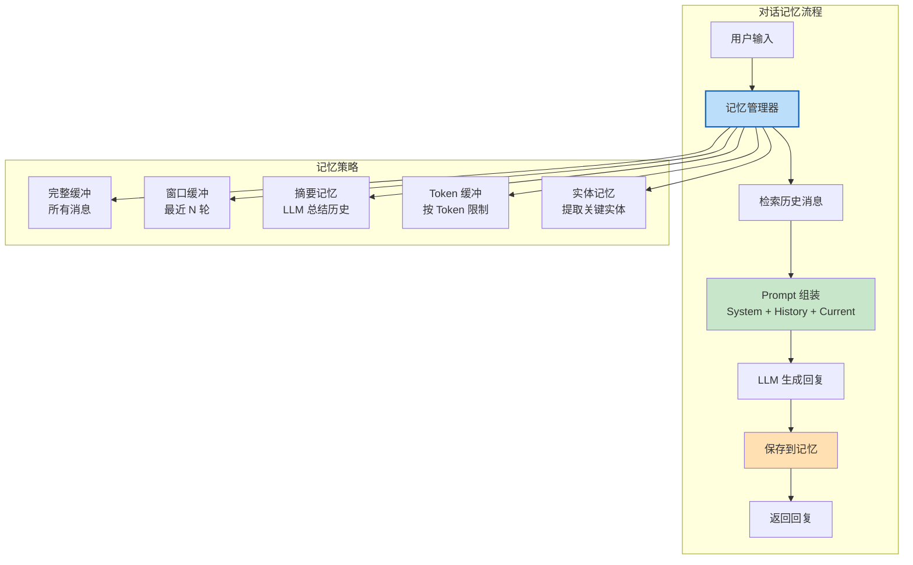

**记忆策略对比**：

| 策略 | 原理 | 优点 | 缺点 | 适用场景 |
|------|------|------|------|---------|
| 完整缓冲 | 保存所有消息 | 信息最完整 | Token 消耗随对话增长 | 短对话（<20轮） |
| 窗口缓冲 | 只保留最近 N 轮 | 控制 Token 用量 | 丢失早期信息 | 中等长度对话 |
| 摘要记忆 | 用 LLM 总结历史 | Token 用量稳定 | 可能丢失细节，增加 LLM 调用 | 长对话 |
| Token 缓冲 | 按 Token 数量截断 | 精确控制 Token | 可能截断半句话 | 对 Token 敏感的场景 |
| 实体记忆 | 提取关键实体（人名、日期等） | 结构化存储，检索高效 | 实现复杂 | 需要长期记忆的场景 |

**核心机制**：
1. **消息存储**：对话历史以 `List[BaseMessage]`（System/Human/AI/Tool）形式存储
2. **历史注入**：通过 `MessagesPlaceholder(variable_name="history")` 在 Prompt 中占位，调用时传入历史消息
3. **自动管理**：`RunnableWithMessageHistory` 包装 Chain，自动加载历史、保存新消息，开发者只需提供 `get_session_history` 函数
4. **会话隔离**：通过 `session_id` 区分不同用户/会话的记忆，每个会话独立存储

**技术对比**：

| 维度 | 手动管理历史 | RunnableWithMessageHistory | 外部持久化（Redis/DB） |
|------|------------|--------------------------|----------------------|
| 实现复杂度 | 高（手动加载/保存） | 低（自动管理） | 中（需配置存储） |
| 会话隔离 | 手动实现 | 内置（session_id） | 内置 |
| 持久化 | 内存（重启丢失） | 内存（默认） | 持久化（重启不丢失） |
| 分布式支持 | 不支持 | 不支持（单机内存） | 支持 |
| 适用场景 | 简单原型 | 单机会话 | 生产级多机部署 |

> 🏆 **面试高频考点**：RunnableWithMessageHistory 的工作原理？它是一个 Runnable 包装器，接收一个 Chain 和一个 `get_session_history(session_id)` 函数。调用时：①根据 `configurable.session_id` 调用 `get_session_history` 获取该会话的消息历史；②将历史消息注入到 Chain 的 `history_messages_key` 对应变量中；③执行 Chain 获得回复；④将用户输入和 AI 回复追加到历史中。这样开发者只需实现 `get_session_history`（从内存/Redis/数据库加载历史），就能自动管理多会话记忆。

#### 代码示例

**示例1：基础——RunnableWithMessageHistory 多轮对话**

```python
# src/42_memory_basic.py
from langchain_openai import ChatOpenAI
from langchain_core.prompts import ChatPromptTemplate, MessagesPlaceholder
from langchain_core.output_parsers import StrOutputParser
from langchain_community.chat_message_histories import ChatMessageHistory
from langchain_core.runnables.history import RunnableWithMessageHistory
from dotenv import load_dotenv

load_dotenv()

# ===== 构建带历史的 Chain =====
prompt = ChatPromptTemplate.from_messages([
    ("system", "你是一个友好的助手，记住用户说过的话。回答简洁友好。"),
    MessagesPlaceholder(variable_name="history"),
    ("human", "{input}"),
])

chat = ChatOpenAI(model="gpt-4o-mini", temperature=0.7)
chain = prompt | chat | StrOutputParser()

# ===== 会话存储（内存）=====
store = {}

def get_session_history(session_id: str) -> ChatMessageHistory:
    """根据 session_id 获取或创建会话历史。"""
    if session_id not in store:
        store[session_id] = ChatMessageHistory()
    return store[session_id]

# ===== 包装带历史的 Chain =====
chain_with_history = RunnableWithMessageHistory(
    chain,
    get_session_history,
    input_messages_key="input",
    history_messages_key="history",
)

# ===== 多轮对话测试 =====
config = {"configurable": {"session_id": "user_001"}}

print("=== 多轮对话测试（用户 001）===")

# 第一轮
r1 = chain_with_history.invoke({"input": "你好！我叫张三，我是一名 Python 开发者"}, config=config)
print(f"用户: 你好！我叫张三，我是一名 Python 开发者")
print(f"AI: {r1}")

# 第二轮（测试记忆）
r2 = chain_with_history.invoke({"input": "我叫什么名字？我的职业是什么？"}, config=config)
print(f"\n用户: 我叫什么名字？我的职业是什么？")
print(f"AI: {r2}")
# 预期：AI 记得"张三"和"Python 开发者"

# 第三轮
r3 = chain_with_history.invoke({"input": "我喜欢用 FastAPI 做后端开发，你能推荐一些学习资源吗？"}, config=config)
print(f"\n用户: 我喜欢用 FastAPI 做后端开发，你能推荐一些学习资源吗？")
print(f"AI: {r3[:100]}...")

# 第四轮（测试指代）
r4 = chain_with_history.invoke({"input": "刚才说的那个框架，它的主要特点是什么？"}, config=config)
print(f"\n用户: 刚才说的那个框架，它的主要特点是什么？")
print(f"AI: {r4[:100]}...")
# 预期：AI 理解"那个框架"指 FastAPI

# ===== 不同会话隔离测试 =====
print("\n=== 会话隔离测试（用户 002）===")
config2 = {"configurable": {"session_id": "user_002"}}
r5 = chain_with_history.invoke({"input": "我叫什么名字？"}, config=config2)
print(f"用户 002: 我叫什么名字？")
print(f"AI: {r5}")
# 预期：AI 不知道用户 002 的名字（不同会话）

# ===== 查看历史 =====
print(f"\n=== 用户 001 的对话历史 ===")
history = get_session_history("user_001")
for msg in history.messages:
    print(f"  [{msg.type}] {msg.content[:50]}...")
```

**示例2：进阶——窗口记忆 + 摘要记忆 + Token 控制**

```python
# src/43_memory_strategies.py
from langchain_openai import ChatOpenAI
from langchain_core.prompts import ChatPromptTemplate, MessagesPlaceholder
from langchain_core.output_parsers import StrOutputParser
from langchain_community.chat_message_histories import ChatMessageHistory
from langchain_core.runnables.history import RunnableWithMessageHistory
from langchain_core.messages import trim_messages, HumanMessage, AIMessage, SystemMessage
from dotenv import load_dotenv
from typing import List

load_dotenv()

chat = ChatOpenAI(model="gpt-4o-mini", temperature=0.7)

# ===== 策略1：窗口记忆（只保留最近 N 轮）=====
print("=== 策略1：窗口记忆 ===")

class WindowChatMessageHistory(ChatMessageHistory):
    """只保留最近 N 轮对话的历史。"""
    def __init__(self, max_turns: int = 5):
        super().__init__()
        self.max_turns = max_turns

    def add_messages(self, messages):
        super().add_messages(messages)
        # 只保留最近 max_turns 轮（每轮 = human + ai，共 2*max_turns 条）
        max_messages = self.max_turns * 2
        if len(self.messages) > max_messages:
            self.messages = self.messages[-max_messages:]

window_store = {}

def get_window_history(session_id: str):
    if session_id not in window_store:
        window_store[session_id] = WindowChatMessageHistory(max_turns=3)
    return window_store[session_id]

window_prompt = ChatPromptTemplate.from_messages([
    ("system", "你是一个助手。"),
    MessagesPlaceholder(variable_name="history"),
    ("human", "{input}"),
])

window_chain = RunnableWithMessageHistory(
    window_prompt | chat | StrOutputParser(),
    get_window_history,
    input_messages_key="input",
    history_messages_key="history",
)

# 测试：超过 3 轮后早期信息被遗忘
config = {"configurable": {"session_id": "window_test"}}
for i in range(5):
    r = window_chain.invoke({"input": f"这是第 {i+1} 轮对话，关键词是 KEYWORD_{i+1}"}, config=config)
    print(f"  轮次 {i+1}: {r[:50]}...")

# 第 6 轮询问早期关键词
r = window_chain.invoke({"input": "第一轮对话的关键词是什么？"}, config=config)
print(f"  询问第一轮关键词: {r}")
# 预期：AI 可能不记得（因为窗口只保留最近 3 轮）

# ===== 策略2：摘要记忆（用 LLM 总结历史）=====
print("\n=== 策略2：摘要记忆 ===")

class SummarizingChatMessageHistory(ChatMessageHistory):
    """对话超过 N 轮时，用 LLM 总结早期历史。"""
    def __init__(self, summarize_after: int = 6, summary_llm=None):
        super().__init__()
        self.summarize_after = summarize_after
        self.summary_llm = summary_llm or ChatOpenAI(model="gpt-4o-mini", temperature=0)
        self.summary = ""  # 历史摘要

    def add_messages(self, messages):
        super().add_messages(messages)
        # 超过阈值时，总结早期消息
        if len(self.messages) > self.summarize_after:
            self._summarize_old_messages()

    def _summarize_old_messages(self):
        """将早期消息总结为一段摘要，只保留最近几轮。"""
        # 保留最近 4 条消息（2 轮），其余总结
        recent = self.messages[-4:]
        old = self.messages[:-4]

        if not old:
            return

        # 构建摘要 Prompt
        old_text = "\n".join(f"[{m.type}] {m.content}" for m in old)
        summary_prompt = f"""请总结以下对话历史，提取关键信息（用户姓名、偏好、重要决定、待办事项等），不超过200字。

已有摘要：{self.summary}

新增历史：
{old_text}

更新后的摘要："""

        self.summary = self.summary_llm.invoke(summary_prompt).content
        self.messages = recent
        print(f"  [摘要记忆] 已总结 {len(old)} 条旧消息，摘要长度: {len(self.summary)} 字")

    def get_messages_with_summary(self):
        """获取包含摘要的消息列表。"""
        if self.summary:
            return [SystemMessage(content=f"对话历史摘要：{self.summary}")] + self.messages
        return self.messages

summary_store = {}

def get_summary_history(session_id: str):
    if session_id not in summary_store:
        summary_store[session_id] = SummarizingChatMessageHistory(summarize_after=6)
    return summary_store[session_id]

# 测试摘要记忆
summary_prompt = ChatPromptTemplate.from_messages([
    ("system", "你是一个助手。"),
    MessagesPlaceholder(variable_name="history"),
    ("human", "{input}"),
])

# 注意：RunnableWithMessageHistory 默认使用 history.messages
# 摘要记忆需要自定义 get_messages，这里简化演示
summary_chain = RunnableWithMessageHistory(
    summary_prompt | chat | StrOutputParser(),
    get_summary_history,
    input_messages_key="input",
    history_messages_key="history",
)

config = {"configurable": {"session_id": "summary_test"}}
for i in range(8):
    r = summary_chain.invoke({"input": f"第{i+1}轮：我叫张三，我喜欢Python和FastAPI，我在北京工作。"}, config=config)

# 查看摘要
history = get_summary_history("summary_test")
print(f"  当前消息数: {len(history.messages)}")
print(f"  摘要: {history.summary[:100]}...")

# ===== 策略3：Token 限制（trim_messages）=====
print("\n=== 策略3：Token 限制 ===")

# 构造长历史
long_history = ChatMessageHistory()
for i in range(20):
    long_history.add_user_message(f"这是第 {i+1} 条用户消息，内容比较长，包含很多文字。" * 5)
    long_history.add_ai_message(f"这是第 {i+1} 条 AI 回复。" * 3)

print(f"  原始消息数: {len(long_history.messages)}")

# 用 trim_messages 截断（保留最近的，最多 1000 Token）
trimmed = trim_messages(
    long_history.messages,
    max_tokens=1000,
    strategy="last",       # 保留最后
    token_counter=len,      # 简化：用字符数代替 Token 数
    include_system=True,
    allow_partial=False,
)

print(f"  截断后消息数: {len(trimmed)}")
print(f"  截断后字符数: {sum(len(m.content) for m in trimmed)}")
```

**示例3：完整场景——Redis 持久化记忆 + 多会话管理**

```python
# src/44_redis_memory.py
from langchain_openai import ChatOpenAI
from langchain_core.prompts import ChatPromptTemplate, MessagesPlaceholder
from langchain_core.output_parsers import StrOutputParser
from langchain_core.runnables.history import RunnableWithMessageHistory
from langchain_community.chat_message_histories import RedisChatMessageHistory
from dotenv import load_dotenv
import os

load_dotenv()

# ===== Redis 持久化记忆 =====
# 前置条件：安装 redis-py，运行 Redis 服务
# pip install redis
# docker run -d -p 6379:6379 redis

REDIS_URL = os.getenv("REDIS_URL", "redis://localhost:6379/0")

def get_redis_history(session_id: str) -> RedisChatMessageHistory:
    """从 Redis 获取会话历史，自动持久化。"""
    return RedisChatMessageHistory(
        session_id=session_id,
        url=REDIS_URL,
        key_prefix="chat_history:",  # Redis key 前缀
        ttl=60 * 60 * 24 * 7,        # 7 天过期
    )

# ===== 构建 Chain =====
prompt = ChatPromptTemplate.from_messages([
    ("system", "你是一个智能客服助手，记住用户的偏好和历史问题。"),
    MessagesPlaceholder(variable_name="history"),
    ("human", "{input}"),
])

chat = ChatOpenAI(model="gpt-4o-mini", temperature=0.7)
chain = prompt | chat | StrOutputParser()

chain_with_redis = RunnableWithMessageHistory(
    chain,
    get_redis_history,
    input_messages_key="input",
    history_messages_key="history",
)

# ===== 多会话管理类 =====
class SessionManager:
    """会话管理器：创建、查询、删除会话。"""

    def __init__(self, redis_url: str = REDIS_URL):
        import redis
        self.redis = redis.from_url(redis_url)
        self.key_prefix = "chat_history:"

    def list_sessions(self) -> list:
        """列出所有活跃会话。"""
        keys = self.redis.keys(f"{self.key_prefix}*")
        return [k.decode().replace(self.key_prefix, "") for k in keys]

    def get_session_info(self, session_id: str) -> dict:
        """获取会话信息（消息数、最后活跃时间）。"""
        history = get_redis_history(session_id)
        messages = history.messages
        if not messages:
            return {"session_id": session_id, "message_count": 0}
        return {
            "session_id": session_id,
            "message_count": len(messages),
            "first_message": messages[0].content[:50],
            "last_message": messages[-1].content[:50],
        }

    def clear_session(self, session_id: str):
        """清除指定会话的历史。"""
        history = get_redis_history(session_id)
        history.clear()

    def clear_all_sessions(self):
        """清除所有会话。"""
        keys = self.redis.keys(f"{self.key_prefix}*")
        if keys:
            self.redis.delete(*keys)

# ===== 使用示例 =====
print("=== Redis 持久化记忆 ===")

# 注意：需要 Redis 服务运行
try:
    session_mgr = SessionManager()

    # 用户 1 对话
    config1 = {"configurable": {"session_id": "user_alice"}}
    r1 = chain_with_redis.invoke({"input": "你好，我叫 Alice，我想咨询产品 A 的价格"}, config=config1)
    print(f"Alice: {r1[:80]}...")

    # 用户 2 对话
    config2 = {"configurable": {"session_id": "user_bob"}}
    r2 = chain_with_redis.invoke({"input": "你好，我叫 Bob，我的订单号是 ORD-001"}, config=config2)
    print(f"Bob: {r2[:80]}...")

    # 验证记忆持久化（新建一个进程也能读取）
    print(f"\n活跃会话列表: {session_mgr.list_sessions()}")
    print(f"Alice 会话信息: {session_mgr.get_session_info('user_alice')}")
    print(f"Bob 会话信息: {session_mgr.get_session_info('user_bob')}")

    # Alice 继续对话（测试记忆）
    r3 = chain_with_redis.invoke({"input": "我叫什么名字？我刚才问了什么？"}, config=config1)
    print(f"\nAlice 追问: {r3}")

except Exception as e:
    print(f"Redis 未运行或连接失败: {e}")
    print("请先启动 Redis: docker run -d -p 6379:6379 redis")
    print("或使用内存存储进行开发测试。")
```

#### 使用场景与最佳实践

**适用场景**：
- 多轮对话系统（聊天机器人、客服、虚拟助手）
- 需要记住用户偏好和历史信息的个性化应用
- 长对话场景（需要控制 Token 用量）
- 多用户/多会话隔离的生产应用
- 需要持久化对话历史（重启不丢失）

**不适用场景**：
- 单轮问答（不需要记忆）
- 对 Token 成本极度敏感且对话很短（完整缓冲即可）
- 无状态 API 设计（每次请求独立）

**最佳实践**：
1. **用 RunnableWithMessageHistory 管理记忆**：不要手动加载/保存历史，用官方包装器自动管理
2. **短对话用完整缓冲，长对话用窗口或摘要**：<20 轮用完整缓冲，20-50 轮用窗口记忆（最近 5-10 轮），>50 轮用摘要记忆
3. **System Message 放在历史之外**：System Message 每次都注入，不存入历史，避免重复
4. **生产环境用 Redis/数据库持久化**：内存存储重启丢失，Redis 支持分布式和 TTL 过期
5. **会话 ID 与用户认证绑定**：`session_id` 应该从认证后的用户 ID 派生，防止越权访问他人对话
6. **定期清理过期会话**：设置 TTL（如 7 天），定期清理不活跃会话，控制存储成本

**性能建议**：
- 对话历史注入 Prompt 会增加每次调用的 Token 消耗，长对话用窗口/摘要控制在 1000-2000 Token 以内
- Redis 读写延迟通常 <5ms，对整体延迟影响很小
- 批量加载历史时用 Redis pipeline 减少网络往返
- 摘要记忆的 LLM 调用增加额外成本和延迟，可以异步执行（不阻塞用户回复）

#### 常见坑点

**坑点1：MessagesPlaceholder 的 variable_name 与 history_messages_key 不匹配**

- **错误现象**：调用 `chain_with_history.invoke()` 时报 `KeyError: 'history'`，或 AI 回复不包含历史上下文
- **根本原因**：`MessagesPlaceholder(variable_name="history")` 要求传入字典中有 `history` 键，而 `RunnableWithMessageHistory` 的 `history_messages_key` 参数指定将历史注入到哪个键。两者必须完全一致
- **正确做法**：确保 `MessagesPlaceholder(variable_name="history")` 中的 `variable_name` 与 `RunnableWithMessageHistory(..., history_messages_key="history")` 中的 `history_messages_key` 完全相同
- **预防措施**：统一约定历史消息的变量名为 `history`，在代码规范中明确；封装 Chain 工厂函数时自动处理变量名匹配

**坑点2：长对话导致 Token 超限和成本飙升**

- **错误现象**：对话进行到 20+ 轮后，API 报 `context_length_exceeded` 错误，或 Token 消耗呈线性增长，成本飙升
- **根本原因**：使用完整缓冲记忆，所有历史消息都注入 Prompt，对话越长 Token 越多，最终超过模型上下文窗口限制
- **正确做法**：①对话超过 10-20 轮后切换到窗口记忆（只保留最近 5-10 轮）；②或用摘要记忆（LLM 总结早期历史，只保留摘要+最近几轮）；③或用 `trim_messages` 按 Token 数量截断；④在 System Prompt 中设置"如果对话过长，主动建议开启新对话"
- **预防措施**：在会话管理器中监控每个会话的 Token 用量，超过阈值（如模型窗口的 50%）时自动触发摘要或截断；设置每会话最大轮次限制（如 50 轮），超过后提示用户开启新会话

---

> 💡 **深度讲解**：本章深入讲解了对话记忆与管理。记忆是多轮对话的基础——没有记忆的 AI 每次对话都像第一次见面，无法理解指代和保持连贯。LangChain 的 `RunnableWithMessageHistory` 是记忆管理的核心，它自动处理历史加载、注入和保存，开发者只需实现 `get_session_history` 函数。记忆策略的选择取决于对话长度和成本敏感度：短对话用完整缓冲（信息最全），中等对话用窗口记忆（控制 Token），长对话用摘要记忆（Token 稳定但可能丢失细节）。生产环境必须用 Redis 或数据库持久化记忆，支持分布式部署和会话隔离。记忆管理的核心挑战是平衡"信息完整性"和"Token 成本"——既要让 AI 记住足够的上下文，又不能让历史无限增长导致成本飙升和上下文超限。未来的发展方向是更智能的记忆管理（自动判断哪些信息重要、哪些可以遗忘）和外部长期记忆（向量数据库存储关键实体和事实）。

> 📝 **精简总结**：
> 1. RunnableWithMessageHistory 自动管理对话记忆，只需实现 get_session_history 函数
> 2. 记忆策略：完整缓冲（短对话）、窗口缓冲（中等对话）、摘要记忆（长对话）、Token 缓冲（精确控制）
> 3. MessagesPlaceholder(variable_name="history") 与 history_messages_key="history" 必须一致
> 4. 会话通过 session_id 隔离，生产环境与用户认证绑定
> 5. 生产环境用 RedisChatMessageHistory 持久化，支持 TTL 过期和分布式部署
> 6. 长对话必须控制 Token：窗口记忆保留最近 5-10 轮，或用 LLM 摘要早期历史
> 7. System Message 不存入历史，每次独立注入
> 8. 监控每会话 Token 用量，超过阈值自动触发摘要或截断

> 🎯 **梯度练习题**：
> - **基础1**：用 RunnableWithMessageHistory 构建一个多轮对话 Chain，测试 3 轮对话验证 AI 能记住用户名字
> - **基础2**：用两个不同的 session_id 测试会话隔离，验证一个会话的信息不会泄露到另一个
> - **基础3**：实现 WindowChatMessageHistory（只保留最近 3 轮），测试超过 3 轮后早期信息被遗忘
> - **进阶1**：实现 SummarizingChatMessageHistory，超过 6 轮后用 LLM 总结早期历史，验证摘要质量和 Token 控制效果
> - **进阶2**：用 trim_messages 实现按 Token 数量截断历史，设置 max_tokens=500，验证截断效果
> - **实战1**：构建一个完整的对话记忆管理系统，包含：Redis 持久化、会话管理器（创建/列表/删除）、自动摘要（超过 10 轮触发）、Token 监控告警、多会话隔离，并编写测试验证持久化、隔离、摘要功能

---

## 第三篇 实战篇：从原型到生产

---

## 10. 回调、可观测性与流式输出

### 10.1 LangSmith 追踪与评估

#### 概念解释

**LangSmith 是 LangChain 官方的 LLM 应用可观测性平台**，提供追踪（Tracing）、评估（Evaluation）、测试（Testing）、监控（Monitoring）四大核心功能。通过设置环境变量 `LANGCHAIN_TRACING_V2=true`，所有 LangChain Runnable 的调用会自动记录完整的执行轨迹（Trace），包括每一步的输入、输出、耗时、Token 用量、错误信息等。LangSmith 让开发者能够可视化调试 LLM 应用、量化评估 Prompt/模型/Chain 的效果、在生产环境监控质量和性能，是构建生产级 LLM 应用的必备工具。

> 🎯 **生活化比喻**：LangSmith 就像"AI 应用的行车记录仪+体检中心"——追踪功能是行车记录仪，记录 AI 应用每一次"行驶"（调用）的完整过程：走了哪条路（执行了哪些步骤）、花了多长时间（耗时）、油耗多少（Token 用量）、有没有违章（错误）。评估功能是体检中心，你可以给 AI 应用做"体检"（用测试数据集评估回答质量），看它的"健康指标"（准确率、相关性、一致性）是否达标。监控功能是实时仪表盘，24 小时盯着 AI 应用的"生命体征"，异常时自动报警。

**核心价值**：LangSmith 解决了 LLM 应用开发中最大的痛点——"黑盒问题"。传统软件可以用断点调试、日志分析，但 LLM 应用的输出不确定、流程复杂、难以复现。LangSmith 让每一次调用都可追溯、可评估、可监控，大幅提升开发效率和生产可靠性。

#### 原理说明

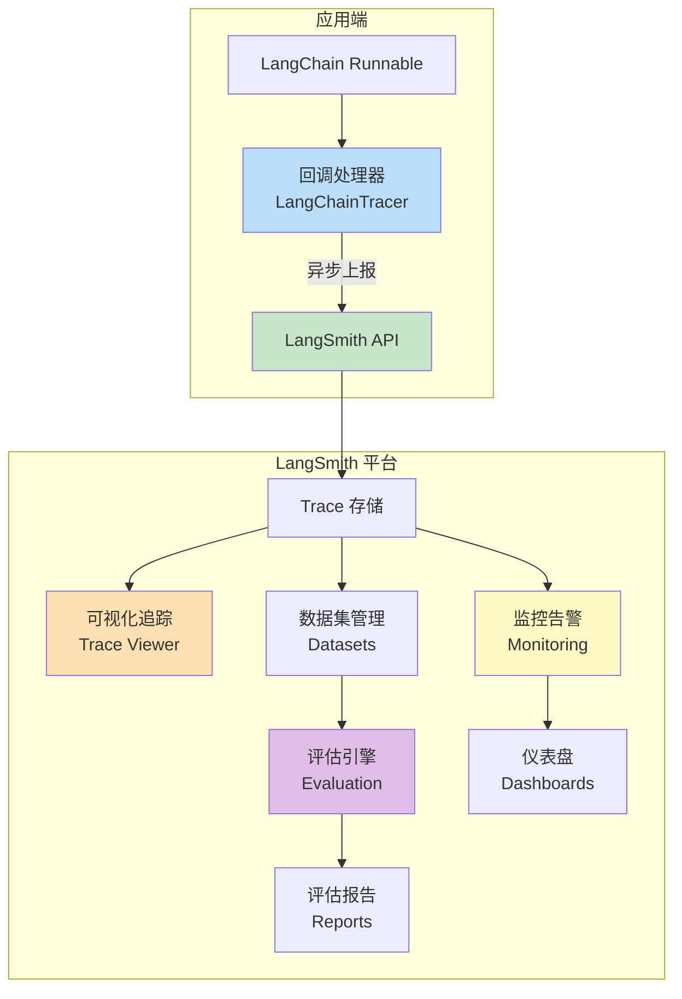

**LangSmith 四大核心功能**：

| 功能 | 说明 | 典型场景 |
|------|------|---------|
| 追踪（Tracing） | 记录每次调用的完整执行轨迹 | 调试 Chain/Agent 执行流程、分析耗时和 Token |
| 评估（Evaluation） | 用数据集和评估器量化质量 | 评估 Prompt 效果、比较不同模型、回归测试 |
| 测试（Testing） | 管理测试数据集和实验 | CI/CD 中的自动化测试、A/B 测试 |
| 监控（Monitoring） | 生产环境实时监控和告警 | 监控延迟、Token 用量、错误率、质量指标 |

**核心机制**：
1. **自动追踪**：设置 `LANGCHAIN_TRACING_V2=true` 后，LangChain 自动注册 `LangChainTracer` 回调，所有 Runnable 调用自动上报
2. **Trace 结构**：每次调用生成一个 Trace（根 Run），包含多个子 Run（每个 Runnable 步骤），形成树状结构
3. **Run 数据**：每个 Run 记录 name、type（llm/chain/tool/retriever）、input、output、start_time、end_time、status、error、token_usage、metadata
4. **评估流程**：创建数据集（输入+期望输出）→ 运行目标 Chain → 用评估器（LLM-as-Judge、自定义指标）打分 → 生成评估报告
5. **采样追踪**：生产环境可设置 `LANGCHAIN_TRACING_SAMPLING_RATE=0.1`，只追踪 10% 的请求，减少性能开销

> 🏆 **面试高频考点**：LangSmith 的 Trace 包含哪些信息？每个 Run 记录：name（名称）、run_type（类型：llm/chain/tool/retriever/embedding）、inputs（输入）、outputs（输出）、start_time/end_time（开始/结束时间）、execution_order（执行顺序）、child_runs（子 Run）、status（状态：success/error）、error（错误信息）、serialized（序列化的组件配置）、metadata（元数据）、tags（标签）、events（事件流，含流式 token）。LLM 类型的 Run 还包含 token_usage（prompt_tokens/completion_tokens/total_tokens）和 model_name。

#### 代码示例

**示例1：基础——LangSmith 追踪配置与自定义回调**

```python
# src/45_langsmith_basic.py
import os
from dotenv import load_dotenv
from langchain_openai import ChatOpenAI
from langchain_core.prompts import ChatPromptTemplate
from langchain_core.output_parsers import StrOutputParser
from langchain_core.callbacks import BaseCallbackHandler
from langchain_core.runnables import RunnableConfig
from typing import Any, Dict

load_dotenv()

# ===== LangSmith 配置（通过环境变量）=====
# .env 文件中设置：
# LANGCHAIN_TRACING_V2=true
# LANGCHAIN_API_KEY=lsv2_your_api_key
# LANGCHAIN_PROJECT=my-first-project
# LANGCHAIN_ENDPOINT=https://api.smith.langchain.com

print(f"LangSmith 追踪: {os.getenv('LANGCHAIN_TRACING_V2')}")
print(f"LangSmith 项目: {os.getenv('LANGCHAIN_PROJECT')}")

# ===== 构建测试 Chain =====
prompt = ChatPromptTemplate.from_template("用一句话解释{concept}")
chat = ChatOpenAI(model="gpt-4o-mini", temperature=0.7)
chain = prompt | chat | StrOutputParser()

# 调用后自动追踪到 LangSmith
result = chain.invoke({"concept": "LangSmith"})
print(f"结果: {result}")
print("查看追踪: https://smith.langchain.com")

# ===== 自定义回调处理器 =====
class CustomCallback(BaseCallbackHandler):
    """自定义回调：记录每个步骤的耗时和 Token。"""

    def __init__(self):
        self.step_times = []
        self.total_tokens = 0

    def on_chain_start(self, serialized: Dict, inputs: Dict, **kwargs):
        print(f"🔗 Chain 启动: {serialized.get('name', 'unknown')}")

    def on_chain_end(self, outputs: Any, **kwargs):
        print(f"🔗 Chain 结束: {str(outputs)[:50]}...")

    def on_llm_start(self, serialized: Dict, prompts: list, **kwargs):
        print(f"🤖 LLM 调用开始，Prompt 数量: {len(prompts)}")

    def on_llm_end(self, response: Any, **kwargs):
        token_usage = response.llm_output.get("token_usage", {}) if response.llm_output else {}
        self.total_tokens += token_usage.get("total_tokens", 0)
        print(f"🤖 LLM 调用结束，Tokens: {token_usage.get('total_tokens', 'N/A')}")

    def on_tool_start(self, serialized: Dict, input_str: str, **kwargs):
        print(f"🔧 工具调用: {serialized.get('name')}，输入: {input_str[:50]}...")

    def on_tool_end(self, output: str, **kwargs):
        print(f"🔧 工具结果: {output[:50]}...")

    def on_llm_error(self, error: Exception, **kwargs):
        print(f"❌ LLM 错误: {error}")

# 使用自定义回调
custom_cb = CustomCallback()
result = chain.invoke(
    {"concept": "回调机制"},
    config=RunnableConfig(callbacks=[custom_cb], tags=["demo", "testing"]),
)
print(f"\n总 Token 消耗: {custom_cb.total_tokens}")

# ===== 用标签和元数据分类追踪 =====
result = chain.invoke(
    {"concept": "标签追踪"},
    config=RunnableConfig(
        tags=["production", "customer_service"],
        metadata={"user_id": "u_001", "request_id": "req_001"},
    ),
)
print(f"带标签的调用: {result}")
# 在 LangSmith 中可以按 tags 和 metadata 筛选追踪
```

**示例2：进阶——LangSmith 数据集与评估**

```python
# src/46_langsmith_eval.py
from langsmith import Client
from langsmith.evaluation import evaluate
from langchain_openai import ChatOpenAI
from langchain_core.prompts import ChatPromptTemplate
from langchain_core.output_parsers import StrOutputParser
from dotenv import load_dotenv
import os

load_dotenv()

client = Client()

# ===== 1. 创建评估数据集 =====
dataset_name = "qa_evaluation_v1"

try:
    dataset = client.read_dataset(dataset_name=dataset_name)
    print(f"数据集已存在: {dataset_name}")
except Exception:
    dataset = client.create_dataset(
        dataset_name=dataset_name,
        description="问答质量评估数据集 v1",
    )
    # 添加评估样本
    examples = [
        {"question": "什么是 LangChain？", "answer": "LangChain 是一个开源的 LLM 应用开发框架。"},
        {"question": "LCEL 是什么？", "answer": "LCEL 是 LangChain 的声明式组合语言，用 | 运算符组合组件。"},
        {"question": "RAG 的作用是什么？", "answer": "RAG 通过检索外部知识增强 LLM 生成，减少幻觉。"},
        {"question": "Agent 和 Chain 的区别？", "answer": "Chain 是固定流程，Agent 是动态决策工具调用。"},
        {"question": "如何管理对话记忆？", "answer": "用 RunnableWithMessageHistory 自动管理多轮对话历史。"},
    ]
    for ex in examples:
        client.create_example(
            inputs={"question": ex["question"]},
            outputs={"answer": ex["answer"]},
            dataset_id=dataset.id,
        )
    print(f"创建数据集: {dataset_name}，包含 {len(examples)} 个样本")

# ===== 2. 定义待评估的 Chain =====
prompt = ChatPromptTemplate.from_template("用简洁准确的语言回答：{question}")
chat = ChatOpenAI(model="gpt-4o-mini", temperature=0)
qa_chain = prompt | chat | StrOutputParser()

# ===== 3. 定义评估器 =====
def correctness_evaluator(run, example):
    """用 LLM 评判回答正确性（LLM-as-Judge）。"""
    judge_prompt = ChatPromptTemplate.from_template("""请评估以下回答的正确性，1-5 分打分。

问题：{question}
参考回答：{reference}
待评估回答：{prediction}

评分标准：
5分：完全正确，信息完整准确
4分：基本正确，有轻微遗漏
3分：部分正确，有明显错误
2分：大部分错误
1分：完全错误

只输出分数数字。""")

    judge_chat = ChatOpenAI(model="gpt-4o-mini", temperature=0)
    judge_chain = judge_prompt | judge_chat | StrOutputParser()

    score_text = judge_chain.invoke({
        "question": example.inputs["question"],
        "reference": example.outputs["answer"],
        "prediction": run.outputs["output"],
    })

    try:
        score = float(score_text.strip())
    except ValueError:
        score = 0.0

    return {"score": score, "key": "correctness"}

def relevance_evaluator(run, example):
    """评估回答与问题的相关性。"""
    prediction = run.outputs["output"]
    question = example.inputs["question"]
    # 简单规则：回答长度 > 10 视为相关
    is_relevant = len(prediction) > 10 and "不知道" not in prediction
    return {"score": 1.0 if is_relevant else 0.0, "key": "relevance"}

# ===== 4. 运行评估 =====
print("\n=== 运行评估 ===")

def target(inputs):
    return {"output": qa_chain.invoke(inputs)}

results = evaluate(
    target,
    data=dataset_name,
    evaluators=[correctness_evaluator, relevance_evaluator],
    experiment_prefix="qa_experiment_v1",
    max_concurrency=2,
)

print(f"\n评估完成！实验名称: {results.experiment_name}")
print(f"查看评估报告: https://smith.langchain.com/o/{os.getenv('LANGCHAIN_PROJECT')}/datasets")
```

**示例3：完整场景——Token 计数与成本监控回调**

```python
# src/47_token_cost_monitor.py
from langchain_core.callbacks import BaseCallbackHandler
from langchain_core.outputs import LLMResult
from langchain_openai import ChatOpenAI
from langchain_core.prompts import ChatPromptTemplate
from langchain_core.output_parsers import StrOutputParser
from dotenv import load_dotenv
from typing import Any, Dict, List
import time
import json

load_dotenv()

# ===== 模型定价（每 1K Token，USD）=====
MODEL_PRICING = {
    "gpt-4o-mini": {"input": 0.00015, "output": 0.0006},
    "gpt-4o": {"input": 0.0025, "output": 0.010},
    "gpt-4-turbo": {"input": 0.010, "output": 0.030},
    "claude-3-5-sonnet": {"input": 0.003, "output": 0.015},
}

class TokenCostMonitor(BaseCallbackHandler):
    """
    Token 和成本监控回调。

    功能：
    - 记录每次 LLM 调用的 Token 用量
    - 计算单次调用成本
    - 累计统计（总 Token、总成本、总耗时）
    - 超过阈值时告警
    - 导出统计报告
    """

    def __init__(self, budget_threshold: float = 1.0):
        self.total_prompt_tokens = 0
        self.total_completion_tokens = 0
        self.total_cost = 0.0
        self.total_latency = 0.0
        self.call_count = 0
        self.budget_threshold = budget_threshold
        self.alerts: List[str] = []
        self.call_details: List[Dict] = []
        self._start_time = None

    def on_llm_start(self, serialized: Dict, prompts: list, **kwargs):
        self._start_time = time.time()

    def on_llm_end(self, response: LLMResult, **kwargs):
        latency = time.time() - self._start_time if self._start_time else 0
        self.call_count += 1
        self.total_latency += latency

        # 获取 Token 用量
        llm_output = response.llm_output or {}
        token_usage = llm_output.get("token_usage", {})
        model_name = llm_output.get("model_name", "unknown")

        prompt_tokens = token_usage.get("prompt_tokens", 0)
        completion_tokens = token_usage.get("completion_tokens", 0)

        self.total_prompt_tokens += prompt_tokens
        self.total_completion_tokens += completion_tokens

        # 计算成本
        pricing = MODEL_PRICING.get(model_name, MODEL_PRICING["gpt-4o-mini"])
        cost = (
            prompt_tokens / 1000 * pricing["input"]
            + completion_tokens / 1000 * pricing["output"]
        )
        self.total_cost += cost

        # 记录详情
        detail = {
            "call_number": self.call_count,
            "model": model_name,
            "prompt_tokens": prompt_tokens,
            "completion_tokens": completion_tokens,
            "total_tokens": prompt_tokens + completion_tokens,
            "cost_usd": round(cost, 6),
            "latency_seconds": round(latency, 3),
        }
        self.call_details.append(detail)

        # 预算告警
        if self.total_cost > self.budget_threshold:
            alert = f"⚠️ 预算告警：累计成本 ${self.total_cost:.4f} 超过阈值 ${self.budget_threshold}"
            if alert not in self.alerts:
                self.alerts.append(alert)

    def get_summary(self) -> Dict:
        """获取统计摘要。"""
        avg_latency = self.total_latency / self.call_count if self.call_count > 0 else 0
        return {
            "total_calls": self.call_count,
            "total_prompt_tokens": self.total_prompt_tokens,
            "total_completion_tokens": self.total_completion_tokens,
            "total_tokens": self.total_prompt_tokens + self.total_completion_tokens,
            "total_cost_usd": round(self.total_cost, 6),
            "total_latency_seconds": round(self.total_latency, 3),
            "avg_latency_seconds": round(avg_latency, 3),
            "avg_cost_per_call": round(self.total_cost / self.call_count, 6) if self.call_count > 0 else 0,
            "alerts": self.alerts,
        }

    def print_summary(self):
        """打印统计摘要。"""
        summary = self.get_summary()
        print("\n" + "=" * 50)
        print("📊 Token & 成本监控报告")
        print("=" * 50)
        print(f"  总调用次数: {summary['total_calls']}")
        print(f"  Prompt Tokens: {summary['total_prompt_tokens']}")
        print(f"  Completion Tokens: {summary['total_completion_tokens']}")
        print(f"  总 Tokens: {summary['total_tokens']}")
        print(f"  总成本: ${summary['total_cost_usd']:.6f}")
        print(f"  总耗时: {summary['total_latency_seconds']}s")
        print(f"  平均延迟: {summary['avg_latency_seconds']}s")
        print(f"  平均单次成本: ${summary['avg_cost_per_call']:.6f}")
        if summary["alerts"]:
            print(f"\n  ⚠️  告警:")
            for alert in summary["alerts"]:
                print(f"    {alert}")
        print("=" * 50)

    def export_to_json(self, filepath: str):
        """导出统计报告为 JSON。"""
        report = {
            "summary": self.get_summary(),
            "call_details": self.call_details,
        }
        with open(filepath, "w", encoding="utf-8") as f:
            json.dump(report, f, ensure_ascii=False, indent=2)
        print(f"报告已导出: {filepath}")


# ===== 使用示例 =====
monitor = TokenCostMonitor(budget_threshold=0.01)

prompt = ChatPromptTemplate.from_template("用中文回答：{question}")
chat = ChatOpenAI(model="gpt-4o-mini", temperature=0.7)
chain = prompt | chat | StrOutputParser()

questions = [
    "什么是 LangChain？",
    "解释 RAG 的工作原理",
    "Agent 和 Chain 有什么区别？",
    "如何管理对话记忆？",
    "LCEL 的优势是什么？",
]

for q in questions:
    result = chain.invoke({"question": q}, config={"callbacks": [monitor]})
    print(f"Q: {q}")
    print(f"A: {result[:60]}...\n")

# 打印统计
monitor.print_summary()

# 导出报告
monitor.export_to_json("./data/token_cost_report.json")
```

#### 使用场景与最佳实践

**适用场景**：
- 所有生产级 LLM 应用的调试和监控
- Prompt/模型/Chain 的效果评估和 A/B 测试
- CI/CD 流水线中的自动化回归测试
- 生产环境的质量监控和成本控制
- Agent 复杂执行流程的调试和分析

**不适用场景**：
- 完全离线的本地模型应用（无法连接 LangSmith 云端）
- 对数据隐私要求极高、不能上报追踪数据的场景（可自托管 LangSmith）
- 极简单次调用的临时脚本

**最佳实践**：
1. **开发阶段就开启追踪**：不要等到出问题才加，设置 `LANGCHAIN_TRACING_V2=true`，所有调用自动记录
2. **用 tags 分类追踪**：`config={"tags": ["production", "customer_service"]}`，在 LangSmith 中按标签筛选和统计
3. **用 metadata 传递上下文**：`config={"metadata": {"user_id": "...", "request_id": "..."}}`，便于追踪单个用户的请求
4. **建立评估数据集**：准备 20-50 个标注好的测试用例，每次 Prompt/模型变更后运行评估，防止回归
5. **生产环境采样追踪**：设置 `LANGCHAIN_TRACING_SAMPLING_RATE=0.1`，只追踪 10% 请求，减少性能开销和成本
6. **用 LLM-as-Judge 评估**：对于开放性回答，用更强的模型（如 GPT-4o）作为评判者，按维度打分

**性能建议**：
- LangSmith 追踪是异步上报的，对应用延迟影响很小（<1%），但会增加少量 CPU 和网络开销
- 生产环境采样追踪（10%-20%），既保留可观测性又控制开销
- 评估运行可以异步执行，不阻塞主流程
- 大量追踪数据时，定期清理旧数据（LangSmith 默认保留 30 天）

#### 常见坑点

**坑点1：LangSmith 不显示追踪记录**

- **错误现象**：设置了环境变量但 LangSmith 平台上看不到任何 Trace
- **根本原因**：①`LANGCHAIN_TRACING_V2` 未设为 `true`（注意是 V2，不是旧版的 `LANGCHAIN_TRACING`）；②`LANGCHAIN_API_KEY` 错误或过期；③环境变量在 `import langchain` 之后才设置；④网络问题无法连接 LangSmith API
- **正确做法**：①在代码入口最顶部调用 `load_dotenv()`，确保在 import langchain 之前环境变量已加载；②验证：`print(os.getenv("LANGCHAIN_TRACING_V2"), os.getenv("LANGCHAIN_API_KEY", "")[:10])`；③检查网络是否能访问 `https://api.smith.langchain.com`
- **预防措施**：在应用启动日志中输出 LangSmith 配置状态（追踪是否开启、项目名称），便于排查

**坑点2：评估结果不稳定，同一次评估多次运行分数差异大**

- **错误现象**：同一个 Chain 用同一个数据集评估，多次运行的平均分差异超过 10%
- **根本原因**：①Chain 的 temperature > 0，输出有随机性；②LLM-as-Judge 的评判也有随机性；③评估样本量太小（<20个），统计意义不足；④评估标准不明确，评判者理解不一致
- **正确做法**：①评估时设置 Chain 的 `temperature=0`，确保输出确定；②评估 Prompt 中给出明确的评分标准和示例；③增加评估样本量（>30个）；④多次评估取平均值，或用更强的模型（GPT-4o）作为评判者减少随机性
- **预防措施**：建立标准化的评估流程：固定 temperature=0、固定评估 Prompt、固定评判模型、样本量>30、多次运行取平均；将评估脚本纳入 CI/CD，确保每次变更都可比较

---

### 10.2 流式输出实现

#### 概念解释

**流式输出（Streaming）是指 LLM 在生成回复时，每生成一个或几个 Token 就立即返回给客户端，而不是等待完整回复生成后一次性返回**。LangChain 的所有 Runnable 都原生支持 `.stream()` 方法，返回一个迭代器，逐块产出结果。流式输出可以将首字延迟（Time To First Token, TTFT）从数秒降低到数百毫秒，大幅提升用户体验，是聊天机器人、AI 写作助手等交互型应用的必备功能。

> 🎯 **生活化比喻**：流式输出就像"自来水"和"桶装水"的区别——非流式输出是桶装水，你要等整桶水装满（完整回复生成）才能喝到（拿到结果），等的时间很长；流式输出是自来水，打开水龙头（调用 .stream()）立刻就有水（Token）流出来，虽然水流是一滴一滴的，但你马上就能喝到第一口，而且边流边喝，体验好很多。对于长文本生成，桶装水可能要等 10 秒，自来水 0.5 秒就开始出水。

**核心价值**：流式输出将首字延迟降低 80%-90%，让用户在等待完整回复的同时就能看到部分内容，感知响应速度大幅提升，是构建自然流畅的 AI 对话体验的关键技术。

#### 原理说明

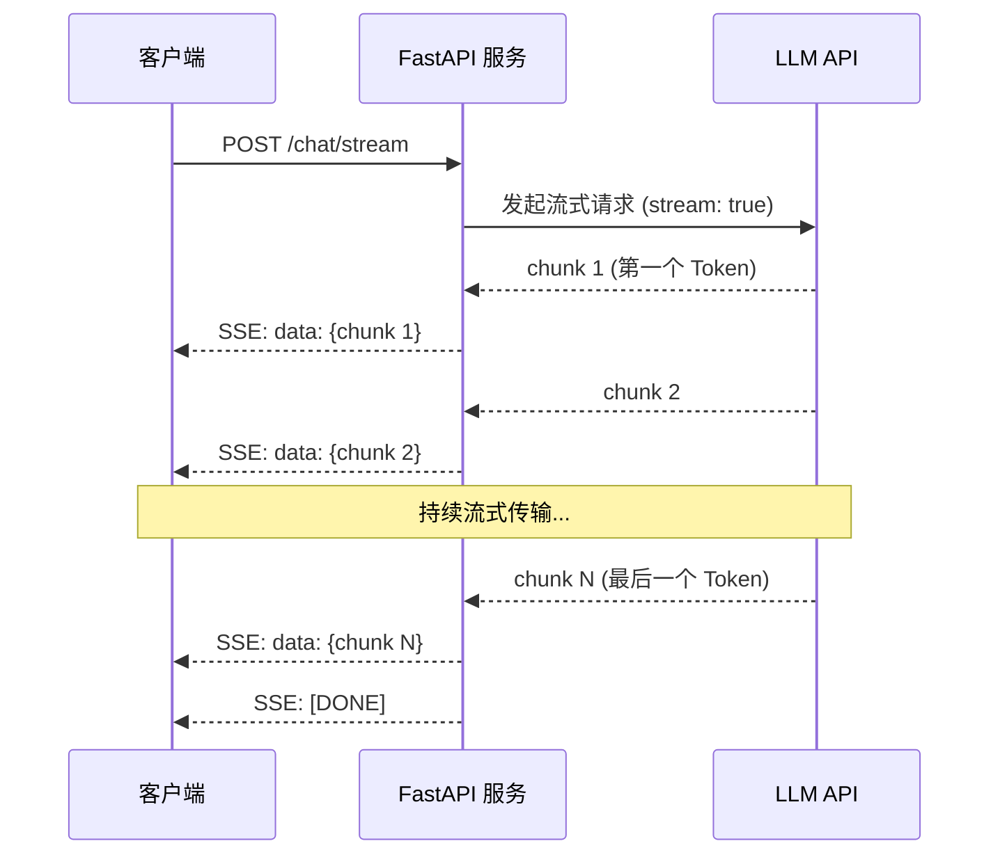

**流式输出的关键概念**：

| 概念 | 说明 | 典型值 |
|------|------|--------|
| TTFT（Time To First Token） | 从请求发出到收到第一个 Token 的时间 | 300-800ms（流式）vs 3-10s（非流式） |
| 吞吐率（Tokens/sec） | 每秒生成的 Token 数 | 30-100 tokens/s |
| 总延迟 | 从请求发出到收到完整回复的时间 | 取决于回复长度 |
| SSE（Server-Sent Events） | 服务端推送事件，HTTP 流式传输标准 | Web 端流式输出的标准协议 |
| chunk | 流式输出的最小数据块，通常包含 1 个或几个 Token | - |

**LangChain 流式输出的层级**：
1. **Runnable.stream()**：所有 Runnable 的基础流式方法，返回迭代器
2. **Chat Model.stream()**：模型层流式，逐 Token 返回 `AIMessageChunk`
3. **Chain.stream()**：链式流式，自动处理各步骤的流式传递（Prompt 输出完整值→Model 流式→Parser 逐块处理）
4. **Agent.stream()**：Agent 流式，逐步输出思考过程、工具调用、工具结果、最终答案
5. **astream()**：异步流式，返回异步迭代器，配合 `async for` 使用

**技术对比**：

| 维度 | 非流式（invoke） | 流式（stream） |
|------|----------------|----------------|
| 首字延迟 | 3-10 秒 | 300-800ms |
| 用户体验 | 长时间等待空白 | 立即看到内容生成 |
| 实现复杂度 | 低 | 中（需处理迭代器/SSE） |
| 适用场景 | 短文本、批处理、API 调用 | 长文本、对话、写作助手 |
| 错误处理 | 简单（一次返回） | 复杂（流中可能中断） |
| 内存占用 | 高（完整结果） | 低（逐块处理） |

> 🏆 **面试高频考点**：LangChain 的 stream() 和 invoke() 有什么区别？invoke() 等待完整结果生成后一次性返回，适合短文本或需要完整结果后处理的场景；stream() 返回迭代器，模型每生成一个 Token 就立即 yield，适合长文本生成和前端实时展示。两者输入参数完全一致，可无缝切换。stream() 的首字延迟（TTFT）通常比 invoke() 低 80%-90%，因为不需要等待完整回复。对于 Chain，stream() 会自动处理各步骤的流式传递——Prompt 步骤输出完整值，Model 步骤流式输出，OutputParser 逐块处理。

#### 代码示例

**示例1：基础——同步/异步流式输出**

```python
# src/48_streaming_basic.py
from langchain_openai import ChatOpenAI
from langchain_core.prompts import ChatPromptTemplate
from langchain_core.output_parsers import StrOutputParser
from dotenv import load_dotenv
import asyncio
import time

load_dotenv()

chat = ChatOpenAI(model="gpt-4o-mini", temperature=0.7)
prompt = ChatPromptTemplate.from_template("写一篇关于{topic}的短文，300字左右。")
chain = prompt | chat | StrOutputParser()

# ===== 1. 同步流式输出 =====
print("=== 同步流式输出 ===")
start = time.time()
first_token_time = None

for chunk in chain.stream({"topic": "人工智能的未来"}):
    if first_token_time is None:
        first_token_time = time.time()
        ttft = first_token_time - start
        print(f"[首字延迟: {ttft:.3f}s] ", end="", flush=True)
    print(chunk, end="", flush=True)

total_time = time.time() - start
print(f"\n\n[总耗时: {total_time:.3f}s]")
print(f"[首字延迟降低: {(1 - ttft/total_time)*100:.1f}%]")

# ===== 2. 异步流式输出 =====
print("\n=== 异步流式输出 ===")

async def async_stream():
    start = time.time()
    first_token = None
    async for chunk in chain.astream({"topic": "区块链技术"}):
        if first_token is None:
            first_token = time.time()
            print(f"[首字延迟: {first_token - start:.3f}s] ", end="", flush=True)
        print(chunk, end="", flush=True)
    print(f"\n[总耗时: {time.time() - start:.3f}s]")

asyncio.run(async_stream())

# ===== 3. 模型层流式（AIMessageChunk）=====
print("\n=== 模型层流式（AIMessageChunk）===")
from langchain_core.messages import HumanMessage

for chunk in chat.stream([HumanMessage(content="说'你好世界'")]):
    print(f"chunk 类型: {type(chunk).__name__}, 内容: '{chunk.content}'")
    # 每个 chunk 是 AIMessageChunk，包含 content 和可能的 tool_calls

# ===== 4. 流式 + 完整结果收集 =====
print("\n=== 流式输出 + 收集完整结果 ===")
full_response = ""
for chunk in chain.stream({"topic": "流式输出的优势"}):
    full_response += chunk
    print(chunk, end="", flush=True)

print(f"\n\n完整回复长度: {len(full_response)} 字符")
print(f"完整回复前50字: {full_response[:50]}...")
```

**示例2：进阶——FastAPI SSE 流式接口**

```python
# src/49_fastapi_streaming.py
from fastapi import FastAPI
from fastapi.responses import StreamingResponse
from fastapi.middleware.cors import CORSMiddleware
from langchain_openai import ChatOpenAI
from langchain_core.prompts import ChatPromptTemplate
from langchain_core.output_parsers import StrOutputParser
from pydantic import BaseModel
from dotenv import load_dotenv
import json
import time

load_dotenv()

app = FastAPI(title="流式输出 API")
app.add_middleware(CORSMiddleware, allow_origins=["*"], allow_methods=["*"], allow_headers=["*"])

chat = ChatOpenAI(model="gpt-4o-mini", temperature=0.7)
prompt = ChatPromptTemplate.from_template("你是一个有帮助的助手。\n\n用户：{message}\n助手：")
chain = prompt | chat | StrOutputParser()

class ChatRequest(BaseModel):
    message: str
    session_id: str = "default"

# ===== 1. 非流式接口（对比用）=====
@app.post("/chat")
async def chat_non_streaming(req: ChatRequest):
    """非流式接口：等待完整回复后返回。"""
    start = time.time()
    response = await chain.ainvoke({"message": req.message})
    latency = time.time() - start
    return {
        "response": response,
        "latency_seconds": round(latency, 3),
    }

# ===== 2. SSE 流式接口 =====
@app.post("/chat/stream")
async def chat_streaming(req: ChatRequest):
    """SSE 流式接口：逐 Token 推送回复。"""

    async def event_generator():
        start = time.time()
        first_token_sent = False
        full_response = ""

        async for chunk in chain.astream({"message": req.message}):
            if not first_token_sent:
                first_token_sent = True
                ttft = time.time() - start
                # 发送元数据事件
                yield f"event: metadata\ndata: {json.dumps({'ttft': round(ttft, 3)})}\n\n"

            full_response += chunk
            # 发送内容事件
            yield f"event: message\ndata: {json.dumps({'content': chunk})}\n\n"

        # 发送完成事件
        total_latency = time.time() - start
        yield f"event: done\ndata: {json.dumps({'total_latency': round(total_latency, 3), 'full_length': len(full_response)})}\n\n"

    return StreamingResponse(
        event_generator(),
        media_type="text/event-stream",
        headers={
            "Cache-Control": "no-cache",
            "Connection": "keep-alive",
            "X-Accel-Buffering": "no",  # 禁用 Nginx 缓冲
        },
    )

# ===== 3. 简化版流式接口（纯文本）=====
@app.post("/chat/stream/simple")
async def chat_streaming_simple(req: ChatRequest):
    """简化版流式接口：直接推送文本，适合简单场景。"""
    async def generate():
        async for chunk in chain.astream({"message": req.message}):
            yield chunk
    return StreamingResponse(generate(), media_type="text/plain")

# ===== 4. Agent 流式接口（逐步输出）=====
@app.post("/agent/stream")
async def agent_streaming(req: ChatRequest):
    """Agent 流式接口：输出思考过程、工具调用、最终答案。"""
    from langchain.agents import create_tool_calling_agent, AgentExecutor
    from langchain_core.tools import tool

    @tool
    def calculator(expression: str) -> str:
        """计算数学表达式。"""
        try:
            return f"结果: {eval(expression, {'__builtins__': {}}, {})}"
        except:
            return "计算错误"

    agent_prompt = ChatPromptTemplate.from_messages([
        ("system", "你是一个助手，可以使用计算器。"),
        ("human", "{input}"),
        ("placeholder", "{agent_scratchpad}"),
    ])
    agent_chat = ChatOpenAI(model="gpt-4o-mini", temperature=0)
    agent = create_tool_calling_agent(agent_chat, [calculator], agent_prompt)
    executor = AgentExecutor(agent=agent, tools=[calculator], verbose=False)

    async def event_generator():
        async for event in executor.astream_events({"input": req.message}, version="v2"):
            event_type = event.get("event")
            if event_type == "on_chat_model_stream":
                chunk = event["data"]["chunk"].content
                if chunk:
                    yield f"data: {json.dumps({'type': 'token', 'content': chunk})}\n\n"
            elif event_type == "on_tool_start":
                tool_name = event["name"]
                yield f"data: {json.dumps({'type': 'tool_start', 'tool': tool_name})}\n\n"
            elif event_type == "on_tool_end":
                output = event["data"]["output"]
                yield f"data: {json.dumps({'type': 'tool_end', 'output': output})}\n\n"
        yield "data: [DONE]\n\n"

    return StreamingResponse(event_generator(), media_type="text/event-stream")

if __name__ == "__main__":
    import uvicorn
    uvicorn.run(app, host="0.0.0.0", port=8000)
```

**示例3：完整场景——前端 EventSource 消费流式输出**

```html
<!-- frontend/chat.html —— 前端流式输出消费示例 -->
<!DOCTYPE html>
<html lang="zh-CN">
<head>
    <meta charset="UTF-8">
    <meta name="viewport" content="width=device-width, initial-scale=1.0">
    <title>AI 流式对话</title>
    <style>
        body { font-family: -apple-system, sans-serif; max-width: 800px; margin: 0 auto; padding: 20px; }
        .chat-container { border: 1px solid #e0e0e0; border-radius: 12px; padding: 20px; height: 500px; overflow-y: auto; }
        .message { margin-bottom: 16px; padding: 12px 16px; border-radius: 8px; max-width: 80%; }
        .user { background: #e3f2fd; margin-left: auto; }
        .ai { background: #f5f5f5; }
        .input-area { display: flex; gap: 10px; margin-top: 16px; }
        input { flex: 1; padding: 12px; border: 1px solid #ddd; border-radius: 8px; font-size: 14px; }
        button { padding: 12px 24px; background: #1976d2; color: white; border: none; border-radius: 8px; cursor: pointer; }
        button:disabled { background: #bdbdbd; }
        .stats { font-size: 12px; color: #666; margin-top: 8px; }
        .cursor { display: inline-block; width: 8px; height: 16px; background: #333; animation: blink 1s infinite; }
        @keyframes blink { 0%, 50% { opacity: 1; } 51%, 100% { opacity: 0; } }
    </style>
</head>
<body>
    <h2>AI 流式对话</h2>
    <div class="chat-container" id="chatContainer"></div>
    <div class="input-area">
        <input type="text" id="messageInput" placeholder="输入消息..." />
        <button onclick="sendMessage()" id="sendBtn">发送</button>
    </div>
    <div class="stats" id="stats"></div>

    <script>
        const chatContainer = document.getElementById('chatContainer');
        const messageInput = document.getElementById('messageInput');
        const sendBtn = document.getElementById('sendBtn');
        const statsEl = document.getElementById('stats');

        function addMessage(text, isUser) {
            const div = document.createElement('div');
            div.className = `message ${isUser ? 'user' : 'ai'}`;
            div.textContent = text;
            chatContainer.appendChild(div);
            chatContainer.scrollTop = chatContainer.scrollHeight;
            return div;
        }

        async function sendMessage() {
            const message = messageInput.value.trim();
            if (!message) return;

            addMessage(message, true);
            messageInput.value = '';
            sendBtn.disabled = true;

            const aiMessageEl = addMessage('', false);
            const cursor = document.createElement('span');
            cursor.className = 'cursor';
            aiMessageEl.appendChild(cursor);

            const startTime = Date.now();
            let firstTokenTime = null;
            let fullText = '';

            try {
                // 使用 fetch + ReadableStream 消费 SSE（支持 POST 请求）
                const response = await fetch('/chat/stream', {
                    method: 'POST',
                    headers: { 'Content-Type': 'application/json' },
                    body: JSON.stringify({ message, session_id: 'demo' }),
                });

                const reader = response.body.getReader();
                const decoder = new TextDecoder();
                let buffer = '';

                while (true) {
                    const { done, value } = await reader.read();
                    if (done) break;

                    buffer += decoder.decode(value, { stream: true });
                    const lines = buffer.split('\n');
                    buffer = lines.pop();

                    for (const line of lines) {
                        if (line.startsWith('data: ')) {
                            const dataStr = line.slice(6);
                            if (dataStr === '[DONE]') continue;

                            try {
                                const data = JSON.parse(dataStr);
                                if (data.type === 'token' || data.content) {
                                    if (!firstTokenTime) {
                                        firstTokenTime = Date.now();
                                        cursor.remove();
                                    }
                                    fullText += data.content || '';
                                    aiMessageEl.textContent = fullText;
                                    chatContainer.scrollTop = chatContainer.scrollHeight;
                                } else if (data.ttft !== undefined) {
                                    statsEl.textContent = `首字延迟: ${data.ttft}s`;
                                } else if (data.total_latency !== undefined) {
                                    statsEl.textContent += ` | 总耗时: ${data.total_latency}s | 长度: ${data.full_length}字`;
                                }
                            } catch (e) {
                                // 忽略解析错误
                            }
                        }
                    }
                }
            } catch (error) {
                aiMessageEl.textContent = `错误: ${error.message}`;
            }

            if (cursor.parentNode) cursor.remove();
            sendBtn.disabled = false;
            messageInput.focus();
        }

        messageInput.addEventListener('keypress', (e) => {
            if (e.key === 'Enter') sendMessage();
        });
    </script>
</body>
</html>
```

#### 使用场景与最佳实践

**适用场景**：
- 聊天机器人、虚拟助手、客服系统
- AI 写作助手、代码生成工具（长文本生成）
- 需要实时展示生成过程的交互型应用
- 移动端/前端对响应速度敏感的场景

**不适用场景**：
- 短文本分类、提取（非流式更快更简单）
- 批处理任务（不需要实时展示）
- 需要完整结果后才能处理的下游逻辑
- 对实现复杂度敏感的简单 API

**最佳实践**：
1. **交互型应用默认用流式**：聊天、写作等场景用 `.stream()`，首字延迟降低 80%+
2. **SSE 是 Web 流式标准**：FastAPI 用 `StreamingResponse` + `text/event-stream`，前端用 `fetch` + `ReadableStream`（EventSource 只支持 GET）
3. **禁用代理缓冲**：Nginx 等反向代理默认会缓冲响应，设置 `X-Accel-Buffering: no` 或 `proxy_buffering off`
4. **发送元数据事件**：在流开始时发送 TTFT，结束时发送总延迟和 Token 数，便于前端展示性能指标
5. **处理流中断**：网络中断时前端应提示用户并支持重试，后端应记录不完整的流用于调试
6. **Agent 流式用 astream_events**：Agent 的流式输出包含思考、工具调用等多种事件，用 `astream_events(version="v2")` 获取完整事件流

**性能建议**：
- 流式输出不减少总延迟（完整回复生成时间相同），但大幅降低首字延迟，提升感知速度
- 长文本生成时，前端可以边接收边渲染，用户感知响应速度提升 5-10 倍
- 流式输出的 Token 吞吐率取决于模型，GPT-4o-mini 约 50-100 tokens/s
- 批量处理用非流式 `batch()`，交互用流式 `stream()`，根据场景选择

#### 常见坑点

**坑点1：前端用 EventSource 无法发送 POST 请求和自定义 Header**

- **错误现象**：前端用 `EventSource` 连接流式接口，但需要发送 POST 请求体（消息内容）和自定义 Header（认证 Token），EventSource 不支持
- **根本原因**：`EventSource` API 只支持 GET 请求，不能发送请求体和自定义 Header，这是 W3C 标准的限制
- **正确做法**：用 `fetch` + `ReadableStream` 替代 EventSource。`fetch` 支持 POST、自定义 Header，通过 `response.body.getReader()` 读取流，手动解析 SSE 格式
- **预防措施**：项目中统一封装一个 `fetchSSE(url, options)` 工具函数，处理流读取和 SSE 解析，不要直接用 EventSource

**坑点2：Nginx 反向代理导致流式输出被缓冲**

- **错误现象**：本地开发时流式输出正常，但部署到 Nginx 反向代理后，前端收不到流式数据，要等完整回复后才一次性收到
- **根本原因**：Nginx 默认启用 `proxy_buffering`，会缓冲后端响应直到完整接收后才发给客户端，破坏了流式输出
- **正确做法**：①在 FastAPI 响应头中设置 `X-Accel-Buffering: no`（Nginx 识别此头并禁用缓冲）；②或在 Nginx 配置中设置 `proxy_buffering off;`（针对流式接口的 location）；③同时设置 `proxy_cache off` 和 `gzip off`（压缩也会导致缓冲）
- **预防措施**：部署文档中明确列出流式接口的 Nginx 配置要求；CI/CD 中添加流式接口的端到端测试，验证首字延迟是否正常

---

> 💡 **深度讲解**：本章深入讲解了 LLM 应用的可观测性和流式输出。LangSmith 是 LLM 应用的"行车记录仪+体检中心"，通过自动追踪让每一次调用都可追溯，通过数据集和评估器让质量可量化，通过监控让生产环境可观测。开发阶段就开启追踪、建立评估数据集、用 LLM-as-Judge 评估，是构建高质量 LLM 应用的标准实践。流式输出是交互型应用的必备功能，通过 SSE 将 LLM 生成的 Token 逐块推送给前端，首字延迟从数秒降低到数百毫秒，用户感知速度提升 5-10 倍。实现流式输出需要注意：FastAPI 用 StreamingResponse + text/event-stream，前端用 fetch + ReadableStream（不要用 EventSource），Nginx 禁用 proxy_buffering，处理流中断和重试。这两项技术——可观测性和流式输出——是从"能跑的原型"到"好用的产品"的关键跨越，生产级 LLM 应用必须具备。

> 📝 **精简总结**：
> 1. LangSmith 四大功能：追踪（Tracing）、评估（Evaluation）、测试（Testing）、监控（Monitoring）
> 2. 设置 LANGCHAIN_TRACING_V2=true 自动追踪所有 Runnable 调用
> 3. 用 tags 和 metadata 分类追踪，便于筛选和统计
> 4. 评估流程：创建数据集→运行 Chain→评估器打分→生成报告
> 5. LLM-as-Judge 用更强模型评判开放性回答，按维度打分
> 6. 流式输出用 .stream()，首字延迟降低 80%-90%
> 7. FastAPI 流式用 StreamingResponse + text/event-stream（SSE）
> 8. 前端用 fetch + ReadableStream 消费 SSE（不要用 EventSource，不支持 POST）
> 9. Nginx 禁用 proxy_buffering，设置 X-Accel-Buffering: no
> 10. 生产环境 LangSmith 采样追踪（10%-20%），控制开销

> 🎯 **梯度练习题**：
> - **基础1**：配置 LangSmith 追踪，运行一个 Chain，在 LangSmith 平台查看 Trace 详情
> - **基础2**：实现一个自定义回调处理器，记录每次 LLM 调用的 Token 用量和耗时
> - **基础3**：用 .stream() 流式输出一段长文本，测量首字延迟和总延迟，对比 invoke()
> - **进阶1**：创建一个 LangSmith 评估数据集（10个样本），用 LLM-as-Judge 评估一个问答 Chain 的正确性
> - **进阶2**：用 FastAPI 实现 SSE 流式接口，包含 metadata 事件（TTFT）、message 事件（Token）、done 事件（总延迟）
> - **实战1**：构建一个完整的可观测性+流式输出系统，包含：LangSmith 追踪、Token 成本监控回调、自定义评估器、FastAPI SSE 流式接口、前端 fetch+ReadableStream 消费、Nginx 配置说明，并编写端到端测试验证流式输出和追踪功能

---

## 11. FastAPI 集成与部署

### 11.1 FastAPI 集成 LangChain

#### 概念解释

**FastAPI 集成 LangChain 是指将 LangChain 的 Chain/Agent/RAG 等业务逻辑封装为 FastAPI 的 REST API 端点**，实现 LLM 应用的 HTTP 服务化。FastAPI 是现代 Python Web 框架，基于 Starlette（异步）和 Pydantic（类型验证），原生支持异步、自动生成 OpenAPI 文档、依赖注入、类型安全。LangChain 的所有 Runnable 都原生支持异步调用（`.ainvoke()`、`.astream()`），与 FastAPI 的异步架构完美契合。

> 🎯 **生活化比喻**：FastAPI 集成 LangChain 就像"把厨房的菜品做成外卖服务"——LangChain 是厨房（做菜的地方，Chain 是菜谱，LLM 是厨师），FastAPI 是外卖平台（接单、派单、送餐）。顾客（前端/客户端）在外卖平台上下单（HTTP 请求），平台把订单传给厨房（调用 Chain），厨房做好菜（生成回复），平台把菜送到顾客手中（HTTP 响应）。FastAPI 还自动生成菜单（OpenAPI 文档），让顾客知道能点什么菜。

**核心价值**：FastAPI 集成让 LangChain 应用从"本地脚本"变成"可被任何客户端调用的网络服务"，支持 Web 前端、移动端、第三方系统集成，是 LLM 应用从原型到生产的关键一步。

#### 原理说明

```mermaid
graph TB
    subgraph "客户端层"
        A[Web 前端]
        B[移动端]
        C[第三方 API]
    end

    subgraph "FastAPI 服务层"
        D[路由层<br/>API Endpoints]
        E[依赖注入<br/>Deps]
        F[中间件<br/>CORS/认证/日志]
        G[异常处理<br/>Exception Handlers]
    end

    subgraph "LangChain 业务层"
        H[Chain 工厂<br/>build_chain()]
        I[RAG Pipeline]
        J[Agent Executor]
        K[记忆管理]
    end

    subgraph "基础设施层"
        L[LLM API]
        M[向量数据库]
        N[Redis 缓存]
        O[数据库]
    end

    A --> D
    B --> D
    C --> D
    D --> E
    E --> H
    H --> I
    H --> J
    H --> K
    I --> L
    I --> M
    J --> L
    K --> N
    K --> O

    style D fill:#bbdefb
    style H fill:#c8e6c9
    style L fill:#ffe0b2
```

**FastAPI + LangChain 集成的核心组件**：

| 组件 | 作用 | 关键技术 |
|------|------|---------|
| Pydantic 模型 | 请求/响应的类型定义和验证 | `BaseModel`、`Field` |
| 路由 | API 端点定义 | `@app.post()`、`APIRouter` |
| 依赖注入 | 共享资源（模型、数据库、配置） | `Depends()`、`@lru_cache` |
| 异步支持 | 非阻塞调用 LLM | `async def`、`chain.ainvoke()` |
| 流式响应 | SSE 流式输出 | `StreamingResponse` |
| 中间件 | 横切关注点（CORS、认证、日志） | `@app.middleware()` |
| 异常处理 | 统一错误响应 | `@app.exception_handler()` |
| OpenAPI 文档 | 自动生成 API 文档 | `/docs`、`/redoc` |

**为什么用 FastAPI 而非 Flask/Django**：
1. **原生异步**：FastAPI 基于 ASGI（Starlette），原生支持异步，LLM 调用是 IO 密集型，异步可以大幅提升并发能力
2. **类型安全**：基于 Pydantic，请求/响应自动验证和序列化，减少运行时错误
3. **自动文档**：自动生成 OpenAPI 文档和交互式 Playground，前端开发和测试非常方便
4. **性能高**：基于 Starlette 和 Uvicorn，性能是 Flask 的 2-3 倍
5. **依赖注入**：内置依赖注入系统，便于管理共享资源和测试

> 🏆 **面试高频考点**：FastAPI 中如何集成 LangChain 的流式输出？用 `StreamingResponse` + `text/event-stream` 媒体类型。在异步路由函数中，用 `async for chunk in chain.astream(input)` 逐块获取结果，通过 `yield` 生成 SSE 格式的事件（`data: {json}\n\n`）。响应头设置 `Cache-Control: no-cache`、`Connection: keep-alive`、`X-Accel-Buffering: no`（禁用 Nginx 缓冲）。前端用 `fetch` + `ReadableStream` 消费，不要用 `EventSource`（只支持 GET）。

#### 代码示例

**示例1：基础——FastAPI + LangChain 最简集成**

```python
# src/50_fastapi_basic.py
from fastapi import FastAPI, HTTPException
from fastapi.middleware.cors import CORSMiddleware
from pydantic import BaseModel, Field
from langchain_openai import ChatOpenAI
from langchain_core.prompts import ChatPromptTemplate
from langchain_core.output_parsers import StrOutputParser
from dotenv import load_dotenv
import os
import time

load_dotenv()

# ===== FastAPI 应用 =====
app = FastAPI(
    title="LangChain AI API",
    description="基于 LangChain 的 AI 应用 API 服务",
    version="1.0.0",
)

# CORS 中间件
app.add_middleware(
    CORSMiddleware,
    allow_origins=["*"],  # 生产环境指定具体域名
    allow_credentials=True,
    allow_methods=["*"],
    allow_headers=["*"],
)

# ===== 请求/响应模型 =====
class ChatRequest(BaseModel):
    message: str = Field(..., description="用户消息", min_length=1, max_length=2000)
    temperature: float = Field(0.7, description="温度参数", ge=0, le=2)
    system_prompt: str = Field("你是一个有帮助的助手。", description="系统提示词")

class ChatResponse(BaseModel):
    response: str = Field(..., description="AI 回复")
    latency_seconds: float = Field(..., description="耗时（秒）")
    model: str = Field(..., description="使用的模型")

# ===== 依赖注入：Chain 工厂 =====
from functools import lru_cache

@lru_cache(maxsize=1)
def get_chat_model() -> ChatOpenAI:
    """获取聊天模型单例。"""
    return ChatOpenAI(
        model=os.getenv("OPENAI_MODEL", "gpt-4o-mini"),
        api_key=os.getenv("OPENAI_API_KEY"),
    )

def build_chat_chain(system_prompt: str, temperature: float):
    """构建聊天 Chain（每次请求动态构建，因为参数不同）。"""
    prompt = ChatPromptTemplate.from_messages([
        ("system", system_prompt),
        ("human", "{message}"),
    ])
    chat = get_chat_model().bind(temperature=temperature)
    return prompt | chat | StrOutputParser()

# ===== API 端点 =====

@app.get("/health")
async def health_check():
    """健康检查端点。"""
    return {"status": "healthy", "timestamp": time.time()}

@app.post("/chat", response_model=ChatResponse)
async def chat(req: ChatRequest):
    """非流式聊天接口。"""
    start = time.time()
    try:
        chain = build_chat_chain(req.system_prompt, req.temperature)
        response = await chain.ainvoke({"message": req.message})
        latency = time.time() - start
        return ChatResponse(
            response=response,
            latency_seconds=round(latency, 3),
            model=os.getenv("OPENAI_MODEL", "gpt-4o-mini"),
        )
    except Exception as e:
        raise HTTPException(status_code=500, detail=f"AI 服务错误: {str(e)}")

# ===== 流式接口 =====
from fastapi.responses import StreamingResponse
import json

@app.post("/chat/stream")
async def chat_stream(req: ChatRequest):
    """流式聊天接口（SSE）。"""
    chain = build_chat_chain(req.system_prompt, req.temperature)

    async def event_generator():
        start = time.time()
        first_token = True
        full_response = ""

        async for chunk in chain.astream({"message": req.message}):
            if first_token:
                first_token = False
                ttft = time.time() - start
                yield f"event: metadata\ndata: {json.dumps({'ttft': round(ttft, 3)})}\n\n"

            full_response += chunk
            yield f"event: message\ndata: {json.dumps({'content': chunk})}\n\n"

        total_latency = time.time() - start
        yield f"event: done\ndata: {json.dumps({'total_latency': round(total_latency, 3), 'length': len(full_response)})}\n\n"

    return StreamingResponse(
        event_generator(),
        media_type="text/event-stream",
        headers={
            "Cache-Control": "no-cache",
            "Connection": "keep-alive",
            "X-Accel-Buffering": "no",
        },
    )

# ===== 运行 =====
if __name__ == "__main__":
    import uvicorn
    uvicorn.run(app, host="0.0.0.0", port=8000)

# 启动后访问：
# - API 文档: http://localhost:8000/docs
# - 健康检查: http://localhost:8000/health
# - 聊天接口: POST http://localhost:8000/chat
# - 流式接口: POST http://localhost:8000/chat/stream
```

**示例2：进阶——模块化项目结构与依赖注入**

```python
# src/api/deps.py —— 依赖注入
from functools import lru_cache
from langchain_openai import ChatOpenAI
from langchain_community.chat_message_histories import RedisChatMessageHistory
from ..config import settings

@lru_cache(maxsize=1)
def get_chat_model() -> ChatOpenAI:
    """聊天模型单例。"""
    return ChatOpenAI(
        model=settings.llm.model_name,
        temperature=settings.llm.temperature,
        api_key=settings.llm.api_key,
    )

def get_session_history(session_id: str):
    """获取会话历史（Redis 持久化）。"""
    return RedisChatMessageHistory(
        session_id=session_id,
        url=settings.redis.url,
        key_prefix="chat:",
        ttl=60 * 60 * 24 * 7,
    )

# src/api/routes/chat.py —— 聊天路由
from fastapi import APIRouter, Depends
from pydantic import BaseModel
from langchain_core.prompts import ChatPromptTemplate, MessagesPlaceholder
from langchain_core.output_parsers import StrOutputParser
from langchain_core.runnables.history import RunnableWithMessageHistory
from ..deps import get_chat_model, get_session_history

router = APIRouter(prefix="/chat", tags=["聊天"])

class ChatRequest(BaseModel):
    message: str
    session_id: str

def build_chat_chain():
    prompt = ChatPromptTemplate.from_messages([
        ("system", "你是一个智能客服助手。"),
        MessagesPlaceholder(variable_name="history"),
        ("human", "{message}"),
    ])
    chain = prompt | get_chat_model() | StrOutputParser()
    return RunnableWithMessageHistory(
        chain,
        get_session_history,
        input_messages_key="message",
        history_messages_key="history",
    )

@router.post("/{session_id}")
async def chat(session_id: str, req: ChatRequest):
    chain = build_chat_chain()
    response = await chain.ainvoke(
        {"message": req.message},
        config={"configurable": {"session_id": session_id}},
    )
    return {"response": response, "session_id": session_id}

# src/main.py —— 应用入口
from fastapi import FastAPI
from .api.routes import chat, rag, agent

app = FastAPI(title="AI 应用服务")
app.include_router(chat.router)
app.include_router(rag.router)
app.include_router(agent.router)
```

**示例3：完整场景——生产级 FastAPI 服务（认证、限流、日志、错误处理）**

```python
# src/51_production_api.py
from fastapi import FastAPI, Request, HTTPException, Depends
from fastapi.middleware.cors import CORSMiddleware
from fastapi.responses import JSONResponse
from fastapi.security import APIKeyHeader
from pydantic import BaseModel, Field
from langchain_openai import ChatOpenAI
from langchain_core.prompts import ChatPromptTemplate
from langchain_core.output_parsers import StrOutputParser
from dotenv import load_dotenv
from slowapi import Limiter, _rate_limit_exceeded_handler
from slowapi.util import get_remote_address
from slowapi.errors import RateLimitExceeded
import os
import time
import logging
import uuid

load_dotenv()

# ===== 日志配置 =====
logging.basicConfig(
    level=logging.INFO,
    format="%(asctime)s | %(levelname)-8s | %(name)s | %(message)s",
)
logger = logging.getLogger("ai_api")

# ===== 限流 =====
limiter = Limiter(key_func=get_remote_address)

# ===== FastAPI 应用 =====
app = FastAPI(title="生产级 AI API", version="1.0.0")
app.state.limiter = limiter
app.add_exception_handler(RateLimitExceeded, _rate_limit_exceeded_handler)

# CORS
app.add_middleware(
    CORSMiddleware,
    allow_origins=os.getenv("CORS_ORIGINS", "*").split(","),
    allow_credentials=True,
    allow_methods=["*"],
    allow_headers=["*"],
)

# ===== 认证 =====
api_key_header = APIKeyHeader(name="X-API-Key", auto_error=False)
VALID_API_KEYS = set(os.getenv("API_KEYS", "").split(",")) if os.getenv("API_KEYS") else None

async def verify_api_key(api_key: str = Depends(api_key_header)):
    """验证 API Key。"""
    if VALID_API_KEYS is None:
        return  # 未配置时跳过认证（开发环境）
    if api_key not in VALID_API_KEYS:
        raise HTTPException(status_code=401, detail="无效或缺失的 API Key")
    return api_key

# ===== 请求日志中间件 =====
@app.middleware("http")
async def log_requests(request: Request, call_next):
    """请求日志中间件：记录每个请求的方法、路径、状态码、耗时。"""
    request_id = str(uuid.uuid4())
    start = time.time()
    logger.info(f"[{request_id}] 请求开始: {request.method} {request.url.path}")

    try:
        response = await call_next(request)
        latency = time.time() - start
        logger.info(f"[{request_id}] 请求完成: {response.status_code}，耗时: {latency:.3f}s")
        response.headers["X-Request-ID"] = request_id
        response.headers["X-Response-Time"] = f"{latency:.3f}"
        return response
    except Exception as e:
        latency = time.time() - start
        logger.error(f"[{request_id}] 请求异常: {str(e)}，耗时: {latency:.3f}s")
        raise

# ===== 全局异常处理 =====
@app.exception_handler(Exception)
async def global_exception_handler(request: Request, exc: Exception):
    """全局异常处理器：统一错误响应格式。"""
    logger.error(f"未处理异常: {type(exc).__name__}: {str(exc)}", exc_info=True)
    return JSONResponse(
        status_code=500,
        content={
            "error": "internal_server_error",
            "message": "服务器内部错误，请稍后重试",
            "detail": str(exc) if os.getenv("DEBUG") == "true" else None,
        },
    )

# ===== 业务逻辑 =====
chat_model = ChatOpenAI(
    model=os.getenv("OPENAI_MODEL", "gpt-4o-mini"),
    api_key=os.getenv("OPENAI_API_KEY"),
    temperature=0.7,
    max_retries=3,
    timeout=60,
)

class ChatRequest(BaseModel):
    message: str = Field(..., min_length=1, max_length=4000)
    system_prompt: str = Field("你是一个有帮助的助手。", max_length=2000)

class ChatResponse(BaseModel):
    response: str
    request_id: str
    latency_seconds: float

@app.post("/chat", response_model=ChatResponse, dependencies=[Depends(verify_api_key)])
@limiter.limit("30/minute")  # 每分钟 30 次
async def chat(request: Request, req: ChatRequest):
    """聊天接口（需认证，限流 30次/分钟）。"""
    request_id = request.headers.get("X-Request-ID", str(uuid.uuid4()))
    start = time.time()

    prompt = ChatPromptTemplate.from_messages([
        ("system", req.system_prompt),
        ("human", "{message}"),
    ])
    chain = prompt | chat_model | StrOutputParser()

    try:
        response = await chain.ainvoke({"message": req.message})
    except Exception as e:
        logger.error(f"[{request_id}] LLM 调用失败: {str(e)}")
        raise HTTPException(status_code=502, detail=f"AI 服务暂时不可用: {str(e)}")

    latency = time.time() - start
    logger.info(f"[{request_id}] 聊天完成，耗时: {latency:.3f}s，输入长度: {len(req.message)}")

    return ChatResponse(
        response=response,
        request_id=request_id,
        latency_seconds=round(latency, 3),
    )

@app.get("/health")
async def health():
    """健康检查。"""
    return {"status": "healthy", "version": "1.0.0"}

@app.get("/stats")
async def stats():
    """服务统计（需认证）。"""
    return {
        "model": os.getenv("OPENAI_MODEL", "gpt-4o-mini"),
        "status": "running",
        "uptime": time.time(),
    }

if __name__ == "__main__":
    import uvicorn
    uvicorn.run(app, host="0.0.0.0", port=8000, workers=4)
```

#### 使用场景与最佳实践

**适用场景**：
- 将 LangChain 应用部署为 Web 服务
- 需要被前端、移动端、第三方系统调用的 AI 应用
- 需要异步、高并发的生产级 API 服务
- 需要自动 API 文档和类型安全的项目

**不适用场景**：
- 本地脚本和一次性任务（直接运行 Python 即可）
- 极度简单的单端点服务（Flask 更轻量）
- 非 HTTP 协议的服务（如 gRPC、WebSocket 专用服务）

**最佳实践**：
1. **路由模块化**：用 `APIRouter` 按业务模块拆分路由（chat、rag、agent），主应用统一注册
2. **依赖注入管理共享资源**：模型实例、数据库连接、配置用 `Depends()` + `@lru_cache` 管理，避免重复创建
3. **Chain 用工厂函数创建**：`build_chain()` 函数动态创建 Chain，便于注入不同配置和测试 Mock
4. **异步优先**：所有 LLM 调用用 `.ainvoke()`，路由函数用 `async def`，充分利用 FastAPI 的异步能力
5. **Pydantic 定义请求/响应**：所有接口用 Pydantic 模型，自动验证和生成文档
6. **生产配置**：Gunicorn + Uvicorn workers，worker 数 = CPU 核心数 × 2 + 1
7. **健康检查端点**：提供 `/health` 端点，用于负载均衡和容器编排的健康检查

**性能建议**：
- 模型实例用单例（`@lru_cache`），不要每次请求创建
- Chain 构建开销小，但如果配置固定，可以在启动时预构建为单例
- 异步调用（`.ainvoke()`）比同步调用并发能力高 5-10 倍
- 流式接口用 SSE，非流式接口用普通 JSON 响应
- 生产环境用 Gunicorn 管理 Uvicorn workers，支持多进程和自动重启
- 向量数据库连接池在启动时初始化，作为单例注入

#### 常见坑点

**坑点1：在 FastAPI 路由中同步调用 LLM 导致阻塞**

- **错误现象**：并发请求时，一个请求的 LLM 调用会阻塞其他请求，并发能力极低
- **根本原因**：在 `async def` 路由中调用 `chain.invoke()`（同步方法），会阻塞整个事件循环，其他请求无法处理
- **正确做法**：①在异步路由中用 `await chain.ainvoke()`（异步方法）；②如果必须用同步方法，路由函数定义为普通 `def`（FastAPI 会自动在线程池中运行）；③流式用 `async for chunk in chain.astream()`
- **预防措施**：代码规范中明确——`async def` 路由中所有 IO 操作必须用异步版本；CI 中添加检查，禁止在 async 路由中调用同步 IO

**坑点2：每次请求都重新创建模型实例导致性能下降**

- **错误现象**：API 响应延迟高，内存占用持续增长
- **根本原因**：在路由函数内部创建 `ChatOpenAI(...)` 实例，每次请求都重新初始化，虽然创建开销不大，但频繁创建会增加 GC 压力，且无法复用底层连接池
- **正确做法**：①用 `@lru_cache(maxsize=1)` 装饰的函数创建模型单例；②或在模块级创建模型实例；③通过依赖注入 `Depends(get_chat_model)` 注入
- **预防措施**：所有共享资源（模型、数据库连接、向量库）都通过依赖注入管理，禁止在路由函数内部直接创建

---

### 11.2 Docker 部署与生产配置

#### 概念解释

**Docker 部署是指将 FastAPI + LangChain 应用打包为 Docker 镜像，在容器中运行的部署方式**。Docker 提供了环境隔离、可复现构建、易于扩展和编排的能力，是现代 AI 应用部署的标准方式。生产级 Docker 部署需要考虑多阶段构建（减小镜像体积）、非 root 用户运行（安全）、健康检查（容器编排）、环境变量注入（配置管理）、资源限制（CPU/内存）等最佳实践。

> 🎯 **生活化比喻**：Docker 部署就像"标准化集装箱运输"——你的应用是货物，Docker 镜像是集装箱，Docker 容器是装上船的集装箱。不管货物是什么（Python 应用、Node.js 应用），都装进标准集装箱（Docker 镜像），用标准起重机（Docker Engine）装卸，用标准货船（Kubernetes）运输。这样你的应用在开发机、测试服务器、生产服务器上运行环境完全一致，不会出现"在我机器上能跑"的问题。

**核心价值**：Docker 部署确保了应用在任何环境中的一致性运行，简化了部署流程，支持快速扩展和版本回滚，是生产级 AI 应用的基础设施。

#### 原理说明

```mermaid
graph TB
    subgraph "构建阶段"
        A[源代码] --> B[Dockerfile]
        B --> C[docker build]
        C --> D[Docker 镜像]
    end

    subgraph "运行阶段"
        D --> E[docker run]
        E --> F[Docker 容器]
        F --> G[FastAPI 服务<br/>端口 8000]
    end

    subgraph "生产编排"
        D --> H[Kubernetes / Docker Compose]
        H --> I[多副本部署]
        I --> J[负载均衡]
        J --> K[自动扩缩容]
    end

    style D fill:#bbdefb
    style F fill:#c8e6c9
    style H fill:#ffe0b2
```

**多阶段 Docker 构建的优势**：

| 阶段 | 作用 | 基础镜像 | 体积 |
|------|------|---------|------|
| 构建阶段 | 安装依赖、编译代码 | python:3.12（完整，含构建工具） | ~1GB |
| 运行阶段 | 只复制必要文件和已安装依赖 | python:3.12-slim（精简） | ~200MB |

**生产级 Docker 部署的关键配置**：
1. **多阶段构建**：减小最终镜像体积，减少攻击面
2. **非 root 用户**：安全最佳实践，容器不以 root 运行
3. **健康检查**：`HEALTHCHECK` 指令，容器编排自动检测和重启不健康实例
4. **环境变量**：通过 `-e` 或 `--env-file` 注入配置，不硬编码在镜像中
5. **资源限制**：`--memory`、`--cpus` 限制容器资源使用
6. **日志驱动**：配置日志驱动，将容器日志发送到集中式日志系统
7. **重启策略**：`--restart=unless-stopped`，容器异常退出时自动重启

> 🏆 **面试高频考点**：Docker 多阶段构建的原理和优势？多阶段构建允许在一个 Dockerfile 中使用多个 FROM 语句，每个 FROM 开始一个新的构建阶段。构建阶段可以安装编译工具和依赖，运行阶段只从构建阶段复制必要的文件（已安装的包、应用代码），使用更轻量的基础镜像（如 python:slim）。优势：①最终镜像体积减小 50%-80%；②减少攻击面（运行镜像不含编译工具）；③构建缓存更高效（依赖层和代码层分离）；④构建环境和运行环境分离，更安全。

#### 代码示例

**示例1：基础——Dockerfile 和 docker-compose.yml**

```dockerfile
# Dockerfile —— 多阶段构建
# ===== 阶段1：构建依赖 =====
FROM python:3.12-slim AS builder

WORKDIR /app

# 安装系统依赖（编译需要）
RUN apt-get update && apt-get install -y --no-install-recommends \
    build-essential \
    gcc \
    && rm -rf /var/lib/apt/lists/*

# 先复制依赖文件，利用 Docker 层缓存
COPY requirements-lock.txt .
RUN pip install --no-cache-dir --prefix=/install -r requirements-lock.txt

# ===== 阶段2：运行时 =====
FROM python:3.12-slim AS runtime

WORKDIR /app

# 安装运行时系统依赖
RUN apt-get update && apt-get install -y --no-install-recommends \
    curl \
    && rm -rf /var/lib/apt/lists/*

# 从构建阶段复制已安装的依赖
COPY --from=builder /install /usr/local

# 复制应用代码
COPY src/ ./src/

# 创建非 root 用户
RUN useradd -m appuser && chown -R appuser:appuser /app
USER appuser

# 环境变量
ENV PYTHONUNBUFFERED=1 \
    PYTHONDONTWRITEBYTECODE=1 \
    PORT=8000

# 健康检查
HEALTHCHECK --interval=30s --timeout=10s --start-period=5s --retries=3 \
    CMD curl -f http://localhost:${PORT}/health || exit 1

EXPOSE 8000

# 启动命令（用 Gunicorn 管理 Uvicorn workers）
CMD ["gunicorn", "src.main:app", \
     "--worker-class", "uvicorn.workers.UvicornWorker", \
     "--workers", "4", \
     "--bind", "0.0.0.0:8000", \
     "--timeout", "120", \
     "--keep-alive", "5"]
```

```yaml
# docker-compose.yml
version: "3.8"

services:
  app:
    build: .
    ports:
      - "8000:8000"
    env_file:
      - .env
    environment:
      - REDIS_URL=redis://redis:6379/0
      - CHROMA_PERSIST_DIRECTORY=/app/data/chroma_db
    volumes:
      - ./data:/app/data
    depends_on:
      - redis
    restart: unless-stopped
    deploy:
      resources:
        limits:
          cpus: "2.0"
          memory: 2G
        reservations:
          cpus: "0.5"
          memory: 512M
    healthcheck:
      test: ["CMD", "curl", "-f", "http://localhost:8000/health"]
      interval: 30s
      timeout: 10s
      retries: 3
      start_period: 10s

  redis:
    image: redis:7-alpine
    ports:
      - "6379:6379"
    volumes:
      - redis_data:/data
    restart: unless-stopped
    command: redis-server --appendonly yes --maxmemory 256mb --maxmemory-policy allkeys-lru

volumes:
  redis_data:
```

```bash
# 构建和运行命令
# 构建镜像
docker build -t langchain-ai-app .

# 单独运行
docker run -d \
  --name ai-app \
  -p 8000:8000 \
  --env-file .env \
  -v $(pwd)/data:/app/data \
  --restart unless-stopped \
  langchain-ai-app

# 用 docker-compose 运行（含 Redis）
docker-compose up -d --build

# 查看日志
docker-compose logs -f app

# 扩缩容
docker-compose up -d --scale app=3

# 停止
docker-compose down
```

**示例2：进阶——Kubernetes 部署配置**

```yaml
# k8s/deployment.yaml
apiVersion: apps/v1
kind: Deployment
metadata:
  name: langchain-ai-app
  labels:
    app: ai-app
spec:
  replicas: 3
  selector:
    matchLabels:
      app: ai-app
  template:
    metadata:
      labels:
        app: ai-app
    spec:
      containers:
      - name: ai-app
        image: registry.example.com/ai-app:1.0.0
        ports:
        - containerPort: 8000
        envFrom:
        - secretRef:
            name: ai-app-secrets
        - configMapRef:
            name: ai-app-config
        resources:
          requests:
            cpu: "500m"
            memory: "512Mi"
          limits:
            cpu: "2000m"
            memory: "2Gi"
        livenessProbe:
          httpGet:
            path: /health
            port: 8000
          initialDelaySeconds: 10
          periodSeconds: 30
          timeoutSeconds: 5
          failureThreshold: 3
        readinessProbe:
          httpGet:
            path: /health
            port: 8000
          initialDelaySeconds: 5
          periodSeconds: 10
          timeoutSeconds: 3
        lifecycle:
          preStop:
            exec:
              command: ["sleep", "10"]  # 优雅停机
      terminationGracePeriodSeconds: 30

---
apiVersion: v1
kind: Service
metadata:
  name: ai-app-service
spec:
  selector:
    app: ai-app
  ports:
  - port: 80
    targetPort: 8000
  type: ClusterIP

---
apiVersion: autoscaling/v2
kind: HorizontalPodAutoscaler
metadata:
  name: ai-app-hpa
spec:
  scaleTargetRef:
    apiVersion: apps/v1
    kind: Deployment
    name: langchain-ai-app
  minReplicas: 3
  maxReplicas: 10
  metrics:
  - type: Resource
    resource:
      name: cpu
      target:
        type: Utilization
        averageUtilization: 70
  - type: Resource
    resource:
      name: memory
      target:
        type: Utilization
        averageUtilization: 80
```

```yaml
# k8s/configmap.yaml
apiVersion: v1
kind: ConfigMap
metadata:
  name: ai-app-config
data:
  OPENAI_MODEL: "gpt-4o-mini"
  LANGCHAIN_TRACING_V2: "true"
  LANGCHAIN_PROJECT: "production"
  LOG_LEVEL: "INFO"

---
# k8s/secret.yaml（实际用 sealed-secrets 或外部密钥管理）
apiVersion: v1
kind: Secret
metadata:
  name: ai-app-secrets
type: Opaque
stringData:
  OPENAI_API_KEY: "your-api-key"
  LANGCHAIN_API_KEY: "your-langsmith-key"
```

#### 使用场景与最佳实践

**适用场景**：
- 生产环境部署 AI 应用服务
- 需要环境一致性和可复现部署
- 需要快速扩展和容器编排
- CI/CD 自动化部署流程

**不适用场景**：
- 本地开发和调试（直接用 uvicorn --reload）
- 极简单次运行的脚本
- 资源极度受限的环境（Docker 有额外开销）

**最佳实践**：
1. **多阶段构建**：构建阶段和运行阶段分离，最终镜像用 slim 基础镜像
2. **非 root 用户**：创建专用用户运行应用，安全最佳实践
3. **健康检查**：Dockerfile 和 docker-compose/K8s 都配置健康检查
4. **环境变量注入**：配置通过环境变量注入，不硬编码在镜像中
5. **资源限制**：设置 CPU/内存限制，防止单个容器占用过多资源
6. **优雅停机**：配置 preStop hook 和 terminationGracePeriodSeconds，确保在途请求完成
7. **日志输出到 stdout**：应用日志输出到标准输出，由 Docker/K8s 收集
8. **.dockerignore**：排除不需要的文件（.git、__pycache__、.env、data），减小构建上下文

**性能建议**：
- 基础镜像用 python:3.12-slim，比完整镜像小 50%+
- 依赖层在代码层之前复制，利用 Docker 构建缓存，代码变更不需要重新安装依赖
- Gunicorn + UvicornWorker，worker 数 = CPU 核心数 × 2 + 1
- K8s HPA 基于 CPU 利用率自动扩缩容，目标 70%
- 向量数据库和 Redis 作为独立服务部署，不与应用在同一容器
- 镜像仓库用私有 registry，加速拉取和保证安全

#### 常见坑点

**坑点1：Docker 镜像体积过大，构建和拉取慢**

- **错误现象**：Docker 镜像超过 1GB，构建时间长，部署拉取慢
- **根本原因**：①用了完整的 python:3.12 基础镜像（含大量不需要的系统包）；②没有用多阶段构建，构建工具留在运行镜像中；③没有 .dockerignore，构建上下文包含大量不需要的文件
- **正确做法**：①用 python:3.12-slim 作为运行阶段基础镜像；②多阶段构建，构建阶段安装编译工具，运行阶段只复制已安装的依赖；③创建 .dockerignore 排除 .git、__pycache__、.env、data、tests 等；④运行阶段只安装运行时需要的系统依赖
- **预防措施**：CI 中添加镜像体积检查，超过阈值（如 500MB）时报警；定期清理无用的依赖和系统包

**坑点2：容器中环境变量未正确注入**

- **错误现象**：容器启动后报 `OPENAI_API_KEY not found`，但本地 .env 文件中有值
- **根本原因**：①Dockerfile 中用了 `ENV` 硬编码默认值，但运行时没有覆盖；②docker-compose 的 `env_file` 路径错误；③K8s 的 Secret/ConfigMap 键名与应用期望的环境变量名不匹配；④.env 文件被 .dockerignore 排除，无法 COPY 到镜像中（但运行时应该用 --env-file 注入，不是 COPY）
- **正确做法**：①运行时用 `docker run --env-file .env` 或 docker-compose 的 `env_file` 注入；②K8s 用 envFrom + secretRef/configMapRef；③确保 Secret/ConfigMap 的键名与应用期望的环境变量名完全一致；④不要将 .env 文件 COPY 到镜像中（安全风险），始终在运行时注入
- **预防措施**：应用启动时打印关键配置状态（如 "OPENAI_API_KEY: configured"），便于排查；CI/CD 中添加配置验证步骤，确保所有必要环境变量已注入

---

> 💡 **深度讲解**：本章深入讲解了 FastAPI 集成和 Docker 部署。FastAPI 是 LangChain 应用的最佳 Web 框架选择——原生异步、类型安全、自动文档、依赖注入，与 LangChain 的异步 Runnable 完美契合。集成的核心是：用 Pydantic 定义请求/响应模型，用依赖注入管理模型单例，用工厂函数创建 Chain，用 `ainvoke()` 异步调用，用 `StreamingResponse` 实现 SSE 流式输出。生产级服务还需要认证（API Key）、限流（slowapi）、日志中间件、全局异常处理、健康检查端点。Docker 部署是从原型到生产的最后一步——多阶段构建减小镜像体积，非 root 用户提升安全，健康检查支持容器编排，环境变量注入实现配置分离，资源限制保证稳定性。Kubernetes 部署进一步提供自动扩缩容、滚动更新、服务发现等生产级能力。掌握了 FastAPI + Docker，你的 LangChain 应用就能从"本地能跑"变成"生产可用"。

> 📝 **精简总结**：
> 1. FastAPI 是 LangChain 应用的最佳 Web 框架：原生异步、类型安全、自动文档
> 2. 用 Pydantic 定义请求/响应模型，自动验证和生成 OpenAPI 文档
> 3. 模型实例用 @lru_cache 单例 + Depends 依赖注入，不要每次请求创建
> 4. 异步路由用 await chain.ainvoke()，不要在 async def 中调用同步 invoke()
> 5. 流式输出用 StreamingResponse + text/event-stream（SSE），前端用 fetch + ReadableStream
> 6. 生产配置：Gunicorn + UvicornWorker，worker 数 = CPU × 2 + 1
> 7. Docker 多阶段构建：构建阶段安装依赖，运行阶段用 slim 镜像，体积减小 50%+
> 8. 容器安全：非 root 用户运行，环境变量注入配置，不硬编码 API Key
> 9. 健康检查：/health 端点 + Docker HEALTHCHECK + K8s liveness/readiness probe
> 10. K8s 部署：Deployment + Service + HPA（CPU 70% 自动扩缩容）+ Secret/ConfigMap

> 🎯 **梯度练习题**：
> - **基础1**：用 FastAPI 创建一个 /chat 端点，接收消息并返回 AI 回复，包含 Pydantic 请求/响应模型
> - **基础2**：实现 /chat/stream 流式端点，用 SSE 逐 Token 推送，包含 TTFT 和总延迟元数据
> - **基础3**：编写 Dockerfile（多阶段构建）和 docker-compose.yml，构建并运行容器
> - **进阶1**：实现依赖注入（模型单例、配置）、API Key 认证、限流（30次/分钟）、请求日志中间件
> - **进阶2**：模块化项目结构（api/routes/、api/deps.py、src/main.py），包含 chat、rag、agent 三个路由模块
> - **实战1**：构建一个完整的生产级 AI API 服务，包含：FastAPI 模块化结构、认证限流、流式输出、Docker 多阶段构建、docker-compose（含 Redis）、健康检查、日志、错误处理、K8s 部署配置，并编写端到端测试验证所有端点

---

## 12. 错误处理、重试与成本控制

### 12.1 错误处理与重试机制

#### 概念解释

**错误处理与重试机制是指 LLM 应用中处理 API 调用失败、网络异常、限流、超时等错误的策略和实现**。LLM API 调用是不稳定的外部依赖，可能遇到各种错误：认证错误、速率限制（429）、服务器错误（5xx）、超时、网络中断等。健壮的错误处理包括：错误分类、自动重试（指数退避）、降级策略（切换备用模型）、熔断机制（连续失败时停止调用）、友好的用户提示。LangChain 内置了 `max_retries` 参数和 `with_fallbacks()` 方法，也可以用 `tenacity` 库实现更灵活的重试策略。

> 🎯 **生活化比喻**：错误处理与重试就像"打电话的策略"——你给客户打电话（调用 LLM API），可能遇到各种情况：对方占线（限流 429）、信号不好（网络超时）、对方关机（服务器 5xx）、号码错误（认证失败）。好的电话策略是：①占线时等一会儿再打（重试+指数退避）；②打了 3 次都不通就换打对方的备用号码（降级到备用模型）；③如果今天所有电话都打不通，就停止拨打并发邮件通知（熔断）；④最后告诉用户"暂时无法联系，稍后再试"（友好提示）。而不是一直打打到手机没电（无限重试）或直接摔手机（崩溃）。

**核心价值**：健壮的错误处理是 LLM 应用生产可用性的基础。LLM API 的故障率通常在 1%-5%，没有重试机制的应用可用性只有 95%-99%，有完善重试和降级的应用可以达到 99.9%+。

#### 原理说明

```mermaid
graph TB
    A[发起 LLM 调用] --> B{调用结果?}
    B -->|成功| C[返回结果]
    B -->|可重试错误<br/>429/5xx/超时| D[等待指数退避]
    D --> E{重试次数 < 上限?}
    E -->|是| A
    E -->|否| F{有备用模型?}
    F -->|是| G[切换到备用模型]
    G --> A
    F -->|否| H{熔断触发?}
    H -->|是| I[快速失败<br/>返回缓存/默认值]
    H -->|否| J[记录错误<br/>返回友好提示]

    style D fill:#ffe0b2
    style G fill:#c8e6c9
    style I fill:#ffccbc
    style J fill:#ffcdd2
```

**LLM API 常见错误分类**：

| 错误类型 | HTTP 状态码 | 可重试 | 原因 | 处理策略 |
|---------|-----------|--------|------|---------|
| 认证错误 | 401/403 | 否 | API Key 错误/过期/无权限 | 检查配置，通知管理员 |
| 速率限制 | 429 | 是 | 超过 RPM/TPM 限制 | 指数退避重试，降低并发 |
| 服务器错误 | 500/502/503/504 | 是 | 服务端故障/过载 | 重试，切换备用模型 |
| 超时 | - | 是 | 网络慢/模型响应慢 | 增加超时，重试，流式输出 |
| 上下文超限 | 400 | 否 | 输入超过模型上下文窗口 | 截断/摘要历史，换大上下文模型 |
| 内容过滤 | 400 | 否 | 输入/输出违反内容政策 | 提示用户修改输入，记录日志 |
| 网络错误 | - | 是 | DNS/连接/SSL 错误 | 重试，检查网络 |

**重试策略核心参数**：
- `stop_after_attempt`：最大重试次数（通常 3-5 次）
- `wait_exponential`：指数退避等待（如 1s → 2s → 4s → 8s）
- `retry_if_exception_type`：只重试特定异常类型（429、5xx、超时）
- `before_sleep`：重试前的回调（记录日志、上报指标）

> 🏆 **面试高频考点**：LLM 应用的重试策略应该怎么设计？①只重试可重试的错误（429、5xx、超时、网络错误），不重试不可重试错误（401、400 上下文超限、内容过滤）；②使用指数退避（1s→2s→4s→8s），避免瞬间高并发重试加剧服务端压力；③最大重试次数 3-5 次，避免无限重试；④重试超过上限后切换到备用模型（降级）；⑤连续失败超过阈值时触发熔断，快速失败并返回缓存或默认值；⑥所有重试和错误都记录日志和指标，便于监控和排查。

#### 代码示例

**示例1：基础——LangChain 内置重试与降级**

```python
# src/52_retry_basic.py
from langchain_openai import ChatOpenAI
from langchain_core.prompts import ChatPromptTemplate
from langchain_core.output_parsers import StrOutputParser
from langchain_core.runnables import RunnableConfig
from dotenv import load_dotenv
import time

load_dotenv()

# ===== 1. 内置 max_retries =====
chat_with_retry = ChatOpenAI(
    model="gpt-4o-mini",
    temperature=0.7,
    max_retries=3,      # 内置重试次数
    timeout=30,          # 超时秒数
    request_timeout=30,  # 请求超时
)

prompt = ChatPromptTemplate.from_template("用一句话解释{concept}")
chain = prompt | chat_with_retry | StrOutputParser()

try:
    result = chain.invoke({"concept": "重试机制"})
    print(f"结果: {result}")
except Exception as e:
    print(f"重试 3 次后仍失败: {e}")

# ===== 2. with_fallbacks 降级链 =====
print("\n=== 降级链 ===")

# 主模型（可能失败）
primary = ChatOpenAI(model="gpt-4o", temperature=0.7, max_retries=1, timeout=10)
# 备用模型（更稳定、更便宜）
fallback1 = ChatOpenAI(model="gpt-4o-mini", temperature=0.7, max_retries=2, timeout=30)
# 最终备用（本地模型或更简单的模型）
fallback2 = ChatOpenAI(model="gpt-4o-mini", temperature=0.3, max_retries=3, timeout=60)

# 构建降级链：主模型失败 → fallback1 → fallback2
chain_with_fallback = (
    prompt
    | primary.with_fallbacks([fallback1, fallback2])
    | StrOutputParser()
)

try:
    result = chain_with_fallback.invoke({"concept": "降级策略"})
    print(f"降级链结果: {result}")
except Exception as e:
    print(f"所有降级都失败: {e}")

# ===== 3. 带配置的降级（不同模型用不同参数）=====
print("\n=== 带配置的降级 ===")

primary_configured = primary.with_config(configurable={"model": "gpt-4o"})
fallback_configured = fallback1.with_config(configurable={"model": "gpt-4o-mini"})

configured_chain = prompt | primary_configured.with_fallbacks([fallback_configured]) | StrOutputParser()

result = configured_chain.invoke({"concept": "配置降级"})
print(f"配置降级结果: {result}")
```

**示例2：进阶——tenacity 灵活重试 + 熔断**

```python
# src/53_tenacity_circuit_breaker.py
from langchain_openai import ChatOpenAI
from langchain_core.prompts import ChatPromptTemplate
from langchain_core.output_parsers import StrOutputParser
from dotenv import load_dotenv
from tenacity import (
    retry,
    stop_after_attempt,
    wait_exponential,
    retry_if_exception_type,
    before_sleep_log,
    after_log,
)
import logging
import time
import openai

load_dotenv()
logging.basicConfig(level=logging.INFO)
logger = logging.getLogger(__name__)

# ===== 1. tenacity 重试装饰器 =====
chat = ChatOpenAI(model="gpt-4o-mini", temperature=0.7, max_retries=0)  # 禁用内置重试，用 tenacity
prompt = ChatPromptTemplate.from_template("解释{concept}")
chain = prompt | chat | StrOutputParser()

# 定义可重试的异常类型
RETRYABLE_EXCEPTIONS = (
    openai.RateLimitError,      # 429
    openai.APIConnectionError,   # 网络错误
    openai.APITimeoutError,      # 超时
    openai.InternalServerError,   # 5xx
)

@retry(
    stop=stop_after_attempt(4),               # 最多 4 次（1 次原始 + 3 次重试）
    wait=wait_exponential(multiplier=1, min=1, max=10),  # 1s → 2s → 4s → 8s
    retry=retry_if_exception_type(RETRYABLE_EXCEPTIONS),  # 只重试可重试异常
    before_sleep=before_sleep_log(logger, logging.WARNING),  # 重试前记录日志
    after=after_log(logger, logging.INFO),  # 调用后记录日志
    reraise=True,  # 重试耗尽后重新抛出异常
)
def call_chain_with_retry(concept: str) -> str:
    """带 tenacity 重试的 Chain 调用。"""
    return chain.invoke({"concept": concept})

# 测试
try:
    result = call_chain_with_retry("tenacity 重试")
    print(f"结果: {result[:80]}...")
except Exception as e:
    print(f"重试耗尽后失败: {type(e).__name__}: {e}")

# ===== 2. 熔断器模式 =====
print("\n=== 熔断器 ===")

class CircuitBreaker:
    """
    熔断器：连续失败超过阈值时打开电路，快速失败。

    状态：
    - CLOSED：正常，请求通过
    - OPEN：熔断，请求快速失败
    - HALF_OPEN：半开，允许少量请求试探
    """

    def __init__(self, failure_threshold: int = 5, recovery_timeout: int = 30):
        self.failure_threshold = failure_threshold
        self.recovery_timeout = recovery_timeout
        self.failure_count = 0
        self.last_failure_time = None
        self.state = "CLOSED"  # CLOSED / OPEN / HALF_OPEN

    def call(self, func, *args, **kwargs):
        """调用函数，带熔断保护。"""
        self._check_state()

        if self.state == "OPEN":
            raise CircuitBreakerOpen("熔断器已打开，快速失败")

        try:
            result = func(*args, **kwargs)
            self._on_success()
            return result
        except Exception as e:
            self._on_failure()
            raise

    def _check_state(self):
        """检查并更新熔断器状态。"""
        if self.state == "OPEN" and self.last_failure_time:
            elapsed = time.time() - self.last_failure_time
            if elapsed > self.recovery_timeout:
                self.state = "HALF_OPEN"
                logger.info(f"熔断器进入 HALF_OPEN 状态，允许试探请求")

    def _on_success(self):
        """成功时重置熔断器。"""
        if self.state == "HALF_OPEN":
            self.state = "CLOSED"
            self.failure_count = 0
            logger.info("熔断器恢复 CLOSED 状态")
        elif self.state == "CLOSED":
            self.failure_count = 0

    def _on_failure(self):
        """失败时计数，超过阈值则熔断。"""
        self.failure_count += 1
        self.last_failure_time = time.time()

        if self.state == "HALF_OPEN":
            self.state = "OPEN"
            logger.warning(f"HALF_OPEN 状态下失败，熔断器重新打开")
        elif self.failure_count >= self.failure_threshold:
            self.state = "OPEN"
            logger.warning(f"连续失败 {self.failure_count} 次，熔断器打开！")

class CircuitBreakerOpen(Exception):
    """熔断器打开异常。"""
    pass

# 使用熔断器
breaker = CircuitBreaker(failure_threshold=3, recovery_timeout=10)

def call_llm(concept: str) -> str:
    return chain.invoke({"concept": concept})

# 模拟成功调用
try:
    result = breaker.call(call_llm, "熔断器模式")
    print(f"成功: {result[:50]}...")
    print(f"熔断器状态: {breaker.state}, 失败计数: {breaker.failure_count}")
except CircuitBreakerOpen as e:
    print(f"熔断: {e}")
except Exception as e:
    print(f"调用失败: {e}")
    print(f"熔断器状态: {breaker.state}, 失败计数: {breaker.failure_count}")
```

**示例3：完整场景——统一错误处理中间件 + 友好错误响应**

```python
# src/54_error_handling.py
from fastapi import FastAPI, Request, HTTPException
from fastapi.responses import JSONResponse
from fastapi.middleware.base import BaseHTTPMiddleware
from langchain_openai import ChatOpenAI
from langchain_core.prompts import ChatPromptTemplate
from langchain_core.output_parsers import StrOutputParser
from dotenv import load_dotenv
from pydantic import BaseModel
import openai
import time
import logging
import uuid

load_dotenv()
logging.basicConfig(level=logging.INFO)
logger = logging.getLogger("error_handler")

app = FastAPI(title="错误处理示例")

# ===== 错误分类与映射 =====
ERROR_MAPPING = {
    openai.AuthenticationError: (401, "auth_error", "API 认证失败，请检查 API Key"),
    openai.RateLimitError: (429, "rate_limited", "请求过于频繁，请稍后重试"),
    openai.APITimeoutError: (504, "timeout", "AI 服务响应超时，请稍后重试"),
    openai.APIConnectionError: (502, "connection_error", "无法连接 AI 服务，请检查网络"),
    openai.InternalServerError: (502, "server_error", "AI 服务暂时不可用，请稍后重试"),
    openai.BadRequestError: (400, "bad_request", "请求参数错误，请检查输入内容"),
}

class ErrorResponse(BaseModel):
    error: str
    message: str
    request_id: str
    detail: str = None
    retry_after: int = None

# ===== 全局异常处理中间件 =====
class ErrorHandlingMiddleware(BaseHTTPMiddleware):
    async def dispatch(self, request: Request, call_next):
        request_id = str(uuid.uuid4())
        start = time.time()

        try:
            response = await call_next(request)
            response.headers["X-Request-ID"] = request_id
            response.headers["X-Response-Time"] = f"{time.time() - start:.3f}"
            return response

        except Exception as exc:
            latency = time.time() - start
            error_type = type(exc).__name__

            # 查找错误映射
            status_code, error_code, message = 500, "internal_error", "服务器内部错误"
            for exc_type, (code, e_code, msg) in ERROR_MAPPING.items():
                if isinstance(exc, exc_type):
                    status_code, error_code, message = code, e_code, msg
                    break

            # 记录日志
            if status_code >= 500:
                logger.error(f"[{request_id}] {error_type}: {str(exc)}, 耗时: {latency:.3f}s", exc_info=True)
            else:
                logger.warning(f"[{request_id}] {error_type}: {str(exc)}, 耗时: {latency:.3f}s")

            # 构建响应
            response_data = ErrorResponse(
                error=error_code,
                message=message,
                request_id=request_id,
                detail=str(exc) if status_code >= 500 else None,
                retry_after=5 if status_code == 429 else None,
            )

            return JSONResponse(
                status_code=status_code,
                content=response_data.model_dump(exclude_none=True),
                headers={"X-Request-ID": request_id},
            )

app.add_middleware(ErrorHandlingMiddleware)

# ===== 业务逻辑（带重试和降级）=====
primary_chat = ChatOpenAI(model="gpt-4o", max_retries=2, timeout=15)
fallback_chat = ChatOpenAI(model="gpt-4o-mini", max_retries=3, timeout=30)
chat = primary_chat.with_fallbacks([fallback_chat])

prompt = ChatPromptTemplate.from_template("你是一个有帮助的助手。\n\n用户：{message}\n助手：")
chain = prompt | chat | StrOutputParser()

class ChatRequest(BaseModel):
    message: str

@app.post("/chat")
async def chat_endpoint(req: ChatRequest):
    """聊天接口，带自动重试和降级。"""
    try:
        response = await chain.ainvoke({"message": req.message})
        return {"response": response}
    except openai.RateLimitError:
        raise HTTPException(status_code=429, detail="请求过于频繁")
    except openai.APITimeoutError:
        raise HTTPException(status_code=504, detail="AI 服务超时")
    except Exception as e:
        # 其他异常由全局中间件处理
        raise

# ===== 健康检查 =====
@app.get("/health")
async def health():
    return {"status": "healthy"}

if __name__ == "__main__":
    import uvicorn
    uvicorn.run(app, host="0.0.0.0", port=8000)
```

#### 使用场景与最佳实践

**适用场景**：
- 所有生产级 LLM 应用（API 调用不稳定是常态）
- 高可用要求的服务（SLA 99.9%+）
- 多模型部署的应用（需要降级切换）
- 高并发场景（容易触发限流）

**不适用场景**：
- 本地开发和原型验证（简单 try-except 即可）
- 离线批处理（可以失败后手动重跑）
- 对延迟极度敏感且不能等待重试的场景

**最佳实践**：
1. **区分可重试和不可重试错误**：只重试 429、5xx、超时、网络错误，不重试 401、400、内容过滤
2. **指数退避**：1s → 2s → 4s → 8s，避免瞬间高并发重试
3. **最大重试 3-5 次**：超过后切换降级或返回错误
4. **降级链**：主模型 → 备用模型 → 最简模型，确保服务不中断
5. **熔断机制**：连续失败超过阈值时快速失败，避免级联故障
6. **友好错误提示**：用户看到的是"AI 服务暂时不可用，请稍后重试"，不是技术错误堆栈
7. **错误监控告警**：记录错误率、重试率、降级触发率，超过阈值告警
8. **超时设置合理**：连接超时 5-10s，读取超时 30-60s，流式输出可适当延长

**性能建议**：
- 重试会增加延迟（指数退避 1+2+4=7s），对延迟敏感的场景减少重试次数
- 降级到更小更快的模型可以降低延迟（gpt-4o-mini 比 gpt-4o 快 2-3 倍）
- 熔断后快速失败（<10ms），避免线程被长时间阻塞
- 批量请求时单个失败不影响其他请求，用 `batch()` 的异常处理机制
- 缓存成功响应，减少重复调用和失败概率

#### 常见坑点

**坑点1：重试所有错误导致不可重试错误也被重试**

- **错误现象**：API Key 错误（401）时应用反复重试 3 次，每次都失败，浪费时间且日志混乱
- **根本原因**：重试逻辑没有区分异常类型，对所有异常都重试。不可重试错误（401 认证错误、400 上下文超限、内容过滤）重试也不会成功
- **正确做法**：用 `retry_if_exception_type((RateLimitError, APIConnectionError, APITimeoutError, InternalServerError))` 只重试可重试异常；不可重试错误立即返回友好提示
- **预防措施**：建立错误分类表，明确每种错误的处理策略；代码审查时检查重试逻辑是否正确分类

**坑点2：没有降级机制，主模型故障时服务完全不可用**

- **错误现象**：OpenAI API 大面积故障时，应用所有请求都失败，用户看到 502 错误
- **根本原因**：只配置了一个模型，没有备用模型和降级链。单一依赖点（Single Point of Failure）
- **正确做法**：①配置降级链 `primary.with_fallbacks([fallback1, fallback2])`；②备用模型可以是不同提供商（OpenAI → Anthropic）或更小模型（gpt-4o → gpt-4o-mini）；③关键应用可以配置本地模型作为最终降级
- **预防措施**：生产环境必须配置至少 1 个备用模型；定期测试降级链路（手动模拟主模型失败，验证降级是否生效）；监控降级触发率，频繁降级说明主模型有问题

---

### 12.2 成本控制与缓存策略

#### 概念解释

**成本控制与缓存策略是指 LLM 应用中管理 Token 消耗和 API 费用的技术和实践**。LLM API 按 Token 计费（输入 Token + 输出 Token），成本随调用量线性增长。成本控制手段包括：模型选择（用小模型处理简单任务）、Prompt 优化（减少冗余 Token）、上下文压缩（摘要/截断历史）、缓存（重复查询不重复调用）、批量处理（降低单价）、预算监控（设置用量告警）。LangChain 内置了 `InMemoryCache`、`RedisCache` 等缓存机制，可以透明地缓存 LLM 调用结果。

> 🎯 **生活化比喻**：成本控制就像"家庭水电账单管理"——LLM API 费用就像水电费，用得越多账单越高。成本控制的方法：①换节能电器（用小模型处理简单任务，便宜 10 倍）；②随手关灯（减少 Prompt 中的冗余文字，每字都是钱）；③储水罐（缓存重复查询的结果，同样的问题不重复花钱）；④分时用电（批量处理享受折扣价）；⑤智能电表（监控用量，超预算告警）。没有成本控制的应用就像出门不关灯、空调全天开，月底账单会让你心疼。

**核心价值**：有效的成本控制可以将 LLM 应用的 API 费用降低 30%-70%，同时不影响用户体验，是生产级应用可持续运营的关键。

#### 原理说明

```mermaid
graph TB
    subgraph "成本控制策略"
        A[模型选择] --> A1[简单任务用 gpt-4o-mini<br/>便宜 10-30 倍]
        B[Prompt 优化] --> B1[去除冗余文字<br/>精准描述需求]
        C[上下文压缩] --> C1[摘要历史<br/>截断无关内容]
        D[缓存] --> D1[重复查询直接返回<br/>零成本]
        E[批量处理] --> E1[降低单价<br/>提高吞吐]
        F[预算监控] --> F1[用量告警<br/>异常检测]
    end

    subgraph "缓存层级"
        G[应用内存缓存<br/>InMemoryCache]
        H[Redis 分布式缓存<br/>RedisCache]
        I[语义缓存<br/>SemanticCache]
    end

    D1 --> G
    D1 --> H
    D1 --> I

    style A fill:#bbdefb
    style D fill:#c8e6c9
    style G fill:#ffe0b2
    style H fill:#e1bee7
    style I fill:#fff9c4
```

**模型成本对比（每 1K Token，USD）**：

| 模型 | 输入价格 | 输出价格 | 相对成本 | 适用场景 |
|------|---------|---------|---------|---------|
| gpt-4o | $0.0025 | $0.010 | 1x（基准） | 复杂推理、代码生成 |
| gpt-4o-mini | $0.00015 | $0.0006 | 0.06x | 通用问答、摘要、分类 |
| gpt-3.5-turbo | $0.0005 | $0.0015 | 0.15x | 简单任务、高并发 |
| claude-3-5-sonnet | $0.003 | $0.015 | 1.2x | 长上下文、高质量 |
| 本地 7B 模型 | $0 | $0 | 0x | 敏感数据、高并发简单任务 |

**缓存类型对比**：

| 缓存类型 | 匹配方式 | 命中率 | 成本 | 适用场景 |
|---------|---------|--------|------|---------|
| InMemoryCache | 精确匹配（Prompt+参数） | 低-中 | 内存 | 单实例、开发测试 |
| RedisCache | 精确匹配 | 低-中 | Redis | 多实例、生产环境 |
| SemanticCache | 语义相似度 | 高 | 向量数据库+Embedding | 重复查询多、用户问法多样 |

> 🏆 **面试高频考点**：LLM 应用的成本优化策略有哪些？①模型选择：简单任务（分类、摘要、翻译）用 gpt-4o-mini（便宜 10-30 倍），复杂任务（推理、代码生成）才用 gpt-4o；②Prompt 优化：去除冗余文字，精准描述需求，每个 Token 都是钱；③上下文压缩：对话历史用摘要代替完整记录，RAG 检索结果用 LLM 压缩去除无关内容；④缓存：精确缓存（相同 Prompt 直接返回）和语义缓存（相似问题复用答案），重复查询零成本；⑤批量处理：非实时任务用 batch API，单价更低；⑥预算监控：设置每日/每月预算告警，异常调用量自动检测；⑦本地模型：高并发简单任务用本地开源模型，零 API 费用。综合使用可以降低 30%-70% 成本。

#### 代码示例

**示例1：基础——LangChain 内置缓存**

```python
# src/55_cache_basic.py
from langchain_openai import ChatOpenAI
from langchain_core.prompts import ChatPromptTemplate
from langchain_core.output_parsers import StrOutputParser
from langchain.cache import InMemoryCache
from dotenv import load_dotenv
import langchain
import time

load_dotenv()

# ===== 1. 内存缓存 =====
print("=== 内存缓存 ===")
langchain.llm_cache = InMemoryCache()

chat = ChatOpenAI(model="gpt-4o-mini", temperature=0)  # 缓存要求 temperature=0
prompt = ChatPromptTemplate.from_template("用一句话解释{concept}")
chain = prompt | chat | StrOutputParser()

# 第一次调用（真实 API 调用）
start = time.time()
result1 = chain.invoke({"concept": "缓存机制"})
latency1 = time.time() - start
print(f"第一次调用: {result1[:50]}... (耗时: {latency1:.3f}s)")

# 第二次调用（完全相同的 Prompt，从缓存返回）
start = time.time()
result2 = chain.invoke({"concept": "缓存机制"})
latency2 = time.time() - start
print(f"第二次调用: {result2[:50]}... (耗时: {latency2:.3f}s)")
print(f"缓存加速比: {latency1/latency2:.1f}x")
print(f"结果一致: {result1 == result2}")

# ===== 2. Redis 分布式缓存 =====
print("\n=== Redis 分布式缓存 ===")
try:
    from langchain_community.cache import RedisCache
    import redis

    redis_client = redis.Redis(host="localhost", port=6379, db=0)
    langchain.llm_cache = RedisCache(redis_=redis_client, ttl=3600)  # 1 小时过期

    # 测试
    result = chain.invoke({"concept": "Redis 缓存"})
    print(f"Redis 缓存调用: {result[:50]}...")

    # 再次调用（从 Redis 缓存返回，多实例共享）
    result_cached = chain.invoke({"concept": "Redis 缓存"})
    print(f"Redis 缓存命中: {result == result_cached}")

except ImportError:
    print("redis 未安装，跳过 Redis 缓存示例")
except Exception as e:
    print(f"Redis 连接失败: {e}，跳过示例")

# ===== 3. 清除缓存 =====
print("\n=== 缓存管理 ===")
if isinstance(langchain.llm_cache, InMemoryCache):
    print(f"缓存中的条目数: {len(langchain.llm_cache.cache)}")
    # 清除所有缓存
    langchain.llm_cache.clear()
    print("缓存已清除")
```

**示例2：进阶——语义缓存 + 成本监控**

```python
# src/56_semantic_cache_cost.py
from langchain_openai import ChatOpenAI, OpenAIEmbeddings
from langchain_core.prompts import ChatPromptTemplate
from langchain_core.output_parsers import StrOutputParser
from langchain_community.vectorstores import Chroma
from dotenv import load_dotenv
import time
import json
from typing import Optional, Tuple

load_dotenv()

# ===== 1. 语义缓存实现 =====
print("=== 语义缓存 ===")

class SemanticCache:
    """
    语义缓存：相似问题复用答案，不需要精确匹配。

    原理：将查询向量化，与缓存中的查询做相似度搜索，
    超过阈值则返回缓存的答案，否则调用 LLM 并缓存结果。
    """

    def __init__(self, embedding_model: str = "text-embedding-3-small",
                 similarity_threshold: float = 0.85,
                 persist_directory: str = "./data/semantic_cache"):
        self.embeddings = OpenAIEmbeddings(model=embedding_model)
        self.similarity_threshold = similarity_threshold
        self.vectorstore = Chroma(
            embedding_function=self.embeddings,
            persist_directory=persist_directory,
            collection_name="semantic_cache",
        )
        self.hits = 0
        self.misses = 0

    def lookup(self, query: str) -> Optional[str]:
        """查找缓存，命中则返回答案，否则返回 None。"""
        results = self.vectorstore.similarity_search_with_score(query, k=1)
        if results:
            doc, score = results[0]
            # Chroma 的 score 是距离，越小越相似（转换为相似度）
            similarity = 1 / (1 + score)
            if similarity >= self.similarity_threshold:
                self.hits += 1
                return doc.metadata.get("answer")
        self.misses += 1
        return None

    def store(self, query: str, answer: str):
        """存储查询和答案到缓存。"""
        from langchain_core.documents import Document
        doc = Document(page_content=query, metadata={"answer": answer})
        self.vectorstore.add_documents([doc])

    @property
    def hit_rate(self) -> float:
        total = self.hits + self.misses
        return self.hits / total if total > 0 else 0

# 使用语义缓存
semantic_cache = SemanticCache(similarity_threshold=0.8)

chat = ChatOpenAI(model="gpt-4o-mini", temperature=0)
prompt = ChatPromptTemplate.from_template("用中文回答：{question}")
chain = prompt | chat | StrOutputParser()

def cached_chat(question: str) -> Tuple[str, bool]:
    """带语义缓存的聊天。返回 (答案, 是否命中缓存)。"""
    cached = semantic_cache.lookup(question)
    if cached is not None:
        return cached, True

    answer = chain.invoke({"question": question})
    semantic_cache.store(question, answer)
    return answer, False

# 测试语义缓存
test_questions = [
    "什么是 LangChain？",
    "LangChain 是什么？",                    # 语义相似，应该命中
    "解释一下 LangChain 框架",               # 语义相似，应该命中
    "什么是 RAG？",                          # 不同问题，不命中
    "RAG 的工作原理是什么？",                # 语义相似，应该命中
]

for q in test_questions:
    start = time.time()
    answer, hit = cached_chat(q)
    latency = time.time() - start
    print(f"Q: {q}")
    print(f"  缓存命中: {'是' if hit else '否'}, 耗时: {latency:.3f}s")
    print(f"  答案: {answer[:50]}...")

print(f"\n缓存命中率: {semantic_cache.hit_rate:.1%} ({semantic_cache.hits}命中/{semantic_cache.misses}未命中)")

# ===== 2. 成本监控 =====
print("\n=== 成本监控 ===")

class CostMonitor:
    """成本监控器：记录每次调用的 Token 和成本，支持预算告警。"""

    PRICING = {
        "gpt-4o-mini": {"input": 0.00015, "output": 0.0006},
        "gpt-4o": {"input": 0.0025, "output": 0.010},
    }

    def __init__(self, daily_budget: float = 10.0):
        self.daily_budget = daily_budget
        self.total_cost = 0.0
        self.total_tokens = 0
        self.call_count = 0
        self.alerts = []

    def record(self, model: str, prompt_tokens: int, completion_tokens: int):
        """记录一次调用的成本。"""
        pricing = self.PRICING.get(model, self.PRICING["gpt-4o-mini"])
        cost = (
            prompt_tokens / 1000 * pricing["input"]
            + completion_tokens / 1000 * pricing["output"]
        )
        self.total_cost += cost
        self.total_tokens += prompt_tokens + completion_tokens
        self.call_count += 1

        # 预算告警
        if self.total_cost > self.daily_budget * 0.8:
            alert = f"⚠️ 预算告警：已使用 ${self.total_cost:.2f}，占日预算 {self.total_cost/self.daily_budget:.0%}"
            if alert not in self.alerts:
                self.alerts.append(alert)
                print(alert)

    def summary(self) -> dict:
        return {
            "total_calls": self.call_count,
            "total_tokens": self.total_tokens,
            "total_cost_usd": round(self.total_cost, 4),
            "daily_budget": self.daily_budget,
            "budget_usage": f"{self.total_cost/self.daily_budget:.1%}",
            "avg_cost_per_call": round(self.total_cost / self.call_count, 6) if self.call_count > 0 else 0,
        }

# 使用成本监控
monitor = CostMonitor(daily_budget=1.0)

chat_with_monitor = ChatOpenAI(model="gpt-4o-mini", temperature=0)
chain = prompt | chat_with_monitor | StrOutputParser()

for concept in ["LangChain", "RAG", "Agent", "Prompt", "Embedding"]:
    response = chat_with_monitor.invoke(f"解释{concept}")
    usage = response.response_metadata.get("token_usage", {})
    monitor.record(
        model="gpt-4o-mini",
        prompt_tokens=usage.get("prompt_tokens", 0),
        completion_tokens=usage.get("completion_tokens", 0),
    )

print("\n成本统计:")
for k, v in monitor.summary().items():
    print(f"  {k}: {v}")
```

#### 使用场景与最佳实践

**适用场景**：
- 生产级 LLM 应用（API 费用是主要运营成本）
- 高并发应用（调用量大，成本增长快）
- 重复查询多的应用（客服、FAQ、知识库问答）
- 预算有限的创业项目和个人开发者

**不适用场景**：
- 低调用量的原型和内部工具（成本可忽略）
- 每次查询都高度独特的应用（缓存命中率低）
- 对答案新鲜度要求极高的场景（缓存可能返回过时信息）

**最佳实践**：
1. **模型分层**：简单任务（分类、摘要、翻译）用 gpt-4o-mini，复杂任务（推理、代码生成）用 gpt-4o，成本降低 50%+
2. **temperature=0 才能缓存**：缓存要求输出确定，temperature>0 时相同 Prompt 可能输出不同结果
3. **语义缓存适合重复查询多的场景**：客服、FAQ 等用户问法多样但语义相似的场景，语义缓存命中率可达 30%-60%
4. **缓存设置 TTL**：缓存结果设置过期时间（如 1-24 小时），避免返回过时信息
5. **Prompt 精简**：去除冗余文字，System Prompt 精准描述需求，每个 Token 都是钱
6. **上下文压缩**：对话历史用摘要代替完整记录，RAG 结果用 LLM 压缩去除无关内容
7. **预算告警**：设置日/月预算，超过 80% 告警，超过 100% 自动降级到小模型
8. **成本按用户/功能维度统计**：识别高成本用户和功能，针对性优化

**性能建议**：
- 内存缓存延迟 <1ms，Redis 缓存延迟 1-5ms，语义缓存延迟 50-200ms（含 Embedding 调用）
- 缓存命中率 30% 即可降低 30% 成本和延迟，命中率 60% 降低 60%
- 语义缓存的 Embedding 调用也有成本，命中率低于 20% 时语义缓存不划算
- 批量处理用 `batch()` 方法，并发调用降低总延迟，部分 API 批量有折扣
- 本地模型处理高并发简单任务（分类、提取），零 API 费用，延迟更低

#### 常见坑点

**坑点1：缓存了 temperature>0 的调用导致结果不一致**

- **错误现象**：启用缓存后，相同的问题有时返回不同的答案，或缓存命中但结果与上次不同
- **根本原因**：temperature>0 时 LLM 输出有随机性，相同 Prompt 可能输出不同结果。LangChain 缓存的 key 包含 Prompt 和模型参数，但如果第一次调用 temperature=0.7 缓存了结果，第二次 temperature=0 就不会命中（参数不同）；或者两次都 temperature=0.7 但输出不同，缓存返回第一次的结果
- **正确做法**：①需要缓存的调用设置 temperature=0；②不需要确定输出的场景（创意写作）不启用缓存；③缓存 key 包含所有影响输出的参数（model、temperature、max_tokens、top_p）
- **预防措施**：在配置管理中明确——需要缓存的 Chain 必须 temperature=0；代码审查时检查缓存的 Chain 配置

**坑点2：语义缓存返回过时或不相关的答案**

- **错误现象**：用户问"今天天气怎么样"，语义缓存返回了昨天的天气答案；或问"Python 装饰器"，缓存返回了"Python 生成器"的答案（相似度不够但被误判为命中）
- **根本原因**：①语义缓存没有设置 TTL，过时信息一直被返回；②相似度阈值设置过低（如 0.6），不相关的问题也被判定为相似；③缓存的答案没有关联时间戳和上下文
- **正确做法**：①语义缓存设置合理的 TTL（事实性信息 24 小时，通用知识 7 天，实时信息不缓存）；②相似度阈值设为 0.85-0.9，宁可少命中也不要误命中；③缓存元数据包含时间戳、来源、适用场景；④实时信息（天气、股价、新闻）不走缓存
- **预防措施**：对语义缓存做 A/B 测试，评估命中率和答案准确率，调整相似度阈值到最佳平衡点；定期清理过期缓存条目

---

> 💡 **深度讲解**：本章深入讲解了 LLM 应用的错误处理、重试机制和成本控制。错误处理是生产可用性的基础——LLM API 故障率 1%-5%，没有重试的应用可用性只有 95%-99%，有完善重试+降级+熔断的应用可以达到 99.9%+。核心原则是：只重试可重试错误（429/5xx/超时），指数退避避免加剧服务端压力，超过重试上限后降级到备用模型，连续失败触发熔断快速失败。成本控制是可持续运营的关键——综合使用模型分层（简单任务用小模型便宜 10 倍）、Prompt 精简、上下文压缩、缓存（精确缓存+语义缓存）、批量处理、预算监控，可以降低 30%-70% 的 API 费用。缓存是成本优化中 ROI 最高的手段——重复查询直接返回，零成本零延迟，但要注意 temperature=0 才能缓存、设置 TTL 避免过时信息、语义缓存阈值要合理。这两项技术——健壮的错误处理和精细的成本控制——是从"能跑的应用"到"能赚钱的产品"的关键跨越，生产级 LLM 应用必须具备。

> 📝 **精简总结**：
> 1. 错误分类：可重试（429/5xx/超时/网络）和不可重试（401/400/内容过滤），只重试前者
> 2. 重试策略：指数退避（1s→2s→4s→8s），最大 3-5 次，只重试可重试异常
> 3. 降级链：主模型.with_fallbacks([备用1, 备用2])，确保服务不中断
> 4. 熔断机制：连续失败超过阈值时快速失败，避免级联故障
> 5. LangChain 内置 max_retries 和 with_fallbacks()，tenacity 库实现更灵活的重试
> 6. 成本优化：模型分层（简单任务 gpt-4o-mini 便宜 10 倍）、Prompt 精简、上下文压缩
> 7. 缓存：InMemoryCache（单实例）、RedisCache（分布式）、SemanticCache（相似问题复用）
> 8. 缓存要求 temperature=0，设置 TTL 避免过时信息，实时信息不缓存
> 9. 预算监控：日/月预算告警，超 80% 告警，超 100% 自动降级
> 10. 综合优化可降低 30%-70% API 费用，缓存是 ROI 最高的手段

> 🎯 **梯度练习题**：
> - **基础1**：用 ChatOpenAI 的 max_retries=3 参数，模拟网络错误验证重试行为
> - - **基础2**：构建降级链 primary.with_fallbacks([fallback])，验证主模型失败时自动切换
> - **基础3**：启用 InMemoryCache，调用相同 Prompt 两次，验证第二次从缓存返回且耗时更短
> - **进阶1**：用 tenacity 实现自定义重试，只重试 429/5xx/超时，指数退避，重试前记录日志
> - **进阶2**：实现 SemanticCache（语义缓存），用 Chroma 存储，相似度阈值 0.85，测试相似问题命中率
> - **实战1**：构建一个完整的生产级错误处理+成本控制系统，包含：统一错误处理中间件、错误分类映射、tenacity 重试、降级链、熔断器、内存+Redis 缓存、语义缓存、成本监控、预算告警，并编写测试验证各种错误场景和缓存命中率

---

## 13. 生产级 AI 应用架构

### 13.1 分层架构与设计模式

#### 概念解释

**生产级 AI 应用架构是指将 LLM 应用组织为清晰的分层结构，各层职责单一、依赖方向明确，支持独立开发、测试、部署和扩展的架构设计**。典型的分层包括：接入层（API/网关）、编排层（Chain/Agent 编排）、能力层（RAG/记忆/工具）、模型层（LLM/Embedding 接入）、基础设施层（向量数据库/缓存/消息队列/存储）。设计模式包括工厂模式（模型/Chain 创建）、策略模式（模型选择/检索策略）、观察者模式（回调/事件）、装饰器模式（重试/缓存/限流）、适配器模式（多模型接入）。

> 🎯 **生活化比喻**：生产级架构就像"现代化餐厅的后厨布局"——接入层是"前台接单"（接收客户订单），编排层是"厨师长"（决定做菜顺序和分工），能力层是"各个工位"（洗菜、切菜、炒菜、摆盘），模型层是"核心炉灶"（真正做菜的地方），基础设施层是"冷库、水电、排烟系统"（支撑整个后厨运转）。每个区域职责明确，厨师长不需要亲自洗菜，洗菜工不需要知道菜品配方，炉灶坏了可以换一个不影响其他工位。好的架构让餐厅能同时服务 100 桌客人而不混乱。

**核心价值**：清晰的分层架构让应用具备高内聚低耦合、可测试性、可扩展性、可维护性，是支撑从原型到生产、从单机到分布式的关键。

#### 原理说明

```mermaid
graph TB
    subgraph "接入层"
        A[FastAPI / GraphQL]
        B[API 网关 / 认证 / 限流]
    end

    subgraph "编排层"
        C[Chain 编排<br/>LCEL]
        D[Agent 编排<br/>LangGraph]
        E[工作流引擎]
    end

    subgraph "能力层"
        F[RAG 检索]
        G[对话记忆]
        H[工具服务]
        I[Prompt 管理]
    end

    subgraph "模型层"
        J[LLM 接入<br/>OpenAI/Anthropic/本地]
        K[Embedding 接入]
        L[模型路由 / 降级]
    end

    subgraph "基础设施层"
        M[向量数据库<br/>Chroma/Milvus]
        N[缓存<br/>Redis]
        O[消息队列<br/>Kafka/RabbitMQ]
        P[对象存储<br/>S3/MinIO]
        Q[关系数据库<br/>PostgreSQL]
    end

    A --> C
    A --> D
    C --> F
    C --> G
    C --> H
    D --> F
    D --> G
    D --> H
    F --> J
    F --> K
    C --> I
    D --> I
    J --> L
    F --> M
    G --> N
    H --> O
    I --> P
    J --> Q

    style A fill:#bbdefb
    style C fill:#c8e6c9
    style F fill:#ffe0b2
    style J fill:#e1bee7
    style M fill:#fff9c4
```

**各层职责与设计原则**：

| 层级 | 职责 | 关键组件 | 设计原则 |
|------|------|---------|---------|
| 接入层 | 请求接收、认证、限流、协议转换 | FastAPI、API Gateway、JWT | 薄接入层，只做协议转换不做业务逻辑 |
| 编排层 | 业务流程编排、Chain/Agent 组合、工作流 | LCEL、LangGraph、Temporal | 编排层不直接调用模型，通过能力层间接调用 |
| 能力层 | RAG、记忆、工具、Prompt 等可复用能力 | Retriever、Memory、Tool、PromptLibrary | 能力层无状态，通过依赖注入获取基础设施 |
| 模型层 | LLM/Embedding 接入、模型路由、降级、缓存 | ChatOpenAI、ModelFactory、FallbackChain | 模型层封装所有模型交互，上层不直接依赖具体模型 |
| 基础设施层 | 数据存储、缓存、消息队列、对象存储 | Chroma、Redis、Kafka、S3 | 基础设施通过接口抽象，可替换实现 |

**核心设计模式**：

| 模式 | 应用场景 | 实现方式 |
|------|---------|---------|
| 工厂模式 | 模型实例、Chain 实例创建 | `ModelFactory.get_model()`、`build_chain()` |
| 策略模式 | 模型选择、检索策略、记忆策略 | `Strategy` 接口 + 多种实现 |
| 适配器模式 | 多模型提供商接入 | `BaseChatModel` + 各提供商实现 |
| 装饰器模式 | 重试、缓存、限流、日志 | `with_retry()`、`with_fallbacks()`、中间件 |
| 观察者模式 | 回调、事件、追踪 | `BaseCallbackHandler`、LangSmith |
| 单例模式 | 模型实例、数据库连接 | `@lru_cache`、模块级实例 |
| 依赖注入 | 共享资源管理 | FastAPI `Depends()`、构造函数注入 |

> 🏆 **面试高频考点**：LLM 应用的分层架构应该怎么设计？典型五层架构：①接入层（FastAPI/网关，认证限流，薄）；②编排层（LCEL/LangGraph，业务流程编排）；③能力层（RAG/记忆/工具/Prompt 管理，可复用能力）；④模型层（LLM/Embedding 接入，模型路由/降级/缓存，封装所有模型交互）；⑤基础设施层（向量数据库/缓存/消息队列/存储，通过接口抽象可替换）。依赖方向从外到内，上层依赖下层，下层不依赖上层。关键原则：接入层薄、编排层不直接调模型、能力层无状态、模型层封装所有模型交互、基础设施通过接口抽象可替换。

#### 代码示例

**示例1：基础——分层架构的目录结构和核心抽象**

```
ai_app/
├── api/                    # 接入层
│   ├── __init__.py
│   ├── main.py             # FastAPI 应用入口
│   ├── deps.py             # 依赖注入
│   ├── middleware.py       # 中间件（认证、日志、限流）
│   └── routes/
│       ├── chat.py         # 聊天接口
│       ├── rag.py          # RAG 问答接口
│       └── agent.py        # Agent 接口
├── orchestration/          # 编排层
│   ├── __init__.py
│   ├── chains/             # Chain 编排
│   │   ├── base.py         # Chain 基类
│   │   ├── chat_chain.py
│   │   └── rag_chain.py
│   └── agents/             # Agent 编排
│       ├── base.py
│       └── research_agent.py
├── capabilities/           # 能力层
│   ├── __init__.py
│   ├── rag/                # RAG 能力
│   │   ├── loader.py
│   │   ├── splitter.py
│   │   ├── retriever.py
│   │   └── vectorstore.py
│   ├── memory/             # 记忆能力
│   │   ├── session_store.py
│   │   └── memory_manager.py
│   ├── tools/              # 工具能力
│   │   ├── search.py
│   │   ├── calculator.py
│   │   └── database.py
│   └── prompts/            # Prompt 管理
│       └── library.py
├── models/                 # 模型层
│   ├── __init__.py
│   ├── factory.py          # 模型工厂
│   ├── router.py           # 模型路由/降级
│   └── cache.py            # 模型缓存
├── infrastructure/         # 基础设施层
│   ├── __init__.py
│   ├── vectorstore.py      # 向量数据库接口
│   ├── cache.py            # 缓存接口
│   ├── database.py         # 关系数据库
│   └── storage.py          # 对象存储
├── config.py               # 配置管理
├── common/                 # 公共工具
│   ├── exceptions.py       # 自定义异常
│   ├── logging.py          # 日志配置
│   └── utils.py
└── tests/                  # 测试
    ├── unit/
    ├── integration/
    └── e2e/
```

```python
# src/architecture_example.py —— 分层架构核心抽象示例

# ===== 模型层：模型工厂 + 路由 =====
from abc import ABC, abstractmethod
from typing import Optional
from langchain_openai import ChatOpenAI
from langchain_core.language_models import BaseChatModel

class BaseModelProvider(ABC):
    """模型提供商抽象接口。"""
    @abstractmethod
    def get_chat_model(self, model_name: str, **kwargs) -> BaseChatModel:
        pass

class OpenAIProvider(BaseModelProvider):
    def get_chat_model(self, model_name: str, **kwargs) -> BaseChatModel:
        return ChatOpenAI(model=model_name, **kwargs)

class ModelFactory:
    """模型工厂：统一创建和管理模型实例。"""
    _instances = {}
    _providers = {"openai": OpenAIProvider()}

    @classmethod
    def get_chat_model(cls, provider: str = "openai", model: str = "gpt-4o-mini", **kwargs) -> BaseChatModel:
        key = f"{provider}:{model}"
        if key not in cls._instances:
            provider_cls = cls._providers.get(provider)
            if not provider_cls:
                raise ValueError(f"不支持的提供商: {provider}")
            cls._instances[key] = provider_cls.get_chat_model(model, **kwargs)
        return cls._instances[key]

# ===== 能力层：RAG 服务 =====
class RAGService:
    """RAG 能力服务：封装文档加载、分块、检索、生成。"""
    def __init__(self, vectorstore, embeddings, chat_model):
        self.vectorstore = vectorstore
        self.embeddings = embeddings
        self.chat_model = chat_model
        self.retriever = vectorstore.as_retriever(search_kwargs={"k": 4})

    def query(self, question: str) -> str:
        """RAG 查询。"""
        from langchain_core.prompts import ChatPromptTemplate
        from langchain_core.output_parsers import StrOutputParser
        from langchain_core.runnables import RunnablePassthrough

        prompt = ChatPromptTemplate.from_template("根据上下文回答：{context}\n\n问题：{question}")
        chain = (
            {"context": self.retriever | (lambda docs: "\n".join(d.page_content for d in docs)),
             "question": RunnablePassthrough()}
            | prompt | self.chat_model | StrOutputParser()
        )
        return chain.invoke(question)

# ===== 编排层：聊天服务 =====
class ChatService:
    """聊天编排服务：组合模型、记忆、RAG 等能力。"""
    def __init__(self, model_factory: ModelFactory, rag_service: Optional[RAGService] = None):
        self.model_factory = model_factory
        self.rag_service = rag_service
        self.chat_model = model_factory.get_chat_model(temperature=0.7)

    def chat(self, message: str, use_rag: bool = False) -> str:
        """聊天接口。"""
        if use_rag and self.rag_service:
            return self.rag_service.query(message)
        return self.chat_model.invoke(message).content

# ===== 接入层：FastAPI 路由 =====
from fastapi import FastAPI, Depends
from pydantic import BaseModel

app = FastAPI()

def get_chat_service() -> ChatService:
    return ChatService(model_factory=ModelFactory)

class ChatRequest(BaseModel):
    message: str
    use_rag: bool = False

@app.post("/chat")
async def chat_endpoint(req: ChatRequest, service: ChatService = Depends(get_chat_service)):
    return {"response": service.chat(req.message, req.use_rag)}
```

**示例2：进阶——依赖注入容器与配置管理**

```python
# src/di_container.py —— 依赖注入容器示例
from typing import Dict, Any, Type, Callable
from functools import lru_cache

class DIContainer:
    """
    简单的依赖注入容器：管理单例实例和工厂函数。

    支持：
    - 单例注册（singleton）
    - 工厂注册（factory，每次调用创建新实例）
    - 按类型解析
    - 循环依赖检测
    """

    def __init__(self):
        self._singletons: Dict[Type, Any] = {}
        self._factories: Dict[Type, Callable] = {}
        self._resolving: set = set()

    def register_singleton(self, interface: Type, instance: Any):
        """注册单例实例。"""
        self._singletons[interface] = instance

    def register_factory(self, interface: Type, factory: Callable):
        """注册工厂函数。"""
        self._factories[interface] = factory

    def resolve(self, interface: Type) -> Any:
        """解析依赖，返回实例。"""
        # 循环依赖检测
        if interface in self._resolving:
            raise RuntimeError(f"检测到循环依赖: {interface}")

        # 已注册的单例
        if interface in self._singletons:
            return self._singletons[interface]

        # 通过工厂创建
        if interface in self._factories:
            self._resolving.add(interface)
            try:
                instance = self._factories[interface](self)
                self._singletons[interface] = instance  # 缓存为单例
                return instance
            finally:
                self._resolving.remove(interface)

        raise ValueError(f"未注册的依赖: {interface}")

# 使用示例
class Config:
    def __init__(self):
        self.model_name = "gpt-4o-mini"
        self.temperature = 0.7

class ModelService:
    def __init__(self, config: Config):
        self.config = config
        self.model = None  # 延迟初始化

    def get_model(self):
        if not self.model:
            from langchain_openai import ChatOpenAI
            self.model = ChatOpenAI(model=self.config.model_name, temperature=self.config.temperature)
        return self.model

class ChatService:
    def __init__(self, model_service: ModelService):
        self.model_service = model_service

    def chat(self, message: str) -> str:
        return self.model_service.get_model().invoke(message).content

# 注册依赖
container = DIContainer()
container.register_singleton(Config, Config())
container.register_factory(ModelService, lambda c: ModelService(c.resolve(Config)))
container.register_factory(ChatService, lambda c: ChatService(c.resolve(ModelService)))

# 解析使用
chat_service = container.resolve(ChatService)
result = chat_service.chat("你好")
print(f"DI 容器解析结果: {result}")
```

#### 使用场景与最佳实践

**适用场景**：
- 中大型 LLM 应用（多模块、多团队协作）
- 需要长期维护和迭代的生产级应用
- 需要独立测试各层的应用
- 可能替换底层组件（模型、向量数据库、缓存）的应用

**不适用场景**：
- 简单原型和单文件脚本
- 团队小、需求变化快的早期项目
- 不会长期维护的一次性工具

**最佳实践**：
1. **依赖方向从外到内**：接入层→编排层→能力层→模型层→基础设施层，上层依赖下层，下层不依赖上层
2. **接入层薄**：API 路由只做请求解析和响应封装，不包含业务逻辑
3. **编排层不直接调模型**：通过模型层或能力层间接调用，便于替换和测试
4. **能力层无状态**：RAG、记忆、工具等能力不保存状态，状态通过参数传入和返回
5. **模型层封装所有模型交互**：上层不直接 import `ChatOpenAI`，通过 `ModelFactory` 获取
6. **基础设施通过接口抽象**：定义 `VectorStore`、`Cache` 等接口，具体实现可替换（Chroma→Milvus，内存→Redis）
7. **依赖注入管理共享资源**：用 FastAPI `Depends()` 或 DI 容器管理模型实例、数据库连接等单例
8. **每层独立测试**：单元测试 mock 下层依赖，集成测试验证层间协作

**性能建议**：
- 模型实例和数据库连接用单例，避免重复创建开销
- 向量数据库连接池在启动时初始化，作为单例注入
- 无状态设计支持水平扩展，多实例部署时用 Redis 共享会话和缓存
- 异步架构（FastAPI + async LLM 调用）支持高并发，同步操作用线程池
- 缓存层（Redis）在模型层之前，减少重复 LLM 调用

#### 常见坑点

**坑点1：分层不清晰，业务逻辑散落在 API 路由中**

- **错误现象**：API 路由函数中直接创建模型、构建 Chain、调用 LLM，代码越来越长，无法复用和测试
- **根本原因**：没有遵循分层架构，接入层承担了编排层和能力层的职责。随着功能增加，路由函数变成"上帝函数"
- **正确做法**：①将业务逻辑提取到 Service 层（编排层），路由只调用 Service 方法；②Chain/Agent 构建放在编排层的工厂函数中；③RAG/记忆/工具放在能力层，通过依赖注入传入 Service
- **预防措施**：代码规范中明确——路由函数不超过 20 行，只做参数验证和调用 Service；Code Review 检查分层是否清晰；新功能先设计 Service 接口再写路由

**坑点2：模型实例在每次请求中创建导致性能下降和资源泄漏**

- **错误现象**：API 响应延迟高，内存占用持续增长，并发能力低
- **根本原因**：在路由函数或 Service 方法中 `ChatOpenAI(...)` 创建模型实例，每次请求都重新初始化，虽然创建开销不大，但底层 HTTP 连接池无法复用，GC 压力大
- **正确做法**：①用 `@lru_cache(maxsize=1)` 装饰的函数创建模型单例；②或在模块级创建模型实例；③通过依赖注入 `Depends(get_chat_model)` 注入；④向量数据库、Redis 连接同理
- **预防措施**：代码规范中明确——所有外部资源（模型、数据库、缓存、向量库）必须通过依赖注入获取，禁止在函数内部直接创建；CI 中添加检查，禁止在路由和 Service 中出现 `ChatOpenAI(`

---

### 13.2 从原型到生产的完整流程

#### 概念解释

**从原型到生产的完整流程是指 LLM 应用从概念验证（PoC）到生产部署的标准化开发流程**，包括六个阶段：①需求分析与用例定义；②原型开发（快速验证可行性）；③评估与优化（Prompt、模型、RAG 效果评估）；④工程化（架构、测试、错误处理、监控）；⑤部署（Docker、CI/CD、灰度发布）；⑥运营（监控、迭代、成本优化）。每个阶段有明确的准入准出标准，确保应用质量和可维护性。

> 🎯 **生活化比喻**：从原型到生产就像"从试菜到开餐厅"——原型是"在家试做菜"（快速验证味道好不好），评估是"请朋友试吃打分"（看大家喜不喜欢、有没有改进空间），工程化是"设计厨房布局、制定菜谱标准、培训厨师"（确保每次做出来味道一致），部署是"装修门店、办理执照、开业"（让顾客能来吃），运营是"收集顾客反馈、更新菜单、控制成本"（持续改进）。跳过任何一步都可能导致"开业后菜味道不稳定、顾客投诉、成本失控"。

**核心价值**：标准化的开发流程确保 LLM 应用从"能跑的 Demo"变成"可靠的产品"，降低生产事故风险，提升开发效率和团队协作。

#### 原理说明

```mermaid
graph LR
    A[1.需求分析] --> B[2.原型开发]
    B --> C[3.评估优化]
    C --> D[4.工程化]
    D --> E[5.部署上线]
    E --> F[6.运营迭代]
    F --> C

    style A fill:#bbdefb
    style B fill:#c8e6c9
    style C fill:#ffe0b2
    style D fill:#e1bee7
    style E fill:#fff9c4
    style F fill:#ffccbc
```

**六个阶段的核心活动和准出标准**：

| 阶段 | 核心活动 | 准出标准 | 典型耗时 |
|------|---------|---------|---------|
| 1. 需求分析 | 用例定义、成功指标、边界确定、风险评估 | PRD 文档、评估指标、边界用例清单 | 1-2 周 |
| 2. 原型开发 | 快速搭建 Demo、验证可行性、探索模型/Prompt | 可运行 Demo、可行性验证报告、技术选型 | 1-3 周 |
| 3. 评估优化 | 构建评估数据集、Prompt 优化、RAG 调优、模型选择 | 评估指标达标（如准确率>85%）、优化记录 | 2-4 周 |
| 4. 工程化 | 分层架构、单元/集成测试、错误处理、监控、文档 | 测试覆盖率>70%、错误处理完善、监控告警配置 | 2-3 周 |
| 5. 部署上线 | Docker 镜像、CI/CD 流水线、灰度发布、回滚方案 | 生产环境运行稳定、灰度无异常、回滚方案验证 | 1-2 周 |
| 6. 运营迭代 | 生产监控、用户反馈收集、Prompt 迭代、成本优化 | 月度迭代计划、成本预算内、用户满意度达标 | 持续 |

**关键评估指标**：

| 指标类型 | 具体指标 | 目标值 |
|---------|---------|--------|
| 质量指标 | 回答准确率、相关性、一致性、幻觉率 | 准确率>85%，幻觉率<5% |
| 性能指标 | 首字延迟（TTFT）、总延迟、吞吐量 | TTFT<1s，P95 延迟<5s |
| 可靠性 | 成功率、重试率、降级触发率 | 成功率>99%，降级率<1% |
| 成本指标 | 单次调用成本、日/月成本、Token 消耗 | 在预算内，持续优化 |
| 用户体验 | 用户满意度、对话轮次、解决率 | 满意度>4/5，解决率>80% |

> 🏆 **面试高频考点**：LLM 应用从原型到生产需要做哪些工作？六个阶段：①需求分析（定义用例和成功指标）；②原型开发（快速验证可行性，技术选型）；③评估优化（构建评估数据集，优化 Prompt/RAG/模型，指标达标）；④工程化（分层架构、测试覆盖、错误处理、重试降级、监控告警、日志、文档）；⑤部署上线（Docker、CI/CD、灰度发布、回滚方案、健康检查）；⑥运营迭代（生产监控、用户反馈、Prompt 迭代、成本优化、A/B 测试）。关键是不要跳过评估和工程化阶段——很多团队 Demo 跑得好就直接上线，结果生产环境错误率高、成本失控、用户投诉。评估数据集和测试覆盖是从 Demo 到产品的关键跨越。

#### 代码示例

**示例1：基础——评估数据集构建与自动化评估脚本**

```python
# scripts/evaluate.py —— 自动化评估脚本
import json
import time
from typing import List, Dict
from langchain_openai import ChatOpenAI
from langchain_core.prompts import ChatPromptTemplate
from langchain_core.output_parsers import StrOutputParser
from dotenv import load_dotenv

load_dotenv()

# ===== 评估数据集（JSON 格式）=====
EVAL_DATASET = [
    {
        "id": "q001",
        "category": "产品信息",
        "input": "产品 A 的价格是多少？",
        "expected": "产品 A 定价 99 元/月/用户，支持 14 天免费试用",
        "keywords": ["99", "免费试用"],
        "must_not_contain": ["不知道", "无法回答"],
    },
    {
        "id": "q002",
        "category": "技术支持",
        "input": "如何重置密码？",
        "expected": "点击登录页的忘记密码，输入注册邮箱，收到重置链接后设置新密码",
        "keywords": ["忘记密码", "邮箱"],
        "must_not_contain": [],
    },
    {
        "id": "q003",
        "category": "边界测试",
        "input": "今天天气怎么样？",
        "expected": "抱歉，我无法获取实时天气信息，建议查看天气预报应用",
        "keywords": ["无法", "天气"],
        "must_not_contain": ["晴", "雨", "25度"],
    },
    # ... 更多测试用例
]

# ===== 评估指标计算 =====
def calculate_metrics(results: List[Dict]) -> Dict:
    """计算评估指标。"""
    total = len(results)
    passed = sum(1 for r in results if r["passed"])
    keyword_hit_rate = sum(r["keyword_hits"] / max(len(r["keywords"]), 1) for r in results) / total
    avg_latency = sum(r["latency"] for r in results) / total
    avg_tokens = sum(r.get("total_tokens", 0) for r in results) / total

    return {
        "total": total,
        "passed": passed,
        "pass_rate": f"{passed/total:.1%}",
        "avg_keyword_hit_rate": f"{keyword_hit_rate:.1%}",
        "avg_latency_seconds": round(avg_latency, 3),
        "avg_tokens": round(avg_tokens, 1),
        "failed_cases": [r["id"] for r in results if not r["passed"]],
    }

# ===== 运行评估 =====
def run_evaluation(chain, dataset: List[Dict]) -> Dict:
    """运行评估并返回结果。"""
    results = []

    for case in dataset:
        start = time.time()
        try:
            response = chain.invoke({"question": case["input"]})
            latency = time.time() - start

            # 检查关键词
            keyword_hits = sum(1 for kw in case["keywords"] if kw in response)
            # 检查禁止词
            forbidden_hits = sum(1 for word in case["must_not_contain"] if word in response)
            # 判断是否通过
            passed = keyword_hits == len(case["keywords"]) and forbidden_hits == 0

            results.append({
                "id": case["id"],
                "category": case["category"],
                "input": case["input"],
                "response": response[:200],
                "expected": case["expected"],
                "keywords": case["keywords"],
                "keyword_hits": keyword_hits,
                "forbidden_hits": forbidden_hits,
                "passed": passed,
                "latency": latency,
            })
        except Exception as e:
            results.append({
                "id": case["id"],
                "category": case["category"],
                "input": case["input"],
                "response": f"ERROR: {str(e)}",
                "expected": case["expected"],
                "keywords": case["keywords"],
                "keyword_hits": 0,
                "forbidden_hits": 0,
                "passed": False,
                "latency": time.time() - start,
                "error": str(e),
            })

    metrics = calculate_metrics(results)
    return {"results": results, "metrics": metrics}

# ===== 使用 =====
if __name__ == "__main__":
    # 构建待评估的 Chain
    prompt = ChatPromptTemplate.from_template("你是一个客服助手。\n\n用户：{question}\n助手：")
    chat = ChatOpenAI(model="gpt-4o-mini", temperature=0)
    chain = prompt | chat | StrOutputParser()

    # 运行评估
    eval_result = run_evaluation(chain, EVAL_DATASET)

    # 输出报告
    print("=" * 60)
    print("评估报告")
    print("=" * 60)
    for k, v in eval_result["metrics"].items():
        print(f"  {k}: {v}")

    # 保存详细结果
    with open("./data/eval_report.json", "w", encoding="utf-8") as f:
        json.dump(eval_result, f, ensure_ascii=False, indent=2)
    print(f"\n详细结果已保存: ./data/eval_report.json")
```

**示例2：进阶——CI/CD 流水线配置（GitHub Actions）**

```yaml
# .github/workflows/ci-cd.yml —— CI/CD 流水线
name: AI App CI/CD

on:
  push:
    branches: [main, develop]
  pull_request:
    branches: [main]

env:
  PYTHON_VERSION: "3.12"

jobs:
  # ===== 阶段1：代码质量检查 =====
  lint:
    name: 代码质量检查
    runs-on: ubuntu-latest
    steps:
      - uses: actions/checkout@v4
      - uses: actions/setup-python@v5
        with:
          python-version: ${{ env.PYTHON_VERSION }}
      - name: 安装依赖
        run: |
          pip install ruff black mypy
          pip install -r requirements-lock.txt
      - name: Ruff 检查
        run: ruff check src/ tests/
      - name: Black 格式检查
        run: black --check src/ tests/
      - name: Mypy 类型检查
        run: mypy src/ --ignore-missing-imports

  # ===== 阶段2：单元测试 =====
  test:
    name: 单元测试
    runs-on: ubuntu-latest
    needs: lint
    steps:
      - uses: actions/checkout@v4
      - uses: actions/setup-python@v5
        with:
          python-version: ${{ env.PYTHON_VERSION }}
      - name: 安装依赖
        run: pip install -r requirements-lock.txt pytest pytest-cov
      - name: 运行测试
        env:
          OPENAI_API_KEY: ${{ secrets.OPENAI_API_KEY }}
          LANGCHAIN_TRACING_V2: "true"
          LANGCHAIN_API_KEY: ${{ secrets.LANGCHAIN_API_KEY }}
        run: |
          pytest tests/unit/ -v --cov=src --cov-report=xml --cov-report=term
      - name: 上传覆盖率
        uses: actions/upload-artifact@v4
        with:
          name: coverage-report
          path: coverage.xml

  # ===== 阶段3：集成测试 + LLM 评估 =====
  evaluate:
    name: 集成测试与 LLM 评估
    runs-on: ubuntu-latest
    needs: test
    if: github.ref == 'refs/heads/develop'
    steps:
      - uses: actions/checkout@v4
      - uses: actions/setup-python@v5
        with:
          python-version: ${{ env.PYTHON_VERSION }}
      - name: 安装依赖
        run: pip install -r requirements-lock.txt
      - name: 运行集成测试
        env:
          OPENAI_API_KEY: ${{ secrets.OPENAI_API_KEY }}
        run: pytest tests/integration/ -v
      - name: 运行 LLM 评估
        env:
          OPENAI_API_KEY: ${{ secrets.OPENAI_API_KEY }}
          LANGCHAIN_API_KEY: ${{ secrets.LANGCHAIN_API_KEY }}
        run: python scripts/evaluate.py
      - name: 检查评估指标
        run: |
          python -c "
          import json
          with open('./data/eval_report.json') as f:
              report = json.load(f)
          pass_rate = float(report['metrics']['pass_rate'].replace('%', ''))
          if pass_rate < 85:
              raise SystemExit(f'评估通过率 {pass_rate}% 低于阈值 85%，阻止部署')
          print(f'评估通过，通过率 {pass_rate}%')
          "

  # ===== 阶段4：构建与部署 =====
  deploy:
    name: 构建与部署
    runs-on: ubuntu-latest
    needs: [test, evaluate]
    if: github.ref == 'refs/heads/main'
    steps:
      - uses: actions/checkout@v4
      - name: 构建 Docker 镜像
        run: |
          docker build -t ai-app:${{ github.sha }} .
          docker tag ai-app:${{ github.sha }} registry.example.com/ai-app:${{ github.sha }}
          docker tag ai-app:${{ github.sha }} registry.example.com/ai-app:latest
      - name: 登录镜像仓库
        run: echo "${{ secrets.REGISTRY_PASSWORD }}" | docker login registry.example.com -u "${{ secrets.REGISTRY_USERNAME }}" --password-stdin
      - name: 推送镜像
        run: |
          docker push registry.example.com/ai-app:${{ github.sha }}
          docker push registry.example.com/ai-app:latest
      - name: 部署到生产（灰度）
        run: |
          echo "部署到 Kubernetes，灰度 10% 流量"
          # kubectl set image deployment/ai-app ai-app=registry.example.com/ai-app:${{ github.sha }}
          # kubectl rollout status deployment/ai-app
```

#### 使用场景与最佳实践

**适用场景**：
- 所有生产级 LLM 应用的开发流程
- 团队协作的中大型项目
- 需要高质量和可维护性的企业应用
- 需要持续迭代和优化的产品

**不适用场景**：
- 一次性原型和概念验证
- 个人学习项目
- 不会上线的内部工具

**最佳实践**：
1. **先评估再优化**：构建评估数据集是第一步，没有评估就无法量化优化效果
2. **评估数据集纳入版本控制**：评估样本和代码一起管理，每次变更都可追溯
3. **Prompt 变更必须跑评估**：CI/CD 中自动运行评估，指标不达标阻止部署
4. **灰度发布**：新功能先 10% 流量，观察监控指标无异常后逐步扩大
5. **回滚方案**：每次发布都有明确的回滚方案，5 分钟内能回滚到上一版本
6. **生产监控三件套**：错误率、延迟、成本，超过阈值自动告警
7. **用户反馈闭环**：收集用户点赞/点踩，定期分析 bad case 并优化
8. **文档同步**：架构文档、API 文档、运维文档随代码一起更新

**性能建议**：
- CI/CD 流水线并行执行 lint、test、evaluate，减少总耗时
- Docker 构建利用层缓存，依赖层和代码层分离
- 评估数据集控制在 50-100 个样本，评估耗时控制在 5-10 分钟
- 生产环境用 Gunicorn 多 worker，worker 数 = CPU × 2 + 1
- 灰度发布期间密切监控错误率和延迟，异常立即回滚

#### 常见坑点

**坑点1：跳过评估阶段直接上线，生产环境效果差**

- **错误现象**：Demo 效果好，上线后用户反馈回答不准确、幻觉多、答非所问
- **根本原因**：原型阶段用少量案例手动测试，没有系统性评估。生产环境用户输入多样，边缘 case 大量出现，Prompt 和 RAG 没有针对这些 case 优化
- **正确做法**：①上线前构建 50-100 个评估样本，覆盖主要场景和边缘 case；②用自动化评估脚本量化准确率、幻觉率、延迟；③针对 bad case 优化 Prompt 和 RAG，直到指标达标（如准确率>85%）；④上线后持续收集用户反馈，定期更新评估数据集
- **预防措施**：项目流程中明确评估阶段为上线的必要条件，CI/CD 中评估不达标阻止部署；建立评估数据集的维护机制，每周新增 bad case

**坑点2：没有灰度发布和回滚方案，新版本出问题影响全部用户**

- **错误现象**：新版本上线后发现严重 bug（如 Prompt 错误导致所有回答异常），影响全部用户，紧急回滚但回滚流程不熟练导致恢复时间长
- **根本原因**：直接全量发布，没有灰度验证；没有预演回滚流程，回滚脚本和步骤不清晰
- **正确做法**：①新功能先灰度 10% 流量，观察 30 分钟-1 小时，监控错误率、延迟、用户反馈无异常后逐步扩大到 50%→100%；②准备回滚脚本，发布前预演回滚流程，确保 5 分钟内能回滚；③灰度期间设置更严格的告警阈值，异常立即自动回滚
- **预防措施**：发布流程中明确灰度策略和回滚方案，写入运维文档；每次发布前检查回滚脚本可用性；生产环境保留最近 3 个版本的镜像，支持快速回滚

---

> 💡 **深度讲解**：本章深入讲解了生产级 AI 应用的架构设计和从原型到生产的完整流程。分层架构是工程化的基础——接入层（薄）、编排层（业务流程）、能力层（RAG/记忆/工具）、模型层（封装所有模型交互）、基础设施层（可替换的存储和缓存），依赖方向从外到内，每层职责单一、可独立测试和替换。设计模式（工厂、策略、适配器、装饰器、观察者、依赖注入）是实现分层架构的工具。从原型到生产是一个标准化的六阶段流程：需求分析→原型开发→评估优化→工程化→部署上线→运营迭代。最容易被跳过的是评估优化和工程化——很多团队 Demo 跑得好就直接上线，结果生产环境错误率高、成本失控、用户投诉。评估数据集和测试覆盖是从 Demo 到产品的关键跨越。灰度发布和回滚方案是生产安全的保障——新功能先 10% 流量验证，异常立即回滚，确保不影响全部用户。掌握了架构设计和开发流程，你的 LLM 应用就能从"能跑的 Demo"变成"可靠的产品"。

> 📝 **精简总结**：
> 1. 五层架构：接入层（薄）→编排层（业务流程）→能力层（RAG/记忆/工具）→模型层（封装模型交互）→基础设施层（可替换存储）
> 2. 依赖方向从外到内，上层依赖下层，下层不依赖上层
> 3. 核心设计模式：工厂（模型/Chain 创建）、策略（模型/检索选择）、适配器（多模型接入）、装饰器（重试/缓存）、依赖注入（共享资源）
> 4. 模型实例和数据库连接用单例+依赖注入，禁止在函数内部创建
> 5. 从原型到生产六阶段：需求分析→原型开发→评估优化→工程化→部署上线→运营迭代
> 6. 评估数据集是关键：50-100 个样本覆盖主要场景和边缘 case，量化准确率/幻觉率/延迟
> 7. CI/CD 流水线：lint→test→evaluate→build→deploy，评估不达标阻止部署
> 8. 灰度发布：新功能先 10% 流量，逐步扩大到 100%，异常立即回滚
> 9. 生产监控三件套：错误率、延迟、成本，超过阈值自动告警
> 10. 用户反馈闭环：收集点赞/点踩，定期分析 bad case 并优化 Prompt/RAG

> 🎯 **梯度练习题**：
> - **基础1**：按照五层架构设计一个聊天应用的目录结构，写出各层的职责和关键文件
> - **基础2**：实现一个 ModelFactory 工厂类，支持创建 OpenAI/Anthropic/本地模型，用单例缓存
> - **基础3**：构建一个 10 个样本的评估数据集，编写自动化评估脚本，计算准确率和平均延迟
> - **进阶1**：实现一个简单的依赖注入容器，支持单例注册和按类型解析，用它管理 Config/ModelService/ChatService
> - **进阶2**：编写 GitHub Actions CI/CD 配置，包含 lint、test、evaluate、build、deploy 五个阶段
> - **实战1**：完成一个从原型到生产的完整项目：定义需求→构建原型→评估优化（50个样本）→工程化（分层架构+测试+错误处理+监控）→Docker 部署→灰度发布方案→运营监控方案，编写完整的项目文档和部署手册

---

## 14. 完整项目实战

### 14.1 项目一：智能客服系统

#### 概念解释

**智能客服系统是基于 RAG + Agent + 对话记忆的自动化客户服务应用**，能够理解用户问题、从知识库检索答案、调用工具（订单查询、工单创建）、多轮对话解决用户问题。核心组件包括：知识库管理（文档加载/分块/向量化）、RAG 问答（检索+生成+引用溯源）、Agent 工具调用（订单查询、工单创建、转人工）、对话记忆（多轮上下文）、FastAPI 服务（REST API + 流式输出）、管理后台（知识库管理、对话监控、数据分析）。

> 🎯 **生活化比喻**：智能客服就像"一个 24 小时不休息的客服团队"——知识库是"产品手册和 FAQ 文档"，RAG 是"客服查手册找答案"，Agent 是"客服主动使用工具（查订单系统、创建工单）"，对话记忆是"客服记得你之前说过什么"，FastAPI 是"客服接待窗口"。用户来咨询，客服先查手册（RAG），查不到就用工具查订单（Agent），解决不了就创建工单转人工（工具调用），整个过程自然流畅，不需要用户重复说明问题。

**核心价值**：智能客服系统可以 7×24 小时服务，解决 70%-80% 的常见问题，大幅降低人工客服成本，提升用户满意度和响应速度。

#### 原理说明

```mermaid
graph TB
    subgraph "用户接入"
        A[Web 聊天窗口]
        B[API 接口]
    end

    subgraph "智能客服核心"
        C[对话管理<br/>会话/记忆]
        D[意图识别]
        E[RAG 问答<br/>知识库检索]
        F[Agent 工具调用]
        G[人工转接]
    end

    subgraph "知识库"
        H[产品文档]
        I[FAQ]
        J[政策条款]
        K[向量数据库]
    end

    subgraph "业务系统"
        L[订单查询 API]
        M[工单系统 API]
        N[CRM 系统]
    end

    A --> B
    B --> C
    C --> D
    D -->|知识库问题| E
    D -->|订单/工单| F
    D -->|复杂问题| G
    E --> K
    K --> H
    K --> I
    K --> J
    F --> L
    F --> M
    F --> N

    style E fill:#c8e6c9
    style F fill:#ffe0b2
    style K fill:#bbdefb
```

**智能客服核心流程**：
1. **用户发送消息** → 会话管理加载历史
2. **意图识别** → 判断是知识库问题、订单查询、工单创建还是人工转接
3. **RAG 问答** → 从知识库检索相关文档，生成带引用的答案
4. **Agent 工具调用** → 调用订单查询、工单创建等业务工具
5. **人工转接** → 复杂问题或用户要求时转人工客服
6. **保存对话** → 记录完整对话用于分析和优化

#### 代码示例

```python
# projects/customer_service/ —— 智能客服系统核心代码

# ===== 1. 配置 =====
# projects/customer_service/config.py
from pydantic_settings import BaseSettings, SettingsConfigDict

class Settings(BaseSettings):
    model_config = SettingsConfigDict(env_file=".env", extra="ignore")
    openai_api_key: str
    openai_model: str = "gpt-4o-mini"
    chroma_persist_dir: str = "./data/chroma_kb"
    redis_url: str = "redis://localhost:6379/0"
    order_api_url: str = "https://api.example.com/orders"
    ticket_api_url: str = "https://api.example.com/tickets"

settings = Settings()

# ===== 2. 知识库管理 =====
# projects/customer_service/knowledge_base.py
from langchain_community.document_loaders import PyPDFLoader, TextLoader
from langchain_text_splitters import RecursiveCharacterTextSplitter
from langchain_openai import OpenAIEmbeddings
from langchain_community.vectorstores import Chroma
from langchain_core.documents import Document
from typing import List

class KnowledgeBase:
    """知识库管理：文档加载、分块、向量化、检索。"""

    def __init__(self, persist_dir: str, embedding_model: str = "text-embedding-3-small"):
        self.embeddings = OpenAIEmbeddings(model=embedding_model)
        self.text_splitter = RecursiveCharacterTextSplitter(
            chunk_size=800, chunk_overlap=100,
            separators=["\n\n", "\n", "。", "！", "？", ".", " ", ""],
        )
        self.vectorstore = Chroma(
            persist_directory=persist_dir,
            embedding_function=self.embeddings,
            collection_name="customer_kb",
        )

    def add_documents(self, file_paths: List[str]) -> int:
        """添加文档到知识库。"""
        documents = []
        for path in file_paths:
            if path.endswith(".pdf"):
                loader = PyPDFLoader(path)
            elif path.endswith(".txt") or path.endswith(".md"):
                loader = TextLoader(path, encoding="utf-8")
            else:
                continue
            documents.extend(loader.load())

        chunks = self.text_splitter.split_documents(documents)
        self.vectorstore.add_documents(chunks)
        return len(chunks)

    def search(self, query: str, k: int = 4) -> List[Document]:
        """检索相关文档。"""
        return self.vectorstore.similarity_search(query, k=k)

    def get_retriever(self, k: int = 4):
        """获取检索器。"""
        return self.vectorstore.as_retriever(search_kwargs={"k": k})

# ===== 3. Agent 工具定义 =====
# projects/customer_service/tools.py
from langchain_core.tools import tool
from pydantic import BaseModel, Field

@tool
def search_knowledge_base(query: str) -> str:
    """搜索客服知识库，获取产品信息、FAQ、政策条款等。当用户询问产品相关问题时使用。"""
    from .main import kb  # 延迟导入避免循环
    docs = kb.search(query, k=3)
    if not docs:
        return "知识库中未找到相关信息。"
    return "\n\n".join(f"[{doc.metadata.get('source', '未知')}]\n{doc.page_content}" for doc in docs)

class OrderInput(BaseModel):
    order_id: str = Field(description="订单编号")
    customer_email: str = Field(description="客户邮箱，用于验证")

@tool(args_schema=OrderInput)
def query_order(order_id: str, customer_email: str) -> str:
    """查询客户订单状态。需要订单编号和客户邮箱验证。"""
    # 调用订单 API（模拟）
    mock_orders = {
        "ORD-001": {"email": "test@example.com", "status": "已发货", "tracking": "SF123"},
    }
    order = mock_orders.get(order_id)
    if not order:
        return f"订单 {order_id} 不存在。"
    if order["email"] != customer_email:
        return "邮箱验证失败，无法查询订单。"
    return f"订单 {order_id} 状态：{order['status']}，物流单号：{order['tracking']}"

class TicketInput(BaseModel):
    customer_name: str = Field(description="客户姓名")
    customer_email: str = Field(description="客户邮箱")
    issue_type: str = Field(description="问题类型：退款/换货/技术问题/其他")
    description: str = Field(description="问题描述")

@tool(args_schema=TicketInput)
def create_ticket(customer_name: str, customer_email: str, issue_type: str, description: str) -> str:
    """创建客服工单。当用户问题无法自动解决或需要人工跟进时使用。"""
    ticket_id = f"TKT-{abs(hash(customer_email + description)) % 100000:05d}"
    return f"工单已创建，工单号：{ticket_id}。客服人员将在 24 小时内联系您。"

@tool
def transfer_to_human(reason: str) -> str:
    """转接人工客服。当问题复杂、用户要求人工或自动解决不了时使用。"""
    return f"正在为您转接人工客服，原因：{reason}。当前排队人数：3人，预计等待 5 分钟。"

tools = [search_knowledge_base, query_order, create_ticket, transfer_to_human]

# ===== 4. 客服 Agent =====
# projects/customer_service/agent.py
from langchain_openai import ChatOpenAI
from langchain.agents import create_tool_calling_agent, AgentExecutor
from langchain_core.prompts import ChatPromptTemplate, MessagesPlaceholder
from .tools import tools
from .config import settings

def create_customer_agent():
    """创建客服 Agent。"""
    prompt = ChatPromptTemplate.from_messages([
        ("system", """你是一个专业、友好的客服助手。你的职责是帮助客户解决问题。

工作流程：
1. 理解客户问题，先搜索知识库查找答案
2. 如果涉及订单查询，使用 query_order 工具（需要订单号和邮箱）
3. 如果问题无法自动解决，使用 create_ticket 创建工单
4. 如果问题复杂或客户要求人工，使用 transfer_to_human 转接人工

回答规则：
- 友好、专业、简洁
- 引用知识库来源时标注 [来源:文件名]
- 不确定时说明，不要编造信息
- 记住客户之前说过的话，不要重复询问"""),
        MessagesPlaceholder(variable_name="history"),
        ("human", "{input}"),
        ("placeholder", "{agent_scratchpad}"),
    ])

    chat = ChatOpenAI(model=settings.openai_model, temperature=0.3)
    agent = create_tool_calling_agent(chat, tools, prompt)
    return AgentExecutor(
        agent=agent, tools=tools, verbose=True,
        max_iterations=5, handle_parsing_errors=True,
    )

# ===== 5. FastAPI 服务 =====
# projects/customer_service/main.py
from fastapi import FastAPI, Depends
from fastapi.middleware.cors import CORSMiddleware
from fastapi.responses import StreamingResponse
from pydantic import BaseModel
from langchain_community.chat_message_histories import RedisChatMessageHistory
from langchain_core.runnables.history import RunnableWithMessageHistory
from .config import settings
from .knowledge_base import KnowledgeBase
from .agent import create_customer_agent
import json

app = FastAPI(title="智能客服系统", version="1.0.0")
app.add_middleware(CORSMiddleware, allow_origins=["*"], allow_methods=["*"], allow_headers=["*"])

# 初始化知识库和 Agent
kb = KnowledgeBase(persist_dir=settings.chroma_persist_dir)
agent = create_customer_agent()

# 会话历史
def get_session_history(session_id: str):
    return RedisChatMessageHistory(session_id=session_id, url=settings.redis_url, key_prefix="cs:")

agent_with_history = RunnableWithMessageHistory(
    agent,
    get_session_history,
    input_messages_key="input",
    history_messages_key="history",
)

class ChatRequest(BaseModel):
    message: str
    session_id: str

@app.post("/chat")
async def chat(req: ChatRequest):
    """非流式聊天接口。"""
    result = await agent_with_history.ainvoke(
        {"input": req.message},
        config={"configurable": {"session_id": req.session_id}},
    )
    return {"response": result["output"], "session_id": req.session_id}

@app.post("/chat/stream")
async def chat_stream(req: ChatRequest):
    """流式聊天接口（SSE）。"""
    async def event_generator():
        async for event in agent_with_history.astream_events(
            {"input": req.message},
            config={"configurable": {"session_id": req.session_id}},
            version="v2",
        ):
            if event["event"] == "on_chat_model_stream":
                chunk = event["data"]["chunk"].content
                if chunk:
                    yield f"data: {json.dumps({'type': 'token', 'content': chunk})}\n\n"
            elif event["event"] == "on_tool_start":
                yield f"data: {json.dumps({'type': 'tool_start', 'tool': event['name']})}\n\n"
            elif event["event"] == "on_tool_end":
                yield f"data: {json.dumps({'type': 'tool_end', 'output': event['data']['output'][:100]})}\n\n"
        yield "data: [DONE]\n\n"

    return StreamingResponse(event_generator(), media_type="text/event-stream")

@app.post("/kb/add")
async def add_to_kb(file_paths: list[str]):
    """添加文档到知识库。"""
    count = kb.add_documents(file_paths)
    return {"added_chunks": count}

@app.get("/health")
async def health():
    return {"status": "healthy"}

if __name__ == "__main__":
    import uvicorn
    uvicorn.run(app, host="0.0.0.0", port=8000)
```

#### 项目结构与部署

```
customer_service/
├── .env
├── .env.example
├── pyproject.toml
├── Dockerfile
├── docker-compose.yml
├── README.md
├── src/
│   ├── __init__.py
│   ├── config.py
│   ├── main.py              # FastAPI 入口
│   ├── knowledge_base.py    # 知识库管理
│   ├── agent.py             # 客服 Agent
│   ├── tools.py             # 工具定义
│   └── prompts.py           # Prompt 管理
├── data/
│   ├── chroma_kb/           # 向量数据库
│   └── documents/           # 原始文档
├── scripts/
│   ├── ingest_docs.py       # 文档入库脚本
│   └── evaluate.py          # 客服效果评估
├── tests/
│   ├── unit/
│   └── integration/
└── frontend/                # 聊天前端（可选）
    └── index.html
```

---

### 14.2 项目二：代码助手与项目三：数据分析 Agent

#### 代码助手系统

**代码助手是基于 LLM 的编程辅助工具**，支持代码生成、代码解释、Bug 修复、代码审查、单元测试生成、技术文档生成等功能。核心技术：Code Chain（专门的代码生成 Prompt）、代码执行工具（沙箱执行 Python 代码）、RAG（检索代码库文档和最佳实践）、多轮对话（迭代修改代码）。

```python
# projects/code_assistant/chains.py —— 代码助手核心 Chain
from langchain_openai import ChatOpenAI
from langchain_core.prompts import ChatPromptTemplate
from langchain_core.output_parsers import StrOutputParser
from langchain_core.tools import tool
import subprocess
import tempfile
import os

# 代码生成 Chain
code_gen_prompt = ChatPromptTemplate.from_messages([
    ("system", """你是一个资深全栈开发专家。根据需求生成高质量代码。

要求：
1. 代码清晰、可读、有注释
2. 遵循最佳实践和设计模式
3. 处理边界情况和错误
4. 包含必要的类型注解
5. 只输出代码，不输出额外解释"""),
    ("human", "语言：{language}\n需求：{requirement}\n\n代码："),
])
code_gen_chain = code_gen_prompt | ChatOpenAI(model="gpt-4o", temperature=0.2) | StrOutputParser()

# 代码审查 Chain
review_prompt = ChatPromptTemplate.from_messages([
    ("system", """你是一个严格的代码审查专家。从以下维度审查代码：
1. 正确性：是否有 Bug 或逻辑错误
2. 安全性：是否有安全漏洞（SQL注入、XSS、硬编码密钥等）
3. 性能：是否有性能问题
4. 可读性：命名、注释、结构是否清晰
5. 最佳实践：是否遵循语言最佳实践

输出格式：
## 问题列表
1. [严重程度] 问题描述 - 修复建议
2. ...

## 总体评价
（1-10分打分和总结）"""),
    ("human", "代码：\n{code}\n\n审查结果："),
])
review_chain = review_prompt | ChatOpenAI(model="gpt-4o", temperature=0) | StrOutputParser()

# 代码执行工具（沙箱）
@tool
def execute_python_code(code: str) -> str:
    """执行 Python 代码并返回输出。用于验证代码正确性。"""
    with tempfile.NamedTemporaryFile(mode="w", suffix=".py", delete=False) as f:
        f.write(code)
        f.flush()
        try:
            result = subprocess.run(
                ["python", f.name],
                capture_output=True, text=True, timeout=10,
            )
            output = f"标准输出:\n{result.stdout}\n标准错误:\n{result.stderr}\n返回码: {result.returncode}"
            return output[:2000]
        except subprocess.TimeoutExpired:
            return "执行超时（10秒）"
        finally:
            os.unlink(f.name)
```

#### 数据分析 Agent

**数据分析 Agent 是能够理解自然语言数据查询、自动编写和执行数据分析代码、生成可视化图表和分析报告的智能体**。核心技术：Agent（自主决定分析步骤）、Python 代码执行工具（pandas/matplotlib）、数据工具（数据库查询、CSV 加载）、报告生成 Chain。

```python
# projects/data_analyst/agent.py —— 数据分析 Agent
from langchain_openai import ChatOpenAI
from langchain.agents import create_tool_calling_agent, AgentExecutor
from langchain_core.prompts import ChatPromptTemplate
from langchain_core.tools import tool
import pandas as pd
import matplotlib
matplotlib.use('Agg')
import matplotlib.pyplot as plt
import io
import base64

@tool
def load_csv(file_path: str) -> str:
    """加载 CSV 文件，返回数据摘要（列名、行数、前5行）。"""
    df = pd.read_csv(file_path)
    return f"数据形状: {df.shape}\n列名: {list(df.columns)}\n数据类型:\n{df.dtypes}\n前5行:\n{df.head().to_string()}"

@tool
def execute_data_analysis(code: str) -> str:
    """执行数据分析 Python 代码（已导入 pandas as pd, matplotlib.pyplot as plt）。返回输出和图表。"""
    namespace = {"pd": pd, "plt": plt}
    try:
        exec(code, namespace)
        # 检查是否有图表
        if plt.get_fignums():
            buf = io.BytesIO()
            plt.savefig(buf, format='png', dpi=100, bbox_inches='tight')
            buf.seek(0)
            img_base64 = base64.b64encode(buf.read()).decode()
            plt.close('all')
            return f"执行成功\n图表: data:image/png;base64,{img_base64[:100]}..."
        return "执行成功（无图表输出）"
    except Exception as e:
        return f"执行错误: {str(e)}"

@tool
def query_database(sql: str) -> str:
    """执行 SQL 查询（只读），返回查询结果。"""
    # 实际应用中连接数据库执行
    return f"SQL 执行结果（模拟）: \n{sql[:200]}"

tools = [load_csv, execute_data_analysis, query_database]

prompt = ChatPromptTemplate.from_messages([
    ("system", """你是一个资深数据分析师。根据用户的自然语言需求，自主进行数据分析。

工作流程：
1. 理解用户需求，确定分析目标
2. 加载数据（load_csv），了解数据结构
3. 编写并执行分析代码（execute_data_analysis），迭代直到得到结果
4. 生成可视化图表
5. 总结分析结论和建议

要求：
- 分析步骤清晰，代码可复现
- 图表美观、有标题和标签
- 结论基于数据，不主观臆断
- 给出可操作的建议"""),
    ("human", "{input}"),
    ("placeholder", "{agent_scratchpad}"),
])

chat = ChatOpenAI(model="gpt-4o", temperature=0)
agent = create_tool_calling_agent(chat, tools, prompt)
data_analyst = AgentExecutor(agent=agent, tools=tools, verbose=True, max_iterations=10)

# 使用
result = data_analyst.invoke({
    "input": "分析 sales.csv 中的销售数据，找出销售额最高的产品类别，生成月度销售趋势图，并给出提升销售的建议。"
})
print(result["output"])
```

---

> 💡 **深度讲解**：本章通过三个完整项目实战——智能客服系统、代码助手、数据分析 Agent——将前面所有章节的知识综合应用。智能客服系统是 RAG + Agent + 对话记忆的经典组合，核心是知识库管理（文档加载/分块/向量化）、RAG 问答（检索+生成+引用）、Agent 工具调用（订单查询/工单创建/转人工）、对话记忆（多轮上下文）。代码助手展示了专门领域的 Prompt 设计（代码生成/代码审查）和代码执行工具（沙箱安全执行）。数据分析 Agent 展示了 Agent 的强大能力——自主决定分析步骤、编写执行代码、生成图表、总结结论，是 LLM 从"问答工具"到"智能助手"的典型代表。这三个项目覆盖了 LLM 应用的主要类型：知识问答型（客服）、内容生成型（代码助手）、任务执行型（数据分析 Agent）。掌握了这三个项目的架构和实现，你就能应对绝大多数 LLM 应用开发需求。

> 📝 **精简总结**：
> 1. 智能客服系统：RAG + Agent + 对话记忆，知识库管理 + 工具调用 + 多轮对话
> 2. 客服核心工具：知识库搜索、订单查询、工单创建、人工转接
> 3. 代码助手：专门的代码生成/审查 Prompt + 沙箱代码执行工具
> 4. 数据分析 Agent：自主分析流程 + Python 执行工具 + 数据加载 + 可视化生成
> 5. 三个项目覆盖 LLM 应用三大类型：知识问答型、内容生成型、任务执行型
> 6. 生产级项目需要：分层架构、配置管理、错误处理、监控、Docker 部署、CI/CD
> 7. 智能客服的关键：知识库质量决定回答质量，工具设计决定自动化程度
> 8. 数据分析 Agent 的关键：代码执行安全（沙箱）、分析步骤可追溯、结果可复现

> 🎯 **梯度练习题**：
> - **基础1**：实现智能客服的知识库管理模块，支持 PDF/Markdown 文档加载、分块、向量化、检索
> - **基础2**：实现客服 Agent 的 4 个工具（知识库搜索、订单查询、工单创建、人工转接），测试工具调用
> - **基础3**：实现代码助手的代码生成 Chain 和代码审查 Chain，用同一个需求测试两个 Chain
> - **进阶1**：完整实现智能客服系统的 FastAPI 服务，包含非流式和流式（SSE）接口、对话记忆、知识库管理接口
> - **进阶2**：实现数据分析 Agent，包含数据加载、代码执行、图表生成工具，测试一个完整的数据分析任务
> - **实战1**：完整实现智能客服系统并部署：包含知识库（50+文档）、Agent（4+工具）、对话记忆（Redis）、FastAPI 服务（流式+认证+限流）、Docker 部署、前端聊天界面、评估数据集（30+样本），编写完整的项目文档和部署手册

---

## 🔗 关联笔记

- [[Python-异步编程与asyncio]] — FastAPI 异步基础
- [[FastAPI-路由与依赖注入]] — Web 框架集成
- [[向量数据库与RAG检索增强]] — RAG 技术深度
- [[LangChain-核心抽象与链]] — LCEL 核心概念

## 📖 前置知识

- [[Python-语法基础与数据结构]]
- [[Python-面向对象编程]]
- [[Python-异步编程与asyncio]]

## 🏷️ 相关标签

#Python #LangChain #LLM #AI应用开发 #RAG #Agent #FastAPI #生产级

---

[[Home|🏠 返回首页]] · [[MOC-Python全栈|📚 返回分类]]
