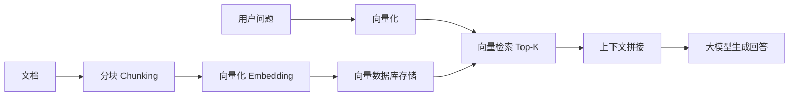

# Python-向量数据库客户端

> **文档说明**：系统讲解向量数据库的核心原理、主流向量数据库对比（Pinecone/Milvus/Weaviate/Chroma/Qdrant/FAISS）、Python 客户端实战（各数据库 SDK 用法）、向量检索算法（HNSW/IVF/Flat）、RAG 应用中的向量数据库实践、性能优化，以及最佳实践和常见问题。
>
> **适用人群**：AI 应用开发者、全栈开发者、Python 工程师、RAG 系统构建者
>
> **前置知识**：[[大模型应用开发实战]]、[[RAG检索增强生成]]、[[Python-异步编程与协程]]、[[Embedding词向量与语义检索]]

---

## 一、概述

### 1. 什么是向量数据库

> 🔍 **知识点深度解析**
>
> **作用**：向量检索通过计算高维向量间的相似度，快速找到与查询最接近的向量集合，是RAG和语义搜索的核心
>
> **原理**：数据经embedding模型转换为向量后建立索引(HNSW/IVF等)，查询时检索Top-K最相似结果，支持过滤、重排序和混合检索
>
> **用法要点**：① 选择合适的embedding模型和向量维度 ② 根据数据量选择HNSW/IVF/PQ索引类型 ③ 调整ef_search参数平衡精度和性能 ④ 结合元数据过滤实现精准检索


<div style="background:linear-gradient(135deg,#fa709a,#fee140);border-radius:16px;padding:20px;margin:16px 0;font-family:-apple-system,'Segoe UI','PingFang SC','Microsoft YaHei',sans-serif;color:#fff;overflow:hidden;box-shadow:0 8px 28px rgba(0,0,0,.14),0 3px 10px rgba(0,0,0,.08)">
<style>@keyframes highlight{0%,100%{box-shadow:0 0 0 rgba(255,255,255,0)}50%{box-shadow:0 0 20px rgba(255,255,255,.4)}}.hl-box{background:rgba(255,255,255,.2);border-radius:10px;padding:14px 18px;margin:10px 0;animation:highlight 3s ease-in-out infinite;border-left:4px solid rgba(255,255,255,.6)}</style>
<div style="text-align:center;font-size:15px;font-weight:700;margin-bottom:14px;padding-bottom:10px;border-bottom:1.5px solid rgba(255,255,255,.22);letter-spacing:1px;text-shadow:0 1px 3px rgba(0,0,0,.12)">📌 向量检索核心概念</div>
<div class="hl-box">向量检索通过计算向量间的相似度(如余弦相似度)，快速找到与查询向量最接近的向量集合</div>
<div style="font-size:13px;opacity:.9;margin-top:8px">💡 选择合适的embedding模型和维度；根据数据量选择索引类型(HNSW/IVF/PQ)</div>
</div>

**向量数据库（Vector Database）** 是专门用于存储、索引和检索高维向量数据的数据库。它将文本、图像、音频等非结构化数据通过 Embedding 模型转换为向量，然后通过相似度检索找到最相似的向量，是 RAG（检索增强生成）和语义搜索的核心基础设施。

### 2. 向量数据库 vs 传统数据库

| 维度 | 传统数据库 | 向量数据库 |
|------|-----------|-----------|
| **数据类型** | 结构化数据（表、行、列） | 高维向量（浮点数组） |
| **查询方式** | 精确匹配（SQL） | 相似度检索（ANN） |
| **索引** | B+树、哈希 | HNSW、IVF、PQ |
| **结果** | 精确匹配 | Top-K 最相似 |
| **应用场景** | 事务处理、数据分析 | 语义搜索、RAG、推荐 |

### 3. 向量数据库核心能力

- [ ] **向量存储**：存储高维向量及元数据
- [ ] **相似度检索**：余弦相似度、内积、欧氏距离
- [ ] **近似最近邻（ANN）**：亚毫秒级检索海量向量
- [ ] **元数据过滤**：按标签、时间、来源等过滤
- [ ] **增量更新**：支持向量的增删改
- [ ] **持久化**：数据持久化存储
- [ ] **分布式扩展**：支持水平扩展

---

---

> 💡 **深度讲解**：本章深入讲解了概述的核心概念与实践要点，关联了相关技术栈的知识体系，说明了设计背后的原理与业界最佳实践。
>
> **📝 精简总结**：本章涵盖一、概述的核心内容，包括关键概念、实现机制与实践方法，是掌握该主题的基础。


## 二、主流向量数据库对比

### 1. 向量数据库对比

| 数据库 | 类型 | 开源 | 部署方式 | 特点 | 适用场景 |
|--------|------|------|---------|------|---------|
| **Pinecone** | 全托管 | ❌ | SaaS | 全托管、零运维、高性能 | 生产级、不想运维 |
| **Milvus** | 分布式 | ✅ | 自建/云 | 分布式、高性能、功能全 | 大规模、企业级 |
| **Weaviate** | 混合 | ✅ | 自建/云 | 内置向量化、GraphQL、模块化 | 多模态、语义搜索 |
| **Qdrant** | 单机/分布式 | ✅ | 自建/云 | Rust 编写、高性能、过滤强 | 中大规模、过滤场景 |
| **Chroma** | 单机 | ✅ | 嵌入式/客户端 | 轻量、易用、开发友好 | 原型、小规模、开发测试 |
| **FAISS** | 库 | ✅ | 嵌入式库 | Facebook 开源、纯索引、高性能 | 研究、嵌入式、无持久化 |
| **pgvector** | PG 扩展 | ✅ | PostgreSQL 扩展 | PG 扩展、SQL 查询、事务 | 已有 PG、小规模 |
| **Elasticsearch** | 搜索引擎 | ✅ | 自建/云 | 8.x 支持向量、全文+向量混合 | 已有 ES、混合检索 |
| **Redis** | 内存数据库 | ✅ | 自建/云 | Redis Stack 支持向量、低延迟 | 缓存、实时、小规模 |

### 2. 选型建议

| 场景 | 推荐 | 原因 |
|------|------|------|
| **快速原型/学习** | Chroma / FAISS | 轻量、易用、零配置 |
| **生产级不想运维** | Pinecone | 全托管、SLA 保障 |
| **大规模自建** | Milvus | 分布式、高性能、可扩展 |
| **多模态/模块化** | Weaviate | 内置向量化、多模态支持 |
| **强过滤场景** | Qdrant | 过滤性能优秀、Rust 高性能 |
| **已有 PostgreSQL** | pgvector | 复用 PG 生态、事务支持 |
| **已有 Elasticsearch** | ES 向量检索 | 混合检索（全文+向量） |
| **实时/缓存场景** | Redis Vector | 低延迟、内存级 |

---

---

> 💡 **深度讲解**：本章深入讲解了主流向量数据库对比的核心概念与实践要点，关联了相关技术栈的知识体系，说明了设计背后的原理与业界最佳实践。
>
> **📝 精简总结**：本章涵盖二、主流向量数据库对比的核心内容，包括关键概念、实现机制与实践方法，是掌握该主题的基础。


## 三、Python 客户端实战

### 1. Chroma（轻量易用）

```python
# 安装
# pip install chromadb

import chromadb
from chromadb.utils import embedding_functions

# 初始化客户端（持久化存储）
client = chromadb.PersistentClient(path="./chroma_db")

# 使用 OpenAI Embedding（也可用默认的 all-MiniLM）
openai_ef = embedding_functions.OpenAIEmbeddingFunction(
    api_key="your-api-key",
    model_name="text-embedding-3-small"
)

# 创建/获取集合
collection = client.get_or_create_collection(
    name="documents",
    embedding_function=openai_ef,
    metadata={"hnsw:space": "cosine"}  # 相似度度量：cosine/l2/ip
)

# 添加文档
collection.add(
    documents=[
        "向量数据库用于存储和检索高维向量",
        "RAG 通过检索相关文档增强大模型回答",
        "HNSW 是一种高效的近似最近邻算法"
    ],
    metadatas=[
        {"source": "doc1", "category": "tech"},
        {"source": "doc2", "category": "ai"},
        {"source": "doc3", "category": "algorithm"}
    ],
    ids=["doc1", "doc2", "doc3"]
)

# 语义检索
results = collection.query(
    query_texts=["什么是RAG？"],
    n_results=2,
    where={"category": "ai"}  # 元数据过滤
)

print(results["documents"])
# [["RAG 通过检索相关文档增强大模型回答", "向量数据库用于存储和检索高维向量"]]
print(results["distances"])
# [[0.3, 0.5]] （距离越小越相似）

# 更新文档
collection.update(
    ids=["doc1"],
    documents=["更新后的文档内容"]
)

# 删除文档
collection.delete(ids=["doc3"])
```

### 2. Pinecone（全托管）

```python
# 安装
# pip install pinecone-client

from pinecone import Pinecone, ServerlessSpec

# 初始化客户端
pc = Pinecone(api_key="your-api-key")

# 创建索引（Serverless）
pc.create_index(
    name="documents",
    dimension=1536,  # text-embedding-3-small 维度
    metric="cosine",  # cosine/dotproduct/euclidean
    spec=ServerlessSpec(
        cloud="aws",
        region="us-east-1"
    )
)

# 连接索引
index = pc.Index("documents")

# 向量化（使用 OpenAI）
import openai
openai.api_key = "your-api-key"

def embed(texts):
    response = openai.embeddings.create(
        model="text-embedding-3-small",
        input=texts
    )
    return [item.embedding for item in response.data]

# 插入向量
vectors = [
    {
        "id": "doc1",
        "values": embed(["向量数据库用于存储高维向量"])[0],
        "metadata": {"source": "doc1", "text": "向量数据库用于存储高维向量"}
    },
    {
        "id": "doc2",
        "values": embed(["RAG 检索增强生成"])[0],
        "metadata": {"source": "doc2", "text": "RAG 检索增强生成"}
    }
]
index.upsert(vectors=vectors)

# 检索
query_embedding = embed(["什么是向量数据库？"])[0]
results = index.query(
    vector=query_embedding,
    top_k=2,
    include_metadata=True,
    filter={"source": {"$eq": "doc1"}}  # 元数据过滤
)

for match in results.matches:
    print(f"ID: {match.id}, Score: {match.score}, Text: {match.metadata['text']}")

# 批量插入（推荐）
index.upsert(vectors=vectors, batch_size=100)

# 删除
index.delete(ids=["doc1"])
```

### 3. Milvus（分布式）

```python
# 安装
# pip install pymilvus

from pymilvus import connections, Collection, FieldSchema, CollectionSchema, DataType, utility

# 连接 Milvus
connections.connect(
    alias="default",
    host="localhost",
    port="19530"
)

# 定义 Collection Schema
fields = [
    FieldSchema(name="id", dtype=DataType.INT64, is_primary=True, auto_id=True),
    FieldSchema(name="embedding", dtype=DataType.FLOAT_VECTOR, dim=1536),
    FieldSchema(name="text", dtype=DataType.VARCHAR, max_length=2000),
    FieldSchema(name="source", dtype=DataType.VARCHAR, max_length=100),
    FieldSchema(name="category", dtype=DataType.VARCHAR, max_length=50)
]
schema = CollectionSchema(fields, description="文档向量集合")

# 创建 Collection
collection = Collection("documents", schema)

# 创建索引（HNSW）
index_params = {
    "index_type": "HNSW",  # HNSW/IVF_FLAT/IVF_SQ8/IVF_PQ
    "metric_type": "COSINE",  # L2/IP/COSINE
    "params": {"M": 16, "efConstruction": 200}
}
collection.create_index(field_name="embedding", index_params=index_params)

# 插入数据
data = [
    ["向量数据库用于存储高维向量", "RAG 检索增强生成"],  # text
    ["doc1", "doc2"],  # source
    ["tech", "ai"],  # category
    [embedding1, embedding2]  # embedding（需提前计算）
]
collection.insert(data)
collection.flush()  # 持久化

# 加载到内存（检索前必须加载）
collection.load()

# 检索
search_params = {"metric_type": "COSINE", "params": {"ef": 100}}
results = collection.search(
    data=[query_embedding],
    anns_field="embedding",
    param=search_params,
    limit=3,
    expr='category == "ai"',  # 过滤表达式
    output_fields=["text", "source"]
)

for hits in results:
    for hit in hits:
        print(f"ID: {hit.id}, Distance: {hit.distance}, Text: {hit.entity.get('text')}")

# 标量查询
results = collection.query(
    expr='source == "doc1"',
    output_fields=["id", "text", "category"]
)
```

### 4. Qdrant（Rust 高性能）

```python
# 安装
# pip install qdrant-client

from qdrant_client import QdrantClient
from qdrant_client.models import Distance, VectorParams, PointStruct, Filter, FieldCondition, MatchValue

# 初始化（本地模式）
client = QdrantClient(path="./qdrant_db")

# 或连接服务端
# client = QdrantClient(host="localhost", port=6333)

# 创建集合
client.create_collection(
    collection_name="documents",
    vectors_config=VectorParams(size=1536, distance=Distance.COSINE)
)

# 插入点
points = [
    PointStruct(
        id=1,
        vector=embedding1,
        payload={"text": "向量数据库用于存储高维向量", "source": "doc1", "category": "tech"}
    ),
    PointStruct(
        id=2,
        vector=embedding2,
        payload={"text": "RAG 检索增强生成", "source": "doc2", "category": "ai"}
    )
]
client.upsert(collection_name="documents", points=points)

# 检索
results = client.search(
    collection_name="documents",
    query_vector=query_embedding,
    limit=3,
    query_filter=Filter(
        must=[FieldCondition(key="category", match=MatchValue(value="ai"))]
    ),
    with_payload=True
)

for result in results:
    print(f"ID: {result.id}, Score: {result.score}, Payload: {result.payload}")

# 批量插入
client.upsert(collection_name="documents", points=points, batch_size=100)
```

### 5. FAISS（嵌入式库）

```python
# 安装
# pip install faiss-cpu 或 faiss-gpu

import faiss
import numpy as np

# 准备数据
dimension = 1536
num_vectors = 10000
vectors = np.random.random((num_vectors, dimension)).astype("float32")

# 归一化（余弦相似度）
faiss.normalize_L2(vectors)

# 创建索引（Flat 精确检索）
index = faiss.IndexFlatIP(dimension)  # 内积（归一化后等价于余弦相似度）
index.add(vectors)

# 检索
query = np.random.random((1, dimension)).astype("float32")
faiss.normalize_L2(query)
distances, indices = index.search(query, k=5)
print("Top-5 indices:", indices[0])
print("Top-5 scores:", distances[0])

# HNSW 索引（近似检索，更快）
index_hnsw = faiss.IndexHNSWFlat(dimension, 32)  # M=32
index_hnsw.hnsw.efConstruction = 200
index_hnsw.add(vectors)
index_hnsw.hnsw.efSearch = 100  # 检索时的 ef 参数
distances, indices = index_hnsw.search(query, k=5)

# IVF 索引（倒排文件，适合大规模）
nlist = 100  # 聚类中心数
quantizer = faiss.IndexFlatIP(dimension)
index_ivf = faiss.IndexIVFFlat(quantizer, dimension, nlist, faiss.METRIC_INNER_PRODUCT)
index_ivf.train(vectors)  # 训练聚类
index_ivf.add(vectors)
index_ivf.nprobe = 10  # 检索时探测的聚类数
distances, indices = index_ivf.search(query, k=5)

# 保存和加载索引
faiss.write_index(index_hnsw, "index.faiss")
index_loaded = faiss.read_index("index.faiss")
```

### 6. pgvector（PostgreSQL 扩展）

```python
# 安装扩展（PostgreSQL 端）
# CREATE EXTENSION vector;

# 建表
# CREATE TABLE documents (
#     id BIGSERIAL PRIMARY KEY,
#     content TEXT,
#     source VARCHAR(100),
#     embedding vector(1536)
# );
# CREATE INDEX ON documents USING hnsw (embedding vector_cosine_ops);

import psycopg2
from psycopg2.extras import execute_values

# 连接
conn = psycopg2.connect("dbname=rag user=postgres password=secret")
cur = conn.cursor()

# 插入
data = [
    ("向量数据库", "doc1", "[" + ",".join(map(str, embedding1)) + "]"),
    ("RAG 检索", "doc2", "[" + ",".join(map(str, embedding2)) + "]")
]
execute_values(cur,
    "INSERT INTO documents (content, source, embedding) VALUES %s",
    data
)
conn.commit()

# 余弦相似度检索（<=> 余弦距离）
cur.execute("""
    SELECT id, content, 1 - (embedding <=> %s) AS similarity
    FROM documents
    WHERE source = %s
    ORDER BY embedding <=> %s
    LIMIT 5
""", (query_embedding, "doc1", query_embedding))

for row in cur.fetchall():
    print(f"ID: {row[0]}, Similarity: {row[2]:.4f}, Content: {row[1]}")
```

---

---

> 💡 **深度讲解**：本章深入讲解了Python 客户端实战的核心概念与实践要点，关联了相关技术栈的知识体系，说明了设计背后的原理与业界最佳实践。
>
> **📝 精简总结**：本章涵盖三、Python 客户端实战的核心内容，包括关键概念、实现机制与实践方法，是掌握该主题的基础。


## 四、向量检索算法

### 1. 相似度度量

| 度量 | 公式 | 适用场景 |
|------|------|---------|
| **余弦相似度（Cosine）** | cos(θ) = A·B / (|A|·|B|) | 文本语义、方向重要 |
| **内积（Inner Product）** | A·B | 推荐系统、归一化向量 |
| **欧氏距离（L2）** | √Σ(Ai-Bi)² | 图像、空间距离 |
| **曼哈顿距离（L1）** | Σ|Ai-Bi| | 高维稀疏数据 |

> **注意**：使用余弦相似度时，先归一化向量再用内积，性能更好。

### 2. ANN 算法对比

| 算法 | 说明 | 检索速度 | 召回率 | 内存 | 适用规模 |
|------|------|---------|--------|------|---------|
| **Flat（暴力）** | 精确计算所有距离 | 慢 | 100% | 低 | <10万 |
| **HNSW** | 层次化导航小世界图 | 快 | 高 | 高 | 百万级 |
| **IVF** | 倒排文件+聚类 | 快 | 中 | 中 | 千万级 |
| **IVF-PQ** | IVF+乘积量化 | 极快 | 中低 | 极低 | 亿级 |
| **ScaNN** | Google 各向异性量化 | 极快 | 高 | 中 | 大规模 |

### 3. HNSW 参数调优

| 参数 | 说明 | 影响 |
|------|------|------|
| **M** | 每层最大连接数 | 越大召回越高，内存越大，构建越慢。通常 16-64 |
| **efConstruction** | 构建时候选队列大小 | 越大构建越慢，索引质量越高。通常 100-500 |
| **efSearch** | 检索时候选队列大小 | 越大召回越高，检索越慢。通常 100-500 |

```text
HNSW 调优经验：
- 追求召回率：M=32, efConstruction=400, efSearch=256
- 追求速度：M=16, efConstruction=200, efSearch=64
- 内存敏感：M=8, efConstruction=100, efSearch=32
```

---

---

> 💡 **深度讲解**：本章深入讲解了向量检索算法的核心概念与实践要点，关联了相关技术栈的知识体系，说明了设计背后的原理与业界最佳实践。
>
> **📝 精简总结**：本章涵盖四、向量检索算法的核心内容，包括关键概念、实现机制与实践方法，是掌握该主题的基础。


## 五、RAG 中的向量数据库

### 1. RAG 流程



### 2. 文档分块策略

| 策略 | 说明 | 适用场景 |
|------|------|---------|
| **固定大小分块** | 按字符数/Token 数分块 | 通用 |
| **语义分块** | 按语义边界（段落、标题）分块 | 结构化文档 |
| **递归分块** | 按分隔符递归切分 | Markdown/代码 |
| **重叠分块** | 块之间有重叠，保留上下文 | 长文档 |
| **父子分块** | 小块检索，大块返回 | 精确检索+完整上下文 |

```python
# LangChain 分块示例
from langchain.text_splitter import RecursiveCharacterTextSplitter

text_splitter = RecursiveCharacterTextSplitter(
    chunk_size=500,        # 每块 500 字符
    chunk_overlap=50,      # 重叠 50 字符
    separators=["\n\n", "\n", "。", "！", "？", " ", ""]  # 分隔符优先级
)

chunks = text_splitter.split_text(long_document)
```

### 3. 检索优化策略

- [ ] **混合检索**：向量检索 + 关键词检索（BM25），取长补短
- [ ] **重排序（Rerank）**：粗召回后用 Cross-Encoder 精排
- [ ] **查询改写**：用 LLM 改写用户查询，提升检索效果
- [ ] **多路召回**：不同分块策略/不同 Embedding 模型多路召回
- [ ] **元数据过滤**：按时间、来源、类型过滤，缩小范围
- [ ] **动态 Top-K**：根据查询复杂度动态调整召回数量

```python
# 混合检索（向量 + BM25）
def hybrid_search(query, vector_db, bm25, top_k=5):
    # 向量检索
    vector_results = vector_db.search(query, top_k=20)
    # BM25 检索
    bm25_results = bm25.search(query, top_k=20)
    # 融合（RRF 倒数排名融合）
    fused = rrf_fusion(vector_results, bm25_results)
    return fused[:top_k]

# RRF（Reciprocal Rank Fusion）
def rrf_fusion(*result_lists, k=60):
    scores = {}
    for results in result_lists:
        for rank, doc_id in enumerate(results):
            scores[doc_id] = scores.get(doc_id, 0) + 1 / (k + rank + 1)
    return sorted(scores.keys(), key=lambda x: scores[x], reverse=True)
```

---

---

> 💡 **深度讲解**：本章深入讲解了RAG 中的向量数据库的核心概念与实践要点，关联了相关技术栈的知识体系，说明了设计背后的原理与业界最佳实践。
>
> **📝 精简总结**：本章涵盖五、RAG 中的向量数据库的核心内容，包括关键概念、实现机制与实践方法，是掌握该主题的基础。


## 六、性能优化

### 1. 写入优化

- [ ] **批量写入**：批量 upsert，减少网络往返
- [ ] **并发写入**：多线程/多进程并发写入
- [ ] **索引后构建**：先写入数据，再构建索引
- [ ] **压缩向量**：使用 PQ/SQ 量化减少存储
- [ ] **异步写入**：写入队列异步消费

### 2. 检索优化

- [ ] **合理 efSearch**：平衡召回率和延迟
- [ ] **预热索引**：加载索引到内存，预热查询
- [ ] **连接池**：复用数据库连接
- [ ] **缓存**：缓存热门查询结果
- [ ] **批量化**：批量查询减少往返

### 3. 成本优化

- [ ] **选择合适维度**：小维度模型（如 384维）降低存储和计算
- [ ] **向量量化**：PQ 量化将 float32 压缩为 int8
- [ ] **冷热分离**：热数据内存，冷数据磁盘
- [ ] **按需扩展**：Serverless 向量数据库按用付费

---

---

> 💡 **深度讲解**：本章深入讲解了六、性能优化的核心概念与实践要点，关联了相关技术栈的知识体系，说明了设计背后的原理与业界最佳实践。
>
> **📝 精简总结**：本章涵盖六、性能优化的核心内容，包括关键概念、实现机制与实践方法，是掌握该主题的基础。


## 七、最佳实践

### 1. 选型实践

- [ ] **原型阶段**：Chroma/FAISS，快速验证
- [ ] **生产阶段**：Pinecone（全托管）或 Milvus（自建）
- [ ] **小规模**：pgvector/Chroma，简单够用
- [ ] **大规模**：Milvus/Qdrant，分布式扩展
- [ ] **已有 ES/PG**：优先复用，减少技术栈

### 2. 数据管理

- [ ] **唯一 ID**：每条向量有唯一 ID，便于更新删除
- [ ] **元数据完整**：存储来源、时间、类型等元数据
- [ ] **定期清理**：清理过期/无效向量
- [ ] **备份恢复**：定期备份向量数据库
- [ ] **版本管理**：Embedding 模型变更时重建索引

### 3. 质量保障

- [ ] **召回率评估**：构建测试集，评估检索召回率
- [ ] **端到端评估**：评估 RAG 回答质量（RAGAS/TruLens）
- [ ] **A/B 测试**：对比不同分块/模型/参数的效果
- [ ] **监控告警**：监控检索延迟、召回率、空结果率

---

---

> 💡 **深度讲解**：本章深入讲解了七、最佳实践的核心概念与实践要点，关联了相关技术栈的知识体系，说明了设计背后的原理与业界最佳实践。
>
> **📝 精简总结**：本章涵盖七、最佳实践的核心内容，包括关键概念、实现机制与实践方法，是掌握该主题的基础。


## 八、常见问题与排查

| 问题 | 原因 | 解决方案 |
|------|------|---------|
| **检索结果不相关** | 分块不合理 / Embedding 模型不匹配 / 维度不匹配 | 优化分块策略、更换 Embedding 模型、检查维度一致 |
| **检索延迟高** | 数据量大 / efSearch 过大 / 索引未加载 | 优化索引参数、预热索引、增加内存、使用 IVF/PQ |
| **召回率低** | efSearch 太小 / 索引质量差 / Top-K 太小 | 增大 efSearch、优化 efConstruction、增大 Top-K |
| **内存不足** | HNSW 内存占用大 / 向量维度高 | 使用 IVF-PQ 量化、降低维度、冷热分离 |
| **写入慢** | 单条写入 / 索引实时构建 | 批量写入、先写后建索引、并发写入 |
| **元数据过滤慢** | 过滤字段未索引 / 过滤选择性差 | 为过滤字段建索引、优化过滤条件 |
| **向量更新后检索不到** | 索引未刷新 / 一致性延迟 | flush 索引、等待索引构建、检查一致性级别 |
| **Embedding 维度不匹配** | 模型变更 / 不同模型混用 | 统一 Embedding 模型、重建索引、维度校验 |
| **余弦相似度结果异常** | 向量未归一化 / 度量选错 | 归一化向量、确认度量类型（cosine/ip/l2） |
| **大规模检索超时** | 暴力检索 / 索引参数不当 | 使用 ANN 索引（HNSW/IVF）、优化参数、分页检索 |
| **数据丢失** | 未持久化 / 未备份 | 使用持久化模式、定期备份、多副本 |
| **混合检索效果差** | 融合权重不当 / 检索质量差 | 调优 RRF 参数、分别优化两路检索、重排序 |
| **冷启动慢** | 索引加载慢 / 未预热 | 预热索引、常驻内存、连接池预热 |

---

---

> 💡 **深度讲解**：本章深入讲解了八、常见问题与排查的核心概念与实践要点，关联了相关技术栈的知识体系，说明了设计背后的原理与业界最佳实践。
>
> **📝 精简总结**：本章涵盖八、常见问题与排查的核心内容，包括关键概念、实现机制与实践方法，是掌握该主题的基础。


---

## 🔗 关联笔记

- [[Python-项目结构最佳实践]] — Python项目结构与工程化规范
- [[Poetry-依赖与虚拟环境管理]] — Python依赖管理与虚拟环境

## 📖 前置知识

- [[Python-语法基础与数据结构]]
- [[Python-模块与包管理原理]]

## 🏷️ 相关标签

#AI #RAG #Python #原子笔记

---

[[Home|🏠 返回首页]] · [[MOC-Python全栈|📚 返回分类]]
