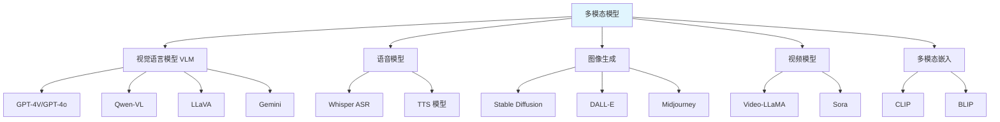

# Python-多模态AI应用开发

> **文档说明**：系统讲解 Python 多模态 AI 应用开发，涵盖视觉语言模型（VLM）、语音识别与合成、图像生成、视频理解、多模态 RAG，以及完整应用示例和部署优化。
>
> **适用人群**：AI 应用开发者、Python 全栈开发者、需要构建多模态 AI 产品的开发者
>
> **前置知识**：[[RAG检索增强生成]]、[[大模型推理优化]]、[[Python-GraphQL接口开发]]

---

## 一、概述

### 1. 什么是多模态 AI

<div style="background:linear-gradient(135deg,#fa709a,#fee140);border-radius:16px;padding:20px;margin:16px 0;font-family:-apple-system,'Segoe UI','PingFang SC','Microsoft YaHei',sans-serif;color:#fff;overflow:hidden;box-shadow:0 8px 28px rgba(0,0,0,.14),0 3px 10px rgba(0,0,0,.08)">
<style>@keyframes highlight{0%,100%{box-shadow:0 0 0 rgba(255,255,255,0)}50%{box-shadow:0 0 20px rgba(255,255,255,.4)}}.hl-box{background:rgba(255,255,255,.2);border-radius:10px;padding:14px 18px;margin:10px 0;animation:highlight 3s ease-in-out infinite;border-left:4px solid rgba(255,255,255,.6)}</style>
<div style="text-align:center;font-size:15px;font-weight:700;margin-bottom:14px;padding-bottom:10px;border-bottom:1.5px solid rgba(255,255,255,.22);letter-spacing:1px;text-shadow:0 1px 3px rgba(0,0,0,.12)">📌 多模态核心概念</div>
<div class="hl-box">多模态AI融合文本、图像、音频、视频等多种模态信息，实现更全面的理解和生成</div>
<div style="font-size:13px;opacity:.9;margin-top:8px">💡 选择支持多模态的模型(如GPT-4V、CLIP)；预处理不同模态数据适配模型输入</div>
</div>

> 🔍 **知识点深度解析**
>
> **作用**：多模态AI融合文本、图像、音频、视频等多种模态信息，实现更全面的理解和生成
>
> **原理**：通过模态编码器将不同类型数据转换为统一的向量表示，在共享语义空间中进行跨模态对齐和融合，支持图文理解、文生图、语音识别等任务
>
> **用法要点**：① 选择支持多模态的模型(如GPT-4V、CLIP) ② 预处理不同模态数据适配模型输入 ③ 设计跨模态注意力机制 ④ 处理模态缺失和不平衡问题


```text
多模态 AI（Multimodal AI）：
- 同时处理和理解多种数据类型
- 模态：文本、图像、音频、视频、3D、传感器数据
- 核心能力：跨模态理解、生成、检索

多模态能力：
- 图文理解：看图说话、图像问答
- 语音交互：语音识别、语音合成
- 图像生成：文生图、图生图
- 视频理解：视频问答、动作识别
- 跨模态检索：以图搜文、以文搜图
- 多模态 RAG：图文混合知识库
```
### 2. 多模态模型分类



### 3. 多模态应用场景

```text
典型应用：
- 智能客服：图文混合问答
- 文档理解：PDF/图片表格提取
- 医疗影像：影像报告生成
- 教育：作业批改、题目讲解
- 电商：商品图像搜索、智能推荐
- 内容创作：图文生成、视频剪辑
- 无障碍：图像描述、语音助手
- 安防：异常检测、人脸识别
```

---

---

> 💡 **深度讲解**：本章深入讲解了概述的核心概念与实践要点，关联了相关技术栈的知识体系，说明了设计背后的原理与业界最佳实践。
>
> **📝 精简总结**：本章涵盖一、概述的核心内容，包括关键概念、实现机制与实践方法，是掌握该主题的基础。


## 二、视觉语言模型（VLM）

### 1. VLM 原理

```text
VLM（Vision-Language Model）架构：
1. 图像编码器（ViT/CLIP）：将图像转为特征
2. 投影层：将图像特征对齐到文本空间
3. 大语言模型：处理图文混合输入

输入格式：
[图像] 这张图里有什么？
→ 图像编码 → 投影 → LLM → 文本回答

主流 VLM：
- GPT-4o / GPT-4V：OpenAI，能力最强
- Qwen-VL / Qwen2-VL：阿里，开源强
- LLaVA：开源，社区活跃
- Gemini：Google，多模态原生
- Claude 3：Anthropic，图像理解强
```

### 2. OpenAI GPT-4o 多模态

```python
from openai import OpenAI

client = OpenAI(api_key="your-key")

# 图像问答（本地图片）
import base64
def encode_image(image_path):
    with open(image_path, "rb") as f:
        return base64.b64encode(f.read()).decode()

response = client.chat.completions.create(
    model="gpt-4o",
    messages=[
        {
            "role": "user",
            "content": [
                {"type": "text", "text": "详细描述这张图片，并提取其中的文字"},
                {"type": "image_url", "image_url": {
                    "url": f"data:image/jpeg;base64,{encode_image('photo.jpg')}"
                }}
            ]
        }
    ],
    max_tokens=500
)
print(response.choices[0].message.content)

# 多图对比
response = client.chat.completions.create(
    model="gpt-4o",
    messages=[{
        "role": "user",
        "content": [
            {"type": "text", "text": "这两张图有什么不同？"},
            {"type": "image_url", "image_url": {"url": "https://example.com/a.jpg"}},
            {"type": "image_url", "image_url": {"url": "https://example.com/b.jpg"}}
        ]
    }]
)
```

```text
### 3. 开源 VLM（Qwen2-VL）
```

```python
from transformers import Qwen2VLForConditionalGeneration, AutoProcessor
from qwen_vl_utils import process_vision_info
import torch

# 加载模型
model = Qwen2VLForConditionalGeneration.from_pretrained(
    "Qwen/Qwen2-VL-7B-Instruct",
    torch_dtype=torch.bfloat16,
    device_map="auto"
)
processor = AutoProcessor.from_pretrained("Qwen/Qwen2-VL-7B-Instruct")

# 准备输入
messages = [
    {
        "role": "user",
        "content": [
            {"type": "image", "image": "photo.jpg"},
            {"type": "text", "text": "描述这张图片"}
        ]
    }
]

text = processor.apply_chat_template(messages, tokenize=False, add_generation_prompt=True)
image_inputs, video_inputs = process_vision_info(messages)
inputs = processor(text=[text], images=image_inputs, videos=video_inputs,
                   padding=True, return_tensors="pt").to("cuda")

# 生成
with torch.no_grad():
    output = model.generate(**inputs, max_new_tokens=512)
print(processor.batch_decode(output, skip_special_tokens=True)[0])
```

### 4. LLaVA

```python
from transformers import LlavaNextProcessor, LlavaNextForConditionalGeneration
import torch
from PIL import Image

processor = LlavaNextProcessor.from_pretrained("llava-hf/llava-v1.6-mistral-7b-hf")
model = LlavaNextForConditionalGeneration.from_pretrained(
    "llava-hf/llava-v1.6-mistral-7b-hf",
    torch_dtype=torch.float16,
    device_map="auto"
)

image = Image.open("photo.jpg")
prompt = "[INST] <image>\n描述这张图片 [/INST]"
inputs = processor(prompt, image, return_tensors="pt").to("cuda")
output = model.generate(**inputs, max_new_tokens=200)
print(processor.decode(output[0], skip_special_tokens=True))
```

---

---

> 💡 **深度讲解**：本章深入讲解了视觉语言模型（VLM）的核心概念与实践要点，关联了相关技术栈的知识体系，说明了设计背后的原理与业界最佳实践。
>
> **📝 精简总结**：本章涵盖二、视觉语言模型（VLM）的核心内容，包括关键概念、实现机制与实践方法，是掌握该主题的基础。


## 三、语音处理

### 1. 语音识别（Whisper）

```python
import whisper

# 加载模型（tiny/base/small/medium/large-v3）
model = whisper.load_model("base")

# 转录音频
result = model.transcribe("audio.mp3")
print(result["text"])

# 带时间戳和语言检测
result = model.transcribe("audio.mp3", language="zh", verbose=True)
for seg in result["segments"]:
    print(f"[{seg['start']:.1f}s - {seg['end']:.1f}s] {seg['text']}")

# 翻译为英文
result = model.transcribe("chinese.mp3", task="translate")
```

```python
# faster-whisper（更快的实现，CTranslate2）
from faster_whisper import WhisperModel

model = WhisperModel("large-v3", device="cuda", compute_type="float16")
segments, info = model.transcribe("audio.mp3", beam_size=5)
for segment in segments:
    print(f"[{segment.start:.2f}s] {segment.text}")
```

### 2. 语音合成（TTS）

```python
# OpenAI TTS
from openai import OpenAI
client = OpenAI()

response = client.audio.speech.create(
    model="tts-1",
    voice="alloy",  # alloy/echo/fable/onyx/nova/shimmer
    input="你好，这是一段语音合成测试"
)
response.stream_to_file("output.mp3")

# 开源 TTS（Coqui TTS）
from TTS.api import TTS
tts = TTS(model_name="tts_models/zh-CN/baker/tacotron2-DDC-GST")
tts.tts_to_file(text="你好世界", file_path="output.wav")

# Edge TTS（免费，微软语音）
import edge_tts
import asyncio
async def main():
    communicate = edge_tts.Communicate("你好", "zh-CN-XiaoxiaoNeural")
    await communicate.save("output.mp3")
asyncio.run(main())
```

### 3. 实时语音对话

```python
# 录音 + Whisper + LLM + TTS 完整流程
import sounddevice as sd
import numpy as np
import whisper
from openai import OpenAI

client = OpenAI()
model = whisper.load_model("base")

def record_and_transcribe(duration=5, fs=16000):
    recording = sd.rec(int(duration * fs), samplerate=fs, channels=1)
    sd.wait()
    audio = recording.flatten().astype(np.float32)
    result = model.transcribe(audio, language="zh")
    return result["text"]

def text_to_speech(text, output="response.mp3"):
    response = client.audio.speech.create(model="tts-1", voice="nova", input=text)
    response.stream_to_file(output)
    # 播放音频
    import subprocess
    subprocess.run(["ffplay", "-nodisp", "-autoexit", output])

# 对话循环
while True:
    print("请说话...")
    user_text = record_and_transcribe()
    print(f"你: {user_text}")

    response = client.chat.completions.create(
        model="gpt-4o",
        messages=[{"role": "user", "content": user_text}]
    )
    ai_text = response.choices[0].message.content
    print(f"AI: {ai_text}")
    text_to_speech(ai_text)
```

---

---

> 💡 **深度讲解**：本章深入讲解了语音处理的核心概念与实践要点，关联了相关技术栈的知识体系，说明了设计背后的原理与业界最佳实践。
>
> **📝 精简总结**：本章涵盖三、语音处理的核心内容，包括关键概念、实现机制与实践方法，是掌握该主题的基础。


## 四、图像生成

### 1. Stable Diffusion

```python
from diffusers import StableDiffusionPipeline
import torch

# 加载模型
pipe = StableDiffusionPipeline.from_pretrained(
    "runwayml/stable-diffusion-v1-5",
    torch_dtype=torch.float16
).to("cuda")

# 文生图
image = pipe(
    "一只穿着宇航服的猫在月球上，赛博朋克风格，高清",
    num_inference_steps=30,
    guidance_scale=7.5,
    negative_prompt="模糊, 低质量, 变形"
).images[0]
image.save("cat_moon.png")
```

### 2. 图生图（Img2Img）

```python
from diffusers import StableDiffusionImg2ImgPipeline
from PIL import Image

pipe = StableDiffusionImg2ImgPipeline.from_pretrained(
    "runwayml/stable-diffusion-v1-5", torch_dtype=torch.float16
).to("cuda")

init_image = Image.open("input.jpg").convert("RGB").resize((512, 512))
image = pipe(
    prompt="将这张图变为水彩画风格",
    image=init_image,
    strength=0.75,  # 变化程度 0-1
    guidance_scale=7.5
).images[0]
```

### 3. ControlNet（控制生成）

```python
from diffusers import StableDiffusionControlNetPipeline, ControlNetModel
from PIL import Image

# 用边缘图控制生成
controlnet = ControlNetModel.from_pretrained(
    "lllyasviel/sd-controlnet-canny", torch_dtype=torch.float16
)
pipe = StableDiffusionControlNetPipeline.from_pretrained(
    "runwayml/stable-diffusion-v1-5",
    controlnet=controlnet,
    torch_dtype=torch.float16
).to("cuda")

canny_image = Image.open("edge.png")
image = pipe(
    "现代建筑，日落",
    image=canny_image,
    num_inference_steps=30
).images[0]
```

---

---

> 💡 **深度讲解**：本章深入讲解了图像生成的核心概念与实践要点，关联了相关技术栈的知识体系，说明了设计背后的原理与业界最佳实践。
>
> **📝 精简总结**：本章涵盖四、图像生成的核心内容，包括关键概念、实现机制与实践方法，是掌握该主题的基础。


## 五、多模态 RAG

### 1. 多模态 RAG 架构

```text
多模态 RAG（Multimodal RAG）：
- 知识库包含文本、图片、PDF、表格
- 检索时同时检索文本和图像
- 生成时用 VLM 理解图像内容

流程：
1. 文档解析：提取文本、图片、表格
2. 向量化：文本用 embedding，图像用 CLIP
3. 存储：向量数据库（支持多模态）
4. 检索：根据查询检索相关文本和图片
5. 生成：VLM 结合图文上下文回答
```

### 2. CLIP 多模态嵌入

```python
from transformers import CLIPProcessor, CLIPModel
from PIL import Image
import torch

model = CLIPModel.from_pretrained("openai/clip-vit-base-patch32")
processor = CLIPProcessor.from_pretrained("openai/clip-vit-base-patch32")

# 图像嵌入
image = Image.open("cat.jpg")
image_inputs = processor(images=image, return_tensors="pt")
with torch.no_grad():
    image_embedding = model.get_image_features(**image_inputs)

# 文本嵌入
text_inputs = processor(text=["一只猫", "一只狗"], return_tensors="pt", padding=True)
with torch.no_grad():
    text_embeddings = model.get_text_features(**text_inputs)

# 计算相似度
image_embedding = image_embedding / image_embedding.norm(dim=-1, keepdim=True)
text_embeddings = text_embeddings / text_embeddings.norm(dim=-1, keepdim=True)
similarity = (image_embedding @ text_embeddings.T).softmax(dim=-1)
print(similarity)  # 图像与各文本的匹配概率
```

### 3. 多模态 RAG 完整示例

```python
# 文档解析（Unstructured）
from unstructured.partition.pdf import partition_pdf
elements = partition_pdf("report.pdf", extract_images_in_pdf=True)

# 分离文本和图片
texts = [e.text for e in elements if e.category == "NarrativeText"]
images = [e for e in elements if e.category == "Image"]

# 文本向量化（用 embedding 模型）
# 图像向量化（用 CLIP）
# 存入向量数据库（Weaviate/Milvus 支持多模态）

# 检索
query = "图表中的数据趋势是什么？"
# 文本检索相关段落
# 图像检索相关图表
# 用 VLM 结合上下文回答
```

---

---

> 💡 **深度讲解**：本章深入讲解了多模态 RAG的核心概念与实践要点，关联了相关技术栈的知识体系，说明了设计背后的原理与业界最佳实践。
>
> **📝 精简总结**：本章涵盖五、多模态 RAG的核心内容，包括关键概念、实现机制与实践方法，是掌握该主题的基础。


## 六、完整应用示例

### 1. 智能文档问答系统

```python
"""
多模态文档问答：上传 PDF/图片，AI 回答问题
支持图文混合理解
"""
from fastapi import FastAPI, UploadFile, File
from openai import OpenAI
import base64

app = FastAPI()
client = OpenAI()

@app.post("/ask")
async def ask_question(file: UploadFile = File(...), question: str = ""):
    # 读取文件
    content = await file.read()
    img_b64 = base64.b64encode(content).decode()

    # 调用 GPT-4o
    response = client.chat.completions.create(
        model="gpt-4o",
        messages=[{
            "role": "user",
            "content": [
                {"type": "text", "text": question},
                {"type": "image_url", "image_url": {
                    "url": f"data:image/jpeg;base64,{img_b64}"
                }}
            ]
        }],
        max_tokens=1000
    )
    return {"answer": response.choices[0].message.content}
```

### 2. 视频理解

```python
"""
视频理解：抽帧 + VLM 问答
"""
import cv2
from openai import OpenAI

client = OpenAI()

def extract_frames(video_path, interval=30):
    """每隔 interval 帧抽一帧"""
    cap = cv2.VideoCapture(video_path)
    frames = []
    count = 0
    while cap.isOpened():
        ret, frame = cap.read()
        if not ret:
            break
        if count % interval == 0:
            _, buffer = cv2.imencode(".jpg", frame)
            frames.append(base64.b64encode(buffer).decode())
        count += 1
    cap.release()
    return frames

def ask_about_video(video_path, question):
    frames = extract_frames(video_path)
    # 取关键帧（最多 10 张）
    frames = frames[:10]

    content = [{"type": "text", "text": question}]
    for f in frames:
        content.append({"type": "image_url", "image_url": {
            "url": f"data:image/jpeg;base64,{f}"
        }})

    response = client.chat.completions.create(
        model="gpt-4o",
        messages=[{"role": "user", "content": content}],
        max_tokens=500
    )
    return response.choices[0].message.content
```

---

---

> 💡 **深度讲解**：本章深入讲解了六、完整应用示例的核心概念与实践要点，关联了相关技术栈的知识体系，说明了设计背后的原理与业界最佳实践。
>
> **📝 精简总结**：本章涵盖六、完整应用示例的核心内容，包括关键概念、实现机制与实践方法，是掌握该主题的基础。


## 七、部署与优化

### 1. 模型部署优化

```text
推理优化：
- 量化：FP16/INT8/INT4（bitsandbytes、GPTQ、AWQ）
- FlashAttention：加速注意力
- vLLM/TensorRT-LLM：高吞吐推理
- 模型蒸馏：用小模型替代大模型
- 批量处理：合并请求，提高 GPU 利用率

图像优化：
- 压缩图片（JPEG quality 85）
- 限制分辨率（VLM 通常 1024px 足够）
- 缓存重复图片的 embedding
- 用 CDN 加速图片加载

音频优化：
- 降采样到 16kHz（Whisper 要求）
- 静音检测，跳过无声段
- 流式识别，减少延迟
```

### 2. 成本优化

```text
成本控制策略：
1. 模型分级：简单任务用小模型，复杂任务用大模型
2. 缓存：相同查询缓存结果
3. 批处理：合并多个请求
4. 图像压缩：降低分辨率和质量
5. 音频裁剪：只处理有效语音段
6. 流式输出：TTFB 优化
7. 本地部署：高频任务用开源模型本地跑
```

---

---

> 💡 **深度讲解**：本章深入讲解了七、部署与优化的核心概念与实践要点，关联了相关技术栈的知识体系，说明了设计背后的原理与业界最佳实践。
>
> **📝 精简总结**：本章涵盖七、部署与优化的核心内容，包括关键概念、实现机制与实践方法，是掌握该主题的基础。


## 八、最佳实践

### 1. 开发规范

- [ ] **选择合适模型**：根据任务复杂度选模型大小
- [ ] **提示词工程**：多模态提示词要明确说明图像和文本的关系
- [ ] **图像预处理**：统一尺寸、格式、压缩
- [ ] **错误处理**：API 调用失败重试、降级
- [ ] **流式输出**：长响应用流式，提升体验
- [ ] **内容安全**：输入输出过滤，防止违规内容
- [ ] **隐私保护**：敏感数据脱敏，不上传第三方

### 2. 性能规范

- [ ] **异步处理**：耗时操作用异步队列
- [ ] **结果缓存**：相同输入缓存输出
- [ ] **模型预热**：服务启动时加载模型
- [ ] **GPU 复用**：一个进程处理多请求，避免重复加载
- [ ] **监控指标**：延迟、吞吐、错误率、GPU 利用率
- [ ] **降级策略**：大模型不可用时用小模型兜底

### 3. 安全规范

- [ ] **输入验证**：检查文件类型、大小
- [ ] **内容审核**：用户上传内容审核
- [ ] **API 密钥保护**：服务端调用，不暴露密钥
- [ ] **速率限制**：防止滥用
- [ ] **数据加密**：传输和存储加密
- [ ] **日志脱敏**：不记录敏感内容

---

---

> 💡 **深度讲解**：本章深入讲解了八、最佳实践的核心概念与实践要点，关联了相关技术栈的知识体系，说明了设计背后的原理与业界最佳实践。
>
> **📝 精简总结**：本章涵盖八、最佳实践的核心内容，包括关键概念、实现机制与实践方法，是掌握该主题的基础。


## 九、常见问题与排查

| 问题 | 原因 | 解决方案 |
|------|------|---------|
| **VLM 图像理解不准** | 图像模糊/分辨率低/提示词不清 | 提高分辨率、明确提示词、用更强模型 |
| **Whisper 识别错误多** | 口音/噪音/语言不匹配 | 用 large 模型、指定语言、降噪预处理 |
| **图像生成慢** | steps 太多/分辨率高 | 减少 steps、用 LCM/SDXL Turbo |
| **显存 OOM** | 模型太大/batch 太大 | 量化、减小 batch、梯度检查点 |
| **多模态 RAG 检索不准** | 嵌入模型不匹配/分块不对 | 用 CLIP 做图像嵌入、优化分块策略 |
| **API 调用超时** | 图像太大/网络慢 | 压缩图像、增加超时、异步处理 |
| **TTS 发音不自然** | 模型差/文本问题 | 用更好模型、SSML 标注、断句处理 |
| **视频处理慢** | 抽帧太多/分辨率高 | 减少抽帧数、降低分辨率 |
| **中文效果差** | 模型中文能力弱 | 用 Qwen-VL、Ernie 等中文优化模型 |
| **成本过高** | 大模型滥用/无缓存 | 模型分级、缓存、本地部署 |
| **流式输出中断** | 连接超时/服务重启 | 增加超时、断线重连、增量保存 |
| **图像方向错误** | EXIF 方向未处理 | 读取 EXIF 自动旋转 |
| **多图对比失败** | 模型不支持多图 | 用支持多图的模型（GPT-4o） |
| **音频格式不支持** | 编码问题 | 用 ffmpeg 转码为 wav/mp3 |
| **生成内容违规** | 未做内容审核 | 接入内容审核 API、设置安全策略 |

---

---

> 💡 **深度讲解**：本章深入讲解了九、常见问题与排查的核心概念与实践要点，关联了相关技术栈的知识体系，说明了设计背后的原理与业界最佳实践。
>
> **📝 精简总结**：本章涵盖九、常见问题与排查的核心内容，包括关键概念、实现机制与实践方法，是掌握该主题的基础。


---

## 🔗 关联笔记

- [[Python-项目结构最佳实践]] — Python项目结构与工程化规范
- [[Poetry-依赖与虚拟环境管理]] — Python依赖管理与虚拟环境

## 📖 前置知识

- [[Python-语法基础与数据结构]]
- [[Python-模块与包管理原理]]

## 🏷️ 相关标签

#Python #多模态 #VLM #CLIP #Whisper

---

[[Home|🏠 返回首页]] · [[MOC-Python全栈|📚 返回分类]]
