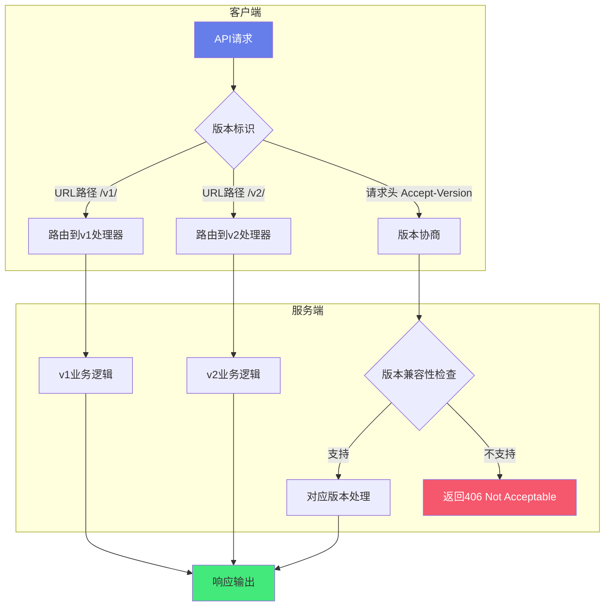

# Python-API版本化与文档

> **文档说明**：系统讲解 Python API 版本化策略、FastAPI 版本化实现、OpenAPI/Swagger 自动文档生成、请求响应模型、弃用策略，以及生产级 API 文档最佳实践。
>
> **适用人群**：Python 后端开发者、全栈开发者、需要设计和维护 API 的开发者
>
> **前置知识**：[[FastAPI-高性能Web框架]]、[[RESTfulAPI设计原则]]、[[前后端联调规范与流程]]

---

## 一、概述

### 1. 为什么需要 API 版本化

> 🔍 **知识点深度解析**
>
> **作用**：API版本化确保接口演进时向后兼容，允许客户端逐步迁移，通过URL路径或请求头标识版本
>
> **原理**：服务端维护多版本实现，路由根据版本标识分发到对应处理器，旧版本标记弃用并设置下线时间表，配合OpenAPI文档自动生成
>
> **用法要点**：① 从第一天就考虑版本化设计 ② 使用语义化版本号(主.次.补丁) ③ 废弃版本添加Deprecation响应头 ④ 提供迁移指南和变更日志





<div style="background:linear-gradient(135deg,#fa709a,#fee140);border-radius:16px;padding:20px;margin:16px 0;font-family:-apple-system,'Segoe UI','PingFang SC','Microsoft YaHei',sans-serif;color:#fff;overflow:hidden;box-shadow:0 8px 28px rgba(0,0,0,.14),0 3px 10px rgba(0,0,0,.08)">
<style>@keyframes highlight{0%,100%{box-shadow:0 0 0 rgba(255,255,255,0)}50%{box-shadow:0 0 20px rgba(255,255,255,.4)}}.hl-box{background:rgba(255,255,255,.2);border-radius:10px;padding:14px 18px;margin:10px 0;animation:highlight 3s ease-in-out infinite;border-left:4px solid rgba(255,255,255,.6)}</style>
<div style="text-align:center;font-size:15px;font-weight:700;margin-bottom:14px;padding-bottom:10px;border-bottom:1.5px solid rgba(255,255,255,.22);letter-spacing:1px;text-shadow:0 1px 3px rgba(0,0,0,.12)">📌 API版本化核心概念</div>
<div class="hl-box">API版本化确保接口演进时向后兼容，允许客户端逐步迁移到新版本</div>
<div style="font-size:13px;opacity:.9;margin-top:8px">💡 从第一天就考虑版本化设计；使用语义化版本号(主.次.补丁)</div>
</div>

API 一旦发布，就有客户端依赖。当 API 需要不兼容变更时，版本化可以保护现有客户端：

| 变更类型 | 示例 | 是否需要新版本 |
|---------|------|--------------|
| **兼容变更** | 新增可选字段、新增接口 | 否（向后兼容） |
| **不兼容变更** | 删除字段、修改字段类型、修改语义 | 是（需要新版本） |
| **安全修复** | 修复漏洞 | 否（紧急修复） |

### 2. 版本化策略对比

| 策略 | 示例 | 优点 | 缺点 |
|------|------|------|------|
| **URL 路径** | `/api/v1/users` | 直观、缓存友好、路由清晰 | URL 不简洁、多版本路由复杂 |
| **Header** | `Accept: application/vnd.app.v1+json` | URL 干净、符合 REST 规范 | 不直观、调试困难 |
| **查询参数** | `/api/users?version=1` | 简单 | 缓存不友好、参数混乱 |
| **子域名** | `v1.api.example.com/users` | 隔离彻底 | DNS 配置复杂 |

> **推荐**：URL 路径版本化（最直观、工具支持最好）。

### 3. API 文档的价值

```text
好的 API 文档：
- 减少前后端沟通成本
- 降低新人上手难度
- 自动生成客户端 SDK
- 支持自动化测试
- 作为 API 契约（Contract）
```

---

---

> 💡 **深度讲解**：本章深入讲解了概述的核心概念与实践要点，关联了相关技术栈的知识体系，说明了设计背后的原理与业界最佳实践。
>
> **📝 精简总结**：本章涵盖一、概述的核心内容，包括关键概念、实现机制与实践方法，是掌握该主题的基础。


## 二、FastAPI 版本化实现

### 1. URL 路径版本化（推荐）

```python
from fastapi import FastAPI, APIRouter
from pydantic import BaseModel

# v1 路由
router_v1 = APIRouter(prefix="/api/v1", tags=["v1"])

class UserV1(BaseModel):
    name: str
    email: str

@router_v1.get("/users/{user_id}")
async def get_user_v1(user_id: int):
    return {"id": user_id, "name": "张三", "email": "zhang@example.com"}

@router_v1.post("/users")
async def create_user_v1(user: UserV1):
    return {"id": 1, **user.dict()}

# v2 路由
router_v2 = APIRouter(prefix="/api/v2", tags=["v2"])

class UserV2(BaseModel):
    name: str
    email: str
    phone: str  # v2 新增字段
    avatar: str | None = None

@router_v2.get("/users/{user_id}")
async def get_user_v2(user_id: int):
    return {
        "id": user_id,
        "name": "张三",
        "email": "zhang@example.com",
        "phone": "13800138000",
        "avatar": None
    }

# 主应用
app = FastAPI(title="示例 API", version="2.0.0")
app.include_router(router_v1)
app.include_router(router_v2)
```

### 2. Header 版本化

```python
from fastapi import FastAPI, Header, HTTPException

app = FastAPI()

@app.get("/api/users/{user_id}")
async def get_user(
    user_id: int,
    accept: str = Header(None)
):
    if accept and "vnd.app.v2" in accept:
        # v2 响应
        return {"id": user_id, "name": "张三", "phone": "13800138000"}
    # 默认 v1 响应
    return {"id": user_id, "name": "张三"}
```

### 3. 依赖注入版本化

```python
from fastapi import Depends, FastAPI, APIRouter

def get_api_version(version: str = "v1"):
    """通过查询参数或 Header 获取版本"""
    return version

router = APIRouter()

@router.get("/users/{user_id}")
async def get_user(user_id: int, version: str = Depends(get_api_version)):
    if version == "v2":
        return {"id": user_id, "name": "张三", "phone": "13800138000"}
    return {"id": user_id, "name": "张三"}
```

### 4. 共享代码的多版本

```python
# 公共逻辑
async def get_user_from_db(user_id: int):
    return {"id": user_id, "name": "张三", "email": "z@e.com", "phone": "138..."}

# v1 适配器
@router_v1.get("/users/{user_id}")
async def get_user_v1(user_id: int):
    user = await get_user_from_db(user_id)
    # v1 只返回部分字段
    return {"id": user["id"], "name": user["name"], "email": user["email"]}

# v2 适配器
@router_v2.get("/users/{user_id}")
async def get_user_v2(user_id: int):
    user = await get_user_from_db(user_id)
    # v2 返回完整字段
    return user
```

---

---

> 💡 **深度讲解**：本章深入讲解了FastAPI 版本化实现的核心概念与实践要点，关联了相关技术栈的知识体系，说明了设计背后的原理与业界最佳实践。
>
> **📝 精简总结**：本章涵盖二、FastAPI 版本化实现的核心内容，包括关键概念、实现机制与实践方法，是掌握该主题的基础。


## 三、OpenAPI 自动文档

### 1. FastAPI 文档端点

```text
FastAPI 自动生成的文档：
- /docs         Swagger UI（交互式文档，推荐）
- /redoc        ReDoc（美观的只读文档）
- /openapi.json OpenAPI 规范 JSON（可用于代码生成）
```

### 2. 自定义文档配置

```python
from fastapi import FastAPI

app = FastAPI(
    title="全栈+AI 工程 API",
    description="""
    ## 概述
    这是一个示例 API，支持多版本。

    ## 版本
    - v1: 稳定版本
    - v2: 最新版本，包含更多字段

    ## 认证
    使用 Bearer Token 认证。
    """,
    version="2.0.0",
    terms_of_service="https://example.com/terms",
    contact={
        "name": "API 支持",
        "url": "https://example.com/contact",
        "email": "api@example.com",
    },
    license_info={
        "name": "MIT",
        "url": "https://opensource.org/licenses/MIT",
    },
    openapi_url="/api/v1/openapi.json",  # 自定义 OpenAPI 路径
    docs_url="/api/v1/docs",             # 自定义 Swagger 路径
    redoc_url="/api/v1/redoc",           # 自定义 ReDoc 路径
)
```

### 3. 路径操作文档

```python
from fastapi import FastAPI, status
from pydantic import BaseModel, Field

app = FastAPI()

class UserCreate(BaseModel):
    name: str = Field(..., description="用户姓名", max_length=50, example="张三")
    email: str = Field(..., description="邮箱地址", example="zhang@example.com")
    age: int | None = Field(None, description="年龄", ge=0, le=150, example=25)

class UserResponse(BaseModel):
    id: int = Field(..., description="用户 ID", example=1)
    name: str = Field(..., description="用户姓名", example="张三")
    email: str = Field(..., description="邮箱地址", example="zhang@example.com")

@app.post(
    "/api/v1/users",
    response_model=UserResponse,
    status_code=status.HTTP_201_CREATED,
    summary="创建用户",
    description="创建一个新用户，返回创建后的用户信息。",
    response_description="创建成功的用户信息",
    tags=["用户管理"],
    deprecated=False,  # 标记为弃用
)
async def create_user(user: UserCreate):
    """
    # 创建用户

    创建一个新用户账号。

    - **name**: 用户姓名（必填）
    - **email**: 邮箱地址（必填，唯一）
    - **age**: 年龄（可选）
    """
    return {"id": 1, **user.dict()}
```

### 4. 参数文档

```python
from fastapi import FastAPI, Query, Path

app = FastAPI()

@app.get("/api/v1/users")
async def list_users(
    page: int = Query(1, description="页码", ge=1, example=1),
    page_size: int = Query(10, description="每页数量", ge=1, le=100, example=10),
    keyword: str | None = Query(None, description="搜索关键词", example="张"),
    sort_by: str = Query("created_at", description="排序字段", enum=["created_at", "name", "id"]),
):
    """获取用户列表（分页）"""
    return {"page": page, "page_size": page_size, "items": []}

@app.get("/api/v1/users/{user_id}")
async def get_user(
    user_id: int = Path(..., description="用户 ID", ge=1, example=1),
):
    """根据 ID 获取用户"""
    return {"id": user_id, "name": "张三"}
```

### 5. 响应示例

```python
from fastapi import FastAPI
from pydantic import BaseModel

app = FastAPI()

class User(BaseModel):
    id: int
    name: str

@app.get(
    "/users/{user_id}",
    responses={
        200: {
            "description": "成功返回用户",
            "content": {
                "application/json": {
                    "example": {"id": 1, "name": "张三"}
                }
            }
        },
        404: {
            "description": "用户不存在",
            "content": {
                "application/json": {
                    "example": {"detail": "User not found"}
                }
            }
        },
        422: {
            "description": "参数验证失败",
        }
    }
)
async def get_user(user_id: int):
    return {"id": user_id, "name": "张三"}
```

---

---

> 💡 **深度讲解**：本章深入讲解了OpenAPI 自动文档的核心概念与实践要点，关联了相关技术栈的知识体系，说明了设计背后的原理与业界最佳实践。
>
> **📝 精简总结**：本章涵盖三、OpenAPI 自动文档的核心内容，包括关键概念、实现机制与实践方法，是掌握该主题的基础。


## 四、Pydantic 模型文档

### 1. 字段描述与示例

```python
from pydantic import BaseModel, Field, EmailStr
from datetime import datetime
from enum import Enum

class UserRole(str, Enum):
    ADMIN = "admin"
    USER = "user"
    GUEST = "guest"

class UserBase(BaseModel):
    name: str = Field(
        ...,
        title="姓名",
        description="用户的真实姓名",
        max_length=50,
        min_length=2,
        example="张三"
    )
    email: EmailStr = Field(
        ...,
        title="邮箱",
        description="用于登录和通知的邮箱",
        example="zhang@example.com"
    )
    role: UserRole = Field(
        UserRole.USER,
        title="角色",
        description="用户角色权限",
        example="user"
    )

class UserCreate(UserBase):
    """创建用户请求"""
    password: str = Field(
        ...,
        title="密码",
        description="至少8位，包含大小写字母和数字",
        min_length=8,
        example="Pass1234"
    )

class UserResponse(UserBase):
    """用户响应"""
    id: int = Field(..., description="用户 ID", example=1)
    created_at: datetime = Field(..., description="创建时间", example="2026-08-27T10:00:00Z")

    class Config:
        schema_extra = {
            "example": {
                "id": 1,
                "name": "张三",
                "email": "zhang@example.com",
                "role": "user",
                "created_at": "2026-08-27T10:00:00Z"
            }
        }
```

### 2. 模型配置

```python
from pydantic import BaseModel, ConfigDict

class User(BaseModel):
    model_config = ConfigDict(
        title="用户模型",
        description="用户信息数据模型",
        json_schema_extra={
            "examples": [
                {"id": 1, "name": "张三", "email": "z@e.com"}
            ]
        }
    )
    id: int
    name: str
    email: str
```

---

---

> 💡 **深度讲解**：本章深入讲解了Pydantic 模型文档的核心概念与实践要点，关联了相关技术栈的知识体系，说明了设计背后的原理与业界最佳实践。
>
> **📝 精简总结**：本章涵盖四、Pydantic 模型文档的核心内容，包括关键概念、实现机制与实践方法，是掌握该主题的基础。


## 五、弃用策略

### 1. 标记弃用

```python
from fastapi import FastAPI

app = FastAPI()

# 标记接口弃用
@app.get("/api/v1/users", deprecated=True, tags=["用户管理-已弃用"])
async def list_users_v1():
    """
    ⚠️ 已弃用，请使用 /api/v2/users
    """
    return {"deprecated": True, "items": []}

# 标记字段弃用
from pydantic import BaseModel, Field

class User(BaseModel):
    id: int
    name: str
    old_field: str | None = Field(
        None,
        description="⚠️ 已弃用，请使用 new_field",
        deprecated=True
    )
    new_field: str | None = None
```

### 2. 弃用流程

```text
API 弃用标准流程：
1. 发布新版本（v2），保留旧版本（v1）
2. 在 v1 文档中标记 deprecated=True
3. 在 v1 响应头添加弃用通知：
   Deprecation: true
   Sunset: Wed, 01 Nov 2026 00:00:00 GMT
   Link: <https://api.example.com/v2/docs>; rel="successor-version"
4. 通知所有客户端迁移
5. 等待至少一个弃用周期（通常 3-6 个月）
6. 移除旧版本
```

### 3. 弃用响应头中间件

```python
from fastapi import FastAPI, Request
from starlette.middleware.base import BaseHTTPMiddleware

class DeprecationMiddleware(BaseHTTPMiddleware):
    async def dispatch(self, request: Request, call_next):
        response = await call_next(request)
        if request.url.path.startswith("/api/v1/"):
            response.headers["Deprecation"] = "true"
            response.headers["Sunset"] = "Wed, 01 Nov 2026 00:00:00 GMT"
            response.headers["Link"] = '</api/v2/docs>; rel="successor-version"'
        return response

app = FastAPI()
app.add_middleware(DeprecationMiddleware)
```

---

---

> 💡 **深度讲解**：本章深入讲解了弃用策略的核心概念与实践要点，关联了相关技术栈的知识体系，说明了设计背后的原理与业界最佳实践。
>
> **📝 精简总结**：本章涵盖五、弃用策略的核心内容，包括关键概念、实现机制与实践方法，是掌握该主题的基础。


## 六、文档工具与生态

### 1. Swagger UI 配置

```python
# FastAPI 默认使用 Swagger UI，可自定义
from fastapi import FastAPI

app = FastAPI(
    swagger_ui_parameters={
        "defaultModelsExpandDepth": -1,  # 不展开模型
        "defaultModelExpandDepth": 1,
        "docExpansion": "list",          # 列出所有接口
        "filter": True,                  # 启用搜索过滤
        "showRequestHeaders": True,
        "tryItOutEnabled": True,         # 默认启用试用
        "persistAuthorization": True,    # 持久化认证信息
    }
)
```

### 2. 多版本文档分离

```python
# 每个版本独立的 OpenAPI 文档
from fastapi import FastAPI

app = FastAPI(docs_url=None, redoc_url=None, openapi_url=None)

# v1 子应用
app_v1 = FastAPI(title="API v1", version="1.0.0")
app_v1.include_router(router_v1)
app.mount("/api/v1", app_v1)
# 访问 /api/v1/docs

# v2 子应用
app_v2 = FastAPI(title="API v2", version="2.0.0")
app_v2.include_router(router_v2)
app.mount("/api/v2", app_v2)
# 访问 /api/v2/docs
```

### 3. 文档导出与发布

```bash
# 导出 OpenAPI JSON
curl http://localhost:8000/openapi.json > openapi.json

# 使用 redoc-cli 生成静态 HTML
npx @redocly/cli build-docs openapi.json -o index.html

# 使用 Stoplight Elements
# <elements-api apiDescriptionUrl="openapi.json" />

# 发布到 GitBook / ReadMe / Postman
# 导入 openapi.json 到对应平台
```

### 4. 代码生成

```bash
# 从 OpenAPI 生成前端客户端
npx @openapitools/openapi-generator-cli generate \
  -i http://localhost:8000/openapi.json \
  -g typescript-axios \
  -o ./frontend/src/api

# 生成 Python 客户端
npx @openapitools/openapi-generator-cli generate \
  -i openapi.json \
  -g python \
  -o ./python-client
```

---

---

> 💡 **深度讲解**：本章深入讲解了六、文档工具与生态的核心概念与实践要点，关联了相关技术栈的知识体系，说明了设计背后的原理与业界最佳实践。
>
> **📝 精简总结**：本章涵盖六、文档工具与生态的核心内容，包括关键概念、实现机制与实践方法，是掌握该主题的基础。


## 七、最佳实践

### 1. 版本化规范

- [ ] **URL 路径版本化**：`/api/v1/`、`/api/v2/`
- [ ] **语义化版本**：主版本号用于不兼容变更
- [ ] **最小版本数**：同时维护不超过 2-3 个版本
- [ ] **弃用周期**：旧版本至少保留 3-6 个月
- [ ] **弃用通知**：文档标记 + 响应头 + 邮件通知
- [ ] **向后兼容**：新增字段不破坏旧版本
- [ ] **版本文档独立**：每个版本有独立的文档入口

### 2. 文档规范

- [ ] **每个接口有 summary 和 description**
- [ ] **每个字段有 description 和 example**
- [ ] **定义 response_model**，不直接返回 dict
- [ ] **定义所有可能的响应状态码**
- [ ] **使用 Pydantic 模型而非裸 dict**
- [ ] **枚举值用 Enum 类型**
- [ ] **分组用 tags 组织接口**
- [ ] **示例数据真实可信**

### 3. 协作规范

- [ ] **API 优先**：先设计 API 文档，再写代码
- [ ] **契约测试**：基于 OpenAPI 的自动化测试
- [ ] **变更审查**：API 变更需要 Code Review
- [ ] **Changelog**：维护 API 变更日志
- [ ] **客户端同步**：API 更新后通知前端更新
- [ ] **文档即代码**：OpenAPI 文件纳入版本控制

---

---

> 💡 **深度讲解**：本章深入讲解了七、最佳实践的核心概念与实践要点，关联了相关技术栈的知识体系，说明了设计背后的原理与业界最佳实践。
>
> **📝 精简总结**：本章涵盖七、最佳实践的核心内容，包括关键概念、实现机制与实践方法，是掌握该主题的基础。


## 八、常见问题与排查

| 问题 | 原因 | 解决方案 |
|------|------|---------|
| **Swagger UI 不显示** | 路径被覆盖 / 静态文件冲突 | 检查 docs_url 配置、Nginx 配置 |
| **示例不显示** | Field 未设 example / 模型未配置 | 为字段添加 example |
| **多版本路由冲突** | 相同路径不同前缀 | 用 APIRouter prefix 隔离 |
| **响应模型不匹配** | 返回字段多于/少于模型 | 用 response_model_exclude / by_alias |
| **认证不显示** | 未配置 security_schemes | 配置 app.openapi() 的 components |
| **文档加载慢** | 接口太多 / 模型太复杂 | 拆分文档、defaultModelsExpandDepth=-1 |
| **生成客户端失败** | OpenAPI 不规范 | 用 openapi-generator 验证、修复 schema |
| **版本切换混乱** | 客户端未指定版本 | 默认版本 + 明确文档引导 |
| **弃用后仍有调用** | 客户端未迁移 | 监控调用量、主动通知、设置 Sunset |
| **Pydantic v2 兼容** | FastAPI 版本旧 | 升级 FastAPI 到 0.100+ |
| **中文乱码** | 编码问题 | 确保 UTF-8、响应头 Content-Type |
| **文件上传文档差** | UploadFile 描述不足 | 用 File() 添加描述和示例 |
| **WebSocket 无文档** | OpenAPI 不支持 WS | 单独维护 WS 文档 |
| **接口太多难查找** | 未分组 / 无搜索 | 用 tags 分组、启用 filter |
| **生产环境暴露文档** | 安全风险 | 生产环境设置 docs_url=None |

---

---

> 💡 **深度讲解**：本章深入讲解了八、常见问题与排查的核心概念与实践要点，关联了相关技术栈的知识体系，说明了设计背后的原理与业界最佳实践。
>
> **📝 精简总结**：本章涵盖八、常见问题与排查的核心内容，包括关键概念、实现机制与实践方法，是掌握该主题的基础。


---

## 🔗 关联笔记

- [[Python-项目结构最佳实践]] — Python项目结构与工程化规范
- [[Poetry-依赖与虚拟环境管理]] — Python依赖管理与虚拟环境

## 📖 前置知识

- [[Python-语法基础与数据结构]]
- [[Python-模块与包管理原理]]

## 🏷️ 相关标签

#Python #FastAPI #版本化 #OpenAPI #Swagger

---

[[Home|🏠 返回首页]] · [[MOC-Python全栈|📚 返回分类]]
