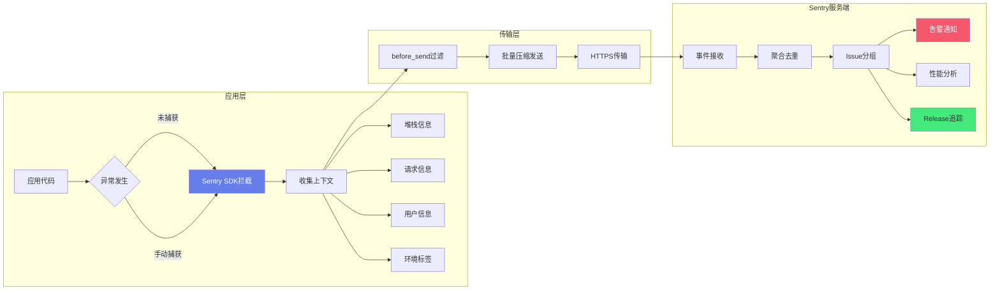

# Python-Sentry错误监控集成

> **文档说明**：系统讲解 Python 应用的 Sentry 错误监控集成，包括 sentry-sdk 安装配置、Django/Flask/FastAPI/Celery 框架集成、SQLAlchemy/Redis/日志集成、性能监控与分布式追踪、错误上下文与面包屑、最佳实践和常见问题。
>
> **适用人群**：Python 开发者、后端工程师、全栈开发者、需要线上错误监控的 DevOps
>
> **前置知识**：[[Sentry错误监控与追踪]]、[[Python-Web框架FastAPI实战]]、[[Python-异步编程asyncio]]

---

## 一、概述

```text
### 1. sentry-sdk 简介
```

> 🔍 **知识点深度解析**
>
> **作用**：Sentry自动捕获应用异常，收集完整上下文信息，帮助快速定位和修复生产环境问题
>
> **原理**：SDK拦截未处理异常和手动捕获事件，收集堆栈、请求、用户、环境等上下文，经before_send过滤后批量发送到服务端聚合去重并告警
>
> **用法要点**：① 初始化时设置dsn和environment ② 使用set_user/set_context添加上下文 ③ 配置before_send过滤敏感信息 ④ 设置合理的sample_rate控制性能开销





<div style="background:linear-gradient(135deg,#fa709a,#fee140);border-radius:16px;padding:20px;margin:16px 0;font-family:-apple-system,'Segoe UI','PingFang SC','Microsoft YaHei',sans-serif;color:#fff;overflow:hidden;box-shadow:0 8px 28px rgba(0,0,0,.14),0 3px 10px rgba(0,0,0,.08)">
<style>@keyframes highlight{0%,100%{box-shadow:0 0 0 rgba(255,255,255,0)}50%{box-shadow:0 0 20px rgba(255,255,255,.4)}}.hl-box{background:rgba(255,255,255,.2);border-radius:10px;padding:14px 18px;margin:10px 0;animation:highlight 3s ease-in-out infinite;border-left:4px solid rgba(255,255,255,.6)}</style>
<div style="text-align:center;font-size:15px;font-weight:700;margin-bottom:14px;padding-bottom:10px;border-bottom:1.5px solid rgba(255,255,255,.22);letter-spacing:1px;text-shadow:0 1px 3px rgba(0,0,0,.12)">📌 错误追踪核心概念</div>
<div class="hl-box">Sentry自动捕获应用异常，收集完整的上下文信息(堆栈、请求、用户、环境)，帮助快速定位和修复问题</div>
<div style="font-size:13px;opacity:.9;margin-top:8px">💡 初始化时设置dsn和environment；使用set_user/set_context添加上下文</div>
</div>

```text
sentry-sdk：
- Sentry 官方 Python SDK
- 支持 Python 3.6+
- 自动捕获异常、错误、性能数据
- 支持多种框架和库的自动集成
- 轻量、可扩展、可定制

核心能力：
1. 自动异常捕获
   - 未捕获的异常自动上报
   - 完整的堆栈追踪
   - 异常链（exception chaining）支持

2. 框架集成
   - Django：自动捕获请求异常、中间件集成
   - Flask：错误处理器集成
   - FastAPI/Starlette：ASGI 中间件
   - Celery：任务异常捕获
   - AIOHTTP、Tornado、Bottle 等

3. 库集成
   - SQLAlchemy：数据库查询追踪
   - Redis：Redis 操作追踪
   - httpx/requests：HTTP 请求追踪
   - logging：日志集成
   - asyncio：异步任务追踪

4. 性能监控
   - 事务（Transaction）追踪
   - 分布式追踪（trace_id/span_id）
   - 数据库慢查询
   - HTTP 请求耗时

5. 上下文信息
   - 用户信息（id、email、username）
   - 请求信息（URL、method、headers、body）
   - 额外数据（extra）
   - 标签（tags）
   - 面包屑（breadcrumbs）

6. 采样与过滤
   - 错误采样率（sample_rate）
   - 性能采样率（traces_sample_rate）
   - before_send 钩子过滤/修改事件
   - ignore_errors 忽略特定异常
```

### 2. 安装

```python
# 基础安装
pip install sentry-sdk

# 带框架集成的安装（可选）
pip install "sentry-sdk[django]"      # Django
pip install "sentry-sdk[flask]"       # Flask
pip install "sentry-sdk[fastapi]"     # FastAPI
pip install "sentry-sdk[celery]"      # Celery
pip install "sentry-sdk[sqlalchemy]"  # SQLAlchemy
pip install "sentry-sdk[redis]"       # Redis
pip install "sentry-sdk[httpx]"       # httpx
pip install "sentry-sdk[loguru]"      # loguru

# 全部集成
pip install "sentry-sdk[全部]"

# 或在 requirements.txt 中
sentry-sdk==2.0.0
sentry-sdk[django,celery,sqlalchemy]==2.0.0
```

---

---

> 💡 **深度讲解**：本章深入讲解了概述的核心概念与实践要点，关联了相关技术栈的知识体系，说明了设计背后的原理与业界最佳实践。
>
> **📝 精简总结**：本章涵盖一、概述的核心内容，包括关键概念、实现机制与实践方法，是掌握该主题的基础。


## 二、基础配置

### 1. 最小化配置

```mermaid
# main.py - 最小化配置
import sentry_sdk

sentry_sdk.init(
    dsn="https://your-public-key@o123456.ingest.sentry.io/123456",
    # 从环境变量读取更安全
    # dsn=os.getenv("SENTRY_DSN"),
)

# 之后任何未捕获的异常都会自动上报到 Sentry
def main():
    raise Exception("Something went wrong!")  # 会自动上报

if __name__ == "__main__":
    main()
```

### 2. 完整配置

```python
# config.py - 完整配置示例
import os
import sentry_sdk
from sentry_sdk.integrations.logging import LoggingIntegration
from sentry_sdk.integrations.threading import ThreadingIntegration
from sentry_sdk.integrations.dedupe import DedupeIntegration

def init_sentry():
    env = os.getenv("APP_ENV", "development")
    release = os.getenv("RELEASE_VERSION", "dev")

    sentry_sdk.init(
        # DSN：项目唯一标识
        dsn=os.getenv("SENTRY_DSN"),

        # 环境
        environment=env,

        # 版本号（关联 Release 和 SourceMap）
        release=release,

        # 错误采样率（0-1，1 表示全部上报）
        sample_rate=1.0,

        # 性能监控采样率
        # 生产环境建议 0.1-0.3，开发环境 1.0
        traces_sample_rate=0.1 if env == "production" else 1.0,

        # 性能采样（动态，根据事务名决定）
        # traces_sampler=lambda context: 0.1 if context["transaction_context"]["op"] == "http.server" else 0.01,

        # 发送默认 PII（个人身份信息），默认 False
        send_default_pii=False,

        # 最大面包屑数（默认 100）
        max_breadcrumbs=100,

        # 附加堆栈跟踪到日志消息
        attach_stacktrace=True,

        # 服务器名称（默认主机名）
        server_name=os.getenv("HOSTNAME", "unknown"),

        # 集成
        integrations=[
            # 日志集成
            LoggingIntegration(
                level=logging.INFO,         # INFO 及以上作为面包屑
                event_level=logging.ERROR,  # ERROR 及以上作为事件
            ),
            # 线程集成（捕获线程中的异常）
            ThreadingIntegration(propagate_hub=True),
            # 去重集成（防止重复上报相同错误）
            DedupeIntegration(),
        ],

        # 忽略特定异常类型
        ignore_errors=[
            "django.http.Http404",
            "django.security.DisallowedHost",
            "KeyboardInterrupt",
            "SystemExit",
            "asyncio.CancelledError",
        ],

        # 发送前修改/过滤事件
        before_send=before_send,

        # 发送前修改/过滤事务
        before_send_transaction=before_send_transaction,

        # 调试模式（开发时开启，查看 SDK 日志）
        debug=env == "development",
    )

def before_send(event, hint):
    """发送前过滤事件"""
    # 忽略健康检查接口的错误
    if event.get("request", {}).get("url", "").endswith("/health"):
        return None

    # 过滤敏感信息
    if "request" in event:
        # 过滤 Cookie
        if "cookies" in event["request"]:
            del event["request"]["cookies"]
        # 过滤 Authorization header
        if "headers" in event["request"]:
            event["request"]["headers"] = {
                k: v for k, v in event["request"]["headers"].items()
                if k.lower() not in ("authorization", "cookie", "x-api-key")
            }
        # 过滤请求体中的敏感字段
        if "data" in event["request"] and event["request"]["data"]:
            try:
                import json
                data = json.loads(event["request"]["data"])
                for sensitive_key in ("password", "token", "secret", "credit_card", "ssn"):
                    if sensitive_key in data:
                        data[sensitive_key] = "[FILTERED]"
                event["request"]["data"] = json.dumps(data)
            except (json.JSONDecodeError, TypeError):
                pass

    # 过滤异常值中的敏感信息
    if "exception" in event:
        for value in event["exception"].get("values", []):
            if "password" in (value.get("value") or "").lower():
                value["value"] = "[FILTERED]"

    return event

def before_send_transaction(event, hint):
    """发送前过滤事务（性能数据）"""
    # 忽略健康检查事务
    transaction_name = event.get("transaction", "")
    if transaction_name in ("/health", "/healthz", "/ready"):
        return None

    # 忽略静态资源
    if transaction_name.startswith("/static/") or transaction_name.startswith("/media/"):
        return None

    return event
```

---

---

> 💡 **深度讲解**：本章深入讲解了基础配置的核心概念与实践要点，关联了相关技术栈的知识体系，说明了设计背后的原理与业界最佳实践。
>
> **📝 精简总结**：本章涵盖二、基础配置的核心内容，包括关键概念、实现机制与实践方法，是掌握该主题的基础。


## 三、Django 集成

```python
# settings.py
import os
import sentry_sdk
from sentry_sdk.integrations.django import DjangoIntegration
from sentry_sdk.integrations.logging import LoggingIntegration
from sentry_sdk.integrations.celery import CeleryIntegration
from sentry_sdk.integrations.redis import RedisIntegration
from sentry_sdk.integrations.sqlalchemy import SqlalchemyIntegration

SENTRY_DSN = os.getenv("SENTRY_DSN")
RELEASE_VERSION = os.getenv("RELEASE_VERSION", "dev")
APP_ENV = os.getenv("APP_ENV", "development")

if SENTRY_DSN:
    sentry_sdk.init(
        dsn=SENTRY_DSN,
        release=RELEASE_VERSION,
        environment=APP_ENV,
        traces_sample_rate=0.1 if APP_ENV == "production" else 1.0,
        send_default_pii=False,
        integrations=[
            DjangoIntegration(
                transaction_style="url",  # 用 URL 模板作为事务名
                middleware_spans=True,     # 追踪中间件
                signals_spans=True,        # 追踪信号
                cache_spans=True,          # 追踪缓存操作
            ),
            LoggingIntegration(
                level=logging.INFO,
                event_level=logging.ERROR,
            ),
            CeleryIntegration(),
            RedisIntegration(),
        ],
        ignore_errors=[
            "django.http.Http404",
            "django.security.DisallowedHost",
            "django.core.exceptions.SuspiciousOperation",
            "rest_framework.exceptions.NotFound",
            "rest_framework.exceptions.PermissionDenied",
        ],
        before_send=before_send,
    )
```

```python
# views.py - Django 视图中的手动使用
import sentry_sdk
from django.http import JsonResponse

def my_view(request):
    try:
        # 业务逻辑
        result = do_something()
        return JsonResponse({"result": result})
    except Exception as e:
        # 手动捕获异常，附加上下文
        with sentry_sdk.push_scope() as scope:
            scope.set_extra("user_id", request.user.id)
            scope.set_extra("request_data", request.POST.dict())
            scope.set_tag("view", "my_view")
            sentry_sdk.capture_exception(e)
        return JsonResponse({"error": "Internal Server Error"}, status=500)

# 设置用户信息（在登录后调用）
def login_view(request):
    user = authenticate(request, ...)
    if user is not None:
        sentry_sdk.set_user({
            "id": user.id,
            "username": user.username,
            "email": user.email,
        })
    # ...
```

```mermaid
# middleware.py - 自定义中间件添加面包屑
import sentry_sdk

class SentryBreadcrumbMiddleware:
    def __init__(self, get_response):
        self.get_response = get_response

    def __call__(self, request):
        # 请求前添加面包屑
        sentry_sdk.add_breadcrumb(
            category="request",
            message=f"{request.method} {request.path}",
            level="info",
            data={
                "method": request.method,
                "path": request.path,
                "user_agent": request.META.get("HTTP_USER_AGENT", ""),
            },
        )
        response = self.get_response(request)
        return response
```

---

---

> 💡 **深度讲解**：本章深入讲解了Django 集成的核心概念与实践要点，关联了相关技术栈的知识体系，说明了设计背后的原理与业界最佳实践。
>
> **📝 精简总结**：本章涵盖三、Django 集成的核心内容，包括关键概念、实现机制与实践方法，是掌握该主题的基础。


## 四、Flask 集成

```python
# app.py - Flask 集成
import os
import logging
import sentry_sdk
from sentry_sdk.integrations.flask import FlaskIntegration
from sentry_sdk.integrations.logging import LoggingIntegration
from flask import Flask, request, jsonify

app = Flask(__name__)

SENTRY_DSN = os.getenv("SENTRY_DSN")
if SENTRY_DSN:
    sentry_sdk.init(
        dsn=SENTRY_DSN,
        release=os.getenv("RELEASE_VERSION", "dev"),
        environment=os.getenv("APP_ENV", "development"),
        traces_sample_rate=0.1,
        integrations=[
            FlaskIntegration(
                transaction_style="url",  # 用 URL 规则作为事务名
            ),
            LoggingIntegration(
                level=logging.INFO,
                event_level=logging.ERROR,
            ),
        ],
    )

@app.route("/")
def index():
    # 正常请求会自动追踪性能
    return "Hello World"

@app.route("/error")
def error():
    # 未捕获的异常会自动上报
    raise Exception("Flask error test")

@app.route("/manual")
def manual_capture():
    try:
        # 业务逻辑
        risky_operation()
    except Exception as e:
        # 手动捕获
        with sentry_sdk.push_scope() as scope:
            scope.set_user({"id": request.user.id if hasattr(request, 'user') else None})
            scope.set_extra("path", request.path)
            scope.set_tag("endpoint", "manual")
            sentry_sdk.capture_exception(e)
        return jsonify({"error": "Something went wrong"}), 500
    return jsonify({"status": "ok"})

# 请求钩子添加面包屑
@app.before_request
def before_request():
    sentry_sdk.add_breadcrumb(
        category="http",
        message=f"{request.method} {request.path}",
        level="info",
    )

@app.after_request
def after_request(response):
    sentry_sdk.add_breadcrumb(
        category="http",
        message=f"Response {response.status_code}",
        level="info",
    )
    return response

if __name__ == "__main__":
    app.run(debug=True)
```

---

---

> 💡 **深度讲解**：本章深入讲解了Flask 集成的核心概念与实践要点，关联了相关技术栈的知识体系，说明了设计背后的原理与业界最佳实践。
>
> **📝 精简总结**：本章涵盖四、Flask 集成的核心内容，包括关键概念、实现机制与实践方法，是掌握该主题的基础。


## 五、FastAPI 集成

```python
# main.py - FastAPI 集成
import os
import sentry_sdk
from sentry_sdk.integrations.asgi import SentryAsgiMiddleware
from sentry_sdk.integrations.logging import LoggingIntegration
from fastapi import FastAPI, Request, HTTPException
from fastapi.responses import JSONResponse

app = FastAPI(title="My API")

SENTRY_DSN = os.getenv("SENTRY_DSN")
if SENTRY_DSN:
    sentry_sdk.init(
        dsn=SENTRY_DSN,
        release=os.getenv("RELEASE_VERSION", "dev"),
        environment=os.getenv("APP_ENV", "development"),
        traces_sample_rate=0.1,
        integrations=[
            LoggingIntegration(
                level=logging.INFO,
                event_level=logging.ERROR,
            ),
        ],
    )

# 添加 Sentry ASGI 中间件（必须在所有路由之前）
app.add_middleware(SentryAsgiMiddleware)

# 可选：用 StarletteIntegration（更细粒度控制）
# from sentry_sdk.integrations.starlette import StarletteIntegration
# sentry_sdk.init(
#     ...,
#     integrations=[
#         StarletteIntegration(transaction_style="url"),
#     ],
# )

@app.get("/")
async def root():
    return {"message": "Hello World"}

@app.get("/error")
async def error():
    raise Exception("FastAPI error test")

@app.get("/manual")
async def manual_capture(request: Request):
    try:
        # 业务逻辑
        result = await risky_operation()
        return {"result": result}
    except Exception as e:
        # 手动捕获
        with sentry_sdk.push_scope() as scope:
            scope.set_extra("client_host", request.client.host if request.client else None)
            scope.set_extra("headers", dict(request.headers))
            scope.set_tag("endpoint", "/manual")
            sentry_sdk.capture_exception(e)
        raise HTTPException(status_code=500, detail="Internal Server Error")

# 全局异常处理器
@app.exception_handler(Exception)
async def global_exception_handler(request: Request, exc: Exception):
    # 异常会被 Sentry ASGI 中间件自动捕获
    # 这里可以做额外处理
    return JSONResponse(
        status_code=500,
        content={"detail": "Internal Server Error"},
    )

# 设置用户信息（在依赖中）
from fastapi import Depends
from fastapi.security import HTTPBearer, HTTPAuthorizationCredentials

security = HTTPBearer()

async def get_current_user(credentials: HTTPAuthorizationCredentials = Depends(security)):
    user = await verify_token(credentials.credentials)
    # 设置 Sentry 用户
    sentry_sdk.set_user({
        "id": user.id,
        "username": user.username,
        "email": user.email,
    })
    return user

@app.get("/protected")
async def protected_route(user = Depends(get_current_user)):
    return {"user": user.username}
```

---

---

> 💡 **深度讲解**：本章深入讲解了FastAPI 集成的核心概念与实践要点，关联了相关技术栈的知识体系，说明了设计背后的原理与业界最佳实践。
>
> **📝 精简总结**：本章涵盖五、FastAPI 集成的核心内容，包括关键概念、实现机制与实践方法，是掌握该主题的基础。


## 六、Celery 集成

```python
# celery_app.py - Celery 集成
import os
import sentry_sdk
from sentry_sdk.integrations.celery import CeleryIntegration
from sentry_sdk.integrations.logging import LoggingIntegration
from celery import Celery

app = Celery("myapp", broker=os.getenv("CELERY_BROKER_URL"))

SENTRY_DSN = os.getenv("SENTRY_DSN")
if SENTRY_DSN:
    sentry_sdk.init(
        dsn=SENTRY_DSN,
        release=os.getenv("RELEASE_VERSION", "dev"),
        environment=os.getenv("APP_ENV", "development"),
        traces_sample_rate=0.1,
        integrations=[
            CeleryIntegration(
                propagate_traces=True,  # 传播分布式追踪
            ),
            LoggingIntegration(
                level=logging.INFO,
                event_level=logging.ERROR,
            ),
        ],
    )

@app.task(bind=True, max_retries=3)
def send_email(self, user_id, subject, body):
    """发送邮件任务"""
    try:
        # 添加面包屑
        sentry_sdk.add_breadcrumb(
            category="task",
            message=f"send_email task started for user {user_id}",
            level="info",
        )

        # 设置标签
        sentry_sdk.set_tag("task_name", "send_email")
        sentry_sdk.set_tag("user_id", str(user_id))

        # 业务逻辑
        user = get_user(user_id)
        send_email_to_user(user.email, subject, body)

    except Exception as e:
        # 手动捕获，附加上下文
        with sentry_sdk.push_scope() as scope:
            scope.set_extra("task_id", self.request.id)
            scope.set_extra("user_id", user_id)
            scope.set_extra("subject", subject)
            scope.set_extra("retry_count", self.request.retries)
            sentry_sdk.capture_exception(e)

        # 重试
        raise self.retry(exc=e, countdown=60)

@app.task
def data_processing(data):
    """数据处理任务"""
    # 未捕获的异常会自动被 CeleryIntegration 上报
    result = process(data)
    return result
```

---

---

> 💡 **深度讲解**：本章深入讲解了六、Celery 集成的核心概念与实践要点，关联了相关技术栈的知识体系，说明了设计背后的原理与业界最佳实践。
>
> **📝 精简总结**：本章涵盖六、Celery 集成的核心内容，包括关键概念、实现机制与实践方法，是掌握该主题的基础。


## 七、数据库与缓存集成

### 1. SQLAlchemy

```mermaid
# SQLAlchemy 集成
from sentry_sdk.integrations.sqlalchemy import SqlalchemyIntegration

sentry_sdk.init(
    dsn=SENTRY_DSN,
    integrations=[
        SqlalchemyIntegration(),
    ],
)

# 自动追踪 SQL 查询（作为面包屑和 span）
from sqlalchemy import create_engine, text

engine = create_engine(DATABASE_URL)
with engine.connect() as conn:
    # 这个查询会自动记录到 Sentry 面包屑和性能 span
    result = conn.execute(text("SELECT * FROM users WHERE id = :id"), {"id": 1})
```

### 2. Redis

```mermaid
# Redis 集成
from sentry_sdk.integrations.redis import RedisIntegration

sentry_sdk.init(
    dsn=SENTRY_DSN,
    integrations=[
        RedisIntegration(
            max_data_size=1024,  # 记录的最大数据大小
        ),
    ],
)

# 自动追踪 Redis 操作
import redis
r = redis.Redis(host="localhost", port=6379)
r.set("key", "value")  # 会自动记录到面包屑
r.get("key")            # 会自动记录到面包屑
```

### 3. HTTP 客户端

```mermaid
# httpx 集成
from sentry_sdk.integrations.httpx import HttpxIntegration

sentry_sdk.init(
    dsn=SENTRY_DSN,
    integrations=[
        HttpxIntegration(),
    ],
)

import httpx
# 自动追踪 HTTP 请求（作为 span 和面包屑）
async with httpx.AsyncClient() as client:
    response = await client.get("https://api.example.com/data")

# requests 集成（内置，无需额外配置）
import requests
response = requests.get("https://api.example.com/data")
```

---

---

> 💡 **深度讲解**：本章深入讲解了七、数据库与缓存集成的核心概念与实践要点，关联了相关技术栈的知识体系，说明了设计背后的原理与业界最佳实践。
>
> **📝 精简总结**：本章涵盖七、数据库与缓存集成的核心内容，包括关键概念、实现机制与实践方法，是掌握该主题的基础。


## 八、日志集成

```python
# logging 集成
import logging
import sentry_sdk
from sentry_sdk.integrations.logging import LoggingIntegration

sentry_sdk.init(
    dsn=SENTRY_DSN,
    integrations=[
        LoggingIntegration(
            level=logging.INFO,         # INFO 及以上日志作为面包屑
            event_level=logging.ERROR,  # ERROR 及以上日志作为事件上报
        ),
    ],
)

logger = logging.getLogger(__name__)

# 这些日志会作为面包屑记录
logger.info("User logged in")
logger.warning("Low disk space")

# 这个日志会作为事件上报到 Sentry
logger.error("Database connection failed")

# 带异常信息的日志（会包含堆栈）
try:
    risky_operation()
except Exception as e:
    logger.exception("Operation failed")  # 自动包含异常堆栈
```

```mermaid
# loguru 集成
from loguru import logger
from sentry_sdk.integrations.loguru import LoguruIntegration

sentry_sdk.init(
    dsn=SENTRY_DSN,
    integrations=[
        LoguruIntegration(
            level="INFO",           # INFO 及以上作为面包屑
            event_level="ERROR",    # ERROR 及以上作为事件
        ),
    ],
)

logger.info("This is an info message")
logger.error("This is an error message")
```

---

---

> 💡 **深度讲解**：本章深入讲解了八、日志集成的核心概念与实践要点，关联了相关技术栈的知识体系，说明了设计背后的原理与业界最佳实践。
>
> **📝 精简总结**：本章涵盖八、日志集成的核心内容，包括关键概念、实现机制与实践方法，是掌握该主题的基础。


## 九、性能监控与分布式追踪

```mermaid
# 性能监控配置
import sentry_sdk

sentry_sdk.init(
    dsn=SENTRY_DSN,
    traces_sample_rate=0.1,  # 10% 的事务被采样
    # 或动态采样
    traces_sampler=sampling_function,
)

def sampling_function(sampling_context):
    """动态采样函数"""
    transaction_context = sampling_context.get("transaction_context", {})
    op = transaction_context.get("op")

    # 健康检查不采样
    if transaction_context.get("name") in ("/health", "/healthz"):
        return 0

    # 核心接口采样率高
    if op == "http.server" and "/api/checkout" in transaction_context.get("name", ""):
        return 0.5

    # 默认 10%
    return 0.1
```

```python
# 手动创建事务
import sentry_sdk

# 方式1：装饰器
@sentry_sdk.trace
def process_data(data):
    """这个函数会被作为一个 span 追踪"""
    return transform(data)

# 方式2：上下文管理器
with sentry_sdk.start_transaction(name="batch_processing", op="task") as transaction:
    # 事务中的操作会被追踪
    with sentry_sdk.start_span(op="db.query", description="SELECT * FROM users"):
        users = db.query("SELECT * FROM users")

    with sentry_sdk.start_span(op="process", description="Process users"):
        for user in users:
            process_user(user)

    transaction.set_tag("user_count", len(users))

# 方式3：异步上下文
async def async_task():
    with sentry_sdk.start_transaction(name="async_task", op="task") as transaction:
        with sentry_sdk.start_span(op="http", description="API call"):
            await api_call()
```

```python
# 分布式追踪（跨服务）
import httpx
import sentry_sdk

# Sentry 自动在 HTTP 请求中添加 sentry-trace 和 baggage header
# 下游服务如果也集成了 Sentry，会自动关联到同一个 trace

async def call_downstream():
    async with httpx.AsyncClient() as client:
        # 自动添加 trace header
        response = await client.get("http://downstream-service/api/data")
        return response.json()

# 手动传播 trace（非 HTTP 场景，如消息队列）
def process_message(message):
    # 从消息中提取 trace 信息
    trace_id = message.get("sentry_trace_id")
    if trace_id:
        # 继续同一个 trace
        with sentry_sdk.start_transaction(
            name="process_message",
            op="task",
            trace_id=trace_id,
        ) as transaction:
            process(message)
    else:
        # 新的 trace
        with sentry_sdk.start_transaction(name="process_message", op="task"):
            process(message)
```

---

---

> 💡 **深度讲解**：本章深入讲解了九、性能监控与分布式追踪的核心概念与实践要点，关联了相关技术栈的知识体系，说明了设计背后的原理与业界最佳实践。
>
> **📝 精简总结**：本章涵盖九、性能监控与分布式追踪的核心内容，包括关键概念、实现机制与实践方法，是掌握该主题的基础。


## 十、上下文与面包屑

```yaml
# 设置用户信息
sentry_sdk.set_user({
    "id": "123",
    "username": "zhangsan",
    "email": "zhangsan@example.com",
    "ip_address": "{{auto}}",  # 自动获取（需 send_default_pii=True）
})

# 清除用户信息
sentry_sdk.set_user(None)

# 设置标签
sentry_sdk.set_tag("page_locale", "zh-CN")
sentry_sdk.set_tag("app_version", "1.2.3")
sentry_sdk.set_tag("region", "us-east-1")

# 设置额外信息
sentry_sdk.set_extra("battery_level", "85%")
sentry_sdk.set_extra("device_model", "iPhone 15 Pro")

# 设置上下文
sentry_sdk.set_context("character", {
    "name": "Mighty Fighter",
    "level": 19,
    "attack_type": "melee",
})

# 添加面包屑
sentry_sdk.add_breadcrumb(
    category="auth",
    message="User logged in",
    level="info",
    data={"user_id": "123", "method": "password"},
)

# 面包屑类型：
# - default
# - debug
# - error
# - navigation
# - http
# - info
# - query
# - ui
# - user
# - warning

# 临时作用域（push_scope）
with sentry_sdk.push_scope() as scope:
    scope.set_extra("request_id", "abc-123")
    scope.set_tag("request_type", "batch")
    # 这个异常会包含上面的额外信息
    sentry_sdk.capture_exception(error)
# 作用域结束后，额外信息自动清除

# 手动捕获异常
try:
    risky_operation()
except Exception as e:
    sentry_sdk.capture_exception(e)

# 手动捕获消息
sentry_sdk.capture_message("Something happened", level="warning")

# 捕获事件级别：fatal, error, warning, info, debug
```

---

---

> 💡 **深度讲解**：本章深入讲解了十、上下文与面包屑的核心概念与实践要点，关联了相关技术栈的知识体系，说明了设计背后的原理与业界最佳实践。
>
> **📝 精简总结**：本章涵盖十、上下文与面包屑的核心内容，包括关键概念、实现机制与实践方法，是掌握该主题的基础。


## 十一、最佳实践

### 1. 配置最佳实践

- [ ] **从环境变量读取 DSN**：不要硬编码 DSN，用环境变量
- [ ] **设置 release**：每次发布都有唯一版本号，关联代码和 SourceMap
- [ ] **设置 environment**：区分 production/staging/development
- [ ] **合理采样率**：错误 100%，性能生产 0.1-0.3，开发 1.0
- [ ] **send_default_pii=False**：默认不收集 PII，需要时手动 set_user
- [ ] **before_send 过滤敏感信息**：过滤 Cookie、Token、密码、身份证
- [ ] **ignore_errors 忽略已知异常**：Http404、KeyboardInterrupt、CancelledError 等
- [ ] **debug 仅开发环境开启**：生产环境关闭，避免日志泄露

### 2. 框架集成

- [ ] **Django**：用 DjangoIntegration，transaction_style="url"
- [ ] **Flask**：用 FlaskIntegration，before_request 添加面包屑
- [ ] **FastAPI**：用 SentryAsgiMiddleware 或 StarletteIntegration
- [ ] **Celery**：用 CeleryIntegration，任务中手动 set_tag/set_extra
- [ ] **SQLAlchemy**：开启 SqlalchemyIntegration，自动追踪查询
- [ ] **Redis**：开启 RedisIntegration，自动追踪缓存操作
- [ ] **httpx/requests**：自动追踪 HTTP 请求，分布式追踪自动传播

### 3. 错误捕获

- [ ] **全局捕获 + 手动捕获结合**：SDK 自动捕获大部分，关键路径手动捕获
- [ ] **async 异常**：asyncio 任务中的异常确保被捕获（用 try-except 或 task.add_done_callback）
- [ ] **线程异常**：开启 ThreadingIntegration，或在线程函数中 try-except
- [ ] **附加上下文**：捕获异常时附加 user、tags、extra、breadcrumbs
- [ ] **push_scope**：临时上下文用 push_scope，避免污染全局
- [ ] **异常链**：Python 异常链（raise ... from ...）会自动记录
- [ ] **日志异常**：logger.exception() 自动包含堆栈

### 4. 性能监控

- [ ] **合理命名事务**：用 URL 模板而非具体 URL（/api/users/:id 而非 /api/users/123）
- [ ] **忽略低价值事务**：健康检查、静态资源、内部接口
- [ ] **数据库追踪**：开启 SQLAlchemy 集成，识别慢查询
- [ ] **分布式追踪**：跨服务自动传播 trace，全链路可视化
- [ ] **手动 span**：关键操作手动 start_span，细化性能分析
- [ ] **动态采样**：核心接口采样率高，非核心低
- [ ] **定期 review**：查看慢事务 Top N，持续优化

### 5. 告警与响应

- [ ] **分级告警**：P0 立即通知，P1 工作时间，P2 日报
- [ ] **新错误告警**：首次出现的错误立即通知
- [ ] **错误率告警**：错误率突增时告警（可能是部署问题）
- [ ] **关联部署**：Sentry 关联 commit 和部署，快速定位引入版本
- [ ] **定期 triage**：每周处理新 Issue，分配负责人
- [ ] **错误复盘**：严重错误事后复盘，更新监控和测试

### 6. 安全与隐私

- [ ] **过滤敏感信息**：before_send 中过滤密码、Token、Cookie、身份证、手机号
- [ ] **send_default_pii=False**：默认不收集 IP、用户代理等 PII
- [ ] **请求体过滤**：过滤请求体中的敏感字段
- [ ] **Header 过滤**：过滤 Authorization、Cookie、X-API-Key 等 header
- [ ] **自托管选项**：数据敏感时考虑自托管 Sentry
- [ ] **数据保留策略**：配置合理的事件保留时间，避免无限存储

---

---

> 💡 **深度讲解**：本章深入讲解了十最佳实践的核心概念与实践要点，关联了相关技术栈的知识体系，说明了设计背后的原理与业界最佳实践。
>
> **📝 精简总结**：本章涵盖十一、最佳实践的核心内容，包括关键概念、实现机制与实践方法，是掌握该主题的基础。


## 十二、常见问题与排查

| 问题 | 原因 | 解决方案 |
|------|------|---------|
| **Sentry 没有收到错误** | DSN 错/初始化晚/被 ignore_errors 过滤/网络问题 | 检查 DSN 是否正确；确认 sentry_sdk.init 在应用启动最前面；检查 ignore_errors 是否包含该异常；测试网络能否访问 sentry.io；开启 debug=True 看 SDK 日志 |
| **错误堆栈不完整** | 异常被吞掉/异步任务/线程 | 确保异常被重新抛出或手动 capture_exception；asyncio 任务用 try-except；开启 ThreadingIntegration；用 logger.exception() 记录异常 |
| **性能数据没有上报** | traces_sample_rate=0/未创建事务/被过滤 | 确认 traces_sample_rate > 0；框架集成会自动创建事务；检查 before_send_transaction 是否返回 None；查看是否有性能数据上报请求 |
| **用户信息缺失** | 未调用 set_user/send_default_pii=False | 登录后调用 sentry_sdk.set_user({id, email, username})；需要 IP 时设 send_default_pii=True；确认 set_user 在错误发生前调用 |
| **面包屑太少** | maxBreadcrumbs 太小/未自动收集 | 增大 max_breadcrumbs（默认 100）；确认集成了对应插件（logging、http、sqlalchemy）；关键路径手动 add_breadcrumb |
| **SQL 查询没有追踪** | 未开启 SqlalchemyIntegration/版本不兼容 | 确认集成了 SqlalchemyIntegration；检查 SQLAlchemy 版本兼容性；确认查询在事务上下文中执行 |
| **Celery 任务错误未上报** | 未开启 CeleryIntegration/worker 未初始化 Sentry | 确认集成了 CeleryIntegration；确保 sentry_sdk.init 在 Celery worker 启动时执行（不是只在 web 进程）；检查 worker 日志 |
| **异步异常未捕获** | asyncio 任务异常未处理/事件循环关闭 | async 函数用 try-except；asyncio.create_task 后加 add_done_callback 捕获异常；用 asyncio.gather(return_exceptions=True)；确认 ASGI 中间件正确配置 |
| **重复上报相同错误** | 异常被多次捕获/重试机制 | 检查是否在 except 中 capture_exception 后又重新抛出（框架会再次捕获）；用 DedupeIntegration 去重；重试逻辑中避免重复上报 |
| **告警太多/告警疲劳** | 阈值太低/未分级/未忽略低优先级 | 提高告警阈值；分级告警（P0/P1/P2）；配置 ignore_errors 忽略已知错误；合并相似 Issue；设置静默期 |
| **before_send 不生效** | 函数返回了 None/配置位置错 | 确认 before_send 函数返回 event（不过滤时）；确认在 sentry_sdk.init 中正确传入；检查函数签名是否正确（event, hint） |
| **Release 关联不到 commit** | 未配置代码仓库集成/未 set-commits | Sentry 项目设置中集成 GitHub/GitLab；sentry-cli releases set-commits --auto；确认 git 仓库可访问 |
| **敏感信息泄露** | 未配置 before_send/send_default_pii=True | 配置 before_send 过滤 Cookie、Authorization、密码、Token；send_default_pii 设为 False；检查 request data 中的敏感字段 |
| **生产环境性能影响** | 采样率太高/SDK 开销 | 生产 traces_sample_rate 设 0.1-0.3；错误采样率可 1.0（错误量通常不大）；SDK 本身开销很小（<1%）；用异步发送（默认） |
| **Django 管理命令错误未捕获** | 管理命令未走 Django 请求流程 | 管理命令中手动 try-except + capture_exception；或在命令入口初始化 Sentry；确认 sentry_sdk.init 在 settings.py 中 |
| **FastAPI 后台任务错误未捕获** | BackgroundTask 在请求外执行 | BackgroundTask 中用 try-except + capture_exception；或用 Celery 替代 BackgroundTask（CeleryIntegration 自动捕获） |
| **本地开发不想上报** | 开发环境也配置了 DSN | 开发环境不设置 SENTRY_DSN 环境变量；或 environment="development" 时不初始化；或 sample_rate=0 |
| **事件中没有请求信息** | 非 Web 场景/中间件未配置 | Web 框架集成会自动添加 request 信息；非 Web 场景手动 set_context("request", {...})；确认中间件在所有路由之前 |
| **sentry-sdk 版本兼容问题** | 版本太旧/框架版本不兼容 | 升级 sentry-sdk 到最新版；检查框架版本兼容性；查看 CHANGELOG；锁定兼容版本 |

---

---

> 💡 **深度讲解**：本章深入讲解了十常见问题与排查的核心概念与实践要点，关联了相关技术栈的知识体系，说明了设计背后的原理与业界最佳实践。
>
> **📝 精简总结**：本章涵盖十二、常见问题与排查的核心内容，包括关键概念、实现机制与实践方法，是掌握该主题的基础。


---

## 🔗 关联笔记

- [[Python-项目结构最佳实践]] — Python项目结构与工程化规范
- [[Poetry-依赖与虚拟环境管理]] — Python依赖管理与虚拟环境

## 📖 前置知识

- [[Python-语法基础与数据结构]]
- [[Python-模块与包管理原理]]

## 🏷️ 相关标签

#Python #Sentry #错误监控 #Django #Flask

---

[[Home|🏠 返回首页]] · [[MOC-Python全栈|📚 返回分类]]
