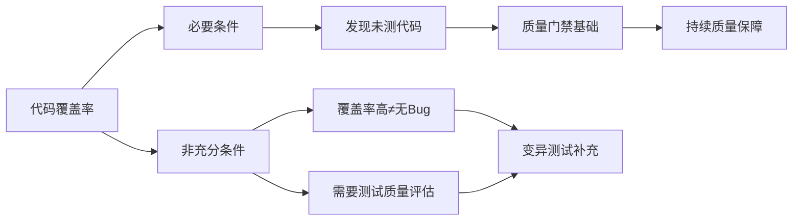
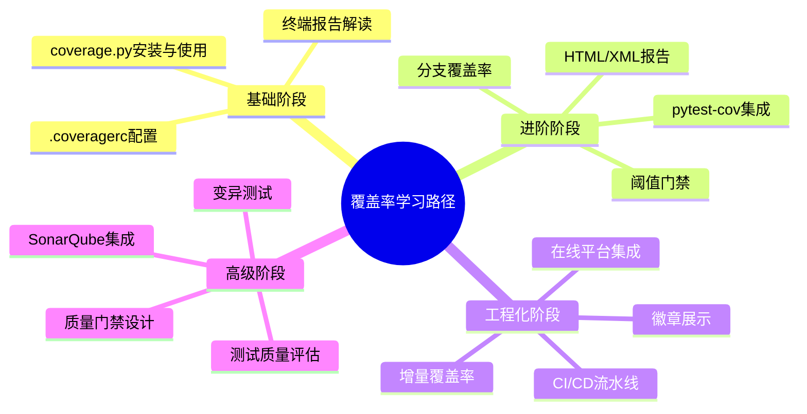
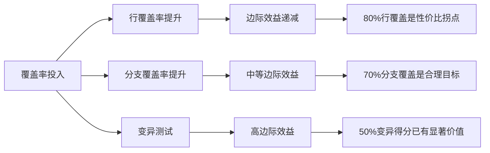
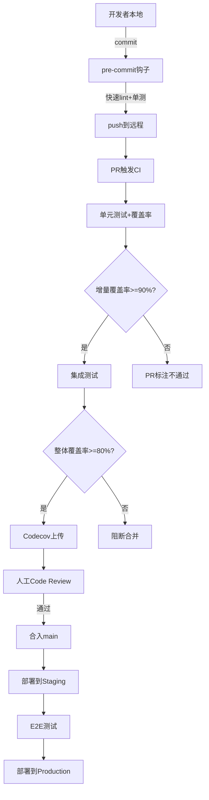
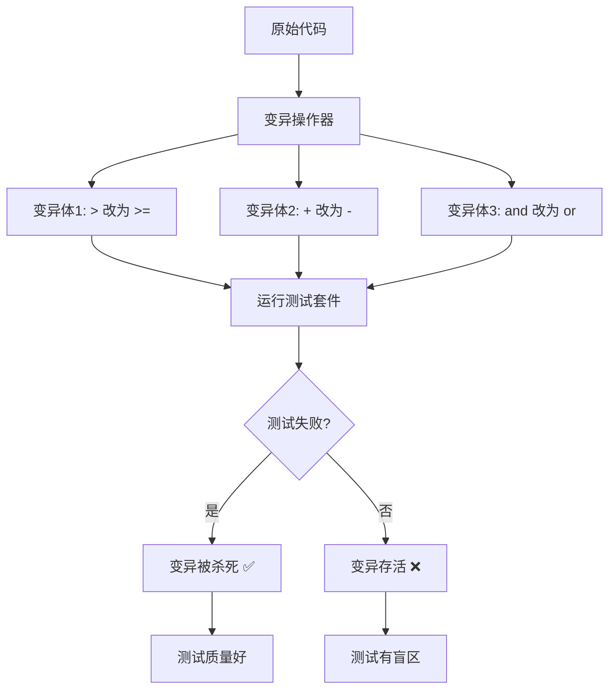
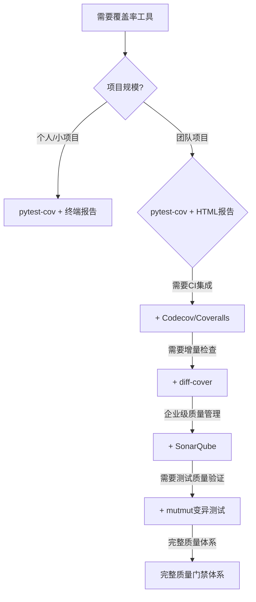

# Python-代码覆盖率与质量门禁

> **文档定位**：本文档是Python代码覆盖率与质量门禁领域的完整深度指南，覆盖从coverage.py基础使用到CI/CD流水线门禁设计、从行覆盖到变异测试的全链路知识体系。
>
> **适用人群**：Python后端开发者、全栈工程师、测试工程师、DevOps工程师、技术负责人
>
> **前置知识**：[[Python-异常处理与错误体系]]、[[测试工程-契约测试与集成测试]]、基础pytest使用经验

---

## 一、概述与学习路径

### 1.1 什么是代码覆盖率

**概念解释**：代码覆盖率（Code Coverage）是衡量测试用例执行了多少源代码的量化指标，反映测试套件对生产代码的覆盖程度。打个比方，覆盖率就像体检报告里"检查了多少器官"——覆盖越多，发现隐藏问题的概率越大，但"检查过的器官"不代表完全健康。

**核心价值**：
- 发现未被测试覆盖的代码盲区
- 量化评估测试充分程度
- 在CI/CD中作为质量门禁防止低质量代码合入
- 建立团队质量文化和量化基线

> 🎯 面试高频：代码覆盖率的定义、覆盖率不是什么、覆盖率的局限性

### 1.2 覆盖率与测试质量的关系



**关键认知**：
| 认知误区 | 正确理解 |
|---------|---------|
| 100%覆盖率=零Bug | 覆盖率只衡量"执行过"，不衡量"断言正确" |
| 覆盖率越高越好 | 高覆盖率可能意味着为覆盖率写无意义测试 |
| 行覆盖率够了 | 分支覆盖率更能发现逻辑遗漏 |
| 覆盖率低=测试差 | 覆盖率低可能因为配置错误或环境差异 |

### 1.3 Python覆盖率工具生态

| 工具 | 类型 | 核心能力 | 适用场景 |
|------|------|---------|---------|
| **coverage.py** | 底层库 | 插桩收集覆盖率数据 | 所有Python覆盖率场景的基础 |
| **pytest-cov** | pytest插件 | 与pytest无缝集成 | 主流pytest项目首选 |
| **coverage-badge** | 工具 | 生成SVG覆盖率徽章 | README展示 |
| **diff-cover** | 工具 | 增量覆盖率检查 | PR评审中检查变更代码 |
| **mutmut** | 工具 | 变异测试 | 评估测试断言质量 |
| **Codecov** | 在线平台 | 覆盖率趋势分析 | 开源/商业项目 |
| **Coveralls** | 在线平台 | 覆盖率追踪 | CI集成 |
| **SonarQube** | 静态分析平台 | 覆盖率+代码质量 | 企业级质量管理 |

### 1.4 学习路径



---

> 💡 **深度讲解**：本章建立了覆盖率领域的整体认知框架。覆盖率不是万能药，但它是当前最成熟、最可量化的测试充分性指标。理解覆盖率的边界——它衡量"执行"而非"正确性"——是正确使用这一工具的前提。后续章节将从工具使用到工程实践逐步深入，最终达到设计完整质量门禁体系的能力。
>
> **📝 精简总结**：
> - 核心概念：代码覆盖率=测试执行的源代码比例
> - 关键认知：覆盖率是必要非充分条件，100%≠无Bug
> - 工具生态：coverage.py(底层) → pytest-cov(pytest集成) → diff-cover(增量) → mutmut(变异测试)
> - 学习路线：基础使用 → 报告分析 → CI集成 → 质量门禁设计
>
> **🎯 梯度练习题**：
> - ⭐ 基础题1：代码覆盖率的定义是什么？它衡量的是什么？
> - ⭐ 基础题2：为什么说100%覆盖率不等于没有Bug？
> - ⭐ 进阶题1：行覆盖率和分支覆盖率有什么区别？哪个更重要？
> - ⭐⭐ 进阶题2：在什么场景下，高覆盖率反而可能是一个危险信号？
> - ⭐⭐⭐ 实战题：你接手一个新项目，现有测试覆盖率只有30%，请设计一个分阶段提升覆盖率的计划，考虑团队接受度和业务交付节奏。

---

## 二、coverage.py深度使用

### 2.1 安装与初始化

**概念解释**：coverage.py是Python生态的标准覆盖率测量工具，通过在代码执行前插入探针（插桩），记录每行代码是否被执行过。它就像在你代码的每行门口装了一个红外感应器，有人走过就自动计数。

**原理说明**：coverage.py底层使用Python的`sys.settrace()`函数或C扩展（tracemalloc优化版）来追踪代码执行事件。当Python解释器执行一行代码时，coverage的trace函数会被调用，记录当前文件名和行号。执行完成后，coverage将收集到的行号集合与源文件的可执行行集合对比，计算覆盖率百分比。

**技术对比**：
| 追踪方式 | 性能开销 | 准确性 | 适用场景 |
|---------|---------|--------|---------|
| sys.settrace() | 约2-3x减速 | 高 | 默认纯Python实现 |
| C扩展 tracer | 约1.5x减速 | 高 | 安装C扩展后自动启用 |
| PyCoverage | 约1.2x减速 | 高 | 最新版推荐 |

**代码示例**：

```python
# 示例1：安装coverage.py
# pip install coverage
# pip install pytest-cov  # pytest集成版本
# 验证安装
import coverage
print(f"coverage.py版本: {coverage.__version__}")
# 预期输出: coverage.py版本: 7.x.x
```

```bash
# 示例2：命令行安装与验证
pip install coverage pytest-cov
coverage --version
# 预期输出: Coverage.py 7.x.x
which coverage
# 预期输出: /usr/local/bin/coverage 或对应路径
```

```python
# 示例3：Python API方式使用coverage
import coverage

# 创建coverage对象并启动
cov = coverage.Coverage(source=["myapp"])
cov.start()

# 执行被测量的代码
from myapp.core import calculate
result = calculate(10, 20)
print(f"计算结果: {result}")
# 预期输出: 计算结果: 30

# 停止测量并保存
cov.stop()
cov.save()

# 生成报告
cov.report(show_missing=True)
# 预期输出: 文件覆盖率表格
```

### 2.2 核心命令详解

**代码示例**：

```bash
# 示例4：运行Python脚本并收集覆盖率
coverage run my_script.py
# 等价于: python my_script.py，但同时收集覆盖率数据
# 生成 .coverage 数据文件
```

```bash
# 示例5：运行pytest测试并收集覆盖率
coverage run -m pytest tests/
# 这会在运行pytest的同时收集覆盖率数据
# 数据存储在 .coverage 文件中
```

```bash
# 示例6：查看终端覆盖率报告
coverage report
# 预期输出示例:
# Name       Stmts   Miss  Cover
# ----------------------------
# myapp.py      10      2    80%
# tests.py      15      0   100%
# ----------------------------
# TOTAL         25      2    92%
```

```bash
# 示例7：查看哪些行未被覆盖
coverage report -m
# -m 或 --show-missing 显示缺失的行号
# 预期输出:
# Name       Stmts   Miss  Cover   Missing
# ----------------------------------------
# myapp.py      10      2    80%   5-6
```

```bash
# 示例8：生成HTML可视化报告
coverage html
# 生成 htmlcov/ 目录
# 用浏览器打开 htmlcov/index.html 查看
# 绿色=已覆盖，红色=未覆盖，黄色=部分覆盖（分支）
```

```bash
# 示例9：生成XML报告（CI工具使用）
coverage xml
# 生成 coverage.xml（Cobertura格式）
# 用于 Codecov、SonarQube 等CI工具读取
```

```bash
# 示例10：生成JSON报告
coverage json
# 生成 coverage.json，机器可读的详细数据
# 用于自定义分析脚本
```

```bash
# 示例11：清除历史覆盖率数据
coverage erase
# 删除 .coverage 数据文件
# 在CI开始前清理，确保数据干净
```

```bash
# 示例12：合并多进程覆盖率数据
coverage combine
# 当使用 parallel=True 时，每个worker生成 .coverage.<host>.<pid> 文件
# combine 将它们合并为一个 .coverage 文件
coverage report  # 然后查看合并后的报告
```

### 2.3 .coveragerc配置文件

**概念解释**：`.coveragerc`是coverage.py的配置文件，就像代码覆盖率项目的"总控室"，集中管理测量范围、排除规则、报告格式等所有参数。

**代码示例**：

```ini
# 示例13：完整的 .coveragerc 配置
[run]
# 测量分支覆盖率（if/else两个方向都检查）
branch = True

# 只测量指定目录下的代码
source = myapp

# 精确包含的文件模式
include =
    myapp/*
    utils/*

# 排除不测量的文件
omit =
    myapp/tests/*
    myapp/migrations/*
    myapp/settings/*
    */site-packages/*
    */__pycache__/*
    conftest.py

# 并行模式（多进程/多worker测试时必须开启）
parallel = True

# 数据文件路径
data_file = .coverage

[report]
# 终端报告显示未覆盖的行号
show_missing = True

# 排除特定行不统计
exclude_lines =
    # pragma标记的行
    pragma: no cover
    # __repr__方法通常不需要测试
    def __repr__
    # main入口不需要测试
    if __name__ == .__main__.:
    # 抽象方法抛出NotImplementedError
    raise NotImplementedError
    # 类型检查块
    if TYPE_CHECKING:
    # 调试日志分支
    if settings.DEBUG:

# 整体覆盖率阈值（低于此值报错退出）
fail_under = 80

# 跳过100%覆盖的文件（终端报告更简洁）
skip_covered = False

# 不显示零语句文件
skip_empty = True

[html]
# HTML报告输出目录
directory = htmlcov

# 报告标题
title = "MyApp 代码覆盖率报告"

# 显示上下文行数（未覆盖行前后显示几行代码）
show_contexts = False

[xml]
# XML报告输出文件名
output = coverage.xml

# XML报告包名
package_depth = 1

[paths]
# 路径映射（用于CI和本地路径不一致的场景）
source =
    myapp/
    */checkout/myapp/
```

```toml
# 示例14：使用 pyproject.toml 配置（现代推荐方式）
[tool.coverage.run]
branch = true
source = ["myapp"]
omit = [
    "myapp/tests/*",
    "myapp/migrations/*",
]
parallel = true

[tool.coverage.report]
show_missing = true
fail_under = 80
exclude_lines = [
    "pragma: no cover",
    "def __repr__",
    "if __name__ == .__main__.:",
    "raise NotImplementedError",
]

[tool.coverage.html]
directory = "htmlcov"
title = "MyApp Coverage Report"
```

### 2.4 pragma: no cover 精确排除

**代码示例**：

```python
# 示例15：合理使用 pragma: no cover

# 合理排除1：类型检查导入（运行时不执行）
from typing import List, Optional

if TYPE_CHECKING:
    from database import Database  # pragma: no cover
    # 这个导入只在类型检查时需要，运行时不存在

# 合理排除2：抽象基类的默认实现
class BaseProcessor:
    def process(self, data):
        raise NotImplementedError("子类必须实现process方法")  # pragma: no cover
    # 这个方法不直接被调用，由子类覆盖

# 合理排除3：main入口
def main():
    app = create_app()
    app.run()

if __name__ == "__main__":
    main()  # pragma: no cover
    # main入口不在测试范围内

# 合理排除4：调试模式分支
import logging
logger = logging.getLogger(__name__)

def debug_function():
    if logger.isEnabledFor(logging.DEBUG):  # pragma: no cover
        # 生产环境不开DEBUG，这个分支通常不执行
        logger.debug("调试信息")
```

> ❌ 常见坑点：不要用 pragma: no cover 掩盖未测试的业务逻辑
>
> **错误现象**：为了提高覆盖率数字，在复杂业务逻辑上加 `# pragma: no cover`
> **根本原因**：将覆盖率数字当作目标而非手段
> **正确做法**：只有真正不可能执行的代码（TYPE_CHECKING、抽象方法）才用pragma排除
> **预防措施**：Code Review时检查所有pragma: no cover的使用理由

### 2.5 编程式API深度使用

**代码示例**：

```python
# 示例16.5：使用coverage.py API做精细控制
import coverage
import unittest

class CoverageTestResult(unittest.TextTestResult):
    """自定义测试结果类，集成覆盖率数据"""

    def startTest(self, test):
        super().startTest(test)
        # 每个测试开始前可以记录覆盖率快照
        self._test_name = str(test)

    def stopTest(self, test):
        super().stopTest(test)
        # 每个测试结束后可以记录该测试覆盖了哪些行
        pass

# 手动控制覆盖率的高级用法
cov = coverage.Coverage(
    source=["myapp"],
    branch=True,
    omit=["myapp/tests/*"],
    config_file=True,  # 同时读取.coveragerc配置
)

# 启动覆盖率
cov.start()

try:
    # 执行要测试的代码
    from myapp.business import OrderProcessor
    processor = OrderProcessor()
    result = processor.process({"user_id": 123, "items": [1, 2, 3]})
    print(f"处理结果: {result}")
finally:
    # 确保停止测量
    cov.stop()
    cov.save()

# 获取覆盖率数据
analysis = cov.analysis2("myapp/business.py")
filename, executable, executed, missing, missing_formatted = analysis
print(f"文件: {filename}")
print(f"可执行行数: {len(executable)}")
print(f"已执行行数: {len(executable) - len(missing)}")
print(f"缺失行: {missing_formatted}")

# 生成报告
cov.report(show_missing=True)
cov.html_report(directory="custom_htmlcov")
cov.xml_report(outfile="custom_coverage.xml")
```

```python
# 示例17.5：在pytest fixture中使用覆盖率API
# tests/conftest.py
import pytest
import coverage

@pytest.fixture(scope="session")
def coverage_session():
    """会话级覆盖率控制fixture"""
    cov = coverage.Coverage(source=["myapp"], branch=True)
    cov.start()
    yield cov
    cov.stop()
    cov.save()
    cov.report(show_missing=True)

@pytest.fixture(autouse=True)
def isolate_coverage(coverage_session):
    """自动隔离每个测试的覆盖率"""
    # 可以在这里记录每个测试的覆盖率增量
    yield
    # 测试结束后可以记录增量
```

### 2.6 覆盖路子进程和多线程

**概念解释**：Python的多线程和多进程场景下，覆盖率数据的收集需要特殊处理。多线程相对简单（共享数据空间），多进程则需要合并各自的数据文件。

**代码示例**：

```python
# 示例18.5：多线程覆盖率收集
# coverage.py默认自动追踪多线程
# 但需要注意线程的daemon属性

import threading
import time

def worker_function(worker_id):
    """工作线程函数"""
    print(f"Worker {worker_id} started")
    time.sleep(0.1)
    result = process_task(worker_id)
    print(f"Worker {worker_id} done: {result}")
    return result

# 启动多个线程
threads = []
for i in range(5):
    t = threading.Thread(target=worker_function, args=(i,))
    threads.append(t)
    t.start()

for t in threads:
    t.join()

# coverage.py自动追踪所有线程
# 无需额外配置
```

```python
# 示例19.5：多进程覆盖率合并
# .coveragerc 必须配置:
[run]
parallel = True
source = myapp

# 使用multiprocessing时:
import multiprocessing

def child_process(task_id):
    """子进程函数"""
    # coverage会自动在每个子进程生成 .coverage.<host>.<pid> 文件
    result = heavy_computation(task_id)
    return result

if __name__ == "__main__":
    # 启动多进程池
    with multiprocessing.Pool(4) as pool:
        results = pool.map(child_process, range(10))

    # 测试结束后合并:
    # coverage combine
    # coverage report

    # 编程式合并:
    cov = coverage.Coverage()
    cov.combine()
    cov.report()
```

```python
# 示例20.5：使用pytest-xdist时的覆盖率配置
# .coveragerc
[run]
branch = True
source = myapp
parallel = True  # 必须开启

# 运行:
# pytest -n 4 --cov=myapp tests/
#
# pytest-cov自动处理:
# 1. 每个xdist worker独立收集覆盖率
# 2. 测试结束后自动合并
# 3. 生成统一报告
#
# 不需要手动coverage combine
# pytest-cov >= 4.0 自动处理xdist集成
```

### 2.7 排除行的高级用法

**代码示例**：

```python
# 示例21.5：exclude_lines正则表达式详解
# .coveragerc
[report]
exclude_lines =
    # pragma标记（精确匹配）
    pragma: no cover

    # __repr__方法（匹配整个def行）
    def __repr__

    # main入口
    if __name__ == .__main__.:

    # 抛出NotImplementedError的行
    raise NotImplementedError

    # 类型检查块
    if TYPE_CHECKING:

    # 特定的debug日志分支
    if logger.isEnabledFor.*:

    # 抽象属性
    @property
    @abstractmethod

# 注意: exclude_lines使用正则表达式匹配
# . 匹配任意字符（如.__main__.匹配"__main__"两边有引号）
# .* 匹配任意字符零次或多次
```

```python
# 示例22.5：动态排除行（编程式）
import coverage

cov = coverage.Coverage()
cov.exclude(
    "if __name__ == .__main__.:",
    partial=True  # 部分匹配
)
cov.exclude("raise NotImplementedError")
cov.exclude("pragma: no cover")

cov.start()
# ... 执行测试 ...
cov.stop()
cov.report()
```

---

> 💡 **深度讲解**：coverage.py是整个覆盖率工具链的基石。理解它的插桩原理（sys.settrace追踪）有助于排查覆盖率异常问题——比如多进程覆盖率丢失、某些文件没被统计等。.coveragerc配置的精细程度直接决定了报告的准确性：source/omit配置不对，覆盖率就会失真；exclude_lines配置不合理，就会出现大量"技术上覆盖了但实际不重要"的噪音。
>
> **📝 精简总结**：
> - 核心命令：coverage run / report / html / xml / combine
> - 配置核心：source（测量范围）+ omit（排除范围）+ branch（分支覆盖）
> - pragma使用：只排除真正不可执行的代码
> - 多进程：必须parallel=True + coverage combine
>
> **🎯 梯度练习题**：
> - ⭐ 基础题1：coverage run和python直接运行有什么区别？
> - ⭐ 基础题2：.coveragerc中source和include有什么区别？
> - ⭐⭐ 进阶题1：为什么多进程测试时覆盖率数据会丢失？如何解决？
> - ⭐⭐ 进阶题2：exclude_lines中应该排除哪些类型的行？为什么？
> - ⭐⭐⭐ 实战题：你的项目使用pytest-xdist并行运行测试，发现覆盖率只有5%，请排查并修复这个问题。

---

## 三、pytest-cov集成与配置

### 3.1 基本使用

**概念解释**：pytest-cov是pytest的插件，将coverage.py无缝集成到pytest工作流中。它就像给pytest装了一个"自动仪表盘"——运行测试的同时自动显示覆盖率数据，无需手动执行coverage命令。

**原理说明**：pytest-cov通过pytest插件机制在测试会话开始前启动coverage测量，在测试会话结束后自动生成报告。它利用pytest的`pytest_configure`和`pytest_unconfigure`钩子函数管理coverage的生命周期，比手动`coverage run -m pytest`更可靠。

**代码示例**：

```bash
# 示例16：基本用法 - 运行测试并生成覆盖率报告
pytest --cov=myapp tests/
# --cov=myapp 指定测量myapp包的覆盖率
# 自动在终端显示覆盖率摘要
```

```bash
# 示例17：生成多种格式报告
pytest --cov=myapp \
       --cov-report=term \
       --cov-report=term-missing \
       --cov-report=html \
       --cov-report=xml \
       tests/
# term: 终端摘要
# term-missing: 终端摘要+缺失行号
# html: HTML可视化报告
# xml: Cobertura XML报告
```

```bash
# 示例18：启用分支覆盖率
pytest --cov=myapp --cov-branch tests/
# --cov-branch 启用分支覆盖率测量
# 检查if/else的两个方向是否都被执行
```

```bash
# 示例19：设置覆盖率阈值（CI门禁）
pytest --cov=myapp --cov-fail-under=80 tests/
# 如果整体覆盖率低于80%，pytest以非零状态退出
# CI中可据此阻断流水线
```

```bash
# 示例20：只显示未覆盖行（精简终端输出）
pytest --cov=myapp --cov-report=term-missing tests/
# 终端输出包含Missing列，显示未覆盖的行号范围
```

```bash
# 示例21：排除特定文件
pytest --cov=myapp \
       --cov-report=term \
       --cov-omit="myapp/migrations/*,myapp/tests/*" \
       tests/
```

### 3.2 持久化配置

**代码示例**：

```toml
# 示例22：pyproject.toml 配置（现代推荐）
[tool.pytest.ini_options]
# 默认选项：每次pytest自动带上这些参数
addopts = """
    --cov=myapp
    --cov-branch
    --cov-report=term-missing
    --cov-report=html
    --cov-report=xml
    --cov-fail-under=80
"""
testpaths = ["tests"]
python_files = ["test_*.py"]
```

```ini
# 示例23：pytest.ini 配置（传统方式）
[pytest]
addopts =
    --cov=myapp
    --cov-branch
    --cov-report=term-missing
    --cov-report=html
    --cov-fail-under=80
testpaths = tests
python_files = test_*.py
```

```python
# 示例24：conftest.py 中编程式配置
# tests/conftest.py
import pytest

def pytest_configure(config):
    """pytest配置钩子，可动态修改覆盖率设置"""
    # 在CI环境中额外上传到Codecov
    import os
    if os.environ.get("CI"):
        config.option.cov_report = ["term-missing", "xml"]

def pytest_sessionfinish(session, exitstatus):
    """测试会话结束时的钩子"""
    # 自定义后处理逻辑
    print(f"\n测试会话完成，退出状态: {exitstatus}")
```

### 3.3 覆盖率徽章生成

**代码示例**：

```bash
# 示例25：安装coverage-badge生成SVG徽章
pip install coverage-badge
# 从coverage.xml读取数据生成徽章
coverage-badge -o coverage.svg
# 在README.md中引用:
# 
```

```python
# 示例26：编程式生成覆盖率徽章
import xml.etree.ElementTree as ET

def generate_badge(coverage_xml_path, output_path):
    """从coverage.xml计算百分比并生成徽章SVG"""
    tree = ET.parse(coverage_xml_path)
    root = tree.getroot()
    # 读取行覆盖率
    line_rate = float(root.attrib.get("line-rate", 0))
    percentage = int(line_rate * 100)

    # 根据覆盖率选择颜色
    if percentage >= 90:
        color = "brightgreen"
    elif percentage >= 80:
        color = "green"
    elif percentage >= 70:
        color = "yellowgreen"
    elif percentage >= 60:
        color = "yellow"
    else:
        color = "red"

    print(f"覆盖率: {percentage}%, 徽章颜色: {color}")
    return percentage, color

# 使用
pct, color = generate_badge("coverage.xml", "coverage.svg")
# 预期输出: 覆盖率: 85%, 徽章颜色: green
```

### 3.4 pytest-cov常见参数速查

| 参数 | 说明 | 示例 |
|------|------|------|
| `--cov=PATH` | 指定测量目录 | `--cov=myapp` |
| `--cov-branch` | 启用分支覆盖率 | `--cov-branch` |
| `--cov-report=TYPE` | 报告类型 | `term/html/xml/json` |
| `--cov-fail-under=N` | 覆盖率阈值 | `--cov-fail-under=80` |
| `--cov-omit=PATTERN` | 排除文件 | `--cov-omit="tests/*"` |
| `--cov-source=PATH` | 指定source | 同--cov |
| `--cov-config=PATH` | 指定配置文件 | `--cov-config=.coveragerc` |

> 🎯 面试高频：pytest-cov的工作原理、--cov-branch的作用、fail_under如何用于CI门禁

---

> 💡 **深度讲解**：pytest-cov将覆盖率测量从手动命令行操作变成了pytest工作流的一部分，这意味着覆盖率检查可以像测试一样自动执行。关键设计决策是将配置放在pyproject.toml中而非命令行参数，这样团队成员无需记忆命令就能获得一致的覆盖率行为。--cov-fail-under是质量门禁的核心开关——它将"覆盖率指标"变成了"自动化强制执行的标准"。
>
> **📝 精简总结**：
> - 核心参数：--cov(指定目录) + --cov-branch(分支覆盖) + --cov-fail-under(阈值门禁)
> - 报告类型：term(终端) + html(可视化) + xml(CI工具)
> - 配置方式：pyproject.toml的addopts持久化配置
> - 徽章：coverage-badge生成SVG展示
>
> **🎯 梯度练习题**：
> - ⭐ 基础题1：pytest --cov=myapp和coverage run -m pytest有什么区别？
> - ⭐ 基础题2：--cov-report=term和term-missing有什么区别？
> - ⭐⭐ 进阶题1：为什么建议将覆盖率配置放在pyproject.toml中？
> - ⭐⭐ 进阶题2：--cov-fail-under在本地开发和CI中的行为有何不同？
> - ⭐⭐⭐ 实战题：为你的pytest项目配置一套完整的覆盖率方案，要求：分支覆盖率80%阈值、HTML报告生成、CI中自动上传XML报告。

---

## 四、覆盖率指标体系

### 4.1 行覆盖率（Line Coverage）

**概念解释**：行覆盖率统计有多少可执行代码行被测试执行过。它是最基础的覆盖率指标，就像统计一本书有多少页被翻开过——翻到的页数越多，说明阅读越全面。

**原理说明**：coverage.py在收集阶段记录每个文件中被执行的行号集合，与该文件的可执行行集合对比。注释行、空行、纯声明行不计入分母。行覆盖率 = 已执行行数 / 总可执行行数 × 100%。

**代码示例**：

```python
# 示例27：行覆盖率示例
# myapp/calculator.py
def add(a, b):
    """加法函数"""
    result = a + b  # 行1: 可执行
    return result    # 行2: 可执行

def subtract(a, b):
    """减法函数"""
    result = a - b  # 行3: 可执行
    return result    # 行4: 可执行

def multiply(a, b):
    """乘法函数"""
    result = a * b  # 行5: 可执行
    return result    # 行6: 可执行
```

```python
# 示例28：测试只覆盖add函数
# tests/test_calculator.py
from myapp.calculator import add

def test_add():
    assert add(1, 2) == 3

# 覆盖率分析:
# add函数: 2行全部执行 → 100%
# subtract函数: 0行执行 → 0%
# multiply函数: 0行执行 → 0%
# 整体行覆盖率: 2/6 = 33.3%
```

```python
# 示例29：完整测试后的覆盖率
# tests/test_calculator_full.py
from myapp.calculator import add, subtract, multiply

def test_add():
    assert add(1, 2) == 3

def test_subtract():
    assert subtract(5, 3) == 2

def test_multiply():
    assert multiply(4, 5) == 20

# 覆盖率分析: 6行全部执行 → 100%行覆盖率
```

### 4.2 分支覆盖率（Branch Coverage）

**概念解释**：分支覆盖率统计代码中的条件分支（if/else、布尔表达式）有多少条路径被执行过。如果说行覆盖率是"走到了这个房间"，分支覆盖率就是"检查了房间里的每个抽屉"。

**原理说明**：coverage.py的branch=True模式会将每个if语句分析为两个分支（真分支和假分支），统计两个分支是否都被执行。对于复合条件（`if a and b`），coverage.py会进一步分解为多个原子条件，检查每个条件的真假组合。

**代码示例**：

```python
# 示例30：分支覆盖率示例
# myapp/user_service.py
def get_user_level(age: int, is_vip: bool) -> str:
    """根据年龄和VIP状态返回用户等级"""
    if age >= 18:
        if is_vip:
            return "VIP_ADULT"    # 分支: age>=18 AND is_vip=True
        else:
            return "ADULT"        # 分支: age>=18 AND is_vip=False
    else:
        if is_vip:
            return "VIP_MINOR"    # 分支: age<18 AND is_vip=True
        else:
            return "MINOR"        # 分支: age<18 AND is_vip=False
```

```python
# 示例31：测试只覆盖部分分支
def test_adult_non_vip():
    assert get_user_level(25, False) == "ADULT"

# 行覆盖率分析:
# 所有行都执行了吗？不，return "VIP_ADULT" 和 return "VIP_MINOR" 和 return "MINOR" 没执行
# 行覆盖率: 假设6行可执行，执行了2行 → 33%

# 分支覆盖率分析:
# if age >= 18: True分支执行了，False分支没执行
# if is_vip: True分支没执行，False分支执行了
# 分支覆盖率: 2个分支执行了 / 4个分支 = 50%
```

```python
# 示例32：完整分支覆盖测试
import pytest

@pytest.mark.parametrize("age,is_vip,expected", [
    (25, True, "VIP_ADULT"),    # age>=18, is_vip=True
    (25, False, "ADULT"),       # age>=18, is_vip=False
    (16, True, "VIP_MINOR"),    # age<18, is_vip=True
    (16, False, "MINOR"),       # age<18, is_vip=False
])
def test_get_user_level(age, is_vip, expected):
    assert get_user_level(age, is_vip) == expected

# 覆盖率分析: 4/4分支全部覆盖 → 100%分支覆盖率
```

### 4.3 条件覆盖率（Condition Coverage）

**概念解释**：条件覆盖率（也叫谓词覆盖）检查布尔表达式中每个原子条件的真假是否都被覆盖。它比分支覆盖率更细粒度——不仅看if走了哪条路，还看每个子条件的真假组合。

**代码示例**：

```python
# 示例33：条件覆盖示例
def can_access(user, resource):
    """判断用户是否可以访问资源"""
    # 复合条件: 两个原子条件
    if user.is_admin and resource.is_public:
        return True
    return False

# 分支覆盖率: if的True和False两个分支都测试了 → 100%
# 但条件覆盖率需要每个原子条件的真假都覆盖:
# 组合1: is_admin=True, is_public=True → if为True
# 组合2: is_admin=False, is_public=True → if为False (is_admin=False)
# 组合3: is_admin=True, is_public=False → if为False (is_public=False)
# 组合4: is_admin=False, is_public=False → if为False (both False)
```

```python
# 示例34：参数化测试实现条件覆盖
class FakeUser:
    def __init__(self, is_admin):
        self.is_admin = is_admin

class FakeResource:
    def __init__(self, is_public):
        self.is_public = is_public

@pytest.mark.parametrize("is_admin,is_public,expected", [
    (True, True, True),    # 都为真
    (False, True, False),   # admin假
    (True, False, False),  # public假
    (False, False, False), # 都假
])
def test_can_access(is_admin, is_public, expected):
    user = FakeUser(is_admin)
    resource = FakeResource(is_public)
    assert can_access(user, resource) == expected
    # 所有4个原子条件组合都被测试 → 条件覆盖率100%
```

### 4.4 函数覆盖率与其他指标

| 覆盖率指标 | 测量对象 | 公式 | 特点 |
|-----------|---------|------|------|
| **行覆盖率** | 可执行行 | 已执行行/总行 | 最基础，最常用 |
| **分支覆盖率** | if/else分支 | 已执行分支/总分支 | 比行覆盖更严格 |
| **条件覆盖率** | 原子布尔条件 | 已覆盖条件组合/总组合 | 最严格，最复杂 |
| **函数覆盖率** | 函数定义 | 已调用函数/总函数 | 粗略，易高估 |
| **路径覆盖率** | 执行路径 | 已走路径/总路径 | 指数级增长，不实用 |
| **状态覆盖率** | 状态机状态 | 已达状态/总状态 | 特定领域使用 |

### 4.5 覆盖率指标计算实战

**代码示例**：

```python
# 示例4.5：手动计算覆盖率指标
# 给定源代码和测试执行记录，手动计算各种覆盖率指标

# 源代码:
# 1: def calculate_discount(price, is_member):
# 2:     if price > 100:
# 3:         if is_member:
# 4:             return price * 0.8   # 会员8折
# 5:         else:
# 6:             return price * 0.9   # 非会员9折
# 7:     else:
# 8:         return price              # 原价
# 9:
# 10:    if price < 0:
# 11:        raise ValueError("价格不能为负")

# 测试执行记录:
# 测试1: calculate_discount(200, True) → 执行行 1,2,3,4
# 测试2: calculate_discount(50, False) → 执行行 1,2,8
# 测试3: calculate_discount(-10, True) → 执行行 1,2,3,4,10,11

# 行覆盖率计算:
# 可执行行: 1,2,3,4,6,8,10,11 (8行)
# 已执行行: 1,2,3,4,8,10,11 (7行)
# 未执行行: 6 (非会员的else分支)
# 行覆盖率 = 7/8 = 87.5%

# 分支覆盖率计算:
# 分支点1: if price > 100 → True(行2→3), False(行2→8)
#   - True分支: 测试1,测试3执行了
#   - False分支: 测试2执行了
#   - 分支1覆盖: 2/2 = 100%
#
# 分支点2: if is_member → True(行3→4), False(行3→6)
#   - True分支: 测试1,测试3执行了
#   - False分支: 没有测试走这里(price>100且is_member=False)
#   - 分支2覆盖: 1/2 = 50%
#
# 分支点3: if price < 0 → True(行10→11), False(行10→结束)
#   - True分支: 测试3执行了
#   - False分支: 测试1,测试2执行了
#   - 分支3覆盖: 2/2 = 100%
#
# 总分支覆盖率 = (2+1+2) / (2+2+2) = 5/6 = 83.3%

# 结论: 行覆盖率87.5%看起来不错，
# 但分支覆盖率83.3%暴露了is_member=False且price>100的分支没测
```

```python
# 示例5.5：补齐缺失的分支覆盖
# 上述分析发现: price > 100 且 is_member = False 的分支没测
# 补充测试:

def test_discount_non_member_expensive():
    """非会员购买高价商品: 9折"""
    result = calculate_discount(200, False)
    assert result == 180.0  # 200 * 0.9 = 180

# 补充后:
# 行覆盖率: 8/8 = 100%
# 分支覆盖率: 6/6 = 100%
```

### 4.6 覆盖率指标的行业标准

| 指标 | 入门级 | 标准级 | 优秀级 | 卓越级 |
|------|--------|--------|--------|--------|
| **行覆盖率** | 50% | 80% | 90% | 95%+ |
| **分支覆盖率** | 30% | 70% | 85% | 90%+ |
| **变异得分** | 30% | 50% | 70% | 85%+ |
| **增量行覆盖** | - | 80% | 90% | 95%+ |
| **关键模块覆盖** | 60% | 85% | 95% | 100% |

```python
# 示例6.5：不同项目类型的推荐覆盖率目标
# 1. 开源库/SDK:
#    行覆盖: 90%+, 分支: 80%+
#    原因: 用户依赖你的代码，API必须稳定

# 2. 企业后端服务:
#    行覆盖: 80%, 分支: 70%
#    原因: 业务逻辑复杂，平衡质量和迭代速度

# 3. 数据管道/ETL:
#    行覆盖: 70%, 分支: 60%
#    原因: 大量数据处理逻辑，边缘情况多

# 4. 前端组件:
#    行覆盖: 75%, 分支: 65%
#    原因: UI交互复杂，E2E测试补充

# 5. 脚本/工具:
#    行覆盖: 50%
#    原因: 一次性脚本，维护成本低
```

### 4.7 覆盖率指标的权衡分析



> ❌ 常见坑点：行覆盖率高但分支覆盖率低
>
> **错误现象**：行覆盖率90%+，但分支覆盖率只有60%
> **根本原因**：测试只覆盖了if的"是"路径，没覆盖else
> **正确做法**：始终同时关注行覆盖率和分支覆盖率
> **预防措施**：CI中同时设置两个指标的阈值

---

> 💡 **深度讲解**：覆盖率指标体系是一个从粗到细的光谱。行覆盖率告诉你"代码有没有被执行"，分支覆盖率告诉你"逻辑的各个方向有没有被走到"，条件覆盖率告诉你"布尔表达式的每个子条件有没有被独立验证"。实际工程中，行覆盖率+分支覆盖率是性价比最高的组合——条件覆盖率的组合爆炸问题使其在大多数项目中不实用。变异测试（后续章节）则从另一个维度补充：即使所有分支都走了，测试断言是否真的有效？
>
> **📝 精简总结**：
> - 行覆盖率：最基础，统计可执行行
> - 分支覆盖率：检查if/else两个方向，推荐与行覆盖一起使用
> - 条件覆盖率：检查原子布尔条件的真假组合，成本最高
> - 函数覆盖率：粗略指标，容易高估质量
> - 推荐组合：行覆盖≥80% + 分支覆盖≥70%
>
> **🎯 梯度练习题**：
> - ⭐ 基础题1：行覆盖率和分支覆盖率的核心区别是什么？
> - ⭐ 基础题2：什么是条件覆盖率？为什么它在实际项目中用得少？
> - ⭐⭐ 进阶题1：为什么函数覆盖率容易高估测试质量？
> - ⭐⭐ 进阶题2：对于`if a > 0 and b < 10`这样的条件，条件覆盖率需要多少个测试用例？
> - ⭐⭐⭐ 实战题：给定一个包含5个if语句（其中3个是复合条件）的函数，计算要达到100%条件覆盖率需要多少个测试用例？是否有更经济的策略？

---

## 五、覆盖率报告生成与分析

### 5.1 终端报告分析

**概念解释**：终端报告是coverage最直接的输出格式，在CI日志中即时可见。就像体检报告的摘要页——一眼就能看出整体状况，再细看哪些指标异常。

**代码示例**：

```bash
# 示例35：终端报告各列含义
pytest --cov=myapp --cov-report=term-missing tests/

# 输出示例:
# Name                        Stmts   Miss Branch BrPart  Cover   Missing
# -----------------------------------------------------------------------
# myapp/__init__.py               0      0      0      0   100%
# myapp/models.py                45      5     12      2    88%   30-35, 42
# myapp/views.py                 80     12     20      5    75%   15-18, 25, 60-65
# myapp/utils.py                 30      0      8      0   100%
# -----------------------------------------------------------------------
# TOTAL                         155     17     40      7    82%
```

```python
# 示例36：解读Missing列
# Missing列显示未覆盖的行号范围:
# "30-35" 表示第30到35行未被执行
# "42" 表示第42行未被执行
# "15-18, 25, 60-65" 表示多个未覆盖区域

# BrPart列（Branch Partial）表示部分覆盖的分支:
# 数字表示有多少个分支只走了一个方向
# 例如 BrPart=2 表示有2个if/else只测了一半
```

### 5.2 HTML报告深度分析

**概念解释**：HTML报告是可视化的覆盖率分析工具，用颜色编码标记每一行代码的覆盖状态。就像把你的代码变成一张热力图——绿色的地方安全，红色的地方需要关注。

**代码示例**：

```bash
# 示例37：生成并查看HTML报告
coverage html
# 或使用pytest-cov:
pytest --cov=myapp --cov-report=html tests/

# 生成 htmlcov/ 目录，包含:
# - index.html: 总览页（文件列表+覆盖率百分比）
# - myapp/models_py.html: 单文件详情页（行级覆盖标记）
# - style.css: 样式
# - *.js: 交互功能

# 打开报告:
# 本地: open htmlcov/index.html
# 服务器: python -m http.server -d htmlcov 8080
```

```python
# 示例38：HTML报告中的颜色含义
# 绿色行 = 已完整覆盖（行和分支都执行了）
# 红色行 = 完全未覆盖（从未执行）
# 黄色行 = 部分覆盖（分支只走了一个方向）
# 灰色行 = 排除行（pragma: no cover或非可执行行）
# 淡红色背景 = 未覆盖的代码区域
```

```python
# 示例39：自定义HTML报告标题和目录
# .coveragerc
[html]
directory = "reports/coverage"
title = "生产环境覆盖率报告"
```

### 5.3 XML报告（Cobertura格式）

**概念解释**：XML报告采用Cobertura标准格式，是CI工具（Codecov、SonarQube、GitLab CI）读取覆盖率数据的标准接口。就像体检报告的电子数据版——不同的体检中心用不同的格式，但XML是行业通用语言。

**代码示例**：

```xml
<!-- 示例40：coverage.xml 结构示例 -->
<?xml version="1.0" ?>
<coverage version="7.x.x" timestamp="1234567890"
          lines-valid="155" lines-covered="138"
          line-rate="0.89"
          branches-valid="40" branches-covered="33"
          branch-rate="0.825"
          complexity="0">
    <packages>
        <package name="myapp" line-rate="0.89" branch-rate="0.825">
            <classes>
                <class name="models.py" filename="myapp/models.py"
                       line-rate="0.89" branch-rate="0.833">
                    <lines>
                        <line number="1" hits="1"/>
                        <line number="5" hits="0" branch="true"
                              condition-coverage="50% (1/2)"/>
                    </lines>
                </class>
            </classes>
        </package>
    </packages>
</coverage>
```

```python
# 示例41：解析coverage.xml获取覆盖率数据
import xml.etree.ElementTree as ET

def parse_coverage(xml_path):
    """解析Cobertura XML报告"""
    tree = ET.parse(xml_path)
    root = tree.getroot()

    # 整体覆盖率
    line_rate = float(root.get("line-rate", 0)) * 100
    branch_rate = float(root.get("branch-rate", 0)) * 100

    print(f"行覆盖率: {line_rate:.1f}%")
    print(f"分支覆盖率: {branch_rate:.1f}%")

    # 逐文件分析
    for pkg in root.findall(".//package"):
        pkg_name = pkg.get("name")
        pkg_line_rate = float(pkg.get("line-rate", 0)) * 100
        print(f"\n包: {pkg_name} - {pkg_line_rate:.1f}%")

        for cls in pkg.findall(".//class"):
            cls_name = cls.get("filename")
            cls_line_rate = float(cls.get("line-rate", 0)) * 100
            status = "✅" if cls_line_rate >= 80 else "⚠️"
            print(f"  {status} {cls_name}: {cls_line_rate:.1f}%")

    return line_rate, branch_rate

# 使用
line_pct, branch_pct = parse_coverage("coverage.xml")
# 预期输出:
# 行覆盖率: 89.0%
# 分支覆盖率: 82.5%
```

### 5.4 JSON报告与自定义分析

**代码示例**：

```json
// 示例42：coverage.json 结构示例
{
    "meta": {
        "version": "7.x.x",
        "timestamp": 1234567890,
        "branch_coverage": true
    },
    "totals": {
        "covered_lines": 138,
        "num_statements": 155,
        "percent_covered": 89.03,
        "num_branches": 40,
        "covered_branches": 33,
        "percent_covered_branches": 82.5
    },
    "files": {
        "myapp/models.py": {
            "executed_lines": [1, 2, 3, 5, 6, 7, 10, 11],
            "missing_lines": [30, 31, 32, 33, 34, 35, 42],
            "excluded_lines": [100],
            "summary": {
                "covered_lines": 38,
                "num_statements": 45,
                "percent_covered": 84.44
            }
        }
    }
}
```

```python
# 示例43：使用JSON报告做自定义分析
import json

def analyze_uncovered_patterns(json_path):
    """分析未覆盖代码的分布模式"""
    with open(json_path) as f:
        data = json.load(f)

    uncovered_by_dir = {}

    for filepath, file_data in data["files"].items():
        # 按目录归类
        directory = "/".join(filepath.split("/")[:-1]) or "root"
        missing = file_data["missing_lines"]
        if directory not in uncovered_by_dir:
            uncovered_by_dir[directory] = 0
        uncovered_by_dir[directory] += len(missing)

    # 按未覆盖行数排序
    sorted_dirs = sorted(uncovered_by_dir.items(),
                        key=lambda x: x[1], reverse=True)

    print("未覆盖代码分布（按目录）:")
    for directory, count in sorted_dirs[:10]:
        bar = "█" * min(count, 30)
        print(f"  {directory:30s} {count:4d}行 {bar}")

    return uncovered_by_dir

# 使用
patterns = analyze_uncovered_patterns("coverage.json")
```

---

> 💡 **深度讲解**：覆盖率报告的分析价值远超数字本身。HTML报告的颜色热力图让你快速定位"代码红区"，XML报告让CI工具能自动判断质量门禁，JSON报告让你能构建自定义分析脚本。最常见的分析模式是：找出未覆盖代码集中在哪些模块——如果某个业务核心模块覆盖率低，那就是测试投入的优先级。Missing列的行号范围还能帮你判断未覆盖的是独立函数还是某个if分支的一半。
>
> **📝 精简总结**：
> - 终端报告：即时摘要，CI日志中最常用
> - HTML报告：可视化热力图，本地开发时深度分析
> - XML报告：Cobertura标准格式，CI工具集成接口
> - JSON报告：机器可读，自定义分析的基础
> - 分析重点：未覆盖代码的分布模式，而非单一数字
>
> **🎯 梯度练习题**：
> - ⭐ 基础题1：HTML报告中绿色、红色、黄色分别代表什么？
> - ⭐ 基础题2：为什么CI工具需要XML格式的覆盖率报告？
> - ⭐⭐ 进阶题1：Missing列显示"15-18, 25"意味着什么？如何进一步分析？
> - ⭐⭐ 进阶题2：如何用JSON报告做覆盖率趋势分析？
> - ⭐⭐⭐ 实战题：编写一个Python脚本，读取coverage.json，生成"覆盖率最低的Top 10文件"报告，并按优先级排序。

---

## 六、覆盖率阈值与质量门禁设计

### 6.1 阈值设计原则

**概念解释**：质量门禁（Quality Gate）是自动化流水线中强制执行的质量标准——覆盖率不达标就阻止代码合入。就像大楼的安检门——你的包不过X光机，就进不去大楼。

**原理说明**：质量门禁的核心逻辑很简单：如果覆盖率 < 阈值，则构建失败。但设计阈值本身是一门艺术——太低没有约束力，太高团队无法接受。业界推荐从80%开始，逐步提升。

**代码示例**：

```python
# 示例44：命令行设置覆盖率阈值
pytest --cov=myapp --cov-fail-under=85 tests/
# 如果覆盖率 < 85%，退出码非零
# CI据此判定构建失败
```

```ini
# 示例45：.coveragerc中设置阈值
[report]
fail_under = 85
# 也可以只在特定CI环境启用
```

```python
# 示例46：多维度质量门禁策略
# .coveragerc
[report]
fail_under = 80          # 整体行覆盖率不低于80%
exclude_lines =
    pragma: no cover
    def __repr__
    if __name__ == .__main__.:
```

```python
# 示例47：分层门禁策略设计
# 推荐的质量门禁分层:
# 第一层: 整体覆盖率门槛
#   - 行覆盖率 >= 80%
#   - 分支覆盖率 >= 70%
#
# 第二层: 增量覆盖率门禁（PR级）
#   - 新增代码行覆盖率 >= 90%
#   - 新增代码分支覆盖率 >= 85%
#   - 使用 diff-cover 工具检查
#
# 第三层: 关键模块门禁
#   - 核心业务逻辑模块 >= 95%
#   - 安全相关代码 >= 95%
#   - 数据模型层 >= 90%
#
# 第四层: 零容忍规则
#   - 任何PR不得降低整体覆盖率
#   - 新代码必须附带测试
#   - pragma: no cover 需要人工审批
```

### 6.2 增量覆盖率（diff-cover）

**概念解释**：增量覆盖率只检查本次变更（diff）中新增或修改的代码是否被测试覆盖。这比整体覆盖率更公平——老代码没测试不应该阻止新代码合入。

**原理说明**：diff-cover工具对比当前分支与目标分支（如main）的diff，提取变更的代码行，然后检查这些行在coverage.xml中是否被覆盖。这样可以只要求"新写的代码必须有测试"，而不要求历史代码一次性补齐。

**代码示例**：

```bash
# 示例48：安装并使用diff-cover
pip install diff-cover

# 第一步: 生成coverage.xml
coverage run -m pytest tests/
coverage xml

# 第二步: 对比main分支检查增量覆盖率
diff-cover coverage.xml --compare-branch=main
# 输出变更行的覆盖率
```

```bash
# 示例49：设置增量覆盖率阈值
diff-cover coverage.xml \
    --compare-branch=main \
    --fail-under=90
# 变更代码覆盖率低于90%时退出码非零
```

```bash
# 示例50：生成HTML格式的增量覆盖率报告
diff-cover coverage.xml \
    --compare-branch=main \
    --html-report diff-cover.html \
    --fail-under=90
# 浏览器打开diff-cover.html查看详细变更行覆盖情况
```

```python
# 示例51：diff-cover在GitHub Actions中的完整使用
# .github/workflows/pr-check.yml
# name: PR Coverage Check
# on: [pull_request]
#
# jobs:
#   coverage:
#     runs-on: ubuntu-latest
#     steps:
#       - uses: actions/checkout@v4
#         with:
#           fetch-depth: 0  # 需要完整git历史才能diff
#
#       - uses: actions/setup-python@v5
#       - run: pip install pytest pytest-cov diff-cover
#
#       - name: Run tests
#         run: pytest --cov=myapp --cov-report=xml tests/
#
#       - name: Check diff coverage
#         run: |
#           diff-cover coverage.xml \
#             --compare-branch=origin/main \
#             --fail-under=90
```

### 6.3 覆盖率门禁的常见误区

> ❌ 常见坑点：追求100%覆盖率
>
> **错误现象**：团队要求100%覆盖率，开发者为了达标写无意义的测试
> **根本原因**：将覆盖率数字本身当作目标，而非保障质量的手段
> **正确做法**：设置合理阈值（80-85%），关注测试质量而非数字
> **预防措施**：Code Review关注测试的断言质量，覆盖率只是参考指标

> ❌ 常见坑点：覆盖率下降但没人注意
>
> **错误现象**：整体覆盖率从85%降到80%，但没有触发告警
> **根本原因**：只有fail_under绝对阈值，没有下降告警
> **正确做法**：设置覆盖率趋势告警，任何下降都触发通知
> **预防措施**：在Codecov/SonarQube中配置趋势监控

### 6.4 质量门禁策略设计实战

**代码示例**：

```python
# 示例6.4.1：从零设计质量门禁体系
# 阶段1: 现状评估（第1周）
# - 运行现有测试获取基线覆盖率
# - 识别测试覆盖最薄弱的模块
# - 评估测试执行时间

# 阶段2: 基础门禁（第2-4周）
# - 整体覆盖率门槛: 当前基线 + 2%
# - 例如: 当前35% → 门禁37%
# - 增量覆盖率: 新代码 >= 80%
# - 使用diff-cover在PR中强制

# 阶段3: 持续提升（第2-6月）
# - 每月提升2-3%整体覆盖率
# - 核心模块专项提升到90%+
# - 引入分支覆盖率检查
# - 引入变异测试评估

# 阶段4: 成熟体系（6月后）
# - 整体覆盖率 >= 80%
# - 增量覆盖率 >= 90%
# - 分支覆盖率 >= 70%
# - 变异得分 >= 50%
# - SonarQube综合质量门禁
```

```python
# 示例6.4.2：不同规模团队的门禁策略
# 2-5人小团队:
# - 整体覆盖率门槛: 70%
# - 增量覆盖率: 85%
# - 不需要太复杂，简单pytest-cov + fail_under即可

# 5-20人中型团队:
# - 整体覆盖率门槛: 80%
# - 增量覆盖率: 90%
# - diff-cover + Codecov + 趋势监控
# - pre-commit本地检查

# 20+人大型团队:
# - 多层门禁: 本地→PR→main→周度
# - 整体80% + 增量90% + 核心模块95%
# - SonarQube + 变异测试 + 自动化报告
# - 质量看板 + 定期质量回顾
```

```python
# 示例6.4.3：覆盖率阈值的科学设定
# 设定阈值的三种方法:

# 方法1: 基线法（最常用）
baseline = get_current_coverage()  # 当前覆盖率
threshold = baseline + 2  # 基线+2%
# 优点: 团队容易接受
# 缺点: 基线如果太低，提升太慢

# 方法2: 行业基准法
threshold = 80  # 业界通用标准
# 优点: 简单直接
# 缺点: 不考虑项目实际情况

# 方法3: 模块分级法
thresholds = {
    "core": 95,      # 核心业务逻辑
    "api": 85,       # API层
    "utils": 90,     # 工具函数
    "experimental": 50,  # 实验性功能
}
# 优点: 精准，资源投入最优
# 缺点: 配置复杂

# 推荐: 方法1+方法3结合
# 整体: 基线+2%，逐步提升到80%
# 核心模块: 95%
```

### 6.5 质量门禁的通知与告警

**代码示例**：

```python
# 示例6.5.1：覆盖率下降Slack告警
# .github/workflows/coverage-alert.yml
# name: Coverage Alert
# on:
#   push:
#     branches: [main]
# jobs:
#   alert:
#     runs-on: ubuntu-latest
#     steps:
#       - uses: actions/checkout@v4
#       - uses: actions/setup-python@v5
#       - run: pip install pytest pytest-cov
#       - name: Run tests
#         run: pytest --cov=myapp --cov-report=json tests/
#       - name: Compare with baseline
#         run: |
#           python scripts/check_coverage_trend.py
#       - name: Notify if dropped
#         if: failure()
#         uses: slackapi/slack-github-action@v1
#         with:
#           slack-message: "覆盖率下降！请查看PR #${{ github.event.number }}"
#           slack-webhook-url: ${{ secrets.SLACK_WEBHOOK }}
```

```python
# 示例6.5.2：覆盖率趋势检查脚本
import json
import sys

def check_coverage_trend(current_path, baseline_path):
    """对比当前覆盖率与基线，判断是否下降"""
    with open(current_path) as f:
        current = json.load(f)["totals"]["percent_covered"]

    try:
        with open(baseline_path) as f:
            baseline = json.load(f)["totals"]["percent_covered"]
    except FileNotFoundError:
        print("无基线数据，创建新基线")
        return True

    change = current - baseline
    if change < -2:  # 下降超过2%
        print(f"⚠️ 覆盖率下降: {baseline:.1f}% → {current:.1f}%")
        print(f"   下降了 {abs(change):.1f}%")
        return False  # 触发告警
    else:
        print(f"✅ 覆盖率稳定: {current:.1f}% (变化 {change:+.1f}%)")
        return True

# 使用
if not check_coverage_trend("coverage.json", "baseline.json"):
    sys.exit(1)  # 非零退出码触发CI失败
```

---

> 💡 **深度讲解**：质量门禁的设计是一个组织工程问题而非纯技术问题。阈值太低（如50%）形同虚设，太高（如100%）则会迫使团队做假测试。增量覆盖率是最合理的起点——它对新代码高标准（90%+），对历史代码宽容（渐进提升）。真正成熟的质量门禁体系不仅看数字，还结合测试质量（变异测试）、代码复杂度、静态分析等多维度指标。
>
> **📝 精简总结**：
> - 阈值设计：80%整体 + 90%增量 + 关键模块95%
> - 增量覆盖率：diff-cover只检查变更代码，最公平
> - 门禁分层：整体门槛 → 增量门禁 → 关键模块 → 零容忍规则
> - 避免误区：不追求100%，关注测试质量而非数字
>
> **🎯 梯度练习题**：
> - ⭐ 基础题1：什么是质量门禁？它在CI/CD中起什么作用？
> - ⭐ 基础题2：fail_under参数的作用是什么？
> - ⭐⭐ 进阶题1：为什么增量覆盖率比整体覆盖率更适合PR检查？
> - ⭐⭐ 进阶题2：为什么不建议设置100%覆盖率要求？
> - ⭐⭐⭐ 实战题：为一个已有10万行代码、覆盖率只有40%的遗留项目设计质量门禁策略，要求既推动改进又不阻塞日常开发。

---

## 七、CI/CD中的覆盖率检查

### 7.1 GitHub Actions集成

**概念解释**：CI/CD中的覆盖率检查是将质量门禁自动化——每次代码提交或PR自动运行测试、收集覆盖率、判断是否通过门禁。就像工厂里的自动化质检线——产品下流水线自动检测，不合格自动剔除。

**代码示例**：

```yaml
# 示例52：GitHub Actions完整覆盖率工作流
# .github/workflows/coverage.yml
name: Test & Coverage

on:
  push:
    branches: [main, develop]
  pull_request:
    branches: [main]

jobs:
  test:
    runs-on: ubuntu-latest
    strategy:
      matrix:
        python-version: ["3.9", "3.10", "3.11", "3.12"]

    steps:
      - uses: actions/checkout@v4
        with:
          fetch-depth: 0

      - name: Set up Python ${{ matrix.python-version }}
        uses: actions/setup-python@v5
        with:
          python-version: ${{ matrix.python-version }}

      - name: Install dependencies
        run: |
          python -m pip install --upgrade pip
          pip install -r requirements.txt
          pip install pytest pytest-cov diff-cover coverage-badge

      - name: Run tests with coverage
        run: |
          pytest --cov=myapp \
                 --cov-branch \
                 --cov-report=xml \
                 --cov-report=term-missing \
                 --cov-fail-under=80 \
                 tests/

      - name: Upload coverage to Codecov
        if: matrix.python-version == '3.11'
        uses: codecov/codecov-action@v4
        with:
          file: ./coverage.xml
          fail_ci_if_error: false
          token: ${{ secrets.CODECOV_TOKEN }}

      - name: Check diff coverage (PR only)
        if: github.event_name == 'pull_request'
        run: |
          diff-cover coverage.xml \
            --compare-branch=origin/main \
            --fail-under=90
```

### 7.2 GitLab CI集成

**代码示例**：

```yaml
# 示例53：GitLab CI覆盖率配置
# .gitlab-ci.yml
stages:
  - test
  - coverage

test:
  stage: test
  image: python:3.11-slim
  before_script:
    - pip install -r requirements.txt
    - pip install pytest pytest-cov
  script:
    - pytest --cov=myapp --cov-report=xml --cov-fail-under=80 tests/
  coverage: '/TOTAL.+?(\d+%)$/'  # GitLab提取覆盖率百分比
  artifacts:
    reports:
      coverage_report:
        coverage_format: cobertura
        path: coverage.xml
    paths:
      - htmlcov/
    expire_in: 1 week

  only:
    - merge_requests
    - main
```

### 7.3 pre-commit本地门禁

**代码示例**：

```yaml
# 示例54：pre-commit覆盖率检查
# .pre-commit-config.yaml
repos:
  - repo: local
    hooks:
      - id: pytest-cov
        name: Run pytest with coverage
        entry: pytest --cov=myapp --cov-fail-under=80 tests/
        language: system
        pass_filenames: false
        stages: [push]
        # 只在push时运行，commit时不跑（太快反馈）

      - id: coverage-report
        name: Generate coverage badge
        entry: bash -c 'coverage-badge -o coverage.svg'
        language: system
        pass_filenames: false
        stages: [push]
```

```bash
# 示例55：手动运行pre-commit覆盖率检查
# 安装pre-commit
pip install pre-commit
pre-commit install --hook-type pre-push

# 手动运行所有hooks
pre-commit run --all-files

# 只运行覆盖率hook
pre-commit run pytest-cov --all-files
```

### 7.4 CI中覆盖率问题排查

| 问题 | 可能原因 | 解决方案 |
|------|---------|---------|
| CI覆盖率远低于本地 | 环境差异/跳过测试 | 统一Python版本和依赖 |
| 覆盖率为0% | source路径不对 | 检查--cov参数和目录结构 |
| 多进程覆盖率丢失 | 未开parallel | parallel=True + coverage combine |
| Codecov不上传 | token缺失/网络 | 检查CI secrets配置 |
| diff-cover报错 | git历史不完整 | fetch-depth: 0 |
| 覆盖率波动 | flaky test | 修复不稳定测试 |

### 7.5 Jenkins CI集成

**代码示例**：

```groovy
// 示例7.5.1：Jenkinsfile 覆盖率流水线
pipeline {
    agent any
    stages {
        stage('Checkout') {
            steps {
                checkout scm
            }
        }
        stage('Setup') {
            steps {
                sh 'python -m venv venv'
                sh '. venv/bin/activate && pip install -r requirements.txt'
                sh '. venv/bin/activate && pip install pytest pytest-cov'
            }
        }
        stage('Test with Coverage') {
            steps {
                sh '''
                    . venv/bin/activate
                    pytest --cov=myapp \
                           --cov-branch \
                           --cov-report=xml \
                           --cov-report=term \
                           --cov-fail-under=80 \
                           tests/
                '''
            }
        }
        stage('Publish Coverage') {
            steps {
                recordCoverage(
                    parsers: [[parser: 'COBERTURA', pattern: 'coverage.xml']],
                    failUnhealthy: true,
                    healthyTarget: [overallCoverageTarget: '80']
                )
            }
        }
    }
    post {
        always {
            junit 'reports/pytest.xml'
            publishHTML(target: [
                reportDir: 'htmlcov',
                reportFiles: 'index.html',
                reportName: 'Coverage Report'
            ])
        }
    }
}
```

```python
# 示例7.5.2：GitLab CI 完整覆盖率配置
# .gitlab-ci.yml
variables:
  PIP_CACHE_DIR: "$CI_PROJECT_DIR/.cache/pip"

cache:
  paths:
    - .cache/pip

test:
  stage: test
  image: python:3.11-slim
  before_script:
    - pip install -r requirements.txt
    - pip install pytest pytest-cov diff-cover
  script:
    - pytest --cov=myapp --cov-report=xml --cov-fail-under=80 tests/
    - |
      if [ "$CI_PIPELINE_SOURCE" == "merge_request_event" ]; then
        diff-cover coverage.xml \
          --compare-branch=origin/main \
          --fail-under=90
      fi
  coverage: '/TOTAL.+?(\d+%)$/'
  artifacts:
    reports:
      coverage_report:
        coverage_format: cobertura
        path: coverage.xml
    paths:
      - htmlcov/
    expire_in: 1 week
  only:
    - merge_requests
    - main
```

### 7.6 多阶段CI流水线设计



```python
# 示例7.6.1：GitHub Actions分阶段工作流
# .github/workflows/ci.yml
# name: CI Pipeline
# on:
#   push:
#     branches: [main]
#   pull_request:
#     branches: [main]
#
# jobs:
#   # 阶段1: 快速检查（30秒内）
#   quick-check:
#     runs-on: ubuntu-latest
#     steps:
#       - uses: actions/checkout@v4
#       - uses: actions/setup-python@v5
#       - run: pip install ruff black
#       - run: ruff check myapp/
#       - run: black --check myapp/
#
#   # 阶段2: 单元测试+覆盖率（2-3分钟）
#   unit-test:
#     needs: quick-check
#     runs-on: ubuntu-latest
#     steps:
#       - uses: actions/checkout@v4
#       - uses: actions/setup-python@v5
#       - run: pip install -r requirements.txt pytest pytest-cov
#       - run: pytest --cov=myapp --cov-report=xml tests/unit/
#       - uses: codecov/codecov-action@v4
#
#   # 阶段3: 集成测试（5-10分钟）
#   integration-test:
#     needs: unit-test
#     runs-on: ubuntu-latest
#     steps:
#       - uses: actions/checkout@v4
#       - uses: actions/setup-python@v5
#       - run: pip install -r requirements.txt
#       - run: pytest tests/integration/
```

### 7.7 覆盖率缓存与增量运行

```python
# 示例7.7.1：CI中缓存pip依赖加速
# .github/workflows/test.yml
# - uses: actions/setup-python@v5
#   with:
#     python-version: '3.11'
#     cache: 'pip'  # 自动缓存pip下载

# 自定义缓存:
# - name: Cache dependencies
#   uses: actions/cache@v4
#   with:
#     path: ~/.cache/pip
#     key: ${{ runner.os }}-pip-${{ hashFiles('**/requirements.txt') }}
#     restore-keys: |
#       ${{ runner.os }}-pip-
```

```python
# 示例7.7.2：只运行受影响的测试
# 使用pytest-testmon只运行受代码变更影响的测试
# pip install pytest-testmon
# pytest --testmon --cov=myapp
#
# testmon会追踪代码变更与测试的依赖关系
# 只运行受影响的测试，大幅加快CI速度
#
# 注意: 第一次运行仍需全量测试建立基线
```

---

> 💡 **深度讲解**：CI/CD中的覆盖率检查是质量工程的闭环——本地开发时快速反馈，PR时增量检查，main分支时整体门禁。GitHub Actions的矩阵测试（多Python版本）要注意只在一个版本上传Codecov，避免数据重复。pre-commit是本地第一道防线，让开发者在push前就能发现覆盖率问题。最关键的设计是：不要在commit时跑完整测试（太慢），而在push或PR时跑——平衡反馈速度和检查深度。
>
> **📝 精简总结**：
> - GitHub Actions：matrix测试 + Codecov上传 + diff-cover PR检查
> - GitLab CI：coverage关键字自动提取百分比
> - pre-commit：本地push前快速检查
> - 常见问题：路径配置、多进程合并、环境差异
>
> **🎯 梯度练习题**：
> - ⭐ 基础题1：CI中为什么要用XML格式的覆盖率报告？
> - ⭐ 基础题2：pre-commit和CI中的覆盖率检查有什么区别？
> - ⭐⭐ 进阶题1：为什么矩阵测试中只在一个Python版本上传Codecov？
> - ⭐⭐ 进阶题2：CI覆盖率比本地低10%，可能的原因有哪些？
> - ⭐⭐⭐ 实战题：为你的项目设计一套完整的CI覆盖率流水线，包括：本地pre-push检查、PR增量覆盖率、main分支整体门禁、Codecov趋势追踪。

---

## 八、SonarQube与在线平台集成

### 8.1 SonarQube集成

**概念解释**：SonarQube是企业级代码质量管理平台，将覆盖率与静态分析（代码异味、安全漏洞、重复代码）整合到一个仪表盘。它就像一个"全身体检中心"——不仅查覆盖率，还查代码的各个维度健康度。

**原理说明**：SonarQube通过sonar-scanner工具分析源代码，导入coverage.xml（Cobertura格式）作为覆盖率数据源。SonarQube将覆盖率数据与代码行级别的静态分析关联，提供"哪行代码既没测试又有异味"的深度洞察。

**代码示例**：

```bash
# 示例56：安装并配置SonarQube Scanner
# 安装sonar-scanner
# 参考: https://docs.sonarqube.org/latest/analysis/scan/sonarscanner/

# 生成覆盖率XML
pytest --cov=myapp --cov-report=xml tests/

# 运行SonarQube扫描
sonar-scanner \
  -Dsonar.projectKey=my-project \
  -Dsonar.sources=myapp \
  -Dsonar.python.coverage.reportPaths=coverage.xml \
  -Dsonar.host.url=http://localhost:9000 \
  -Dsonar.login=sqp_xxxxxxxxxxxx
```

```properties
# 示例57：sonar-project.properties 配置文件
sonar.projectKey=my-python-project
sonar.projectName=My Python Project
sonar.projectVersion=1.0

# 源代码目录
sonar.sources=myapp

# 测试目录
sonar.tests=tests

# Python配置
sonar.python.version=3.11

# 覆盖率报告路径
sonar.python.coverage.reportPaths=coverage.xml

# 排除目录
sonar.exclusions=myapp/migrations/**,myapp/tests/**

# 质量门禁（SonarQube Quality Gate）
# 在SonarQube UI中配置:
# - Coverage on New Code >= 80%
# - Coverage >= 70%
# - No New Bugs
# - No New Vulnerabilities
```

```python
# 示例58：GitHub Actions中的SonarQube集成
# .github/workflows/sonar.yml
# name: SonarQube
# on:
#   push:
#     branches: [main]
#   pull_request:
# jobs:
#   sonar:
#     runs-on: ubuntu-latest
#     steps:
#       - uses: actions/checkout@v4
#         with:
#           fetch-depth: 0
#
#       - uses: actions/setup-python@v5
#
#       - name: Install dependencies
#         run: |
#           pip install -r requirements.txt
#           pip install pytest pytest-cov
#
#       - name: Run tests
#         run: pytest --cov=myapp --cov-report=xml tests/
#
#       - name: SonarQube Scan
#         uses: SonarSource/sonarqube-scan-action@v2
#         env:
#           SONAR_TOKEN: ${{ secrets.SONAR_TOKEN }}
#           SONAR_HOST_URL: ${{ secrets.SONAR_HOST_URL }}
```

### 8.2 Codecov集成

**概念解释**：Codecov是专注于覆盖率的在线平台，自动追踪覆盖率变化趋势，在PR中直接评论覆盖率增减。它就像一个"覆盖率健康日记"——每天记录数据，画出趋势曲线，异常自动提醒。

**代码示例**：

```yaml
# 示例59：Codecov GitHub Action配置
# .github/workflows/codecov.yml
name: Codecov
on: [push, pull_request]

jobs:
  upload:
    runs-on: ubuntu-latest
    steps:
      - uses: actions/checkout@v4

      - uses: actions/setup-python@v5
        with:
          python-version: '3.11'

      - run: pip install -r requirements.txt pytest pytest-cov

      - name: Run tests
        run: pytest --cov=myapp --cov-report=xml tests/

      - name: Upload to Codecov
        uses: codecov/codecov-action@v4
        with:
          file: ./coverage.xml
          flags: unittests  # 标记测试类型
          name: codecov-umbrella
          fail_ci_if_error: true  # 上传失败也让CI失败
          verbose: true
          token: ${{ secrets.CODECOV_TOKEN }}  # 私有仓库需要token
```

```yaml
# 示例60：codecov.yml 配置文件
# .codecov.yml
coverage:
  status:
    project:
      default:
        target: 80%        # 项目覆盖率目标
        threshold: 2%       # 允许下降2%
        if_no_uploads: error

    patch:
      default:
        target: 90%        # 补丁覆盖率目标
        threshold: 1%
        if_no_uploads: error

  notify:
    slack:
      default:
        url: "secret:SLACK_WEBHOOK"

comment:
  layout: "reach, diff, flags, files"
  behavior: default
  require_changes: false
```

### 8.3 Coveralls与Code Climate

**代码示例**：

```yaml
# 示例61：Coveralls配置
# .github/workflows/coveralls.yml
# name: Coveralls
# on: [push, pull_request]
# jobs:
#   build:
#     runs-on: ubuntu-latest
#     steps:
#       - uses: actions/checkout@v4
#       - uses: actions/setup-python@v5
#       - run: pip install pytest pytest-cov
#       - run: pytest --cov=myapp --cov-report=xml tests/
#       - name: Coveralls
#         uses: coverallsapp/github-action@v2
#         with:
#           file: coverage.xml
```

```yaml
# 示例62：Code Climate Test Reporter
# .github/workflows/codeclimate.yml
# name: Code Climate
# on: [push, pull_request]
# jobs:
#   test:
#     runs-on: ubuntu-latest
#     steps:
#       - uses: actions/checkout@v4
#       - uses: actions/setup-python@v5
#       - run: pip install pytest pytest-cov
#       - run: pytest --cov=myapp --cov-report=xml tests/
#       - name: Code Climate Test Reporter
#         uses: paambaati/codeclimate-action@v6.0.0
#         env:
#           CC_TEST_REPORTER_ID: ${{ secrets.CC_TEST_REPORTER_ID }}
#         with:
#           coverageLocations: coverage.xml:cobertura
```

### 8.4 平台对比

| 平台 | 核心能力 | 免费额度 | 适合场景 |
|------|---------|---------|---------|
| **Codecov** | 覆盖率趋势、PR评论、Flag分组 | 开源免费 | 开源项目首选 |
| **Coveralls** | 覆盖率追踪、历史记录 | 开源免费 | 轻量替代 |
| **SonarQube** | 覆盖率+静态分析+安全漏洞 | 社区版免费 | 企业级质量管理 |
| **Code Climate** | 覆盖率+代码复杂度+维护性 | 私有仓库付费 | 代码质量综合评估 |

---

> 💡 **深度讲解**：在线覆盖率平台的真正价值不在于显示一个数字，而在于趋势追踪和PR集成。Codecov在PR上自动评论"本次变更新增了多少未覆盖行"，这种即时反馈比让开发者自己跑HTML报告高效得多。SonarQube的独特价值在于将覆盖率与静态分析关联——"这段代码既没测试又有bug风险"才是真正需要关注的代码。选型建议：开源项目用Codecov，企业项目用SonarQube。
>
> **📝 精简总结**：
> - SonarQube：覆盖率+静态分析+安全，企业级
> - Codecov：覆盖率趋势+PR评论，开源首选
> - Coveralls：轻量覆盖率追踪
> - Code Climate：覆盖率+代码复杂度综合评估
> - 核心价值：趋势追踪 + PR即时反馈
>
> **🎯 梯度练习题**：
> - ⭐ 基础题1：Codecov和SonarQube在覆盖率分析上有什么不同？
> - ⭐ 基础题2：为什么私有仓库上传Codecov需要token？
> - ⭐⭐ 进阶题1：SonarQube的Quality Gate和pytest-cov的fail_under有什么区别？
> - ⭐⭐ 进阶题2：Codecov的threshold参数有什么作用？为什么需要它？
> - ⭐⭐⭐ 实战题：为一个GitHub开源项目配置完整的覆盖率平台方案，要求：每次PR自动检查增量覆盖率、每次main分支push上传趋势数据、README显示覆盖率徽章。

---

## 九、覆盖率误区与测试质量评估

### 9.1 覆盖率的常见误区

**概念解释**：覆盖率最大的危险在于它容易被"造假"——写一堆只调用函数不做任何断言的测试，行覆盖率100%但测试毫无价值。这就像体检时只是"躺上检查床"就算检查过了——身体指标一个都没测。

**代码示例**：

```python
# 示例63：❌ 反面教材：为覆盖率写的无意义测试
# myapp/order_service.py
def calculate_total(items, tax_rate):
    """计算订单总价"""
    subtotal = sum(item.price * item.quantity for item in items)
    tax = subtotal * tax_rate
    total = subtotal + tax
    discount = 0
    if total > 1000:
        discount = total * 0.1  # 满1000打9折
    return total - discount
```

```python
# 示例64：❌ 糟糕的测试（覆盖率100%但质量极低）
def test_calculate_total_calls_function():
    """这个测试只是调用了函数，没有验证任何结果"""
    items = [("item1", 100, 1)]
    result = calculate_total(items, 0.1)
    # 没有assert！函数被调用了就算覆盖了
    # 行覆盖率100%，但什么都没验证
```

```python
# 示例65：✅ 正确的测试（覆盖率不高但质量好）
class FakeItem:
    def __init__(self, price, quantity):
        self.price = price
        self.quantity = quantity

def test_calculate_normal():
    """正常订单：无折扣"""
    items = [FakeItem(100, 2)]  # 200元
    result = calculate_total(items, 0.1)
    assert result == 220.0  # 200 + 20税 = 220

def test_calculate_with_discount():
    """大额订单：享受9折"""
    items = [FakeItem(500, 3)]  # 1500元
    result = calculate_total(items, 0.1)
    # 1500 + 150税 = 1650, 打9折 = 1485
    assert result == 1485.0

def test_calculate_empty():
    """空订单边界"""
    items = []
    result = calculate_total(items, 0.1)
    assert result == 0.0
```

### 9.2 测试质量评估维度

**代码示例**：

```python
# 示例66：测试质量评估清单
# 一个高质量测试应该:
#
# 1. 有明确的断言（assert）
# 2. 测试一个具体行为，而非一个函数
# 3. 包含边界值测试
# 4. 包含异常路径测试
# 5. 测试命名清晰描述被测行为
# 6. 不依赖执行顺序
# 7. 快速运行（< 100ms）
# 8. 失败时能快速定位问题
```

```python
# 示例67：好测试 vs 坏测试对比
# ❌ 坏测试：名字模糊，断言松散
def test_order():
    result = process_order()
    assert result is not None  # 太宽泛

# ✅ 好测试：名字清晰，断言精确
def test_process_order_with_valid_items_returns_order_id():
    """给定有效商品列表，处理订单后返回唯一订单ID"""
    items = [Item("BOOK", 2, 59.9)]
    order = process_order(items, user_id=123)
    assert order.id is not None
    assert order.status == "CONFIRMED"
    assert order.total == 131.78  # 精确到分
    assert order.items_count == 2
```

### 9.3 变异测试简介

**概念解释**：变异测试（Mutation Testing）是评估测试质量的金标准——故意在代码中制造小改动（变异），看测试能否检测出这些改动。如果测试检测到了变异（测试失败），说明测试质量高；如果测试没检测到（测试通过），说明测试质量低。

**原理说明**：变异测试的工作流程：
1. 对源代码做微小改动（如`>`改成`>=`，`+`改成`-`）
2. 运行测试套件
3. 如果测试失败 → 变异被"杀死"（killed），测试有效
4. 如果测试通过 → 变异"存活"（survived），测试有盲区
5. 变异得分 = 被杀死的变异数 / 总变异数



---

> 💡 **深度讲解**：覆盖率最大的陷阱是"为覆盖率而测试"——这在团队压力大时尤其常见。变异测试从根本上解决了这个问题：它不关心你测了多少行，只关心你的测试断言能不能真正发现代码错误。一个变异得分80%的测试套件，即使行覆盖率只有70%，也比一个行覆盖率95%但变异得分30%的套件可靠得多。变异测试成本高（每个变异体都要跑一遍完整测试），通常只在CI中对关键模块运行。
>
> **📝 精简总结**：
> - 覆盖率误区：为覆盖率写无断言测试、追求100%数字、忽略分支覆盖
> - 测试质量：断言精确、边界覆盖、异常路径、命名清晰
> - 变异测试：改代码看测试能不能发现，是测试质量的金标准
> - 变异得分：杀死变异数/总变异数，比覆盖率更能反映测试质量
>
> **🎯 梯度练习题**：
> - ⭐ 基础题1：为什么"调用了函数就算覆盖"是一种错误的测试方式？
> - ⭐ 基础题2：变异测试的基本原理是什么？
> - ⭐⭐ 进阶题1：变异测试有什么局限性？为什么不适合在所有项目中全面使用？
> - ⭐⭐ 进阶题2：变异得分和覆盖率之间应该是什么关系？
> - ⭐⭐⭐ 实战题：为一个计算折扣的函数设计变异测试用例，列出至少5种变异操作，并说明每种变异对应的测试断言应该是什么。

---

## 十、变异测试实战（mutmut）

### 10.1 mutmut基础

**概念解释**：mutmut是Python生态最流行的变异测试工具，它自动在代码中插入变异（改运算符、改常量、删语句），然后运行测试看能不能发现。就像让一个"代码捣蛋鬼"偷偷改你的代码，然后看你的测试能不能抓住他。

**代码示例**：

```bash
# 示例68：安装mutmut
pip install mutmut

# 运行变异测试
mutmut run
# mutmut会自动发现项目中的代码和测试
# 逐个变异，运行测试，报告结果
```

```bash
# 示例69：指定变异的目录和测试
mutmut run --paths-to-mutate=myapp --tests-dir=tests
# --paths-to-mutate: 要变异的源代码目录
# --tests-dir: 测试目录
```

```bash
# 示例70：查看变异测试结果
mutmut show
# 输出统计:
# Mutation score: 75%
# ⏰  Timeout: 2
# 🎉  Survived: 8
# 🤖  Killed: 24
# 👽  Skipped: 5
# 💀  Mutation types: ...
```

```bash
# 示例71：查看存活的变异详情
mutmut show survived
# 显示哪些变异没被测试发现
# 例如:
# --- myapp/calculator.py
# +++ myapp/calculator.py (mutated)
# @@ -10,7 +10,7 @@
#  def add(a, b):
# -    return a + b
# +    return a - b
#
# 这个变异没有被测试发现！
# 说明测试没有验证add的正确性
```

### 10.2 配置mutmut

**代码示例**：

```toml
# 示例72：pyproject.toml中配置mutmut
[tool.mutmut]
paths_to_mutate = "myapp"
tests_dir = "tests"
dict_synonyms = ["Dict", "MutableMapping"]
```

```bash
# 示例73：mutmut常用命令
# 查看变异结果详情
mutmut results

# 查看某个具体变异
mutmut show 123  # 显示ID为123的变异

# 生成HTML报告
mutmut html
# 生成 html/ 目录，可视化查看变异结果

# 只运行特定类型的变异
mutmut run --mutation-types=operator

# 变异类型:
# operator: 改运算符 (+ → -, > → >=)
# literal: 改常量 (1 → 2, "a" → "b")
# keyword: 改关键字 (and → or, True → False)
# number: 改数字
# all: 所有类型（默认）
```

### 10.3 解读变异测试报告

**代码示例**：

```python
# 示例74：变异测试结果分类
# Killed (被杀死): 变异后测试失败 → 测试有效 ✅
# Survived (存活): 变异后测试通过 → 测试有盲区 ❌
# Incompetent (无效): 变异导致语法错误 → 无意义变异
# Timeout (超时): 变异导致测试卡住 → 需关注
# Skipped (跳过): 被配置排除的变异

# 变异得分 = Killed / (Killed + Survived + Timeout)
# 推荐目标: 变异得分 >= 60%
# 核心模块: 变异得分 >= 80%
```

```python
# 示例75：分析存活变异的典型原因
# 原因1: 测试没有断言返回值
#   变异: return a + b → return a - b
#   测试: result = add(1, 2)  # 没有assert
#   解决: 添加 assert result == 3

# 原因2: 测试只测了"快乐路径"
#   变异: if score >= 60 → if score > 60
#   测试: test(score=70) → 通过（70>60和70>=60都走True分支）
#   解决: 添加边界测试 test(score=60)

# 原因3: 异常分支没测
#   变异: raise ValueError → return None
#   测试: 只测了正常路径
#   解决: 添加异常路径测试
```

### 10.4 变异测试在CI中的集成

```yaml
# 示例76：GitHub Actions中集成变异测试
# .github/workflows/mutation.yml
# name: Mutation Testing
# on:
#   schedule:
#     - cron: '0 2 * * 1'  # 每周一凌晨2点运行
#   workflow_dispatch:  # 手动触发
#
# jobs:
#   mutmut:
#     runs-on: ubuntu-latest
#     steps:
#       - uses: actions/checkout@v4
#       - uses: actions/setup-python@v5
#       - run: pip install -r requirements.txt mutmut
#       - name: Run mutation tests
#         run: |
#           mutmut run \
#             --paths-to-mutate=myapp/core \
#             --tests-dir=tests \
#             --max-children=4
#       - name: Generate report
#         run: mutmut html
#       - uses: actions/upload-artifact@v4
#         with:
#           name: mutation-report
#           path: html/
```

---

> 💡 **深度讲解**：变异测试是测试质量评估的终极武器，但它有一个致命问题——慢。每个变异体都要完整跑一遍测试套件，一个有50个变异体的项目就要跑50次测试。这就是为什么变异测试通常在每周定时任务中运行，而非每次PR都跑。mutmut的设计理念是"够用就好"——不需要100%变异杀死率，但变异存活的代码往往就是测试最薄弱的地方。对于安全关键模块，变异测试的投入产出比最高。
>
> **📝 精简总结**：
> - mutmut：Python最流行的变异测试工具
> - 核心指标：变异得分 = Killed / (Killed + Survived)
> - 运行方式：本地开发时偶尔运行，CI中每周定时运行
> - 存活变异分析：找测试盲区的最有效方法
> - 推荐目标：整体60%+，核心模块80%+
>
> **🎯 梯度练习题**：
> - ⭐ 基础题1：变异测试中"变异存活"意味着什么？
> - ⭐ 基础题2：为什么变异测试比覆盖率慢得多？
> - ⭐⭐ 进阶题1：变异测试适合在每次PR中运行吗？为什么？
> - ⭐⭐ 进阶题2：如何减少变异测试的运行时间？
> - ⭐⭐⭐ 实战题：选择项目中的一个核心模块，用mutmut运行变异测试，分析存活的变异，写出补充测试用例来杀死这些变异。

---

## 十一、最佳实践与性能优化

### 11.1 覆盖率最佳实践

**代码示例**：

```python
# 示例77：项目覆盖率最佳实践清单
# 1. 配置在pyproject.toml而非命令行
# 2. branch=True 始终启用
# 3. source精确指定，避免统计无关代码
# 4. omit排除tests、migrations、settings
# 5. fail_under设置合理阈值（80%）
# 6. CI中同时生成term + xml报告
# 7. 增量覆盖率（diff-cover）在PR中强制
# 8. 定期审查HTML报告，关注未覆盖区域
# 9. pragma: no cover只用于真正不可执行的代码
# 10. 变异测试定期评估测试质量
```

```python
# 示例78：优化pytest-cov配置以提升速度
# 慢的配置:
# pytest --cov=myapp --cov-report=html tests/
# 问题: 每次都生成HTML报告，本地开发时不需要

# 快的配置:
# 本地开发: 只看终端摘要
pytest --cov=myapp tests/

# CI: 生成XML上传平台
pytest --cov=myapp --cov-report=xml tests/

# 深度分析: 偶尔生成HTML
pytest --cov=myapp --cov-report=html tests/
```

### 11.2 大型项目覆盖率优化

**代码示例**：

```python
# 示例79：大型项目的覆盖率策略
# 问题: 项目有50万行代码，一次性提升覆盖率不现实
# 策略: 分模块、分阶段提升

# 第一阶段: 建立基线（1-2周）
# - 配置覆盖率工具
# - 运行现有测试获取基线覆盖率
# - 识别覆盖率最低的Top 10模块

# 第二阶段: 增量门禁（持续）
# - 新代码覆盖率 >= 90%
# - 使用diff-cover在PR中检查
# - 老代码不强制要求

# 第三阶段: 核心模块专项提升（每月）
# - 选择1-2个核心模块
# - 专项补齐测试
# - 目标: 核心模块 >= 90%

# 第四阶段: 变异测试验证（每季度）
# - 对核心模块运行变异测试
# - 补充杀死存活变异的测试
```

```python
# 示例80：并行测试的覆盖率合并
# 使用pytest-xdist并行运行测试时:
# .coveragerc
[run]
parallel = True
source = myapp

# 运行测试:
# pytest -n 4 --cov=myapp tests/
# 每个worker生成 .coverage.<host>.<pid>

# 合并数据:
# coverage combine
# coverage report
```

### 11.3 覆盖率趋势监控

**代码示例**：

```python
# 示例81：用Codecov API追踪覆盖率趋势
import requests

def get_coverage_history(repo_owner, repo_name, token):
    """从Codecov API获取覆盖率历史"""
    url = f"https://api.codecov.io/api/v2/github/{repo_owner}/{repo_name}/coverage/"
    headers = {"Authorization": f"Bearer {token}"}

    response = requests.get(url, headers=headers)
    data = response.json()

    print("覆盖率历史趋势:")
    for entry in data.get["results", []][:10]:
        print(f"  {entry['commitid'][:8]}: {entry['coverage']:.1f}%")

    return data

# 分析:
# - 覆盖率是否在下降？
# - 哪个PR导致了下降？
# - 覆盖率趋势是否稳定？
```

### 11.4 团队推广覆盖率的策略

**代码示例**：

```python
# 示例11.4.1：推动团队接受覆盖率的沟通策略
# 场景: 团队对覆盖率有抵触情绪，认为是额外负担

# 策略1: 从痛点切入
# 不要说: "我们需要达到80%覆盖率"
# 要说: "上次生产环境的bug，如果有测试覆盖这个分支就能提前发现"

# 策略2: 从小处着手
# 不要: 要求一次性补齐所有老代码的测试
# 要: 新代码必须有测试，老代码渐进提升

# 策略3: 数据驱动
# 展示覆盖率趋势图，让团队看到进步
# 用Codecov的PR评论功能自动反馈

# 策略4: 榜样示范
# 选择一个核心模块做覆盖率提升标杆
# 展示提升后bug率下降的数据

# 策略5: 降低门槛
# 提供测试模板和脚手架
# Code Review中帮新人写测试
```

```python
# 示例11.4.2：覆盖率提升的KPI设定
# 不推荐的KPI:
# ❌ "每人每周写5个测试" — 数量导向，质量差
# ❌ "月底覆盖率必须达到90%" — 不切实际

# 推荐的KPI:
# ✅ "新代码增量覆盖率 >= 90%" — 质量导向
# ✅ "核心模块覆盖率每月提升2%" — 渐进式
# ✅ "生产bug中有测试覆盖的比例 >= 80%" — 效果导向
```

### 11.5 覆盖率与代码审查结合

```python
# 示例11.5.1：Code Review中的覆盖率检查清单
# PR Review时关注:
#
# 代码变更:
# □ 新增/修改的函数都有测试吗？
# □ 异常路径都有测试吗？
# □ 边界值都有测试吗？
# □ 测试断言是否精确？
#
# 覆盖率:
# □ diff-cover显示增量覆盖率 >= 90%
# □ 没有滥用 pragma: no cover
# □ 新分支都有测试覆盖
#
# 测试质量:
# □ 测试命名清晰（test_功能_场景_预期）
# □ 测试是独立的（不依赖执行顺序）
# □ Mock使用合理（不过度Mock）
```

```python
# 示例11.5.2：PR模板中的覆盖率检查
# .github/PULL_REQUEST_TEMPLATE.md
# ## 测试
# - [ ] 新增/修改的代码有单元测试
# - [ ] 异常路径有测试覆盖
# - [ ] diff-cover显示增量覆盖率 >= 90%
# - [ ] 没有为提高覆盖率而写无意义测试
#
## ## 覆盖率报告
# Codecov Report: <!-- 自动生成 -->
```

---

> 💡 **深度讲解**：覆盖率的最佳实践本质上是"工程纪律"问题。工具配置正确只是第一步，真正的挑战是让团队持续关注覆盖率——这需要CI门禁自动化、Codecov趋势可视化、以及Code Review中对测试质量的关注。大型项目的覆盖率提升不能靠"运动式补课"，而要靠"增量门禁+持续改进"的策略——新代码高标准，老代码渐进提升。变异测试是质量保证的最后一道防线，定期运行能发现"覆盖率数字好看但测试质量差"的隐藏问题。
>
> **📝 精简总结**：
> - 配置：pyproject.toml集中管理，branch=True，source精确
> - 策略：增量门禁（新代码90%）+ 核心模块专项提升（95%）
> - 性能：并行测试用parallel=True + combine合并
> - 监控：Codecov趋势追踪，覆盖率下降自动告警
> - 质量：定期变异测试验证测试断言有效性
>
> **🎯 梯度练习题**：
> - ⭐ 基础题1：为什么大型项目不应该追求一次性提升到80%覆盖率？
> - ⭐ 基础题2：pytest-xdist并行测试时覆盖率为什么会丢失？
> - ⭐⭐ 进阶题1：如何设计一个覆盖率提升路线图，既能看到效果又不阻塞业务？
> - ⭐⭐ 进阶题2：Codecov的趋势监控能发现什么终端报告发现不了的问题？
> - ⭐⭐⭐ 实战题：为一个50万行代码的遗留项目设计覆盖率提升计划，包括：基线测量、增量门禁、核心模块优先级排序、季度变异测试计划。

---

## 十二、常见问题与故障排查

### 12.1 覆盖率为0%或异常低

**代码示例**：

```python
# 示例82：排查覆盖率为0%的问题
# 问题现象: pytest --cov=myapp tests/ 显示覆盖率 0%

# 排查步骤1: 确认测试是否真的在运行
pytest tests/ -v
# 如果没有测试运行，--cov自然为0

# 排查步骤2: 确认source路径是否正确
# 错误: --cov=myapp 但实际包名是 my_app
# 正确: --cov=my_app
pytest --cov=. tests/  # 临时测量所有代码看结构

# 排查步骤3: 检查是否在虚拟环境中安装了包
pip install -e .  # 确保包在开发模式下可导入

# 排查步骤4: 检查omit配置是否排除了所有文件
# .coveragerc
[run]
omit =
    myapp/*  # ← 这会排除所有文件！
```

### 12.2 覆盖率波动大

```python
# 示例83：覆盖率波动排查清单
# 1. flaky test（不稳定测试）:
#    - 有时通过有时失败
#    - 导致覆盖率数据不一致
#    - 解决: pytest-rerunfailures 或修复不稳定测试

# 2. 随机数据:
#    - 测试使用随机数据，某些分支偶尔执行
#    - 解决: 固定随机种子 random.seed(42)

# 3. 时间相关:
#    - 测试依赖当前日期/时间
#    - 某些分支只在特定时间执行
#    - 解决: mock时间函数

# 4. 并行执行顺序:
#    - pytest-xdist下测试执行顺序不确定
#    - 某些模块在某些worker上才导入
#    - 解决: parallel=True + combine
```

### 12.3 覆盖率过高（100%）的真相

```python
# 示例84：100%覆盖率可能意味着什么？
# 场景1: 项目真的被充分测试了 ✅
# 场景2: 代码太少，很容易100% ⚠️
# 场景3: 大量pragma: no cover排除了难测代码 ❌
# 场景4: 测试没有断言，只是调用了函数 ❌
# 场景5: source配置错误，只统计了几个文件 ❌

# 如何验证100%覆盖率的真实性:
# 1. 检查代码总行数是否合理
# 2. 运行变异测试看变异得分
# 3. 检查pragma: no cover的使用频率
# 4. 人工审查几个测试的断言质量
```

### 12.4 完整FAQ表

| 问题 | 原因 | 解决方案 |
|------|------|---------|
| 覆盖率0% | source路径错误 | 检查--cov参数 |
| 覆盖率100%但有Bug | 测试无断言 | 变异测试验证 |
| 分支覆盖率低于行覆盖率 | 只测了if没测else | 补充异常路径测试 |
| CI覆盖率比本地低 | 环境差异 | 统一Python版本 |
| 多进程覆盖率丢失 | 未开parallel | parallel=True + combine |
| pragma不生效 | 格式错误 | `# pragma: no cover`精确格式 |
| HTML报告空白 | 路径问题 | 检查htmlcov目录权限 |
| fail_under不生效 | 配置位置错 | 放在[report]段 |
| diff-cover报错 | git历史浅 | fetch-depth: 0 |
| Codecov不上传 | token缺失 | 检查CI secrets |
| 覆盖率波动 | flaky test | 修复不稳定测试 |
| 测试慢导致超时 | 覆盖率开销大 | 用C扩展tracer |

### 12.5 覆盖率问题排查实战案例

**代码示例**：

```python
# 示例12.5.1：案例1 — 覆盖率从85%突然降到40%
# 问题: CI中覆盖率突然下降，本地正常
#
# 排查过程:
# 1. 对比CI和本地的覆盖率配置
#    → 发现CI使用不同的.coveragerc
#
# 2. 检查CI的依赖安装
#    → 发现requirements.txt更新，新增了一个包
#    → 该包被--cov=myapp误统计
#
# 3. 修复: 在.coveragerc中添加omit排除第三方包
#
# 教训: 依赖变更可能影响覆盖率统计范围
```

```python
# 示例12.5.2：案例2 — pytest-xdist覆盖率只有一半
# 问题: 使用pytest-xdist -n 4后覆盖率只有预期的一半
#
# 原因: 未配置parallel=True
# 每个worker独立收集覆盖率，最后一个worker覆盖了之前的
#
# 修复:
# .coveragerc:
# [run]
# parallel = True
#
# pytest-cov >= 4.0 自动处理xdist
# 确保pytest-cov版本 >= 4.0
```

```python
# 示例12.5.3：案例3 — 分支覆盖率显示50%但所有分支都测了
# 问题: 明明测试了if和else两个方向，分支覆盖率还是50%
#
# 原因: coverage.py的分支覆盖率分析逻辑
# 对于 if x: 这种语句，coverage.py认为:
# - True分支: if块内代码执行了
# - False分支: if块外的下一行执行了（隐式）
# 但如果if块后面紧跟else，False分支走else
# coverage.py需要显式知道else分支
#
# 修复: 确保 --cov-branch 启用
# 检查.coveragerc:
# [run]
# branch = True
```

```python
# 示例12.5.4：案例4 — 覆盖率时高时低（flaky coverage）
# 问题: 同样的测试，有时覆盖率85%有时75%
#
# 可能原因:
# 1. 测试依赖执行顺序 — pytest-randomly
# 2. 随机数据导致某些分支偶尔执行
# 3. 时间相关的代码分支
# 4. 异步测试竞态条件
#
# 修复:
# 1. 固定随机种子: random.seed(42)
# 2. mock时间: freezegun
# 3. 修复异步竞态
# 4. 确保测试隔离
```

---

> 💡 **深度讲解**：覆盖率问题排查的核心思路是"分层排查"——先确认测试是否运行了（0%通常是配置问题），再确认覆盖率数据是否完整（多进程合并问题），最后确认报告是否正确生成（XML/HTML格式问题）。覆盖率波动往往是最隐蔽的问题——它不是每次都出错，而是偶尔让团队对覆盖率数据失去信任。最佳实践是在CI中固定环境、固定随机种子，并追踪覆盖率趋势而非单次数值。
>
> **📝 精简总结**：
> - 0%覆盖率：90%是source路径或测试没运行
> - 覆盖率波动：flaky test、随机数据、并行顺序
> - 100%覆盖率不一定好：可能是测试质量低
> - 排查流程：测试运行 → 数据收集 → 报告生成 → 趋势分析
>
> **🎯 梯度练习题**：
> - ⭐ 基础题1：覆盖率显示0%，第一个应该检查什么？
> - ⭐ 基础题2：为什么CI中的覆盖率可能比本地低？
> - ⭐⭐ 进阶题1：覆盖率时高时低，最可能的原因是什么？
> - ⭐⭐ 进阶题2：100%覆盖率为什么反而需要警惕？
> - ⭐⭐⭐ 实战题：你的团队发现CI覆盖率从85%突然降到60%，且时好时坏，请设计排查流程找出根本原因。

---

## 十三、面试高频考点汇总

### 13.1 基础概念题

```python
# 示例85：面试题与答案要点
#
# Q1: 什么是代码覆盖率？
# A: 衡量测试执行覆盖了多少源代码的指标。
#    行覆盖率=已执行行/总行数，分支覆盖率=已执行分支/总分支数。
#    覆盖率是测试充分性的必要非充分条件。
#
# Q2: 行覆盖率和分支覆盖率有什么区别？
# A: 行覆盖率统计代码行是否执行，分支覆盖率统计if/else的两个方向
#    是否都走了。行覆盖率80%可能分支覆盖率只有50%——
#    因为函数定义行被执行了，但else分支没走到。
#
# Q3: coverage.py的工作原理是什么？
# A: 通过sys.settrace()在每行代码执行时插入钩子，
#    记录文件名和行号。执行完成后对比已执行行和可执行行计算覆盖率。
#    C扩展版本使用更低开销的追踪机制。
```

### 13.2 工程实践题

```python
# 示例86：面试题与答案要点
#
# Q4: 如何在CI中设置覆盖率门禁？
# A: pytest-cov的--cov-fail-under=80参数，
#    覆盖率低于80%时pytest以非零退出码退出，CI据此阻断流水线。
#    配合diff-cover做增量覆盖率检查（PR级90%）。
#
# Q5: 什么是增量覆盖率？为什么需要它？
# A: 增量覆盖率只检查本次PR变更代码的覆盖率。
#    原因：老代码没测试不应该阻止新代码合入，
#    但新写的代码必须有测试（通常要求90%+）。
#    使用diff-cover工具对比目标分支的diff。
#
# Q6: pytest-xdist并行运行时覆盖率为什么丢失？
# A: 每个worker进程有独立的coverage数据文件，
#    如果不开启parallel=True，数据会互相覆盖。
#    解决方案：.coveragerc中设置parallel=True，
#    测试完成后运行coverage combine合并所有数据。
```

### 13.3 高级概念题

```python
# 示例87：面试题与答案要点
#
# Q7: 什么是变异测试？它和覆盖率有什么关系？
# A: 变异测试通过故意修改代码（变异）来测试测试套件的质量。
#    如果测试能检测到变异（测试失败），说明测试有效；
#    如果检测不到（测试通过），说明测试有盲区。
#    覆盖率衡量"测了多少行"，变异测试衡量"测试断言有多有效"。
#
# Q8: 为什么不建议追求100%覆盖率？
# A: 1) 100%覆盖率成本极高，边际效益递减
#    2) 容易催生无意义的测试（只调用不断言）
#    3) 100%不代表没有Bug——测试质量才是关键
#    4) 有些代码天然难测（如main入口、TYPE_CHECKING）
#    推荐目标：80%整体 + 90%增量 + 核心模块95%
#
# Q9: 覆盖率有哪些局限性？
# A: 1. 只衡量执行，不衡量断言质量
#    2. 100%覆盖率的测试可能完全无效
#    3. 不能发现需求理解错误
#    4. 高覆盖率可能是假的（无断言测试）
#    5. 需要变异测试补充评估测试质量
```

### 13.4 系统设计题

```python
# 示例88：面试题与答案要点
#
# Q10: 设计一个完整的代码质量门禁体系
# A: 分层设计：
#    第一层（本地）: pre-commit跑lint + 快速测试
#    第二层（PR）: 全量测试 + 增量覆盖率(diff-cover>=90%)
#    第三层（main）: 整体覆盖率(>=80%) + 分支覆盖率(>=70%)
#    第四层（周）: 变异测试核心模块 + SonarQube静态分析
#    工具链: pytest-cov + diff-cover + Codecov + SonarQube + mutmut
#
# Q11: coverage.py、pytest-cov、diff-cover、mutmut各解决什么问题？
# A: coverage.py: 底层覆盖率测量引擎（插桩+报告）
#    pytest-cov: pytest集成插件（自动化覆盖率测量）
#    diff-cover: 增量覆盖率检查（只看变更代码）
#    mutmut: 变异测试（评估测试断言质量）
#    四者互补：测量→集成→增量检查→质量验证
```

### 13.5 真实面试场景模拟

```python
# 示例89.5：面试场景1 — 基础考察
# 面试官: "你在项目中用过代码覆盖率吗？说说你的理解"
#
# 回答框架:
# 1. 定义: 覆盖率衡量测试执行了多少源代码
# 2. 工具: coverage.py + pytest-cov是Python生态标准
# 3. 指标: 行覆盖率和分支覆盖率，推荐同时看
# 4. 门禁: --cov-fail-under在CI中强制
# 5. 认知: 覆盖率是必要非充分条件，100%≠无Bug
# 6. 进阶: 变异测试评估测试质量，diff-cover做增量检查
```

```python
# 示例90.5：面试场景2 — 问题排查
# 面试官: "CI中覆盖率突然降到0%，你怎么排查？"
#
# 排查思路（分层排查）:
# 第一层: 测试是否运行？
#   - 检查CI日志，确认pytest正常执行
#   - 如果测试没运行，--cov自然为0
#
# 第二层: source配置是否正确？
#   - 检查--cov参数指定的路径
#   - 包名是否变了？目录结构是否调整？
#   - 临时用 --cov=. 测量所有代码看结构
#
# 第三层: 数据是否收集？
#   - 检查.coverage文件是否生成
#   - 是否被.coveragerc的omit全部排除？
#
# 第四层: 报告是否生成？
#   - coverage report 手动运行看输出
#   - coverage html 打开HTML看详情
```

```python
# 示例91.5：面试场景3 — 系统设计
# 面试官: "给你一个20万行的遗留项目，覆盖率35%，你怎么提升？"
#
# 设计思路:
# 1. 现状评估（1周）
#    - 运行覆盖率基线，识别Top 10未覆盖模块
#    - 分析现有测试质量
#
# 2. 增量门禁（立即）
#    - 新代码覆盖率 >= 90%（diff-cover）
#    - 不阻塞业务，只要求新代码有测试
#
# 3. 核心模块专项（每月）
#    - 每月选1个核心模块提升到90%+
#    - 结合业务优先级选择
#
# 4. 趋势追踪（持续）
#    - Codecov趋势图
#    - 每月质量回顾会议
#
# 5. 质量验证（季度）
#    - 变异测试核心模块
#    - 补充杀死存活变异的测试
#
# 预期效果: 6个月内整体覆盖率从35%提升到60-65%
```

```python
# 示例92.5：面试场景4 — 深度理解
# 面试官: "覆盖率和变异测试有什么区别？为什么需要变异测试？"
#
# 回答:
# 覆盖率衡量"测了多少行代码"，变异测试衡量"测试断言有多有效"。
#
# 举个例子:
# - 函数add(a,b)，测试只调用了add(1,2)但没assert结果
# - 行覆盖率: 100%（所有行都执行了）
# - 变异测试: 把+改成-，测试还是通过 → 变异存活 → 测试无效
#
# 变异测试的价值:
# 1. 发现"为覆盖率而写"的假测试
# 2. 验证测试断言的有效性
# 3. 找出测试盲区
#
# 变异测试的局限:
# 1. 慢（每个变异体跑一遍测试）
# 2. 成本高（变异体数量多）
# 3. 适合核心模块而非全项目
```

---

> 💡 **深度讲解**：面试中覆盖率相关问题通常从三个层面考察：基础概念（覆盖率定义、行/分支区别）、工程实践（CI集成、门禁设计、多进程问题）、高级思维（覆盖率局限性、变异测试、质量体系设计）。能说清"覆盖率是必要非充分条件"并主动提到变异测试作为补充，通常能体现对测试工程的深入理解。
>
> **📝 精简总结**：
> - 基础：覆盖率定义、行vs分支、coverage.py原理
> - 实践：CI门禁、增量覆盖率、并行测试合并
> - 高级：变异测试、覆盖率局限性、质量体系设计
> - 关键认知：覆盖率不是目标，而是手段；测试质量才是根本
>
> **🎯 梯度练习题**：
> - ⭐ 基础题1：解释行覆盖率、分支覆盖率、条件覆盖率的区别
> - ⭐ 基础题2：coverage.py如何追踪代码执行？
> - ⭐⭐ 进阶题1：为什么覆盖率100%不等于没有Bug？请举例说明
> - ⭐⭐ 进阶题2：设计一个大型项目的覆盖率提升策略
> - ⭐⭐⭐ 实战题：面试场景——请向面试官解释你会如何为一个10万行的Python后端项目设计完整的代码质量门禁体系，包括覆盖率、静态分析、变异测试和CI/CD集成。

---

## 十四、进阶拓展与学习资源

### 14.1 推荐学习资源

| 资源 | 类型 | 说明 |
|------|------|------|
| **coverage.py官方文档** | 文档 | 最权威的使用指南 |
| **pytest-cov GitHub** | 文档 | 插件参数和配置详解 |
| **diff-cover文档** | 文档 | 增量覆盖率工具使用 |
| **mutmut文档** | 文档 | 变异测试完整指南 |
| **Google测试博客** | 博客 | 测试覆盖率的最佳实践讨论 |
| **Testing Without Mocks** | 书籍 | 测试设计哲学 |

### 14.2 相关工具链扩展

```python
# 示例89：完整Python测试工具链
# 核心测试框架: pytest
# 覆盖率: pytest-cov + coverage.py
# 增量覆盖率: diff-cover
# 变异测试: mutmut
# 测试数据: pytest-factoryboy / Faker
# Mock: unittest.mock / pytest-mock
# 属性测试: hypothesis
# 性能测试: pytest-benchmark
# 类型检查: mypy
# Lint: ruff / flake8
# 格式化: black / ruff format
# pre-commit: 本地质量门禁
```

### 14.3 延伸阅读方向

- **属性测试（Property-Based Testing）**：Hypothesis库自动生成测试用例，比手工参数化测试更能发现边界问题
- **契约测试（Contract Testing）**：Pact库确保微服务间接口兼容性
- **端到端测试**：Playwright/Selenium从用户视角验证系统
- **混沌工程**：主动注入故障验证系统韧性
- **AI辅助测试生成**：用LLM自动生成测试用例

---

> 💡 **深度讲解**：覆盖率工具只是测试工程体系的一环。成熟的测试策略是金字塔结构——大量快速单元测试（覆盖率主要在这里提升）、适量集成测试、少量端到端测试。变异测试评估测试质量，属性测试自动发现边界用例，契约测试保证服务间兼容。理解这些工具在整个测试体系中的位置，比单独掌握某个工具更重要。
>
> **📝 精简总结**：
> - 工具链：pytest + pytest-cov + diff-cover + mutmut
> - 延伸：属性测试(Hypothesis)、契约测试(Pact)、AI辅助测试生成
> - 体系思维：覆盖率是工具，测试质量才是目标
>
> **🎯 梯度练习题**：
> - ⭐ 基础题1：属性测试和传统参数化测试有什么区别？
> - ⭐ 基础题2：变异测试在测试金字塔中处于什么位置？
> - ⭐⭐ 进阶题1：AI辅助测试生成会替代手工编写测试吗？
> - ⭐⭐ 进阶题2：覆盖率工具链如何与类型检查、Linting协同工作？
> - ⭐⭐⭐ 实战题：调研Hypothesis属性测试库，为一个排序函数设计属性测试用例，对比传统单元测试的覆盖效果。

---

## 十五、附录：速查表与配置模板

### 15.1 覆盖率命令速查表

| 命令 | 用途 | 示例 |
|------|------|------|
| `coverage run` | 运行并收集 | `coverage run -m pytest` |
| `coverage report` | 终端报告 | `coverage report -m` |
| `coverage html` | HTML报告 | `coverage html -d reports/` |
| `coverage xml` | XML报告 | `coverage xml -o coverage.xml` |
| `coverage json` | JSON报告 | `coverage json` |
| `coverage erase` | 清除数据 | `coverage erase` |
| `coverage combine` | 合并数据 | `coverage combine` |
| `pytest --cov` | pytest集成 | `pytest --cov=myapp tests/` |
| `pytest --cov-branch` | 分支覆盖 | `pytest --cov=myapp --cov-branch` |
| `pytest --cov-fail-under` | 阈值门禁 | `pytest --cov-fail-under=80` |
| `diff-cover` | 增量覆盖率 | `diff-cover coverage.xml --compare-branch=main` |
| `mutmut run` | 变异测试 | `mutmut run` |
| `mutmut html` | 变异报告 | `mutmut html` |

### 15.2 生产级配置模板

```toml
# 示例90：生产级 pyproject.toml 覆盖率配置模板
[tool.pytest.ini_options]
minversion = "7.0"
addopts = """
    --cov=myapp
    --cov-branch
    --cov-report=term-missing
    --cov-report=xml
    --cov-fail-under=80
    --strict-markers
    --tb=short
"""
testpaths = ["tests"]
python_files = ["test_*.py"]
python_classes = ["Test*"]
python_functions = ["test_*"]

[tool.coverage.run]
branch = true
source = ["myapp"]
omit = [
    "myapp/tests/*",
    "myapp/migrations/*",
    "myapp/settings/*",
    "myapp/__main__.py",
]
parallel = true
data_file = ".coverage"

[tool.coverage.report]
show_missing = true
skip_covered = false
skip_empty = true
fail_under = 80
exclude_lines = [
    "pragma: no cover",
    "def __repr__",
    "if __name__ == .__main__.:",
    "raise NotImplementedError",
    "if TYPE_CHECKING:",
]

[tool.coverage.html]
directory = "htmlcov"
title = "MyApp Coverage Report"

[tool.coverage.xml]
output = "coverage.xml"
```

### 15.3 质量门禁检查清单

```python
# 示例91：提交代码前的覆盖率检查清单
# □ 本地运行 pytest --cov=myapp tests/ 通过
# □ 整体覆盖率 >= 80%
# □ 分支覆盖率 >= 70%
# □ 新代码都有测试
# □ 新代码覆盖率 >= 90%（增量）
# □ 异常路径都有测试
# □ 边界值都有测试
# □ 没有为了覆盖率加 pragma: no cover
# □ 测试断言精确（不只是assert result is not None）
# □ CI流水线覆盖率检查通过
```

### 15.4 参考链接

- [coverage.py官方文档](https://coverage.readthedocs.io/)
- [pytest-cov GitHub](https://github.com/pytest-dev/pytest-cov)
- [diff-cover文档](https://github.com/Bachmann1234/diff_cover)
- [mutmut变异测试](https://mutmut.readthedocs.io/)
- [Codecov](https://about.codecov.io/)
- [SonarQube](https://www.sonarqube.org/)

---

> 💡 **深度讲解**：本文档从coverage.py的基础命令出发，逐步深入到pytest-cov集成、覆盖率指标体系、报告分析、质量门禁设计、CI/CD集成、在线平台、误区澄清、变异测试、最佳实践和面试考点，形成了一个完整的知识闭环。核心 takeaway 是：覆盖率是工程化工具而非目标——它的价值在于发现测试盲区和自动化质量门禁，而数字本身永远不是目的。真正的质量来自于有意义的断言、完整的路径覆盖和持续的工程纪律。
>
> **📝 全文精简总结**：
> - coverage.py通过插桩追踪代码执行，是所有覆盖率工具的基础
> - pytest-cov将覆盖率集成到pytest工作流，--cov-fail-under实现门禁
> - 指标体系：行覆盖(基础) + 分支覆盖(推荐) + 条件覆盖(严格)
> - 报告：终端(即时) + HTML(可视化) + XML(CI工具) + JSON(自定义分析)
> - 门禁设计：80%整体 + 90%增量(diff-cover) + 核心模块95%
> - CI集成：GitHub Actions + GitLab CI + pre-commit三层防线
> - 平台：Codecov(趋势) + SonarQube(综合质量)
> - 误区：100%≠无Bug，覆盖率是必要非充分条件
> - 变异测试：mutmut评估测试断言质量，是覆盖率的补充
> - 最佳实践：增量门禁 + 核心模块专项 + 定期变异测试
>
> **🎯 终极大实战题**：
> 背景：你是一个10人团队的技术负责人，项目有20万行Python代码，当前测试覆盖率35%，团队对写测试有抵触情绪。
> 需求：设计一套覆盖率提升与质量门禁方案。
> 要求：
> 1. 6个月内整体覆盖率提升到70%
> 2. 新代码增量覆盖率达到90%
> 3. 不阻塞业务交付节奏
> 4. 团队接受度高，不引起反弹
> 验收标准：
> - 有明确的分阶段路线图
> - 有CI/CD自动化方案
> - 有团队沟通和激励策略
> - 有度量和追踪机制
> 提示：从增量门禁入手降低阻力，结合Codecov趋势可视化，选择1-2个核心模块做标杆示范，逐步扩大影响。

### 15.5 多场景覆盖率配置模板

```python
# 示例92：Django项目覆盖率配置模板
# .coveragerc for Django
[run]
branch = True
source = myapp
omit =
    myapp/manage.py
    myapp/myapp/settings/*
    myapp/myapp/wsgi.py
    myapp/*/migrations/*
    myapp/*/tests/*

[report]
exclude_lines =
    pragma: no cover
    def __str__
    def __repr__
    if __name__ == .__main__.:
    raise NotImplementedError
    if settings.DEBUG:

[html]
directory = reports/htmlcov
title = "Django App Coverage"
```

```python
# 示例93：FastAPI项目覆盖率配置
# pyproject.toml for FastAPI
[tool.pytest.ini_options]
addopts = """
    --cov=app
    --cov-branch
    --cov-report=term-missing
    --cov-report=xml
    --cov-fail-under=85
"""
testpaths = ["tests"]

[tool.coverage.run]
branch = true
source = ["app"]
omit = [
    "app/tests/*",
    "app/alembic/*",
    "app/main.py",  # 入口文件
]
parallel = true

[tool.coverage.report]
fail_under = 85
show_missing = true
exclude_lines = [
    "pragma: no cover",
    "if __name__ == .__main__.:",
    "raise NotImplementedError",
]
```

```python
# 示例94：数据处理项目覆盖率配置
# 数据管道项目通常有大量数据处理逻辑
[run]
branch = true
source =
    src/etl
    src/transform
    src/load
omit =
    src/etl/extract_raw.py  # 外部API调用，难以测试
    src/utils/logger.py     # 日志工具，测试意义不大

[report]
fail_under = 75
skip_covered = true  # 跳过100%覆盖的文件，减少噪音
exclude_lines =
    pragma: no cover
    if __name__ == .__main__.:
    raise NotImplementedError
```

```python
# 示例95：库/SDK项目的覆盖率配置
# 库项目需要100%覆盖所有公开API
[run]
branch = true
source = mylibrary
omit =
    mylibrary/version.py

[report]
fail_under = 95  # 库项目要求更高
show_missing = true
exclude_lines =
    pragma: no cover
    def __repr__
    if __name__ == .__main__.:
    raise NotImplementedError
```

### 15.6 覆盖率数据可视化进阶

```python
# 示例96：自定义覆盖率仪表盘脚本
import json
import os
from pathlib import Path

class CoverageDashboard:
    """生成覆盖率可视化报告"""

    def __init__(self, coverage_json_path):
        with open(coverage_json_path) as f:
            self.data = json.load(f)

    def generate_summary(self):
        """生成覆盖率摘要"""
        totals = self.data["totals"]
        line_cov = totals["percent_covered"]
        branch_cov = totals.get("percent_covered_branches", 0)

        print("=" * 60)
        print("           代码覆盖率摘要报告")
        print("=" * 60)
        print(f"  行覆盖率:     {line_cov:.1f}%")
        print(f"  分支覆盖率:   {branch_cov:.1f}%")
        print(f"  覆盖行数:     {totals['covered_lines']}/{totals['num_statements']}")
        print("=" * 60)

        # 等级评定
        if line_cov >= 90:
            grade = "A+ 优秀"
        elif line_cov >= 80:
            grade = "A  良好"
        elif line_cov >= 70:
            grade = "B  一般"
        elif line_cov >= 60:
            grade = "C  及格"
        else:
            grade = "D  需改进"
        print(f"  质量等级:     {grade}")
        print("=" * 60)

    def show_low_coverage_files(self, threshold=80, top_n=10):
        """显示覆盖率最低的文件"""
        files = []
        for path, info in self.data["files"].items():
            cov = info["summary"]["percent_covered"]
            files.append((path, cov, len(info["missing_lines"])))

        # 按覆盖率升序排列
        files.sort(key=lambda x: x[1])

        print(f"\n覆盖率低于{threshold}%的文件 (Top {top_n}):")
        print("-" * 60)
        for path, cov, missing in files[:top_n]:
            if cov < threshold:
                bar = self._make_bar(cov)
                print(f"  {cov:5.1f}% {bar} {path}")
                print(f"         未覆盖行: {missing}行")

    def _make_bar(self, percentage, width=20):
        """生成文本进度条"""
        filled = int(percentage / 100 * width)
        if percentage >= 80:
            color = "█"
        elif percentage >= 60:
            color = "▓"
        else:
            color = "▒"
        return color * filled + "░" * (width - filled)

# 使用
dashboard = CoverageDashboard("coverage.json")
dashboard.generate_summary()
dashboard.show_low_coverage_files(threshold=75, top_n=15)
```

```python
# 示例97：覆盖率趋势追踪脚本
import json
from datetime import datetime
from pathlib import Path

class CoverageTracker:
    """追踪覆盖率随时间的变化趋势"""

    def __init__(self, history_file="coverage_history.json"):
        self.history_file = Path(history_file)
        self.history = self._load_history()

    def _load_history(self):
        if self.history_file.exists():
            with open(self.history_file) as f:
                return json.load(f)
        return []

    def record_current(self, coverage_json_path):
        """记录当前覆盖率快照"""
        with open(coverage_json_path) as f:
            data = json.load(f)

        snapshot = {
            "date": datetime.now().isoformat(),
            "line_coverage": data["totals"]["percent_covered"],
            "branch_coverage": data["totals"].get("percent_covered_branches", 0),
            "covered_lines": data["totals"]["covered_lines"],
            "total_lines": data["totals"]["num_statements"],
        }
        self.history.append(snapshot)
        self._save()
        return snapshot

    def show_trend(self, last_n=10):
        """显示最近N次的覆盖率趋势"""
        recent = self.history[-last_n:]
        print("覆盖率趋势:")
        print("-" * 50)
        for entry in recent:
            date = entry["date"][:10]
            cov = entry["line_coverage"]
            bar = "█" * int(cov / 5)
            print(f"  {date}: {cov:5.1f}% {bar}")

        # 计算变化
        if len(recent) >= 2:
            change = recent[-1]["line_coverage"] - recent[0]["line_coverage"]
            direction = "↑" if change > 0 else "↓" if change < 0 else "→"
            print(f"\n  变化趋势: {direction} {abs(change):.1f}% (最近{len(recent)}次)")

    def _save(self):
        with open(self.history_file, "w") as f:
            json.dump(self.history, f, indent=2)

# 使用
tracker = CoverageTracker()
tracker.record_current("coverage.json")
tracker.show_trend()
```

### 15.7 覆盖率与测试金字塔的协同

```python
# 示例98：测试金字塔与覆盖率分布
# 理想的测试金字塔:
#
#         /\          端到端测试 (10%)
#        /  \         - 少量，覆盖核心业务流程
#       /----\        - 覆盖率贡献小但价值高
#      /      \
#     /--------\      集成测试 (20%)
#    /          \     - 覆盖模块间交互
#   /------------\
#  /              \   单元测试 (70%)
# /----------------\  - 覆盖率主要来源
#                     - 快速、隔离、断言精确
#
# 覆盖率主要由单元测试贡献，端到端测试补充关键路径

# 不同测试层对覆盖率的贡献分析:
# 单元测试: 行覆盖率主要来源 (70%+贡献)
# 集成测试: 分支覆盖率主要来源 (跨模块路径)
# E2E测试:  关键路径验证 (覆盖率贡献小但业务价值高)
```

```python
# 示例99：混合测试策略下的覆盖率目标
# 单元测试目标:
# - 行覆盖率: 80%+
# - 分支覆盖率: 70%+
# - 执行时间: < 5秒（快速反馈）
#
# 集成测试目标:
# - 覆盖所有API端点
# - 覆盖数据库交互
# - 执行时间: < 30秒
#
# E2E测试目标:
# - 覆盖核心用户流程（注册、下单、支付）
# - 执行时间: < 5分钟
# - 不需要追求覆盖率数字
```

### 15.8 覆盖率工具性能调优

```python
# 示例100：大型项目覆盖率性能优化
# 问题: 10万行代码项目，运行测试+覆盖率需要10分钟
# 优化方案:

# 1. 使用C扩展tracer（默认自动启用）
# pip install coverage[toml]
# coverage会自动检测并使用更快的C tracer

# 2. 减少测量范围
[run]
source = myapp/business_logic  # 只测量核心业务
omit = myapp/external/*        # 排除外部接口层

# 3. 并行测试 + 覆盖率合并
# pytest-xdist并行运行
# .coveragerc:
[run]
parallel = True
# 测试后:
# coverage combine
# coverage report

# 4. 增量覆盖率（只测变更文件）
# pytest --cov=myapp --cov-on-changed-only tests/
# 或使用 pytest-cov --cov-fail-under 配合diff-cover

# 5. 排除慢的测试
# pytest -m "not slow" --cov=myapp tests/
# CI中分别运行快速测试和慢速测试
```

```python
# 示例101：覆盖率测量开销对比
# 不同规模项目的覆盖率开销:
#
# 代码规模    无覆盖率   有覆盖率   开销倍数
# 1000行      1s        2s        2x
# 10000行     10s       25s       2.5x
# 100000行    2min      6min      3x
#
# 优化策略:
# - 开发时不跑覆盖率（快速反馈）
# - pre-commit时快速检查
# - CI中完整覆盖率测量
```

### 15.9 覆盖率常用速查表（终极版）

| 场景 | 命令/配置 | 说明 |
|------|----------|------|
| 安装 | `pip install coverage pytest-cov` | 基础安装 |
| 运行测试 | `pytest --cov=myapp tests/` | 基本用法 |
| 分支覆盖 | `pytest --cov=myapp --cov-branch tests/` | 启用分支 |
| 阈值门禁 | `pytest --cov-fail-under=80` | 低于80%失败 |
| HTML报告 | `coverage html` | 可视化分析 |
| XML报告 | `coverage xml` | CI工具用 |
| 增量覆盖 | `diff-cover coverage.xml --compare-branch=main` | PR检查 |
| 变异测试 | `mutmut run` | 测试质量评估 |
| 合并多进程 | `coverage combine` | xdist后合并 |
| 清除数据 | `coverage erase` | CI开始前 |
| 生成徽章 | `coverage-badge -o coverage.svg` | README展示 |
| 配置文件 | `.coveragerc` 或 `pyproject.toml` | 持久化配置 |

```python
# 示例102：一行命令完成覆盖率检查
# 开发时快速检查:
pytest --cov=myapp --cov-report=term-missing tests/ -x -q

# CI完整检查:
pytest --cov=myapp --cov-branch --cov-report=xml --cov-fail-under=80 tests/

# PR增量检查:
diff-cover coverage.xml --compare-branch=origin/main --fail-under=90

# 变异测试核心模块:
mutmut run --paths-to-mutate=myapp/core --tests-dir=tests
```

### 15.10 覆盖率工具生态选型决策树



```python
# 示例103：快速选型指南
# 如果你是:
# - 个人开发者: pytest-cov + 终端报告就够了
# - 小团队(2-5人): pytest-cov + Codecov + diff-cover
# - 中团队(5-20人): 上面 + SonarQube + pre-commit
# - 大团队(20+人): 上面 + mutmut + 质量看板 + 定期回顾
#
# 记住: 工具是手段，质量是目的
# 不要为了工具而工具，按需选择
```

---

## 🔗 关联笔记

- [[Python-项目结构最佳实践]] — Python项目结构与工程化规范
- [[Poetry-依赖与虚拟环境管理]] — Python依赖管理
- [[测试工程-契约测试与集成测试]] — 测试策略体系
- [[Python-异常处理与错误体系]] — 错误处理与测试覆盖
- [[Python-日志与监控体系]] — 可观测性最佳实践
- [[FastAPI-路由与依赖注入]] — Web框架测试实践
- [[Django-测试最佳实践]] — Django测试与覆盖率
- [[Python-类型注解与mypy]] — 静态类型检查与测试互补
- [[Python-代码风格与格式化]] — ruff/black与测试工具链集成
- [[Python-性能测试与基准]] — 性能测试与覆盖率互补
- [[Python-安全编码实践]] — 安全测试与覆盖率门禁

## 📖 前置知识

- [[Python-语法基础与数据结构]]
- [[Python-模块与包管理原理]]
- [[pytest入门到精通]]
- [[Python-异常处理与错误体系]]
- [[测试工程基础]]
- [[Python-项目结构最佳实践]]
- [[Poetry-依赖与虚拟环境管理]]

## 🏷️ 相关标签

`#Python` `#代码覆盖率` `#质量门禁` `#pytest` `#coverage` `#变异测试` `#CI/CD` `#diff-cover` `#mutmut` `#Codecov` `#SonarQube` `#测试工程` `#pytest-cov` `#Cobertura` `#增量覆盖率`

---

[[Home|🏠 返回首页]] · [[MOC-Python全栈|📚 返回分类]]
