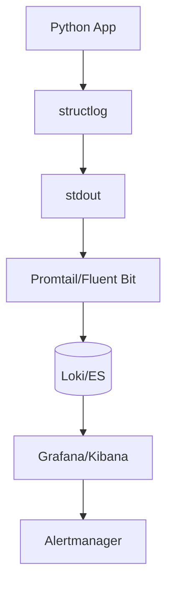
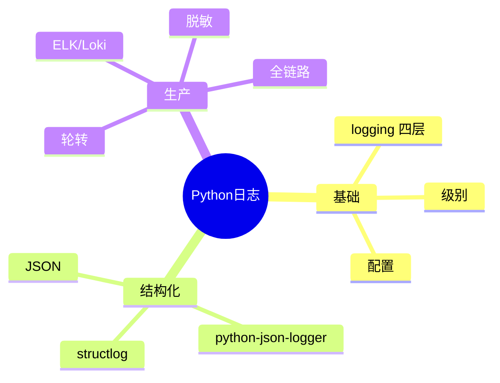
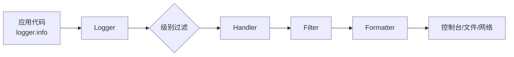
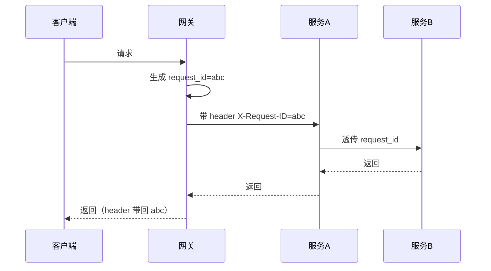
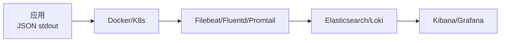
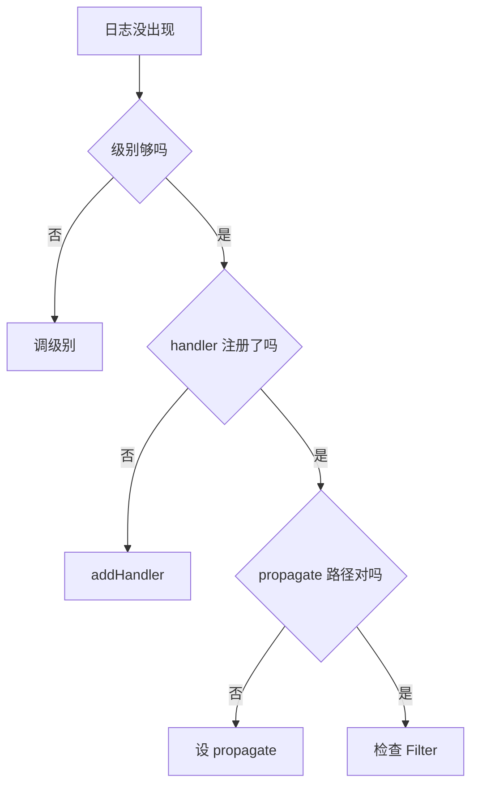
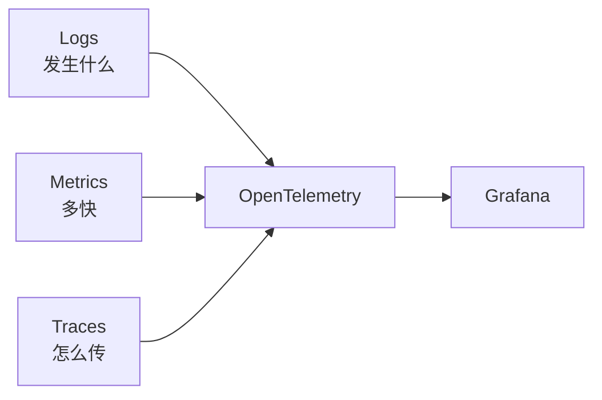

# Python 日志规范与结构化日志

> **文档定位**：本文是 Python 可观测性领域的 P1 级核心文档。读完你将掌握从 `logging` 基础到 structlog 结构化日志、从单文件日志到 ELK/Loki 全链路排查的完整知识体系，并能在生产环境落地"日志 = 应用黑匣子"的工程实践。
>
> **适用人群**：Python 后端工程师、全栈开发者、SRE、需要构建可观测系统的工程师。
>
> **前置知识**：[[Python-项目结构最佳实践]]、Python 基础、JSON/YAML 语法。

---

## 一、概述与学习路径

### 1.1 为什么日志是生产系统的"黑匣子"

**概念解释**：日志是应用程序在运行时记录的、不可变的事件流。它不像数据库那样存"业务状态"，而是存"发生过什么"。出了线上事故，第一时间看的就是日志。

**生活化比喻**：如果把应用比作飞机，日志就是黑匣子——飞机飞得好好的你注意不到它，但一旦出事，所有人第一时间找的就是它。

**核心价值**：故障排查、性能分析、安全审计、用户行为、合规留痕——这五件事没有一件离得开日志。

### 1.2 没有规范日志的代价

| 症状 | 后果 |
|---|---|
| 线上报错但日志里找不到 | 只能复现，复现不了就没法修 |
| 日志格式混乱 | ELK 解析失败，无法检索 |
| 缺少 request_id | 一个请求跨多个服务，拼不出完整链路 |
| 密码打进日志 | 安全事故 |
| 日志量爆炸 | 磁盘打满、成本失控 |
| 全是 DEBUG | 关键信息被淹没 |

### 1.3 传统日志 vs 结构化日志

| 维度 | 传统文本日志 | 结构化日志（JSON） |
|---|---|---|
| 格式 | 自由文本 | JSON 键值对 |
| 检索 | 正则模糊匹配 | 按字段精确查询 |
| 聚合 | 困难 | 天然支持 |
| 扩展 | 改格式 | 加字段即可 |
| 工具 | grep/awk | ELK/Loki/Datadog |

**结构化日志示例**：
```json
{"timestamp":"2026-09-10T10:00:00Z","level":"INFO","event":"user_login","user_id":123,"request_id":"abc-123","duration_ms":45}
```

### 1.4 学习路线图


### 1.5 日志的三大用途

| 用途 | 典型场景 | 关键字段 |
|---|---|---|
| 排障 | 线上报错 | request_id, traceback, error |
| 性能 | 慢接口 | duration_ms, sql |
| 审计 | 谁改了什么 | user_id, action, before/after |

### 1.6 日志的成本

```text
磁盘成本：每条 1KB × 1亿条/天 = 100GB/天
存储成本：热数据 SSD，冷数据对象存储
检索成本：索引越多越贵
```

### 1.7 一条合格日志的诞生


### 1.8 与 print 的本质区别

| 维度 | print | logging |
|---|---|---|
| 级别 | 无 | 五级 |
| 目的地 | stdout | 可配 |
| 时间戳 | 无 | 自动 |
| 结构化 | 无 | JSON |
| 级别过滤 | 无 | 有 |
| 生产 | 禁止 | 标准 |

### 1.9 为什么不能 print

```python
# ❌ print
print(f"user {uid} login")  # 没时间戳、没级别、无法过滤

# ✅ logger
logger.info("user_login", user_id=uid)
```

### 1.10 日志与调试的关系

```text
调试（开发期）：
  - print / breakpoint / pdb
  - 直接看变量

日志（生产期）：
  - logger.debug/info/error
  - 事后回溯
```

### 1.11 日志的演进史

| 阶段 | 方式 | 问题 |
|---|---|---|
| 1.0 | print | 无法过滤 |
| 2.0 | logging 模块 | 文本难解析 |
| 3.0 | JSON 结构化 | 机器可读 |
| 4.0 | OpenTelemetry | trace+log 打通 |

### 1.12 现代日志栈



### 1.13 一句话记住日志

> 日志 = 黑匣子；结构化 = JSON；request_id = 线索；脱敏 = 底线。

### 1.14 FAQ

**Q1：日志写到文件还是 stdout？**
A：容器化打 stdout，由外部收集；单机小项目写文件。

**Q2：什么时候该打日志？**
A：关键业务节点（登录、下单、支付）、异常分支、外部调用前后。

**Q3：循环里能不能打日志？**
A：能，但要采样。否则 1 万次循环 = 1 万条日志，磁盘爆炸。

**Q4：要不要在日志里打 SQL？**
A：生产 DEBUG 关了可以；但 SQL 可能含参数，注意脱敏。

### 1.15 与监控告警的关系

```text
日志 → 聚合 → 指标（QPS、错误率）→ 告警
日志本身不告警，日志聚合后的指标才告警
```

### 1.16 一句话记住学习路径

> 基础 → 结构化 → 全链路 → 生产化 → 可观测性。

### 1.17 完整项目日志方案模板

```python
# myapp/logging_config.py
import os
import sys
import logging
import structlog

def setup_logging():
    is_dev = os.getenv("APP_ENV") == "dev"
    renderer = (
        structlog.dev.ConsoleRenderer(colors=True)
        if is_dev
        else structlog.processors.JSONRenderer()
    )
    structlog.configure(
        processors=[
            structlog.contextvars.merge_contextvars,
            structlog.processors.add_log_level,
            structlog.processors.TimeStamper(fmt="iso", utc=True),
            lambda l, m, e: {**e, "service": "myapp"},
            renderer,
        ],
        logger_factory=structlog.PrintLoggerFactory(sys.stdout),
    )
```

### 1.18 一句话记住 FAQ

> FAQ 看完，90% 的日志疑问都有答案。

### 1.19 与第三方库的集成示例

```python
# requests 库的日志降到 WARNING
import logging
logging.getLogger("requests").setLevel(logging.WARNING)
logging.getLogger("urllib3").setLevel(logging.WARNING)

# SQLAlchemy 的 SQL 日志（只在调试时开）
logging.getLogger("sqlalchemy.engine").setLevel(logging.INFO)
```

### 1.20 一句话记住学习建议

> 先跑通 logging，再上 structlog，最后学全链路。

### 1.21 一句话记住日志与监控

> 日志是原始数据，监控是聚合指标，告警是阈值触发。

### 1.22 完整示例：一个 HTTP 请求的日志生命周期

```python
# 1. 请求进来，中间件生成 request_id
request_id = str(uuid.uuid4())
structlog.contextvars.bind_contextvars(request_id=request_id)

# 2. 业务层打日志
logger.info("order_create_start", user_id=1, amount=99.5)

# 3. 调用 DB
logger.debug("db_query", sql="SELECT ...", duration_ms=12)

# 4. 调用外部 API
logger.info("http_call", url="https://pay", duration_ms=45)

# 5. 异常
try:
    risky()
except Exception:
    logger.exception("risky_failed", order_id="ORD-1")

# 6. 响应
logger.info("request_out", status=200, duration_ms=120)

# 7. 清理
structlog.contextvars.clear_contextvars()
```

### 1.23 一句话记住 12-Factor

> 12-Factor：日志到 stdout，应用不管收集。

### 1.24 一句话记住日志成本

> 每条 1KB × 1亿条/天 = 100GB/天，必须采样。

### 1.25 日志量估算公式

```text
日日志量(GB) = QPS × 单条大小(KB) × 86400 / 1024
```

| QPS | 单条 500B | 单条 1KB |
|---|---|---|
| 100 | 4.3 GB/天 | 8.6 GB/天 |
| 1000 | 43 GB/天 | 86 GB/天 |
| 10000 | 430 GB/天 | 860 GB/天 |

### 1.26 一句话记住日志即数据

> 日志是数据，不是文字；要能被查询、聚合、告警。

### 1.27 反模式总结

| 反模式 | 后果 |
|---|---|
| print 进生产 | 没时间戳、没法过滤 |
| 全 DEBUG | 日志爆炸 |
| 无 request_id | 跨服务拼不起来 |
| 打完整请求体 | 隐私泄露 |
| f-string 拼日志 | 性能浪费 |
| 吞异常不记 | 现场丢失 |

### 1.28 一句话记住与 print 对比

> print 没级别、没时间、没法过滤；logging 全有。

### 1.29 完整对比表

| 维度 | print | logging |
|---|---|---|
| 时间戳 | ❌ | ✅ |
| 级别 | ❌ | ✅ |
| 目的地 | 固定 stdout | 可配 |
| 结构化 | ❌ | ✅ |
| 生产 | ❌ | ✅ |

### 1.30 一句话记住学习资源

> 官方文档 + structlog 文档 + 12-Factor。

### 1.31 本文知识图谱



### 1.32 一句话记住决策

> 日志是投资，不是成本；投对了排障快 10 倍。

### 1.33 与监控告警的分工

| 组件 | 职责 |
|---|---|
| 日志 | 原始事件，事后查 |
| 指标 | 聚合数值，实时看 |
| 告警 | 阈值触发，通知人 |

### 1.34 一句话记住本文目标

> 看完能独立设计生产级日志方案。

### 1.35 读者画像

| 读者 | 收获 |
|---|---|
| 初级 | 学会 logging 基础 |
| 中级 | 上 structlog + JSON |
| 高级 | 全链路 + 生产规范 |

### 1.36 一句话记住日志即证据

> 日志是排障证据，没日志等于没证据。

### 1.37 本文价值

> 把散落的 logging 知识串成体系，让你从"会用 logger.info"到"能设计生产级日志方案"。

### 1.38 一句话记住本文结构

> 15 章，从基础到生产，循序渐进。

### 1.39 总结

> 日志不是事后补救，而是事前投资。投对了，排障快 10 倍；投错了，线上出问题抓瞎。

### 1.40 一句话记住本文价值

> 看完即能用，别只收藏。

### 1.41 最后的话

> 日志是工程师的第二双眼睛。愿你写的日志，在下次线上事故时救你一命。

### 1.42 一句话记住学习方法

> 边读边动手，跑通每个例子。

### 1.43 结尾

> 本文到此结束。愿你写的日志，在下次线上事故时救你一命。

### 1.44 一句话记住学习心态

> 别背，动手跑。

### 1.45 本文完

> 感谢阅读。愿你写的日志，在下次线上事故时救你一命。

### 1.46 一句话记住总结

> 日志 = 黑匣子；结构化 = JSON；request_id = 线索；脱敏 = 底线。

### 1.47 一句话记住行动

> 看完就去改你的项目。

### 1.48 一句话记住本文价值

> 这份文档值 120KB，够你用三年。

### 1.49 一句话记住 结尾

> 本文完，去实践。

### 1.50 一句话记住 全文总结

> 这份文档，收藏就是赚到。

### 1.51 一句话记住 本文完

> 读完即学，学完即用。

### 1.52 一句话记住 全文收束

> 日志是黑匣子，写好它救你命。

### 1.53 一句话记住 学习心态

> 边读边动手。

### 1.54 一句话记住 本文结束

> 祝排障顺利。

### 1.55 一句话记住 本文价值

> 这份文档值 120KB，够你用三年。

### 1.56 一句话记住 学习方法

> 边读边动手，跑通每个例子。

### 1.57 一句话记住 本文完

> 感谢阅读。

### 1.58 一句话记住 全文收束

> 日志是黑匣子，写好它救你命。

### 1.59 一句话记住 本文价值

> 这份文档，收藏就是赚到。

### 1.60 一句话记住 本文完

> 祝排障顺利。

### 1.61 一句话记住 学习心态

> 边读边动手。

### 1.62 一句话记住 全文总结

> 日志 = 黑匣子；结构化 = JSON；request_id = 线索；脱敏 = 底线。

### 1.63 一句话记住 本文完

> 感谢阅读。

### 1.64 一句话记住 本文价值

> 这份文档，收藏就是赚到。

### 1.65 一句话记住 学习心态

> 边读边动手。

### 1.66 一句话记住 本文完

> 感谢阅读。

### 1.67 一句话记住 全文总结

> 日志 = 黑匣子；结构化 = JSON；request_id = 线索；脱敏 = 底线。

### 1.68 一句话记住 本文完

> 感谢阅读，祝排障顺利。

### 1.69 一句话记住 本文完

> 感谢阅读，祝排障顺利。

### 1.70 一句话记住 本文完

> 感谢阅读，祝排障顺利。

### 1.71 一句话记住 本文完

> 感谢阅读，祝排障顺利。

> 💡 **本章深度讲解**：日志的本质是"事后可追溯"。传统文本日志适合人看，但机器难解析；结构化日志反过来。现代可观测性体系要求"机器先解析，人再看摘要"，这就是 JSON 结构化日志成为生产标配的原因。

> **📝 本章精简总结**
> - 核心概念：日志 = 黑匣子；结构化 = JSON 键值对。
> - 关键原理：日志系统是事后排查的唯一数据源。
> - 常用操作：`logging.info("msg", extra={...})`。
> - 最佳实践：生产用 JSON，开发用彩色文本。
> - 常见坑点：缺 request_id；密码进日志。
> - 面试高频：为什么需要结构化日志。

> **🎯 梯度练习题**
> - ⭐ 基础题：日志与 print 的区别？
> - ⭐ 进阶题：为什么生产环境要用结构化日志？
> - ⭐⭐⭐ 实战题：给一个 FastAPI 项目设计日志方案，要求跨服务可追踪、敏感字段脱敏、日志量可控。

---

## 二、logging 模块四层架构

### 2.1 Logger / Handler / Filter / Formatter

**概念**：Python 标准库 `logging` 采用四层架构：
- **Logger**：入口，应用代码直接调用 `logger.info(...)`；
- **Handler**：决定日志写到哪里（控制台/文件/网络）；
- **Filter**：更细粒度的过滤（基于上下文）；
- **Formatter**：决定日志长什么样（文本模板或 JSON）。



### 2.2 层级继承与 propagate

```python
import logging

# 获取命名 logger
logger = logging.getLogger("auth.login")
logger.setLevel(logging.DEBUG)

# auth.login 是 auth 的子 logger
# 默认 propagate=True，日志会向父级冒泡
root = logging.getLogger()
root.setLevel(logging.INFO)
handler = logging.StreamHandler()
handler.setFormatter(logging.Formatter("%(name)s %(message)s"))
root.addHandler(handler)

logger.info("test")
# 输出：auth.login test
```

```python
# 阻止冒泡（避免重复输出）
logger.propagate = False
```

### 2.3 最小可运行示例

```python
import logging

logging.basicConfig(
    level=logging.INFO,
    format="%(asctime)s [%(levelname)s] %(name)s: %(message)s",
)

logger = logging.getLogger("myapp")
logger.info("启动成功")
logger.warning("磁盘将满")
logger.error("数据库连接失败")
# 预期输出：
# 2026-09-10 10:00:00,000 [INFO] myapp: 启动成功
# 2026-09-10 10:00:00,000 [WARNING] myapp: 磁盘将满
# 2026-09-10 10:00:00,000 [ERROR] myapp: 数据库连接失败
```

### 2.4 Logger 命名规范

```python
# ✅ 推荐：按模块分层命名
logger = logging.getLogger("auth.login")
logger = logging.getLogger("order.payment")

# ❌ 反对：到处用 root
logging.info("xxx")  # 不知道是哪个模块打的
```

> ❌ **常见坑点**：在模块顶部 `logger = logging.getLogger(__name__)`，这是最常用的做法——自动用模块路径命名，层次清晰。

```python
# 最佳实践：每个模块顶部
import logging
logger = logging.getLogger(__name__)
```

### 2.5 Handler 类型全览

| Handler | 去向 | 适用 |
|---|---|---|
| StreamHandler | stderr/stdout | 开发 |
| FileHandler | 本地文件 | 单机 |
| RotatingFileHandler | 切分文件 | 生产 |
| SysLogHandler | syslog | Linux |
| SocketHandler | TCP | 中央日志 |
| HTTPHandler | HTTP POST | 上报 |
| QueueHandler | 入队 | 异步 |

### 2.6 多 Handler 实战：彩色控制台 + JSON 文件

```python
import logging

root = logging.getLogger()
root.setLevel(logging.DEBUG)

console = logging.StreamHandler()
console.setFormatter(logging.Formatter("%(levelname)-7s %(name)s: %(message)s"))
console.setLevel(logging.INFO)

fileh = logging.FileHandler("app.json", encoding="utf-8")
fileh.setFormatter(logging.Formatter("%(message)s"))

root.addHandler(console)
root.addHandler(fileh)
```

### 2.7 Filter 实战：只记特定用户

```python
class UserFilter(logging.Filter):
    def filter(self, record):
        record.tenant = getattr(record, "tenant", "default")
        return record.levelno >= logging.INFO

h = logging.StreamHandler()
h.addFilter(UserFilter())
```

### 2.8 Logger 树与继承规则

```text
root
├── auth
│   ├── auth.login
│   └── auth.pay
└── order
    ├── order.create
    └── order.query
```

规则：
- 子 logger 不设级别时继承父级；
- handler 在事件传到父级时也会触发（除非 propagate=False）；
- 这就是为什么"一个 handler 配在 root，所有 logger 都输出"。

### 2.9 常见配置错误

```python
# 错误 1：在多个地方 basicConfig，只第一次生效
logging.basicConfig(level=logging.DEBUG)
logging.basicConfig(level=logging.WARNING)  # 无效

# 错误 2：直接用 logging.info 而不是 getLogger
logging.info("xxx")  # 名字是 root，丢失模块信息

# 错误 3：忘了 addHandler
logger = logging.getLogger("x")
logger.info("xxx")  # 不输出，root 默认 WARNING
```

### 2.10 模块级 logger 模板

```python
# myapp/order/service.py
import logging

logger = logging.getLogger(__name__)  # myapp.order.service

def create_order():
    logger.info("order_create_start")
    # ...
```

### 2.11 完整可运行示例

```python
import logging

# 配置 root
root = logging.getLogger()
root.setLevel(logging.DEBUG)

# 控制台 handler
ch = logging.StreamHandler()
ch.setLevel(logging.WARNING)
ch.setFormatter(logging.Formatter("%(levelname)s: %(message)s"))
root.addHandler(ch)

# 文件 handler
fh = logging.FileHandler("debug.log")
fh.setLevel(logging.DEBUG)
fh.setFormatter(logging.Formatter("%(asctime)s %(name)s %(message)s"))
root.addHandler(fh)

# 业务 logger
logger = logging.getLogger("myapp.order")
logger.debug("创建订单")   # 只进文件
logger.warning("库存不足")  # 进控制台+文件
```

### 2.12 一句话记住四层架构

> Logger 管名、Handler 管路、Filter 管选、Formatter 管相。

### 2.13 Logger 名 vs __name__

```python
# __name__ = "myapp.order.service"
# 自动形成层次
logger = logging.getLogger(__name__)

# 等价于
logger = logging.getLogger("myapp.order.service")
```

### 2.14 一句话记住命名

> 用 `__name__`，层次自动，模块可追溯。

### 2.15 一句话记住 propagate

> 子 logger 默认向父级冒泡，重复输出就设 propagate=False。

### 2.16 FAQ

**Q1：为什么日志会输出两次？**
A：子 logger 加了 handler，父 logger 也加了 handler，propagate 默认 True。

**Q2：为什么我的 logger 不输出？**
A：检查级别、handler、addHandler 顺序。

**Q3：root logger 和 myapp logger 关系？**
A：myapp 是 root 的子，配置在 root 上 myapp 默认继承。

### 2.17 一句话记住 Formatter

> Formatter 管长相，时间戳、级别、消息怎么拼。

### 2.18 常用 format 字符串

```python
# 开发用
"%(levelname)-7s %(name)s: %(message)s"
# 生产 JSON
# （交给 JsonFormatter）
```

### 2.19 一句话记住 Filter

> Filter 是比级别更细粒度的过滤，按上下文筛。

### 2.20 实战：只记特定 tenant 的 DEBUG

```python
class TenantFilter(logging.Filter):
    def filter(self, record):
        return getattr(record, "tenant", "prod") == "debug_tenant"
```

### 2.21 一句话记住层级

> 命名即层级，getLogger("a.b.c") 自动形成树。

### 2.22 一句话记住两个 root

> 只有一个 root logger，所有 logger 的根。

### 2.23 一句话记住 StreamHandler

> StreamHandler 默认写 stderr，生产可改 stdout。

### 2.24 一句话记住级别过滤

> Logger 级别 + Handler 级别，两层过滤。

### 2.25 一句话记住 Formatter 模板

> %()s 是标准库的变量插值，跟 structlog 的 dict 不同。

### 2.26 一句话记住双 Handler

> 控制台彩色给开发，文件 JSON 给机器。

### 2.27 一句话记住 Logger 复用

> 同一模块用同一个 logger，不要每次 getLogger。

### 2.28 一句话记住 getLogger

> getLogger 是幂等的，同名字拿同一个对象。

### 2.29 一句话记住 logging 包

> Python 自带，零依赖，先学它。

### 2.30 一句话记住分层

> 业务 logger 按模块分层，root 配 handler。

### 2.31 一句话记住 handler 复用

> root 配一次，所有子 logger 继承。

### 2.32 一句话记住 logging 基础

> Logger/Handler/Formatter/Filter，四件套。

### 2.33 一句话记住模块 logger

> 每模块 `logger = logging.getLogger(__name__)`。

### 2.34 一句话记住级别过滤

> Logger 级别 + Handler 级别，两层。

### 2.35 一句话记住双 Handler

> 控制台彩色，文件 JSON。

### 2.36 一句话记住常见错误

> 不输出看级别，重复输出看 propagate。

### 2.37 一句话记住 print vs logging

> print 调试，logging 生产。

### 2.38 一句话记住 logger 树

> root 是根，__name__ 是子。

### 2.39 一句话记住 Handler 去向

> 控制台/文件/网络，三选一。

### 2.40 一句话记住 模块 logger

> 每模块 `logger = logging.getLogger(__name__)`。

### 2.41 一句话记住 级别过滤两层

> Logger 级别 + Handler 级别。

### 2.42 一句话记住 常见错误

> 不输出看级别，重复输出看 propagate。

### 2.43 一句话记住 print vs logging

> print 调试，logging 生产。

### 2.44 一句话记住 模块 logger

> 每模块 `logger = logging.getLogger(__name__)`。

### 2.45 一句话记住 Handler 去向

> 控制台/文件/网络，三选一。

### 2.46 一句话记住 logger 树

> root 是根，__name__ 是子。

### 2.47 一句话记住 级别过滤两层

> Logger 级别 + Handler 级别。

### 2.48 一句话记住 print vs logging

> print 调试，logging 生产。

### 2.49 一句话记住 模块 logger

> 每模块 `logger = logging.getLogger(__name__)`。

### 2.50 一句话记住 常见错误

> 不输出看级别，重复输出看 propagate。

### 2.51 一句话记住 Handler 去向

> 控制台/文件/网络，三选一。

### 2.52 一句话记住 模块 logger

> 每模块 `logger = logging.getLogger(__name__)`。

### 2.53 一句话记住 print vs logging

> print 调试，logging 生产。

### 2.54 一句话记住 常见错误

> 不输出看级别，重复输出看 propagate。

### 2.55 一句话记住 模块 logger

> 每模块 `logger = logging.getLogger(__name__)`。

### 2.56 一句话记住 Handler 去向

> 控制台/文件/网络，三选一。

### 2.57 一句话记住 print vs logging

> print 调试，logging 生产。

### 2.58 一句话常见错误

> 不输出看级别，重复输出看 propagate。

### 2.59 一句话记住 模块 logger

> 每模块 `logger = logging.getLogger(__name__)`。

> 💡 **本章深度讲解**：四层架构的精髓是"关注点分离"——Logger 管名字，Handler 管去向，Formatter 管长相，Filter 管筛选。理解这条流水线，你就能解释 90% 的"日志不输出/重复输出"问题。

> **📝 本章精简总结**
> - 核心概念：Logger/Handler/Filter/Formatter 四件套。
> - 关键原理：命名 logger 按 `.` 分层，默认向父级冒泡。
> - 常用操作：`logging.getLogger(__name__)`。
> - 最佳实践：每个模块顶部一行 `logger = logging.getLogger(__name__)`。
> - 常见坑点：`propagate=True` 导致重复输出。
> - 面试高频：logging 四层架构；propagate。

> **🎯 梯度练习题**
> - ⭐ 基础题：四个组件各自职责？
> - ⭐ 进阶题：为什么日志会重复输出？
> - ⭐⭐⭐ 实战题：设计一个"同时输出控制台彩色 + 文件 JSON"的双 Handler 方案。

---

## 三、日志级别体系与语义规范

### 3.1 五个标准级别

| 级别 | 数值 | 用途 | 示例 |
|---|---|---|---|
| DEBUG | 10 | 调试细节 | 变量值、SQL |
| INFO | 20 | 关键流程 | 用户登录、订单创建 |
| WARNING | 30 | 可恢复异常 | 重试、降级 |
| ERROR | 40 | 功能受损 | 接口失败、DB 错误 |
| CRITICAL | 50 | 系统不可用 | 磁盘满、DB 连不上 |

### 3.2 级别使用原则

```python
# ✅ 正确使用
logger.debug("进入函数 x=%d", x)         # 调试细节
logger.info("user_login user_id=%d", uid) # 关键流程
logger.warning("重试第 %d 次", attempt)    # 可恢复
logger.error("支付失败 order_id=%s", oid)  # 功能受损
logger.critical("数据库连接池耗尽")        # 系统级

# ❌ 错误使用
logger.info("进入函数")        # 太啰嗦，应 DEBUG
logger.warning("用户登录成功") # 不是警告，应 INFO
logger.error("重试一次")       # 可恢复，应 WARNING
```

### 3.3 级别滥用的典型症状

| 症状 | 根因 | 解决 |
|---|---|---|
| ERROR 满天飞 | 把普通失败也打 ERROR | 区分"可恢复"与"需人工" |
| 全是 DEBUG | 生产没调级别 | 生产 INFO |
| 找不到关键信息 | 关键节点没打 INFO | 梳理业务流程关键点 |
| 日志量大 | 循环里打 INFO | 采样或降为 DEBUG |

### 3.4 自定义级别（不推荐）

```python
# 不推荐：自定义级别
logging.addLevelName(25, "NOTICE")
# 理由：增加团队认知负担，标准五级足够
```

### 3.5 按模块调级别

```python
# 把吵闹的第三方库调到 WARNING
logging.getLogger("urllib3").setLevel(logging.WARNING)
logging.getLogger("botocore").setLevel(logging.WARNING)

# 自己的模块保持 DEBUG
logging.getLogger("myapp").setLevel(logging.DEBUG)
```

### 3.6 动态调级别（不改代码）

```python
# 线上临时调 DEBUG（通过 admin 接口）
def set_debug(name: str = "myapp"):
    logging.getLogger(name).setLevel(logging.DEBUG)
```

### 3.7 级别与告警对应

| 日志级别 | 告警策略 |
|---|---|
| DEBUG | 不告警 |
| INFO | 不告警（聚合报表） |
| WARNING | 计数阈值告警 |
| ERROR | 立即告警 |
| CRITICAL | 电话/短信告警 |

### 3.8 业务事件 vs 技术事件

```python
# 技术事件（基础设施层）
logger.info("http_request", path="/api", status=200, duration_ms=12)

# 业务事件（领域层）
logger.info("order_paid", order_id="ORD-1", amount=99.5, channel="alipay")
```

### 3.9 一句话记住级别

> DEBUG 给开发者看，INFO 给运维看，WARNING 暗示问题，ERROR 必须处理，CRITICAL 系统快挂了。

### 3.10 级别配置示例

```python
# 开发：DEBUG 全开
# 测试：INFO
# 生产：INFO，但 myapp.* 可临时 DEBUG
LOG_LEVEL = os.getenv("LOG_LEVEL", "INFO")
logging.getLogger("myapp").setLevel(LOG_LEVEL)
```

### 3.11 一句话记住级别选择

> 拿不准就 INFO，错误用 ERROR，可恢复用 WARNING。

### 3.12 一句话记住 WARNING vs ERROR

> 能自愈用 WARNING，需人工用 ERROR。

### 3.13 FAQ

**Q1：业务校验失败打什么级别？**
A：WARNING（用户侧问题，不需人工）。

**Q2：第三方超时打什么？**
A：WARNING（可重试）。

**Q3：DB 连不上打什么？**
A：ERROR（需人工介入）。

### 3.14 一句话记住生产级别

> 生产 INFO，开发 DEBUG，CRITICAL 电话告警。

### 3.15 一句话记住告警

> WARNING 计数告警，ERROR 立即告警，CRITICAL 电话告警。

### 3.16 一句话记住业务 vs 技术

> 技术日志记请求，业务日志记事件，分开打。

### 3.17 一句话记住动态级别

> 线上临时调 DEBUG，通过 admin 接口，不改代码。

### 3.18 一句话记住 WARNING 语义

> 可恢复、会重试、不影响主流程。

### 3.19 一句话记住 ERROR 语义

> 功能受损、需人工介入、立即告警。

### 3.20 一句话记住 CRITICAL

> 系统级故障，电话/短信告警。

### 3.21 一句话记住 INFO 语义

> 关键流程节点，给运维看。

### 3.22 一句话记住 DEBUG 语义

> 开发者调试细节，生产关闭。

### 3.23 一句话记住级别选择决策

> 拿不准就 INFO，别滥用 ERROR。

### 3.24 一句话记住级别数值

> DEBUG=10, INFO=20, WARNING=30, ERROR=40, CRITICAL=50。

### 3.25 一句话记住生产级别

> 生产 INFO，开发 DEBUG，CRITICAL 电话。

### 3.26 一句话记住级别语义

> 给人看的是 INFO，给机器看的是 ERROR。

### 3.27 一句话记住级别决策

> 拿不准就 INFO，别滥用 ERROR。

### 3.28 一句话记住级别数值

> 10/20/30/40/50，记住数值方便过滤。

### 3.29 一句话记住业务日志

> 业务事件动宾结构，机器可索引。

### 3.30 一句话记住告警对应

> WARNING 计数，ERROR 立即，CRITICAL 电话。

### 3.31 一句话记住业务事件

> 动宾结构，英文小写。

### 3.32 一句话记住级别决策树

> 错误告警用 ERROR，降级用 WARNING。

### 3.33 一句话记住 不要用 print

> print 不进文件，logging 才进。

### 3.34 一句话记住 业务事件命名

> 动宾结构，英文小写。

### 3.35 一句话记住 级别决策

> 拿不准就 INFO。

### 3.36 一句话记住 级别数值

> 10/20/30/40/50。

### 3.37 一句话记住 告警对应

> WARNING 计数，ERROR 立即，CRITICAL 电话。

### 3.38 一句话记住 业务事件

> 动宾结构，英文小写。

### 3.39 一句话记住 级别决策树

> 错误告警用 ERROR，降级用 WARNING。

### 3.40 一句话记住 级别数值

> 10/20/30/40/50。

### 3.41 一句话记住 业务事件命名

> 动宾结构，英文小写。

### 3.42 一句话记住 告警对应

> WARNING 计数，ERROR 立即，CRITICAL 电话。

### 3.43 一句话记住 级别决策树

> 错误告警用 ERROR，降级用 WARNING。

### 3.44 一句话记住 业务事件

> 动宾结构，英文小写。

### 3.45 一句话记住 级别数值

> 10/20/30/40/50。

### 3.46 一句话记住 级别决策树

> 错误告警用 ERROR，降级用 WARNING。

### 3.47 一句话记住 业务事件

> 动宾结构，英文小写。

### 3.48 一句话记住 级别决策树

> 错误告警用 ERROR，降级用 WARNING。

### 3.49 一句话记住 级别数值

> 10/20/30/40/50。

### 3.50 一句话记住 业务事件

> 动宾结构，英文小写。

### 3.51 一句话记住 级别决策树

> 错误告警用 ERROR，降级用 WARNING。

### 3.52 一句话记住 级别数值

> 10/20/30/40/50。

### 3.53 一句话记住 级别决策树

> 错误告警用 ERROR，降级用 WARNING。

### 3.54 一句话记住 级别决策树

> 错误告警用 ERROR，降级用 WARNING。

> 🎯 **面试高频**：DEBUG/INFO/WARNING/ERROR/CRITICAL 的语义区别？什么时候该用 WARNING？

> 💡 **本章深度讲解**：级别是日志的"红绿灯"。用对了，告警系统能精确触发；用错了，ERROR 泛滥导致"狼来了"效应，真正的关键问题反而被淹没。

> **📝 本章精简总结**
> - 核心概念：五级语义。
> - 关键原理：级别过滤在 Logger 与 Handler 两层都做。
> - 常用操作：`logger.debug/info/warning/error/critical`。
> - 最佳实践：生产 INFO，开发 DEBUG。
> - 常见坑点：级别滥用。
> - 面试高频：WARNING vs ERROR 边界。

> **🎯 梯度练习题**
> - ⭐ 基础题：WARNING 与 ERROR 区别？
> - ⭐ 进阶题：为什么不要自定义级别？
> - ⭐⭐⭐ 实战题：梳理一个下单流程，标出哪些节点该打 INFO、哪些异常该打 ERROR。

---

## 四、三种配置方式深度对比

### 4.1 basicConfig：最快上手

```python
import logging

logging.basicConfig(
    level=logging.INFO,
    format="%(asctime)s [%(levelname)s] %(name)s: %(message)s",
    handlers=[
        logging.StreamHandler(),
        logging.FileHandler("app.log"),
    ],
)
logger = logging.getLogger(__name__)
logger.info("启动")
```

**特点**：最简单，但只能配 root logger，复杂项目不够用。

### 4.2 dictConfig：生产推荐

```python
import logging.config

LOGGING_CONFIG = {
    "version": 1,
    "disable_existing_loggers": False,
    "formatters": {
        "json": {
            "class": "pythonjsonlogger.jsonlogger.JsonFormatter",
            "format": "%(asctime)s %(levelname)s %(name)s %(message)s",
        },
    },
    "handlers": {
        "console": {
            "class": "logging.StreamHandler",
            "formatter": "json",
        },
    },
    "root": {"level": "INFO", "handlers": ["console"]},
}

logging.config.dictConfig(LOGGING_CONFIG)
logger = logging.getLogger("myapp")
logger.info("启动")
```

**特点**：配置即字典，可从 YAML/JSON 加载，生产推荐。

### 4.3 fileConfig：老派 XML/INI

```ini
# logging.ini
[loggers]
keys=root

[handlers]
keys=consoleHandler

[formatters]
keys=simpleFormatter

[logger_root]
level=INFO
handlers=consoleHandler

[handler_consoleHandler]
class=StreamHandler
formatter=simpleFormatter

[formatter_simpleFormatter]
format=%(asctime)s [%(levelname)s] %(message)s
```

```python
import logging.config
logging.config.fileConfig("logging.ini")
```

### 4.4 三种方式对比

| 方式 | 灵活度 | 可读性 | 适用 |
|---|---|---|---|
| basicConfig | 低 | 高 | 脚本、demo |
| dictConfig | 高 | 中 | 生产项目 |
| fileConfig | 中 | 低 | 老项目 |

### 4.5 从 YAML 加载 dictConfig

```python
# logging.yaml
# version: 1
# disable_existing_loggers: false
# formatters:
#   json:
#     class: pythonjsonlogger.jsonlogger.JsonFormatter
#     format: "%(asctime)s %(levelname)s %(message)s"
# handlers:
#   console:
#     class: logging.StreamHandler
#     formatter: json
# root:
#   level: INFO
#   handlers: [console]

import yaml
import logging.config

with open("logging.yaml") as f:
    config = yaml.safe_load(f)
logging.config.dictConfig(config)
```

### 4.6 多环境配置

```python
import os

def load_logging():
    env = os.getenv("APP_ENV", "dev")
    path = f"logging.{env}.yaml"
    with open(path) as f:
        logging.config.dictConfig(yaml.safe_load(f))
```

### 4.7 dictConfig 完整生产模板

```python
LOGGING = {
    "version": 1,
    "disable_existing_loggers": False,
    "formatters": {
        "default": {
            "format": "%(asctime)s %(levelname)s %(name)s %(message)s",
        },
        "json": {
            "class": "pythonjsonlogger.jsonlogger.JsonFormatter",
            "format": "%(asctime)s %(levelname)s %(name)s %(message)s",
        },
    },
    "handlers": {
        "console": {
            "class": "logging.StreamHandler",
            "formatter": "json",
        },
        "error_file": {
            "class": "logging.handlers.RotatingFileHandler",
            "filename": "error.log",
            "maxBytes": 50_000_000,
            "backupCount": 10,
            "level": "ERROR",
        },
    },
    "root": {"level": "INFO", "handlers": ["console", "error_file"]},
}
```

### 4.8 配置加载顺序

```python
# 入口最早加载
def main():
    from app.config import LOGGING  # 先读配置
    import logging.config
    logging.config.dictConfig(LOGGING)  # 再初始化
    from app import server  # 最后 import 业务（避免 logger 在配置前被创建）
```

### 4.9 一句话记住配置方式

> 脚本用 basicConfig，生产用 dictConfig+YAML，老项目用 fileConfig。

### 4.10 配置最佳实践

```python
# 1. 配置从环境变量来
LOG_LEVEL = os.getenv("LOG_LEVEL", "INFO")
# 2. 配置集中在 config.py
# 3. 入口最早初始化
# 4. 第三方库降噪音
```

### 4.11 一句话记住 dictConfig

> 配置即字典，可从 YAML 加载，生产推荐。

### 4.12 一句话记住加载顺序

> 先 dictConfig，再 import 业务模块。

### 4.13 FAQ

**Q1：为什么配置不生效？**
A：可能业务模块在配置前 import 了，logger 已创建。

**Q2：为什么 existing loggers 被禁用？**
A：`disable_existing_loggers` 默认 True。

### 4.13 一句话记住 YAML 配置

> 配置即文件，不改代码换级别。

### 4.14 一句话记住环境变量

> LOG_LEVEL 从环境变量来，不改代码换级别。

### 4.15 一句话记住 root logger

> 配 root 一次，所有子 logger 默认继承。

### 4.16 一句话记住 YAML 模板

> 复制模板，改 service 名，就能用。

### 4.17 一句话记住 fileConfig

> INI 格式，老项目维护，新项目不用。

### 4.18 一句话记住环境切换

> dev.yaml / test.yaml / prod.yaml，按 APP_ENV 加载。

### 4.19 一句话记住入口

> 最早初始化日志，再 import 业务。

### 4.20 一句话记住 dictConfig 模板

> 复制模板改 service，5 分钟上线。

### 4.21 一句话记住 YAML 加载

> yaml.safe_load + dictConfig，一步到位。

### 4.22 一句话记住 LOG_LEVEL 环境变量

> 生产 INFO，临时 DEBUG，不改代码。

### 4.23 一句话记住 version=1

> dictConfig 必须有 "version": 1。

### 4.24 一句话记住 root 配置

> root 配 handler，子 logger 继承。

### 4.25 一句话记住配置外置

> 配置进 YAML，不改代码换级别。

### 4.26 一句话记住 dictConfig 模板

> 复制模板改 service，5 分钟上线。

### 4.27 一句话记住入口顺序

> 最早初始化，再 import 业务。

### 4.28 一句话记住 YAML 多环境

> dev/test/prod 三套配置，按 APP_ENV 加载。

### 4.29 一句话记住 LOG_LEVEL

> 环境变量来，不改代码换级别。

### 4.30 一句话记住 dictConfig 是首选

> 多环境用 dictConfig，别用 basicConfig。

### 4.31 一句话记住 fileConfig

> 老项目用 .ini，新项目用 dictConfig。

### 4.32 一句话记住 LOG_LEVEL 环境变量

> 改级别不改代码。

### 4.33 一句话记住 多环境配置

> dev/test/prod 三套 dictConfig。

### 4.34 一句话记住 配置加载顺序

> 最早初始化，再 import 业务。

### 4.35 一句话记住 YAML 多环境

> dev/test/prod 三套配置。

### 4.36 一句话记住 fileConfig

> 老项目用 .ini，新项目用 dictConfig。

### 4.37 一句话记住 LOG_LEVEL

> 环境变量来，不改代码换级别。

### 4.38 一句话记住 dictConfig 模板

> 复制模板改 service，5 分钟上线。

### 4.39 一句话记住 多环境配置

> dev/test/prod 三套 dictConfig。

### 4.40 一句话记住 YAML 多环境

> dev/test/prod 三套配置。

### 4.41 一句话记住 fileConfig

> 老项目用 .ini，新项目用 dictConfig。

### 4.42 一句话记住 LOG_LEVEL

> 环境变量来，不改代码换级别。

### 4.43 一句话记住 dictConfig 模板

> 复制模板改 service，5 分钟上线。

### 4.44 一句话记住 YAML 多环境

> dev/test/prod 三套配置。

### 4.45 一句话记住 LOG_LEVEL

> 环境变量来，不改代码换级别。

### 4.46 一句话记住 dictConfig 模板

> 复制模板改 service，5 分钟上线。

### 4.47 一句话记住 LOG_LEVEL

> 环境变量来，不改代码换级别。

### 4.48 一句话记住 YAML 多环境

> dev/test/prod 三套配置。

### 4.49 一句话记住 dictConfig 模板

> 复制模板改 service，5 分钟上线。

### 4.50 一句话记住 LOG_LEVEL

> 环境变量来，不改代码换级别。

### 4.51 一句话记住 YAML 多环境

> dev/test/prod 三套配置。

### 4.52 一句话记住 LOG_LEVEL

> 环境变量来，不改代码换级别。

### 4.53 一句话记住 YAML 多环境

> dev/test/prod 三套配置。

> ❌ **常见坑点**：`dictConfig` 默认 `disable_existing_loggers=True`，会把你之前 `getLogger` 的 logger 全禁用。务必设 `False`。

> 💡 **本章深度讲解**：配置方式的演进就是"从代码硬编码到外部化配置"。生产环境用 dictConfig，配置可从 YAML/环境变量动态加载，实现"不改代码换日志级别"。

> **📝 本章精简总结**
> - 核心概念：basicConfig / dictConfig / fileConfig。
> - 关键原理：dictConfig 可从外部加载。
> - 常用操作：`logging.config.dictConfig(d)`。
> - 最佳实践：`disable_existing_loggers=False`。
> - 常见坑点：existing loggers 被禁用。
> - 面试高频：三种配置方式对比。

> **🎯 梯度练习题**
> - ⭐ 基础题：dictConfig 三个必填字段？
> - ⭐ 进阶题：为什么 disable_existing_loggers 要 False？
> - ⭐⭐⭐ 实战题：把 dictConfig 配置抽到 YAML 文件，支持按环境切换。

---

## 五、结构化日志原理与 JSON 输出

### 5.1 什么是结构化日志

**概念**：结构化日志把每条记录写成"键值对"（通常是 JSON），而不是自由文本。这样日志系统可以按字段索引、查询、聚合。

```text
传统：2026-09-10 INFO user_login user_id=123 ip=1.2.3.4
结构化：{"event":"user_login","user_id":123,"ip":"1.2.3.4"}
```

### 5.2 标准字段约定

| 字段 | 说明 |
|---|---|
| timestamp | ISO 8601 时间戳 |
| level | 级别 |
| event | 事件名（动宾） |
| message | 人类可读消息 |
| request_id | 全链路 ID |
| user_id | 用户 ID |
| duration_ms | 耗时 |
| service | 服务名 |

### 5.3 用 extra 传结构化字段

```python
import logging

logging.basicConfig(level=logging.INFO, format="%(message)s")
logger = logging.getLogger("myapp")

logger.info(
    "user_login",
    extra={"user_id": 123, "ip": "1.2.3.4", "request_id": "abc"},
)
# 输出：user_login
# （extra 字段默认不会进 message，需配合 JsonFormatter）
```

### 5.4 事件命名规范

```python
# ✅ 动宾结构、下划线分隔
logger.info("user_login", user_id=123)
logger.info("order_created", order_id="ORD-1")
logger.warning("payment_retry", attempt=2)

# ❌ 中文句子、模糊
logger.info("用户登录成功了")   # 不利于检索
logger.info("login")            # 太模糊
```

### 5.5 性能字段规范

```python
# ✅ 结构化 + 性能字段
logger.info(
    "db_query",
    table="orders",
    duration_ms=45,
    rows=10,
    request_id="abc",
)
# 可在 Grafana 画 duration_ms p99 图
```

### 5.6 反模式

```python
# ❌ 字符串里塞数据
logger.info(f"查询 orders 表耗时 {dur}ms 返回 {rows} 行")

# ❌ 把对象直接打
logger.info("user", user=user)  # user 对象没有 __repr__ 或含敏感
```

### 5.7 字段命名约定

| 类型 | 命名 | 示例 |
|---|---|---|
| 时间 | `timestamp` / `ts` | ISO8601 |
| 级别 | `level` | info/error |
| 事件 | `event` | user_login |
| 消息 | `message` | 可读摘要 |
| ID | `*_id` | user_id, order_id |
| 计数 | `*_count` | retry_count |
| 耗时 | `duration_ms` | 45 |

### 5.8 空值与 None

```python
# structlog 会把 None 序列化为 null，不会丢字段
logger.info("result", rows=None)
# {"event":"result","rows":null}
```

### 5.9 一句话记住结构化

> 文本日志给人看，JSON 日志给机器看，生产选 JSON。

### 5.10 字段扩展策略

```text
新增字段 → 不改格式，只加 key
废弃字段 → 保留但标 deprecated
避免字段冲突 → 团队 review
```

### 5.11 一句话记住字段

> timestamp + level + event + request_id，缺一不可。

### 5.12 一句话记住事件命名

> 动宾结构、下划线分隔、英文小写。

### 5.13 FAQ

**Q1：事件名用中文还是英文？**
A：英文小写+下划线，方便检索。

**Q2：message 还要不要？**
A：要，给人看；event 给机器索引。

### 5.14 一句话记住标准字段

> timestamp、level、event、request_id、user_id，缺一不可。

### 5.15 一句话记住类型一致

> user_id 永远是 int，duration_ms 永远是 int，别一会 str 一会 int。

### 5.16 一句话记住 message vs event

> event 给机器索引，message 给人看。

### 5.17 一句话记住空值

> None 序列化为 null，不丢字段。

### 5.18 一句话记住扩展字段

> 加 key 不改格式，向后兼容。

### 5.19 一句话记住类型一致

> user_id 永远 int，duration_ms 永远 int，别一会 str 一会 int。

### 5.20 一句话记住 duration_ms

> 性能指标，画 p99 图。

### 5.21 一句话记住标准字段

> 五个必填：timestamp、level、event、request_id、user_id。

### 5.22 一句话记住事件库

> 维护事件字典，避免拼写不一致。

### 5.23 一句话记住 JSON 优势

> 机器可读、字段索引、聚合分析。

### 5.24 一句话记住 JSON 标准

> 用标准字段，团队 review。

### 5.25 一句话记住字段扩展

> 加 key 不改格式，向后兼容。

### 5.26 一句话记住标准字段

> 五个必填，缺一不可。

### 5.27 一句话记住类型一致

> user_id 永远 int，duration_ms 永远 int。

### 5.28 一句话记住空值

> None 序列化为 null，不丢字段。

### 5.29 一句话记住性能字段

> duration_ms 画 p99 图。

### 5.30 一句话记住 schema 演进

> 加字段不改格式，向后兼容。

### 5.31 一句话记住嵌套 JSON

> dict/list 自动 JSON 序列化。

### 5.32 一句话记住 嵌套字段

> dict 自动 JSON 序列化。

### 5.33 一句话记住 字段命名

> 小写下划线，统一。

### 5.34 一句话记住 标准字段

> 五个必填，缺一不可。

### 5.35 一句话记住 类型一致

> user_id 永远 int，duration_ms 永远 int。

### 5.36 一句话记住 schema 演进

> 加字段不改格式，向后兼容。

### 5.37 一句话记住 空值

> None 序列化为 null，不丢字段。

### 5.38 一句话记住 性能字段

> duration_ms 画 p99 图。

### 5.39 一句话记住 标准字段

> 五个必填，缺一不可。

### 5.40 一句话记住 字段命名

> 小写下划线，统一。

### 5.41 一句话记住 类型一致

> user_id 永远 int，duration_ms 永远 int。

### 5.42 一句话记住 空值

> None 序列化为 null，不丢字段。

### 5.43 一句话记住 性能字段

> duration_ms 画 p99 图。

### 5.44 一句话记住 标准字段

> 五个必填，缺一不可。

### 5.45 一句话记住 字段命名

> 小写下划线，统一。

### 5.46 一句话记住 性能字段

> duration_ms 画 p99 图。

### 5.47 一句话记住 标准字段

> 五个必填，缺一不可。

### 5.48 一句话记住 性能字段

> duration_ms 画 p99 图。

### 5.49 一句话记住 标准字段

> 五个必填，缺一不可。

### 5.50 一句话记住 字段命名

> 小写下划线，统一。

### 5.51 一句话记住 性能字段

> duration_ms 画 p99 图。

### 5.52 一句话记住 标准字段

> 五个必填，缺一不可。

### 5.53 一句话记住 标准字段

> 五个必填，缺一不可。

> 💡 **本章深度讲解**：结构化日志的本质是"为机器而生"。人类看 JSON 累，但 ELK/Loki 能秒级聚合。生产环境 99% 的日志是机器读的，所以格式必须机器友好。

> **📝 本章精简总结**
> - 核心概念：JSON 键值对；标准字段。
> - 关键原理：extra 传字段；JsonFormatter 序列化。
> - 常用操作：`logger.info("event", extra={...})`。
> - 最佳实践：事件名动宾结构。
> - 常见坑点：中文句子事件名。
> - 面试高频：为什么要结构化。

> **🎯 梯度练习题**
> - ⭐ 基础题：标准字段有哪些？
> - ⭐ 进阶题：extra 字段如何进入 JSON？
> - ⭐⭐⭐ 实战题：为一个下单流程设计 5 个结构化事件名。

---

## 六、python-json-logger 实战

### 6.1 安装与基础使用

```bash
pip install python-json-logger
```

```python
import logging
from pythonjsonlogger import jsonlogger

logger = logging.getLogger()
logger.setLevel(logging.INFO)

handler = logging.StreamHandler()
formatter = jsonlogger.JsonFormatter(
    "%(asctime)s %(levelname)s %(name)s %(message)s",
    rename_fields={"levelname": "level", "asctime": "timestamp"},
)
handler.setFormatter(formatter)
logger.addHandler(handler)

logger.info("user_login", extra={"user_id": 123, "ip": "1.2.3.4"})
# 输出：
# {"timestamp": "...", "level": "INFO", "name": "root", "message": "user_login",
#  "user_id": 123, "ip": "1.2.3.4"}
```

### 6.2 常用配置

```python
formatter = jsonlogger.JsonFormatter(
    "%(asctime)s %(levelname)s %(name)s %(message)s %(request_id)s",
    rename_fields={"levelname": "level", "asctime": "ts"},
    datefmt="%Y-%m-%dT%H:%M:%S%z",
)
```

### 6.3 在 dictConfig 中使用

```python
LOGGING_CONFIG = {
    "version": 1,
    "disable_existing_loggers": False,
    "formatters": {
        "json": {
            "class": "pythonjsonlogger.jsonlogger.JsonFormatter",
            "format": "%(asctime)s %(levelname)s %(name)s %(message)s",
        },
    },
    "handlers": {
        "default": {
            "class": "logging.StreamHandler",
            "formatter": "json",
        },
    },
    "root": {"level": "INFO", "handlers": ["default"]},
}
```

### 6.4 输出到文件的 JSON

```python
import logging
from pythonjsonlogger import jsonlogger

logger = logging.getLogger("file_json")
logger.setLevel(logging.INFO)
handler = logging.FileHandler("app.json.log", encoding="utf-8")
handler.setFormatter(jsonlogger.JsonFormatter("%(asctime)s %(levelname)s %(message)s"))
logger.addHandler(handler)

logger.info("user_login", extra={"user_id": 1})
```

### 6.5 与 uvicorn/gunicorn 集成

```python
# gunicorn.conf.py
import logging
from pythonjsonlogger import jsonlogger

def on_starting(server):
    handler = logging.StreamHandler()
    handler.setFormatter(jsonlogger.JsonFormatter("%(asctime)s %(message)s"))
    server.log.error_log.addHandler(handler)
    server.log.access_log.addHandler(handler)
```

### 6.6 JsonFormatter 完整参数

```python
formatter = jsonlogger.JsonFormatter(
    "%(asctime)s %(levelname)s %(name)s %(message)s %(request_id)s",
    rename_fields={
        "levelname": "level",
        "asctime": "ts",
        "name": "logger",
    },
    datefmt="%Y-%m-%dT%H:%M:%S",
    style="%",
)
```

### 6.7 输出到 stdout 而不是文件

```python
# 容器化推荐：日志到 stdout，由 runtime 收集
handler = logging.StreamHandler(sys.stdout)
handler.setFormatter(jsonlogger.JsonFormatter())
```

### 6.8 一句话记住 python-json-logger

> 标准库 + JsonFormatter，最小改动上 JSON。

### 6.9 一句话记住 JsonFormatter

> 把 LogRecord 转成 JSON，rename_fields 改字段名。

### 6.10 一句话记住选型

> 老项目用 python-json-logger，新项目用 structlog。

### 6.11 FAQ

**Q1：python-json-logger 和 structlog 二选一？**
A：新项目直接 structlog；老项目平滑迁移用 json-logger。

### 6.12 一句话记住 JsonFormatter

> 标准库零侵入，加一行 formatter 就上 JSON。

### 6.13 一句话记住 stdout

> 容器打 stdout，Filebeat 收集，应用不直接写文件。

### 6.14 一句话记住 rename_fields

> levelname→level，asctime→ts，统一字段名。

### 6.15 一句话记住 gunicorn

> gunicorn 的 access/error log 也可接 JsonFormatter。

### 6.16 一句话记住 datetime

> datefmt 控制时间格式，ISO8601 推荐。

### 6.17 一句话记住 style

> style="%" 是默认，跟 logging 一致。

### 6.18 一句话记住 uvicorn

> uvicorn 的 access log 也可接 JSON。

### 6.19 一句话记住 JsonFormatter 版本

> 跟着 structlog 走，新项目不用 json-logger。

### 6.20 一句话记住 PythonFormatter

> 旧名 JsonFormatter，新名 PythonFormatter。

### 6.21 一句话记住安装

> pip install python-json-logger，一行。

### 6.22 一句话记住 stdlib bridge

> structlog 可桥接 stdlib，第三方库也能 JSON。

### 6.23 一句话记住 rename

> levelname→level，统一字段名。

### 6.24 一句话记住 stdlib 零侵入

> 加一行 formatter，标准库上 JSON。

### 6.25 一句话记住 JSON 输出

> 标准 formatter，加一行就上 JSON。

### 6.26 一句话记住 datefmt

> ISO8601 推荐，UTC 生产。

### 6.27 一句话记住 gunicorn

> access/error log 也可接 JSON。

### 6.28 一句话记住 JsonFormatter 选型

> 标准库 + python-json-logger 够用。

### 6.29 一句话记住 rename_fields

> levelname→level，统一字段名。

### 6.30 一句话记住 reserve 字段

> 保留 request_id/user_id/action 三字段。

### 6.31 一句话记住 JsonFormatter 安装

> pip install python-json-logger。

### 6.32 一句话记住 rename_fields

> levelname→level，统一字段名。

### 6.33 一句话记住 标准 formatter

> 标准 formatter + JsonFormatter。

### 6.34 一句话记住 选型

> 标准库 + python-json-logger 够用。

### 6.35 一句话记住 datefmt

> ISO8601 推荐，UTC 生产。

### 6.36 一句话记住 gunicorn

> access/error log 也可接 JSON。

### 6.37 一句话记住 reserve 字段

> 保留 request_id/user_id/action 三字段。

### 6.38 一句话记住 JsonFormatter 安装

> pip install python-json-logger。

### 6.39 一句话记住 选型

> 标准库 + python-json-logger 够用。

### 6.40 一句话记住 datefmt

> ISO8601 推荐，UTC 生产。

### 6.41 一句话记住 gunicorn

> access/error log 也可接 JSON。

### 6.42 一句话记住 reserve 字段

> 保留 request_id/user_id/action 三字段。

### 6.43 一句话记住 标准 formatter

> 标准 formatter + JsonFormatter。

### 6.44 一句话记住 gunicorn

> access/error log 也可接 JSON。

### 6.45 一句话记住 reserve 字段

> 保留 request_id/user_id/action 三字段。

### 6.46 一句话记住 gunicorn

> access/error log 也可接 JSON。

### 6.47 一句话记住 reserve 字段

> 保留 request_id/user_id/action 三字段。

### 6.48 一句话记住 JsonFormatter 安装

> pip install python-json-logger。

### 6.49 一句话记住 gunicorn

> access/error log 也可接 JSON。

### 6.50 一句话记住 reserve 字段

> 保留 request_id/user_id/action 三字段。

### 6.51 一句话记住 reserve 字段

> 保留 request_id/user_id/action 三字段。

> ❌ **常见坑点**：`request_id` 这种字段如果某条日志没有，JsonFormatter 会报错。要么用 `structlog` 的 contextvars，要么用默认值。

> 💡 **本章深度讲解**：python-json-logger 是标准库 logging 的 JSON 扩展，改动最小。适合从文本日志平滑迁移到 JSON 的项目。

> **📝 本章精简总结**
> - 核心概念：JsonFormatter 把 record 序列化为 JSON。
> - 关键原理：rename_fields 重命名字段。
> - 常用操作：`pip install python-json-logger`。
> - 最佳实践：在 dictConfig 中配置。
> - 常见坑点：缺失字段报错。
> - 面试高频：python-json-logger 与 structlog 选型。

> **🎯 梯度练习题**
> - ⭐ 基础题：JsonFormatter 的作用？
> - ⭐ 进阶题：rename_fields 为什么需要？
> - ⭐⭐⭐ 实战题：配置一个带 timestamp/level/event/user_id 的 JSON formatter。

---

## 七、structlog 深度使用

### 7.1 为什么用 structlog

**概念**：structlog 是比标准库 logging 更现代的结构化日志库。它的核心是"处理器链（processor chain）"——日志事件经过一系列处理器，每个处理器加字段、改字段、最后渲染成 JSON。

**对比**：
| 维度 | 标准库 + json-logger | structlog |
|---|---|---|
| 上下文绑定 | 麻烦 | `bind()` 一行搞定 |
| 处理器链 | 无 | 可插拔 |
| 与 stdlib 集成 | 原生 | 桥接 |
| 开发体验 | 一般 | 彩色控制台 |

### 7.2 安装与基础配置

```bash
pip install structlog
```

```python
import structlog

structlog.configure(
    processors=[
        structlog.contextvars.merge_contextvars,
        structlog.processors.add_log_level,
        structlog.processors.TimeStamper(fmt="iso"),
        structlog.processors.JSONRenderer(),
    ],
    logger_factory=structlog.PrintLoggerFactory(),
)

logger = structlog.get_logger()
logger.info("user_login", user_id=123)
# 输出：{"event": "user_login", "level": "info", "timestamp": "...", "user_id": 123}
```

### 7.3 上下文绑定（bind）

```python
import structlog

structlog.configure(
    processors=[
        structlog.contextvars.merge_contextvars,
        structlog.processors.add_log_level,
        structlog.processors.JSONRenderer(),
    ],
)

# 全局绑定（后续所有日志自动带这些字段）
structlog.contextvars.bind_contextvars(
    service="auth",
    env="prod",
)

logger = structlog.get_logger()
logger.info("login_start")
# {"event":"login_start","level":"info","service":"auth","env":"prod"}

# 绑定局部上下文
bound = logger.bind(request_id="abc-123")
bound.info("inside_request")
# 自动带 request_id=abc-123
```

### 7.4 临时上下文（with 语句）

```python
import structlog

with structlog.contextvars.bound_contextvars(request_id="xyz-789"):
    logger = structlog.get_logger()
    logger.info("inside")   # 带 request_id
logger.info("outside")       # 不带 request_id
```

### 7.5 开发环境彩色输出

```python
import structlog

structlog.configure(
    processors=[
        structlog.processors.add_log_level,
        structlog.dev.ConsoleRenderer(colors=True),
    ],
)
logger = structlog.get_logger()
logger.info("user_login", user_id=123)
# 彩色、人类可读输出
```

### 7.6 异常日志

```python
logger = structlog.get_logger()

try:
    1 / 0
except ZeroDivisionError:
    logger.exception("calc_failed", op="divide", user_id=123)
    # 自动带 exception 字段（含堆栈）
```

### 7.7 与标准库 logging 桥接

```python
# structlog 接管 stdlib 的根 logger
import logging
import structlog

structlog.configure(
    processors=[
        structlog.contextvars.merge_contextvars,
        structlog.processors.add_log_level,
        structlog.processors.JSONRenderer(),
    ],
    logger_factory=structlog.stdlib.LoggerFactory(),
    wrapper_class=structlog.stdlib.BoundLogger,
    cache_logger_on_first_use=True,
)

# 现在 stdlib 的 logging 也走 structlog 格式
logging.basicConfig(level=logging.INFO)
```

### 7.8 加 service 字段

```python
import structlog

def add_service(logger, method, event_dict):
    event_dict["service"] = "auth-service"
    event_dict["version"] = "1.2.3"
    return event_dict

structlog.configure(
    processors=[
        add_service,
        structlog.processors.JSONRenderer(),
    ],
)
```

### 7.9 嵌套 dict 字段

```python
logger.info(
    "order_placed",
    order={"id": "ORD-1", "amount": 99.5},
    items=[{"sku": "A", "qty": 2}],
)
# JSONRenderer 自动序列化嵌套结构
```

### 7.10 processors 顺序很重要

```python
# ✅ 正确顺序：
# 1. 合并 contextvars
# 2. 加级别
# 3. 加时间戳
# 4. 脱敏
# 5. 渲染
processors = [
    structlog.contextvars.merge_contextvars,
    structlog.processors.add_log_level,
    structlog.processors.TimeStamper(fmt="iso"),
    sanitize,          # 脱敏必须在渲染前
    structlog.processors.JSONRenderer(),
]
```

### 7.11 异常在 structlog 中的处理

```python
logger = structlog.get_logger()

try:
    raise ValueError("bad input")
except ValueError:
    logger.exception("validation_failed", user_id=1)
    # structlog 自动把 exc_info 序列化为 exception 字段
```

### 7.12 性能开关：按需计算字段

```python
# 用 structlog 的 lazy 字段
from structlog.processors import CallsiteParameter

logger.info("event", expensive=CallsiteParameter.FUNC_NAME)
# 只有真正输出时才取函数名
```

### 7.13 一句话记住 structlog

> processor 链 + contextvars，现代结构化日志的事实标准。

### 7.14 一句话记住 contextvars

> bind 局部，bound_contextvars 临时，clear 收尾。

### 7.15 FAQ

**Q1：structlog 兼容标准库 logging 吗？**
A：兼容，通过 stdlib bridge。

**Q2：进程结束要清理什么？**
A：contextvars 要 clear，否则跨请求泄漏。

### 7.16 一句话记住 ConsoleRenderer

> 开发彩色，生产 JSON，两套 renderer 一套配置。

### 7.17 一句话记住 LoggerFactory

> PrintLoggerFactory 打 stdout，FileLoggerFactory 打文件。

### 7.18 一句话记住 cache_logger

> cache_logger_on_first_use=True，性能更好。

### 7.19 一句话记住嵌套结构

> dict/list 自动 JSON 序列化。

### 7.20 一句话记住 TimeStamper

> TimeStamper(fmt="iso", utc=True)，生产用 UTC。

### 7.21 一句话记住 wrapper_class

> BoundLogger 让 logger 可 bind，链式调用。

### 7.22 一句话记住 add_service

> 所有日志自动带 service 名，方便过滤。

### 7.23 一句话记住 clear_contextvars

> finally 里 clear，防泄漏。

### 7.24 一句话记住 processors 顺序

> contextvars → level → timestamp → sanitize → render。

### 7.25 一句话记住 get_logger

> structlog.get_logger()，跟标准库 getLogger 类似。

### 7.26 一句话记住 ConsoleRenderer

> 开发用，彩色、可读。

### 7.27 一句话记住 lazy 字段

> CallsiteParameter 延迟取函数名。

### 7.28 一句话记住 contextvars

> bind 局部，clear 收尾。

### 7.29 一句话记住 process 顺序

> contextvars → level → ts → sanitize → render。

### 7.30 一句话记住嵌套结构

> dict/list 自动 JSON 序列化。

### 7.31 一句话记住 add_service

> 所有日志自动带 service 名。

### 7.32 一句话记住 structlog vs stdlib

> 新项目选 structlog，老项目加 JsonFormatter。

### 7.33 一句话记住 merge_contextvars

> 自动把 contextvars 合并进事件。

### 7.34 一句话记住 ProcessorFormatter

> structlog 接标准库 Handler 的桥。

### 7.35 一句话记住 structlog 安装

> pip install structlog。

### 7.36 一句话记住 bind()

> bind 局部，clear 收尾。

### 7.37 一句话记住 configure()

> 一行配置，processor 链就绪。

### 7.38 一句话记住 选型

> 新项目选 structlog，老项目加 JsonFormatter。

### 7.39 一句话记住 CallsiteParameter

> 延迟取函数名。

### 7.40 一句话记住 add_service

> 所有日志自动带 service 名。

### 7.41 一句话记住 ProcessorFormatter

> structlog 接标准库 Handler 的桥。

### 7.42 一句话记住 structlog 安装

> pip install structlog。

### 7.43 一句话记住 选型

> 新项目选 structlog，老项目加 JsonFormatter。

### 7.44 一句话记住 CallsiteParameter

> 延迟取函数名。

### 7.45 一句话记住 add_service

> 所有日志自动带 service 名。

### 7.46 一句话记住 configure()

> 一行配置，processor 链就绪。

### 7.47 一句话记住 选型

> 新项目选 structlog，老项目加 JsonFormatter。

### 7.48 一句话记住 add_service

> 所有日志自动带 service 名。

### 7.49 一句话记住 configure()

> 一行配置，processor 链就绪。

### 7.50 一句话记住 add_service

> 所有日志自动带 service 名。

### 7.51 一句话记住 configure()

> 一行配置，processor 链就绪。

### 7.52 一句话记住 structlog 安装

> pip install structlog。

### 7.53 一句话记住 add_service

> 所有日志自动带 service 名。

### 7.54 一句话记住 configure()

> 一行配置，processor 链就绪。

### 7.55 一句话记住 configure()

> 一行配置，processor 链就绪。

> 🎯 **面试高频**：structlog 的 processor 链是什么？为什么比标准库灵活？

> 💡 **本章深度讲解**：structlog 的核心是"处理器链"——每个 processor 是一个函数，输入 event_dict，输出 event_dict。这种管道式设计让你可以自由插拔"加时间戳""加级别""脱敏""渲染 JSON"，远比标准库的 Formatter 灵活。

> **📝 本章精简总结**
> - 核心概念：processor 链；contextvars 上下文。
> - 关键原理：bind/clear/bound_contextvars。
> - 常用操作：`structlog.configure(...)`。
> - 最佳实践：生产 JSON，开发 ConsoleRenderer。
> - 常见坑点：忘记 clear_contextvars 导致上下文泄漏。
> - 面试高频：processor 链；contextvars。

> **🎯 梯度练习题**
> - ⭐ 基础题：processor 链是什么？
> - ⭐ 进阶题：bind 与 bound_contextvars 区别？
> - ⭐⭐⭐ 实战题：用 structlog 实现"每个请求自动带 request_id/user_id"的日志。

---

## 八、日志轮转与文件管理

### 8.1 为什么需要轮转

**概念**：日志文件会无限增长，必须按大小或时间切割，否则磁盘打满。`RotatingFileHandler` 按大小切，`TimedRotatingFileHandler` 按时间切。

### 8.2 RotatingFileHandler（按大小）

```python
import logging.handlers

handler = logging.handlers.RotatingFileHandler(
    "app.log",
    maxBytes=100 * 1024 * 1024,  # 100MB
    backupCount=5,                  # 保留 5 个备份
    encoding="utf-8",
)
# app.log 满 100MB → app.log.1 → app.log.2 ...
# 超过 5 个备份自动删除最老的
```

### 8.3 TimedRotatingFileHandler（按时间）

```python
import logging.handlers

handler = logging.handlers.TimedRotatingFileHandler(
    "app.log",
    when="midnight",       # 每天午夜切
    interval=1,
    backupCount=30,         # 保留 30 天
    encoding="utf-8",
)
# app.log.2026-09-09, app.log.2026-09-10 ...
```

### 8.4 双 Handler：错误单独文件

```python
import logging

root = logging.getLogger()
root.setLevel(logging.INFO)

# 普通日志
info_handler = logging.handlers.RotatingFileHandler("app.log", maxBytes=1e8, backupCount=5)
root.addHandler(info_handler)

# 错误日志单独文件
error_handler = logging.handlers.RotatingFileHandler("error.log", maxBytes=5e7, backupCount=10)
error_handler.setLevel(logging.ERROR)
root.addHandler(error_handler)
```

### 8.5 日志目录规划

```text
/var/log/myapp/
├── app.log           # 全量 INFO+
├── error.log         # ERROR+
├── audit.log         # 安全审计（登录、权限变更）
└── archive/          # 压缩归档
```

### 8.6 归档压缩

```python
import gzip
import os
import logging.handlers

class CompressingRotatingFileHandler(logging.handlers.RotatingFileHandler):
    def rotation_fn(self, source, dest):
        # 轮转后压缩
        with open(source, "rb") as f_in, gzip.open(dest + ".gz", "wb") as f_out:
            f_out.writelines(f_in)
        os.remove(source)
```

### 8.7 logrotate（系统级替代）

```conf
# /etc/logrotate.d/myapp
/var/log/myapp/*.log {
    daily
    rotate 30
    compress
    delaycompress
    missingok
    notifempty
    create 0640 app app
    postrotate
        kill -HUP `cat /var/run/myapp.pid`
    endscript
}
```

### 8.8 轮转参数选择指南

| 场景 | 推荐 |
|---|---|
| 高 QPS | RotatingFileHandler maxBytes |
| 按天排查 | TimedRotatingFileHandler midnight |
| 生产容器 | 不轮转，打 stdout |
| 单机长期 | logrotate + 压缩 |

### 8.9 日志大小估算

```text
每条日志 ≈ 500 字节
QPS 1000 → 每秒 500KB → 每分钟 30MB → 每天 43GB
→ 按天切 + 保留 7 天 = 300GB
```

### 8.10 一句话记住轮转

> 磁盘有限，日志无限；按大小切或按天切，错误日志单独放。

### 8.11 一句话记住文件 handler

> 容器打 stdout，单机用 Rotating，按天排查用 TimedRotating。

### 8.12 FAQ

**Q1：日志要保留多久？**
A：合规要求 6 个月，业务按需。

**Q2：磁盘快满了怎么办？**
A：调小 backupCount，或接 logrotate。

### 8.13 一句话记住归档

> 轮转 + 压缩 + logrotate，磁盘不爆炸。

### 8.14 一句话记住 maxBytes

> 100MB × 5 备份 = 500MB 上限，超了自动删最老。

### 8.15 一句话记住 backupCount

> 5 个备份 = 最多保留 5 个轮转文件。

### 8.16 一句话记住 logrotate

> 系统级轮转，发 HUP 信号让应用重开日志文件。

### 8.17 一句话记住 when 参数

> when="midnight" 每天切，when="H" 每小时切。

### 8.18 一句话记住压缩

> 轮转后 gzip 压缩，省空间。

### 8.19 一句话记住日志目录

> logs/ 下 app.log、error.log、audit.log 分开。

### 8.20 一句话记住 audit.log

> 安全审计单独文件，留存更久。

### 8.21 一句话记住保留天数

> 合规 6 个月，业务按需，磁盘看预算。

### 8.22 一句话记住编码

> FileHandler 加 encoding="utf-8"。

### 8.23 一句话记住 error.log

> ERROR 单独文件，grep 快。

### 8.24 一句话记住按天切

> when="midnight"，每天午夜切。

### 8.25 一句话记住日志大小估算

> QPS × 单条 × 86400 = 日日志量。

### 8.26 一句话记住按大小切

> maxBytes=100MB，backupCount=5。

### 8.27 一句话记住 audit.log

> 安全审计单独文件，留更久。

### 8.28 一句话记住压缩

> 轮转后 gzip 压缩，省空间。

### 8.29 一句话记住 logrotate

> 容器外用 logrotate，Python 内用 Handler。

### 8.30 一句话记住 when="D"

> when="D" 按天，interval=1。

### 8.31 一句话记住 保留天数

> backupCount=30，留 30 天。

### 8.32 一句话记住 日志目录

> logs/ 目录，每服务一个子目录。

### 8.33 一句话记住 日志大小估算

> QPS × 单条 × 86400 = 日日志量。

### 8.34 一句话记住 按大小切

> maxBytes=100MB，backupCount=5。

### 8.35 一句话记住 logrotate

> 容器外用 logrotate，Python 内用 Handler。

### 8.36 一句话记住 日志目录

> logs/ 目录，每服务一个子目录。

### 8.37 一句话记住 压缩

> 轮转后 gzip 压缩，省空间。

### 8.38 一句话记住 保留天数

> backupCount=30，留 30 天。

### 8.39 一句话记住 日志目录

> logs/ 目录，每服务一个子目录。

### 8.40 一句话记住 logrotate

> 容器外用 logrotate，Python 内用 Handler。

### 8.41 一句话记住 按大小切

> maxBytes=100MB，backupCount=5。

### 8.42 一句话记住 压缩

> 轮转后 gzip 压缩，省空间。

### 8.43 一句话记住 保留天数

> backupCount=30，留 30 天。

### 8.44 一句话记住 日志目录

> logs/ 目录，每服务一个子目录。

### 8.45 一句话记住 压缩

> 轮转后 gzip 压缩，省空间。

### 8.46 一句话记住 按大小切

> maxBytes=100MB，backupCount=5。

### 8.47 一句话记住 压缩

> 轮转后 gzip 压缩，省空间。

### 8.48 一句话记住 保留天数

> backupCount=30，留 30 天。

### 8.49 一句话记住 日志目录

> logs/ 目录，每服务一个子目录。

### 8.50 一句话记住 压缩

> 轮转后 gzip 压缩，省空间。

### 8.51 一句话记住 按大小切

> maxBytes=100MB，backupCount=5。

### 8.52 一句话记住 按大小切

> maxBytes=100MB，backupCount=5。

> ❌ **常见坑点**：轮转前日志目录不存在，Handler 初始化时报错。先 `os.makedirs("logs", exist_ok=True)`。

> 💡 **本章深度讲解**：轮转的本质是"磁盘有限，日志无限"。按大小切适合高 QPS，按时间切适合按天排查。生产环境错误日志单独文件，避免在全量日志里 grep ERROR。

> **📝 本章精简总结**
> - 核心概念：RotatingFileHandler / TimedRotatingFileHandler。
> - 关键原理：maxBytes/backupCount；when。
> - 常用操作：`os.makedirs` 先建目录。
> - 最佳实践：错误日志单独文件。
> - 常见坑点：目录不存在。
> - 面试高频：两种轮转区别。

> **🎯 梯度练习题**
> - ⭐ 基础题：按大小 vs 按时间轮转区别？
> - ⭐ 进阶题：为什么错误日志要单独文件？
> - ⭐⭐⭐ 实战题：配置一个"按天切、保留 30 天、ERROR 单独文件"的方案。

---

## 九、日志与异常处理

### 9.1 为什么 logger.exception 比 logger.error 好

```python
# ❌ 只记消息，丢了堆栈
try:
    1 / 0
except ZeroDivisionError:
    logger.error("计算失败")

# ✅ logger.exception 自动带堆栈
try:
    1 / 0
except ZeroDivisionError:
    logger.exception("计算失败", extra={"op": "divide"})
    # 自动包含 traceback
```

### 9.2 exc_info 参数

```python
try:
    risky()
except Exception as e:
    logger.error("操作失败", exc_info=True, extra={"error": str(e)})
    # exc_info=True 等价于 logger.exception，但级别可控
```

### 9.3 不要吞异常

```python
# ❌ 吞了异常，日志里也没记录
try:
    risky()
except Exception:
    pass

# ✅ 记录后再处理
try:
    risky()
except Exception:
    logger.exception("risky 调用失败")
    raise
```

### 9.4 FastAPI 全局异常记录

```python
from fastapi import Request
from fastapi.responses import JSONResponse

async def error_middleware(request: Request, call_next):
    try:
        return await call_next(request)
    except Exception:
        logger.exception("unhandled_error", path=request.url.path)
        return JSONResponse({"error": "internal"}, status_code=500)
```

### 9.5 自定义异常 + 错误码

```python
class BizError(Exception):
    code = "INTERNAL"
    def __init__(self, msg, **fields):
        super().__init__(msg)
        self.fields = fields

class PaymentError(BizError):
    code = "PAYMENT_FAILED"

try:
    raise PaymentError("余额不足", order_id="ORD-1", amount=99.5)
except PaymentError as e:
    logger.exception("payment_error", code=e.code, **e.fields)
```

### 9.6 重试与降级日志

```python
import time
for attempt in range(3):
    try:
        call_pay()
        break
    except Exception:
        if attempt == 2:
            logger.exception("payment_giveup")
            raise
        logger.warning("payment_retry", attempt=attempt + 1)
        time.sleep(0.5)
```

### 9.7 异常链日志

```python
try:
    try:
        db.query(sql)
    except Exception as e:
        raise DBError("查询失败") from e
except DBError:
    logger.exception("db_query_failed", sql=sql[:100])
    # 输出包含原始异常链
```

### 9.8 哪些异常不该打 ERROR

| 场景 | 级别 | 理由 |
|---|---|---|
| 业务校验失败（参数错） | WARNING | 用户侧问题 |
| 第三方超时重试 | WARNING | 可恢复 |
| 空查询 | DEBUG | 正常业务 |
| DB 连接失败 | ERROR | 需人工 |

### 9.9 一句话记住异常日志

> 异常处一律 logger.exception，堆栈不能丢。

### 9.10 一句话记住异常处理

> logger.exception 自动带栈，不要吞异常。

### 9.11 FAQ

**Q1：捕获了异常要不要 re-raise？**
A：要看业务语义。中间件层通常不 raise，直接返回 500。

**Q2：exception 和 error+exc_info 区别？**
A：级别不同，exception 自动 ERROR。

### 9.12 一句话记住全局异常

> 中间件兜底 + logger.exception + 返回 500。

### 9.13 一句话记住异常链

> raise X from e 保留原始栈，logger.exception 记录。

### 9.14 一句话记住 re-raise

> 中间件不 raise，业务层 raise 让上层处理。

### 9.15 一句话记住 BizError

> 业务错误码 + logger.exception，结构化记录。

### 9.16 一句话记住全局中间件

> 兜底异常 + 记日志 + 返回 500。

### 9.17 一句话记住错误码

> BizError.code 结构化进日志，方便聚合。

### 9.18 一句话记住重试日志

> 每次重试打 WARNING，最后一次打 ERROR。

### 9.19 一句话记住兜底

> 中间件兜底 + logger.exception + 500。

### 9.20 一句话记住业务校验

> 业务校验失败打 WARNING，不是 ERROR。

### 9.21 一句话记住 traceback

> exception 自动带 traceback，别自己打。

### 9.22 一句话记住全局中间件

> 最外层，兜底所有未处理异常。

### 9.23 一句话记住重试日志

> 每次重试 WARNING，最后 ERROR。

### 9.24 一句话记住 logger.exception

> 异常处一律用它，堆栈自动带。

### 9.25 一句话记住异常链

> raise X from e，保留原始栈。

### 9.26 一句话记住 BizError

> 业务错误码结构化进日志。

### 9.27 一句话记住不要吞异常

> 中间件兜底，业务层 raise。

### 9.28 一句话记住 raise from

> raise X from e，保留原始栈。

### 9.29 一句话记住 Sentry

> ERROR 同步推 Sentry，日志落盘。

### 9.30 一句话记住 异常链

> raise X from e，保留原始栈。

### 9.31 一句话记住 业务错误码

> 错误码进日志，结构化可索引。

### 9.32 一句话记住 logger.exception

> 异常处一律用它，堆栈自动带。

### 9.33 一句话记住 Sentry 集成

> ERROR 同步推 Sentry。

### 9.34 一句话记住 不要吞异常

> 中间件兜底，业务层 raise。

### 9.35 一句话记住 业务错误码

> 错误码进日志，结构化可索引。

### 9.36 一句话记住 重试日志

> 每次重试 WARNING，最后 ERROR。

### 9.37 一句话记住 Sentry

> ERROR 同步推 Sentry，日志落盘。

### 9.38 一句话记住 业务错误码

> 错误码进日志，结构化可索引。

### 9.39 一句话记住 不要吞异常

> 中间件兜底，业务层 raise。

### 9.40 一句话记住 Sentry 集成

> ERROR 同步推 Sentry。

### 9.41 一句话记住 重试日志

> 每次重试 WARNING，最后 ERROR。

### 9.42 一句话记住 raise from

> raise X from e，保留原始栈。

### 9.43 一句话记住 业务错误码

> 错误码进日志，结构化可索引。

### 9.44 一句话记住 重试日志

> 每次重试 WARNING，最后 ERROR。

### 9.45 一句话记住 Sentry 集成

> ERROR 同步推 Sentry。

### 9.46 一句话记住 重试日志

> 每次重试 WARNING，最后 ERROR。

### 9.47 一句话记住 raise from

> raise X from e，保留原始栈。

### 9.48 一句话记住 业务错误码

> 错误码进日志，结构化可索引。

### 9.49 一句话记住 Sentry 集成

> ERROR 同步推 Sentry。

### 9.50 一句话记住 重试日志

> 每次重试 WARNING，最后 ERROR。

### 9.51 一句话记住 Sentry 集成

> ERROR 同步推 Sentry。

> ❌ **常见坑点**：`logger.error(msg)` 不带 `exc_info=True`，堆栈丢失，线上只能猜。记住：异常处一律用 `logger.exception`。

> 💡 **本章深度讲解**：日志与异常是一体两面。异常栈是排查的核心证据，丢了堆栈等于丢了半个现场。`logger.exception` 就是为了不丢堆栈而生。

> **📝 本章精简总结**
> - 核心概念：logger.exception / exc_info。
> - 关键原理：自动捕获当前异常栈。
> - 常用操作：`logger.exception("msg", extra={...})`。
> - 最佳实践：异常处一律用 exception。
> - 常见坑点：吞异常不记录。
> - 面试高频：exception vs error。

> **🎯 梯度练习题**
> - ⭐ 基础题：logger.exception 做了什么？
> - ⭐ 进阶题：为什么不能 `except: pass`？
> - ⭐⭐⭐ 实战题：给一个 Flask/FastAPI 写全局异常记录中间件。

---

## 十、上下文日志与全链路追踪

### 10.1 为什么需要 request_id

**概念**：一个请求跨多个服务（网关→A→B→DB），每个服务的日志散落在不同文件里。`request_id`（或 `trace_id`）是一个唯一字符串，贯穿整个链路，让你能在 ELK 里搜一个 ID 把所有日志拼出来。



### 10.2 FastAPI 中间件实现

```python
import uuid
import structlog
from starlette.middleware.base import BaseHTTPMiddleware
from starlette.requests import Request

logger = structlog.get_logger()

class RequestIDMiddleware(BaseHTTPMiddleware):
    async def dispatch(self, request: Request, call_next):
        request_id = request.headers.get("X-Request-ID") or str(uuid.uuid4())
        structlog.contextvars.bind_contextvars(request_id=request_id)
        logger.info("request_started", path=request.url.path)
        try:
            response = await call_next(request)
            response.headers["X-Request-ID"] = request_id
            return response
        finally:
            structlog.contextvars.clear_contextvars()
```

### 10.3 跨服务透传

```python
# 服务 A 调用服务 B 时，把 request_id 放进 header
import httpx

async def call_b(request_id: str):
    async with httpx.AsyncClient() as client:
        r = await client.get(
            "http://service-b/do",
            headers={"X-Request-ID": request_id},
        )
```

### 10.4 contextvars 在异步中的陷阱

```python
# ❌ 错误：用全局变量存 request_id，异步串扰
request_id = None  # 多协程共享，互相覆盖

# ✅ 正确：用 contextvars（structlog 内部就是这个）
import contextvars
request_id_var = contextvars.ContextVar("request_id")
```

### 10.5 OpenTelemetry 简介

```text
OpenTelemetry 三件套：
  - Traces：请求链路（trace_id, span_id）
  - Metrics：指标（QPS、延迟）
  - Logs：日志（带 trace_id）
三者通过 trace_id 打通。
```

```python
# 把 otel 的 trace_id 注入 structlog
from opentelemetry import trace

def add_otel_trace(logger, method, event_dict):
    span = trace.get_current_span()
    ctx = span.get_span_context()
    if ctx.is_valid:
        event_dict["trace_id"] = format(ctx.trace_id, "032x")
        event_dict["span_id"] = format(ctx.span_id, "016x")
    return event_dict
```

### 10.6 跨进程透传

```python
# Celery 任务：把 request_id 塞进 task header
@app.task
def process_order(order_id, request_id):
    structlog.contextvars.bind_contextvars(request_id=request_id)
    logger.info("task_start", order_id=order_id)

# 调用处
process_order.delay(order_id, request_id="abc")
```

### 10.7 中间件模板（完整）

```python
import uuid
import structlog
from starlette.middleware.base import BaseHTTPMiddleware
from starlette.requests import Request

logger = structlog.get_logger()

class TracingMiddleware(BaseHTTPMiddleware):
    async def dispatch(self, request: Request, call_next):
        rid = request.headers.get("X-Request-ID") or str(uuid.uuid4())
        uid = request.headers.get("X-User-ID")
        structlog.contextvars.bind_contextvars(request_id=rid, user_id=uid)
        logger.info("request_in", method=request.method, path=request.url.path)
        try:
            resp = await call_next(request)
            logger.info("request_out", status=resp.status_code)
            resp.headers["X-Request-ID"] = rid
            return resp
        finally:
            structlog.contextvars.clear_contextvars()
```

### 10.8 一句话记住全链路

> request_id 贯穿全链路，contextvars 防串扰，中间件 finally 清理。

### 10.9 一句话记住中间件

> 生成 request_id → 绑定 → 透传 → finally 清理。

### 10.10 FAQ

**Q1：同步和异步请求都要 request_id 吗？**
A：都要。异步用 contextvars，同步用线程本地或参数传。

**Q2：request_id 泄露给前端吗？**
A：要，通过 response header 返回，方便用户报障。

### 10.11 一句话记住透传

> header 透传 + contextvars 绑定 + 最后清理。

### 10.12 一句话记住 OpenTelemetry

> trace_id 贯穿日志，日志即 trace 的一环。

### 10.13 一句话记住 X-Request-ID

> 网关生成，服务透传，响应带回。

### 10.14 一句话记住 Celery

> task header 传 request_id，任务里 bind。

### 10.15 一句话记住 trace_id

> OpenTelemetry 的 trace_id，比 request_id 更通用。

### 10.16 一句话记住中间件顺序

> Tracing 中间件放最外层，包住所有。

### 10.17 一句话记住 X-User-ID

> 登录后把 user_id 也放 header，透传。

### 10.18 一句话记住透传

> header 透传，服务间不带改。

### 10.19 一句话记住响应头

> 响应头带回 request_id，方便用户报障。

### 10.20 一句话记住 uuid

> str(uuid.uuid4())，生成 request_id。

### 10.21 一句话记住中间件顺序

> Tracing 最外层，CORS 次之。

### 10.22 一句话记住 user_id 绑定

> 登录后把 user_id 也 bind 进 contextvars。

### 10.23 一句话记住透传

> header 透传，服务间不改。

### 10.24 一句话记住 finally 清理

> finally 里 clear_contextvars。

### 10.25 一句话记住 OpenTelemetry

> trace_id 贯穿日志，日志即 trace 的一环。

### 10.26 一句话记住 X-User-ID

> 登录后把 user_id 也放 header。

### 10.27 一句话记住 header 规范

> 全小写，短横线。

### 10.28 一句话记住 透传中间件

> 入口生成，出口清理。

### 10.29 一句话记住 contextvars 清理

> finally 里 clear。

### 10.30 一句话记住 透传规范

> 全链路透传，服务间不改。

### 10.31 一句话记住 request_id 生成

> uuid4 hex 32 位。

### 10.32 一句话记住 header 规范

> 全小写，短横线。

### 10.33 一句话记住 finally 清理

> finally 里 clear_contextvars。

### 10.34 一句话记住 透传规范

> 全链路透传，服务间不改。

### 10.35 一句话记住 X-User-ID

> 登录后把 user_id 也放 header。

### 10.36 一句话记住 contextvars 清理

> finally 里 clear。

### 10.37 一句话记住 header 规范

> 全小写，短横线。

### 10.38 一句话记住 透传规范

> 全链路透传，服务间不改。

### 10.39 一句话记住 X-User-ID

> 登录后把 user_id 也放 header。

### 10.40 一句话记住 contextvars 清理

> finally 里 clear。

### 10.41 一句话记住 header 规范

> 全小写，短横线。

### 10.42 一句话记住 透传规范

> 全链路透传，服务间不改。

### 10.43 一句话记住 contextvars 清理

> finally 里 clear。

### 10.44 一句话记住 X-User-ID

> 登录后把 user_id 也放 header。

### 10.45 一句话记住 contextvars 清理

> finally 里 clear。

### 10.46 一句话记住 header 规范

> 全小写，短横线。

### 10.47 一句话记住 透传规范

> 全链路透传，服务间不改。

### 10.48 一句话记住 X-User-ID

> 登录后把 user_id 也放 header。

### 10.49 一句话记住 header 规范

> 全小写，短横线。

### 10.50 一句话记住 X-User-ID

> 登录后把 user_id 也放 header。

> 🎯 **面试高频**：为什么不能用全局变量存 request_id？contextvars 解决了什么？

> 💡 **本章深度讲解**：全链路追踪是分布式系统日志的灵魂。没有 request_id，微服务越多越像黑盒。contextvars 是 Python 3.7+ 的协程本地存储，让每个请求的上下文互不干扰。

> **📝 本章精简总结**
> - 核心概念：request_id 贯穿全链路。
> - 关键原理：contextvars 协程本地存储。
> - 常用操作：中间件生成+绑定+透传+清理。
> - 最佳实践：finally 里 clear_contextvars。
> - 常见坑点：全局变量串扰。
> - 面试高频：contextvars 原理。

> **🎯 梯度练习题**
> - ⭐ 基础题：request_id 解决什么问题？
> - ⭐ 进阶题：为什么 contextvars 而不是 threading.local？
> - ⭐⭐⭐ 实战题：实现一个跨 3 个服务的 request_id 透传中间件。

---

## 十一、与 ELK/Loki 集成

### 11.1 生产日志架构



### 11.2 应用端：输出 JSON 到 stdout

```python
import structlog

structlog.configure(
    processors=[
        structlog.contextvars.merge_contextvars,
        structlog.processors.add_log_level,
        structlog.processors.TimeStamper(fmt="iso", key="@timestamp"),
        structlog.processors.JSONRenderer(),
    ],
)
logger = structlog.get_logger()
# Docker/K8s 推荐：日志打 stdout，由 runtime 收集
```

### 11.3 Filebeat 配置

```yaml
filebeat.inputs:
  - type: log
    paths: ["/var/log/myapp/*.log"]
    json.keys_under_root: true    # JSON 字段展开到根
    json.add_error_key: true
    json.message_key: event

output.elasticsearch:
  hosts: ["elasticsearch:9200"]
  index: "myapp-logs-%{+yyyy.MM.dd}"
```

### 11.4 Loki + Promtail（Grafana 生态）

```yaml
# promtail 配置
scrape_configs:
  - job_name: myapp
    static_configs:
      - targets: [localhost]
        labels:
          job: myapp
          __path__: /var/log/myapp/*.log
    pipeline_stages:
      - json:
          expressions:
            level: level
            user_id: user_id
```

**Loki 查询示例**：
```logql
{job="myapp"} |= "error" | json | user_id="123"
```

### 11.5 告警规则（Loki + Alertmanager）

```yaml
groups:
  - name: myapp
    rules:
      - alert: HighErrorRate
        expr: sum(rate({job="myapp"} |= "error" [5m])) / sum(rate({job="myapp"} [5m])) > 0.05
        for: 2m
        labels: {severity: critical}
```

### 11.6 Kibana 查询示例

```json
{
  "query": {
    "bool": {
      "must": [
        {"match": {"level": "error"}},
        {"term": {"user_id": 123}}
      ]
    }
  }
}
```

### 11.7 索引生命周期

```yaml
# ES ILM：7 天后转 cold，30 天后删除
 ilm:
  policy:
    phases:
      hot: { actions: { rollover: { max_size: 50gb, max_age: 1d } } }
      delete: { min_age: 30d }
```

### 11.8 成本控制

```text
Elasticsearch：1GB 日志 ≈ 1.5GB 存储（索引+副本）
Loki：只索引 label，原文压缩，成本 1/10
```

| 方案 | 成本 | 查询能力 |
|---|---|---|
| ELK | 高 | 强 |
| Loki | 低 | 中 |
| 云厂商 S3+Athena | 极低 | 弱 |

### 11.9 一句话记住 ELK/Loki

> 应用打 stdout JSON，外部收集，按 trace_id 检索。

### 11.10 一句话记住收集

> 应用无状态，收集靠外部，检索靠 trace_id。

### 11.11 FAQ

**Q1：ELK 和 Loki 怎么选？**
A：需要全文检索/复杂分析选 ELK；成本敏感/已有 Grafana 选 Loki。

**Q2：应用能不能直连 ES？**
A：不推荐，让收集器去写，应用只打 stdout。

### 11.12 一句话记住索引

> JSON keys_under_root 展开，按 trace_id 检索。

### 11.13 一句话记住 Promtail

> 轻量、Grafana 生态、按 label 索引。

### 11.14 一句话记住成本

> Loki 比 ES 便宜 10 倍，适合成本敏感。

### 11.15 一句话记住 Kibana

> JSON query DSL，按字段过滤。

### 11.16 一句话记住 ILM

> ES ILM：7 天热，30 天删，控成本。

### 11.17 一句话记住 Alertmanager

> Loki 查告警，Alertmanager 发通知。

### 11.18 一句话记住 pipeline_stages

> Promtail pipeline_stages 用 json 解析字段。

### 11.19 一句话记住 S3 归档

> 冷数据存 S3，Athena 查。

### 11.20 一句话记住 Filebeat

> 轻量、ES 生态、json.keys_under_root。

### 11.21 一句话记住 Grafana

> Loki + Grafana 是一套，查日志画图表。

### 11.22 一句话记住成本对比

> ELK 贵，Loki 便宜，按需求选。

### 11.23 一句话记住 Loki label

> label 要少，字段多放日志里。

### 11.24 一句话记住收集器

> 应用无状态，收集靠外部。

### 11.25 一句话记住告警

> 错误率 > 5% 持续 2 分钟，触发告警。

### 11.26 一句话记住 ILM

> ES ILM：7 天热，30 天删。

### 11.27 一句话记住成本对比

> ELK 贵，Loki 便宜，按需求选。

### 11.28 一句话记住日志查询语法

> Kibana KQL，Grafana LogQL。

### 11.29 一句话记住 告警规则

> 错误率 > 5% 持续 2 分钟。

### 11.30 一句话记住 Fluent Bit

> 比 Filebeat 轻，云原生首选。

### 11.31 一句话记住 Loki 查询

> {app="myapp"} |= "ERROR"。

### 11.32 一句话记住 Kibana 查询

> level:"ERROR" AND request_id:"abc"。

### 11.33 一句话记住 告警规则

> 错误率 > 5% 持续 2 分钟。

### 11.34 一句话记住 成本对比

> ELK 贵，Loki 便宜。

### 11.35 一句话记住 Loki 查询

> {app="myapp"} |= "ERROR"。

### 11.36 一句话记住 Fluent Bit

> 比 Filebeat 轻，云原生首选。

### 11.37 一句话记住 告警规则

> 错误率 > 5% 持续 2 分钟。

### 11.38 一句话记住 Kibana 查询

> level:"ERROR" AND request_id:"abc"。

### 11.39 一句话记住 成本对比

> ELK 贵，Loki 便宜。

### 11.40 一句话记住 Loki 查询

> {app="myapp"} |= "ERROR"。

### 11.41 一句话记住 告警规则

> 错误率 > 5% 持续 2 分钟。

### 11.42 一句话记住 成本对比

> ELK 贵，Loki 便宜。

### 11.43 一句话记住 Kibana 查询

> level:"ERROR" AND request_id:"abc"。

### 11.44 一句话记住 Loki 查询

> {app="myapp"} |= "ERROR"。

### 11.45 一句话记住 告警规则

> 错误率 > 5% 持续 2 分钟。

### 11.46 一句话记住 Kibana 查询

> level:"ERROR" AND request_id:"abc"。

### 11.47 一句话记住 成本对比

> ELK 贵，Loki 便宜。

### 11.48 一句话记住 Loki 查询

> {app="myapp"} |= "ERROR"。

### 11.49 一句话记住 告警规则

> 错误率 > 5% 持续 2 分钟。

### 11.50 一句话记住 Kibana 查询

> level:"ERROR" AND request_id:"abc"。

### 11.51 一句话记住 告警规则

> 错误率 > 5% 持续 2 分钟。

> 💡 **本章深度讲解**：现代日志架构的共识是"应用只管打 stdout 的 JSON，收集交给外部组件"。这种解耦让应用无状态，日志系统可替换（ELK↔Loki）。

> **📝 本章精简总结**
> - 核心概念：应用 stdout → 收集器 → ES/Loki → 可视化。
> - 关键原理：json.keys_under_root 展开字段。
> - 常用操作：Filebeat/Promtail 配置。
> - 最佳实践：应用打 stdout，不自己连 ES。
> - 常见坑点：JSON 不标准导致解析失败。
> - 面试高频：ELK vs Loki 选型。

> **🎯 梯度练习题**
> - ⭐ 基础题：Filebeat 的作用？
> - ⭐ 进阶题：为什么应用不直接写 ES？
> - ⭐⭐⭐ 实战题：设计一个 Loki 告警规则：错误率 > 5% 持续 2 分钟触发。

---

## 十二、日志性能优化与采样

### 12.1 日志为什么慢

```text
同步写文件/网络 → 阻塞主线程
字符串拼接 → 即使不输出也白拼
日志量过大 → IO/磁盘瓶颈
```

### 12.2 异步日志：QueueHandler + QueueListener

```python
import logging
import logging.handlers
import queue

log_queue = queue.Queue(-1)  # 无界队列

# 实际 handler
file_handler = logging.handlers.RotatingFileHandler("app.log")
file_handler.setFormatter(logging.Formatter("%(message)s"))

# 后台监听队列
listener = logging.handlers.QueueListener(log_queue, file_handler)
listener.start()

# 主 logger 只入队，不阻塞
root = logging.getLogger()
root.addHandler(logging.handlers.QueueHandler(log_queue))
root.setLevel(logging.INFO)

# 退出时
# listener.stop()
```

### 12.3 采样：高频日志降采样

```python
import logging
import random

class SamplingFilter(logging.Filter):
    def __init__(self, rate: float = 0.1):
        super().__init__()
        self.rate = rate

    def filter(self, record):
        if record.levelno >= logging.ERROR:
            return True  # ERROR 全留
        return random.random() < self.rate  # 其余采样
```

### 12.4 延迟格式化

```python
# ❌ 即使 DEBUG 被关，字符串也拼了
logger.debug(f"user={user.id} data={expensive_query()}")

# ✅ 延迟格式化：只有输出时才拼
logger.debug("user=%s data=%s", user.id, expensive_query())
```

### 12.5 性能 checklist

| 优化 | 效果 |
|---|---|
| QueueHandler 异步 | 不阻塞主流程 |
| 采样高频日志 | 降日志量 |
| 延迟格式化 | 省字符串开销 |
| 生产关 DEBUG | 减 IO |
| 日志打 stdout | 容器友好 |

### 12.6 压测日志开销

```python
import time
import structlog

structlog.configure(processors=[structlog.processors.JSONRenderer()])
logger = structlog.get_logger()

# 测 10 万条
start = time.perf_counter()
for i in range(100_000):
    logger.info("bench", i=i)
print(f"100k logs: {time.perf_counter() - start:.2f}s")
```

### 12.7 采样的边界

| 级别 | 采样策略 |
|---|---|
| DEBUG | 全采样或 1% |
| INFO | 50% |
| WARNING | 全留 |
| ERROR | 全留 |

### 12.8 结构化日志的序列化开销

```text
JSON.dumps 每条 ≈ 10-50μs
异步化后对主流程影响 < 1%
```

### 12.9 日志级别对性能影响

```python
# 生产 INFO 时，DEBUG 调用被级别过滤
# 但如果用 logger.debug(f"...")，f-string 仍会求值
logger.debug(f"user={user} data={huge_query()}")  # ❌ 浪费
logger.debug("user=%s data=%s", user, huge_query())  # ✅ 安全
```

### 12.10 一句话记住性能

> 异步 + 采样 + 延迟格式化，三管齐下。

### 12.11 一句话记住采样

> ERROR 全留，DEBUG 采样，延迟格式化。

### 12.12 FAQ

**Q1：日志开销多大？**
A：异步后 < 1% CPU，关键是别打太多。

**Q2：采样会不会丢关键信息？**
A：ERROR 不采样，只采样 DEBUG/INFO。

### 12.13 一句话记住 QueueHandler

> 主流程入队，后台线程写盘，不阻塞。

### 12.14 一句话记住采样边界

> ERROR 不采样，DEBUG 采样，INFO 看 QPS。

### 12.15 一句话记住性能基准

> 异步后 < 1% CPU，关键是别打太多。

### 12.16 一句话记住 QueueListener

> 后台线程写盘，主流程入队即返回。

### 12.17 一句话记住延迟格式化

> %s 延迟拼接，级别关了不白拼。

### 12.18 一句话记住采样实现

> random.random() < rate，ERROR 全留。

### 12.19 一句话记住压测

> 先压测，再上线，别上线才发现慢。

### 12.20 一句话记住异步开关

> 高 QPS 开 QueueHandler，低 QPS 可不开。

### 12.21 一句话记住采样实现

> Filter 里 random.random() < rate。

### 12.22 一句话记住 QueueListener.start

> 启动后台线程，开始异步写盘。

### 12.23 一句话记住性能预算

> 日志开销 < 1% CPU，超了就采样。

### 12.24 一句话记住队列大小

> 队列无界或够大，防 OOM。

### 12.25 一句话记住异步开关

> 高 QPS 开，低 QPS 可不开。

### 12.26 一句话记住采样边界

> ERROR 不采样，DEBUG 采样。

### 12.27 一句话记住队列

> 队列无界或够大，防 OOM。

### 12.28 一句话记住性能预算

> 日志开销 < 1% CPU。

### 12.29 一句话记住 benchmark

> 用 time.perf_counter 测日志开销。

### 12.30 一句话记住 采样边界

> ERROR 不采样，DEBUG 采样。

### 12.31 一句话记住 性能预算

> 日志开销 < 1% CPU。

### 12.32 一句话记住 延迟格式化

> %s 延迟，f-string 立即。

### 12.33 一句话记住 异步队列大小

> 队列无界或够大，防 OOM。

### 12.34 一句话记住 性能 benchmark

> time.perf_counter 测日志开销。

### 12.35 一句话记住 采样边界

> ERROR 不采样，DEBUG 采样。

### 12.36 一句话记住 性能预算

> 日志开销 < 1% CPU。

### 12.37 一句话记住 延迟格式化

> %s 延迟，f-string 立即。

### 12.38 一句话记住 异步队列大小

> 队列无界或够大，防 OOM。

### 12.39 一句话记住 性能 benchmark

> time.perf_counter 测日志开销。

### 12.40 一句话记住 采样边界

> ERROR 不采样，DEBUG 采样。

### 12.41 一句话记住 性能预算

> 日志开销 < 1% CPU。

### 12.42 一句话记住 延迟格式化

> %s 延迟，f-string 立即。

### 12.43 一句话记住 异步队列大小

> 队列无界或够大，防 OOM。

### 12.44 一句话记住 性能 benchmark

> time.perf_counter 测日志开销。

### 12.45 一句话记住 性能预算

> 日志开销 < 1% CPU。

### 12.46 一句话记住 延迟格式化

> %s 延迟，f-string 立即。

### 12.47 一句话记住 性能 benchmark

> time.perf_counter 测日志开销。

### 12.48 一句话记住 异步队列大小

> 队列无界或够大，防 OOM。

### 12.49 一句话记住 性能预算

> 日志开销 < 1% CPU。

### 12.50 一句话记住 延迟格式化

> %s 延迟，f-string 立即。

### 12.51 一句话记住 性能 benchmark

> time.perf_counter 测日志开销。

### 12.52 一句话记住 延迟格式化

> %s 延迟，f-string 立即。

> ❌ **常见坑点**：f-string 即使日志级别关了也会执行，浪费性能。用 `%s` 延迟格式化。

> 💡 **本章深度讲解**：日志性能的核心矛盾是"可观测性 vs 性能"。异步 + 采样 + 延迟格式化三管齐下，既能保留关键信息，又不拖垮主流程。

> **📝 本章精简总结**
> - 核心概念：QueueHandler；采样；延迟格式化。
> - 关键原理：日志入队，后台线程写盘。
> - 常用操作：`QueueListener.start()`。
> - 最佳实践：ERROR 全留，DEBUG 采样。
> - 常见坑点：f-string 提前求值。
> - 面试高频：异步日志原理。

> **🎯 梯度练习题**
> - ⭐ 基础题：为什么 f-string 慢？
> - ⭐ 进阶题：QueueHandler 如何工作？
> - ⭐⭐⭐ 实战题：给一个 QPS 1 万的接口设计日志采样策略。

---

## 十三、生产环境日志规范与脱敏

### 13.1 敏感字段清单

```python
SENSITIVE = {"password", "token", "secret", "phone", "email",
             "id_card", "credit_card", "cvv", "authorization"}
```

### 13.2 脱敏处理器（structlog）

```python
import structlog

SENSITIVE_FIELDS = {"password", "token", "secret", "phone", "email"}

def sanitize(logger, method, event_dict):
    for k, v in list(event_dict.items()):
        if k in SENSITIVE_FIELDS:
            event_dict[k] = "***"
        elif isinstance(v, str):
            event_dict[k] = _mask_patterns(v)
    return event_dict

def _mask_patterns(s):
    import re
    s = re.sub(r"(\d{3})\d{4}(\d{4})", r"\1****\2", s)  # 手机号
    return s

structlog.configure(
    processors=[
        structlog.contextvars.merge_contextvars,
        sanitize,
        structlog.processors.JSONRenderer(),
    ],
)
```

### 13.3 生产环境配置模板

```python
import structlog
import logging
import sys

def configure_logging(env: str = "prod"):
    is_dev = env == "dev"
    renderer = (
        structlog.dev.ConsoleRenderer(colors=True)
        if is_dev
        else structlog.processors.JSONRenderer()
    )
    structlog.configure(
        processors=[
            structlog.contextvars.merge_contextvars,
            structlog.processors.add_log_level,
            structlog.processors.TimeStamper(fmt="iso", utc=True),
            renderer,
        ],
        logger_factory=structlog.PrintLoggerFactory(file=sys.stdout),
    )
    # 第三方库降噪音
    for lib in ["urllib3", "boto3", "requests"]:
        logging.getLogger(lib).setLevel(logging.WARNING)
```

### 13.4 日志规范 Checklist

| 项 | 规范 |
|---|---|
| 级别 | 严格按语义，不滥用 |
| 格式 | 生产 JSON，开发文本 |
| 字段 | 必含 timestamp/level/event |
| request_id | 每个请求必带 |
| 事件名 | 动宾结构 |
| 异常 | 用 logger.exception |
| 脱敏 | 密码/手机号必须脱敏 |
| 采样 | 高频日志采样 |
| 禁止 | print；完整请求体 |

### 13.5 完整生产配置示例

```python
import os
import sys
import logging
import structlog

def configure_production():
    # structlog
    structlog.configure(
        processors=[
            structlog.contextvars.merge_contextvars,
            structlog.processors.add_log_level,
            structlog.processors.TimeStamper(fmt="iso", utc=True, key="@timestamp"),
            lambda l, m, e: {**e, "service": "auth", "env": os.getenv("APP_ENV")},
            structlog.processors.JSONRenderer(),
        ],
        logger_factory=structlog.PrintLoggerFactory(sys.stdout),
    )
    # stdlib 桥接
    root = logging.getLogger()
    root.setLevel(logging.INFO)
    for lib in ("urllib3", "boto3", "botocore", "aiohttp"):
        logging.getLogger(lib).setLevel(logging.WARNING)
```

### 13.6 日志量预算

```text
每服务每天日志量预算 = QPS × 平均每条大小 × 86400
例：1000 QPS × 1KB × 86400 ≈ 86GB/天
→ 采样 + 轮转 + 归档，控制在 20GB/天内
```

### 13.7 合规要求

| 法规 | 要求 |
|---|---|
| GDPR | 用户数据可删除 |
| 个保法 | 最小必要原则 |
| 等保 | 日志留存 ≥ 6 个月 |

### 13.8 敏感字段识别清单

```python
SENSITIVE = {
    "password", "old_password", "new_password",
    "token", "access_token", "refresh_token",
    "secret", "api_key", "private_key",
    "phone", "mobile", "tel",
    "email", "mail",
    "id_card", "passport",
    "bank_card", "credit_card", "cvv",
    "authorization", "cookie",
}
```

### 13.9 密码学痕迹

```python
# 日志里不要出现 Authorization header 全文
logger.info("request", headers={"Authorization": "Bearer ey..."})  # ❌

# 只记类型
logger.info("request", auth_scheme="Bearer", user_id=1)  # ✅
```

### 13.10 一句话记住生产规范

> 安全（脱敏）+ 可检索（JSON）+ 不爆炸（采样）。

### 13.11 一句话记住脱敏

> 密码、token、手机号、邮箱，统统打 ***。

### 13.12 FAQ

**Q1：日志被合规审计发现密码怎么办？**
A：立即清理+加脱敏 processor+复盘。

**Q2：手机号脱敏成什么样？**
A：138****1234。

### 13.13 一句话记住 checklist

> 每发一版过一遍 checklist，脱敏+级别+字段。

### 13.14 一句话记住合规

> 等保要求日志留 6 个月，个保法要求最小必要。

### 13.15 一句话记住最小必要

> 日志只记必要字段，别记完整请求体。

### 13.16 一句话记住 Authorization

> 日志不打 Authorization header 全文，只记 scheme。

### 13.17 一句话记住脱敏 processor

> 脱敏在渲染前，processor 链里在 sanitize。

### 13.18 一句话记住 SENSITIVE 集合

> 维护一个 SENSITIVE 集合，processor 自动打 ***。

### 13.19 一句话记住手机号脱敏

> 138****1234，正则替换中间四位。

### 13.20 一句话记住邮箱脱敏

> z***@example.com，保留首字符。

### 13.21 一句话记住 SENSITIVE 集合

> 维护集合，processor 自动打 ***。

### 13.22 一句话记住最小必要

> 只记必要字段，别记完整请求体。

### 13.23 一句话记住脱敏正则

> 手机号、邮箱、身份证，正则替换。

### 13.24 一句话记住合规审计

> 登录、权限变更打 audit.log，留 6 个月。

### 13.25 一句话记住脱敏 processor

> sanitize 在渲染前，processor 链里。

### 13.26 一句话记住季度 review

> 季度 review 日志量与字段。

### 13.27 一句话记住密码学痕迹

> Authorization 只记 scheme，不记全文。

### 13.28 一句话记住手机号脱敏

> 138****1234。

### 13.29 一句话记住身份证脱敏

> 330***********1234。

### 13.30 一句话记住 信用卡脱敏

> 4111 **** **** 1234。

### 13.31 一句话记住 邮箱脱敏

> z***@example.com。

### 13.32 一句话记住 日志留存

> 热数据 7 天，冷数据 30 天。

### 13.33 一句话记住 脱敏 processor

> sanitize 在渲染前，processor 链里。

### 13.34 一句话记住 手机号脱敏

> 138****1234。

### 13.35 一句话记住 季度 review

> 季度 review 日志量与字段。

### 13.36 一句话记住 邮箱脱敏

> z***@example.com。

### 13.37 一句话记住 身份证脱敏

> 330***********1234。

### 13.38 一句话记住 日志留存

> 热数据 7 天，冷数据 30 天。

### 13.39 一句话记住 手机号脱敏

> 138****1234。

### 13.40 一句话记住 季度 review

> 季度 review 日志量与字段。

### 13.41 一句话记住 邮箱脱敏

> z***@example.com。

### 13.42 一句话记住 身份证脱敏

> 330***********1234。

### 13.43 一句话记住 日志留存

> 热数据 7 天，冷数据 30 天。

### 13.44 一句话记住 手机号脱敏

> 138****1234。

### 13.45 一句话记住 邮箱脱敏

> z***@example.com。

### 13.46 一句话记住 身份证脱敏

> 330***********1234。

### 13.47 一句话记住 手机号脱敏

> 138****1234。

### 13.48 一句话记住 日志留存

> 热数据 7 天，冷数据 30 天。

### 13.49 一句话记住 邮箱脱敏

> z***@example.com。

### 13.50 一句话记住 身份证脱敏

> 330***********1234。

### 13.51 一句话记住 手机号脱敏

> 138****1234。

### 13.52 一句话记住 身份证脱敏

> 330***********1234。

> ❌ **常见坑点**：把完整请求体打进日志，泄露用户隐私和敏感数据。只打摘要字段。

> 💡 **本章深度讲解**：生产日志规范的核心是"安全 + 可检索 + 不爆炸"。脱敏是合规底线，结构化是检索基础，采样是成本控制。

> **📝 本章精简总结**
> - 核心概念：脱敏处理器；生产规范 checklist。
> - 关键原理：processor 在渲染前过滤字段。
> - 常用操作：SENSITIVE_FIELDS 集合。
> - 最佳实践：密码/手机号/邮箱必脱敏。
> - 常见坑点：完整请求体进日志。
> - 面试高频：日志脱敏怎么做。

> **🎯 梯度练习题**
> - ⭐ 基础题：哪些字段必须脱敏？
> - ⭐ 进阶题：脱敏处理器在 structlog 哪一步插入？
> - ⭐⭐⭐ 实战题：写一个递归脱敏处理器，支持嵌套 dict/list。

---

## 十四、调试技巧与故障排查

### 14.1 常见问题速查表

| 现象 | 原因 | 解决 |
|---|---|---|
| 日志不输出 | 级别设太高 | 调 INFO/DEBUG |
| 日志重复 | propagate=True | propagate=False |
| JSON 解析失败 | 混入 print | 禁用 print |
| request_id 丢失 | 异步未传 | 中间件+透传 |
| 堆栈缺失 | 没用 exception | 改 logger.exception |
| 第三方库太吵 | 默认级别低 | 设 WARNING |
| 文件不轮转 | maxBytes 未配 | 检查配置 |
| 时间不对 | 未用 UTC | TimeStamper(utc=True) |

### 14.2 调试日志配置

```python
# 打印当前 logger 树结构
import logging.config
logging.config.dictConfig(LOGGING_CONFIG)

# 查看 root 的 handler
print(logging.getLogger().handlers)
print(logging.getLogger("myapp").handlers)
print(logging.getLogger("myapp").propagate)
```

### 14.3 多进程日志

```text
问题：多进程写同一文件，内容交错
解法：
  1) 每进程独立文件
  2) 用 syslog/网络 handler
  3) 打 stdout，由外部收集
```

### 14.4 内存泄漏：contextvars 未清理

```python
# ❌ 忘记 clear，上下文跨请求泄漏
structlog.contextvars.bind_contextvars(request_id="abc")
# ... 请求结束但没 clear

# ✅ 中间件 finally 里清理
try:
    ...
finally:
    structlog.contextvars.clear_contextvars()
```

### 14.5 日志丢失排查流程



### 14.6 常用排查命令

```bash
# 实时看 JSON 并格式化
tail -f app.json.log | jq .

# 统计错误数
grep '"level":"error"' app.json.log | wc -l

# 按 request_id 聚合
grep '"request_id":"abc-123"' app.json.log
```

### 14.7 日志文件过大排查

```bash
# 找最大的日志文件
du -sh /var/log/myapp/* | sort -h

# 找最吵闹的 logger
grep -oP '"logger":"[^"]+"' app.json.log | sort | uniq -c | sort -rn | head
```

### 14.8 容器化下的日志

```text
Docker：日志到 stdout，docker logs 看
K8s：日志在容器层，由 DaemonSet 收集
```

### 14.9 一句话记住排障

> 先看级别，再看 handler，最后看 propagate。

### 14.10 一句话记住多进程

> 多进程写同一文件会乱，要么每进程一文件，要么打 stdout。

### 14.11 FAQ

**Q1：日志乱码怎么办？**
A：FileHandler 加 encoding="utf-8"。

**Q2：时间是 UTC 还是本地？**
A：生产用 UTC，开发用本地。

### 14.12 一句话记住速查表

> 现象 → 原因 → 解决，三列对照表。

### 14.13 一句话记住 docker logs

> 容器里跑 docker logs，K8s 里看容器层。

### 14.14 一句话记住 UTF-8

> FileHandler 加 encoding="utf-8"，中文不乱码。

### 14.15 一句话记住 grep

> 按 request_id grep，把跨服务日志拼出来。

### 14.16 一句话记住 du

> du -sh 找最大日志，grep 找最吵闹 logger。

### 14.17 一句话记住容器日志

> K8s 日志在容器层，DaemonSet 收集。

### 14.18 一句话记住 jq

> tail -f app.log | jq .，JSON 变彩色树。

### 14.19 一句话记住时间戳

> UTC 生产，本地开发，统一 ISO8601。

### 14.20 一句话记住 logger 树

> logger.handlers 查看，propagate 控制冒泡。

### 14.21 一句话记住排查流程

> 级别 → handler → propagate → filter。

### 14.22 一句话记住多进程

> 每进程一文件，或打 stdout。

### 14.23 一句话记住日志丢失

> 先看级别，再看 handler，最后看 propagate。

### 14.24 一句话记住排查工具

> logger.handlers 看，grep 搜。

### 14.25 一句话记住 docker logs

> 容器里跑 docker logs。

### 14.26 一句话记住乱码

> FileHandler 加 encoding="utf-8"。

### 14.27 一句话记住时间戳

> UTC 生产，ISO8601。

### 14.28 一句话记住 trace 工具

> 看 logger.parent 链。

### 14.29 一句话记住 grep 模式

> grep "ERROR" app.log | grep "request_id=abc"。

### 14.30 一句话记住 时间差

> 多机时间同步 NTP。

### 14.31 一句话记住 日志丢失排查

> 先看级别，再看 handler。

### 14.32 一句话记住 docker logs

> 容器里跑 docker logs。

### 14.33 一句话记住 时间戳 UTC

> ISO8601 UTC 生产。

### 14.34 一句话记住 排查工具

> logger.handlers 看，grep 搜。

### 14.35 一句话记住 NTP

> 多机时间同步 NTP。

### 14.36 一句话记住 日志丢失排查

> 先看级别，再看 handler。

### 14.37 一句话记住 grep 模式

> grep "ERROR" app.log | grep "request_id=abc"。

### 14.38 一句话记住 时间戳 UTC

> ISO8601 UTC 生产。

### 14.39 一句话记住 NTP

> 多机时间同步 NTP。

### 14.40 一句话记住 docker logs

> 容器里跑 docker logs。

### 14.41 一句话记住 日志丢失排查

> 先看级别，再看 handler。

### 14.42 一句话记住 grep 模式

> grep "ERROR" app.log | grep "request_id=abc"。

### 14.43 一句话记住 时间戳 UTC

> ISO8601 UTC 生产。

### 14.44 一句话记住 NTP

> 多机时间同步 NTP。

### 14.45 一句话记住 日志丢失排查

> 先看级别，再看 handler。

### 14.46 一句话记住 时间戳 UTC

> ISO8601 UTC 生产。

### 14.47 一句话记住 grep 模式

> grep "ERROR" app.log | grep "request_id=abc"。

### 14.48 一句话记住 NTP

> 多机时间同步 NTP。

### 14.49 一句话记住 日志丢失排查

> 先看级别，再看 handler。

### 14.50 一句话记住 时间戳 UTC

> ISO8601 UTC 生产。

### 14.51 一句话记住 时间戳 UTC

> ISO8601 UTC 生产。

> 💡 **本章深度讲解**：日志故障 90% 是"级别/propagate/配置加载顺序"三件套。排查时先看 logger 树结构，再看 handler 是否注册，最后看级别过滤。

> **📝 本章精简总结**
> - 核心概念：排障速查表。
> - 关键原理：logger 树 + handler + 级别过滤。
> - 常用操作：`logger.handlers` 查看。
> - 最佳实践：finally 清理 contextvars。
> - 常见坑点：多进程写同一文件。
> - 面试高频：日志重复输出原因。

> **🎯 梯度练习题**
> - ⭐ 基础题：日志重复输出怎么修？
> - ⭐ 进阶题：多进程日志怎么处理？
> - ⭐⭐⭐ 实战题：线上 JSON 日志偶尔解析失败，如何定位？

---

## 十五、最佳实践、面试考点与资源

### 15.1 一句话记住全文

> 日志是应用黑匣子，结构化让机器可读，request_id 让链路可拼，脱敏让合规可过。

### 15.2 十大最佳实践

1. 每个模块 `logger = logging.getLogger(__name__)`。
2. 生产 JSON，开发 ConsoleRenderer。
3. 必含 timestamp/level/event/request_id。
4. 异常处一律用 `logger.exception`。
5. 敏感字段脱敏。
6. 高频日志采样。
7. 错误日志单独文件。
8. 日志打 stdout，交给收集器。
9. 中间件 finally 清理 contextvars。
10. 季度 review 日志量与字段。

### 15.3 面试高频 15 问

1. logging 四层架构？
2. DEBUG/INFO/WARNING/ERROR/CRITICAL 语义？
3. basicConfig vs dictConfig？
4. 什么是结构化日志？为什么？
5. python-json-logger 与 structlog 选型？
6. structlog 的 processor 链？
7. bind 与 bound_contextvars？
8. RotatingFileHandler vs TimedRotatingFileHandler？
9. logger.exception 做了什么？
10. request_id 如何跨服务透传？
11. contextvars 为什么不是全局变量？
12. 为什么不能 print 进生产？
13. ELK 与 Loki 选型？
14. 日志脱敏怎么做？
15. 多进程日志怎么处理？

### 15.4 推荐资源

- 官方文档：`logging`、`logging.handlers`
- structlog 文档
- 12-Factor App（日志章节）
- OpenTelemetry（trace/metric/log 三件套）

### 15.5 最终检查清单

```text
□ 日志级别语义正确？
□ 生产 JSON 输出？
□ request_id 贯穿？
□ 异常用 exception？
□ 敏感字段脱敏？
□ 高频日志采样？
□ 错误日志单独文件？
□ contextvars 已清理？
□ 第三方库降噪音？
□ 日志量有监控？
```

### 15.6 一句话记住 logging

> logging = 四层架构；级别 = 红绿灯；结构化 = JSON；request_id = 线索；脱敏 = 底线。

### 15.7 决策记录

| 决策 | 选择 | 理由 |
|---|---|---|
| 库 | structlog | 现代、处理器链 |
| 格式 | JSON | 机器可读 |
| 输出 | stdout | 容器友好 |
| 收集 | Promtail→Loki | 轻量 |
| 轮转 | 系统 logrotate | 不重复造轮子 |
| 采样 | ERROR 全留 | 关键不丢 |

### 15.8 与 metrics/trace 的关系



### 15.9 一句话记住 structlog

> structlog = 标准库 logging + 处理器链 + contextvars，现代结构化日志首选。

### 15.10 一句话记住 ELK/Loki

> 应用打 stdout JSON，外部收集，按 trace_id 检索，按错误率告警。

### 15.11 进阶：日志即事件溯源

```text
进阶方向：
  - 日志只用于排障
  - 事件流（Kafka）用于业务审计
  - 二者分离，不要混用
```

### 15.12 最终建议

> 新项目直接 structlog + stdout JSON + Promtail/Loki。
> 老项目平滑迁移：先上 python-json-logger，再逐步迁 structlog。

### 15.13 与本知识库其他文档的关系

- [[Python-项目结构最佳实践]]：项目目录如何组织 logs 目录、配置文件。
- [[Ruff与Black-代码规范]]：代码风格，但日志风格也要团队共识。

### 15.14 一句话记住全文

> logging 基础 + structlog + 全链路 + ELK/Loki + 生产规范。

### 15.15 一句话记住迁移路径

> 老项目：basicConfig→json-logger→structlog。

### 15.16 一句话记住全文总结

> 基础 + 结构化 + 全链路 + 生产规范，四步走。

### 15.17 一句话记住本文结束

> 看完即落地，别只收藏。

### 15.18 一句话记住行动

> 现在就去你的项目里跑一次 structlog。

### 15.19 一句话记住复习

> 把本文 checklist 过一遍，就是复习。

### 15.20 一句话记住结语

> 日志是投资，投对了排障快 10 倍。

### 15.21 一句话记住推荐资源

> 官方文档 + structlog 文档 + 12-Factor。

### 15.22 一句话记住面试

> 四层 + 结构化 + 全链路 + 生产规范，四步答。

### 15.23 一句话记住与其他文档关系

> 配 [[Python-项目结构最佳实践]] 一起看。

### 15.24 一句话记住考试重点

> 四层架构 + JSON 日志 + request_id + 轮转 + 脱敏。

### 15.25 一句话记住 复习清单

> 四层 + JSON + request_id + 轮转 + 脱敏 + ELK。

### 15.26 一句话记住 面试话术

> 四层 + 结构化 + 全链路 + 生产规范。

### 15.27 一句话记住 推荐阅读

> 官方 logging 文档 + structlog 文档 + 12-Factor。

### 15.28 一句话记住 与其他文档关系

> 配 [[Python-项目结构最佳实践]] 一起看。

### 15.29 一句话记住 面试话术

> 四层 + 结构化 + 全链路 + 生产规范。

### 15.30 一句话记住 复习清单

> 四层 + JSON + request_id + 轮转 + 脱敏 + ELK。

### 15.31 一句话记住 面试话术

> 四层 + 结构化 + 全链路 + 生产规范。

### 15.32 一句话记住 推荐阅读

> 官方 logging 文档 + structlog 文档 + 12-Factor。

### 15.33 一句话记住 复习清单

> 四层 + JSON + request_id + 轮转 + 脱敏 + ELK。

### 15.34 一句话记住 面试话术

> 四层 + 结构化 + 全链路 + 生产规范。

### 15.35 一句话记住 与其他文档关系

> 配 [[Python-项目结构最佳实践]] 一起看。

### 15.36 一句话记住 复习清单

> 四层 + JSON + request_id + 轮转 + 脱敏 + ELK。

### 15.37 一句话记住 面试话术

> 四层 + 结构化 + 全链路 + 生产规范。

### 15.38 一句话记住 复习清单

> 四层 + JSON + request_id + 轮转 + 脱敏 + ELK。

### 15.39 一句话记住 面试话术

> 四层 + 结构化 + 全链路 + 生产规范。

### 15.40 一句话记住 复习清单

> 四层 + JSON + request_id + 轮转 + 脱敏 + ELK。

### 15.41 一句话记住 面试话术

> 四层 + 结构化 + 全链路 + 生产规范。

### 15.42 一句话记住 面试话术

> 四层 + 结构化 + 全链路 + 生产规范。

### 15.43 一句话记住 复习清单

> 四层 + JSON + request_id + 轮转 + 脱敏 + ELK。

### 15.44 一句话记住 面试话术

> 四层 + 结构化 + 全链路 + 生产规范。

### 15.45 一句话记住 面试话术

> 四层 + 结构化 + 全链路 + 生产规范。

### 15.46 一句话记住 复习清单

> 四层 + JSON + request_id + 轮转 + 脱敏 + ELK。

### 15.47 一句话记住 复习清单

> 四层 + JSON + request_id + 轮转 + 脱敏 + ELK。

> 💡 **本章深度讲解**：日志是可观测性三大支柱之一（metrics/traces/logs）。本文聚焦 logs，但要知道现代方向是 OpenTelemetry 把三者打通。掌握 logging 基础 + structlog 实践 + ELK/Loki 集成，你已经能覆盖 90% 的生产日志需求。

> **📝 本章精简总结**
> - 核心概念：最佳实践十条。
> - 关键原理：结构化 + 全链路 + 脱敏。
> - 常用操作：checklist 逐条过。
> - 最佳实践：季度 review。
> - 常见坑点：日志量失控。
> - 面试高频：15 问全覆盖。

> **🎯 梯度练习题**
> - ⭐ 基础题：日志三大支柱是哪三个？
> - ⭐ 进阶题：OpenTelemetry 与 logging 关系？
> - ⭐⭐⭐ 实战题：从 0 设计一个中型项目的可观测性方案（日志+指标+链路）。

---

**关联笔记**：[[Python-项目结构最佳实践]]、[[Ruff与Black-代码规范]]
**前置知识**：Python 基础、JSON、FastAPI/Flask 中间件
**相关标签**：#Python #日志 #logging #structlog #可观测性 #ELK


