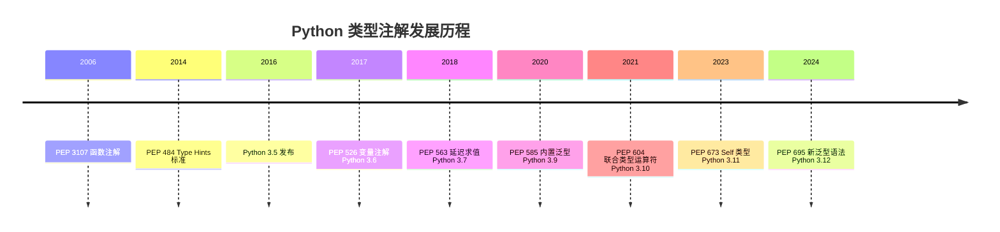

# Python 类型注解与 mypy

> **文档定位**：本文档是 Python 类型注解（Type Hints）与 mypy 静态类型检查的完整实战指南，覆盖从基础注解到泛型、Protocol、TypedDict、Callable、TypeGuard 等高级类型，以及 mypy 配置、strict 模式、IDE 集成、CI 流水线和渐进式类型化策略。
>
> **适用人群**：Python 开发者、全栈工程师、想提升代码质量的团队、从动态语言转向类型安全的开发者
>
> **前置知识**：[[Python-语法基础与数据结构]]、[[Python-异步编程asyncio]]

---

## 一、类型注解概述与发展历史

### 1.1 什么是类型注解

**类型注解（Type Hints）** 是 Python 3.5+ 引入的语法特性，允许开发者在代码中显式声明变量、函数参数和返回值的预期类型。类型注解是**可选的、不影响运行时**的——Python 解释器不会因为类型不匹配而报错。类型注解主要用于静态类型检查工具（如 mypy）、IDE 智能提示和文档生成。

**生活化比喻**：如果传统 Python 是"不打标签的仓库"——你需要翻遍每个箱子才知道里面是什么，类型注解就是给每个箱子贴上标签——一眼就知道里面装的是什么。标签不影响箱子里的东西（运行时不变），但让管理和查找变得轻松。

**核心价值**：类型注解让 Python 同时拥有动态语言的开发灵活性和静态语言的类型安全性。

```python
# 无类型注解（传统 Python）
def add(a, b):
    return a + b

# 有类型注解
def add(a: int, b: int) -> int:
    return a + b

# 变量注解
name: str = "Python"
age: int = 30
pi: float = 3.14159
```

### 1.2 为什么需要类型注解

| 好处 | 说明 | 实际收益 |
|------|------|---------|
| **提前发现 Bug** | 静态类型检查在运行前发现类型错误 | 减少线上故障 |
| **IDE 智能提示** | 精确的自动补全、参数提示、重构支持 | 提升开发效率 |
| **代码可读性** | 函数签名即文档，无需读实现 | 降低理解成本 |
| **重构安全** | 类型检查器自动发现所有受影响的地方 | 重构更放心 |
| **文档即代码** | 类型注解与代码同步更新 | 文档不会过时 |
| **团队协作** | 类型注解是接口契约 | 减少沟通成本 |
| **工具链支持** | FastAPI/Pydantic 利用注解自动生成文档和校验 | 减少样板代码 |

### 1.3 发展历史



| PEP | Python 版本 | 内容 |
|-----|------------|------|
| PEP 3107 | 3.0 | 函数注解语法基础 |
| PEP 484 | 3.5 | Type Hints 标准，typing 模块 |
| PEP 526 | 3.6 | 变量注解语法 |
| PEP 563 | 3.7 | 延迟求值注解（`from __future__ import annotations`） |
| PEP 585 | 3.9 | 内置泛型（`list[int]` 替代 `List[int]`） |
| PEP 604 | 3.10 | 联合类型运算符（`int | str`） |
| PEP 612 | 3.10 | 参数规范变量（ParamSpec） |
| PEP 646 | 3.11 | 可变参数泛型（TypeVarTuple） |
| PEP 673 | 3.11 | Self 类型 |
| PEP 695 | 3.12 | 新泛型语法 |

### 1.4 动态类型 vs 静态类型

```python
# Python 是动态类型语言：运行时才检查类型
x = 1        # x 是 int
x = "hello"  # x 变成 str，运行时完全合法

# 类型注解是静态的：由 mypy 在运行前检查
x: int = 1
x = "hello"  # mypy 会报错：Incompatible types in assignment
             # 但 Python 运行时不会报错！
```

| 维度 | 动态类型（无注解） | 静态类型（有注解+mypy） |
|------|-------------------|----------------------|
| 类型检查时机 | 运行时 | 运行前（开发/CI） |
| Bug 发现时机 | 线上 | 开发时 |
| 开发速度 | 快（无需写类型） | 稍慢（长期更快） |
| 重构成本 | 高 | 低（类型检查器自动发现） |
| 可读性 | 需读实现 | 签名即文档 |
| 适用场景 | 小脚本、原型 | 大型项目、团队协作 |

> ✅ 最佳实践：Python 的类型注解是**渐进式**的——可以从无类型开始，逐步为核心模块添加类型注解，不需要一次性全部注解。新代码建议都加类型注解，老代码逐步迁移。

### 1.5 类型注解不影响运行时

```python
# 验证：类型注解存储在 __annotations__ 中，不影响执行
def greet(name: str) -> str:
    return f"Hello, {name}"

# 查看注解
print(greet.__annotations__)
# 输出：{'name': <class 'str'>, 'return': <class 'str'>}

# 运行时不检查类型
greet(123)  # 运行时正常执行（返回 "Hello, 123"）
# 但 mypy 会报错
```

```python
# from __future__ import annotations 让注解变成字符串
# 运行时完全不求值，零开销
from __future__ import annotations

def process(data: dict[str, list[int]]) -> str:
    return str(data)

# 查看 __annotations__
print(process.__annotations__)
# {'data': "dict[str, list[int]]", 'return': 'str'}
# 注意：注解是字符串，不是实际类型对象
```

### 1.6 类型注解与 Python 版本选择

```toml
# 推荐：Python 3.10+（支持 | 联合类型）
[tool.poetry.dependencies]
python = "^3.10"

# 如果需要支持 3.8：
[tool.poetry.dependencies]
python = ">=3.8"

# 3.8 需要从 typing 导入 List, Dict, Union, Optional
# 3.9+ 可以用 list, dict, |
# 3.10+ 推荐用 | 替代 Union
```

### 1.7 类型注解的社区采用

```python
# 已大规模采用类型注解的项目：
# - FastAPI（100% 注解）
# - Pydantic（利用注解做校验）
# - Django 4.2+（逐步添加注解）
# - pandas 2.0（类型存根）
# - SQLAlchemy 2.0（类型化 ORM）

# 趋势：
# - 新项目默认带类型注解
# - 老项目逐步迁移
# - 开源库发布时包含类型存根
```

### 1.10 类型注解与动态语言的关系

```python
# Python 仍然是动态语言
# 类型注解只是"提示"，不是强制
# mypy 是可选的检查器

# 这意味着：
# 1. 不加注解的代码完全合法
# 2. 类型错误在运行时才发现
# 3. 你可以选择严格度

# 但趋势是：
# 1. 新代码默认带注解
# 2. 大型项目必须有类型检查
# 3. 开源库应该包含类型存根
```

### 1.11 类型注解 vs TypeScript

```python
# Python 类型注解 vs TypeScript
# 1. Python 注解是可选的；TypeScript 强制
# 2. Python 注解不影响运行时；TypeScript 编译为 JS
# 3. Python 渐进式；TypeScript 可以 strict
# 4. Python mypy 是第三方；TypeScript tsc 是编译器
# 5. Python 更灵活；TypeScript 更严格

# 如果你从 TypeScript 转来：
# - 类型概念类似（泛型、联合、可选）
# - 语法不同（Python 用冒号，TS 用冒号）
# - Python 更宽松（可选注解）
```

---

> 💡 **本章深度讲解**：理解类型注解的核心是理解"静态 vs 动态"的区别。类型注解不改变 Python 的动态本质，它只是在代码中添加了"类型元数据"。mypy 在开发时读取这些元数据进行检查，IDE 用它做智能提示。这个设计让 Python 保持了灵活性，同时在大型项目中提供了类型安全。
>
> **📝 精简总结**：
> - 核心概念：类型注解、静态检查、渐进式类型化
> - 关键原理：注解是元数据；不影响运行时；mypy 运行前检查
> - 常用操作：`def f(x: int) -> str`；`x: int = 1`
> - 最佳实践：新代码加注解；老代码渐进式迁移
> - 常见坑点：以为类型注解会在运行时检查
> - 面试高频：类型注解影响运行时吗；渐进式类型化

### 🎯 梯度练习题

**基础题（⭐）**
1. 类型注解会在运行时检查类型吗？
   - 答案：不会。它只是元数据，运行时不生效。
2. `from __future__ import annotations` 的作用是什么？
   - 答案：让注解变成字符串，运行时不求值，零开销。

**进阶题（⭐⭐）**
1. 为什么说类型注解是"渐进式"的？
   - 思考方向：可以部分注解；未注解的部分默认为 Any。
2. 类型注解和 Pydantic 的运行时校验有什么区别？
   - 思考方向：注解是静态的（mypy）；Pydantic 是运行时的（实例化时校验）。

**实战题（⭐⭐⭐）**
- **背景**：你接手一个 5 万行的 Python 项目，没有任何类型注解。
- **需求**：制定类型化迁移策略。
- **要求**：① 从核心模块开始；② 新代码必须有注解；③ mypy 配置渐进式严格；④ CI 中运行 mypy。
- **验收标准**：核心模块 100% 注解；mypy 无错误；新代码必须有注解。
- **提示**：参考渐进式类型化的四阶段策略。

---

## 二、类型注解基础：变量、函数与基本类型

### 2.1 变量注解

```python
# 基本类型变量注解
name: str = "Alice"
age: int = 30
height: float = 1.75
is_active: bool = True
data: bytes = b"binary data"

# 只声明不赋值
result: int  # 声明类型，后续赋值时检查
result = 42   # OK
result = "42"  # mypy 错误：类型不匹配

# None 类型
value: None = None
```

```python
# 容器类型注解（Python 3.9+ 推荐）
names: list[str] = ["Alice", "Bob", "Charlie"]
scores: dict[str, int] = {"Alice": 90, "Bob": 85}
coordinates: tuple[int, int] = (10, 20)
unique: set[int] = {1, 2, 3}

# 嵌套容器
matrix: list[list[int]] = [[1, 2], [3, 4]]
user_data: dict[str, list[int]] = {"scores": [90, 85, 88]}
```

### 2.2 函数类型注解

```python
# 基本函数注解
def add(a: int, b: int) -> int:
    return a + b

# 带默认值
def greet(name: str, greeting: str = "Hello") -> str:
    return f"{greeting}, {name}!"

# 可变参数
def sum_numbers(*numbers: int) -> int:
    return sum(numbers)

def print_info(**kwargs: str) -> None:
    for key, value in kwargs.items():
        print(f"{key}: {value}")

# 无返回值
def log(message: str) -> None:
    print(f"[LOG] {message}")
```

```python
# 多返回值（实际是 tuple）
from typing import Tuple  # Python 3.8 及以下
# Python 3.9+ 直接用 tuple

def get_user() -> tuple[str, int]:
    return "Alice", 30

# 泛化的返回类型
def parse_json(data: str) -> dict:
    return {}  # mypy 知道这是 dict，但不知道键值类型
```

### 2.3 基本类型速查

| 类型注解 | 说明 | 示例 |
|---------|------|------|
| `int` | 整数 | `age: int = 30` |
| `str` | 字符串 | `name: str = "Alice"` |
| `float` | 浮点数 | `pi: float = 3.14` |
| `bool` | 布尔值 | `is_valid: bool = True` |
| `bytes` | 字节 | `data: bytes = b"hi"` |
| `None` | 空值 | `result: None = None` |
| `object` | 所有类型的基类 | `x: object = 42` |
| `Any` | 任意类型（禁用检查） | `x: Any = anything` |
| `NoReturn` | 永不返回 | `def f() -> NoReturn: raise ...` |

> ❌ 常见坑点：`int` 是 `float` 的子类型（mypy 认为 int 可以赋值给 float），但 `float` 不能赋值给 `int`。`bool` 是 `int` 的子类型（True 是 1，False 是 0）。

### 2.4 None 与 Optional

```python
# Python 3.10+ 推荐：用 | 运算符
def find_user(user_id: int) -> "User | None":
    # 可能返回 User，也可能返回 None
    ...

# Python 3.9 及以下：用 Optional
from typing import Optional

def find_user(user_id: int) -> Optional["User"]:
    ...

# Optional[X] 等价于 Union[X, None]
# 即：可能是 X，也可能是 None
```

```python
# None 检查的两种方式
def get_name(user) -> str:
    if user is None:
        return "Anonymous"
    return user.name  # mypy 知道这里 user 不是 None

# 或用默认值
def greet(name: str | None = None) -> str:
    if name is None:
        return "Hello, Guest!"
    return f"Hello, {name}!"
```

### 2.5 联合类型（Union）

```python
# Python 3.10+：用 | 运算符（推荐）
def parse_value(value: str | int | float) -> float:
    return float(value)

# Python 3.9 及以下：用 Union
from typing import Union

def parse_value(value: Union[str, int, float]) -> float:
    return float(value)

# 联合类型的常见用法
def process_id(user_id: int | str) -> str:
    return str(user_id)
```

```python
# Any vs object 的区别
from typing import Any

# Any：完全禁用类型检查
def f(x: Any) -> Any:
    return x.anything()  # mypy 不检查

# object：可以做任意操作，但 mypy 会检查
def g(x: object) -> None:
    print(x)  # OK，print 接受任意类型
    # x.upper()  # mypy 错误：object 没有 upper 方法
```

### 2.6 类型别名与 NewType

```python
# 类型别名：给复杂类型起个短名字
from typing import TypeAlias

Vector: TypeAlias = list[float]
Matrix: TypeAlias = list[Vector]

def scale(v: Vector, factor: float) -> Vector:
    return [x * factor for x in v]

# NewType：创建一个全新的类型（不是别名）
from typing import NewType

UserId = NewType("UserId", int)

def get_user(user_id: UserId):
    ...

user_id = UserId(123)
get_user(user_id)   # OK
get_user(123)       # mypy 错误：int 不是 UserId
```

> ✅ 最佳实践：用 NewType 区分"看起来像 int 但语义不同"的 ID 类型。`UserId` 和 `ProductId` 都是 int，但混用会被 mypy 抓住，防止逻辑错误。

### 2.7 字面量与枚举的类型注解

```python
from enum import Enum

class Color(Enum):
    RED = "red"
    GREEN = "green"
    BLUE = "blue"

def set_color(c: Color) -> None:
    ...

set_color(Color.RED)   # OK
set_color("red")       # mypy 错误：str 不是 Color
```

```python
# 枚举 vs Literal 的选择
# Literal：简单的字符串选项
Mode = Literal["read", "write", "append"]

# Enum：有更多逻辑或需要迭代时
class Status(Enum):
    ACTIVE = "active"
    INACTIVE = "inactive"
    PENDING = "pending"

    @property
    def is_active(self) -> bool:
        return self == Status.ACTIVE
```

### 2.8 模块级常量与全局变量

```python
# 模块级常量用 Final
from typing import Final

MAX_CONNECTIONS: Final = 100
DEFAULT_TIMEOUT: Final[float] = 30.0
APP_NAME: Final[str] = "MyApp"

# 全局可变变量不推荐，但如果需要：
_cache: dict[str, object] = {}  # 模块级可变全局

def get_cache() -> dict[str, object]:
    return _cache
```

### 2.9 NoneType 与空值处理

```python
# None 的类型是 NoneType
# 但注解时用 None
x: None = None  # OK
y: int | None = None  # OK

# 常见模式：返回 Optional
def find(key: str) -> str | None:
    data = {"a": "1", "b": "2"}
    return data.get(key)

result = find("c")  # None
if result is None:
    print("not found")
else:
    print(result.upper())
```

### 2.10 数字类型的层次关系

```python
# mypy 的数字类型层次：
# object -> int -> bool
# object -> float -> int（注意：int 是 float 的子类型）
# object -> complex -> float

# 这意味着：
def takes_float(x: float) -> None:
    ...

takes_float(1)      # OK：int 是 float 子类型
takes_float(1.5)    # OK
# takes_float(complex(1, 2))  # mypy 错误

# bool 是 int 子类型
def takes_int(x: int) -> None:
    ...

takes_int(True)      # OK：True 是 1
takes_int(False)     # OK：False 是 0
```

### 2.11 函数注解中的默认值与 None

```python
# 错误：默认 None 时 Optional 隐式
def greet(name: str = None) -> str:  # mypy 警告
    ...

# 正确：显式 Optional
def greet(name: str | None = None) -> str:
    if name is None:
        return "Hello!"
    return f"Hello, {name}!"
```

```python
# no_implicit_optional = true 时必须显式 Optional
# 这是 strict 模式的一部分
# 推荐开启，避免隐式 None
```

### 2.12 异步函数注解

```python
# 异步函数的类型注解
async def fetch_user(user_id: int) -> dict:
    return {"id": user_id, "name": "Alice"}

# 注解方式与同步函数相同
# mypy 和 asyncio 集成检查

# 与 pydantic 结合
from pydantic import BaseModel

class User(BaseModel):
    id: int
    name: str

async def get_user(user_id: int) -> User:
    data = await db.fetch(user_id)
    return User(**data)
```

### 2.13 生成器函数注解

```python
# 生成器的类型注解
from collections.abc import Generator

def count_up(start: int, end: int) -> Generator[int, None, None]:
    n = start
    while n < end:
        yield n
        n += 1

# Generator[YieldType, SendType, ReturnType]
# YieldType: yield 的类型
# SendType: send() 的参数类型
# ReturnType: return 的类型

# Python 3.9+ 也可以用 Iterator
from collections.abc import Iterator

def count_up_simple(start: int, end: int) -> Iterator[int]:
    n = start
    while n < end:
        yield n
        n += 1
```

### 2.14 函数重载与类型注解实战

```python
from typing import overload

@overload
def parse(value: int) -> str: ...
@overload
def parse(value: str) -> int: ...
@overload
def parse(value: float) -> float: ...

def parse(value):
    if isinstance(value, int):
        return str(value)
    elif isinstance(value, str):
        return int(value)
    return float(value)

a = parse(42)      # str
b = parse("42")    # int
c = parse(3.14)    # float
```

### 2.15 类型注解中的 forward reference

```python
# 前向引用：引用尚未定义的类
class TreeNode:
    def __init__(self, value: int, left: "TreeNode | None" = None) -> None:
        self.value = value
        self.left = left

# Python 3.7+ 用 future 导入后可以省略引号
from __future__ import annotations

class TreeNodeV2:
    def __init__(self, value: int, left: TreeNodeV2 | None = None) -> None:
        self.value = value
        self.left = left
```

### 2.16 类方法和静态方法注解

```python
class User:
    def __init__(self, name: str) -> None:
        self.name = name

    @classmethod
    def from_dict(cls, data: dict[str, str]) -> "User":
        return cls(name=data["name"])

    @staticmethod
    def validate_name(name: str) -> bool:
        return len(name) > 0
```

---

> 💡 **本章深度讲解**：变量注解和函数注解是类型系统的基础。理解"注解不影响运行时"和"渐进式"是关键——你可以逐步为代码添加注解。None 检查是最常见的类型错误来源，`X | None` 显式声明让 mypy 帮你检查所有 None 分支。NewType 是一个强大但少有人用的工具，它让你在不增加运行时开销的情况下区分语义不同的同构类型。
>
> **📝 精简总结**：
> - 核心概念：变量注解、函数注解、Optional、Union、NewType
> - 关键原理：注解是元数据；int 是 float 子类型；NewType 创建新类型
> - 常用操作：`def f(x: int) -> str`；`X | None`；`NewType("UserId", int)`
> - 最佳实践：公共 API 必须注解返回值；用 NewType 区分 ID
> - 常见坑点：以为注解会在运行时检查；Optional 用法混淆
> - 面试高频：Optional vs Union；Any vs object；NewType

### 🎯 梯度练习题

**基础题（⭐）**
1. `Optional[str]` 等价于什么？
   - 答案：`Union[str, None]` 或 `str | None`。
2. `NewType("UserId", int)` 和 `UserId = int` 有什么区别？
   - 答案：NewType 创建新类型，mypy 认为不同；别名是同一个类型。

**进阶题（⭐⭐）**
1. 为什么 `int` 可以赋值给 `float`？
   - 思考方向：Python 的数字类型层次；mypy 的子类型规则。
2. `Any` 和 `object` 的区别？
   - 思考方向：Any 禁用检查；object 允许操作但 mypy 检查。

**实战题（⭐⭐⭐）**
- **背景**：你有一个 `User` 类，有 `id: int`、`name: str` 属性。
- **需求**：为它添加完整的类型注解。
- **要求**：① `__init__` 注解；② 方法注解；③ 返回类型注解；④ 用 NewType 区分 UserId。
- **验收标准**：mypy 无错误；类型清晰。
- **提示**：注意 `None` 检查和默认值。

---

## 三、复杂类型注解：容器、字典与结构化数据

### 3.1 容器类型详解

```python
# Python 3.9+：内置泛型（推荐）
names: list[str] = ["Alice", "Bob"]
scores: dict[str, int] = {"Alice": 90}
pair: tuple[int, int] = (10, 20)
unique: set[int] = {1, 2, 3}
frozen: frozenset[str] = frozenset(["a", "b"])

# 可变长度元组
numbers: tuple[int, ...] = (1, 2, 3, 4, 5)  # 任意数量的 int

# 固定长度元组
point: tuple[int, int] = (10, 20)  # 必须恰好两个 int
```

```python
# Python 3.8 及以下：从 typing 导入
from typing import List, Dict, Tuple, Set, FrozenSet

names: List[str] = ["Alice", "Bob"]
scores: Dict[str, int] = {"Alice": 90}
coordinates: Tuple[int, int] = (10, 20)
unique: Set[int] = {1, 2, 3}
numbers: Tuple[int, ...] = (1, 2, 3)
```

> ❌ 常见坑点：`tuple[int, ...]` 表示可变长度（任意数量的 int），而 `tuple[int, int]` 表示固定长度（恰好两个 int）。这个区别经常被混淆。

### 3.2 TypedDict：类型化字典

```python
from typing import TypedDict

class User(TypedDict):
    name: str
    age: int
    email: str  # 必填

# 使用
user: User = {"name": "Alice", "age": 30, "email": "alice@example.com"}
# mypy 检查键名和值类型
```

```python
# 可选字段
class User(TypedDict, total=False):
    name: str
    age: int
    email: str  # 所有字段都可选

# 混合必填和可选
from typing import NotRequired

class User(TypedDict):
    name: str      # 必填
    age: int       # 必填
    email: NotRequired[str]  # 可选
```

```python
# TypedDict 实战：API 响应
class APIResponse(TypedDict):
    status: str
    data: dict[str, object]
    message: NotRequired[str]

def handle_response(resp: APIResponse) -> None:
    if resp["status"] == "ok":
        print(resp["data"])
    if "message" in resp:
        print(resp["message"])  # mypy 知道 message 存在
```

### 3.3 NamedTuple：命名元组

```python
from typing import NamedTuple

class Point(NamedTuple):
    x: int
    y: int
    label: str = "origin"  # 默认值

p = Point(10, 20)
print(p.x, p.y)  # 10 20
print(p.label)   # origin

# NamedTuple vs TypedDict vs dataclass
# NamedTuple：不可变，轻量，基于 tuple
# TypedDict：字典，用于 JSON 数据
# dataclass：真正的类，有方法
```

### 3.4 Literal：字面量类型

```python
from typing import Literal

# 只能是指定的字面量值之一
def get_status(code: Literal[200, 404, 500]) -> str:
    if code == 200:
        return "OK"
    elif code == 404:
        return "Not Found"
    else:
        return "Error"

get_status(200)   # OK
get_status(301)   # mypy 错误

# 常见用法：模式、状态、选项
Mode = Literal["read", "write", "append"]

def open_file(path: str, mode: Mode) -> None:
    ...

open_file("test.txt", "read")   # OK
open_file("test.txt", "delete")  # mypy 错误
```

### 3.5 Final 与 ClassVar

```python
from typing import Final, ClassVar

# Final：常量（不能重新赋值）
MAX_SIZE: Final = 100
MAX_SIZE = 200  # mypy 错误：Final 变量不能重新赋值

# ClassVar：类变量（不是实例变量）
class Counter:
    class_var: ClassVar[int] = 0  # 所有实例共享
    instance_var: int = 0          # 每个实例独立

Counter.class_var = 1  # OK
Counter.instance_var = 1  # mypy 错误：应该通过实例访问
```

### 3.6 TypeGuard：类型守卫

```python
from typing import TypeGuard

# 类型守卫函数：告诉 mypy 类型被收窄
def is_str_list(val: list[object]) -> TypeGuard[list[str]]:
    return all(isinstance(x, str) for x in val)

items: list[object] = ["a", "b", "c"]
if is_str_list(items):
    # items 在这里被窄化为 list[str]
    print(items[0].upper())  # OK
```

### 3.7 嵌套 TypedDict

```python
from typing import TypedDict

class Address(TypedDict):
    street: str
    city: str
    zipcode: str

class User(TypedDict):
    name: str
    age: int
    address: Address  # 嵌套 TypedDict

# 使用
user: User = {
    "name": "Alice",
    "age": 30,
    "address": {
        "street": "123 Main St",
        "city": "Beijing",
        "zipcode": "100000"
    }
}
```

### 3.8 条件 Literal 与有限状态

```python
from typing import Literal, TypedDict

# 状态机：不同状态有不同字段
class PendingOrder(TypedDict):
    status: Literal["pending"]
    order_id: str

class PaidOrder(TypedDict):
    status: Literal["paid"]
    order_id: str
    paid_at: str

Order = PendingOrder | PaidOrder

def process_order(order: Order) -> None:
    if order["status"] == "pending":
        print(f"Order {order['order_id']} pending")
    elif order["status"] == "paid":
        print(f"Paid at {order['paid_at']}")
```

### 3.9 字典与 JSON 类型

```python
# JSON 数据类型
# JSON 只支持：str, int, float, bool, None, list, dict
# 不支持：tuple, set, datetime, custom classes

# JSON 字典的类型
JsonDict = dict[str, object]

def parse_json(data: str) -> JsonDict:
    import json
    return json.loads(data)

# 更精确的 JSON 类型
from typing import TypeAlias

JSONValue = str | int | float | bool | None | list["JSONValue"] | dict[str, "JSONValue"]
JSONObject = dict[str, JSONValue]

def parse_json_v2(data: str) -> JSONObject:
    import json
    return json.loads(data)
```

### 3.10 不可变类型与只读

```python
# 元组是不可变的
t: tuple[int, int] = (1, 2)
# t[0] = 3  # mypy 错误

# frozenset 不可变
fs: frozenset[int] = frozenset([1, 2, 3])

# 只读列表（Python 3.11+ 不行，用 Sequence）
from typing import Sequence

def process(items: Sequence[int]) -> None:
    # items 是只读的
    print(len(items))
    print(items[0])
    # items.append(1)  # mypy 错误：Sequence 没有 append
```

### 3.11 Sequence vs Iterable vs list

```python
from collections.abc import Sequence, Iterable

# Iterable：可以 for 遍历（最小约束）
def process_items(items: Iterable[int]) -> None:
    for item in items:
        print(item)

# Sequence：可索引、有长度（更强约束）
def get_first(items: Sequence[int]) -> int:
    return items[0]

# list：具体类型（最严格）
def sort_list(items: list[int]) -> list[int]:
    return sorted(items)
```

> ✅ 最佳实践：函数参数用最宽松的类型（Iterable/Sequence），返回值用最具体的类型（list）。

### 3.12 Mapping vs dict vs MutableMapping

```python
from collections.abc import Mapping, MutableMapping

# Mapping：只读字典接口
def get_config(config: Mapping[str, str]) -> str:
    return config.get("key", "default")

# MutableMapping：可修改字典接口
def update_config(config: MutableMapping[str, str]) -> None:
    config["key"] = "value"

# dict：具体实现
# 函数参数用 Mapping，返回值用 dict
def make_config() -> dict[str, str]:
    return {"key": "value"}
```

### 3.13 类型别名与 TypeAlias

```python
from typing import TypeAlias

# 简单别名
Vector: TypeAlias = list[float]
Matrix: TypeAlias = list[Vector]

# 带参数的别名（Python 3.12+）
# type Vec[T] = list[T]  # 新语法

# 旧写法用 TypeVar
T = TypeVar("T")
Box: TypeAlias = tuple[T, T]

def center(v: Vector) -> float:
    return sum(v) / len(v)
```

### 3.14 Annotated 元数据注解

```python
from typing import Annotated

# Annotated：给类型附加元数据
# 用于 Pydantic、FastAPI 等

# 基本用法
PositiveInt = Annotated[int, "positive"]

def set_age(age: PositiveInt) -> None:
    ...

# FastAPI 中的 Annotated
from fastapi import Query

def get_items(
    page: Annotated[int, Query(ge=1, le=100)] = 1
) -> list[str]:
    ...
```

---

> 💡 **本章深度讲解**：复杂类型注解让你精确描述数据结构。TypedDict 让字典有了类型安全，特别适合 API 响应和 JSON 数据。Literal 让你限制取值范围，替代了"字符串常量"的模式。TypeGuard 让你可以自定义类型收窄函数。这些高级类型让 Python 的类型系统可以表达非常精确的约束。
>
> **📝 精简总结**：
> - 核心概念：容器泛型、TypedDict、NamedTuple、Literal、Final、TypeGuard
> - 关键原理：TypedDict 检查键名和值类型；Literal 限制取值；TypeGuard 收窄类型
> - 常用操作：`TypedDict` 类；`Literal["read", "write"]`；`TypeGuard[list[str]]`
> - 最佳实践：API 响应用 TypedDict；状态用 Literal；常量用 Final
> - 常见坑点：tuple[int] vs tuple[int, ...]；total=False vs NotRequired
> - 面试高频：TypedDict vs dataclass；Literal 用途；TypeGuard

### 🎯 梯度练习题

**基础题（⭐）**
1. `TypedDict` 的作用是什么？
   - 答案：给字典指定键和值的类型，mypy 检查键名和值类型。
2. `Literal["read", "write"]` 是什么意思？
   - 答案：只能是 "read" 或 "write"。

**进阶题（⭐⭐）**
1. `tuple[int]` 和 `tuple[int, ...]` 的区别？
   - 答案：tuple[int] 是单个元素；tuple[int, ...] 是可变长度。
2. TypedDict 和 dataclass 的区别？
   - 思考方向：TypedDict 是字典；dataclass 是类。

**实战题（⭐⭐⭐）**
- **背景**：你有一个 API 返回 JSON 数据结构。
- **需求**：用 TypedDict 描述 API 响应。
- **要求**：① status 必填；② data 必填；③ message 可选；④ 用 mypy 验证。
- **验收标准**：mypy 无错误；键名错误被检测。
- **提示**：用 `NotRequired` 标记可选字段。

---

## 四、高级类型：泛型、Callable 与 Protocol

### 4.1 泛型函数与 TypeVar

```python
from typing import TypeVar

T = TypeVar("T")  # 任意类型

# 泛型函数：输入什么类型，返回什么类型
def first(items: list[T]) -> T:
    return items[0]

# 类型自动推断
result_int: int = first([1, 2, 3])
result_str: str = first(["a", "b", "c"])
```

```python
# 有约束的 TypeVar
Number = TypeVar("Number", int, float)

def add(a: Number, b: Number) -> Number:
    return a + b

add(1, 2)       # OK，Number = int
add(1.5, 2.5)   # OK，Number = float
add(1, 2.5)     # mypy 错误：不一致
```

```python
# 有上界的 TypeVar
from typing import TypeVar

class Animal:
    def speak(self) -> str: ...

class Dog(Animal):
    def speak(self) -> str: return "Woof"

A = TypeVar("A", bound=Animal)

def make_speak(animal: A) -> A:
    animal.speak()
    return animal
```

### 4.2 泛型类

```python
from typing import Generic, TypeVar

T = TypeVar("T")

class Stack(Generic[T]):
    def __init__(self) -> None:
        self._items: list[T] = []

    def push(self, item: T) -> None:
        self._items.append(item)

    def pop(self) -> T:
        return self._items.pop()

    def peek(self) -> T | None:
        return self._items[-1] if self._items else None

# 使用
int_stack: Stack[int] = Stack()
int_stack.push(1)
int_stack.push("hello")  # mypy 错误：str 不是 int
```

### 4.3 Callable 类型

```python
from typing import Callable

# Callable[[参数类型...], 返回类型]
def apply(func: Callable[[int, int], int], a: int, b: int) -> int:
    return func(a, b)

def add(x: int, y: int) -> int:
    return x + y

result = apply(add, 3, 4)  # 7
```

```python
# 任意参数的可调用对象
Handler = Callable[..., None]  # 任意参数，返回 None

def register_handler(handler: Handler) -> None:
    ...

# 带命名参数的 Callable（Python 3.10+ 用 ParamSpec）
from typing import Callable, ParamSpec, TypeVar

P = ParamSpec("P")
R = TypeVar("R")

def log_decorator(func: Callable[P, R]) -> Callable[P, R]:
    def wrapper(*args: P.args, **kwargs: P.kwargs) -> R:
        print(f"Calling {func.__name__}")
        return func(*args, **kwargs)
    return wrapper
```

### 4.4 Protocol：结构化子类型

```python
from typing import Protocol

# Protocol：鸭子类型的类型注解
# 不需要显式继承，只要有相同的方法就符合

class HasName(Protocol):
    name: str

class HasSpeak(Protocol):
    def speak(self) -> str: ...

# 任何有 name 属性的类都符合 HasName
class Person:
    def __init__(self, name: str) -> None:
        self.name = name

class Company:
    def __init__(self, name: str) -> None:
        self.name = name

def print_name(obj: HasName) -> None:
    print(obj.name)

print_name(Person("Alice"))   # OK
print_name(Company("Acme"))    # OK（不需要继承 HasName）
```

```python
# 运行时可检查的 Protocol
from typing import Protocol, runtime_checkable

@runtime_checkable
class HasSpeak(Protocol):
    def speak(self) -> str: ...

class Dog:
    def speak(self) -> str: return "Woof"

dog = Dog()
isinstance(dog, HasSpeak)  # True（运行时检查）
```

### 4.5 Self 类型

```python
# Python 3.11+：Self 类型
class Node:
    def __init__(self, value: int) -> None:
        self.value = value
        self.next: Node | None = None

    def set_next(self, node: Self) -> Self:
        self.next = node
        return self

# 旧写法：用字符串前向引用
class OldNode:
    def set_next(self, node: "OldNode") -> "OldNode":
        ...
```

### 4.6 overload：函数重载

```python
from typing import overload

@overload
def process(value: int) -> str: ...
@overload
def process(value: str) -> int: ...

def process(value):  # 实际实现
    if isinstance(value, int):
        return str(value)
    return int(value)

result1 = process(42)      # mypy 知道是 str
result2 = process("42")    # mypy 知道是 int
```

### 4.7 ParamSpec 与装饰器

```python
from typing import Callable, ParamSpec, TypeVar
from functools import wraps

P = ParamSpec("P")
R = TypeVar("R")

def retry(times: int = 3) -> Callable[[Callable[P, R]], Callable[P, R]]:
    """重试装饰器：保留原函数的类型签名"""
    def decorator(func: Callable[P, R]) -> Callable[P, R]:
        @wraps(func)
        def wrapper(*args: P.args, **kwargs: P.kwargs) -> R:
            for attempt in range(times):
                try:
                    return func(*args, **kwargs)
                except Exception:
                    if attempt == times - 1:
                        raise
            return func(*args, **kwargs)
        return wrapper
    return decorator

# 使用
@retry(times=3)
def fetch_user(user_id: int) -> dict:
    ...
```

### 4.8 Concatenate 与参数变换

```python
from typing import Callable, Concatenate, ParamSpec, TypeVar

P = ParamSpec("P")
R = TypeVar("R")

# 第一个参数被注入（如 self 或 session）
def with_session(func: Callable[Concatenate[str, P], R]) -> Callable[P, R]:
    def wrapper(*args: P.args, **kwargs: P.kwargs) -> R:
        return func("session-string", *args, **kwargs)
    return wrapper

@with_session
def query(session: str, sql: str) -> list:
    ...
```

### 4.9 泛型协议

```python
from typing import Protocol, TypeVar, Generic

T = TypeVar("T")

class Repository(Protocol[T]):
    def get(self, id: int) -> T | None: ...
    def save(self, entity: T) -> T: ...

# 任何实现了 get/save 的类都符合
class UserRepo:
    def get(self, id: int) -> User | None: ...
    def save(self, entity: User) -> User: ...

def use_repo(repo: Repository[User]) -> None:
    user = repo.get(1)
```

### 4.10 多泛型参数

```python
from typing import Generic, TypeVar

K = TypeVar("K")
V = TypeVar("V")

class Pair(Generic[K, V]):
    def __init__(self, key: K, value: V) -> None:
        self.key = key
        self.value = value

    def get_key(self) -> K:
        return self.key

    def get_value(self) -> V:
        return self.value

p: Pair[str, int] = Pair("age", 30)
key: str = p.get_key()
value: int = p.get_value()
```

### 4.11 type[X] 类型：类对象的类型

```python
from typing import TypeVar

class Animal: ...
class Dog(Animal): ...

# type[Animal]：Animal 或其子类的类对象
def create_animal(cls: type[Animal]) -> Animal:
    return cls()

create_animal(Dog)  # OK
# create_animal(str)  # mypy 错误
```

### 4.12 协变与逆变

```python
# mypy 默认对泛型参数是不变的
# 但某些情况下需要协变/逆变

from typing import Generic, TypeVar

T_co = TypeVar("T_co", covariant=True)

class Box(Generic[T_co]):
    def __init__(self, item: T_co) -> None:
        self._item = item

    def get(self) -> T_co:
        return self._item

# 如果 Dog 是 Animal 子类
# Box[Dog] 是 Box[Animal] 子类（协变）
# 这在返回值位置是安全的
```

### 4.13 完整泛型实战：类型安全的事件系统

```python
from typing import Generic, TypeVar, Callable

EventT = TypeVar("EventT")

class Event(Generic[EventT]):
    def __init__(self, data: EventT) -> None:
        self.data = data

class EventBus:
    def __init__(self) -> None:
        self._handlers: dict[type, list[Callable[..., None]]] = {}

    def subscribe(self, event_type: type[EventT], handler: Callable[[EventT], None]) -> None:
        self._handlers.setdefault(event_type, []).append(handler)

    def publish(self, event: Event[EventT]) -> None:
        handlers = self._handlers.get(type(event.data), [])
        for handler in handlers:
            handler(event.data)

# 使用
class UserCreated:
    def __init__(self, user_id: int) -> None:
        self.user_id = user_id

bus = EventBus()
bus.subscribe(UserCreated, lambda e: print(f"User {e.user_id} created"))
bus.publish(Event(UserCreated(1)))
```

### 4.14 泛型实战：类型安全的缓存

```python
from typing import Generic, TypeVar

T = TypeVar("T")

class Cache(Generic[T]):
    def __init__(self) -> None:
        self._data: dict[str, T] = {}

    def get(self, key: str) -> T | None:
        return self._data.get(key)

    def set(self, key: str, value: T) -> None:
        self._data[key] = value

    def delete(self, key: str) -> None:
        self._data.pop(key, None)

# 使用
int_cache: Cache[int] = Cache()
int_cache.set("count", 42)
value = int_cache.get("count")  # int | None
```

### 4.15 泛型实战：类型安全的 Repository

```python
from typing import Generic, TypeVar, Protocol

class Model(Protocol):
    id: int

M = TypeVar("M", bound=Model)

class Repository(Generic[M]):
    def __init__(self) -> None:
        self._items: dict[int, M] = {}

    def get(self, id: int) -> M | None:
        return self._items.get(id)

    def save(self, item: M) -> M:
        self._items[item.id] = item
        return item

    def list_all(self) -> list[M]:
        return list(self._items.values())
```

---

> 💡 **本章深度讲解**：泛型和 Protocol 是 Python 类型系统最强大的部分。泛型让你写出"类型安全的容器和工具函数"——输入什么类型，输出什么类型。Protocol 实现了结构化子类型（鸭子类型的类型安全版），不需要显式继承。Callable 描述函数签名，让你可以类型安全地传递函数。这些高级类型让 Python 可以表达 Java/C# 级别的类型抽象。
>
> **📝 精简总结**：
> - 核心概念：TypeVar、Generic、Callable、Protocol、Self、overload
> - 关键原理：泛型保持类型关系；Protocol 结构化子类型；overload 多态
> - 常用操作：`TypeVar("T")`；`Generic[T]`；`Protocol` 类；`Self`
> - 最佳实践：用 Protocol 替代继承；公共 API 用 overload
> - 常见坑点：TypeVar bound vs constraints；overload 只是声明
> - 面试高频：泛型；Protocol vs 继承；Callable

### 🎯 梯度练习题

**基础题（⭐）**
1. `TypeVar("T")` 的作用是什么？
   - 答案：创建类型变量，用于泛型函数和泛型类。
2. Protocol 和继承的区别？
   - 答案：Protocol 是结构化子类型（鸭子类型）；继承是名义子类型。

**进阶题（⭐⭐）**
1. `bound=Animal` 和 `Animal` constraints 的区别？
   - 思考方向：bound 是上界（必须是子类）；constraints 是枚举（必须是其中之一）。
2. `Callable[..., None]` 中的 `...` 是什么意思？
   - 答案：任意参数列表。

**实战题（⭐⭐⭐）**
- **背景**：你需要写一个通用的缓存工具。
- **需求**：用泛型实现类型安全的缓存。
- **要求**：① `Cache[T]` 泛型类；② `get(key) -> T | None`；③ `set(key, value: T)`；④ mypy 无错误。
- **验收标准**：`Cache[int]` 只能存 int；类型自动推断。
- **提示**：继承 `Generic[T]`。

---

## 五、mypy 安装与基本用法

### 5.1 安装 mypy

```bash
# 安装 mypy
pip install mypy

# 或用 Poetry
poetry add --group dev mypy

# 验证安装
mypy --version
# 预期输出：mypy 1.x.x
```

### 5.2 基本命令

```bash
# 检查单个文件
mypy myscript.py

# 检查整个目录
mypy src/

# 检查多个文件
mypy module1.py module2.py

# 检查时显示错误代码
mypy --show-error-codes myscript.py

# 忽略缺失的导入
mypy --ignore-missing-imports src/

# 严格模式
mypy --strict src/
```

### 5.3 错误信息解读

```python
# 示例代码
def greet(name: str) -> str:
    return f"Hello, {name}"

result: int = greet("Alice")  # 类型错误
```

```text
# mypy 输出
example.py:5: error: Incompatible types in assignment
  (expression has type "str", variable has type "int")  [assignment]
Found 1 error in 1 file (checked 1 source file)
```

| 部分 | 含义 |
|------|------|
| `example.py:5` | 文件和行号 |
| `error` | 错误级别 |
| `Incompatible types in assignment` | 错误描述 |
| `[assignment]` | 错误代码（用于忽略） |

### 5.4 类型推断机制

```python
# mypy 自动推断类型
x = 42          # 推断为 int
name = "Alice"  # 推断为 str
items = [1, 2, 3]  # 推断为 list[int]

# 空容器需要显式注解
empty: list[int] = []  # 必须注解，否则推断为 list[Any]

# 函数返回值推断
def add(a: int, b: int):  # 没有 -> 注解
    return a + b  # mypy 推断返回 int
```

```python
# 推断的局限性
def get_value(key):
    data = {"a": 1, "b": 2}
    return data.get(key)  # 推断为 int | None

# 建议：公共 API 显式注解返回值
def get_value(key: str) -> int | None:
    data = {"a": 1, "b": 2}
    return data.get(key)
```

### 5.5 渐进式类型检查

```python
# mypy 默认只检查有注解的部分
# 未注解的函数参数和返回值默认是 Any

def untyped(x, y):  # x, y 是 Any，返回值是 Any
    return x + y     # 不会报错

def typed(x: int, y: int) -> int:
    return x + y     # 会检查类型
```

### 5.6 mypy 错误代码速查

| 错误代码 | 含义 | 示例 |
|---------|------|------|
| `assignment` | 类型不匹配赋值 | `x: int = "str"` |
| `arg-type` | 参数类型错误 | `f(123)` 但 f 期望 str |
| `return-value` | 返回值类型错误 | `return "str"` 但声明 int |
| `attr-defined` | 属性不存在 | `obj.non_existent` |
| `import` | 导入错误 | `from nonexistent import x` |
| `union-attr` | 联合类型属性访问 | `x.upper()` 但 x 可能是 int |
| `call-arg` | 调用参数错误 | `f(1, 2, 3)` 但 f 只接受 2 个 |
| `index` | 索引类型错误 | `x[0]` 但 x 不可索引 |
| `list-item` | 列表元素类型错误 | `[1, "a"]` 但声明 list[int] |
| `dict-item` | 字典值类型错误 | `{"a": "str"}` 但声明 dict[str, int] |

### 5.7 常见 mypy 错误修复

```python
# 错误1：Argument 1 to "greet" has incompatible type "int"; expected "str"
def greet(name: str) -> str: ...
greet(123)  # ❌
greet(str(123))  # ✅ 转换类型

# 错误2：Incompatible return value (got "str") (expected "int")
def get_age() -> int:
    return "30"  # ❌
    return 30  # ✅

# 错误3：Item "None" of "Optional[str]" has no attribute "upper"
def shout(s: str | None) -> str:
    return s.upper()  # ❌
    if s is None:     # ✅
        return ""
    return s.upper()
```

### 5.8 mypy 报告功能

```bash
# 生成 HTML 报告
mypy --html-report report_html src/

# 生成 XML 报告（用于 CI 集成）
mypy --junit-xml report.xml src/

# 统计 Any 使用
mypy --any-exprs-report any_report src/

# 生成依赖分析
mypy --verbose src/ | head -50
```

### 5.9 mypy 缓存管理

```bash
# mypy 缓存在 .mypy_cache/
# 清理
rm -rf .mypy_cache/

# CI 中缓存
# GitHub Actions:
- uses: actions/cache@v4
  with:
    path: .mypy_cache
    key: mypy-${{ github.sha }}

# 禁用缓存（调试时）
mypy --no-cache-dir src/
```

### 5.10 从静态检查到运行时校验

```python
# 完整的类型安全策略
# 1. 类型注解（静态）
# 2. mypy 检查（开发时）
# 3. Pydantic 校验（运行时输入）
# 4. pytest 测试（行为验证）

# 示例：用户注册
from pydantic import BaseModel, field_validator

class RegisterRequest(BaseModel):
    email: str
    password: str

    @field_validator("password")
    def password_strength(cls, v: str) -> str:
        if len(v) < 8:
            raise ValueError("Password too short")
        return v

# mypy 检查：参数和返回值类型
# Pydantic 校验：输入格式和约束
# pytest 测试：业务逻辑
```

> ✅ 最佳实践：三层防御——mypy 抓静态错误，Pydantic 抓输入错误，pytest 抓逻辑错误。

> ✅ 最佳实践：mypy 错误信息很精确。读错误信息第一行，它告诉你哪里错了。`--show-error-codes` 让你知道错误代码，便于精确忽略。

> ✅ 最佳实践：渐进式策略——新代码全部加注解；老代码从核心模块开始逐步添加；用 `--strict` 逐步收紧。

---

> 💡 **本章深度讲解**：mypy 的基本用法很简单——`mypy file.py`。核心是理解错误信息格式和类型推断机制。mypy 的类型推断在很多情况下已经很智能，但空容器和公共 API 的返回值需要显式注解。渐进式类型化是实际项目中的关键策略——不要一次性全部注解，而是逐步收紧。
>
> **📝 精简总结**：
> - 核心概念：mypy、类型推断、渐进式检查、错误代码
> - 关键原理：mypy 读取注解进行检查；未注解部分默认为 Any
> - 常用操作：`mypy file.py`；`--show-error-codes`；`--strict`
> - 最佳实践：空容器显式注解；公共 API 显式返回值
> - 常见坑点：空容器推断为 list[Any]；忘记注解返回值
> - 面试高频：mypy 工作原理；类型推断；渐进式类型化

### 🎯 梯度练习题

**基础题（⭐）**
1. `mypy file.py` 做了什么？
   - 答案：静态类型检查，不执行代码。
2. 空列表 `[]` 推断为什么类型？
   - 答案：list[Any]，需要显式注解。

**进阶题（⭐⭐）**
1. 为什么公共 API 要显式注解返回值？
   - 思考方向：调用者需要知道返回类型；类型推断可能不够精确。
2. mypy 如何处理未注解的函数？
   - 思考方向：参数和返回值默认为 Any；不检查。

**实战题（⭐⭐⭐）**
- **背景**：你有一个 1000 行的老项目，没有类型注解。
- **需求**：开始用 mypy 检查。
- **要求**：① 安装 mypy；② 运行检查；③ 配置宽松模式；④ 从核心模块开始添加注解。
- **验收标准**：mypy 运行无崩溃；核心模块有注解。
- **提示**：先 `--ignore-missing-imports`，逐步收紧。

---

## 六、mypy 配置与 strict 模式

### 6.1 配置文件

```toml
# pyproject.toml 中的 mypy 配置
[tool.mypy]
python_version = "3.12"
warn_return_any = true
warn_unused_configs = true
disallow_untyped_defs = false  # 渐进式：先关闭
disallow_incomplete_defs = false
check_untyped_defs = false
no_implicit_optional = true
show_error_codes = true
warn_unused_ignores = true
```

### 6.2 strict 模式

```bash
# --strict 启用所有严格检查
mypy --strict src/
```

```ini
# --strict 等价于以下所有选项：
# warn_unused_configs
# disallow_any_generics
# disallow_subclassing_any
# disallow_untyped_calls
# disallow_untyped_defs
# disallow_incomplete_defs
# check_untyped_defs
# disallow_untyped_decorators
# no_implicit_optional
# warn_redundant_casts
# warn_unused_ignores
# warn_return_any
# no_implicit_reexport
# strict_equality
```

> ✅ 最佳实践：不要一开始就全局 `--strict`。建议：① 新模块启用 strict；② 核心模块逐步启用；③ 最终全局启用。

### 6.3 忽略错误

```python
# 单行忽略
x: int = "hello"  # type: ignore

# 忽略特定错误代码
x: int = "hello"  # type: ignore[assignment]

# 忽略多个错误代码
x: int = "hello"  # type: ignore[assignment, arg-type]

# 文件级忽略（在文件顶部）
# mypy: ignore-errors
```

```python
# 好的忽略方式：说明原因
result = some_dynamic_api()  # type: ignore[attr-defined]  # 第三方库无类型存根
```

### 6.4 第三方库类型存根

```bash
# 自动安装缺失的类型存根
mypy --install-types

# 手动安装常见类型存根
pip install types-requests
pip install types-PyYAML
pip install types-redis
pip install types-Flask
```

```toml
# pyproject.toml：为无类型库配置忽略
[[tool.mypy.overrides]]
module = "requests.*"
ignore_missing_imports = true

[[tool.mypy.overrides]]
module = "numpy.*"
ignore_missing_imports = true
```

### 6.5 按模块配置

```toml
[tool.mypy]
python_version = "3.12"
strict = false

# 核心模块用严格模式
[[tool.mypy.overrides]]
module = "my_project.core.*"
disallow_untyped_defs = true
disallow_incomplete_defs = true
check_untyped_defs = true

# 测试模块宽松一些
[[tool.mypy.overrides]]
module = "tests.*"
disallow_untyped_defs = false
ignore_errors = false
```

### 6.6 完整 mypy 配置示例

```toml
# pyproject.toml - 完整的 mypy 配置
[tool.mypy]
python_version = "3.12"

# 基本行为
warn_return_any = true
warn_unused_configs = true
warn_redundant_casts = true
warn_unused_ignores = true

# 严格度（渐进式）
disallow_untyped_defs = true
disallow_incomplete_defs = true
check_untyped_defs = true
no_implicit_optional = true
no_implicit_reexport = true

# 显示
show_error_codes = true
show_column_numbers = true
pretty = true

# 排除
exclude = [
    "scripts/",
    "migrations/",
]

# 第三方库
[[tool.mypy.overrides]]
module = ["requests.*", "urllib3.*"]
ignore_missing_imports = true

[[tool.mypy.overrides]]
module = ["numpy.*", "pandas.*"]
ignore_missing_imports = true

# 核心模块更严格
[[tool.mypy.overrides]]
module = "my_project.core.*"
strict_equality = true
disallow_any_generics = true
```

### 6.7 mypy 缓存

```bash
# mypy 默认缓存到 .mypy_cache/
# 加速重复检查

# 清除缓存
rm -rf .mypy_cache/

# 禁用缓存
mypy --no-cache-dir src/

# CI 中缓存 mypy
# GitHub Actions:
#   - uses: actions/cache@v4
#     with:
#       path: .mypy_cache
#       key: mypy-${{ hashFiles('**/*.py') }}
```

### 6.8 dmypy：守护模式

```bash
# dmypy 是 mypy 的守护进程模式
# 比 mypy 快很多（适合大型项目）

# 启动守护进程
dmypy start

# 检查
dmypy run src/

# 停止
dmypy stop
```

### 6.9 mypy 与 pytest 集成

```toml
# pyproject.toml：mypy 检查测试文件
[tool.mypy]
# 测试文件不需要严格注解
[[tool.mypy.overrides]]
module = "tests.*"
disallow_untyped_defs = false
check_untyped_defs = true
```

```python
# pytest fixture 的类型注解
import pytest
from typing import Iterator

@pytest.fixture
def db_connection() -> Iterator[Database]:
    conn = Database.connect()
    yield conn
    conn.close()

def test_query(db_connection: Database) -> None:
    result = db_connection.query("SELECT 1")
    assert result == [(1,)]
```

### 6.10 mypy 与 ruff 集成

```toml
# ruff 也可以做类型检查（基于 pyright）
[tool.ruff.lint]
select = ["E", "F", "ANN", "S"]

# ANN 规则要求类型注解
# 与 mypy 互补
```

```bash
# 运行顺序
ruff check .       # 快速 lint
mypy src/          # 类型检查
pytest             # 测试
```

### 6.11 常见配置错误

```toml
# ❌ 错误：strict 和其他选项冲突
[tool.mypy]
strict = true
disallow_untyped_defs = false  # 会被 strict 覆盖

# ✅ 正确：用 strict 基础上微调
[tool.mypy]
strict = true

[[tool.mypy.overrides]]
module = "scripts.*"
disallow_untyped_defs = false  # 脚本不需要
```

### 6.12 mypy 版本升级注意事项

```bash
# 升级 mypy 后可能有新的错误
# 1. 先在测试环境升级
pip install --upgrade mypy

# 2. 运行检查
mypy src/

# 3. 查看新错误
# mypy 新版本可能更严格
# 4. 修复或暂时忽略
# 5. 更新 CI 中的 mypy 版本

# 固定 mypy 版本（推荐）
# pyproject.toml 或 requirements-dev.txt
# mypy==1.8.0  # 固定版本，避免突然出错
```

### 6.13 mypy 与类型存根版本对齐

```bash
# 类型存根包应该和库版本对齐
# 如果升级了 requests，也要升级 types-requests

# 推荐：
poetry add --group dev types-requests
poetry add --group dev types-PyYAML
poetry add --group dev types-redis

# 不要混用：
# requests==2.31 + types-requests==2.28  # 可能不匹配
```

---

> 💡 **本章深度讲解**：mypy 配置是渐进式类型化的关键工具。strict 模式提供最大安全性，但不适合老项目直接启用。按模块配置让你可以"核心严格、外围宽松"。忽略错误时必须指定错误代码和原因，否则就是"类型债务"，越积越多。
>
> **📝 精简总结**：
> - 核心概念：strict 模式、type: ignore、类型存根、按模块配置
> - 关键原理：strict 启用所有检查；overrides 按模块覆盖
> - 常用操作：`--strict`；`# type: ignore[code]`；`--install-types`
> - 最佳实践：渐进式 strict；忽略必须加原因；定期清理 ignore
> - 常见坑点：全局 ignore-errors；忽略不加原因
> - 面试高频：strict 模式；type: ignore；按模块配置

### 🎯 梯度练习题

**基础题（⭐）**
1. `--strict` 模式做了什么？
   - 答案：启用所有严格检查选项。
2. 如何为第三方库安装类型存根？
   - 答案：`mypy --install-types` 或 `pip install types-requests`。

**进阶题（⭐⭐）**
1. 为什么不建议一开始就全局 strict？
   - 思考方向：老项目有大量无注解代码；会有海量错误。
2. `# type: ignore[assignment]` 和 `# type: ignore` 的区别？
   - 思考方向：指定错误代码只忽略该类错误；无代码忽略所有。

**实战题（⭐⭐⭐）**
- **背景**：你的项目有核心模块和工具脚本。
- **需求**：配置 mypy 按模块严格度不同。
- **要求**：① 核心模块 strict；② 工具脚本宽松；③ 测试模块不强制注解。
- **验收标准**：核心模块 mypy 无错误；工具脚本不报错。
- **提示**：用 `[[tool.mypy.overrides]]` 按 module 配置。

---

## 七、类型窄化与错误处理

### 7.1 类型窄化（Type Narrowing）

```python
# mypy 根据条件判断窄化类型
def process(value: int | str) -> None:
    if isinstance(value, int):
        print(value + 1)  # value 窄化为 int
    else:
        print(value.upper())  # value 窄化为 str
```

```python
# None 检查
def get_length(s: str | None) -> int:
    if s is None:
        return 0
    return len(s)  # s 窄化为 str

# 真值检查
def process(items: list[int] | None) -> None:
    if items:
        print(items[0])  # items 窄化为非空 list
    else:
        print("empty")
```

### 7.2 cast：类型断言

```python
from typing import cast

# cast：告诉 mypy 相信这个类型（运行时不检查）
data: object = get_data()
string_value = cast(str, data)
print(string_value.upper())  # OK

# ⚠️ cast 只是静态断言，运行时不检查！
# 如果 data 不是 str，运行时会报错
```

```python
# 更好的做法：运行时检查
if isinstance(data, str):
    print(data.upper())  # 安全，mypy 和运行时都保证
```

> ❌ 常见坑点：`cast` 不做任何运行时检查。它只是"骗过 mypy"。如果实际类型不对，运行时会报错。优先用 `isinstance` 检查。

### 7.3 TYPE_CHECKING 与循环导入

```python
from typing import TYPE_CHECKING

# TYPE_CHECKING：只在类型检查时为 True
if TYPE_CHECKING:
    from models import User  # 避免循环导入

def get_user() -> "User":  # 字符串前向引用
    ...
```

```python
# Python 3.7+：延迟求值注解
from __future__ import annotations

# 所有注解变成字符串，运行时不求值
# 可以直接使用未导入的类型
from typing import TYPE_CHECKING

if TYPE_CHECKING:
    from models import User

def get_user() -> User:  # 不需要字符串引号
    ...
```

### 7.4 常见类型错误

```python
# 1. 类型不匹配
x: int = "hello"  # error: Incompatible types in assignment

# 2. 参数类型错误
def greet(name: str): ...
greet(123)  # error: Argument 1 has incompatible type "int"

# 3. 返回值类型错误
def add(a: int, b: int) -> int:
    return f"{a + b}"  # error: 返回 str 而非 int

# 4. None 访问
def get_length(s: str | None) -> int:
    return len(s)  # error: s 可能是 None
```

### 7.5 修复 None 错误

```python
# ❌ 错误
def get_user_name(user_id: int) -> str:
    user = db.query(user_id)
    return user.name  # user 可能是 None

# ✅ 正确：显式检查
def get_user_name(user_id: int) -> str:
    user = db.query(user_id)
    if user is None:
        raise ValueError(f"User {user_id} not found")
    return user.name

# ✅ 另一种方式
def get_user_name(user_id: int) -> str | None:
    user = db.query(user_id)
    if user is None:
        return None
    return user.name
```

### 7.6 isinstance 与 issubclass 窄化

```python
# isinstance 窄化
def process(value: int | str) -> None:
    if isinstance(value, int):
        print(value + 1)  # value 是 int
    elif isinstance(value, str):
        print(value.upper())  # value 是 str

# issubclass 窄化（类方法中）
class Animal: ...
class Dog(Animal): ...
class Cat(Animal): ...

def make_sound(cls: type[Animal]) -> str:
    if issubclass(cls, Dog):
        return "Woof"  # cls 是 type[Dog]
    return "..."
```

### 7.7 真值检查窄化

```python
# mypy 也支持真值检查窄化
def first_non_empty(items: list[str] | None) -> str:
    if not items:  # None 或空列表
        return ""
    return items[0]  # items 是 list[str]，非空

# 对 Optional 字符串
def get_name(user: dict | None) -> str:
    if not user:  # None 或空 dict
        return "Anonymous"
    name = user.get("name")
    if not name:  # None 或空字符串
        return "Anonymous"
    return name
```

### 7.8 assert 窄化

```python
# assert 也能窄化类型
def process(data: dict[str, int] | None) -> int:
    assert data is not None, "data required"
    # data 现在是 dict[str, int]
    return data["key"]

# assert 用于运行时调试
def divide(a: int, b: int) -> float:
    assert b != 0, "b cannot be zero"
    return a / b
```

> ❌ 常见坑点：`assert` 在生产环境可能被 `python -O` 优化掉。关键检查用 `if` + `raise`，不用 `assert`。

---

> 💡 **本章深度讲解**：类型窄化是 mypy 最智能的特性——它根据你的 if/else 判断自动收窄类型。None 检查是最常见的类型错误来源，`if x is None: return ...` 后 mypy 知道 x 不是 None。cast 是"最后的手段"，优先用 isinstance。TYPE_CHECKING 解决了循环导入问题，让类型注解不增加运行时导入开销。
>
> **📝 精简总结**：
> - 核心概念：类型窄化、cast、TYPE_CHECKING、None 检查
> - 关键原理：isinstance 收窄类型；None 检查收窄；TYPE_CHECKING 避免循环导入
> - 常用操作：`isinstance(x, int)`；`cast(str, data)`；`from __future__ import annotations`
> - 最佳实践：优先 isinstance 而非 cast；显式 None 检查
> - 常见坑点：cast 运行时不检查；忘记 None 检查
> - 面试高频：类型窄化；cast vs isinstance；TYPE_CHECKING

### 🎯 梯度练习题

**基础题（⭐）**
1. 什么是类型窄化？
   - 答案：mypy 根据条件判断将宽类型收窄为具体类型。
2. `cast(str, data)` 做了什么？
   - 答案：静态断言，告诉 mypy data 是 str。运行时不检查。

**进阶题（⭐⭐）**
1. 为什么 cast 不如 isinstance？
   - 思考方向：cast 不做运行时检查；isinstance 运行时和静态都安全。
2. TYPE_CHECKING 解决什么问题？
   - 思考方向：循环导入；类型注解不需要运行时导入。

**实战题（⭐⭐⭐）**
- **背景**：你的代码中有大量 `x: int | None` 类型。
- **需求**：修复所有 None 相关的 mypy 错误。
- **要求**：① 找到所有 None 访问；② 用 if 检查修复；③ 确保 mypy 无错误。
- **验收标准**：mypy strict 模式通过。
- **提示**：从 `mypy --strict` 输出开始。

### 7.9 match/case 类型窄化（Python 3.10+）

```python
# match/case 也能窄化类型
def process(value: int | str | list[int]) -> None:
    match value:
        case int():
            print(value + 1)  # value 是 int
        case str():
            print(value.upper())  # value 是 str
        case list():
            print(sum(value))  # value 是 list[int]
```

### 7.10 联合类型的穷尽性检查

```python
from typing import Literal

Status = Literal["active", "inactive", "pending"]

def describe(status: Status) -> str:
    if status == "active":
        return "Active"
    elif status == "inactive":
        return "Inactive"
    # mypy 知道 status 只能是 "pending"
    return "Pending"
```

### 7.11 类型窄化实战：数据库查询结果

```python
from typing import TypedDict

class UserRow(TypedDict):
    id: int
    name: str

def find_user(conn, user_id: int) -> UserRow | None:
    row = conn.execute("SELECT * FROM users WHERE id = ?", (user_id,))
    if row is None:
        return None
    return UserRow(id=row[0], name=row[1])

def get_user_name(conn, user_id: int) -> str:
    user = find_user(conn, user_id)
    if user is None:
        raise ValueError(f"User {user_id} not found")
    return user["name"]
```

---

## 八、与 Pydantic / FastAPI / IDE 集成

### 8.1 Pydantic：运行时类型校验

```python
from pydantic import BaseModel, Field

class UserCreate(BaseModel):
    name: str = Field(..., min_length=1, max_length=50)
    age: int = Field(..., ge=0, le=150)
    email: str

# Pydantic 在运行时校验类型
user = UserCreate(name="Alice", age=30, email="alice@example.com")

# 类型错误时抛出异常
UserCreate(name=123, age="not a number")  # ValidationError
```

```python
# Pydantic 与 mypy 配合
# mypy 检查静态类型
# Pydantic 校验运行时输入
# 两者互补，不是替代
```

### 8.2 FastAPI：类型注解驱动开发

```python
from fastapi import FastAPI
from pydantic import BaseModel

app = FastAPI()

class UserResponse(BaseModel):
    id: int
    name: str
    email: str

@app.get("/users/{user_id}", response_model=UserResponse)
def get_user(user_id: int) -> UserResponse:
    # FastAPI 自动：
    # 1. 将 user_id 路径参数转换为 int
    # 2. 用 UserResponse 序列化返回值
    # 3. 生成 OpenAPI 文档
    return db.get_user(user_id)
```

> ✅ 最佳实践：FastAPI 是类型注解的最大受益者——一次注解，多重收益（校验+文档+提示+序列化）。FastAPI 项目应该 100% 覆盖类型注解。

### 8.3 VSCode 配置

```json
// .vscode/settings.json
{
    "python.analysis.typeCheckingMode": "strict",
    "python.analysis.autoImportCompletions": true,
    "python.linting.mypyEnabled": true,
    "python.linting.mypyArgs": ["--strict", "--show-error-codes"]
}
```

### 8.4 pre-commit 集成

```yaml
# .pre-commit-config.yaml
repos:
  - repo: https://github.com/pre-commit/mirrors-mypy
    rev: v1.8.0
    hooks:
      - id: mypy
        args: [--strict, --ignore-missing-imports]
        additional_dependencies: [types-requests, pydantic]
```

```bash
# 安装 pre-commit
poetry add --group dev pre-commit
pre-commit install

# 运行
pre-commit run mypy --all-files
```

### 8.5 CI 集成

```yaml
# .github/workflows/ci.yml
jobs:
  type-check:
    runs-on: ubuntu-latest
    steps:
      - uses: actions/checkout@v4
      - uses: actions/setup-python@v5
        with:
          python-version: "3.12"
      - run: pip install mypy pydantic
      - run: mypy src/ --strict --show-error-codes
```

### 8.6 Pydantic v2 高级类型

```python
from pydantic import BaseModel, Field, EmailStr, HttpUrl
from datetime import datetime

class User(BaseModel):
    id: int
    name: str = Field(..., min_length=1, max_length=50)
    email: EmailStr  # Pydantic 自动验证邮箱格式
    avatar_url: HttpUrl  # 自动验证 URL
    created_at: datetime
    tags: list[str] = []
    settings: dict[str, bool] = {}
```

```python
# Pydantic 模型类型注解的好处：
# 1. mypy 检查类型
# 2. Pydantic 运行时校验
# 3. FastAPI 自动生成文档
# 4. IDE 智能提示

# 使用 Pydantic 类型后，不需要手写校验逻辑
# Pydantic 自动处理：
# - 类型转换（str -> int）
# - 范围检查（ge, le）
# - 格式检查（EmailStr, HttpUrl）
# - 序列化（model_dump, model_dump_json）
```

### 8.7 FastAPI 类型注解实战

```python
from fastapi import FastAPI, HTTPException, Depends
from pydantic import BaseModel
from typing import Annotated

app = FastAPI(title="User API")

class UserCreate(BaseModel):
    name: str
    email: str
    age: int

class UserResponse(BaseModel):
    id: int
    name: str
    email: str
    age: int

# 依赖注入（类型注解自动识别）
async def get_current_user(token: str) -> UserResponse:
    user = db.verify_token(token)
    if not user:
        raise HTTPException(401, "Unauthorized")
    return user

@app.post("/users", response_model=UserResponse)
async def create_user(
    user: UserCreate,
    current_user: Annotated[UserResponse, Depends(get_current_user)]
) -> UserResponse:
    # FastAPI 自动：
    # 1. 解析 JSON body 为 UserCreate
    # 2. 验证 token
    # 3. 用 UserResponse 序列化返回
    return db.create(user)
```

### 8.8 VSCode/PyCharm 类型提示

```json
// VSCode: 开启类型检查
{
    "python.analysis.typeCheckingMode": "basic",
    "python.analysis.autoImportCompletions": true,
    "python.analysis.indexing": true,
    "python.analysis.packageIndexDepths": [
        { "name": "pydantic", "depth": 3 }
    ]
}
```

```python
# PyCharm: 内置类型检查
# Settings -> Editor -> Inspections -> Python
# 勾选 "Type checker" 相关选项
# PyCharm 用自己的类型检查器，也支持 mypy 外部工具
```

### 8.9 SQLAlchemy 2.0 类型化 ORM

```python
from sqlalchemy import String
from sqlalchemy.orm import DeclarativeBase, Mapped, mapped_column

class Base(DeclarativeBase):
    pass

class User(Base):
    __tablename__ = "users"

    id: Mapped[int] = mapped_column(primary_key=True)
    name: Mapped[str] = mapped_column(String(50))
    email: Mapped[str] = mapped_column(String(100))

# 类型安全的 ORM 查询
from sqlalchemy import select

def find_user(session, user_id: int) -> User | None:
    stmt = select(User).where(User.id == user_id)
    return session.scalar(stmt)
```

### 8.10 Pydantic 与数据库模型互转

```python
from pydantic import BaseModel, ConfigDict

# 数据库模型（SQLAlchemy）
class UserDB:
    def __init__(self, id: int, name: str, email: str) -> None:
        self.id = id
        self.name = name
        self.email = email

# API 响应模型
class UserResponse(BaseModel):
    model_config = ConfigDict(from_attributes=True)

    id: int
    name: str
    email: str

# 互转
db_user = UserDB(1, "Alice", "alice@example.com")
api_user = UserResponse.model_validate(db_user)
print(api_user.name)  # Alice
```

---

> 💡 **本章深度讲解**：类型注解的真正威力在与工具链的集成中体现。Pydantic 将注解变成运行时校验，FastAPI 将注解变成自动文档和校验。IDE 用注解提供智能补全。pre-commit 和 CI 让类型检查成为开发流程的一部分。这种"一次注解，多重收益"是类型注解 ROI 最高的地方。
>
> **📝 精简总结**：
> - 核心概念：Pydantic 运行时校验、FastAPI 注解驱动、pre-commit
> - 关键原理：Pydantic 读取注解做运行时校验；FastAPI 生成 OpenAPI
> - 常用操作：BaseModel；response_model；mypy hook
> - 最佳实践：FastAPI 项目 100% 注解；CI 中运行 mypy
> - 常见坑点：Pydantic 校验和 mypy 检查混淆
> - 面试高频：Pydantic vs mypy；FastAPI 类型注解

### 🎯 梯度练习题

**基础题（⭐）**
1. Pydantic 和 mypy 的区别？
   - 答案：Pydantic 运行时校验；mypy 静态检查。
2. FastAPI 如何利用类型注解？
   - 答案：自动校验请求、序列化响应、生成文档。

**进阶题（⭐⭐）**
1. 为什么 FastAPI 项目应该 100% 覆盖类型注解？
   - 思考方向：FastAPI 从注解获取信息；无注解=无校验=无文档。
2. pre-commit 和 CI 中运行 mypy 的区别？
   - 思考方向：pre-commit 本地快速反馈；CI 最终把关。

**实战题（⭐⭐⭐）**
- **背景**：你的 FastAPI 项目需要 CI 中运行类型检查。
- **需求**：配置 CI 类型检查。
- **要求**：① mypy strict；② 安装类型存根；③ 失败时阻断构建。
- **验收标准**：类型错误时 CI 失败。
- **提示**：用 GitHub Actions。

---

## 九、类型注解运行时影响与性能

### 9.1 运行时开销

```python
# 类型注解在运行时几乎没有开销
# 1. 注解存储在 __annotations__ 字典中
# 2. 不影响函数执行速度
# 3. from __future__ import annotations 让注解变成字符串

def greet(name: str) -> str:
    return f"Hello, {name}"

print(greet.__annotations__)
# {'name': <class 'str'>, 'return': <class 'str'>}
```

### 9.2 性能敏感场景

```python
# 类型注解不影响运行时性能
# mypy 检查是开发时/CI 时的，不影响生产

# 但 Pydantic 的运行时校验有少量开销
# 如果性能极端敏感，可以：
# 1. 用 model_config 关闭部分校验
from pydantic import BaseModel, ConfigDict

class User(BaseModel):
    model_config = ConfigDict(arbitrary_types_allowed=True)
    name: str
    age: int

# 2. 或在热点路径用纯数据类
from dataclasses import dataclass

@dataclass
class FastUser:
    name: str
    age: int
```

### 9.3 from __future__ import annotations

```python
# Python 3.7+：延迟求值注解
from __future__ import annotations

# 所有注解变成字符串，运行时不求值
# 零开销，且可以引用尚未定义的类型

class TreeNode:
    def __init__(self, value: int, left: TreeNode | None = None) -> None:
        self.value = value
        self.left = left
        # 不需要字符串前向引用！
```

> ✅ 最佳实践：所有新文件开头都加 `from __future__ import annotations`。它让注解变成字符串，零运行时开销，且支持前向引用。

### 9.4 Pydantic 与 mypy 的运行时对比

```python
# mypy：静态检查，运行时不执行
def process(data: dict[str, int]) -> int:
    return data["key"]  # mypy 检查类型，但运行时不检查键存在

# Pydantic：运行时校验
from pydantic import BaseModel

class Data(BaseModel):
    key: int

def process(data: dict) -> int:
    validated = Data(**data)  # 运行时校验
    return validated.key
```

### 9.5 类型注解与序列化

```python
# dataclass：轻量，无运行时校验
from dataclasses import dataclass, asdict

@dataclass
class User:
    name: str
    age: int

u = User("Alice", 30)
d = asdict(u)  # {'name': 'Alice', 'age': 30}

# Pydantic：带运行时校验
from pydantic import BaseModel

class UserPydantic(BaseModel):
    name: str
    age: int

u2 = UserPydantic(name="Bob", age=25)
d2 = u2.model_dump()  # {'name': 'Bob', 'age': 25}
```

### 9.6 性能基准测试

```python
# 对比三种数据类方案
import timeit

# 方案1：普通 dict
def use_dict():
    u = {"name": "Alice", "age": 30}
    return u["name"]

# 方案2：dataclass
from dataclasses import dataclass

@dataclass
class UserDC:
    name: str
    age: int

def use_dataclass():
    u = UserDC("Alice", 30)
    return u.name

# 方案3：Pydantic
from pydantic import BaseModel

class UserPyd(BaseModel):
    name: str
    age: int

def use_pydantic():
    u = UserPyd(name="Alice", age=30)
    return u.name

# 性能：dict ≈ dataclass > Pydantic（Pydantic 有校验开销）
# 开发体验：Pydantic > dataclass > dict
```

### 9.7 类型注解与序列化/反序列化

```python
# 序列化：对象 -> dict
from dataclasses import dataclass, asdict

@dataclass
class User:
    name: str
    age: int

user = User("Alice", 30)
d = asdict(user)  # {"name": "Alice", "age": 30}

# 反序列化：dict -> 对象
user2 = User(**d)
```

```python
# Pydantic 版本
from pydantic import BaseModel

class UserPydantic(BaseModel):
    name: str
    age: int

# 序列化
user = UserPydantic(name="Alice", age=30)
d = user.model_dump()  # {"name": "Alice", "age": 30}

# 反序列化（自动校验）
user2 = UserPydantic(**{"name": "Bob", "age": "25"})
# Pydantic 自动将 "25" 转为 int
```

### 9.8 类型注解与 JSON API

```python
# API 请求/响应的类型化
from pydantic import BaseModel

class CreateUserRequest(BaseModel):
    name: str
    email: str
    age: int

class UserResponse(BaseModel):
    id: int
    name: str
    email: str

# FastAPI 自动校验和序列化
# 请求 JSON -> CreateUserRequest（运行时校验）
# 返回 UserResponse -> JSON（自动序列化）
```

### 9.9 类型注解与性能分析

```python
# 类型注解不影响运行时性能
# 但 Pydantic 的校验有开销

# 性能敏感场景的策略：
# 1. 热点路径用纯函数 + 类型注解
# 2. 输入/输出用 Pydantic 校验
# 3. 中间计算用纯 Python（无校验）

def fast_calculate(x: list[float]) -> float:
    # 热点路径：纯计算，无校验
    return sum(x) / len(x)

# 输入输出层校验
class Input(BaseModel):
    values: list[float]

class Output(BaseModel):
    result: float
```

### 9.10 类型注解与内存占用

```python
# 类型注解的内存开销
# 1. 注解存储在 __annotations__ 中
# 2. 每个函数有一个 __annotations__ 字典
# 3. 对于大型项目，这有少量内存开销

# 优化：用 future 导入
from __future__ import annotations
# 注解变成字符串，不创建实际类型对象
# 节省内存
```

---

> 💡 **本章深度讲解**：类型注解的运行时影响几乎为零。唯一需要注意的是 Pydantic 的运行时校验有少量开销，但在大多数场景下完全可接受。`from __future__ import annotations` 是必须加的——它让注解变成字符串，零开销。
>
> **📝 精简总结**：
> - 核心概念：运行时开销、延迟求值、Pydantic 性能
> - 关键原理：注解存储在 __annotations__；future 导入变成字符串
> - 常用操作：`from __future__ import annotations`
> - 最佳实践：所有文件加 future 导入；性能敏感用 dataclass
> - 常见坑点：以为类型注解影响运行时性能
> - 面试高频：类型注解运行时影响；future 导入

### 🎯 梯度练习题

**基础题（⭐）**
1. 类型注解影响运行时性能吗？
   - 答案：几乎不影响，注解只是元数据。
2. `from __future__ import annotations` 的作用？
   - 答案：注解变成字符串，运行时不求值。

**进阶题（⭐⭐）**
1. Pydantic 的运行时校验有开销吗？
   - 答案：有少量开销，但通常可接受。
2. 性能极端敏感时怎么办？
   - 思考方向：用 dataclass 替代 Pydantic；关闭部分校验。

**实战题（⭐⭐⭐）**
- **背景**：你的 API 服务在高 QPS 下 Pydantic 校验成为瓶颈。
- **需求**：优化类型校验性能。
- **要求**：① 分析瓶颈；② 用 dataclass 或关闭校验；③ 基准测试对比。
- **验收标准**：P99 延迟降低 50%。
- **提示**：用 pytest-benchmark 对比。

---

## 十、渐进式类型化策略

### 10.1 四阶段迁移策略


| 阶段 | 时间 | 目标 | 具体操作 |
|------|------|------|---------|
| 1. 基础 | 1-2 周 | 安装 mypy，新代码加注解 | 安装 mypy；CI 运行但不阻断 |
| 2. 核心模块 | 2-4 周 | 核心业务模块注解 | 核心模块 strict；CI 阻断核心模块错误 |
| 3. 全局推广 | 1-2 月 | 所有模块注解 | 逐步扩大 strict 范围 |
| 4. 持续维护 | 长期 | 新代码必须 strict | CI 全局 strict；定期清理 ignore |

### 10.2 新老代码策略

```python
# 新代码：全部加注解
def new_function(x: int, y: str) -> bool:
    return x > 0 and len(y) > 0

# 老代码：逐步迁移
# 1. 先加函数签名注解
def old_function(x, y):  # 先不加内部
    ...

# 2. 逐步加返回值注解
def old_function(x, y) -> int:
    ...

# 3. 最后加参数注解
def old_function(x: int, y: str) -> int:
    ...
```

### 10.3 临时方案

```python
# 临时用 Any 绕过
data: Any = dynamic_api()  # TODO: 逐步替换为具体类型

# 临时用 type: ignore
result = old_library.call()  # type: ignore[attr-defined]  # TODO: 安装类型存根

# 定期清理：
# 1. grep "type: ignore" 找到所有忽略
# 2. 逐个解决或加 TODO 期限
# 3. --warn-unused-ignores 检查未使用的忽略
```

### 10.4 模块级渐进策略

```python
# mypy: disable-error-code=all  # 整个文件不检查（不推荐）
# mypy: warn_return_any         # 文件级开关
# mypy: disallow_untyped_defs   # 更严格

# 推荐做法：
# 1. 文件顶部加 # mypy: warn_return_any
# 2. 逐步收紧
# 3. 最终全局配置
```

### 10.5 新增模块的类型化模板

```python
# 新模块模板（从一开始就 strict）
from __future__ import annotations

from typing import Any, TYPE_CHECKING

if TYPE_CHECKING:
    from models import User

def process_user(user: User) -> dict[str, int]:
    result: dict[str, int] = {}
    # ... 实现
    return result
```

### 10.6 类型化迁移检查清单

```markdown
# 类型化迁移检查清单

## 阶段1：基础设施
- [ ] 安装 mypy
- [ ] 添加 mypy 配置
- [ ] CI 中运行 mypy（不阻断）
- [ ] pre-commit 集成

## 阶段2：核心模块
- [ ] 核心模块添加类型注解
- [ ] 核心模块启用 strict
- [ ] CI 阻断核心模块错误

## 阶段3：逐步推广
- [ ] API 层添加注解
- [ ] 工具函数添加注解
- [ ] 模型层添加注解
- [ ] 全局 strict

## 阶段4：持续维护
- [ ] 新代码必须 strict
- [ ] 定期清理 type: ignore
- [ ] 定期清理 Any
- [ ] 监控类型覆盖率
```

### 10.7 类型覆盖率度量

```bash
# 统计类型覆盖率
# 1. 总函数数
grep -r "def " src/ | wc -l

# 2. 有注解的函数数
grep -r "def.*->.*:" src/ | wc -l

# 3. 覆盖率 = 有注解的 / 总数

# 工具：mypy 可以统计
mypy --any-exprs-report .

# 更精确的工具：
# pip install mypy-protobuf  # 不是这个
# 用 coverage.py 的分支覆盖间接衡量
```

### 10.8 常见迁移障碍与解决

```python
# 障碍1：第三方库无类型存根
# 解决：pip install types-xxx 或 ignore_missing_imports

# 障碍2：大量动态代码
# 解决：先用 Any 过渡，逐步替换

# 障碍3：团队不熟悉
# 解决：培训 + 代码审查 + 渐进式

# 障碍4：mypy 报错太多
# 解决：--ignore-missing-imports 开始，逐步收紧

# 障碍5：CI 变慢
# 解决：dmypy 守护进程 + 缓存
```

### 10.9 类型注解迁移的 ROI

```python
# 类型注解的投资回报

# 短期成本：
# - 写注解的时间
# - 学习成本
# - 修复 mypy 错误

# 长期收益：
# - 减少线上 bug
# - 更快的开发速度（IDE 提示）
# - 更安全的重构
# - 更好的文档
# - 新人更快上手

# 经验数据：
# - 大型项目：类型注解减少 20-30% 的类型相关 bug
# - 开发效率：IDE 提示提升 10-20%
# - 重构时间：减少 50%+
```

### 10.10 渐进式类型化的工具支持

```bash
# 自动化工具帮助迁移

# 1. monkeytype：自动推断类型
pip install monkeytype
monkeytype run myscript.py
monkeytype stub myscript

# 2. pyannotate：运行时收集类型
pip install pyannotate
pyannotate myscript.py

# 3. auto-optional：自动添加 Optional
# 手动审查自动生成的注解
```

---

> 💡 **本章深度讲解**：渐进式类型化是实际项目中唯一可行的策略。不要试图一次性给老项目全部加注解——那会是数周的"类型债务"。正确做法是：新代码必须有注解，老代码从核心模块开始逐步迁移，CI 中逐步收紧严格度。这个过程可能持续数月，但每一步都有价值。
>
> **📝 精简总结**：
> - 核心概念：四阶段迁移、新老策略、临时方案
> - 关键原理：渐进式收紧；新代码高标准；老代码逐步迁移
> - 常用操作：mypy 逐步启用 strict；# type: ignore 加 TODO
> - 最佳实践：新代码必须注解；核心模块先 strict
> - 常见坑点：一次性全注解；type: ignore 长期不清理
> - 面试高频：渐进式类型化策略；迁移老项目

### 🎯 梯度练习题

**基础题（⭐）**
1. 渐进式类型化的第一步是什么？
   - 答案：安装 mypy，新代码加注解。
2. 临时用 `Any` 合理吗？
   - 答案：合理但必须是临时的，要有 TODO 替换。

**进阶题（⭐⭐）**
1. 为什么不建议一次性全注解？
   - 思考方向：工作量巨大；容易出 bug；难以 review。
2. 如何确保 type: ignore 不越积越多？
   - 思考方向：--warn-unused-ignores；定期清理；加 TODO。

**实战题（⭐⭐⭐）**
- **背景**：你的项目有 10 万行代码，0 行类型注解。
- **需求**：制定 6 个月的类型化迁移计划。
- **要求**：① 分阶段；② 每阶段有明确目标；③ CI 逐步收紧。
- **验收标准**：6 个月后核心模块 100% 注解，mypy strict 通过。
- **提示**：参考四阶段策略，调整时间线。

---

## 十一、最佳实践与团队规范

### 11.1 类型注解规范

| 规则 | 说明 |
|------|------|
| 公共 API 必须注解 | 对外暴露的函数/类必须有完整注解 |
| 内部函数可选 | 私有函数可以依赖类型推断 |
| 避免 Any | Any 是类型安全的漏洞 |
| 避免 # type: ignore | 必须忽略时加错误代码和原因 |
| 返回值必须注解 | 即使 mypy 能推断，也提高可读性 |
| None 显式化 | 可能返回 None 的函数必须用 `-> X | None` |
| 复杂类型用别名 | 提高可读性 |

### 11.2 团队规范示例

```markdown
# 团队类型注解规范

## 必须遵守
1. 所有新代码必须通过 `mypy --strict`
2. 公共 API 必须有完整类型注解
3. 不允许新增 `Any` 类型（除非有充分理由）
4. 不允许新增 `# type: ignore`（除非有原因）

## 推荐做法
1. 使用 Python 3.10+ 的 `X | Y` 语法
2. 使用 Python 3.9+ 的 `list[int]` 语法
3. 复杂类型用类型别名
4. 数据结构用 TypedDict 或 dataclass
```

### 11.3 代码审查检查项

- [ ] 所有新函数有类型注解
- [ ] 没有新增 Any
- [ ] 没有无理由的 type: ignore
- [ ] mypy --strict 通过
- [ ] 类型注解与文档一致

### 11.4 类型注解 anti-pattern

```python
# ❌ Anti-pattern 1：过度使用 Any
def process(data: Any) -> Any:
    return data.transform()  # mypy 不检查

# ✅ 正确：用具体类型
def process(data: dict[str, int]) -> str:
    return str(data)

# ❌ Anti-pattern 2：cast 滥用
user = cast(User, db.query(sql))  # 运行时不检查

# ✅ 正确：isinstance 检查
result = db.query(sql)
if isinstance(result, User):
    ...

# ❌ Anti-pattern 3：全局 type: ignore
# mypy: ignore-errors

# ✅ 正确：精确忽略
x = dynamic_api()  # type: ignore[attr-defined]  # TODO: 安装存根
```

### 11.5 类型注解性能与可读性权衡

```python
# 复杂类型影响可读性
def process(
    data: dict[str, list[tuple[int, str, bool]]]
) -> dict[str, int]:
    ...

# ✅ 用类型别名提高可读性
from typing import TypeAlias

Row: TypeAlias = tuple[int, str, bool]
Table: TypeAlias = dict[str, list[Row]]

def process(data: Table) -> dict[str, int]:
    ...
```

### 11.6 文档与类型注解的关系

```python
# 好的文档 + 类型注解
def calculate_price(
    items: list[Item],
    tax_rate: float,
    *,
    discount: float = 0.0
) -> float:
    """计算订单总价。

    Args:
        items: 商品列表
        tax_rate: 税率（0-1）
        discount: 折扣率（0-1）

    Returns:
        总价
    """
    ...
```

> ✅ 最佳实践：类型注解替代了大部分类型相关的文档字符串。但业务逻辑说明（税率如何计算）仍需要文档字符串。

### 11.7 类型注解代码审查清单

```markdown
# PR 类型注解审查清单

## 必须检查
- [ ] 新函数有参数和返回值注解
- [ ] 没有新增 Any 类型
- [ ] 没有无原因的 type: ignore
- [ ] 空容器有显式注解
- [ ] 可能为 None 的返回值用 X | None
- [ ] mypy --strict 通过

## 推荐检查
- [ ] 复杂类型用类型别名
- [ ] 公共 API 注解清晰
- [ ] 用 Protocol 替代不必要的继承
- [ ] 用 NewType 区分语义不同的 ID
- [ ] 类型注解与文档字符串一致
```

### 11.8 类型注解与代码质量

```python
# 类型注解如何提高代码质量
# 1. 提前发现 bug
result = db.query(user_id)
# result.name  # mypy 报错：result 可能是 None

# 2. 重构更安全
# 重命名参数时，mypy 自动找到所有使用处

# 3. 更好的 IDE 支持
# 自动补全、跳转定义、内联提示

# 4. 自文档化
# 函数签名即接口文档
```

### 11.9 类型注解培训要点

```markdown
# 团队类型注解培训要点

## 第一天：基础
- 什么是类型注解
- 变量和函数注解
- Optional 和 Union
- mypy 基本用法

## 第二天：进阶
- 泛型和 TypeVar
- Protocol 和结构化类型
- TypedDict 和 Literal
- 类型窄化

## 第三天：实战
- Pydantic 和 FastAPI 集成
- 渐进式迁移策略
- 团队规范
- 常见错误处理
```

### 11.10 类型注解与技术债务

```python
# 类型注解技术债务的来源
# 1. 临时 Any：忘了替换
# 2. type: ignore：长期不清理
# 3. 动态代码：未注解
# 4. 第三方库：无类型存根

# 管理技术债务：
# 1. grep 找到所有 Any 和 type: ignore
# 2. 分类：必须修复 / 可以接受 / 临时
# 3. 加 TODO 和期限
# 4. 定期清理
# 5. --warn-unused-ignores 自动检查
```

### 11.11 类型注解与开源贡献

```python
# 为开源项目贡献类型注解
# 1. 先阅读项目的贡献指南
# 2. 从简单函数开始
# 3. 不要改变行为，只加注解
# 4. 运行 mypy 确保无错误
# 5. 提交 PR 说明注解的范围

# 常见贡献：
# - 为未注解的公共函数添加注解
# - 修复 mypy 警告
# - 添加类型存根
```

---

> 💡 **本章深度讲解**：类型注解的最佳实践核心是"渐进式"和"严格但务实"。团队规范让类型注解成为代码质量的一部分，而非可选项。代码审查时检查类型注解，和检查代码逻辑一样重要。
>
> **📝 精简总结**：
> - 核心概念：公共 API 注解、避免 Any、团队规范
> - 关键原理：类型注解是接口契约
> - 常用操作：--strict；代码审查检查项
> - 最佳实践：公共 API 必须注解；新代码 strict
> - 常见坑点：Any 滥用；type: ignore 不清理
> - 面试高频：团队类型规范；公共 API 注解

### 🎯 梯度练习题

**基础题（⭐）**
1. 为什么公共 API 必须注解？
   - 答案：调用者依赖签名；类型注解是接口文档。
2. 为什么避免 Any？
   - 答案：Any 禁用类型检查，是类型安全漏洞。

**进阶题（⭐⭐）**
1. 团队中如何强制类型注解规范？
   - 思考方向：CI 检查；代码审查；pre-commit。
2. 什么时候用 Any 是合理的？
   - 思考方向：无类型的第三方库；真正动态的数据；临时过渡。

**实战题（⭐⭐⭐）**
- **背景**：你的团队开始采用类型注解，但执行不一致。
- **需求**：制定团队类型规范文档。
- **要求**：① 必须遵守的规则；② 推荐做法；③ 检查项；④ 例外情况。
- **验收标准**：团队全员遵守；CI 自动化检查。
- **提示**：参考本章规范模板。

---

## 十二、常见坑点汇总

### 12.1 常见错误与解决方案

| 坑点 | 现象 | 原因 | 解决 |
|------|------|------|------|
| None 访问 | error: "str | None" | 未检查 None | `if x is None: return` |
| 空容器 | 推断为 list[Any] | 未注解 | `x: list[int] = []` |
| 循环导入 | ImportError | 类型注解需要导入 | TYPE_CHECKING |
| 第三方无类型 | error: Module has no attribute | 无类型存根 | `pip install types-xxx` |
| cast 误用 | 运行时 TypeError | cast 不检查 | 用 isinstance |
| Any 扩散 | 类型检查失效 | 从 Any 传出 | 替换为具体类型 |
| 前向引用 | NameError | 使用了未定义类型 | 字符串或 future 导入 |
| 字典键不存在 | 运行时 KeyError | mypy 不检查 | 用 .get() |
| 列表越界 | 运行时 IndexError | mypy 不检查 | 先检查长度 |

### 12.2 面试高频考点

> 🎯 **面试考点 1**：类型注解影响运行时吗？
> 不影响。注解存储在 `__annotations__` 中，Python 解释器不检查类型。mypy 在开发时检查。

> 🎯 **面试考点 2**：Optional 和 Union 的关系？
> `Optional[X]` = `Union[X, None]`。Python 3.10+ 推荐用 `X | None`。

> 🎯 **面试考点 3**：Any 和 object 的区别？
> Any 完全禁用检查；object 允许操作但 mypy 检查。优先用 object 而非 Any。

> 🎯 **面试考点 4**：什么是渐进式类型化？
> 逐步添加注解，不需要一次性全部。新代码加注解，老代码从核心模块开始。

> 🎯 **面试考点 5**：TypedDict 和 dataclass 的区别？
> TypedDict 是字典（JSON 数据）；dataclass 是真正的类（有方法）。

> 🎯 **面试考点 6**：Protocol 是什么？
> 结构化子类型（鸭子类型的类型安全版）。不需要显式继承。

> 🎯 **面试考点 7**：cast 和 isinstance 的区别？
> cast 是静态断言（运行时不检查）；isinstance 是运行时检查。优先 isinstance。

> 🎯 **面试考点 8**：TYPE_CHECKING 是什么？
> 只在类型检查时为 True，用于避免循环导入。

> 🎯 **面试考点 9**：--strict 模式做了什么？
> 启用所有严格检查选项，包括 disallow_untyped_defs 等。

> 🎯 **面试考点 10**：NewType 的用途？
> 创建语义不同的同构类型，如 UserId 和 ProductId 都是 int 但不混用。

### 12.3 进阶学习资源

- [mypy 官方文档](https://mypy.readthedocs.io/)
- [PEP 484](https://peps.python.org/pep-0484/) — Type Hints 标准
- [PEP 604](https://peps.python.org/pep-0604/) — 联合类型运算符
- [Type checking Python](https://typing.python.org/) — Python 类型官方文档

### 12.4 更多面试高频考点

> 🎯 **面试考点 11**：`list[int]` 和 `List[int]` 的区别？
> Python 3.9+ 推荐用内置泛型 `list[int]`。`List[int]` 从 typing 导入，是旧写法。新代码用 `list[int]`。

> 🎯 **面试考点 12**：`dict[str, Any]` 和 `dict[str, object]` 的区别？
> `Any` 禁用检查；`object` 允许操作但 mypy 检查。优先用 `object`。

> 🎯 **面试考点 13**：如何处理循环导入与类型注解？
> 用 `if TYPE_CHECKING:` 导入。注解在运行时不求值（future 导入），不需要实际导入。

> 🎯 **面试考点 14**：什么是类型收窄？举例说明。
> mypy 根据 if/else 判断自动收窄类型。如 `if isinstance(x, int): x 是 int`。

> 🎯 **面试考点 15**：`@overload` 的作用？
> 声明多个函数签名，让 mypy 知道不同参数类型对应不同返回类型。

### 12.5 常见运行时陷阱

```python
# 陷阱1：类型注解不影响运行时
def add(a: int, b: int) -> int:
    return a + b

add("hello", "world")  # 运行时正常（字符串拼接）
# mypy 报错，但运行时不报错！

# 陷阱2：Optional 的误解
def find(key: str) -> str | None:
    ...

result = find("x")
result.upper()  # mypy 报错：result 可能是 None
# 运行时如果 result 是 None 会 AttributeError

# 陷阱3：cast 的危险
from typing import cast

data: object = "hello"
num = cast(int, data)
print(num + 1)  # 运行时 TypeError！cast 不检查
```

### 12.6 第三方库类型存根推荐

```bash
# 常用类型存根包
pip install types-requests      # requests 类型
pip install types-PyYAML        # yaml 类型
pip install types-redis         # redis 类型
pip install types-Flask         # Flask 类型
pip install types-setuptools    # setuptools 类型
pip install types-six           # six 类型

# 自动安装
mypy --install-types --non-interactive
```

### 12.7 mypy 与其他检查器对比

| 特性 | mypy | pyright | pytype |
|------|------|---------|--------|
| 开发方 | Dropbox/Microsoft | Microsoft | Google |
| 速度 | 中 | 快 | 中 |
| 严格度 | 高 | 高 | 中 |
| VSCode 集成 | 好 | 原生 | 一般 |
| 配置 | pyproject.toml | pyrightconfig.json | setup.cfg |
| 推荐 | 通用 | VSCode 项目 | Google 生态 |

### 12.8 类型注解安全审计

```python
# 审计类型安全的命令
# 1. 查找所有 Any
grep -rn ": Any" src/

# 2. 查找所有 type: ignore
grep -rn "type: ignore" src/

# 3. 查找未注解的函数
mypy --disallow-untyped-defs src/

# 4. 查找返回 Any 的函数
mypy --warn-return-any src/
```

### 12.9 常见误报与抑制

```python
# mypy 有时会误报
# 正确的抑制方式

# 1. 已知第三方库问题
import some_third_party  # type: ignore[import-untyped]  # TODO: 等库升级

# 2. 运行时动态属性
class Dynamic:
    def __getattr__(self, name: str) -> Any:
        ...

d = Dynamic()
d.anything  # mypy 报 attr-defined
# 正确处理：
# d = Dynamic()  # type: ignore[attr-defined]
# 或用 Protocol
```

### 12.10 类型注解与测试

```python
# 类型注解在测试中的价值
from typing import Any
import pytest

def test_user_creation() -> None:
    user = User(name="Alice", age=30)
    assert user.name == "Alice"
    assert user.age == 30

# 测试也应该有类型注解
# 测试函数返回 None
# 但 pytest fixture 的类型需要注解

@pytest.fixture
def sample_user() -> User:
    return User(name="Test", age=25)

def test_with_fixture(sample_user: User) -> None:
    assert sample_user.age > 0
```

### 12.11 类型注解与日志

```python
# 日志函数的类型注解
import logging

logger = logging.getLogger(__name__)

# 日志参数类型
def process_user(user_id: int) -> None:
    logger.info("Processing user %d", user_id)  # 类型安全
    # logger.info(f"Processing {user_id}")  # 也行，但 % 更安全
```

### 12.12 类型注解与错误处理

```python
# 异常的类型注解
from typing import NoReturn

def fatal_error(message: str) -> NoReturn:
    raise RuntimeError(message)
    # NoReturn 表示函数不返回

# 自定义异常
class UserNotFoundError(Exception):
    def __init__(self, user_id: int) -> None:
        self.user_id = user_id
        super().__init__(f"User {user_id} not found")

def find_user(user_id: int) -> User:
    user = db.query(user_id)
    if user is None:
        raise UserNotFoundError(user_id)
    return user
```

### 12.13 类型注解与上下文管理器

```python
from contextlib import contextmanager
from typing import Iterator

@contextmanager
def db_session() -> Iterator[Session]:
    session = Session()
    try:
        yield session
        session.commit()
    except Exception:
        session.rollback()
        raise
    finally:
        session.close()
```

### 12.14 类型注解实战案例：配置管理

```python
from typing import TypedDict
import os

class DBConfig(TypedDict):
    host: str
    port: int
    database: str
    user: str
    password: str

class AppConfig(TypedDict):
    debug: bool
    database: DBConfig

def load_config() -> AppConfig:
    return AppConfig(
        debug=os.getenv("DEBUG", "false").lower() == "true",
        database=DBConfig(
            host=os.getenv("DB_HOST", "localhost"),
            port=int(os.getenv("DB_PORT", "5432")),
            database=os.getenv("DB_NAME", "app"),
            user=os.getenv("DB_USER", "postgres"),
            password=os.getenv("DB_PASSWORD", ""),
        ),
    )
```

### 12.15 类型注解与环境变量

```python
# 环境变量的类型注解
from typing import Optional
import os

def get_int_env(key: str, default: int | None = None) -> int | None:
    value = os.getenv(key)
    if value is None:
        return default
    try:
        return int(value)
    except ValueError:
        return default

def get_bool_env(key: str, default: bool = False) -> bool:
    value = os.getenv(key, "").lower()
    if value in ("true", "1", "yes"):
        return True
    return default
```

### 12.16 类型注解与日期时间

```python
from datetime import datetime, date

def parse_date(value: str) -> date:
    return datetime.strptime(value, "%Y-%m-%d").date()

def format_datetime(dt: datetime) -> str:
    return dt.isoformat()

# Pydantic 自动处理日期时间
from pydantic import BaseModel

class Event(BaseModel):
    name: str
    start: datetime
    end: datetime
```

### 12.17 类型注解与文件操作

```python
from pathlib import Path

def read_config(path: Path) -> str:
    return path.read_text(encoding="utf-8")

def write_output(data: str, path: Path) -> None:
    path.write_text(data, encoding="utf-8")

# 用 Path 而非 str，更类型安全
def process_file(path: str) -> None:  # 不太好
    ...

def process_file(path: Path) -> None:  # 更好
    ...
```

### 12.18 类型注解实战：完整 API 服务

```python
from fastapi import FastAPI, HTTPException
from pydantic import BaseModel, Field
from datetime import datetime

app = FastAPI()

class UserCreate(BaseModel):
    name: str = Field(..., min_length=1, max_length=50)
    email: str = Field(..., pattern=r"^[\w\.-]+@[\w\.-]+\.\w+$")
    age: int = Field(..., ge=0, le=150)

class UserResponse(BaseModel):
    id: int
    name: str
    email: str
    age: int
    created_at: datetime

class UserUpdate(BaseModel):
    name: str | None = None
    email: str | None = None
    age: int | None = None

# 内存数据库
users: dict[int, UserResponse] = {}
next_id: int = 1

@app.post("/users", response_model=UserResponse, status_code=201)
def create_user(user: UserCreate) -> UserResponse:
    global next_id
    result = UserResponse(
        id=next_id,
        name=user.name,
        email=user.email,
        age=user.age,
        created_at=datetime.now(),
    )
    users[next_id] = result
    next_id += 1
    return result

@app.get("/users/{user_id}", response_model=UserResponse)
def get_user(user_id: int) -> UserResponse:
    user = users.get(user_id)
    if user is None:
        raise HTTPException(404, "User not found")
    return user
```

### 12.19 类型注解与正则表达式

```python
import re

def parse_email(text: str) -> str | None:
    pattern = r"[\w\.-]+@[\w\.-]+\.\w+"
    match = re.search(pattern, text)
    if match:
        return match.group()
    return None
```

### 12.20 类型注解与序列化协议

```python
# JSON 序列化的类型安全
import json
from typing import Any

def to_json(data: Any) -> str:
    return json.dumps(data)

def from_json(text: str) -> dict[str, Any]:
    return json.loads(text)

# 更精确的类型
from typing import TypeAlias

JSONValue = str | int | float | bool | None | list["JSONValue"] | dict[str, "JSONValue"]
JSONObject = dict[str, JSONValue]

def from_json_typed(text: str) -> JSONObject:
    result: object = json.loads(text)
    if isinstance(result, dict):
        return result
    raise TypeError("Expected JSON object")
```

### 12.21 类型注解与并发编程

```python
import asyncio
from typing import Coroutine

async def fetch_url(url: str) -> str:
    await asyncio.sleep(0.1)
    return f"content of {url}"

async def fetch_all(urls: list[str]) -> list[str]:
    tasks: list[Coroutine[None, None, str]] = [fetch_url(url) for url in urls]
    results: list[str] = await asyncio.gather(*tasks)
    return results

# mypy 检查协程类型
```

### 12.22 类型注解与缓存装饰器

```python
from functools import lru_cache
from typing import override

class MathService:
    @lru_cache(maxsize=128)
    def fibonacci(self, n: int) -> int:
        if n < 2:
            return n
        return self.fibonacci(n - 1) + self.fibonacci(n - 2)
```

### 12.23 类型注解与消息队列

```python
# Redis 消息的类型注解
from typing import Any
import json

def publish_message(channel: str, message: dict[str, Any]) -> None:
    data = json.dumps(message)
    # redis_client.publish(channel, data)

def consume_message(data: bytes) -> dict[str, Any]:
    result: object = json.loads(data)
    if isinstance(result, dict):
        return result
    return {}
```

### 12.24 类型注解与缓存失效

```python
from typing import Generic, TypeVar
from time import time

K = TypeVar("K")
V = TypeVar("V")

class TimedCache(Generic[K, V]):
    def __init__(self, ttl: float = 60.0) -> None:
        self._ttl = ttl
        self._data: dict[K, tuple[V, float]] = {}

    def get(self, key: K) -> V | None:
        entry = self._data.get(key)
        if entry is None:
            return None
        value, timestamp = entry
        if time() - timestamp > self._ttl:
            del self._data[key]
            return None
        return value

    def set(self, key: K, value: V) -> None:
        self._data[key] = (value, time())
```

### 12.25 类型注解与重试逻辑

```python
from typing import Callable, TypeVar
from time import sleep

T = TypeVar("T")

def retry(
    func: Callable[[], T],
    times: int = 3,
    delay: float = 1.0,
) -> T:
    last_error: Exception | None = None
    for _ in range(times):
        try:
            return func()
        except Exception as e:
            last_error = e
            sleep(delay)
    raise RuntimeError(f"Failed after {times} attempts") from last_error
```

### 12.26 类型注解实战：完整数据处理管道

```python
from typing import TypedDict
from collections.abc import Iterable

class RawRecord(TypedDict):
    id: int
    raw_value: str
    timestamp: str

class CleanRecord(TypedDict):
    id: int
    value: float
    timestamp: float

def clean_records(records: Iterable[RawRecord]) -> list[CleanRecord]:
    result: list[CleanRecord] = []
    for record in records:
        try:
            clean: CleanRecord = {
                "id": record["id"],
                "value": float(record["raw_value"]),
                "timestamp": float(record["timestamp"]),
            }
            result.append(clean)
        except (ValueError, KeyError):
            continue
    return result
```

---

> 💡 **本章深度讲解**：坑点和面试考点是从实际项目中总结的经验。None 检查是最常见的错误；Any 扩散是最隐蔽的类型安全问题；cast 误用是最危险的——它骗过 mypy 但运行时崩溃。掌握这些坑点，你就能避免 90% 的类型注解问题。
>
> **📝 精简总结**：
> - 核心概念：None 检查、Any 扩散、cast 误用
> - 关键原理：mypy 不检查运行时错误（KeyError/IndexError）
> - 常用操作：isinstance 检查；.get() 替代 []
> - 最佳实践：优先 isinstance 而非 cast；用 .get() 防 KeyError
> - 常见坑点：cast 运行时不检查；空容器推断为 Any
> - 面试高频：Optional vs Union；Protocol；渐进式类型化

### 🎯 梯度练习题

**基础题（⭐）**
1. 为什么 cast 不如 isinstance？
   - 答案：cast 运行时不检查；isinstance 运行时安全。
2. `Optional[list[str]]` 是什么意思？
   - 答案：list 或 None，不是 list 元素可以是 None。

**进阶题（⭐⭐）**
1. 为什么 mypy 不检查 KeyError？
   - 思考方向：mypy 是静态分析；字典键存在性是运行时信息。
2. Any 如何扩散？
   - 思考方向：Any 赋值给变量；Any 作为返回值；Any 作为函数参数。

**实战题（⭐⭐⭐）**
- **背景**：你的项目中有大量 `# type: ignore`。
- **需求**：清理技术债务。
- **要求**：① 列出所有 ignore；② 分类处理；③ 替换为具体类型；④ 添加 CI 检查。
- **验收标准**：type: ignore 数量减少 80%。
- **提示**：从 `--warn-unused-ignores` 开始。

---

## 附录：类型注解速查表

### 基本类型

```python
x: int = 1
x: str = "hello"
x: float = 3.14
x: bool = True
x: bytes = b"data"
x: None = None
```

### 容器类型

```python
names: list[str] = ["a", "b"]
scores: dict[str, int] = {"a": 90}
pair: tuple[int, int] = (1, 2)
items: set[int] = {1, 2, 3}
```

### 可选与联合

```python
# Python 3.10+
def f(x: int | None) -> str | None: ...

# Python 3.9-
from typing import Optional, Union
def f(x: Optional[int]) -> Union[str, None]: ...
```

### 高级类型

```python
from typing import (
    TypeVar, Generic, Callable, Protocol,
    TypedDict, Literal, Final, ClassVar,
    TypeGuard, Self, overload, cast, Any
)

T = TypeVar("T")

class Stack(Generic[T]): ...
class HasName(Protocol): ...
class User(TypedDict): ...
Mode = Literal["read", "write"]
MAX: Final = 100
```

### mypy 命令

```bash
mypy file.py              # 检查
mypy --strict file.py     # 严格模式
mypy --show-error-codes   # 显示错误代码
mypy --install-types      # 安装类型存根
mypy --ignore-missing-imports  # 忽略缺失导入
```

### 类型选择决策树

```mermaid
graph TD
    A[需要注解?] --> B{是公共API?}
    B -->|是| C[必须注解]
    B -->|否| D{是核心逻辑?}
    D -->|是| C
    D -->|否| E{有类型推断?}
    E -->|是| F[可以不注解]
    E -->|否| C

    C --> G{返回可能None?}
    G -->|是| H[X | None]
    G -->|否| I[具体类型]

    C --> J{是函数?}
    J -->|是| K[注解参数和返回值]
    J -->|否| L[注解变量]
```

### 迁移策略流程图


### 类型注解常见错误速查表

| 错误 | 原因 | 修复 |
|------|------|------|
| `Incompatible types` | 赋值类型不匹配 | 检查变量类型 |
| `No attribute` | 属性不存在 | 检查对象类型 |
| `Item None` | Optional 未检查 | 添加 None 检查 |
| `Argument type` | 参数类型错误 | 检查参数类型 |
| `Return value` | 返回值不匹配 | 检查返回类型 |
| `Missing import` | 导入类型存根 | `pip install types-xxx` |

### mypy 配置速查

```toml
[tool.mypy]
python_version = "3.12"
strict = false
show_error_codes = true
warn_return_any = true
warn_unused_ignores = true

# 按模块覆盖
[[tool.mypy.overrides]]
module = "my_project.core.*"
disallow_untyped_defs = true

[[tool.mypy.overrides]]
module = "third_party.*"
ignore_missing_imports = true
```

### 类型注解语法速查

```python
# 变量
name: str = "Alice"
age: int = 30
scores: list[int] = [90, 85]
user: dict[str, str] = {"name": "Alice"}

# 函数
def add(a: int, b: int) -> int:
    return a + b

# 可选与联合
def find(id: int) -> str | None: ...
def process(data: int | str | None) -> None: ...

# 泛型
def first(items: list[T]) -> T: ...

# 类
class Stack(Generic[T]):
    def push(self, item: T) -> None: ...
```

### PEP 版本对照

| PEP | Python | 特性 |
|-----|--------|------|
| 484 | 3.5 | Type Hints |
| 526 | 3.6 | 变量注解 |
| 563 | 3.7 | 延迟求值 |
| 585 | 3.9 | 内置泛型 |
| 604 | 3.10 | `X \| Y` 联合 |
| 673 | 3.11 | Self 类型 |
| 695 | 3.12 | 新泛型语法 |

### 类型注解语法完整速查

```python
# === 变量注解 ===
name: str = "Alice"
age: int = 30
scores: list[int] = [90, 85]
config: dict[str, bool] = {"debug": True}

# === 函数注解 ===
def add(a: int, b: int) -> int:
    return a + b

def greet(name: str | None = None) -> str:
    return f"Hello, {name or 'Guest'}"

# === 容器类型 ===
items: list[str] = ["a", "b"]
mapping: dict[str, int] = {"a": 1}
pair: tuple[int, int] = (1, 2)
unique: set[int] = {1, 2, 3}

# === 高级类型 ===
from typing import (
    TypeVar, Generic, Protocol,
    TypedDict, Literal, Final, ClassVar,
    TypeGuard, Self, overload, cast,
    Annotated, TypeAlias, NewType,
    Callable, ParamSpec
)

# === 泛型 ===
T = TypeVar("T")
class Box(Generic[T]):
    def get(self) -> T: ...

# === Protocol ===
class HasName(Protocol):
    name: str

# === TypedDict ===
class User(TypedDict):
    name: str
    age: int
```

### 常见类型组合

```python
# 可空列表
items: list[int] | None = None

# 列表可空
items: list[int | None] = [1, None, 3]

# 可空字典值
config: dict[str, int | None] = {"a": 1, "b": None}

# 嵌套
data: dict[str, list[int | str]] = {"x": [1, "a"]}

# 回调
Handler: Callable[[int], None] = lambda x: print(x)

# 异步
async def fetch() -> dict[str, str]:
    ...
```

### 类型注解最佳实践检查清单

```markdown
# 新文件检查清单
- [ ] from __future__ import annotations
- [ ] 所有公共函数有参数和返回值注解
- [ ] 空容器有显式类型
- [ ] 可能为 None 的返回值用 X | None
- [ ] 没有 Any（除非有原因）
- [ ] 没有无原因的 type: ignore
- [ ] mypy --strict 通过
```

### 类型注解面试题汇总

**基础概念类**
1. 什么是类型注解？
2. 类型注解影响运行时吗？
3. 什么是渐进式类型化？
4. Optional 和 Union 的关系？
5. Any 和 object 的区别？

**语法类**
6. list[int] 和 List[int] 的区别？
7. X | Y 是什么语法？
8. NewType 的用途？
9. TypedDict 和 dataclass 的区别？
10. Protocol 和继承的区别？

**mypy 类**
11. mypy 做了什么？
12. --strict 模式启用了什么？
13. type: ignore 怎么用？
14. 什么是类型窄化？
15. cast 和 isinstance 的区别？

**实战类**
16. 如何迁移老项目到类型注解？
17. 如何处理循环导入？
18. 第三方库无类型存根怎么办？
19. 如何在 CI 中集成 mypy？
20. Pydantic 和 mypy 的关系？

### 类型注解与设计模式

```python
# 策略模式的类型安全版
from typing import Protocol

class PaymentStrategy(Protocol):
    def pay(self, amount: float) -> bool: ...

class CreditCardPayment:
    def pay(self, amount: float) -> bool:
        print(f"Paid {amount} with credit card")
        return True

class PayPalPayment:
    def pay(self, amount: float) -> bool:
        print(f"Paid {amount} with PayPal")
        return True

class ShoppingCart:
    def __init__(self, strategy: PaymentStrategy) -> None:
        self.strategy = strategy

    def checkout(self, amount: float) -> bool:
        return self.strategy.pay(amount)
```

### 类型注解与依赖注入

```python
from typing import Protocol

class Database(Protocol):
    def query(self, sql: str) -> list[dict]: ...

class UserService:
    def __init__(self, db: Database) -> None:
        self.db = db

    def get_users(self) -> list[dict]:
        return self.db.query("SELECT * FROM users")
```

### 类型注解与错误处理实战

```python
from typing import Never

def handle_error(error: Exception) -> Never:
    """处理错误并退出"""
    raise SystemExit(f"Error: {error}")

# 可选类型的错误处理模式
from typing import TypeVar

T = TypeVar("T")

def unwrap(value: T | None, error_msg: str = "Unexpected None") -> T:
    if value is None:
        raise ValueError(error_msg)
    return value

# 使用
result: int | None = maybe_get()
x: int = unwrap(result, "Result was None")
```

### 类型注解与配置验证

```python
from pydantic import BaseModel, Field
from typing import Literal

class Settings(BaseModel):
    environment: Literal["development", "staging", "production"]
    debug: bool = False
    database_url: str = Field(..., pattern=r"^postgresql://")
    redis_url: str = "redis://localhost:6379/0"
    max_workers: int = Field(default=4, ge=1, le=32)
```

### 类型注解与日志级别

```python
from typing import Literal
import logging

LogLevel = Literal["DEBUG", "INFO", "WARNING", "ERROR", "CRITICAL"]

def setup_logging(level: LogLevel) -> None:
    numeric_level = getattr(logging, level)
    logging.basicConfig(level=numeric_level)

setup_logging("DEBUG")   # OK
setup_logging("VERBOSE")  # mypy 错误
```

### 类型注解实战：文件上传服务

```python
from fastapi import UploadFile
from pydantic import BaseModel

class FileMetadata(BaseModel):
    filename: str
    content_type: str | None
    size: int

async def save_upload(file: UploadFile) -> FileMetadata:
    content = await file.read()
    return FileMetadata(
        filename=file.filename or "unknown",
        content_type=file.content_type,
        size=len(content),
    )
```

### 类型注解与批处理任务

```python
from collections.abc import Sequence
from typing import TypeVar

T = TypeVar("T")

def batch(items: Sequence[T], size: int) -> list[list[T]]:
    """将列表分批"""
    return [list(items[i:i+size]) for i in range(0, len(items), size)]

def process_in_batches(
    items: list[int],
    processor: Callable[[list[int]], list[int]],
    batch_size: int = 100,
) -> list[int]:
    results: list[int] = []
    for batch_items in batch(items, batch_size):
        results.extend(processor(batch_items))
    return results
```

### 类型注解与状态机

```python
from typing import Literal

State = Literal["idle", "loading", "ready", "error"]
Event = Literal["start", "finish", "fail", "reset"]

def transition(state: State, event: Event) -> State:
    if state == "idle" and event == "start":
        return "loading"
    elif state == "loading" and event == "finish":
        return "ready"
    elif state == "loading" and event == "fail":
        return "error"
    elif state == "ready" and event == "reset":
        return "idle"
    elif state == "error" and event == "reset":
        return "idle"
    return state
```

### 类型注解实战：API 客户端

```python
from typing import Any
import httpx

class APIClient:
    def __init__(self, base_url: str, token: str) -> None:
        self._client = httpx.AsyncClient(
            base_url=base_url,
            headers={"Authorization": f"Bearer {token}"},
        )

    async def get_user(self, user_id: int) -> dict[str, Any]:
        response = await self._client.get(f"/users/{user_id}")
        response.raise_for_status()
        result: dict[str, Any] = response.json()
        return result

    async def close(self) -> None:
        await self._client.aclose()
```

### 类型注解与配置热更新

```python
from typing import Protocol
import json
from pathlib import Path

class Config(Protocol):
    version: str
    debug: bool

class JsonConfig:
    def __init__(self, path: Path) -> None:
        self._path = path
        self._data: dict[str, object] = {}
        self.reload()

    @property
    def version(self) -> str:
        return str(self._data.get("version", "0.0.0"))

    @property
    def debug(self) -> bool:
        return bool(self._data.get("debug", False))

    def reload(self) -> None:
        self._data = json.loads(self._path.read_text(encoding="utf-8"))
```

### 类型注解与数据验证管道

```python
from typing import TypeVar, TypeGuard

T = TypeVar("T")

def is_list_of_type(
    value: object,
    item_type: type[T]
) -> TypeGuard[list[T]]:
    if not isinstance(value, list):
        return False
    return all(isinstance(item, item_type) for item in value)

data: object = [1, 2, 3]
if is_list_of_type(data, int):
    total = sum(data)  # data 是 list[int]
```

### 类型注解与中间件

```python
from typing import Callable, Awaitable
from fastapi import Request, Response

async def logging_middleware(
    request: Request,
    call_next: Callable[[Request], Awaitable[Response]]
) -> Response:
    response = await call_next(request)
    return response
```

### 类型注解与插件系统

```python
from typing import Protocol, runtime_checkable

@runtime_checkable
class Plugin(Protocol):
    name: str
    version: str

    def initialize(self) -> None: ...
    def shutdown(self) -> None: ...

class PluginManager:
    def __init__(self) -> None:
        self._plugins: list[Plugin] = []

    def register(self, plugin: Plugin) -> None:
        plugin.initialize()
        self._plugins.append(plugin)

    def shutdown_all(self) -> None:
        for plugin in self._plugins:
            plugin.shutdown()
```

### 类型注解与事务管理

```python
from contextlib import contextmanager
from typing import Iterator

class Transaction:
    def __init__(self, connection: object) -> None:
        self._conn = connection

    def commit(self) -> None: ...
    def rollback(self) -> None: ...

@contextmanager
def transaction(connection: object) -> Iterator[Transaction]:
    tx = Transaction(connection)
    try:
        yield tx
        tx.commit()
    except Exception:
        tx.rollback()
        raise
```

### 类型注解与定时任务

```python
from collections.abc import Callable
from typing import Any

class Task:
    def __init__(self, func: Callable[..., Any], name: str) -> None:
        self.func = func
        self.name = name

    def run(self, *args: Any, **kwargs: Any) -> Any:
        return self.func(*args, **kwargs)

def cron_task(name: str) -> Callable[[Callable[..., Any]], Task]:
    def decorator(func: Callable[..., Any]) -> Task:
        return Task(func, name)
    return decorator
```

### 类型注解与数据验证错误处理

```python
from pydantic import ValidationError
from fastapi import HTTPException

def validate_request(data: dict, model_class: type[T]) -> T:
    try:
        return model_class(**data)
    except ValidationError as e:
        raise HTTPException(
            status_code=422,
            detail=e.errors()
        )
```

### 类型注解与性能监控

```python
from time import perf_counter
from typing import Callable, TypeVar

R = TypeVar("R")

def timed(func: Callable[..., R]) -> Callable[..., R]:
    def wrapper(*args: object, **kwargs: object) -> R:
        start = perf_counter()
        try:
            return func(*args, **kwargs)
        finally:
            elapsed = perf_counter() - start
            print(f"{func.__name__} took {elapsed:.3f}s")
    return wrapper
```

### 类型注解与缓存键设计

```python
from typing import Hashable, TypeVar
from collections.abc import Callable

K = TypeVar("K", bound=Hashable)
V = TypeVar("V")

def memoize(func: Callable[[K], V]) -> Callable[[K], V]:
    cache: dict[K, V] = {}

    def wrapper(key: K) -> V:
        if key not in cache:
            cache[key] = func(key)
        return cache[key]

    return wrapper
```

---

> 💡 **本章深度讲解**：本章汇总了从实际项目中总结的类型注解坑点和面试考点。核心教训是：mypy 是开发时工具，不是运行时工具。类型错误（None、类型不匹配）在开发时被抓住，但运行时错误（KeyError、IndexError）需要测试。结合 Pydantic 的运行时校验和 pytest 的行为测试，形成完整的三层防御体系。
>
> **📝 精简总结**：
> - 核心概念：None 检查、Any 扩散、cast 误用、类型安全边界
> - 关键原理：mypy 静态检查；Pydantic 运行时校验；pytest 行为验证
> - 常用操作：isinstance 检查；.get() 防 KeyError；三层防御
> - 最佳实践：优先 isinstance 而非 cast；用 .get()；三层防御
> - 常见坑点：cast 运行时不检查；空容器推断为 Any
> - 面试高频：Optional vs Union；Protocol；渐进式类型化；cast vs isinstance

### 🎯 梯度练习题

**基础题（⭐）**
1. 为什么 cast 不如 isinstance？
   - 答案：cast 运行时不检查；isinstance 运行时安全。
2. `Optional[list[str]]` 是什么意思？
   - 答案：list 或 None，不是 list 元素可以是 None。

**进阶题（⭐⭐）**
1. 为什么 mypy 不检查 KeyError？
   - 思考方向：mypy 是静态分析；字典键存在性是运行时信息。
2. Any 如何扩散？
   - 思考方向：Any 赋值给变量；Any 作为返回值；Any 作为函数参数。

**实战题（⭐⭐⭐）**
- **背景**：你的项目中有大量 `# type: ignore`。
- **需求**：清理技术债务。
- **要求**：① 列出所有 ignore；② 分类处理；③ 替换为具体类型；④ 添加 CI 检查。
- **验收标准**：type: ignore 数量减少 80%。
- **提示**：从 `--warn-unused-ignores` 开始。

---

> 💡 **附录深度讲解**：本附录汇总了类型注解的所有常用语法、配置和决策树。实际工作中，遇到不确定的类型注解问题，先查本附录。关键决策：参数用最宽松类型（Sequence），返回值用最具体类型（list）；可能为 None 的返回值用 X | None；空容器显式注解。
>
> **📝 精简总结**：
> - 核心概念：类型选择决策；PEP 版本；最佳实践清单
> - 关键原理：宽松输入 + 具体输出；显式 None
> - 常用操作：类型速查；mypy 配置速查
> - 最佳实践：新文件加 future 导入；空容器显式注解
> - 常见坑点：tuple[int] vs tuple[int, ...]；Any 扩散
> - 面试高频：类型选择策略；PEP 版本对照

### 🎯 梯度练习题

**基础题（⭐）**
1. 函数参数应该用 list 还是 Sequence？
   - 答案：Sequence（更宽松），返回值用 list（更具体）。
2. PEP 604 引入了什么？
   - 答案：`X | Y` 联合类型运算符。

**进阶题（⭐⭐）**
1. 为什么参数用宽松类型？
   - 思考方向：函数不应该假设输入是具体类型。
2. Python 3.10 相比 3.9 多了什么类型特性？
   - 思考方向：X | Y 联合类型；match/case 窄化。

**实战题（⭐⭐⭐）**
- **背景**：你需要为团队编写类型注解规范。
- **需求**：编写一页纸的类型注解速查卡。
- **要求**：① 常用语法；② 决策树；③ 检查清单；④ 常见错误。
- **验收标准**：团队成员能用速查卡写正确的类型注解。
- **提示**：参考本附录的速查表。

---

**🔗 关联笔记**

- [[Pytest-测试驱动开发]] — Python 测试框架
- [[Poetry-依赖与虚拟环境管理]] — Python 依赖管理

**📖 前置知识**

- [[Python-语法基础与数据结构]]
- [[Python-异步编程asyncio]]

**🏷️ 相关标签**

#Python #类型注解 #mypy #静态类型检查 #TypeHints

---

[[Home|🏠 返回首页]] · [[MOC-Python全栈|📚 返回分类]]
