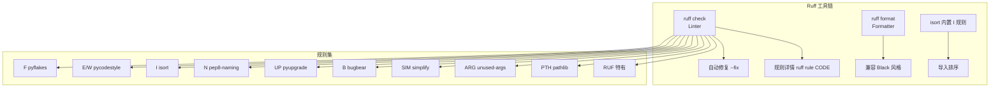
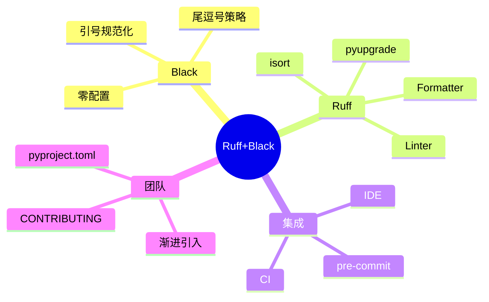
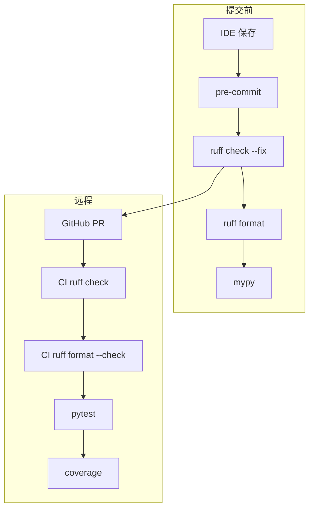
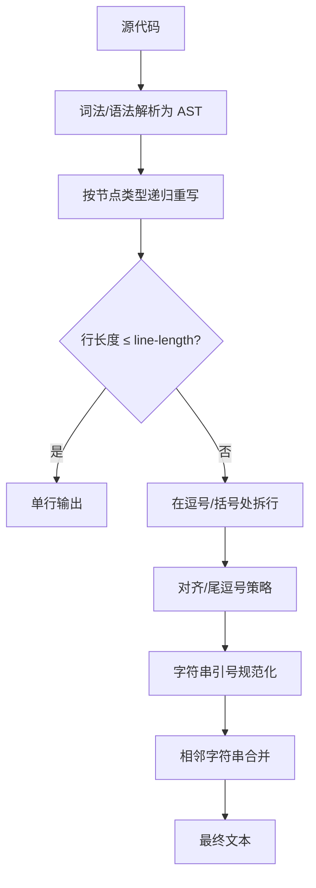
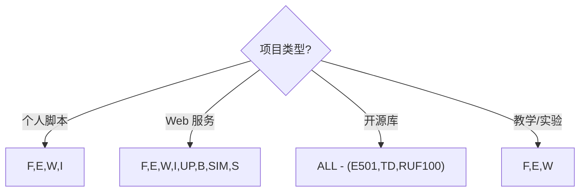
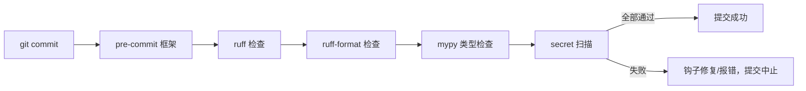
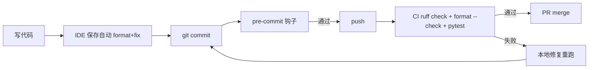
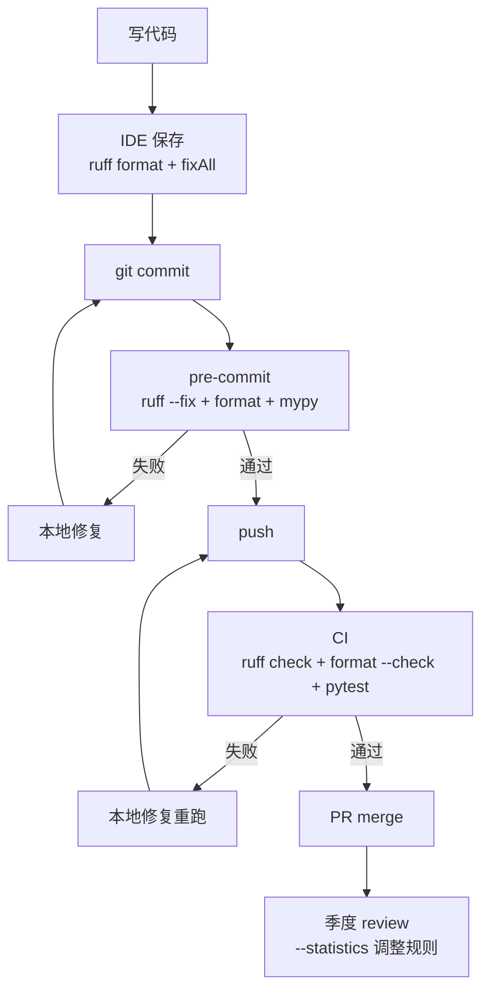

# Ruff 与 Black 代码规范

> **文档定位**：本文是 Python 工程化领域的 P1 级核心文档，目标是让你从"知道 Ruff/Black 是什么"进阶到"能在团队中独立搭建一套毫秒级、零争论、可强制、可演进的代码规范体系"。全文按照"概念 → 原理 → 代码 → 场景 → 坑点"五要素展开，每个知识点都给出可独立运行的代码与预期结果。
>
> **适用人群**：Python 后端/全栈工程师、技术负责人、需要给团队定规范的资深开发。
>
> **前置知识**：[[Python-项目结构最佳实践]]、[[Python-类型注解与mypy]]、Git 基础、YAML/TOML 语法。

---

## 一、概述与学习路径

### 1.1 为什么代码规范工具是工程化的第一块基石

**概念解释**：代码规范工具分两类——**格式化器（Formatter）**负责把代码排成统一的"排版"，**检查器（Linter）**负责发现代码中的"语法毛病与坏味道"。Black 是格式化器的代表，Ruff 则是把 Linter、Formatter、isort、pyupgrade 等合而为一的"瑞士军刀"。

**生活化比喻**：如果把团队协作比作开餐厅，Black 是"服务员摆盘标准"——不管谁炒菜，端出来盘子都摆成一样，客人（Code Reviewer）不会因为萝卜朝左还是朝右吵架；Ruff 则是"后厨质检员+安监员"——不仅查卫生（PEP8），还查老鼠（未使用的导入）、查煤气泄漏（可变默认参数），而且它是一台德国工业机器人，一秒钟查完一整层楼。

**核心价值**：把"人对格式的主观争论"从 Code Review 中彻底移除，把"低级错误拦截"前置到提交的那一刻，让评审精力聚焦在真正的架构与业务逻辑上。

### 1.2 无工具时代的七大痛点

| 痛点（无规范工具） | Ruff + Black 解决方式 |
|---|---|
| Code Review 里争论缩进/引号/换行 | Black/ruff format 自动决定，零配置零争论 |
| `import json` 这类死代码越积越多 | Ruff F401 自动检测并 `--fix` 删除 |
| 导入顺序乱、stdout/第三方/本项目混在一起 | Ruff isort(I) 规则一键排序 |
| `if x == None`、`[]` 当默认参数等隐患 | Ruff E711/B006 规则提前拦截 |
| flake8 + isort + black + pylint + pyupgrade 五件套，慢且配置分散 | Ruff 一个二进制替代全部，单一 `pyproject.toml` |
| 工具跑一次几十秒，开发者干脆不跑 | Ruff 用 Rust 实现，万行项目毫秒级 |
| 不合规代码照样合并到主干 | pre-commit 本地拦 + CI 远程拦，双重门禁 |

### 1.3 Ruff 的能力全景图



### 1.4 学习路径与知识依赖


**学习路线建议**：第 1 天装 Ruff 跑通 `ruff check .` 与 `ruff format .`；第 2 天啃 pyproject.toml 配置；第 3 天接 IDE 与 pre-commit；第 4 天接 CI 并写团队 CONTRIBUTING；之后在真实项目里渐进式加规则。

> 🎯 **面试高频**：请用 2 分钟讲清楚 Formatter 与 Linter 的区别，以及为什么 Ruff 能比 flake8 快两个数量级。

### 1.5 学习误区预警

| 误区 | 真相 |
|---|---|
| "工具越严越好" | 规则太严会让团队对抗工具，反而降低采用率 |
| "配一次就完事" | 规则集需要季度 review 与业务演进同步 |
| "CI 挂了再说" | 本地反馈太慢，错误成本指数上升 |
| "Ruff 万能" | 它只做单文件 AST 级分析，跨模块问题仍要 mypy/pylint |
| "noqa 是逃避" | 合理的 noqa 是工程现实，关键是带原因 |

### 1.6 知识依赖图回顾



### 1.7 一份最小可运行的"Hello Ruff"

```python
# hello_ruff.py
import os
import sys


def greet(name: str) -> str:
    return f"Hello, {name}!"


if __name__ == "__main__":
    print(greet("Ruff"))
```

```bash
# 初始化
pip install ruff
ruff check hello_ruff.py
ruff format hello_ruff.py

# 预期：文件被格式化为统一风格，无任何 lint 报错
```

### 1.8 文档导航

| 章节 | 你将学会 |
|---|---|
| 一、概述 | 工具链全景与学习路径 |
| 二、工具链原理 | lint/format 分层与 AST |
| 三、Black | 零配置哲学与尾逗号技巧 |
| 四、Ruff 上手 | 命令词汇表与退出码 |
| 五、规则体系 | 按前缀分组开关 |
| 六、ruff format | 与 Black 兼容及迁移 |
| 七、pyproject.toml | 单一配置入口 |
| 八、规则选择与忽略 | 四级忽略粒度 |
| 九、IDE 集成 | 保存即修 |
| 十、pre-commit | 本地门禁 |
| 十一、CI/CD | 远程门禁 |
| 十二、工具对比与迁移 | 从 flake8 迁移 |
| 十三、团队规范 | 规范即代码 |
| 十四、性能与排障 | 可观测性 |
| 十五、面试与资源 | 速查卡 |

### 1.9 最后的鼓励

> 工具是为人服务的。Ruff 与 Black 的终极目标不是让代码"更严格"，而是让团队"更自由"——把争论格式、查找低级错误的精力，留给真正创造价值的事情。

### 1.10 开始行动

> 现在就跑一次 `pip install ruff && ruff check .`，感受 5 秒内的反馈。这就是现代 Python 工程化的起点。

### 1.11 文档结束

> 本文到此结束。下一步：去你的项目里跑一次 `ruff check .`，把第一个红色波浪线变成团队的第一个共识。

> 💡 **本章深度讲解**：代码规范工具的本质不是"管人的工具"，而是"把团队共识沉淀成可执行规则的工具"。Black 的哲学是"固执己见、零配置"，牺牲灵活性换取零争论；Ruff 的哲学是"规则海量、配置集中、速度极致"，用一个 Rust 二进制终结 Python 工具链的碎片化。理解这两种哲学，是后续所有配置取舍的出发点。

> **📝 本章精简总结**
> - 核心概念：Formatter（Black/ruff format）排版、Linter（ruff check）查错、isort 排序。
> - 关键原理：Black 解析 AST 重排；Ruff 用 Rust 原生执行 + 多线程 + 单次遍历 + 增量缓存。
> - 常用操作：`ruff check .`、`ruff check --fix .`、`ruff format .`、`ruff rule F401`。
> - 最佳实践：新项目直接用 Ruff 替代 flake8/isort/pylint/pyupgrade。
> - 常见坑点：不要同时启用 Black 与 ruff format 两套格式化；不要一次性全开规则。
> - 面试高频：Formatter vs Linter；Ruff 为什么快；E501 为何交给 formatter。

> **🎯 梯度练习题**
> - ⭐ 基础题：Formatter 和 Linter 各自解决什么问题？能否互相替代？
> - ⭐ 基础题：写出"检查不修复"和"检查并自动修复"两条命令。
> - ⭐⭐ 进阶题：为什么 Black 故意只暴露 `line-length` 一个配置项？这背后的设计哲学是什么？
> - ⭐⭐ 进阶题：Ruff 相比 flake8 快 10~100 倍，至少说出三个性能来源。
> - ⭐⭐⭐ 实战题：给一个 5 万行的存量 Django 项目，要求两周内把 Ruff 接入且不阻塞业务开发，请给出分阶段接入计划与验收标准（提示：渐进式 select + per-file-ignores + --fix 批量落地）。

---

## 二、代码规范与工具链全景

### 2.1 PEP8 与"风格"的历史包袱

**概念**：PEP8 是 Python 官方的风格指南，规定了缩进、空格、命名、行宽等。但 PEP8 只是"建议"，它本身不强制执行。真正让建议落地的是工具。

**为什么需要工具**：人眼在 Review 时既看不准行宽（80 还是 88？），也记不住上百条规则；而且讨论格式是最低 ROI 的评审活动。工具把这些机械化的判断全部接管。

**技术对比**：

| 层次 | 工具 | 做什么 | 是否改代码 |
|---|---|---|---|
| 格式 | Black / ruff format | 排版（空格、换行、引号） | 是 |
| 风格 | pycodestyle(E/W) | 检查 PEP8 违规 | 否（部分可 fix） |
| 逻辑 | pyflakes(F) | 未定义/未使用等真实 bug | 部分 |
| 导入 | isort(I) | 排序、分块 | 是 |
| 复杂度 | mccabe(C90) | 圈复杂度 | 否 |
| 深度 | pylint | 全局静态分析 | 否 |
| 语法升级 | pyupgrade(UP) | 旧语法现代化 | 是 |

### 2.2 一条代码从磁盘到报告的旅程


**原理深入**：Ruff 与传统工具的关键差异在于"单次遍历"。flake8 的实现是每个插件各自遍历一遍 AST，100 个插件就是 100 次遍历；Ruff 在一次 Visitor 中并行调用所有启用规则的 visitor，缓存共享的语义信息（如符号表、作用域），这是它快的根本原因之一。

### 2.3 最小可运行示例：三行代码看出工具价值

```python
# demo_before.py —— 修复前
import os
import json  # 未使用

def add(a,b):
    result=a+b
    return result
x = add(1,2)
```

```bash
# 运行 lint
ruff check demo_before.py
# 预期输出（节选）：
# F401 [*]  json imported but unused
# E701  multiple statements on one line
# E225  missing whitespace around operator
# F841  local variable `x` is assigned to but never used

# 自动修复可修的部分
ruff check --fix demo_before.py
```

```python
# demo_after.py —— 修复并格式化后
import os


def add(a, b):
    result = a + b
    return result
```

> ❌ **常见坑点**：新手看到 `ruff check --fix` 把 `import json` 删了却没报错，以为"什么都没发生"，其实是 F401 已自动修复。务必在 `git diff` 里确认改动，而不是看终端输出。

### 2.4 何时不该用工具

**适用场景**：多人协作的业务代码、开源库、需要长期维护的服务。
**不适用场景**：一次性 5 行临时脚本、Jupyter 探索性 notebook（可单独 exclude）、原型 demo。

> ✅ **最佳实践**：哪怕是临时脚本，也值得保存时跑一次 format——因为它可能三个月后变成线上事故的源头。

### 2.5 一个完整工具链的组成



### 2.6 Lint 的"可自动修复"光谱

| 规则类型 | 示例 | 能否自动修复 | 风险 |
|---|---|---|---|
| 纯风格 | 空格、引号、换行 | ✅ 安全 | 无 |
| 死代码 | F401 未用 import | ✅ 安全 | 无 |
| 语法现代化 | UP List→list | ✅ 安全 | 低 |
| 逻辑简化 | SIM102 合并 if | ⚠️ 可能改语义 | 中 |
| 命名 | N802 函数改名 | ❌ 需人工 | 高（破坏 API） |
| 业务逻辑 | B006 默认参数 | ❌ 需人工 | 高 |

**关键认知**：`--fix` 分 `safe`（语义不变）与 `unsafe`（可能改语义）。Ruff 默认只修 safe 的；`--unsafe-fixes` 才修 unsafe 的，需要你 review。

```bash
# 只修安全修复（默认）
ruff check --fix .

# 连"不安全"修复也修（需 review）
ruff check --fix --unsafe-fixes .
```

> ✅ **最佳实践**：本地开发用 `--fix`（safe）；CI 上不要用 `--unsafe-fixes`，那些改动要人工 review。

### 2.7 静态分析的能力边界

```text
静态分析能抓：
  ✓ 未定义/未使用变量
  ✓ 明显的代码陷阱（可变默认参数）
  ✓ 风格不一致
  ✓ 导入顺序
  ✓ 旧语法
静态分析抓不到：
  ✗ 业务逻辑对错
  ✗ 性能瓶颈（要 profiling）
  ✗ 运行时类型错误（要 mypy/测试）
  ✗ 架构腐化（要架构工具）
  ✗ 安全漏洞（要专门安全工具，部分 S 规则覆盖）
```

### 2.8 工具链的"最小可用"与"生产级"对比

```toml
# 最小可用（个人脚本）
[tool.ruff]
line-length = 100
[tool.ruff.lint]
select = ["F", "E", "W", "I"]
```

```toml
# 生产级（团队项目）
[tool.ruff]
line-length = 100
target-version = "py311"
exclude = [".venv", "build", "dist", "migrations"]

[tool.ruff.lint]
select = ["F", "E", "W", "C", "I", "N", "UP", "B", "SIM", "ARG", "PTH", "TCH", "S", "RUF"]
ignore = ["E501", "B008", "ARG001"]

[tool.ruff.lint.per-file-ignores]
"tests/*" = ["ARG", "S101"]
"app/__init__.py" = ["F401"]
```

**差异本质**：最小可用只抓"会跑挂的问题"；生产级还要抓"未来会埋雷的问题"和"风格一致性"。

### 2.9 从 lint 到"质量门禁"的完整光谱


### 2.10 一个团队的"工具链选型"决策记录

```text
2023-01：flake8 + isort + black + pylint
  问题：慢（30s）、配置分散、新人上手难

2023-06：评估 Ruff
  结论：快 50 倍、规则全、单一配置

2023-09：试点 Ruff（一个子包）
  结果：无重大问题，误报 < 5%

2023-12：全量切换 Ruff
  结果：CI 时间 30s → 3s，工具数 4 → 1

2024-06：引入 ruff format
  结果：black 下线，工具数 1
```

**决策要点**：选型不是一次性决定，而是"试点 → 灰度 → 全量 → 下线旧工具"的演进过程。

### 2.11 工具链的终局

> 未来，Python 工程化的工具链会进一步收敛：Ruff 一家独大，mypy 负责类型，pytest 负责测试，其余皆为历史。理解这个趋势，就理解了为什么现在学 Ruff 是值得的。

> 💡 **本章深度讲解**：本章建立"格式 vs 逻辑 vs 导入 vs 复杂度"的四层心智模型。Ruff 的革命性在于它把这四层塞进一个进程、一次遍历完成，消除了工具链之间的衔接成本（例如 black 改完又要跑 isort，isort 改完 black 又不满意）。理解这个分层，你就能看懂后续所有 `select`/`ignore` 配置都在"分层开关"。

> **📝 本章精简总结**
> - 核心概念：PEP8 是建议，工具才是执行者；格式/风格/逻辑/复杂度四层。
> - 关键原理：单次遍历 + 共享符号表是 Ruff 快的根因。
> - 常用操作：`ruff check`、`--fix`、`--diff`。
> - 最佳实践：用 `git diff` 核验 `--fix` 结果。
> - 常见坑点：`--fix` 静默删 import 要留意。
> - 面试高频：Ruff 为什么比 flake8 快；单次遍历含义。

> **🎯 梯度练习题**
> - ⭐ 基础题：pycodestyle 与 pyflakes 分别属于哪一层？
> - ⭐ 进阶题：为什么"每个插件独立遍历 AST"会慢？单次遍历为什么能提速？
> - ⭐⭐⭐ 实战题：为一个 Jupyter 数据科学项目配置 Ruff，要求忽略 `*.ipynb` 但检查其中的 `.py` 导出脚本，写出配置片段。

---

## 三、Black 代码格式化深度解析

### 3.1 Black 的"零配置"哲学

**概念**：Black 自称 "The Uncompromising Code Formatter"。它不提供风格旋钮——你不能让它把 4 空格改成 2 空格，也不能让它保留你的换行习惯。它只暴露 `line-length`（默认 88，而非 PEP8 的 79）这一个真正影响结果的开关。

**生活化比喻**：Black 像一位固执的排版编辑，你交给他的稿子怎么写都行，但他交回来的版本永远是同一个版式；你能改的只有"版心宽度"。

**为什么这样设计**：配置越多，团队争论越多。Black 的作者认为"任何关于格式的讨论都是浪费"，于是把选择权从团队手中拿走，用产品化的方式消灭争论。代价是失去灵活性——如果你团队死忠 PEP8 79 列，只能改 `line-length`，其余风格必须接受。

### 3.2 Black 的格式化算法



**关键规则**：
- 行宽目标 88，超长优先在逗号、括号、括号配对处拆。
- **尾逗号决定拆行**：函数参数末尾加不加逗号，直接决定 Black 是否把它竖排。这是一个非常实用的"开关"。
- 字符串引号统一为双引号（`--skip-string-normalization` 可关）。
- 相邻的隐式拼接字符串会被合并成一个。

### 3.3 Black 安装与基础用法

```bash
# pip 安装
pip install black

# 项目级安装（推荐，锁定版本）
pip install "black==24.*"

# Poetry / uv 安装
poetry add --group dev black
uv add --dev black

# 格式化当前目录所有 .py
black .

# 只检查不写盘（CI 用）
black --check .

# 展示差异但不写盘
black --diff .

# 指定行宽
black --line-length=100 .

# 仅格式化被 git 修改的文件（pre-commit 内部就是这么做的）
black $(git ls-files '*.py')
```

```toml
# pyproject.toml —— Black 的官方配置位置
[tool.black]
line-length = 100
target-version = ["py311"]
include = '\.pyi?$'
extend-exclude = '''
/(
  \.venv
  | build
  | dist
  | migrations
)/
'''
```

### 3.4 尾逗号策略：Black 最有用的"隐藏开关"

```python
# 不带尾逗号 → Black 尽量放一行
def create_user(name: str, email: str, age: int, role: str) -> User:
    ...

# 带尾逗号 → Black 强制竖排（方便 code review 看 diff）
def create_user(
    name: str,
    email: str,
    age: int,
    role: str,
) -> User:
    ...
```

**场景价值**：当参数很多、字段很多时，主动加尾逗号可以让 Black 竖排，未来新增一个字段时 diff 只有一行，Review 友好。这是"用格式化器服务于 code review"的经典技巧。

### 3.5 字符串规范化与你需要知道的"副作用"

```python
# Black 会统一引号风格
name = 'BewhY'        # → "BewhY"
greeting = "hello"    # 保持
msg = 'a' 'b' 'c'     # → "abc"（合并相邻字符串字面量）
```

```python
# 注释中的字符串不会被改动
# 这行里的 'single quote' 保持不变
```

> ❌ **常见坑点 1**：Black 会把单引号统一成双引号，如果你团队强制单引号，需要 `--skip-string-normalization` 或直接改用 ruff format 并设 `quote-style = "single"`。

> ❌ **常见坑点 2**：Black 把相邻字符串字面量合并，有时会改变预期的"分多行书写 + 行内注释"效果。解决办法是显式加 `\` 或接受合并。

> ✅ **最佳实践**：不要再单独维护 Black。Ruff 的 `ruff format` 已经实现了 Black 兼容风格，且规则可配置（如单引号）。新项目直接 `ruff format`，老项目可平滑迁移。

### 3.6 Black 的"不能改"清单

| 维度 | Black 行为 | 能否改 |
|---|---|---|
| 缩进 | 4 空格 | ❌ 不能 |
| 引号 | 双引号 | ⚠️ `--skip-string-normalization` |
| 行宽 | 88 | ✅ `--line-length` |
| 换行符 | LF | ✅ |
| 尾逗号 | 影响是否竖排 | 由代码决定 |
| 注释位置 | 不移动 | ❌ |

**为什么缩进不能改**：Black 作者认为 4 空格是 PEP8 唯一合理选择，改它等于分裂社区。如果你真要 2 空格（如某些嵌入式项目），用 ruff format 的 `indent-style`。

### 3.7 Black 对字符串字面量的处理

```python
# Black 合并相邻字符串
x = ("hello"
     "world")      # → "helloworld"

# Black 规范化引号
x = 'hello'        # → "hello"
x = "it's"         # 保持双引号（内部单引号无需转义）

# Black 不改注释里的字符串
# 'this stays single'
```

### 3.8 从 Black 迁移到 ruff format 的实战 diff

```bash
# 对比两者输出差异（迁移期）
black --diff . > black.diff
ruff format --diff . > ruff.diff
diff black.diff ruff.diff | head -50
```

通常 99% 一致，差异集中在"超长字典是否竖排""尾逗号与换行组合"等边缘 case。

### 3.9 Black 对换行与括号的处理哲学

```python
# Black 的"包裹"规则：能用一行就不拆
result = some_function(arg1, arg2, arg3)

# 一旦超长，优先在括号处拆
result = some_function(
    argument_one_with_long_name,
    argument_two_with_long_name,
    argument_three_with_long_name,
)
```

**为什么这样**：在 88 列下，"一行能放下就放一行"让代码密度最高；放不下才竖排，竖排后每个参数一行，diff 友好。

### 3.10 Black 与 Jupyter notebook

```bash
# Black 支持格式化 Jupyter
black notebook.ipynb

# Ruff 也支持
ruff format notebook.ipynb
ruff check notebook.ipynb
```

> ❌ **常见坑点**：notebook 里的代码 cell 之间有运行时状态，格式化后 import 顺序可能改变，但运行时 cell 的执行顺序不变。格式化 notebook 后必须重启 kernel 重新跑一遍验证。

### 3.11 Black 的"不稳定性"争议

**概念**：Black 在不同版本间偶尔会改变输出（例如某个 edge case 的换行策略调整）。这是已知现象，官方会在 changelog 中说明。

**应对**：
- 锁定 Black 版本（`pip install "black==24.*"`）；
- 升级前跑 `black --diff .` 看变化；
- 把"Black 升级导致的 diff"单独成 commit。

### 3.12 Black 与类型注解的交互

```python
# Black 不拆类型注解，除非超长
def f(
    a: VeryLongTypeName,
    b: AnotherLongTypeName,
) -> Tuple[int, str]:
    ...
```

> ❌ **常见坑点**：Black 不会"聪明"地简化你的类型注解，超长注解就是超长。需要自己拆成 TypeAlias。

```python
# ✅ 用 TypeAlias 简化
UserId = int
UserName = str

def f(uid: UserId, name: UserName) -> Tuple[UserId, UserName]:
    ...
```

### 3.13 一句话记住 Black

> Black = 固执的排版编辑，你交稿子，他还版面，你只能改版心宽度。

> 💡 **本章深度讲解**：Black 的真正贡献不是"排版好看"，而是用产品哲学终结了风格争论。理解它的"尾逗号即开关"技巧，能让你主动驾驭格式化器而不是被它折磨。现代项目中，ruff format 是 Black 的超集——它既兼容 Black 输出，又开放了引号、缩进风格等少数配置，是趋势。

> **📝 本章精简总结**
> - 核心概念：零配置、固执排版、行宽 88。
> - 关键原理：AST 重写 + 尾逗号拆行策略 + 引号规范化。
> - 常用操作：`black .`、`--check`、`--diff`、`--line-length`。
> - 最佳实践：用尾逗号控制竖排；新项目用 ruff format 替代。
> - 常见坑点：引号被改；相邻字符串被合并。
> - 面试高频：Black 为什么只暴露 line-length；尾逗号的作用。

> **🎯 梯度练习题**
> - ⭐ 基础题：Black 默认行宽是多少？为什么不是 PEP8 的 79？
> - ⭐ 进阶题：在函数参数末尾加逗号，Black 会如何处理？这个特性对 code review 有什么价值？
> - ⭐⭐⭐ 实战题：团队希望"字符串保持单引号、行宽 100"，但其他风格接受 Black 默认。给出 Black 与 ruff format 两套配置方案，并推荐其一。

---

## 四、Ruff 安装与快速上手

### 4.1 安装方式与版本锁定

**概念**：Ruff 是一个 Rust 编译的单一可执行文件，pip 安装时会下载对应平台的 wheel，因此安装快、运行不依赖 Python 解释器。

```bash
# 基础安装
pip install ruff

# 推荐：锁定次版本号（避免小版本规则变化导致 CI 抖动）
pip install "ruff==0.8.*"

# uv（更快）
uv add --dev ruff

# Poetry
poetry add --group dev ruff

# 验证安装
ruff --version
ruff --help
```

### 4.2 五个最常用命令

```bash
# 1) 检查（只报告，不改文件）——CI 主力命令
ruff check .

# 2) 检查并自动修复——本地开发主力命令
ruff check --fix .

# 3) 格式化（Black 兼容）
ruff format .

# 4) 格式检查（CI 用）
ruff format --check .

# 5) 查询规则详情（含正反例）
ruff rule F401
ruff rule B006
```

```bash
# 只检查某个文件/目录
ruff check app/services/user_service.py

# 仅启用某类规则
ruff check --select F .

# 忽略某条规则（临时）
ruff check --ignore E501 .

# 输出格式：`concise` 终端简洁；`json` 给 CI 解析；`github` 在 GitHub Actions 内联注解
ruff check --output-format json .
ruff check --output-format github .

# 统计规则命中分布（接入期很有用）
ruff check . --statistics
```

### 4.3 第一个完整可运行示例

```python
# math_tools.py
import os
import json


def average(numbers: list):
    total = 0
    for n in numbers:
        total = total + n
    result = total / len(numbers)
    return result


if __name__ == "__main__":
    print(average([1, 2, 3, 4]))
```

```bash
ruff check math_tools.py
# 预期（取决于启用规则）：
# UP035  `list` 应写作 `list`（已 py39+，无需 typing.List）
# SIM107  可简化 sum(numbers) / len(numbers)
# E402    模块级 import 之后有代码（此处 os/json 未使用会被 F401 报）

ruff check --fix math_tools.py
```

```python
# 修复后（ruff format 之后）
def average(numbers: list[int]) -> float:
    return sum(numbers) / len(numbers)


if __name__ == "__main__":
    print(average([1, 2, 3, 4]))  # 预期输出 2.5
```

### 4.4 Ruff 的退出码约定（CI 必须知道）

| 命令 | 无问题 | 有问题但全部可自动修复 | 有问题 |
|---|---|---|---|
| `ruff check .` | 0 | 0（报告 fixable） | 1 |
| `ruff check --fix .` | 0 | 0（已修复） | 1（剩余不可修复） |
| `ruff format --check .` | 0 | — | 1（需格式化） |

> ❌ **常见坑点**：在 CI 里写 `ruff check --fix . && ruff format .` 然后期望它"有问题就失败"，这是错的——`--fix` 成功退出 0，掩盖了真实违规。正确做法是 `ruff check --fix .` 后跑 `git diff --exit-code`，或在 CI 上跑不带 `--fix` 的版本让它失败。

### 4.5 增量缓存

Ruff 会把检查结果缓存在 `.ruff_cache/`（可通过 `RUFF_CACHE_DIR` 修改）。同一文件未改动时第二次检查直接命中缓存，这是 pre-commit 每次提交都跑也不慢的关键。

```bash
# 查看缓存目录
ruff check . --show-settings | grep -i cache

# 清除缓存
rm -rf .ruff_cache
ruff clean
```

> ✅ **最佳实践**：把 `.ruff_cache/` 加进 `.gitignore`；CI 上用 actions/cache 缓存它以进一步提速。

### 4.6 常见输出格式与 CI 集成

```bash
# concise：终端默认，一行一问题
ruff check . --output-format concise

# full：完整上下文（行号 + 代码片段 + 修复建议）
ruff check . --output-format full

# json：机器可读，供 CI/脚本消费
ruff check . --output-format json > ruff.json

# github：在 GitHub Actions 中直接在 PR 行内标注
ruff check . --output-format github

# gitlab：GitLab CI 格式
ruff check . --output-format gitlab

# junit：JUnit XML，供测试报告平台
ruff check . --output-format junit > ruff-report.xml
```

```json
// json 输出单条示例（供理解）
{
  "cell": null,
  "code": "F401",
  "message": "`json` imported but unused",
  "location": {"row": 3, "column": 1},
  "fix": {"applicability": "safe", "message": "Remove unused import"}
}
```

### 4.7 与编辑器 LSP 的关系

**概念**：`ruff` 命令行是一次性扫描；`ruff server`（LSP）是常驻进程，编辑器实时问它"这一行有没有问题"。两者共享同一份规则与配置，但运行模式不同。

```bash
# 启动 Ruff LSP（VSCode/Neovim 插件内部自动调用）
ruff server

# 查看 LSP 能力
ruff lsp --help
```

| 模式 | 触发时机 | 用途 |
|---|---|---|
| 命令行 `ruff check` | 手动/CI/pre-commit | 批量、门禁 |
| LSP `ruff server` | 边写边报 | 实时反馈 |

> ✅ **最佳实践**：命令行与 LSP 共用同一份 `pyproject.toml`，确保"编辑器看到的"与"CI 报的"完全一致。

### 4.8 首次接入后的"第一周"节奏

```bash
# Day 1：跑一次看家底
ruff check . --statistics | head -30

# Day 2：自动修复能修的
ruff check --fix .
ruff format .
git add -A && git commit -m "chore: bulk auto-fix"

# Day 3：人工修剩余（F841/B006 等不可自动修）
ruff check .
# 逐个处理，必要时 noqa

# Day 4：接 pre-commit
pre-commit install
pre-commit run --all-files

# Day 5：接 CI
# 加 lint.yml，跑 ruff check . && ruff format --check .
```

### 4.9 与 uv / Poetry / pipx 配合

```bash
# uv（最快的包管理器）
uv add --dev ruff
uv run ruff check .

# Poetry
poetry add --group dev ruff
poetry run ruff check .

# pipx（全局 CLI 工具）
pipx install ruff
ruff check .
```

### 4.10 离线/内网环境安装

```bash
# 内网没有 PyPI 时，下载 wheel 离线安装
pip download ruff -d ./wheels
# 传到内网
pip install --no-index --find-links=./wheels ruff
```

### 4.11 常见安装问题

| 现象 | 原因 | 解决 |
|---|---|---|
| `ruff: command not found` | 装到了别的 venv | `which ruff` 确认；用 `python -m ruff` |
| 版本不是最新 | pip 缓存 | `pip install -U ruff` |
| wheel 不支持平台 | ARM/ musl | 用源码编译或找对应 wheel |

### 4.12 一句话记住 Ruff

> Ruff = Rust + 极快 + 一个二进制替代 flake8/isort/black/pyupgrade，是现代 Python 工程化的事实标准。

> 💡 **本章深度讲解**：本章把 Ruff 的"命令词汇表"建立完整。最容易被忽视的是退出码语义——`--fix` 在 CI 里不是"修完就没事了"，而是"修完了，需要你把修复提交上来"，所以要配合 `git diff --exit-code` 或跑不带 fix 的检查。缓存机制则解释了为什么 Ruff 在 pre-commit 里体感"第一次慢、之后秒过"。

> **📝 本章精简总结**
> - 核心概念：单二进制、Rust 原生、版本要锁定。
> - 关键原理：退出码语义、增量缓存 `.ruff_cache/`。
> - 常用操作：`check` / `check --fix` / `format` / `format --check` / `rule CODE` / `--statistics`。
> - 最佳实践：CI 用 `github` 或 `json` 输出；本地用 `--fix`。
> - 常见坑点：`--fix` 掩盖违规；缓存目录要 ignore。
> - 面试高频：ruff check 退出码；CI 上为什么不能直接 `--fix`。

> **🎯 梯度练习题**
> - ⭐ 基础题：写出"CI 中既检查 lint 又检查格式"的两条命令。
> - ⭐ 进阶题：为什么 CI 上不建议直接 `ruff check --fix .`？应该怎么改？
> - ⭐⭐⭐ 实战题：写一个 shell 脚本，本地提交前自动跑 `ruff check --fix . && ruff format .`，并在有改动时 `git add -u`。

---

## 五、Ruff Linter 规则体系

### 5.1 规则码的命名结构

**概念**：每条规则有一个 `前缀 + 数字` 的码，例如 `F401`、`E501`、`B006`。前缀代表规则集来源，数字是该集内编号。

| 前缀 | 来源 | 检查内容 |
|---|---|---|
| `F` | Pyflakes | 未定义/未使用、未使用 import、语法级 bug |
| `E` | pycodestyle | PEP8 风格错误 |
| `W` | pycodestyle | PEP8 风格警告 |
| `C` | mccabe | 圈复杂度 |
| `I` | isort | 导入排序 |
| `N` | pep8-naming | 命名规范（类名大驼峰等） |
| `UP` | pyupgrade | 旧语法现代化 |
| `B` | flake8-bugbear | 常见 bug 与陷阱 |
| `SIM` | flake8-simplify | 可简化写法 |
| `ARG` | flake8-unused-arguments | 函数参数未使用 |
| `PTH` | flake8-use-pathlib | 建议用 pathlib |
| `TCH` | flake8-type-checking | 类型检查导入归位 |
| `S` | bandit | 安全问题（eval、shell=True） |
| `RUF` | Ruff 自研 | Ruff 独有规则 |

### 5.2 高频规则速查表

| 规则码 | 含义 | 可自动修复 | 实战价值 |
|---|---|---|---|
| F401 | 导入但未使用 | ✅ | 清理死 import |
| F841 | 局部变量赋值后未使用 | ❌ | 发现半成品代码 |
| E501 | 行过长 | ❌ | 交给 formatter |
| E711 | `== None` 应为 `is None` | ✅ | 防比较陷阱 |
| E712 | `== True/False` 应为 `is` | ✅ | 同上 |
| E731 | 不建议 lambda 赋值给变量 | ✅ | 可读性 |
| B006 | 可变默认参数 `def f(x=[])` | ❌ | 经典陷阱 |
| B008 | 函数调用作为默认参数 | ❌ | FastAPI Depends 例外 |
| B011 | `assert False` 应改 `raise` | ✅ | 优化模式下 assert 被移除 |
| I001 | 导入未排序 | ✅ | 统一导入块 |
| N802 | 函数名应为小写 | ❌ | PEP8 命名 |
| UP007 | `Union[X,Y]` 应写 `X \| Y` | ✅ | py310+ 现代语法 |
| UP035 | `List` 应写 `list` | ✅ | py39+ |
| SIM102 | 可合并嵌套 if | ✅ | 简化 |
| SIM108 | 可用三元表达式 | ✅ | 简化 |
| PTH100 | `os.path` 应改 `pathlib` | ✅ | 现代 IO |
| ARG001 | 函数参数未使用 | ❌ | 接口契约清理 |

### 5.3 规则示例：修复前 → 修复后

```python
# ===== 修复前 =====
import os
import sys
import json  # F401

from typing import List, Dict  # UP035

def get_users(ids: List[int]):
    result = []
    for i in ids:
        if i != None:  # E711
            result.append(i)
    return result
```

```bash
ruff check --fix demo.py
# 自动修复：删 json、E711 改 is not None、UP035 改 list[int]
```

```python
# ===== 修复后 =====
import os
import sys


def get_users(ids: list[int]):
    result = []
    for i in ids:
        if i is not None:
            result.append(i)
    return result
```

### 5.4 B 系列：真正能防 bug 的规则

```python
# ❌ B006 可变默认参数陷阱
def append_item(item, target=[]):  # 警告：默认 [] 在函数定义时只创建一次
    target.append(item)
    return target

append_item(1)  # [1]
append_item(2)  # [1, 2]  ← 意料之外！

# ✅ 正确做法：用 None 哨兵
def append_item(item, target=None):
    if target is None:
        target = []
    target.append(item)
    return target
```

```python
# ❌ B011：assert False 在 `python -O` 下会被完全移除
def admin_only(user):
    assert user.is_admin, "forbidden"  # 生产优化模式下这行消失！

# ✅ 正确做法：显式 raise
def admin_only(user):
    if not user.is_admin:
        raise PermissionError("forbidden")
```

> 🎯 **面试高频**：`def f(x=[])` 为什么有 bug？Ruff 的哪条规则能抓到它？正确写法是什么？（答案：默认参数在函数定义时求值一次，所有调用共享同一个 list；B006；用 `None` 哨兵。）

### 5.5 UP 系列：让代码自动跟上 Python 版本

```python
# pyproject.toml 中 target-version = "py311" 后，UP 规则会建议：

# 旧写法                              # Ruff 建议
from typing import Optional           # → x: int | None
from typing import List, Dict        # → list[int], dict[str, int]
isinstance(x, (int, float))           # 保持
os.path.join(a, b)                   # PTH 建议 Path(a) / b
open("f").read()                     # SIM 建议 with open(...)
```

```bash
# 升级语法（一次性）
ruff check --select UP --fix .
ruff check --select PTH --fix .
```

> ✅ **最佳实践**：把 `target-version` 设为你 CI 实际跑的 Python 版本。设太低，UP 不会建议现代语法；设太高，老环境会跑挂。

### 5.6 安全规则集 S（bandit 兼容）

```bash
# 开启安全规则（代码上线前强烈建议）
ruff check --select S .
```

```python
import subprocess
import pickle

subprocess.run("ls " + user_input, shell=True)  # S602：shell=True 命令注入风险
data = pickle.loads(raw_bytes)                  # S301：pickle 反序列化任意代码执行
eval(user_input)                                # S307：eval 注入
```

> ❌ **常见坑点**：S 系列误报较多（例如你确实需要 `shell=False` 的 subprocess），不要一股脑全 ignore；用 `per-file-ignores` 只给 `scripts/`、`tests/` 等目录放宽。

### 5.7 SIM 系列：把"能跑"变"漂亮"

```python
# ❌ SIM102：嵌套 if 可合并
def is_adult_vip(age, vip):
    if age >= 18:
        if vip:
            return True
    return False

# ✅ Ruff 自动修复为
def is_adult_vip(age, vip):
    if age >= 18 and vip:
        return True
    return False
```

```python
# ❌ SIM108：冗长 if/else 赋值可改三元
def describe(n):
    if n > 0:
        label = "positive"
    else:
        label = "non-positive"
    return label

# ✅ 自动修复为
def describe(n):
    label = "positive" if n > 0 else "non-positive"
    return label
```

```python
# ❌ SIM117：with 嵌套可合并
with open("a.txt") as fa:
    with open("b.txt") as fb:
        data = fa.read() + fb.read()

# ✅ 自动修复为
with open("a.txt") as fa, open("b.txt") as fb:
    data = fa.read() + fb.read()
```

### 5.8 N 系列：命名规范实战

```python
# ❌ N801 类名应大驼峰
class user_service:   # → UserService
    ...

# ❌ N802 函数名应小写加下划线
def GetUser():        # → get_user
    ...

# ❌ N803 参数名应小写
def createUser(UserID):  # → create_user(user_id)
    ...

# ❌ N806 变量名不应全大写（除非是常量）
my_var = 1          # OK
MAX_RETRY = 3       # OK（常量）
userID = 1          # ❌ → user_id
```

### 5.9 PTH 系列：pathlib 现代化

```python
# ❌ PTH100/PTH101：旧 os.path 写法
import os
base = "/data"
path = os.path.join(base, "sub", "file.txt")
if os.path.exists(path):
    with open(path) as f:
        content = f.read()

# ✅ ruff --fix 自动改为
from pathlib import Path
base = Path("/data")
path = base / "sub" / "file.txt"
if path.exists():
    content = path.read_text()
```

### 5.10 ARG 系列：未使用参数的取舍

```python
# ❌ ARG001：函数参数未使用
def handler(request, user):   # request 没用上
    return {"ok": True, "user": user}

# ✅ 方案1：下划线前缀（ARG 通常忽略 _ 开头）
def handler(request, _user):
    return {"ok": True}

# ✅ 方案2：接口契约保留参数，noqa
def handler(request, user):  # noqa: ARG001 -- webhook 签名校验需要 request
    return {"ok": True, "user": user}
```

### 5.11 TCH：类型检查导入归位

```python
# ❌ TCH001：只在类型注解用的导入，应放 TYPE_CHECKING 块
from app.models import User  # 运行时不需要，只用于注解

def get_user(uid: int) -> User:
    ...
```

```python
# ✅ 修复后（减少运行时导入，加快启动、避免循环导入）
from typing import TYPE_CHECKING

if TYPE_CHECKING:
    from app.models import User

def get_user(uid: int) -> "User":
    ...
```

> 🎯 **面试高频**：`if TYPE_CHECKING:` 有什么作用？为什么能避免循环导入？（答案：该块内的导入只在类型检查期执行，运行时不导入，从而打破 A→B→A 的运行时循环，同时减少运行时依赖。）

### 5.12 C90 mccabe 圈复杂度实战

```python
# ❌ 圈复杂度高（>15）：一个函数里 if/elif/for/while 太多
def classify(score):
    if score >= 90:
        return "A"
    elif score >= 80:
        return "B"
    elif score >= 70:
        return "C"
    elif score >= 60:
        return "D"
    else:
        return "F"
```

```python
# ✅ 用查表/映射降低复杂度
GRADE_MAP = [(90, "A"), (80, "B"), (70, "C"), (60, "D")]

def classify(score):
    for threshold, grade in GRADE_MAP:
        if score >= threshold:
            return grade
    return "F"
```

### 5.13 PT 系列：pytest 风格检查

```python
# ❌ PT011：pytest.raises 应写 match
def test_divide():
    with pytest.raises(ZeroDivisionError):
        1 / 0

# ✅ 推荐：加 match，精确断言异常信息
def test_divide():
    with pytest.raises(ZeroDivisionError, match="division by zero"):
        1 / 0
```

### 5.14 规则组合速查：常见 bug 一网打尽

```python
# 一行代码里藏的 5 个 bug
def f(x=[]):
    if x == None:
        assert False
        y = x.pop()
    return y
```

```text
# Ruff 同时报：
B006  可变默认参数 x=[]
E711  x == None 应 is None
B011  assert False 应 raise
F841  y 赋值未使用（且 return y 在 None 分支不可达）
```

### 5.15 一句话记住规则体系

> 规则按前缀分组：F/E/W/I 必开，UP/B/SIM 建议开，N/PTH/ARG 渐进开，S 上线前开。

> 💡 **本章深度讲解**：规则体系的核心心智是"按前缀分组开关"。`F/E/W/I` 是基础设施，必开；`UP/B/SIM` 是现代化与简化，建议开；`N/PTH/ARG` 是风格洁癖，渐进开；`S` 是安全红线，上线前必须开。规则不是越多越好，而是"每条都要能解释为什么开"。

> **📝 本章精简总结**
> - 核心概念：规则码 = 前缀 + 编号；按前缀分组开关。
> - 关键原理：B006 默认参数共享；B011 assert 在 -O 下消失；UP 依赖 target-version。
> - 常用操作：`ruff rule CODE`、`--select`、`--ignore`、`--statistics`。
> - 最佳实践：F/E/W/I 必开；UP/B/SIM 建议开；S 上线前开。
> - 常见坑点：S 误报用 per-file-ignores；B008 对 FastAPI 是例外。
> - 面试高频：可变默认参数；assert 与 -O；is/is not None。

> **🎯 梯度练习题**
> - ⭐ 基础题：F、E、B、UP、I 五个前缀分别检查什么？
> - ⭐ 进阶题：为什么 `assert False` 在生产可能失效？哪条规则会提醒？
> - ⭐⭐⭐ 实战题：为 FastAPI 项目启用 `F,E,W,I,UP,B,SIM,S`，但忽略 `B008` 并让 `tests/*` 忽略 `ARG,S101`，写出 `[tool.ruff.lint]` 配置。

---

## 六、Ruff Formatter 与 Black 兼容性

### 6.1 为什么 Ruff 要自己做一个 Formatter

**概念**：早期 Ruff 只有 Linter，格式化仍需调用 Black。2024 年 Ruff 内置了 `ruff format`，官方目标是"与 Black 100% 兼容，且提供少数 Black 不开放的配置（如引号风格）"。

**原理**：ruff format 复用了 Ruff 的 Rust 解析器，因此格式化与 lint 共享同一份 AST 与符号表，不需要再起一个 Python 进程跑 Black。这就是它比 Black 快 100 倍以上的原因。

### 6.2 ruff format 与 Black 的细微差异

| 维度 | Black | ruff format |
|---|---|---|
| 默认行宽 | 88 | 88 |
| 引号风格 | 双引号（不可配） | 可配 `quote-style` |
| 缩进风格 | 空格 | 可配 `indent-style = "tab"` |
| 行尾 | LF | 可配 `line-ending` |
| 速度 | 中（Python） | 极快（Rust） |
| docstring 内代码 | 不格式化 | 可配 `docstring-code-format` |

**结论**：在大多数项目里二者输出一致；如果你需要单引号或 tab 缩进，用 ruff format；否则随便选一个，**不要同时跑**。

### 6.3 ruff format 配置

```toml
[tool.ruff.format]
quote-style = "double"          # double / single / preserve
indent-style = "space"          # space / tab
line-ending = "auto"            # auto / lf / crlf / native
docstring-code-format = true    # 是否格式化 docstring 中的代码示例
```

```bash
# 与 Black 等价的命令
ruff format .                    # 写盘
ruff format --check .            # CI 检查
ruff format --diff .             # 展示差异
ruff format --line-length=100 .  # 临时改行宽
```

### 6.4 从 Black 迁移到 ruff format

```bash
# 1) 在 pyproject.toml 中把 [tool.black] 的 line-length 同步到 [tool.ruff.format] / [tool.ruff]
# 2) 一次性全量格式化
ruff format .

# 3) 检查是否有差异（理论上除边缘情况外无差异）
ruff format --check .

# 4) 提交一次"format migration"，之后移除 black 依赖
pip uninstall black
```

> ❌ **常见坑点**：Black 和 ruff format 在"长字符串拼接尾逗号""字典字面量是否竖排"等少数边缘 case 输出不同。迁移前先在 CI 跑 `ruff format --check` 与 `black --check` 双跑一周，把差异 case 列出来统一决策，不要直接切换。

### 6.5 ruff format 实战：前后对比

```python
# 格式化前（混乱）
x = {
'a':1,
  'b':2,
    'c':[1,2,3,4,5,6,7,8,9,10,11,12],
}
def f( a,b ):
    return a+b
```

```python
# ruff format 后（整齐）
x = {
    "a": 1,
    "b": 2,
    "c": [1, 2, 3, 4, 5, 6, 7, 8, 9, 10, 11, 12],
}


def f(a, b):
    return a + b
```

### 6.6 格式化与注释的边界

```python
# ruff format 不会动注释
def f():
    # 重要的注释会保留
    x = 1  # 行尾注释也保留
    return x
```

> ❌ **常见坑点**：ruff format 与 ruff check 是两个独立命令。`ruff check --fix` 只修 lint 问题，不修格式。**两者都要跑**：`ruff check --fix . && ruff format .`。

### 6.7 格式化的"幂等性"保证

**概念**：好的格式化器必须是"幂等"的——跑一次和跑十次结果一样。ruff format 承诺幂等，这意味着你可以放心地在 pre-commit 和 CI 上反复跑，不会出现"越跑越乱"。

```bash
# 验证幂等性
ruff format .
ruff format --check .   # 第二次应通过
```

### 6.8 与 git 的协同：format commit 独立化

```bash
# 推荐的提交节奏：
# 1) 写业务代码
# 2) ruff check --fix . && ruff format .
# 3) 把格式化与业务分开提交？
#    其实 pre-commit 已自动 format，业务 commit 就是干净的
#    只有"迁移期"才需要单独 format commit
```

### 6.9 常见格式化意外

```python
# ruff format 可能"意外"合并你想分行的代码
x = (
    "a"
    "b"
    "c"
)
# → "abc"（相邻字符串被合并）
```

**解法**：用显式连接或 list。

```python
parts = ["a", "b", "c"]
x = "".join(parts)
```

### 6.11 结语

> 当你读完本章，应该能自信地说：我知道何时选 Black、何时选 ruff format、为什么不能双跑、迁移要做什么。这就是本章的价值。

### 6.12 迁移 ruff format 的最后检查清单

```text
□ 备份原配置（black 的 pyproject.toml 节）
□ 双跑对照一周（black vs ruff format）
□ 把差异 case 列出来统一决策
□ 更新 pre-commit（替换 black hook 为 ruff-format）
□ 更新 CI（替换 black --check 为 ruff format --check）
□ 通知团队成员"保存行为变了"
□ 观察一周，无回滚需求后下线 black
```

### 6.13 常见迁移遗留问题

```python
# 迁移后第一次跑 ruff format --check 报红
# 原因：历史代码从未被 ruff format 处理过
# 解法：跑一次全量 ruff format .，单独成 commit
ruff format .
git add -A
git commit -m "chore: migrate to ruff format"
```

> 💡 **本章深度讲解**：Formatter 的选择本质是"工具链统一 vs 风格自由度"的权衡。Ruff format 的战略意义在于让整个 Python 工程化收敛到一个二进制——lint、format、isort、pyupgrade 全部由同一进程完成，消除了工具间"你改完我又改"的震荡。这也是为什么新项目几乎 unanimous 选择 Ruff 全家桶。

> **📝 本章精简总结**
> - 核心概念：ruff format 是 Black 兼容的 Rust 版格式化器。
> - 关键原理：共享 AST 与符号表，单进程完成 lint+format。
> - 常用操作：`ruff format`、`--check`、`--diff`。
> - 最佳实践：二选一，不要双跑；迁移前双跑对照一周。
> - 常见坑点：边缘 case 输出不一致，迁移要灰度。
> - 面试高频：ruff format 与 Black 差异；为什么不要双跑。

> **🎯 梯度练习题**
> - ⭐ 基础题：写出 CI 中"格式不通过就让 pipeline 失败"的命令。
> - ⭐ 进阶题：ruff format 比 Black 快的根因是什么？
> - ⭐⭐⭐ 实战题：团队希望单引号、行宽 100、tab 缩进，写出 ruff format 完整配置。

---

## 七、pyproject.toml 完整配置指南

### 7.1 为什么用 pyproject.toml

**概念**：`pyproject.toml` 是 PEP 621 规定的 Python 项目"单一配置入口"。Ruff、Black、mypy、pytest、coverage、Poetry 全部支持读它。相比老的 `setup.cfg`/`tox.ini`/`.flake8` 散落多处，单一文件便于版本控制与团队共享。

### 7.2 一份生产级完整配置

```toml
# pyproject.toml —— 生产级 Ruff + ruff format 完整配置
[tool.ruff]
# 目标 Python 版本：决定 UP 规则建议什么语法
target-version = "py311"

# 行宽（与 formatter 一致）
line-length = 100

# 文件包含/排除
extend-include = ["*.ipynb"]
exclude = [
    ".venv",
    ".git",
    "__pycache__",
    "build",
    "dist",
    "migrations",
    "alembic/versions",
    "*.pyi",
]

# ============ Linter 配置 ============
[tool.ruff.lint]
# 启用的规则集（渐进式，从基础到严格）
select = [
    "F",     # pyflakes：未定义/未使用
    "E",     # pycodestyle 错误
    "W",     # pycodestyle 警告
    "C",     # mccabe 圈复杂度
    "I",     # isort
    "N",     # pep8-naming
    "UP",    # pyupgrade
    "B",     # bugbear
    "SIM",   # simplify
    "ARG",   # unused-arguments
    "PTH",   # pathlib
    "TCH",   # type-checking
    "RUF",   # ruff 自研
    "S",     # bandit 安全
]

# 全局忽略（这些规则由 formatter 或业务约定处理）
ignore = [
    "E501",   # 行过长 → 交给 ruff format
    "B008",   # FastAPI Depends() 标准用法
    "ARG001", # self/cls 不算未使用
]

# ============ 按文件/目录差异化配置 ============
[tool.ruff.lint.per-file-ignores]
"tests/*" = ["ARG", "S101", "B011"]          # 测试允许断言/未用参数
"tests/fixtures/*" = ["ALL"]                  # fixtures 全放松
"app/__init__.py" = ["F401"]                 # __init__.py 再导出
"alembic/versions/*" = ["ALL"]                # 迁移文件不检查
"scripts/*" = ["S", "ARG"]                    # 运维脚本放宽安全
"**/migrations/*" = ["ALL"]
"docs/**" = ["ALL"]

# ============ isort 细分配置 ============
[tool.ruff.lint.isort]
known-first-party = ["app", "myproject"]
known-third-party = ["fastapi", "sqlalchemy", "pydantic"]
case-sensitive = true
force-sort-within-sections = true
combine-as-imports = true

# ============ mccabe 圈复杂度 ============
[tool.ruff.lint.mccabe]
max-complexity = 15

# ============ pyupgrade ============
[tool.ruff.lint.pyupgrade]
keep-runtime-typing = false   # 允许把 List → list

# ============ 格式化器 ============
[tool.ruff.format]
quote-style = "double"
indent-style = "space"
line-ending = "auto"
docstring-code-format = true
```

### 7.3 配置优先级与覆盖

Ruff 配置查找顺序（从当前目录向上找最近的 `pyproject.toml`/`ruff.toml`）：


**命令行参数优先级最高**，例如 `ruff check --line-length=120` 会覆盖配置文件。

### 7.4 验证你的配置生效

```bash
# 显示 Ruff 实际读到的配置（排查"配置不生效"神器）
ruff check --show-settings

# 显示启用的所有规则
ruff check --show-settings | Select-String "rules"
ruff rule F401

# 只跑某条规则看效果
ruff check --select B006 .
```

> ❌ **常见坑点**：把配置写到 `[tool.ruff.lint]` 之外，或节名写成 `[tool.ruff.linting]`（错误），Ruff 静默忽略不报错。用 `ruff check --show-settings` 是唯一可靠的验证方式。

### 7.5 三套典型配置模板

```toml
# 模板A：最小配置（个人脚本/小项目）
[tool.ruff]
line-length = 100
target-version = "py311"

[tool.ruff.lint]
select = ["F", "E", "W", "I", "UP"]
```

```toml
# 模板B：中型 Web 项目（FastAPI/Django）
[tool.ruff]
line-length = 100
target-version = "py311"

[tool.ruff.lint]
select = ["F", "E", "W", "I", "N", "UP", "B", "SIM", "ARG", "PTH", "TCH", "RUF"]
ignore = ["E501", "B008", "ARG001"]

[tool.ruff.lint.per-file-ignores]
"tests/*" = ["ARG", "S101", "B011"]
"app/__init__.py" = ["F401"]
"alembic/versions/*" = ["ALL"]

[tool.ruff.lint.isort]
known-first-party = ["app"]
```

```toml
# 模板C：严格开源库
[tool.ruff]
line-length = 88
target-version = "py310"

[tool.ruff.lint]
select = ["ALL"]      # 全部规则
ignore = ["E501", "COM812", "TD", "RUF100"]

[tool.ruff.lint.per-file-ignores]
"tests/*" = ["S", "ARG", "S101"]
"docs/conf.py" = ["ALL"]
```

### 7.6 ruff.toml 与 pyproject.toml 怎么选

```toml
# ruff.toml（独立文件，Ruff 原生格式）
line-length = 100
target-version = "py311"

[lint]
select = ["F", "E", "W", "I"]
```

| 维度 | pyproject.toml | ruff.toml |
|---|---|---|
| 用途 | Python 项目唯一配置入口 | 纯 Ruff 项目 |
| 共享 | 与 Poetry/pytest/mypy 同文件 | 独立 |
| 语法 | TOML | TOML |
| 推荐 | **Python 项目首选** | 非 Python 仓库只跑 Ruff |

> ✅ **最佳实践**：只要项目里有 Python，就用 `pyproject.toml`，把所有工具配置集中在一起。`ruff.toml` 留给"仓库不是 Python 项目但想跑 Ruff 检查"的边缘场景。

### 7.7 常见配置错误自查清单

```bash
# 自查1：节名必须是 [tool.ruff.lint]，不是 [tool.ruff.linting]
# 自查2：select 里的码是字符串列表，不是逗号字符串
# 自查3：per-file-ignores 的 key 是 glob，不是正则
# 自查4：ignore 是"在 select 基础上再排除"，不是"只启用这些"
# 自查5：target-version 必须是 py3XX 格式
ruff check --show-settings
```

### 7.8 与 mypy/pytest/coverage 的协同配置

```toml
# 同一份 pyproject.toml，多工具共存
[tool.ruff]
line-length = 100
target-version = "py311"

[tool.mypy]
python_version = "3.11"
strict = true
warn_return_any = true
disallow_untyped_defs = true

[tool.pytest.ini_options]
minversion = "8.0"
addopts = "-ra -q --strict-markers"
testpaths = ["tests"]

[tool.coverage.run]
source = ["app"]
omit = ["app/migrations/*"]

[tool.coverage.report]
fail_under = 80
show_missing = true
```

**为什么集中在一个文件**：新人 clone 后只需看 `pyproject.toml` 就知道项目用了哪些工具、版本要求、跑什么命令。散落的 `setup.cfg`/`tox.ini`/`.flake8` 是上个时代的遗产。

### 7.9 配置演进的版本化

```toml
# pyproject.toml 头部加注释，记录配置变更历史
# ruff-config-history:
#   v1 (2024-01): 初版 F,E,W,I
#   v2 (2024-03): +UP,B,SIM
#   v3 (2024-06): +N,PTH,S；ignore E501/B008
#   v4 (2024-09): target-version py311
[tool.ruff]
line-length = 100
```

> ✅ **最佳实践**：把配置变更写在文件头注释里，半年后你自己都会感谢自己——"为什么这里 ignore B008？"不用猜。

### 7.10 配置最小化原则

```toml
# ❌ 过度配置：什么都要管
[tool.ruff]
line-length = 100
target-version = "py311"

[tool.ruff.lint]
select = ["F", "E", "W", "I", "N", "UP", "B", "SIM", "ARG", "PTH", "TCH", "S", "RUF", "C", "PT", "Q", "DTZ"]
ignore = ["E501", "B008", "ARG001", "RUF100", "TD", "Q000", "Q001", "Q002", "Q003"]
```

```toml
# ✅ 精简配置：只开真正需要的
[tool.ruff]
line-length = 100
target-version = "py311"

[tool.ruff.lint]
select = ["F", "E", "W", "I", "UP", "B", "SIM", "S"]
ignore = ["E501", "B008"]
```

**原则**：每条规则都要能说出"为什么开"和"它救过什么问题"。说不清的，先关掉。

### 7.11 配置审查 checklist

```text
□ line-length 与团队约定一致？
□ target-version 与实际部署一致？
□ exclude 覆盖所有生成物？
□ select 里每条规则都能说出用途？
□ ignore 里没有"因为太烦就关掉"的规则？
□ per-file-ignores 是否最小化？
□ 有没有用 ruff.toml 而不是 pyproject.toml？（非 Python 项目除外）
□ 是否在文件头注释了配置历史？
```

### 7.12 与 Poetry/uv 的配置协同

```toml
# pyproject.toml 同时是依赖与工具配置的家
[tool.poetry]
name = "myapp"
version = "0.1.0"

[tool.poetry.dependencies]
python = "^3.11"

[tool.poetry.group.dev.dependencies]
ruff = "0.8.*"
mypy = "1.13.*"
pytest = "8.*"

[tool.ruff]
line-length = 100
```

**好处**：`poetry install` 一次装好所有 dev 工具，版本锁定在 poetry.lock 里，团队成员环境完全一致。

> 💡 **本章深度讲解**：pyproject.toml 是团队规范的"单一事实源"。`select` 决定"开哪些课"，`ignore` 决定"哪些课免修"，`per-file-ignores` 决定"哪些专业哪些课免修"。这套三层配置模型，是把规则落地到复杂项目的核心武器。

> **📝 本章精简总结**
> - 核心概念：PEP 621 单一配置入口。
> - 关键原理：命令行 > pyproject.toml > 用户配置 > 内置默认。
> - 常用操作：`--show-settings`、`--config`。
> - 最佳实践：`per-file-ignores` 区分 tests/migrations/__init__。
> - 常见坑点：节名写错静默忽略；用 `--show-settings` 验证。
> - 面试高频：Ruff 配置节名；per-file-ignores 作用。

> **🎯 梯度练习题**
> - ⭐ 基础题：`select` 与 `ignore` 的关系？
> - ⭐ 进阶题：为什么 `__init__.py` 常被 ignore F401？
> - ⭐⭐⭐ 实战题：把上面的完整配置改造成"双环境"——dev 严格、CI 只跑 F/E/W/I/B，写出条件化思路（提示：命令行 `--select` 覆盖）。

---

## 八、规则选择、忽略与自定义

### 8.1 四种忽略粒度

**概念**：Ruff 提供从"全局"到"单行"四个粒度的忽略机制，选对粒度是规范不被绕过的关键。

| 粒度 | 写法 | 适用场景 |
|---|---|---|
| 全局 | `ignore = [...]` | 团队永久不认同某条规则 |
| 目录/文件 | `per-file-ignores` | tests/migrations 等结构性豁免 |
| 行级 | `# noqa: CODE` | 单行例外，必须附原因 |
| 文件级 | `# ruff: noqa` | 整个文件跳过 |
| 函数级 | `# noqa: CODE` 写在 def 上方 | 函数内所有行豁免 |

### 8.2 行级忽略示例与规范

```python
def calculate(
    user_id: int,  # noqa: ARG001  # 接口契约要求保留该参数，但内部不用
) -> int:
    return 42
```

```python
# ruff: noqa: B008,S101  # 整个文件允许：FastAPI 依赖注入 + 测试断言
from fastapi import Depends


def route(db=Depends(get_db)):
    assert db is not None
```

```python
# ✅ 推荐：noqa 必须带规则码 + 原因
result = subprocess.run(cmd, shell=True)  # noqa: S602 -- 内部可信命令，无外部输入

# ❌ 反对：裸 noqa，等于关掉所有规则
result = subprocess.run(cmd, shell=True)  # noqa
```

> ❌ **常见坑点 1**：写 `# noqa` 不带规则码，会把该行所有规则都关掉，包括你想保留的 F401。**必须带规则码**：`# noqa: S602`。

> ❌ **常见坑点 2**：在 `# noqa` 后面不写原因，三个月后没人记得为什么豁免。Ruff 有 `RUF100` 规则专门检测"未使用的 noqa"——你删了违规代码但忘了删 noqa，RUF100 会提醒你清理。

### 8.3 渐进式引入策略（存量项目必读）


```bash
# 阶段1：先把死代码和 PEP8 修干净
ruff check --select F,E,W,I --fix .
git commit -m "chore: ruff stage1 basic"

# 阶段2：语法现代化 + 常见 bug
ruff check --select UP,B --fix .
git commit -m "chore: ruff stage2 modernize"

# 阶段3：简化与未用参数
ruff check --select SIM,ARG --fix .
git commit -m "chore: ruff stage3 simplify"

# 阶段4：严格风格 + 安全
ruff check --select N,PTH,S .
# 剩余手动修，不要 --fix 自动化命名类规则
git commit -m "chore: ruff stage4 strict"
```

**为什么分阶段**：一次性全开规则，可能出来 800 个错误，PR 巨大到无法 Review。分阶段每次 PR 几百行，Review 友好，业务也不会被阻塞。

### 8.4 自定义规则的边界

**概念**：Ruff 不像 ESLint 那样允许你用 Python 写自定义规则插件（历史上有讨论但未稳定支持）。如果有团队独特规范，通常用以下方式：

1. 把规范写成 **CONTRIBUTING.md** + Code Review checklist；
2. 能用"约定 + docstring 模板"的，不用规则；
3. 真正需要 AST 级自定义的，用 `ast` 写一个一次性脚本放进 `scripts/`。

```python
# scripts/team_lint.py —— 一次性团队自定义检查示例
import ast
from pathlib import Path


def check_no_print(tree: ast.AST):
    """禁止业务代码使用 print"""
    for node in ast.walk(tree):
        if isinstance(node, ast.Call) and getattr(node.func, "id", "") == "print":
            print(f"print() at line {node.lineno}")


for py in Path("app").rglob("*.py"):
    check_no_print(ast.parse(py.read_text(encoding="utf-8")))
```

> ✅ **最佳实践**：90% 的"团队规范"其实可以用 Ruff 现有规则表达；真要自定义，先问自己"这条规则值得吗"——维护 AST visitor 的成本不低。

### 8.5 noqa 规范的正反例对比

```python
# ✅ 推荐：带规则码 + 原因
data = pickle.loads(raw)  # noqa: S301 -- 内部可信数据，无外部输入

# ✅ 推荐：多行 noqa
def complex_func(
    a: int,  # noqa: ARG001 -- 接口契约要求
) -> int:
    return 42
```

```python
# ❌ 反对：裸 noqa（关掉该行所有规则）
data = pickle.loads(raw)  # noqa

# ❌ 反对：noqa 不带原因
x = subprocess.run(cmd, shell=True)  # noqa: S602

# ❌ 反对： noqa 了不存在的规则码（RUF100 会抓）
x = 1  # noqa: F999
```

### 8.6 用 RUF100 清理死 noqa

```bash
# RUF100 会检测" noqa 但该行实际无违规"
ruff check --select RUF100 .
# 输出：path.py:10:5: RUF100 unused noqa comment: F401
# 按提示删除多余 noqa
```

### 8.7 目录级豁免实战

```toml
[tool.ruff.lint.per-file-ignores]
# 测试：允许未用参数、断言、assert False
"tests/*" = ["ARG", "S101", "B011", "PT011"]

# __init__.py：再导出不算未使用
"app/__init__.py" = ["F401"]

# Alembic 自动生成的迁移：不检查
"alembic/versions/*" = ["ALL"]

# 运维脚本：放宽安全
"scripts/*" = ["S", "ARG"]

# 文档示例：不检查
"docs/**" = ["ALL"]
```

> ✅ **最佳实践**：`per-file-ignores` 的 glob 用正斜杠 `/`，跨平台一致。不要写 `tests\\*`（Windows 反斜杠），Ruff 不认。

### 8.8 select 与 extend-select 的区别

```toml
[tool.ruff.lint]
# select：覆盖默认，只启用这些
select = ["F", "E", "W"]

# extend-select：在 select 基础上再加
extend-select = ["UP", "B"]
```

| 写法 | 结果 |
|---|---|
| `select = ["F", "E"]` | 只启用 F 和 E |
| `select = ["F"]` + `extend-select = ["E"]` | 启用 F 和 E |
| `select = ["F"]` + `extend-ignore = ["F401"]` | 启用 F 但排除 F401 |

**为什么有 extend- 系列**：当你在基础配置上想"加一点"而不是"换一套"时，extend- 避免你重写整个 select 列表。

### 8.9 规则集组合的决策树



> ✅ **最佳实践**：不要一上来 `select = ["ALL"]`。它会引入大量你不关心的规则（如文档字符串格式），让团队疲劳。从最小集开始，按需 extend。

### 8.10 规则演进的记录

```toml
# pyproject.toml 头部
# ruff-rules-history:
#   2024-Q1: F,E,W,I（基础）
#   2024-Q2: +UP,B（现代化）
#   2024-Q3: +SIM,ARG（简化）
#   2024-Q4: +N,PTH,S（严格+安全）
[tool.ruff.lint]
select = ["F", "E", "W", "I", "UP", "B", "SIM", "ARG", "N", "PTH", "S"]
```

### 8.11 一句话记住忽略规则

> 全局 ignore 是欠债，per-file-ignores 是结构，行级 noqa 是例外。

> 💡 **本章深度讲解**：忽略规则的艺术在于"最小权限"。全局 ignore 是欠债，per-file-ignores 是结构，行级 noqa 是例外。健康的项目里 noqa 应该是少数、有原因、被 RUF100 持续清理的。渐进式引入则是存量项目不被规范"吓退"的唯一现实路径。

> **📝 本章精简总结**
> - 核心概念：四级忽略粒度；noqa 必须带码与原因。
> - 关键原理：RUF100 检测未使用的 noqa。
> - 常用操作：`# noqa: CODE -- 原因`；`per-file-ignores`。
> - 最佳实践：存量项目分 4 阶段引入；noqa 带原因。
> - 常见坑点：裸 noqa；忘记删 noqa 被 RUF100 抓。
> - 面试高频：noqa 规范；渐进式引入策略。

> **🎯 梯度练习题**
> - ⭐ 基础题：`# noqa` 与 `# noqa: F401` 有什么区别？
> - ⭐ 进阶题：为什么 RUF100 对健康项目很重要？
> - ⭐⭐⭐ 实战题：为 10 万行存量项目写一份"两周 Ruff 接入计划"，列出每阶段 select 集、预期错误量、PR 大小与验收标准。

---

## 九、IDE 编辑器集成

### 9.1 VSCode 项目级配置（提交进仓库）

**概念**：IDE 集成的目标是"保存即格式化 + 边写边报错"，让开发者在提交前就看到问题，而不是等 pre-commit 或 CI 报红。

```json
// .vscode/settings.json（项目级，团队共享）
{
    "editor.formatOnSave": true,
    "editor.codeActionsOnSave": {
        "source.fixAll.ruff": "explicit",
        "source.organizeImports.ruff": "explicit"
    },
    "[python]": {
        "editor.defaultFormatter": "charliermarsh.ruff"
    },
    "ruff.enable": true,
    "ruff.lint.run": "onType",
    "ruff.lint.args": ["--config=pyproject.toml"],
    "ruff.format.args": ["--config=pyproject.toml"],
    "ruff.importStrategy": "fromEnvironment",
    "python.analysis.typeCheckingMode": "basic"
}
```

```json
// .vscode/extensions.json（推荐团队安装的插件）
{
    "recommendations": [
        "charliermarsh.ruff",
        "ms-python.python",
        "ms-python.mypy-type-checker"
    ]
}
```

### 9.2 PyCharm / IntelliJ 配置

```text
Settings → Languages & Frameworks → Python → Ruff
  ✅ Enable Ruff
  Show after: on the fly
  Run ruff format on save: ✅
  Use ruff: as external formatter instead of Black
```

```bash
# 命令行等价（PyCharm 的 External Tools 里可配置）
ruff check --fix $FilePath$
ruff format $FilePath$
```

### 9.3 Neovim / LSP 配置

```lua
-- nvim-lspconfig + ruff-lsp / ruff 原生 LSP
lspconfig.ruff.setup({
    on_attach = on_attach,
    init_options = {
        settings = {
            lineLength = 100,
        },
    },
})

-- 保存时组织 import + fix
vim.api.nvim_create_autocmd("BufWritePre", {
    pattern = "*.py",
    callback = function()
        vim.lsp.buf.code_action({
            context = { only = { "source.fixAll.ruff", "source.organizeImports" } },
            apply = true,
        })
    end,
})
```

### 9.4 保存时修复 vs 提交时修复的取舍

| 策略 | 优点 | 缺点 | 适用 |
|---|---|---|---|
| 保存时 format + fix | 零感知，代码永远干净 | 团队成员 IDE 不一致会有"漂移" | 统一 IDE 的小团队 |
| 仅提交时 fix（pre-commit） | 与 IDE 无关，统一 | 提交瞬间卡顿；本地看到的代码未修 | 远程团队、IDE 杂 |
| 双保险 | 最稳 | 配置略多 | **推荐生产项目** |

> ✅ **最佳实践**：保存时 format（体验好）+ pre-commit 再跑一遍（兜底）+ CI 跑 `--check`（门禁）。三层缺一不可：保存时依赖个人 IDE 配置，pre-commit 兜底，CI 是最后一道墙。

> ❌ **常见坑点**：VSCode 的 `editor.defaultFormatter` 同时被 Pylance、Black、Ruff 注册，多个格式化器打架。必须在 `[python]` 下显式指定 `"editor.defaultFormatter": "charliermarsh.ruff"`。

### 9.5 VSCode 多环境配置

```json
// .vscode/settings.json —— 团队级 + 个人级分离
{
    "ruff.lint.run": "onType",
    "editor.formatOnSave": true
}
```

```json
// .vscode/settings.local.json —— 个人级（加入 .gitignore）
{
    "ruff.format.args": ["--line-length=120"]
}
```

> ✅ **最佳实践**：把团队共享配置放 `settings.json`（提交仓库），个人偏好放 `settings.local.json`（gitignore）。这样团队统一、个人不被打扰。

### 9.6 常见 IDE 问题

| 现象 | 原因 | 解决 |
|---|---|---|
| 保存没格式化 | defaultFormatter 未设 | `[python]` 下指定 ruff |
| 红线与 CI 不一致 | Ruff 版本不同 | 锁版本 + 重启 LSP |
| 保存后 import 没整理 | organizeImports 未开 | 加 `source.organizeImports.ruff` |
| 启动慢 | LSP 缓存损坏 | `ruff server` 重启 |

### 9.7 团队共享 IDE 配置的分发

```bash
# 方式1：提交 .vscode/settings.json 到仓库
# 新人 clone 后自动生效

# 方式2：用 EditorConfig（跨编辑器）
# .editorconfig
root = true

[*.py]
indent_style = space
indent_size = 4
insert_final_newline = true
trim_trailing_whitespace = true
```

```bash
# .editorconfig 让 VSCode/PyCharm/Neovim 共用同一份基础约定
# Ruff 的 pyproject.toml 负责 Python 专用规则
```

> ✅ **最佳实践**：`.editorconfig` 处理跨语言基础约定（换行符、缩进），`pyproject.toml` 处理 Python 专用规则。两层互补，不重叠。

### 9.8 远程开发 / Codespaces 中的 IDE 配置

```json
// .devcontainer/devcontainer.json
{
  "extensions": ["charliermarsh.ruff", "ms-python.python"],
  "settings": {
    "editor.formatOnSave": true
  }
}
```

### 9.9 远程开发中的注意事项

```text
Codespaces / SSH Remote 开发时：
- Ruff LSP 跑在远程容器里
- 配置文件（pyproject.toml）必须在远程可访问
- 本地编辑器只是"瘦客户端"
```

### 9.10 一句话记住 IDE 集成

> 保存即修 + 边写边报，是把反馈周期压到毫秒级的关键。

> 💡 **本章深度讲解**：IDE 集成的本质是"把反馈周期从分钟级（CI）压到毫秒级（保存）"。开发者在 VSCode 里多花 5 秒看到红色波浪线，比在 CI 上花 5 分钟修冲突划算得多。但 IDE 配置不可靠（有人用 Notepad 改代码），所以必须配合 pre-commit 与 CI 形成闭环。

> **📝 本章精简总结**
> - 核心概念：保存即修 + 边写边报。
> - 关键原理：LSP 协议让 Ruff 进程与编辑器实时通信。
> - 常用操作：`.vscode/settings.json` 提交仓库。
> - 最佳实践：IDE + pre-commit + CI 三层门禁。
> - 常见坑点：多个 formatter 打架；必须显式指定 defaultFormatter。
> - 面试高频：为什么需要三层门禁。

> **🎯 梯度练习题**
> - ⭐ 基础题：VSCode 里如何指定默认 Python 格式化器？
> - ⭐ 进阶题：为什么"保存时修复"仍不能替代 CI 检查？
> - ⭐⭐⭐ 实战题：团队一半用 VSCode 一半用 PyCharm，如何保证两边格式化结果一致？

---

## 十、pre-commit 钩子集成

### 10.1 pre-commit 是什么

**概念**：pre-commit 是一个 Git 钩子框架，让你在 `git commit` 时自动跑一系列检查（lint、format、secret 扫描等）。它把"不合规代码"挡在本地提交之前，而不是等 CI 挂了再返工。



### 10.2 一份生产级 .pre-commit-config.yaml

```yaml
# .pre-commit-config.yaml
repos:
  # Ruff Lint（自动修复）
  - repo: https://github.com/astral-sh/ruff-pre-commit
    rev: v0.8.4
    hooks:
      - id: ruff
        name: ruff lint
        args: [--fix, --exit-non-zero-on-fix]
        types_or: [python, pyi]

      # Ruff Formatter
      - id: ruff-format
        name: ruff format
        types_or: [python, pyi]

  # mypy 类型检查
  - repo: https://github.com/pre-commit/mirrors-mypy
    rev: v1.13.0
    hooks:
      - id: mypy
        additional_dependencies:
          - pydantic
          - sqlalchemy
        args: [--strict, --ignore-missing-imports]

  # 通用文件检查
  - repo: https://github.com/pre-commit/pre-commit-hooks
    rev: v5.0.0
    hooks:
      - id: trailing-whitespace
      - id: end-of-file-fixer
      - id: check-yaml
        args: [--allow-multiple-documents]
      - id: check-json
      - id: check-toml
      - id: check-merge-conflict
      - id: check-added-large-files
        args: [--maxkb=500]
      - id: detect-private-key
      - id: debug-statements
      - id: mixed-line-ending
        args: [--fix=lf]
```

### 10.3 安装与日常使用

```bash
# 安装
pip install pre-commit

# 安装 git 钩子（每个新 clone 的人都要跑一次）
pre-commit install

# 首次全量跑一遍（把存量代码格式化）
pre-commit run --all-files

# 只跑某一个钩子
pre-commit run ruff --all-files

# 针对本次暂存的文件跑（commit 时自动行为）
pre-commit run

# 紧急跳过（不要滥用）
git commit --no-verify -m "hotfix: urgent"

# 更新钩子版本
pre-commit autoupdate
```

### 10.4 让 pre-commit 快如闪电

```bash
# 缓存虚拟环境（首次慢，之后秒级）
pre-commit run --all-files

# 并行跑钩子
pre-commit run --all-files --jobs 8

# 仅跑暂存文件（commit 默认行为），避免每次扫全仓库
```

**关键技巧**：Ruff 钩子默认只对 `git diff --cached` 的文件跑，所以日常提交几乎秒过。`--all-files` 只在首次接入和 CI 中使用。

### 10.5 常见 pre-commit 坑

```bash
# ❌ 坑1：忘了 pre-commit install，团队成员以为没钩子
# ✅ 解决：在 CONTRIBUTING.md 写"clone 后第一步：pre-commit install"
```

```bash
# ❌ 坑2：钩子改了文件但 git 没重新 add，提交的还是旧版本
# ✅ 解决：让开发者看到"文件已被修改"后，重新 git add
#   ruff 钩子用 --exit-non-zero-on-fix 会让 commit 失败，提示重新 add
```

```yaml
# ❌ 坑3：rev 不锁版本，团队成员钩子版本不一致
# ✅ 解决：rev 必须写具体 tag（v0.8.4），不要写 master
```

> ✅ **最佳实践**：在 README 的"本地开发"一节，把 `pip install -e ".[dev]" && pre-commit install` 写成第一步。新成员 clone 完跑一次 `pre-commit run --all-files`，一次性把存量代码格式好。

### 10.6 钩子参数详解

```yaml
# 一个 ruff 钩子的完整参数示例
- repo: https://github.com/astral-sh/ruff-pre-commit
  rev: v0.8.4
  hooks:
    - id: ruff
      name: "ruff: lint & auto-fix"
      entry: ruff
      language: python
      types_or: [python, pyi]      # 检查哪些文件类型
      require_serial: false          # 允许并行
      pass_filenames: true           # 把暂存文件名传给 ruff
      args:
        - --fix
        - --exit-non-zero-on-fix
        - --show-fixes
      exclude: ^alembic/versions/
```

**参数含义**：
- `types_or`：只对 Python 文件跑（不会去 lint 你的 JSON/YAML）；
- `pass_filenames: true`：只把暂存的文件名传给 ruff，这就是"快"的原因；
- `require_serial: false`：多个钩子可并行；
- `exclude`：在钩子级排除特定目录。

### 10.7 多项目/Monorepo 的 pre-commit

```yaml
# monorepo 中不同子包用不同配置
repos:
  - repo: https://github.com/astral-sh/ruff-pre-commit
    rev: v0.8.4
    hooks:
      - id: ruff
        name: ruff (auth-service)
        files: ^services/auth/
        args: [--config=services/auth/pyproject.toml]
      - id: ruff
        name: ruff (order-service)
        files: ^services/order/
        args: [--config=services/order/pyproject.toml]
```

### 10.8 跳过与调试钩子

```bash
# 调试某个钩子：看它实际跑了什么
pre-commit run ruff --verbose

# 临时禁用某个钩子
pre-commit run ruff --hook-stage manual

# 仅对某文件跑
pre-commit run ruff --files app/main.py

# 紧急跳过全部钩子（慎用，需在 PR 说明原因）
git commit --no-verify -m "hotfix: emergency"
```

> ✅ **最佳实践**：把 `--no-verify` 列为"需要在 PR 描述中说明原因"的例外。长期来看，团队里 `--no-verify` 的次数应该趋近于零。

### 10.9 pre-commit 钩子的缓存与性能

```bash
# 首次安装钩子（每个钩子建自己的 venv）
pre-commit install
# 之后每次 commit：
#   ruff 钩子：< 1 秒（缓存命中）
#   mypy 钩子：~3 秒（缓存命中）
#   总耗时：~5 秒
```

```bash
# 想看钩子跑了多久
pre-commit run --all-files --verbose
```

### 10.10 常见钩子组合推荐

| 钩子 | 用途 | 必装？ |
|---|---|---|
| ruff | lint+fix | ✅ |
| ruff-format | 格式化 | ✅ |
| trailing-whitespace | 去行尾空格 | ✅ |
| end-of-file-fixer | 文件末尾换行 | ✅ |
| check-yaml/json/toml | 配置语法 | ✅ |
| detect-private-key | 防私钥泄露 | ✅ |
| mypy | 类型检查 | 项目级 |
| check-added-large-files | 防大文件入库 | 推荐 |

### 10.11 一句话记住 pre-commit

> pre-commit = 把 CI 的检查搬到本地提交前，让错误在 3 秒内暴露。

### 10.12 一句话记住 pre-commit

> 提交前自动跑检查，让错误在 3 秒内暴露。

> 💡 **本章深度讲解**：pre-commit 是"把规则左移"的最关键一环。CI 反馈太慢（5~10 分钟），pre-commit 反馈在 commit 瞬间（1~3 秒）。配合 `--exit-non-zero-on-fix`，开发者会自然养成"保存即合规"的肌肉记忆。它的另一价值是"环境隔离"——每个钩子跑在自己的 venv 里，不污染主环境。

> **📝 本章精简总结**
> - 核心概念：Git 钩子框架；提交时自动跑检查。
> - 关键原理：只跑暂存文件 + 钩子独立 venv + 缓存。
> - 常用操作：`pre-commit install`、`run --all-files`、`autoupdate`。
> - 最佳实践：rev 锁版本；README 写 install 步骤；用 `--exit-non-zero-on-fix`。
> - 常见坑点：忘 install；钩子改了文件没 add；rev 不锁。
> - 面试高频：pre-commit vs CI 分工；为什么要 --no-verify。

> **🎯 梯度练习题**
> - ⭐ 基础题：`pre-commit install` 做了什么？
> - ⭐ 进阶题：`--exit-non-zero-on-fix` 解决了什么问题？
> - ⭐⭐⭐ 实战题：写一份 README 片段，指导新成员从零 clone 到能提交的完整命令序列。

---

## 十一、CI/CD 流水线集成

### 11.1 GitHub Actions 完整 lint 工作流

```yaml
# .github/workflows/lint.yml
name: Lint & Format

on:
  push:
    branches: [main, develop]
  pull_request:
    branches: [main, develop]

jobs:
  ruff:
    name: Ruff Lint & Format
    runs-on: ubuntu-latest
    steps:
      - uses: actions/checkout@v4

      - name: Install Python
        uses: actions/setup-python@v5
        with:
          python-version: "3.11"
          cache: pip

      # 用 astral-sh/ruff-action 官方 action，无需自己 pip install
      - name: Ruff check
        uses: astral-sh/ruff-action@v3
        with:
          args: "check ."

      - name: Ruff format check
        uses: astral-sh/ruff-action@v3
        with:
          args: "format --check ."

      - name: mypy
        run: |
          pip install mypy pydantic sqlalchemy
          mypy app
```

### 11.2 GitLab CI 配置

```yaml
# .gitlab-ci.yml
ruff:
  image: python:3.11-slim
  before_script:
    - pip install ruff
  script:
    - ruff check . --output-format gitlab
    - ruff format --check .
  rules:
    - if: $CI_PIPELINE_SOURCE == "merge_request_event"
```

### 11.3 Jenkins / 通用 CI 模板

```bash
# Jenkinsfile 中的 shell 片段
pip install "ruff==0.8.*"
ruff check . --output-format junit > ruff-report.xml || true
ruff format --check .
```

```yaml
# Azure DevOps
- task: UsePythonVersion@0
  inputs: { versionSpec: "3.11" }
- script: |
    pip install ruff
    ruff check .
    ruff format --check .
  displayName: "Ruff"
```

### 11.4 CI 中"自动修复并提交"的反模式

```yaml
# ❌ 反模式：在 CI 里 ruff check --fix . 然后 commit
# 问题：CI 凭证污染、与 PR 作者冲突、隐藏违规
- name: Auto fix
  run: |
    ruff check --fix .
    ruff format .
    git config user.email "ci@bot"
    git commit -am "chore: auto fix"   # 危险！
```

```yaml
# ✅ 正确：CI 只做"检查不修复"，让 PR 作者本地修
- name: Lint
  run: ruff check .
- name: Format
  run: ruff format --check .
```

### 11.5 质量门禁矩阵

| 门禁 | 工具 | 失败条件 | 阻断合并 |
|---|---|---|---|
| Lint | ruff check | 任一规则违规 | ✅ |
| 格式 | ruff format --check | 文件未格式化 | ✅ |
| 类型 | mypy --strict | 类型错误 | ✅ |
| 单测 | pytest | 任一测试失败 | ✅ |
| 覆盖率 | pytest --cov-fail-under | < 80% | 可配 |
| 安全 | ruff S + bandit | 高危漏洞 | ✅ |
| 依赖 | pip-audit | 已知 CVE | 可配 |

> ✅ **最佳实践**：CI 上 Ruff 版本必须与本地 `pyproject.toml` 锁定版本一致。否则"本地过、CI 挂"会让团队崩溃。用 `pip install "ruff==0.8.*"` 或官方 action 的固定版本。

> ❌ **常见坑点**：在 PR 上跑 `ruff check --fix .` 后用 `git diff --exit-code` 判断"是否需要修复"。这要求 CI 有写权限并能提交——非常危险。改成：PR 只检查不修复，本地开发者自己跑 `--fix`。

### 11.6 完整 CI 流水线（lint + test + coverage）

```yaml
# .github/workflows/ci.yml —— 生产级 CI
name: CI

on:
  push:
    branches: [main]
  pull_request:

jobs:
  quality:
    runs-on: ubuntu-latest
    steps:
      - uses: actions/checkout@v4
      - uses: actions/setup-python@v5
        with:
          python-version: "3.11"
          cache: pip

      - name: Install
        run: |
          pip install -e ".[dev]"

      - name: Ruff Lint
        uses: astral-sh/ruff-action@v3

      - name: Ruff Format
        run: ruff format --check .

      - name: mypy
        run: mypy app

      - name: Pytest + Coverage
        run: pytest --cov=app --cov-fail-under=80

      - name: Upload coverage
        uses: codecov/codecov-action@v4
```

### 11.7 缓存策略

```yaml
# 缓存 pip 与 .ruff_cache
- uses: actions/cache@v4
  with:
    path: |
      ~/.cache/pip
      .ruff_cache
    key: ${{ runner.os }}-pip-${{ hashFiles('**/pyproject.toml') }}
    restore-keys: |
      ${{ runner.os }}-pip-
```

**效果**：CI 从 3 分钟降到 40 秒。

### 11.8 失败时的反馈体验

```bash
# CI 上 ruff 失败，开发者本地如何快速复现
# 1) 拉 PR 分支
# 2) 跑同一条命令
ruff check .
ruff format --check .
# 3) 本地修复后 push
```

> ✅ **最佳实践**：CI 命令必须与本地命令完全一致，且写在 README 里。开发者本地跑过的命令，CI 上不应该出现新问题。

### 11.9 CI 失败的 5 分钟自愈流程

```bash
# 1) 拉 PR 分支
git fetch origin pull/123/head:pr-123
git checkout pr-123

# 2) 跑本地同一条命令
ruff check .
ruff format --check .

# 3) 自动修复
ruff check --fix .
ruff format .

# 4) 提交修复
git add -u
git commit -m "fix: apply ruff"
git push
```

**关键**：CI 上的 Ruff 版本必须与本地完全一致。这就是为什么要锁版本。

### 11.10 多 Python 版本矩阵

```yaml
# .github/workflows/ci.yml —— 多版本矩阵
jobs:
  lint:
    runs-on: ubuntu-latest
    strategy:
      matrix:
        python-version: ["3.10", "3.11", "3.12"]
    steps:
      - uses: actions/checkout@v4
      - uses: actions/setup-python@v5
        with:
          python-version: ${{ matrix.python-version }}
      - uses: astral-sh/ruff-action@v3
```

**注意**：lint 不需要真跑业务代码，所以矩阵里的 Python 版本对 Ruff 影响不大（Ruff 是 Rust 二进制）；但 `target-version` 要覆盖最低支持的版本。

### 11.11 CI 性能预算

```text
目标：lint 阶段 < 30 秒
- ruff check：< 5 秒（缓存命中）
- ruff format --check：< 5 秒
- mypy：< 15 秒（增量）
- 合计：< 25 秒
```

### 11.12 一句话记住 CI 门禁

> CI 只检查不修复，是最后一道墙。

> 💡 **本章深度讲解**：CI 门禁的设计哲学是"不修复，只拒绝"。让 CI 自动修会模糊"谁负责合规"的边界，也会引入凭证安全问题。CI 是最后一道墙，不是第二只手。把修复的责任留在本地 pre-commit，把拒绝的权力留在 CI。

> **📝 本章精简总结**
> - 核心概念：CI 只检查不修复。
> - 关键原理：版本锁定；actions/cache 提速。
> - 常用操作：`ruff check .`、`ruff format --check .`。
> - 最佳实践：GitHub 用官方 ruff-action；版本锁定。
> - 常见坑点：CI 自动 commit；本地与 CI 版本不一致。
> - 面试高频：CI vs pre-commit 分工；为什么 CI 不能 fix。

> **🎯 梯度练习题**
> - ⭐ 基础题：CI 上为什么用 `ruff format --check .` 而不是 `ruff format .`？
> - ⭐ 进阶题：如何保证本地 Ruff 版本与 CI 一致？
> - ⭐⭐⭐ 实战题：写一个 GitHub Actions 工作流，PR 上跑 ruff + mypy + pytest，全部通过才允许 merge。

---

## 十二、与传统工具对比与迁移

### 12.1 工具家族对比总表

| 工具 | 功能 | 实现语言 | 速度 | 配置文件 | 规则来源 |
|---|---|---|---|---|---|
| **Ruff** | Lint + Format + isort + pyupgrade + 更多 | Rust | 极快（10~100x） | pyproject.toml | 合并 20+ 工具 |
| Flake8 | Lint | Python | 慢 | setup.cfg/.flake8 | pyflakes+pycodestyle+第三方插件 |
| pylint | 深度 Lint | Python | 很慢 | .pylintrc | 自研 |
| pycodestyle | 风格检查 | Python | 慢 | setup.cfg | PEP8 |
| isort | 导入排序 | Python | 中 | .isort.cfg/pyproject.toml | 自研 |
| Black | 格式化 | Python | 中 | pyproject.toml | 自研（固执） |
| pyupgrade | 语法升级 | Python | 中 | 命令行 | 自研 |
| mypy | 类型检查 | Python | 慢 | pyproject.toml | PEP484 |

### 12.2 规则映射表：从 flake8 迁移到 Ruff

| flake8 插件 | Ruff 规则集 | 备注 |
|---|---|---|
| pyflakes | `F` | 直接对应 |
| pycodestyle | `E` / `W` | 直接对应 |
| flake8-bugbear | `B` | 直接对应 |
| flake8-isort | `I` | 直接对应 |
| flake8-pytest-style | `PT` | Ruff 内建 |
| flake8-bandit | `S` | 直接对应 |
| flake8-comprehensions | `C4` | 直接对应 |
| flake8-simplify | `SIM` | 直接对应 |
| pep8-naming | `N` | 直接对应 |
| mccabe | `C` | 直接对应 |
| pyupgrade | `UP` | 直接对应 |
| pep8-naming | `N` | 直接对应 |

### 12.3 从 flake8 + isort + Black 迁移到 Ruff 的步骤

```bash
# 1) 安装 Ruff
pip install ruff

# 2) 把 .flake8 / setup.cfg 配置迁移到 pyproject.toml
#    通常：flake8 的 select = F,E,W,C,E501 ignore 直接搬到 [tool.ruff.lint]
#    isort 的 known_first_party 搬到 [tool.ruff.lint.isort]
#    black 的 line-length 搬到 [tool.ruff] / [tool.ruff.format]

# 3) 全量检查
ruff check . --statistics

# 4) 自动修复可修的
ruff check --fix .
ruff format .

# 5) 验证：原来 flake8 报的问题，ruff 都覆盖了吗？
flake8 . --statistics   # 旧工具最后一次跑，对比
ruff check . --statistics

# 6) 卸载旧工具（可选）
pip uninstall flake8 isort black pyupgrade
```

### 12.4 迁移期双跑对照

```bash
# 双跑：新旧工具同时跑，把差异落到一个报告里
flake8 . --output-file=old.txt
ruff check . --output-format=concise > new.txt

# 对比差异（人工 review 前几个版本）
diff old.txt new.txt
```

> ❌ **常见坑点**：flake8 的某些插件在 Ruff 里规则码不完全一致（如 flake8-comprehensions 在 Ruff 里是 `C4` 而非 `C`）。不要假设"前缀相同就一一对应"，用 `ruff rule <CODE>` 查实际规则。

### 12.5 为什么 pylint 不能被完全替代

**概念**：pylint 做跨模块的"全局静态分析"（如未使用的方法、子类覆盖关系、导入图），Ruff 主要做"单文件 AST 级"检查。在大型多模块项目里，pylint 仍有价值，但速度慢、配置繁琐。

| 维度 | Ruff | pylint |
|---|---|---|
| 分析粒度 | 单文件为主 | 跨模块全局 |
| 速度 | 极快 | 慢 |
| 误报 | 少 | 较多 |
| 配置成本 | 低 | 高 |
| 适合场景 | 日常开发 + CI | 发布前深度扫描 |

> ✅ **最佳实践**：日常用 Ruff，发布前（如打 tag）偶尔跑一次 pylint 扫"跨模块问题"。不要把 pylint 放进每次提交的 pre-commit。

### 12.6 迁移案例：从 flake8 到 Ruff 的完整一周

```text
Day 1：安装 Ruff，跑一次看家底
  pip install ruff
  ruff check . --statistics > ruff-before.txt

Day 2：把 .flake8 配置搬到 pyproject.toml
  flake8 的 max-line-length → [tool.ruff] line-length
  flake8 的 select/ignore → [tool.ruff.lint]
  isort 的 known_first_party → [tool.ruff.lint.isort]

Day 3：自动修复
  ruff check --fix .
  ruff format .
  git commit -m "chore: migrate to ruff, auto-fix"

Day 4：人工修剩余
  ruff check .
  # 把 F841/B006 等手动修，必要时 noqa
  git commit -m "chore: manual fix remaining ruff issues"

Day 5：双跑对照（flake8 vs ruff）
  flake8 . --statistics > flake8-after.txt
  diff ruff-before.txt flake8-after.txt

Day 6：pre-commit 换 Ruff
  # 替换 pre-commit-config.yaml 里的 flake8/isort/black 钩子为 ruff
  pre-commit autoupdate

Day 7：CI 换 Ruff
  # lint.yml 改用 ruff-action
  # 观察一周，下线 flake8
```

### 12.7 迁移回滚方案

```bash
# 如果迁移出问题，如何回滚
git revert <迁移commit>
# 恢复 .flake8 / .isort.cfg / setup.cfg
# 恢复旧 pre-commit 钩子
# 恢复旧 CI 工作流
```

**回滚触发条件**：双跑一周内出现 Ruff 误报导致业务阻塞、或 Ruff 与旧工具行为差异不可接受。

### 12.8 常见迁移误区

| 误区 | 正解 |
|---|---|
| 一次性全开 `select = ["ALL"]` | 渐进式，从 F,E,W,I 开始 |
| 迁移当天就下线旧工具 | 双跑至少一周 |
| 忽略差异 case 直接切 | 把差异列出来统一决策 |
| 不改 CI 只改本地 | CI 与本地必须同步 |

### 12.9 性能对比：实测数据参考

| 工具 | 1 万行项目 | 10 万行项目 | 100 万行项目 |
|---|---|---|---|
| flake8 | ~8s | ~60s | 超时 |
| pylint | ~25s | ~180s | 超时 |
| black | ~5s | ~40s | 超时 |
| **ruff check** | **~0.1s** | **~0.8s** | **~6s** |
| **ruff format** | **~0.2s** | **~1.5s** | **~10s** |

**结论**：在万行以上项目，Ruff 比传统工具快 50~100 倍。这不是优化，是数量级差距。

### 12.10 为什么 Ruff 选择 Rust 而非 Python

```text
Python 工具链慢的根因：
  1. 每次检查都要启动 Python 解释器
  2. 每个插件是独立进程/模块
  3. GIL 限制 CPU 多核利用
  4. AST 遍历在 Python 层做，对象创建开销大

Rust 的解法：
  1. 编译为原生二进制，无解释器
  2. 一个进程跑所有规则
  3. 无 GIL，自由多线程
  4. AST 用零拷贝数据结构
```

### 12.11 迁移决策清单

```text
□ 是否已读 Ruff 官方迁移指南？
□ 是否在一个子包试点 2 周？
□ 是否双跑对照（flake8 vs ruff）？
□ 是否锁版本？
□ 是否更新 README/CONTRIBUTING？
□ 是否通知团队成员新命令？
□ 是否有回滚方案？
```

### 12.12 一句话记住工具对比

> Ruff 一家替代 flake8+isort+black+pyupgrade，但 pylint 的跨模块分析仍不可替代。

> 💡 **本章深度讲解**：迁移的本质不是"换工具"，而是"重新做规则取舍"。Ruff 不是 flake8 的等价替换，它有自己的规则哲学（更多、更快、更现代）。迁移期要接受"新工具会报一些旧工具没报的问题"，并把这些作为团队规则迭代的输入。pylint 的不可替代性说明：单文件 AST 分析与跨模块数据流分析是两个层次，没有银弹。

> **📝 本章精简总结**
> - 核心概念：Ruff 合并了 20+ 工具；pylint 不可完全替代。
> - 关键原理：规则码按来源前缀映射；迁移期双跑对照。
> - 常用操作：`--statistics` 看分布；`ruff rule` 查规则。
> - 最佳实践：新工具接入后跑 1~2 周双跑再下线旧工具。
> - 常见坑点：规则码前缀不完全对应；双跑期差异属正常。
> - 面试高频：Ruff vs flake8；为什么 pylint 仍有存在价值。

> **🎯 梯度练习题**
> - ⭐ 基础题：flake8 的 `B` 插件对应 Ruff 哪个规则集？
> - ⭐ 进阶题：为什么 Ruff 不能完全替代 pylint？
> - ⭐⭐⭐ 实战题：把一个用 flake8+isort+black 的 Django 项目迁移到 Ruff，列出迁移检查清单（含回滚方案）。

---

## 十三、团队协作规范落地

### 13.1 CONTRIBUTING.md 模板

```markdown
# 贡献指南（Python 代码规范）

## 本地开发环境
1. 克隆仓库后第一步：`pip install -e ".[dev]" && pre-commit install`
2. 启动开发：`make run`
3. 提交前会自动跑 ruff + ruff-format + mypy

## 代码规范
- 所有 Python 代码必须通过 `ruff check .` 与 `ruff format --check .`
- CI 会自动检查，不通过的 PR 无法合并
- 如需忽略规则，必须写 `# noqa: CODE -- 原因`
- 新功能必须包含完整类型注解
- 公共函数必须有 docstring

## 提交规范
- 提交信息遵循 Conventional Commits：`feat: ...` / `fix: ...` / `chore: ...`
- 一次提交只做一件事
- 禁止 `--no-verify`，紧急情况需在 PR 描述说明
```

### 13.2 团队规范决策清单

| 决策项 | 推荐 | 说明 |
|---|---|---|
| 行宽 | 100 | 比 Black 默认 88 更现代，平衡可读性 |
| 引号 | 双引号 | ruff format 默认 |
| 启用规则 | F,E,W,I,UP,B,SIM,N,PTH,S | 渐进启用 |
| 忽略 E501 | ✅ | 行宽交给 formatter |
| 忽略 B008 | FastAPI 项目必做 | Depends 标准用法 |
| 忽略 ARG001 | ✅ | self/cls 不计 |
| 测试目录 | ignore ARG, S101, B011 | 测试允许断言 |
| 迁移目录 | ignore ALL | autogenerate 产物 |
| mypy | --strict（新项目）/ 宽松（老项目） | 渐进 |
| 覆盖率门禁 | 80% | 视项目而定 |

### 13.3 Code Review 中的规范关注点

```text
# Code Review Checklist（与 Ruff 无关的部分，人来审）
□ 业务逻辑是否正确？
□ 错误处理是否完整？
□ 是否有硬编码的配置/密钥？
□ 公共 API 命名是否清晰？
□ 测试是否覆盖关键路径？
□ 文档与 docstring 是否更新？
# 以下交给 Ruff，不要在 Review 里提：
□ 缩进、空格、引号、行宽
□ import 顺序
□ 未使用的变量/导入
□ 旧语法（List → list）
```

### 13.4 规范演进机制


**为什么需要"规范演进机制"**：规则不是一次定终身。业务变了（从单体变微服务）、语言升级了（py312 新语法）、踩坑了（发现某条误报），都需要调整规范。写在 CONTRIBUTING 里的规则，与写在 pyproject.toml 里的规则，要同步演进。

> ✅ **最佳实践**：每季度 review 一次 `ruff check --statistics`，看看哪些规则从来没命中过（可考虑关掉，减少噪音），哪些规则每周都报（考虑是否该 autofix 或改写法）。

> ❌ **常见坑点**：团队里有人私下在本地 `--ignore` 一堆规则，以为项目"干净"了，但 CI 还是挂。规范必须以 pyproject.toml 为准，命令行临时 ignore 不算数。

### 13.5 新成员 onboarding 脚本

```bash
# scripts/setup-dev.sh —— 新成员一键初始化
#!/usr/bin/env bash
set -e
echo "=== 初始化开发环境 ==="
python -m venv .venv
source .venv/bin/activate   # Windows: .venv\Scripts\activate
pip install -U pip
pip install -e ".[dev]"
pre-commit install
echo "=== 首次全量检查 ==="
pre-commit run --all-files
echo "=== 完成！可开始开发 ==="
```

```bash
# Windows 版 scripts/setup-dev.ps1
python -m venv .venv
.\.venv\Scripts\Activate.ps1
pip install -U pip
pip install -e ".[dev]"
pre-commit install
pre-commit run --all-files
```

### 13.6 规范的"豁免申请"流程


**为什么需要流程**：`ignore` 是"对全员生效"的决策，不能某个人私下改。把豁免也走 PR，是把规范当代码管理的关键。

### 13.7 规范与业务速度的平衡

| 场景 | 建议 |
|---|---|
| 紧急 hotfix | 允许 `--no-verify`，但 PR 必须补跑 lint |
| 原型 demo | 用 `scratch/` 目录，全局 exclude |
| 实验性代码 | 放 `experiments/`，放宽规则 |
| 生产代码 | 严格执行 |

> ✅ **最佳实践**：在仓库里设 `scratch/` 和 `experiments/` 目录并在 `exclude` 中列出，给"快速试错"一个合法出口，避免开发者为了绕规范而写 `--no-verify`。

### 13.8 规范演进的季度 review 流程


**沉默规则**：一年没命中过的规则，考虑关掉——它只增加噪音。
**高频规则**：一周命中超过 50 次的规则，考虑：① 是否该 autofix；② 是否业务模式有问题。

### 13.9 与代码评审文化的结合

```text
# Code Review 三层
1) 机器层（ruff + mypy + pytest）：格式、低级错误、类型、测试 —— 不通过就拦
2) 半自动层（架构检查脚本）：分层是否正确、循环依赖 —— 警告
3) 人工层（人审）：业务逻辑、命名、设计取舍 —— 讨论
```

**关键原则**：机器层能挡住的，不要让人来审。把评审精力留给真正需要思考的部分。

### 13.10 跨团队规范对齐

| 场景 | 做法 |
|---|---|
| Monorepo 多包 | 根 pyproject.toml 定基础规则，子包可加严不可放松 |
| 多仓库 | 维护一个 `python-team-style` 包，各仓库 pip 安装 |
| 跨语言 | Python 用 Ruff，前端用 ESLint，理念一致即可 |

> ✅ **最佳实践**：把团队规范抽象成一个 `python-team-style` 包，内部 pip 安装，所有项目 `from team_style import ruff_config` 复用。这样规范升级时只改一处。

### 13.11 团队规范的"反模式"清单

| 反模式 | 后果 | 正解 |
|---|---|---|
| 规范只写在 wiki 里 | 没人看、不同步 | 写进 pyproject.toml + CONTRIBUTING |
| 规则一年不 review | 规则老化、噪音累积 | 季度 review |
| 把 lint 全交给 CI | 反馈慢、返工多 | 左移到 pre-commit |
| noqa 满天飞 | 规则形同虚设 | RUF100 清理 + 带原因 |
| 规则一次全开 | 团队抵触 | 渐进式 |
| 本地与 CI 工具版本不一致 | "我这能跑" | 锁版本 |

### 13.12 一份可直接抄的团队规范摘要

```markdown
# 团队 Python 规范摘要

## 工具
- Ruff（lint + format）
- mypy（类型）
- pytest（测试）

## 命令
- 本地：ruff check --fix . && ruff format . && pytest
- CI：ruff check . && ruff format --check . && mypy app && pytest

## 规则
- select: F,E,W,C,I,N,UP,B,SIM,ARG,PTH,TCH,S,RUF
- ignore: E501,B008,ARG001
- tests/*: ignore ARG,S101

## 红线
- 禁止 print 到业务代码
- 禁止可变默认参数
- 禁止裸 noqa
- 禁止 CI 自动 commit
```

### 13.13 团队规范成熟度模型


| 级别 | 特征 | 典型 |
|---|---|---|
| L1 | 无规范 | 代码风格随机 |
| L2 | 口头约定 | README 写几句 |
| L3 | 工具强制 | ruff + pre-commit |
| L4 | 规范即代码 | pyproject.toml + CI 门禁 |
| L5 | 持续演进 | 季度 review + 规范 PR |

### 13.14 一句话记住团队规范

> 规范即代码，季度 review，把共识沉淀为可执行规则。

> 💡 **本章深度讲解**：工具规范的天花板不是工具本身，而是团队的"共识维护能力"。Ruff 把规范从"口头约定"变成"机器可执行"，但规范本身的更新、废弃、解释，仍需要人类协作。CONTRIBUTING + 季度 review + 规范演进 PR，是把工具规范真正转化为团队资产的闭环。

> **📝 本章精简总结**
> - 核心概念：规范要写在 CONTRIBUTING + pyproject.toml 两处。
> - 关键原理：季度 review `--statistics` 调整规则。
> - 常用操作：CONTRIBUTING 模板；Code Review checklist。
> - 最佳实践：行宽 100；FastAPI 项目 ignore B008。
> - 常见坑点：本地临时 ignore 不算数。
> - 面试高频：如何让团队接受新规范。

> **🎯 梯度练习题**
> - ⭐ 基础题：为什么 E501 建议 ignore？
> - ⭐ 进阶题：如何用 `ruff check --statistics` 优化规则集？
> - ⭐⭐⭐ 实战题：给一个 20 人团队设计"规范引入 + 半年后 review"的完整流程。

---

## 十四、性能优化与常见坑点排查

### 14.1 性能对比基准

| 项目规模 | flake8 | pylint | Ruff | 加速比 |
|---|---|---|---|---|
| 1 万行 | 8s | 25s | 0.1s | ~80x |
| 10 万行 | 60s | 180s | 0.8s | ~75x |
| 100 万行 | 超时 | 超时 | 6s | ~100x+ |

**为什么 Ruff 快**：
1. Rust 原生编译，无 GIL 与解释器开销；
2. 多线程并行处理文件；
3. 单次遍历 AST 跑所有规则；
4. 增量缓存（`.ruff_cache/`）；
5. 增量检查时只跑改动文件。

### 14.2 性能调优 checklist

```bash
# 1) 把缓存目录纳入 CI cache
# GitHub Actions:
- uses: actions/cache@v4
  with:
    path: .ruff_cache
    key: ruff-${{ hashFiles('**/pyproject.toml') }}

# 2) pre-commit 只跑暂存文件（默认行为）
# 3) CI 上只跑 --check，不跑 --fix
# 4) 用 --show-settings 排查"配置不生效"
ruff check --show-settings | head -50
```

```toml
# 5) exclude 列表要覆盖所有生成物
[tool.ruff]
exclude = [
    ".venv", "build", "dist", "migrations",
    "alembic/versions", "*.pyi", "node_modules",
]
```

### 14.3 常见故障排查表

| 现象 | 根因 | 解决方案 |
|---|---|---|
| `E501` 报行过长但 formatter 没改 | line-length 两边不一致 | 统一 line-length；或 ignore E501 |
| ruff format 与 Black 结果不同 | 边缘 case | 二选一，不要双跑 |
| pre-commit 跑一次要 30 秒 | 首次安装 hook 环境 | 第二次起有缓存 |
| 规则太多不知道开哪些 | 选择困难 | 从 F,E,W,I 开始渐进 |
| 测试里 `assert` 被报 S101 | 安全规则集 | per-file-ignores tests/* = S101 |
| `__init__.py` 报 F401 | 再导出 | per-file-ignores "app/__init__.py" = F401 |
| FastAPI `Depends()` 报 B008 | 默认参数调用 | ignore B008 |
| 配置文件不生效 | 节名错或不在根目录 | `--show-settings` 验证 |
| 引号被强制双引号 | 默认行为 | quote-style 配置 |
| CI 与本地结果不同 | Ruff 版本不一致 | 锁版本 |
| noqa 被报 RUF100 | 违规代码已删但 noqa 留着 | 删除 noqa |
| `isort` 把本项目当第三方 | known-first-party 未配 | 配置 known-first-party |
| 增量缓存导致"明明改了还报旧错" | 缓存过期 | `ruff clean` 或 `rm -rf .ruff_cache` |
| `.ipynb` 不检查 | 未 extend-include | `extend-include = ["*.ipynb"]` |
| Windows 上行尾 CRLF 问题 | git autocrlf | `line-ending = "lf"` |

### 14.4 调试 Ruff 行为

```bash
# 看 Ruff 怎么理解一个文件
ruff check --explain F401 path/to/file.py

# 只跑某条规则，看命中
ruff check --select B006 .

# 输出为 JSON，方便脚本处理
ruff check . --output-format json --output-file ruff-report.json

# 输出统计（按规则聚合）
ruff check . --statistics
```

### 14.5 一键诊断脚本

```python
# scripts/diagnose_ruff.py —— 诊断 Ruff 环境
import shutil
import subprocess
import sys


def run(cmd):
    print(f"\n$ {cmd}")
    r = subprocess.run(cmd, shell=True, capture_output=True, text=True)
    print(r.stdout or r.stderr)
    return r.returncode


print("=== Python 环境 ===")
print(sys.version)
print("python:", shutil.which("python"))

print("\n=== Ruff 版本 ===")
run("ruff --version")

print("\n=== Ruff 实际配置 ===")
run("ruff check --show-settings")

print("\n=== 当前项目统计 ===")
run("ruff check . --statistics")

print("\n=== 缓存位置 ===")
run("ruff check --show-settings | findstr cache")
```

```bash
# 用法
python scripts/diagnose_ruff.py > ruff-diagnosis.txt
# 把这个文件贴到 issue 里，5 分钟就能定位
```

### 14.6 与 mypy 冲突的典型 case

```python
# 冲突场景：Ruff 的 UP 规则建议 Union → X | Y
# 但 mypy 在旧 Python 版本可能不识别
from typing import Union

def f(x: Union[int, str]) -> None:  # UP007 建议 → int | str
    ...
```

**解法**：`target-version` 设为实际 Python 版本（如 py310+），mypy 的 `python_version` 也设成一致，两边就不打架。

### 14.7 性能压测与优化

```bash
# 对比：全量 vs 增量
time ruff check .                    # 全量
time ruff check .                    # 第二次（缓存命中）

# 看哪条规则最慢（Ruff 暂无内置 profile，但可二分）
ruff check --select F . --statistics
ruff check --select B . --statistics
```

> ❌ **常见坑点**：缓存有时会"骗人"——你改了 pyproject.toml，但 Ruff 还在用旧缓存。表现为"明明 ignore 了还报"。`ruff clean` 一次就好。

### 14.8 真实故障案例复盘

**案例 1：CI 上 Ruff 报了本地没有的问题**
- 现象：本地 `ruff check .` 通过，CI 红。
- 根因：CI 用 `astral-sh/ruff-action@v3`，自动拉最新版；本地锁了旧版。新版加了规则。
- 解决：本地 `pip install -U ruff` 对齐；CI action 锁到具体 SHA。

**案例 2：`ruff format` 把大文件改了 2000 行**
- 现象：迁移 ruff format 时 diff 爆炸。
- 根因：历史代码风格与 ruff format 不一致。
- 解决：单独一个 "format migration" commit，不掺业务逻辑；之后只对新代码生效。

**案例 3：pre-commit 在 Windows 上报错**
- 现象：钩子跑不动。
- 根因：CRLF 行尾。
- 解决：`.pre-commit-config.yaml` 加 `mixed-line-ending` 钩子，`ruff format` 配 `line-ending = "lf"`。

**案例 4：`isort` 把本项目当第三方**
- 现象：`from app.x import y` 被排到第三方块。
- 根因：`known-first-party` 没配 `app`。
- 解决：`[tool.ruff.lint.isort] known-first-party = ["app"]`。

### 14.9 健康度指标（建议季度看）

```bash
# 1) 每千行违规数
ruff check . --statistics | awk '{print $2}' | wc -l

# 2) noqa 数量（应缓慢下降）
grep -rn "noqa" app/ | wc -l

# 3) 自动修复占比
ruff check . --statistics | grep "fixable"
```

| 指标 | 健康值 | 恶化信号 |
|---|---|---|
| 每千行违规 | < 1 | > 5 |
| noqa 数量 | 缓慢下降 | 持续上升 |
| 自动修复占比 | > 80% | < 50%（说明规则选得不对） |

### 14.10 性能问题专项排查

```bash
# 症状：pre-commit 跑一次要 20 秒
# 排查1：是不是首次（钩子 venv 还没建）？
# 排查2：是不是跑了 --all-files（应该只跑暂存文件）？
# 排查3：.ruff_cache/ 是否在 .gitignore？
# 排查4：是不是把 mypy 也放进了 pre-commit？（mypy 慢，应放 CI）

# 实测
time pre-commit run ruff
# 预期：第二次 < 1 秒
```

```bash
# 症状：CI 从 1 分钟涨到 5 分钟
# 排查：是不是 ruff 升级后新加了规则集？
ruff check . --select ALL --statistics | wc -l
# 与上月对比
```

### 14.11 与编辑器冲突的解决

```text
症状：VSCode 保存后格式被改了两次（先 ruff format 再 black）
根因：同时启用了 charliermarsh.ruff 和 ms-python.black-formatter
解决：只保留一个
  "python.formatting.provider": "none"
  "[python]": { "editor.defaultFormatter": "charliermarsh.ruff" }
```

### 14.12 升级 Ruff 版本的注意事项

```bash
# 升级前
ruff --version
git tag
# 升级
pip install -U ruff
# 升级后（预期可能出新规则）
ruff check . --statistics
# 把新出现的规则逐条决策：纳入 ignore 还是修代码
```

> ❌ **常见坑点**：`ruff` 小版本升级有时会加新规则，导致 CI 突然红。团队约定：升级 ruff 版本必须单独一个 commit，并在 PR 描述说明"预期哪些新规则会触发"。

### 14.13 终极 FAQ

**Q1：Ruff 和 Black 必须二选一吗？**
A：是的，两个格式化器不能同时跑。推荐 ruff format（兼容 Black 且更快、可配）。

**Q2：为什么 E501 要 ignore？**
A：行宽是格式化器的事，lint 再报一遍会双重报错。让 ruff format 决定行宽。

**Q3：noqa 用多了怎么办？**
A：RUF100 会提醒清理未使用的；定期 `grep -r noqa` 看总数是否上升。

**Q4：CI 上 Ruff 版本和本地不一样怎么办？**
A：在 `requirements-dev.txt` 或 `pyproject.toml` 锁版本；CI 用同一版本。

**Q5：能在 monorepo 里只检查改动的包吗？**
A：用 `files:` 在 pre-commit 里限定；CI 上可用 `ruff check $(git diff --name-only main...HEAD)`。

```bash
# CI 上只检查 PR 改动的文件
git diff --name-only origin/main...HEAD | grep '\.py$' | xargs ruff check
```

**Q6：Ruff 能检查 Jupyter 吗？**
A：能，`extend-include = ["*.ipynb"]`，但注意 cell 间状态。

**Q7：Ruff 支持 PyPy 吗？**
A：Ruff 是 Rust 二进制，本身不依赖 Python，PyPy 项目也能用。

### 14.14 与编辑器 LSP 的同步问题

```text
症状：VSCode 里红线消失了，但 CLI 还报
根因：LSP 缓存旧配置
解决：
  - Ctrl+Shift+P → "Ruff: Restart Server"
  - 或 "Developer: Reload Window"
```

```bash
# CLI 与 LSP 配置应一致
ruff check --show-settings
# 对比 VSCode Ruff Output 面板里加载的配置
```

### 14.15 多版本 Python 下的规则差异

```toml
# target-version 决定 UP 规则建议什么
[tool.ruff]
target-version = "py311"
# UP007 会建议 Union → int | str
# 但如果 target-version = "py38"，就不会建议
```

**坑**：CI 跑 py311，本地 py310，Ruff 报的规则就不一样。统一 `target-version` 与实际部署版本。

### 14.16 一句话记住故障排查

> 先看 `--show-settings`，再问"实际跑了哪些规则"。

> 💡 **本章深度讲解**：性能与排查的核心是"可观测性"。Ruff 提供 `--show-settings`、`--statistics`、JSON 输出四个观测工具，比 flake8 时代靠 stderr 猜原因强太多。遇到问题先问"Ruff 实际读到了什么配置"，再问"它实际跑了哪些规则"，90% 的问题在这一步就能定位。

> **📝 本章精简总结**
> - 核心概念：缓存、exclude、版本锁定是性能三要素。
> - 关键原理：`--show-settings` 是排查万能钥匙。
> - 常用操作：`ruff clean`、`--statistics`、`--explain`。
> - 最佳实践：CI 缓存 `.ruff_cache/`；exclude 全覆盖。
> - 常见坑点：缓存骗人；节名错静默忽略。
> - 面试高频：为什么 Ruff 快；配置不生效怎么办。

> **🎯 梯度练习题**
> - ⭐ 基础题：如何清空 Ruff 缓存？
> - ⭐ 进阶题：CI 上如何把 Ruff 缓存利用起来？
> - ⭐⭐⭐ 实战题：在一个 monorepo 中，如何让 Ruff 只检查改动的包，而不是全仓库？

---

## 十五、面试高频考点汇总与进阶资源

### 15.1 面试高频 15 问速答

| # | 问题 | 答案要点 |
|---|---|---|
| 1 | Formatter 与 Linter 的区别？ | 前者改排版（black/ruff format），后者查错（ruff check） |
| 2 | 为什么 Ruff 比 flake8 快 100 倍？ | Rust 原生 + 多线程 + 单次遍历 + 增量缓存 |
| 3 | Black 为什么几乎零配置？ | 用产品化消灭风格争论，只暴露 line-length |
| 4 | `def f(x=[])` 的 bug？ | 默认参数定义时求值一次，所有调用共享同一 list |
| 5 | B006 怎么修？ | 用 `None` 哨兵 + 函数体内初始化 |
| 6 | `assert False` 为什么危险？ | `python -O` 下 assert 被完全移除 |
| 7 | E501 为什么 ignore？ | 行宽交给 formatter，避免双工具打架 |
| 8 | noqa 怎么写才规范？ | `# noqa: CODE -- 原因`，禁止裸 noqa |
| 9 | RUF100 干什么？ | 检测未使用的 noqa，强迫清理 |
| 10 | pre-commit vs CI 分工？ | pre-commit 本地快反馈，CI 远程门禁，都不可省 |
| 11 | CI 上为什么不能 `--fix`？ | 自动 commit 有凭证风险，且模糊责任边界 |
| 12 | ruff format vs Black？ | ruff format 兼容 Black 且可配引号，新项目推荐 |
| 13 | pylint 不能被 Ruff 替代的部分？ | 跨模块全局静态分析 |
| 14 | 存量项目怎么接 Ruff？ | 渐进式 select 分 4 阶段 + per-file-ignores |
| 15 | 配置不生效怎么排查？ | `ruff check --show-settings` |

### 15.2 速查命令卡

```bash
# 日常开发四件套
ruff check --fix .        # 1) 自动修复
ruff format .             # 2) 格式化
ruff check .              # 3) 检查剩余问题
ruff rule F401            # 4) 查规则

# CI 门禁两件套
ruff check .              # 不修复
ruff format --check .    # 不写盘

# 调试三件套
ruff check --show-settings
ruff check --statistics
ruff check --explain CODE file.py
```

### 15.3 推荐学习资源

| 资源 | 用途 |
|---|---|
| Ruff 官方文档 docs.astral.sh/ruff | 规则全集、配置参考 |
| Black 官方文档 black.readthedocs.io | 格式化哲学与边缘 case |
| Astral GitHub 博客 | Ruff 设计决策、性能基准 |
| 《Python with Ruff》视频教程 | 实战配置演示 |
| pre-commit 官方 hooks 列表 | 通用钩子库 |

### 15.4 进阶方向


### 15.5 补充面试深问：场景题

> 🎯 **场景题 1**：团队里有人抱怨"Ruff 规则太多，写代码束手束脚"，你怎么回应？
>
> **参考回答**：先区分"哪条规则"。如果是 E501 这类纯风格，交给 formatter；如果是 B006 这类防 bug 的，解释它救过什么事故；如果是 N/PTH 这类洁癖，评估是否真的需要。规则是按前缀分组的，不认同的可以 ignore，但要走 PR 流程。工具的目的是减少低级错误，不是束缚创造力。

> 🎯 **场景题 2**：CI 突然全红，本地却正常，怎么排查？
>
> **参考回答**：四步——① 对齐 Ruff 版本（本地 `ruff --version` vs CI）；② 对齐配置（`--show-settings`）；③ 对齐 Python 版本（target-version）；④ 跑同一条命令（CI 上跑 `ruff check .`，本地也跑）。90% 是版本或缓存问题。

> 🎯 **场景题 3**：PR 里 pre-commit 改了一堆格式，diff 很乱，怎么 review？
>
> **参考回答**：把"自动格式化"单独成一个 commit，与"业务逻辑"commit 分开。Review 时先看业务 commit，再看格式 commit。这也是为什么 pre-commit 要在本地跑——把格式化留在业务提交之前。

### 15.6 一张图总结全流程



### 15.7 术语表

| 术语 | 含义 |
|---|---|
| Linter | 静态检查工具，查错不改写 |
| Formatter | 格式化工具，改写排版 |
| AST | 抽象语法树，工具分析的中间表示 |
| noqa | 行级忽略注释 |
| per-file-ignores | 按文件/目录差异化配置 |
| safe/unsafe fix | 语义不变 / 可能改语义的自动修复 |
| propagate | 日志/配置向父级传递 |

### 15.8 附录：规则码速查大表

| 规则码 | 含义 | 自动修复 | 风险 |
|---|---|---|---|
| F401 | 未使用 import | ✅ | 无 |
| F841 | 未使用变量 | ❌ | 需人工 |
| E501 | 行过长 | ❌ | 交 formatter |
| E711 | == None | ✅ | 无 |
| E712 | == True/False | ✅ | 无 |
| B006 | 可变默认参数 | ❌ | 经典陷阱 |
| B008 | 默认参数调用 | ❌ | FastAPI 例外 |
| B011 | assert False | ✅ | -O 下失效 |
| I001 | 导入未排序 | ✅ | 无 |
| N802 | 函数名不规范 | ❌ | 命名 |
| UP007 | Union → \| | ✅ | py310+ |
| UP035 | List → list | ✅ | py39+ |
| SIM102 | 合并嵌套 if | ✅ | 简化 |
| PTH100 | os.path → pathlib | ✅ | 现代化 |
| ARG001 | 未使用参数 | ❌ | 接口契约 |
| S602 | shell=True | ❌ | 安全 |
| S301 | pickle 加载 | ❌ | 安全 |
| C901 | 圈复杂度过高 | ❌ | 需重构 |

### 15.9 附录：命令速查卡（打印贴墙）

```bash
# === 开发日常 ===
ruff check --fix .       # 自动修复
ruff format .           # 格式化
ruff check .             # 检查剩余
ruff rule F401           # 查规则

# === CI 门禁 ===
ruff check .             # 不修复
ruff format --check .   # 不写盘

# === 调试 ===
ruff check --show-settings
ruff check --statistics
ruff check --explain CODE file.py
ruff clean               # 清缓存

# === 迁移/升级 ===
ruff check --select F,E,W,I --fix .
ruff check --select UP,B --fix .
```

### 15.10 一句话总结

> Ruff 是 Python 工程化的"收敛点"——它用 Rust 把过去十年碎片化的 lint/format/isort/upgrade 工具链合成一个二进制，而 Black 的哲学则告诉你：关于格式，团队唯一该做的决定是"行宽"。两者合流，就是现代 Python 项目的默认答案。

### 15.11 面试深度追问：底层原理

> 🎯 **追问**：Ruff 的"单次遍历"具体怎么实现的？
>
> **参考回答**：Ruff 用 Rust 实现了一个 AST Visitor。传统 flake8 的插件模型是"每个插件自己遍历一遍 AST"，N 个插件就是 N 次遍历；Ruff 在一次 Visitor 中，每个节点访问时依次调用所有启用规则的检查函数，共享同一份符号表与作用域信息。这不仅减少了遍历次数，还让规则之间可以共享语义分析结果（如已解析的导入、类型推断）。

> 🎯 **追问**：为什么 Ruff 的缓存比 flake8 快？
>
> **参考回答**：flake8 没有增量缓存，每次全量检查；Ruff 把"文件哈希 + 配置哈希 + 规则集哈希"作为 key 缓存诊断结果，未改动的文件直接命中缓存。配合 Git 的暂存区，pre-commit 只检查改动文件，自然毫秒级。

> 🎯 **追问**：`# noqa` 与 `per-file-ignores` 如何选择？
>
> **参考回答**：结构性豁免（整个 tests/、整个 migrations/）用 per-file-ignores；单行例外用 noqa。前者是"目录性质决定"，后者是"代码本身需要破例"。粒度越细，维护成本越高，但精准度越高。

### 15.12 学习资源清单

| 资源 | 类型 | 用途 |
|---|---|---|
| docs.astral.sh/ruff | 官方文档 | 规则全集、配置参考 |
| GitHub astral-sh/ruff | 源码 | 规则实现、issue |
| Black 官方文档 | 理论 | 格式化哲学 |
| pre-commit 官方 hooks | 钩子库 | 通用钩子 |
| 《Python with Ruff》 | 视频 | 实战演示 |
| Astral 博客 | 博客 | 设计决策、性能基准 |

### 15.13 下一步进阶方向


### 15.14 全章一图流



### 15.15 最后的建议

1. **不要追求完美规则集**：能跑起来比完美重要；
2. **把工具当同事**：它提醒你，不是审判你；
3. **规范要演进**：一年不 review 的规范等于没有；
4. **保持工具链收敛**：少一个工具少一分心智负担；
5. **享受"零争论"的奢侈**：这是 Black 与 Ruff 给团队最大的礼物。

### 15.16 一句话记住全文

> Ruff + ruff format 是现代 Python 工程化的默认答案，把规范沉淀为团队资产。

> 💡 **本章深度讲解**：本章把全文浓缩成"面试可背 + 日常可查"的两张卡。工具的终局不是"用熟"，而是"把规范沉淀为团队资产"——pyproject.toml 是机器可读的资产，CONTRIBUTING 是人类可读的资产，季度 review 是它的新陈代谢。到这一步，规范就不再是负担，而是团队的竞争力。

> **📝 本章精简总结**
> - 核心概念：15 个面试高频点；命令速查卡。
> - 关键原理：规范即代码；季度 review。
> - 常用操作：四件套 + 门禁两件套 + 调试三件套。
> - 最佳实践：把规范沉淀为 pyproject.toml + CONTRIBUTING。
> - 常见坑点：裸 noqa；缓存骗人；双跑。
> - 面试高频：见上表 15 问。

> **🎯 梯度练习题**
> - ⭐ 基础题：背出 CI 门禁的两条命令。
> - ⭐ 进阶题：解释"规范即代码"的含义。
> - ⭐⭐⭐ 实战题：闭卷设计一个"5 人后端小组的 Ruff 规范方案"，含 pyproject.toml 片段、pre-commit、CI、CONTRIBUTING 摘要、渐进引入计划。

---

**🔗 关联笔记**

- [[Python-项目结构最佳实践]] — Python 项目结构与工程化规范
- [[Python-类型注解与mypy]] — 与 Ruff 配合的类型检查
- [[Poetry-依赖与虚拟环境管理]] — 依赖锁定与 dev 组

**📖 前置知识**

- [[Python-语法基础与数据结构]]
- [[Python-模块与包管理原理]]

**🏷️ 相关标签**

#Python #Ruff #Black #代码规范 #Lint #pre-commit #CI

---

[[Home|🏠 返回首页]] · [[MOC-Python全栈|📚 返回分类]]


