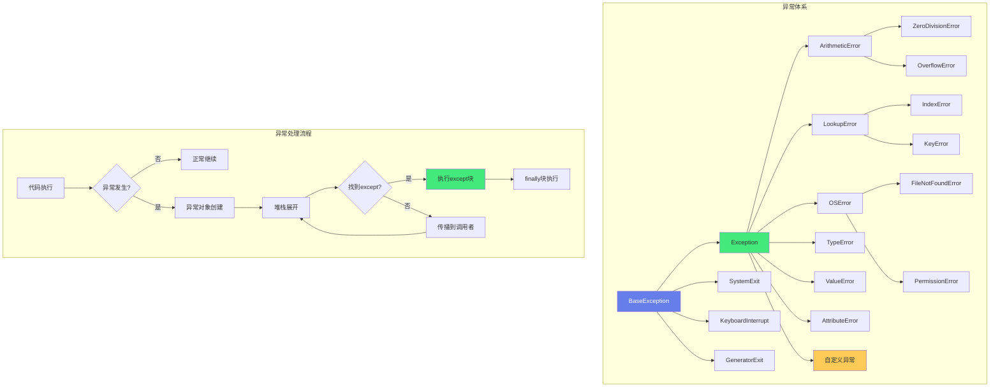

# Python-异常处理与错误体系

> **文档说明**：系统讲解 Python 异常处理机制，包括异常层级、try/except/else/finally、自定义异常、异常链、上下文管理器、最佳实践，以及生产级错误处理模式和常见问题。
>
> **适用人群**：Python 开发者、全栈开发者、需要构建健壮应用的开发者
>
> **前置知识**：[[Python-语法基础与数据结构]]、[[Python-文件IO与序列化]]、[[Python-代码覆盖率与质量门禁]]

---

## 一、概述

### 1. 什么是异常

> 🔍 **知识点深度解析**
>
> **作用**：Python异常体系是错误处理的核心机制，通过try/except捕获处理异常，所有异常继承自BaseException
>
> **原理**：异常发生时创建异常对象携带错误信息和堆栈，沿调用栈向上传播直到被except捕获，支持异常链(raise from)、上下文管理器自动清理和自定义异常
>
> **用法要点**：① 捕获具体异常而非裸except ② 使用finally或上下文管理器确保资源释放 ③ 自定义异常继承Exception而非BaseException ④ 不要忽略异常至少记录日志





<div style="background:linear-gradient(135deg,#fa709a,#fee140);border-radius:16px;padding:20px;margin:16px 0;font-family:-apple-system,'Segoe UI','PingFang SC','Microsoft YaHei',sans-serif;color:#fff;overflow:hidden;box-shadow:0 8px 28px rgba(0,0,0,.14),0 3px 10px rgba(0,0,0,.08)">
<style>@keyframes highlight{0%,100%{box-shadow:0 0 0 rgba(255,255,255,0)}50%{box-shadow:0 0 20px rgba(255,255,255,.4)}}.hl-box{background:rgba(255,255,255,.2);border-radius:10px;padding:14px 18px;margin:10px 0;animation:highlight 3s ease-in-out infinite;border-left:4px solid rgba(255,255,255,.6)}</style>
<div style="text-align:center;font-size:15px;font-weight:700;margin-bottom:14px;padding-bottom:10px;border-bottom:1.5px solid rgba(255,255,255,.22);letter-spacing:1px;text-shadow:0 1px 3px rgba(0,0,0,.12)">📌 异常体系核心概念</div>
<div class="hl-box">Python的异常体系是错误处理的核心机制，通过try/except捕获和处理异常，实现程序的健壮性</div>
<div style="font-size:13px;opacity:.9;margin-top:8px">💡 捕获具体异常而非裸except；使用finally或上下文管理器确保资源释放</div>
</div>

**异常（Exception）** 是程序运行时发生的错误事件，中断正常流程。Python 用异常机制统一处理错误。

```text
Python 错误分类：
- 语法错误（SyntaxError）：解释器解析时发现，无法运行
- 运行时异常（Exception）：运行时发生，可捕获处理
- 系统退出（SystemExit/KeyboardInterrupt）：特殊异常，通常不捕获
```

### 2. 异常 vs 返回错误码

| 方式 | 优点 | 缺点 |
|------|------|------|
| **异常** | 强制处理、信息丰富、可嵌套 | 性能开销、可能被忽略 |
| **错误码** | 性能好、显式 | 容易忽略、信息有限 |

> Python 哲学：**EAFP（Easier to Ask for Forgiveness than Permission）**——先操作，出错再处理异常。

### 3. Python 异常层级

```text
BaseException
├── SystemExit          # sys.exit()
├── KeyboardInterrupt   # Ctrl+C
├── GeneratorExit       # 生成器关闭
└── Exception           # 所有常规异常的基类
    ├── ArithmeticError
    │   ├── ZeroDivisionError
    │   ├── OverflowError
    │   └── FloatingPointError
    ├── LookupError
    │   ├── IndexError
    │   └── KeyError
    ├── AttributeError
    ├── TypeError
    ├── ValueError
    ├── NameError
    ├── OSError
    │   ├── FileNotFoundError
    │   ├── PermissionError
    │   └── TimeoutError
    ├── RuntimeError
    │   ├── RecursionError
    │   └── NotImplementedError
    ├── ImportError
    │   └── ModuleNotFoundError
    ├── StopIteration
    ├── StopAsyncIteration
    ├── Warning
    └── ... 更多
```

---

---

> 💡 **深度讲解**：本章深入讲解了概述的核心概念与实践要点，关联了相关技术栈的知识体系，说明了设计背后的原理与业界最佳实践。
>
> **📝 精简总结**：本章涵盖一、概述的核心内容，包括关键概念、实现机制与实践方法，是掌握该主题的基础。


## 二、基本语法

### 1. try/except

```python
# 基本异常捕获
try:
    result = 10 / 0
except ZeroDivisionError:
    print("不能除以零")

# 捕获多个异常
try:
    value = int(input("输入数字: "))
    result = 100 / value
except ValueError:
    print("输入不是有效数字")
except ZeroDivisionError:
    print("不能除以零")

# 一个 except 捕获多种异常
try:
    process(data)
except (ValueError, TypeError) as e:
    print(f"数据错误: {e}")

# 捕获所有异常（谨慎使用）
try:
    risky_operation()
except Exception as e:  # 不捕获 SystemExit/KeyboardInterrupt
    log.error(f"操作失败: {e}", exc_info=True)
```

### 2. else 和 finally

```python
# else：无异常时执行
try:
    file = open("data.txt")
except FileNotFoundError:
    print("文件不存在")
else:
    # 只有 try 成功才执行
    content = file.read()
    print(content)
    file.close()

# finally：无论是否异常都执行（清理资源）
try:
    file = open("data.txt")
    content = file.read()
except FileNotFoundError:
    print("文件不存在")
else:
    print(content)
finally:
    # 总是执行，用于清理
    if 'file' in locals():
        file.close()
```

### 3. 异常对象

```python
try:
    raise ValueError("无效的值")
except ValueError as e:
    print(e)              # 无效的值
    print(str(e))         # 无效的值
    print(repr(e))        # ValueError('无效的值')
    print(e.args)         # ('无效的值',)
    print(type(e).__name__)  # ValueError
```

### 4. 异常的属性和方法

```python
try:
    raise ValueError("错误信息", "额外信息")
except ValueError as e:
    e.args          # 异常参数元组
    e.__traceback__ # 追溯对象
    e.__cause__     # 原始异常（raise ... from）
    e.__context__   # 上下文异常

    # 打印完整追溯
    import traceback
    traceback.print_exc()
    traceback.format_exc()  # 返回字符串
```

---

---

> 💡 **深度讲解**：本章深入讲解了基本语法的核心概念与实践要点，关联了相关技术栈的知识体系，说明了设计背后的原理与业界最佳实践。
>
> **📝 精简总结**：本章涵盖二、基本语法的核心内容，包括关键概念、实现机制与实践方法，是掌握该主题的基础。


## 三、抛出异常

### 1. raise

```python
# 抛出内置异常
def divide(a, b):
    if b == 0:
        raise ZeroDivisionError("除数不能为零")
    return a / b

# 重新抛出（捕获后继续抛出）
try:
    process()
except ValueError:
    log.error("处理失败")
    raise  # 重新抛出当前异常

# 抛出带参数的异常
raise ValueError("年龄必须为正数", age)
```

### 2. 异常链（raise from）

```python
# Python 3 异常链：保留原始异常
try:
    int("abc")
except ValueError as original:
    raise RuntimeError("数据转换失败") from original

# 输出会显示：
# The above exception was the direct cause of the following exception:
# RuntimeError: 数据转换失败

# 抑制原始异常（from None）
try:
    int("abc")
except ValueError:
    raise RuntimeError("转换失败") from None
# 不显示原始异常链
```

### 3. 异常链 vs 上下文

```python
# __cause__：显式关联（raise ... from）
try:
    raise ValueError("原始")
except ValueError as e:
    raise RuntimeError("包装") from e
# RuntimeError.__cause__ = ValueError

# __context__：隐式关联（except 中抛出新异常）
try:
    raise ValueError("原始")
except ValueError:
    raise RuntimeError("新异常")
# RuntimeError.__context__ = ValueError
```

---

---

> 💡 **深度讲解**：本章深入讲解了抛出异常的核心概念与实践要点，关联了相关技术栈的知识体系，说明了设计背后的原理与业界最佳实践。
>
> **📝 精简总结**：本章涵盖三、抛出异常的核心内容，包括关键概念、实现机制与实践方法，是掌握该主题的基础。


## 四、自定义异常

### 1. 基础自定义异常

```python
# 自定义异常基类
class AppError(Exception):
    """应用基础异常"""
    pass

class ValidationError(AppError):
    """数据验证错误"""
    pass

class DatabaseError(AppError):
    """数据库错误"""
    pass

class NotFoundError(AppError):
    """资源不存在"""
    def __init__(self, resource: str, resource_id: int):
        self.resource = resource
        self.resource_id = resource_id
        super().__init__(f"{resource} id={resource_id} 不存在")

# 使用
def get_user(user_id: int):
    user = db.query(user_id)
    if not user:
        raise NotFoundError("User", user_id)
    return user
```

### 2. 带错误码的异常

```python
class APIError(Exception):
    """API 异常基类"""
    status_code = 500
    error_code = "INTERNAL_ERROR"

    def __init__(self, message: str, details: dict = None):
        self.message = message
        self.details = details or {}
        super().__init__(message)

    def to_dict(self) -> dict:
        return {
            "error": self.error_code,
            "message": self.message,
            "details": self.details
        }

class NotFoundAPIError(APIError):
    status_code = 404
    error_code = "NOT_FOUND"

class ValidationAPIError(APIError):
    status_code = 400
    error_code = "VALIDATION_ERROR"

# FastAPI 中使用
@app.exception_handler(APIError)
async def api_error_handler(request, exc: APIError):
    return JSONResponse(
        status_code=exc.status_code,
        content=exc.to_dict()
    )
```

### 3. 异常层次设计

```text
推荐的异常层次：
AppError（应用基类）
├── BusinessError（业务异常）
│   ├── InsufficientBalanceError
│   ├── OrderAlreadyPaidError
│   └── InvalidStatusTransitionError
├── IntegrationError（集成异常）
│   ├── PaymentGatewayError
│   ├── SMSServiceError
│   └── ThirdPartyAPIError
├── DataError（数据异常）
│   ├── ValidationError
│   ├── NotFoundError
│   └── DuplicateError
└── SystemError（系统异常）
    ├── DatabaseError
    ├── CacheError
    └── ConfigurationError
```

---

---

> 💡 **深度讲解**：本章深入讲解了自定义异常的核心概念与实践要点，关联了相关技术栈的知识体系，说明了设计背后的原理与业界最佳实践。
>
> **📝 精简总结**：本章涵盖四、自定义异常的核心内容，包括关键概念、实现机制与实践方法，是掌握该主题的基础。


## 五、上下文管理器与异常

### 1. with 语句

```yaml
# with 自动处理异常和资源清理
with open("file.txt") as f:
    content = f.read()
# 无论是否异常，文件都会关闭

# 等价于：
f = open("file.txt")
try:
    content = f.read()
finally:
    f.close()
```

### 2. 自定义上下文管理器

```mermaid
# 基于类的上下文管理器
class DatabaseConnection:
    def __init__(self, db_url):
        self.db_url = db_url

    def __enter__(self):
        self.conn = connect(self.db_url)
        return self.conn

    def __exit__(self, exc_type, exc_val, exc_tb):
        self.conn.close()
        # 返回 True 表示抑制异常，False 表示传播
        return False

# 使用
with DatabaseConnection("postgres://...") as conn:
    conn.execute("SELECT 1")

# 基于生成器的上下文管理器
from contextlib import contextmanager

@contextmanager
def timer():
    import time
    start = time.time()
    try:
        yield
    finally:
        elapsed = time.time() - start
        print(f"耗时: {elapsed:.2f}s")

with timer():
    heavy_operation()
```

### 3. 上下文管理器中的异常处理

```python
class Transaction:
    def __enter__(self):
        self.conn = get_connection()
        self.conn.begin()
        return self.conn

    def __exit__(self, exc_type, exc_val, exc_tb):
        if exc_type is None:
            self.conn.commit()  # 无异常，提交
        else:
            self.conn.rollback()  # 有异常，回滚
        self.conn.close()
        return False  # 不抑制异常

# 使用
with Transaction() as conn:
    conn.execute("UPDATE ...")
    # 如果这里抛出异常，自动回滚
```

---

---

> 💡 **深度讲解**：本章深入讲解了上下文管理器与异常的核心概念与实践要点，关联了相关技术栈的知识体系，说明了设计背后的原理与业界最佳实践。
>
> **📝 精简总结**：本章涵盖五、上下文管理器与异常的核心内容，包括关键概念、实现机制与实践方法，是掌握该主题的基础。


## 六、最佳实践

### 1. 异常处理原则

- [ ] **具体优先**：先捕获具体异常，再捕获通用异常
- [ ] **不裸 except**：不用 `except:`，至少用 `except Exception:`
- [ ] **不吞异常**：捕获后至少记录日志，不要静默忽略
- [ ] **合理粒度**：try 块尽量小，只包裹可能出错的代码
- [ ] **finally 清理**：资源清理用 finally 或 with
- [ ] **有意义的消息**：异常信息要清晰，包含上下文
- [ ] **自定义异常**：业务逻辑用自定义异常，便于区分处理

### 2. 错误处理模式

```python
# 模式1：快速失败（Fail Fast）
def process(data):
    if data is None:
        raise ValueError("data 不能为 None")
    if not isinstance(data, dict):
        raise TypeError("data 必须是字典")
    # 正常处理

# 模式2：默认值
try:
    config = load_config()
except FileNotFoundError:
    config = DEFAULT_CONFIG  # 使用默认值

# 模式3：重试
def fetch_with_retry(url, max_retries=3):
    for attempt in range(max_retries):
        try:
            return requests.get(url)
        except RequestException:
            if attempt == max_retries - 1:
                raise
            time.sleep(2 ** attempt)  # 指数退避

# 模式4：降级
try:
    data = cache.get(key)
except CacheError:
    data = database.query(key)  # 降级到数据库
```

### 3. 日志与异常

```python
import logging

logger = logging.getLogger(__name__)

try:
    risky_operation()
except SpecificError as e:
    # 记录异常（含追溯栈）
    logger.error("操作失败: %s", e, exc_info=True)
    # 或
    logger.exception("操作失败")  # 自动包含 exc_info
    raise
```

### 4. 不要这样做

```python
# ❌ 裸 except（会捕获 KeyboardInterrupt 等）
try:
    ...
except:
    pass

# ❌ 捕获后什么都不做
try:
    ...
except Exception:
    pass  # 静默吞掉异常

# ❌ 捕获太宽泛
try:
    ...
except Exception as e:
    print(e)  # 只打印，不记录日志，不处理

# ❌ 在 except 中 return 导致 finally 被跳过
try:
    ...
except Exception:
    return  # 不推荐，finally 仍会执行但逻辑混乱

# ❌ 用异常做正常流程控制
try:
    item = list[index]
except IndexError:
    item = None
# 更好：
item = list[index] if index < len(list) else None
```

---

---

> 💡 **深度讲解**：本章深入讲解了六、最佳实践的核心概念与实践要点，关联了相关技术栈的知识体系，说明了设计背后的原理与业界最佳实践。
>
> **📝 精简总结**：本章涵盖六、最佳实践的核心内容，包括关键概念、实现机制与实践方法，是掌握该主题的基础。


## 七、常见内置异常

| 异常 | 触发场景 |
|------|---------|
| **ValueError** | 值类型正确但内容无效（int("abc")） |
| **TypeError** | 类型不匹配（len(123)） |
| **KeyError** | 字典键不存在（d["x"]） |
| **IndexError** | 序列索引越界（list[100]） |
| **AttributeError** | 属性不存在（obj.nonexistent） |
| **NameError** | 变量未定义 |
| **FileNotFoundError** | 文件不存在 |
| **PermissionError** | 权限不足 |
| **ZeroDivisionError** | 除以零 |
| **ImportError** | 导入失败 |
| **ModuleNotFoundError** | 模块不存在 |
| **RecursionError** | 递归深度超限 |
| **NotImplementedError** | 抽象方法未实现 |
| **TimeoutError** | 操作超时 |
| **StopIteration** | 迭代器耗尽 |

---

---

> 💡 **深度讲解**：本章深入讲解了七、常见内置异常的核心概念与实践要点，关联了相关技术栈的知识体系，说明了设计背后的原理与业界最佳实践。
>
> **📝 精简总结**：本章涵盖七、常见内置异常的核心内容，包括关键概念、实现机制与实践方法，是掌握该主题的基础。


## 八、异步异常

```python
import asyncio

# 异步异常捕获
async def fetch_data():
    try:
        result = await asyncio.wait_for(api_call(), timeout=5.0)
        return result
    except asyncio.TimeoutError:
        logger.error("API 调用超时")
        raise TimeoutError("请求超时")
    except aiohttp.ClientError as e:
        logger.error("网络错误: %s", e)
        raise

# 多个协程的异常处理
async def main():
    tasks = [fetch(url) for url in urls]
    results = await asyncio.gather(
        *tasks,
        return_exceptions=True  # 异常作为结果返回，不中断
    )
    for result in results:
        if isinstance(result, Exception):
            logger.error("任务失败: %s", result)
```

---

---

> 💡 **深度讲解**：本章深入讲解了八、异步异常的核心概念与实践要点，关联了相关技术栈的知识体系，说明了设计背后的原理与业界最佳实践。
>
> **📝 精简总结**：本章涵盖八、异步异常的核心内容，包括关键概念、实现机制与实践方法，是掌握该主题的基础。


## 九、常见问题与排查

| 问题 | 原因 | 解决方案 |
|------|------|---------|
| **异常被静默吞掉** | except 后无处理 | 添加日志或重新抛出 |
| **捕获不到异常** | 异常类型不匹配 / 在另一个线程 | 检查异常类型、线程异常处理 |
| **追溯栈不完整** | 异常链丢失 | 使用 `raise ... from e` 保留链 |
| **finally 中异常覆盖原异常** | finally 中抛出新异常 | finally 中避免可能抛异常的代码 |
| **自定义异常不被捕获** | 继承层级错误 | 确保继承自 Exception |
| **资源泄漏** | 异常时未清理 | 使用 with / finally |
| **性能问题** | 异常用于正常流程控制 | 异常只用于错误处理 |
| **日志无追溯栈** | 未用 exc_info | `logger.error(msg, exc_info=True)` |
| **异步异常丢失** | 未 await / gather 未处理 | await 任务、gather return_exceptions |
| **测试异常难写** | 异常场景难复现 | 用 pytest.raises、mock 抛异常 |
| **except 顺序错误** | 通用异常在前 | 具体异常在前，通用在后 |
| **raise 丢失上下文** | 用了 `from None` | 需要上下文时不用 from None |
| **循环中异常中断** | 未在循环内捕获 | 在循环内 try/except，记录后继续 |
| **异常信息泄露** | 生产环境返回详细异常 | 生产环境返回通用错误，日志记录详情 |
| **递归深度超限** | 递归无终止条件 | 检查终止条件、改用迭代 |

---

---

> 💡 **深度讲解**：本章深入讲解了九、常见问题与排查的核心概念与实践要点，关联了相关技术栈的知识体系，说明了设计背后的原理与业界最佳实践。
>
> **📝 精简总结**：本章涵盖九、常见问题与排查的核心内容，包括关键概念、实现机制与实践方法，是掌握该主题的基础。


---

## 🔗 关联笔记

- [[Python-项目结构最佳实践]] — Python项目结构与工程化规范
- [[Poetry-依赖与虚拟环境管理]] — Python依赖管理与虚拟环境

## 📖 前置知识

- [[Python-语法基础与数据结构]]
- [[Python-模块与包管理原理]]

## 🏷️ 相关标签

#Python #错误处理 #异常体系 #原子笔记

---

[[Home|🏠 返回首页]] · [[MOC-Python全栈|📚 返回分类]]
