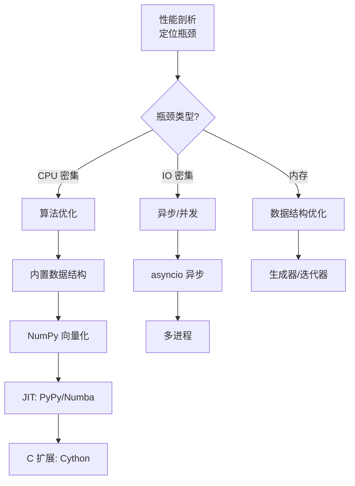

# Python 性能优化与 C 扩展

> **文档说明**：系统讲解 Python 性能优化的方法论与实践，包括性能剖析（cProfile/line_profiler）、算法优化、内置数据结构选择、并发编程（多线程/多进程/协程）、JIT 编译（PyPy/Numba）、C 扩展开发（Cython/ctypes/cffi），含可运行的性能对比代码和优化案例。
>
> **适用人群**：需要优化 Python 性能的后端开发者、算法工程师、关注高吞吐服务的全栈工程师
>
> **前置知识**：[[Python-面向对象与元类]]、[[Python-语法基础与数据结构]]、[[进程线程与协程]]

---

## 一、概述

### 1. 定义与核心价值

> 🔍 **知识点深度解析**
>
> **作用**：C扩展将性能关键代码用C/C++实现并编译为Python模块，突破GIL和解释器性能限制
>
> **原理**：使用Cython(类Python语法编译为C)、ctypes(调用C动态库)、cffi或SWIG，将热点函数编译为原生代码，可释放GIL实现真正并行执行
>
> **用法要点**：① 先用profiler定位真正的瓶颈再优化 ② Cython是最友好的选择学习成本低 ③ 注意Python对象和C类型的转换开销 ④ C扩展增加部署复杂度需权衡收益


<div style="background:linear-gradient(135deg,#fa709a,#fee140);border-radius:16px;padding:20px;margin:16px 0;font-family:-apple-system,'Segoe UI','PingFang SC','Microsoft YaHei',sans-serif;color:#fff;overflow:hidden;box-shadow:0 8px 28px rgba(0,0,0,.14),0 3px 10px rgba(0,0,0,.08)">
<style>@keyframes highlight{0%,100%{box-shadow:0 0 0 rgba(255,255,255,0)}50%{box-shadow:0 0 20px rgba(255,255,255,.4)}}.hl-box{background:rgba(255,255,255,.2);border-radius:10px;padding:14px 18px;margin:10px 0;animation:highlight 3s ease-in-out infinite;border-left:4px solid rgba(255,255,255,.6)}</style>
<div style="text-align:center;font-size:15px;font-weight:700;margin-bottom:14px;padding-bottom:10px;border-bottom:1.5px solid rgba(255,255,255,.22);letter-spacing:1px;text-shadow:0 1px 3px rgba(0,0,0,.12)">📌 C扩展核心概念</div>
<div class="hl-box">C扩展通过将性能关键代码用C/C++实现并编译为Python模块，突破GIL和解释器性能限制</div>
<div style="font-size:13px;opacity:.9;margin-top:8px">💡 先用profiler定位真正的瓶颈再优化；Cython是最友好的选择学习成本低</div>
</div>

Python 以开发效率著称，但执行效率低于 C/C++/Go 等编译语言。性能优化的核心是**"先测量，再优化"**——不要凭直觉优化，要用剖析工具定位瓶颈，然后针对性优化。优化手段从易到难依次为：算法优化 → 内置数据结构 → 并发 → JIT → C 扩展。

### 2. 痛点对比

| 痛点（未优化的 Python） | 优化方案 |
|----------------------|---------|
| 循环处理百万数据耗时数秒 | 用 NumPy 向量化操作，或 Cython 编译 |
| CPU 密集任务无法利用多核 | GIL 限制多线程，用 multiprocessing 多进程 |
| IO 密集任务吞吐量低 | 用 asyncio 异步 + 异步驱动 |
| 数值计算慢 | 用 NumPy/Pandas 替代纯 Python 循环 |
| 热点函数占 80% 时间 | 用 Cython/ctypes 将热点函数改写为 C |
| 重复计算浪费 CPU | 用 `functools.lru_cache` 缓存结果 |

### 3. 优化优先级



**优化原则**：先优化算法（O(n²) → O(n log n)），再优化实现（纯 Python → NumPy），最后才考虑 C 扩展。C 扩展开发成本高、维护难，是最后的手段。

---

---

> 💡 **深度讲解**：本章深入讲解了概述的核心概念与实践要点，关联了相关技术栈的知识体系，说明了设计背后的原理与业界最佳实践。
>
> **📝 精简总结**：本章涵盖一、概述的核心内容，包括关键概念、实现机制与实践方法，是掌握该主题的基础。


## 二、底层原理

### 1. Python 性能瓶颈根源

| 瓶颈 | 原因 | 影响 |
|------|------|------|
| **GIL（全局解释器锁）** | CPython 用 GIL 保证线程安全，同一时刻只有一个线程执行 Python 字节码 | CPU 密集任务多线程无效 |
| **解释执行** | Python 字节码由解释器逐条执行，无编译优化 | 比 C 慢 10-100 倍 |
| **动态类型** | 变量类型运行时确定，每次操作需类型检查 | 数值计算额外开销 |
| **对象开销** | 一切皆对象，int 也是 28 字节对象 | 内存占用大，缓存不友好 |
| **函数调用开销** | 函数调用需创建栈帧、参数传递 | 递归/小函数频繁调用慢 |

### 2. 性能剖析工具对比

| 工具 | 类型 | 粒度 | 适用场景 |
|------|------|------|---------|
| `cProfile` | 确定性剖析 | 函数级 | 定位耗时函数 |
| `line_profiler` | 行级剖析 | 行级 | 函数内逐行耗时 |
| `memory_profiler` | 内存剖析 | 行级 | 定位内存泄漏 |
| `py-spy` | 采样剖析 | 函数级 | 生产环境非侵入式剖析 |
| `snakeviz` | 可视化 | 函数级 | cProfile 结果可视化 |

---

---

> 💡 **深度讲解**：本章深入讲解了底层原理的核心概念与实践要点，关联了相关技术栈的知识体系，说明了设计背后的原理与业界最佳实践。
>
> **📝 精简总结**：本章涵盖二、底层原理的核心内容，包括关键概念、实现机制与实践方法，是掌握该主题的基础。


## 三、实操

### 1. 性能剖析

```python
# profiling_example.py
import cProfile
import pstats
import io


def slow_function():
    """模拟慢速函数"""
    result = []
    for i in range(100000):
        result.append(i ** 2)
    return result


def fast_function():
    """优化后的函数"""
    return [i ** 2 for i in range(100000)]


def main():
    for _ in range(10):
        slow_function()
        fast_function()


# 方法 1：cProfile 命令行
# python -m cProfile -s cumulative profiling_example.py

# 方法 2：代码中使用
if __name__ == "__main__":
    profiler = cProfile.Profile()
    profiler.enable()
    main()
    profiler.disable()

    # 输出统计
    s = io.StringIO()
    ps = pstats.Stats(profiler, stream=s).sort_stats("cumulative")
    ps.print_stats(20)  # 前 20 个
    print(s.getvalue())
```

```python
# line_profiler 行级剖析
# pip install line_profiler
from line_profiler import LineProfiler

def slow_sum(numbers):
    total = 0
    for n in numbers:  # 这行慢？
        total += n ** 2  # 还是这行慢？
    return total

lp = LineProfiler()
lp_wrapper = lp(slow_sum)
lp_wrapper(range(1000000))
lp.print_stats()
```

```python
# py-spy：生产环境非侵入式剖析
pip install py-spy

# 采样正在运行的进程
py-spy top --pid 12345

# 生成火焰图
py-spy record -o profile.svg --pid 12345

# 运行脚本并剖析
py-spy record -o profile.svg -- python my_script.py
```

### 2. 算法与数据结构优化

```text
## optimization_examples.py
```

## 1. 列表推导式 vs for 循环 append

```css
#慢
result = []
for i in range(1000000):
```
```css
    result.append(i ** 2)

# 快（列表推导式在 C 层面执行）
result = [i ** 2 for i in range(1000000)]
```


## 2. 成员检查：set vs list
```css
# 慢：O(n) 每次检查
data_list = list(range(1000000))
if 999999 in data_list:  # 遍历整个列表
    pass

# 快：O(1) 哈希查找
data_set = set(range(1000000))
if 999999 in data_set:  # 哈希查找
    pass
```


```css
# 3. 字符串拼接：join vs +=
# 慢：每次 += 创建新字符串
result = ""
for s in large_list_of_strings:
```
```css
    result += s  # O(n²)

# 快：join 一次性分配内存
result = "".join(large_list_of_strings)  # O(n)
```


## 4. 生成器 vs 列表（内存优化）
## 内存大：一次性加载所有数据
```python
def read_all_lines(filename):
    with open(filename) as f:
        return f.readlines()  # 全部加载到内存
```

## 内存小：逐行迭代
```python
def read_lines(filename):
    with open(filename) as f:
        for line in f:  # 一次只加载一行
            yield line
```


## 5. 缓存：lru_cache
```python
from functools import lru_cache

@lru_cache(maxsize=128)
def fibonacci(n):
```
    """递归计算斐波那契，缓存避免重复计算"""
```text
    if n < 2:
        return n
    return fibonacci(n - 1) + fibonacci(n - 2)
```


## 6. 用内置函数（C 实现）替代 Python 循环

```css
# 慢
total = 0
for x in data:
```
```css
    total += x

# 快：sum 是 C 实现
total = sum(data)
```

### 3. NumPy 向量化

```python
# numpy_vectorization.py
import numpy as np

# 纯 Python：慢
def python_sum_squares(n):
    return sum(i ** 2 for i in range(n))

# NumPy：快 100 倍
def numpy_sum_squares(n):
    arr = np.arange(n)
    return np.sum(arr ** 2)

# 性能对比
# n = 10,000,000
# Python: 2.5 秒
# NumPy:  0.03 秒

# 矩阵运算
def python_matrix_multiply(A, B):
    n = len(A)
    C = [[0] * n for _ in range(n)]
    for i in range(n):
        for j in range(n):
            for k in range(n):
                C[i][j] += A[i][k] * B[k][j]
    return C

def numpy_matrix_multiply(A, B):
    return np.dot(A, B)  # 调用 BLAS，快 1000 倍
```

### 4. 并发编程

```python
# concurrency.py
import asyncio
import aiohttp
from concurrent.futures import ThreadPoolExecutor, ProcessPoolExecutor
import time

# ---------- IO 密集：异步 ----------
async def fetch_url(session, url):
    async with session.get(url) as response:
        return await response.text()

async def fetch_all_urls(urls):
    """异步并发抓取 100 个 URL"""
    async with aiohttp.ClientSession() as session:
        tasks = [fetch_url(session, url) for url in urls]
        results = await asyncio.gather(*tasks)
    return results


# ---------- IO 密集：多线程 ----------
def fetch_url_sync(url):
    import requests
    return requests.get(url).text

def fetch_all_threads(urls):
    with ThreadPoolExecutor(max_workers=20) as executor:
        results = list(executor.map(fetch_url_sync, urls))
    return results


# ---------- CPU 密集：多进程 ----------
def cpu_intensive_task(n):
    """CPU 密集计算：求素数"""
    count = 0
    for num in range(2, n):
        is_prime = True
        for i in range(2, int(num ** 0.5) + 1):
            if num % i == 0:
                is_prime = False
                break
        if is_prime:
            count += 1
    return count

def parallel_prime_count(numbers):
    """多进程并行计算（绕过 GIL）"""
    with ProcessPoolExecutor(max_workers=4) as executor:
        results = list(executor.map(cpu_intensive_task, numbers))
    return results
```

### 5. Numba JIT 编译

```python
# numba_example.py
from numba import jit, njit, prange
import numpy as np

# 纯 Python：慢
def python_sum(arr):
    total = 0
    for i in range(len(arr)):
        total += arr[i]
    return total

# Numba JIT：首次调用时编译为机器码
@njit  # @jit(nopython=True) 的简写
def numba_sum(arr):
    total = 0
    for i in range(len(arr)):
        total += arr[i]
    return total

# 并行加速
@njit(parallel=True)
def parallel_sum(arr):
    total = 0
    for i in prange(len(arr)):  # prange = parallel range
        total += arr[i]
    return total

# 性能对比
# arr = np.random.rand(10_000_000)
# Python:  1.2 秒
# Numba:   0.01 秒（首次含编译时间 0.1 秒）
# 并行:    0.003 秒
```

### 6. Cython C 扩展

```python
# fast_functions.pyx - Cython 代码
# 编译：python setup.py build_ext --inplace

# 纯 Python 版本（慢）
def python_fibonacci(int n):
    if n < 2:
        return n
    a, b = 0, 1
    for _ in range(n):
        a, b = b, a + b
    return a

# Cython 静态类型版本（快 50 倍）
def cython_fibonacci(int n):
    cdef int a = 0, b = 1, i
    if n < 2:
        return n
    for i in range(n):
        a, b = b, a + b
    return a

# Cython 操作 NumPy 数组
import numpy as np
cimport numpy as cnp

def cython_array_sum(cnp.ndarray[cnp.float64_t, ndim=1] arr):
    cdef double total = 0.0
    cdef int i
    for i in range(arr.shape[0]):
        total += arr[i]
    return total
```

```python
# setup.py - Cython 编译配置
from setuptools import setup, Extension
from Cython.Build import cythonize
import numpy as np

extensions = [
    Extension(
        "fast_functions",
        ["fast_functions.pyx"],
        include_dirs=[np.get_include()],
    )
]

setup(
    ext_modules=cythonize(extensions, compiler_directives={
        "language_level": "3",
        "boundscheck": False,  # 关闭边界检查（更快，但不安全）
        "wraparound": False,   # 关闭负索引
    }),
)
```

```python
# 编译
pip install cython numpy
python setup.py build_ext --inplace

# 使用
from fast_functions import cython_fibonacci, cython_array_sum
print(cython_fibonacci(100))
```

### 7. ctypes 调用 C 库

```c
// fast_math.c - C 源码
#include <stdint.h>

int64_t fibonacci(int n) {
    int64_t a = 0, b = 1;
    for (int i = 0; i < n; i++) {
        int64_t temp = a + b;
        a = b;
        b = temp;
    }
    return a;
}

double array_sum(double* arr, int n) {
    double total = 0.0;
    for (int i = 0; i < n; i++) {
        total += arr[i];
    }
    return total;
}
```

## 编译为共享库
gcc -shared -fPIC -o libfast_math.so fast_math.c

```python
# ctypes_usage.py
import ctypes
import numpy as np

# 加载 C 库
lib = ctypes.CDLL("./libfast_math.so")

# 配置函数签名
lib.fibonacci.argtypes = [ctypes.c_int]
lib.fibonacci.restype = ctypes.c_int64

lib.array_sum.argtypes = [ctypes.POINTER(ctypes.c_double), ctypes.c_int]
lib.array_sum.restype = ctypes.c_double

# 调用
result = lib.fibonacci(100)
print(f"Fibonacci(100) = {result}")

# 传递 NumPy 数组
arr = np.random.rand(1000000)
arr_ptr = arr.ctypes.data_as(ctypes.POINTER(ctypes.c_double))
total = lib.array_sum(arr_ptr, len(arr))
print(f"数组和 = {total}")
```

### 8. 性能对比基准测试

```python
# benchmark.py
import timeit
import numpy as np

def benchmark(name, func, number=100):
    """基准测试工具"""
    times = timeit.repeat(func, number=number, repeat=5)
    avg_time = min(times) / number
    print(f"{name:30s}: {avg_time*1000:8.3f} ms")

# 斐波那契对比
setup = "n=10000"
benchmark("Python 循环", "python_fibonacci(n)", setup)
benchmark("Cython", "cython_fibonacci(n)", setup)
benchmark("C (ctypes)", "lib.fibonacci(n)", setup)
benchmark("Numba", "numba_fibonacci(n)", setup)

# 数组求和对比
arr = np.random.rand(1_000_000)
benchmark("Python sum", lambda: sum(arr.tolist()))
benchmark("NumPy sum", lambda: np.sum(arr))
benchmark("Cython", lambda: cython_array_sum(arr))
benchmark("C (ctypes)", lambda: lib.array_sum(arr_ptr, len(arr)))
```

---

---

> 💡 **深度讲解**：本章深入讲解了实操的核心概念与实践要点，关联了相关技术栈的知识体系，说明了设计背后的原理与业界最佳实践。
>
> **📝 精简总结**：本章涵盖三、实操的核心内容，包括关键概念、实现机制与实践方法，是掌握该主题的基础。


## 四、常见问题与排查

| 问题现象 | 原因 | 解决方案 |
|---------|------|---------|
| 多线程 CPU 密集任务没有加速 | GIL 限制，多线程无法并行执行 Python 字节码 | CPU 密集用 `multiprocessing` 多进程；或用 Numba/Cython 释放 GIL |
| Cython 编译后速度提升不明显 | 未使用 `cdef` 声明类型，仍按 Python 对象处理 | 用 `cdef int`、`cdef double` 声明变量类型；用 `@cython.boundscheck(False)` |
| Numba 首次调用慢 | JIT 编译需要时间 | 预热：启动时调用一次触发编译；或用 `@njit(cache=True)` 缓存编译结果 |
| `multiprocessing` 在 Windows 上报错 | Windows 没有 fork，需用 `if __name__ == "__main__"` 保护 | 确保多进程代码在 `if __name__ == "__main__":` 块中 |
| ctypes 调用返回错误结果 | 未正确设置 `argtypes` 和 `restype`，参数类型不匹配 | 显式声明每个函数的参数和返回值类型；注意 64 位整数用 `c_int64` |
| 内存持续增长不释放 | 大对象未被垃圾回收，或 C 扩展内存泄漏 | 用 `memory_profiler` 定位；C 扩展中确保 `free()` 对应 `malloc()` |
| `asyncio` 代码比同步还慢 | 异步函数中调用了阻塞 IO（如 `requests`、`time.sleep`） | 用异步库（`aiohttp`、`asyncio.sleep`）；阻塞操作用 `run_in_executor` |
| 优化后代码更慢了 | 优化方向错误，或引入了额外开销 | 始终用剖析工具验证；微优化可能被解释器开销抵消 |
| PyPy 运行某些库报错 | PyPy 不完全兼容 CPython C API（如 NumPy） | 纯 Python 代码用 PyPy；依赖 C 扩展的用 CPython + Numba |

---

---

> 💡 **深度讲解**：本章深入讲解了常见问题与排查的核心概念与实践要点，关联了相关技术栈的知识体系，说明了设计背后的原理与业界最佳实践。
>
> **📝 精简总结**：本章涵盖四、常见问题与排查的核心内容，包括关键概念、实现机制与实践方法，是掌握该主题的基础。


## 五、进阶与最佳实践

### 1. 优化决策树

```text
性能问题
├── 定位瓶颈（cProfile/line_profiler）
│   ├── IO 密集（网络/文件/数据库）
│   │   ├── 异步 IO（asyncio + aiohttp/asyncpg）
│   │   └── 多线程（ThreadPoolExecutor）
│   │
│   └── CPU 密集
│       ├── 算法优化（O(n²) → O(n log n)）
│       ├── 内置数据结构（set/dict/列表推导式）
│       ├── NumPy 向量化（数值计算）
│       ├── Numba JIT（数值循环）
│       ├── 多进程（multiprocessing）
│       └── Cython/C 扩展（最后手段）
│
└── 内存问题
    ├── 生成器替代列表（惰性求值）
    ├── __slots__ 减少对象内存
    ├── array 模块替代 list（数值数组）
    └── 及时删除大对象（del + gc.collect()）
```

### 2. 优化检查清单

| 检查项 | 说明 |
|--------|------|
| **先剖析再优化** | 不要凭直觉，用数据说话 |
| **优先算法优化** | 算法复杂度的提升是数量级的 |
| **用内置函数** | `sum`/`max`/`min`/`sorted` 都是 C 实现 |
| **用列表推导式** | 比 `for` + `append` 快 30% |
| **用 set 做成员检查** | O(1) vs O(n) |
| **用 `join` 拼接字符串** | O(n) vs O(n²) |
| **用生成器处理大数据** | 内存从 O(n) 降到 O(1) |
| **缓存重复计算** | `@lru_cache` |
| **IO 用异步** | asyncio 提升吞吐量 |
| **CPU 用多进程** | 绕过 GIL |

### 3. C 扩展方案对比

| 方案 | 开发难度 | 性能 | 兼容性 | 适用场景 |
|------|---------|------|--------|---------|
| **Cython** | 中 | 高 | 好 | 数值计算、循环优化 |
| **ctypes** | 中 | 高 | 好 | 调用已有 C 库 |
| **cffi** | 中 | 高 | 好 | 跨平台 C 库调用 |
| **Numba** | 低 | 高 | 中（数值代码） | 数值循环、数组操作 |
| **PyO3** | 高 | 极高 | 好 | Rust 编写 Python 扩展 |
| **pybind11** | 高 | 极高 | 好 | C++ 代码绑定 Python |

### 4. 生产环境性能监控

```python
# 性能监控装饰器
import time
import functools
import logging

logger = logging.getLogger(__name__)

def monitor_performance(threshold_ms=100):
    """监控函数执行时间，超过阈值记录警告"""
    def decorator(func):
        @functools.wraps(func)
        def wrapper(*args, **kwargs):
            start = time.perf_counter()
            result = func(*args, **kwargs)
            elapsed = (time.perf_counter() - start) * 1000
            if elapsed > threshold_ms:
                logger.warning(
                    f"慢函数: {func.__name__} 耗时 {elapsed:.1f}ms (阈值 {threshold_ms}ms)"
                )
            return result
        return wrapper
    return decorator


@monitor_performance(threshold_ms=500)
def process_large_data(data):
    # 业务逻辑
    pass
```

---

---

> 💡 **深度讲解**：本章深入讲解了进阶与最佳实践的核心概念与实践要点，关联了相关技术栈的知识体系，说明了设计背后的原理与业界最佳实践。
>
> **📝 精简总结**：本章涵盖五、进阶与最佳实践的核心内容，包括关键概念、实现机制与实践方法，是掌握该主题的基础。


---

## 🔗 关联笔记

- [[Python-项目结构最佳实践]] — Python项目结构与工程化规范
- [[Poetry-依赖与虚拟环境管理]] — Python依赖管理与虚拟环境

## 📖 前置知识

- [[Python-语法基础与数据结构]]
- [[Python-模块与包管理原理]]

## 🏷️ 相关标签

#Python #性能优化 #C扩展 #Cython #ctypes

---

[[Home|🏠 返回首页]] · [[MOC-Python全栈|📚 返回分类]]
