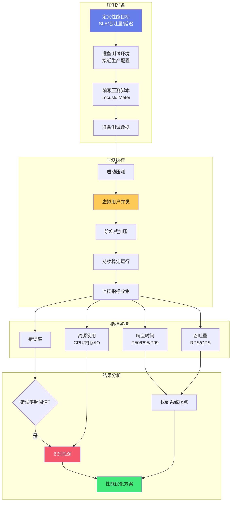

# Python-性能测试与压测

> **文档说明**：系统讲解 Python 性能测试与压力测试的完整体系，包括基准测试、性能分析、压力测试工具（Locust/wrk/ab）、API 压测实战、性能优化，以及最佳实践和常见问题。
>
> **适用人群**：Python 开发者、后端工程师、测试工程师、需要评估系统性能的开发者
>
> **前置知识**：[[Python-代码覆盖率与质量门禁]]、[[Python-异常处理与错误体系]]、[[Python-API版本化与文档]]

---

## 一、概述

### 1. 性能测试类型

> 🔍 **知识点深度解析**
>
> **作用**：压力测试模拟高并发负载验证系统性能瓶颈和稳定性，通过阶梯式加压找到系统拐点
>
> **原理**：使用Locust/JMeter等工具模拟虚拟用户并发请求，监控响应时间(P50/P95/P99)、吞吐量(RPS)、错误率和资源使用，逐步增加负载识别瓶颈
>
> **用法要点**：① 先定义明确的性能目标和SLA ② 测试环境尽量接近生产配置 ③ 使用阶梯式加压找到系统拐点 ④ 关注P95/P99延迟而非仅平均值





<div style="background:linear-gradient(135deg,#fa709a,#fee140);border-radius:16px;padding:20px;margin:16px 0;font-family:-apple-system,'Segoe UI','PingFang SC','Microsoft YaHei',sans-serif;color:#fff;overflow:hidden;box-shadow:0 8px 28px rgba(0,0,0,.14),0 3px 10px rgba(0,0,0,.08)">
<style>@keyframes highlight{0%,100%{box-shadow:0 0 0 rgba(255,255,255,0)}50%{box-shadow:0 0 20px rgba(255,255,255,.4)}}.hl-box{background:rgba(255,255,255,.2);border-radius:10px;padding:14px 18px;margin:10px 0;animation:highlight 3s ease-in-out infinite;border-left:4px solid rgba(255,255,255,.6)}</style>
<div style="text-align:center;font-size:15px;font-weight:700;margin-bottom:14px;padding-bottom:10px;border-bottom:1.5px solid rgba(255,255,255,.22);letter-spacing:1px;text-shadow:0 1px 3px rgba(0,0,0,.12)">📌 压力测试核心概念</div>
<div class="hl-box">压力测试模拟高并发负载验证系统性能瓶颈和稳定性，是性能优化的基础</div>
<div style="font-size:13px;opacity:.9;margin-top:8px">💡 先定义明确的性能目标和SLA；测试环境尽量接近生产配置</div>
</div>

```text
性能测试分类：
- 基准测试（Benchmark）：测量单次操作耗时，对比不同实现
- 负载测试（Load Test）：模拟预期用户量，验证性能
- 压力测试（Stress Test）：超出预期负载，找极限和崩溃点
-  soak Test（浸泡测试）：长时间运行，检测内存泄漏
- 尖峰测试（Spike Test）：突然大量请求，验证弹性
- 并发测试（Concurrency Test）：多用户同时操作
```

### 2. 核心性能指标

| 指标 | 说明 | 目标 |
|------|------|------|
| **响应时间** | 请求从发出到收到响应的时间 | P95 < 200ms（API） |
| **吞吐量（RPS/QPS）** | 每秒处理请求数 | 越高越好 |
| **并发用户数** | 同时在线用户数 | 满足业务需求 |
| **错误率** | 失败请求占比 | < 0.1% |
| **CPU 使用率** | 服务器 CPU 占用 | < 70% |
| **内存使用** | 内存占用和增长 | 无泄漏、稳定 |
| **P50/P90/P99** | 响应时间分位数 | P99 < 500ms |

### 3. 性能测试流程

```text
1. 确定目标：明确性能指标和业务场景
2. 准备环境：隔离测试环境、准备测试数据
3. 编写脚本：基准测试或压测脚本
4. 执行测试：逐步加压，收集数据
5. 分析结果：定位瓶颈、分析趋势
6. 优化调优：代码/配置/架构优化
7. 回归验证：优化后重新测试对比
```

---

---

> 💡 **深度讲解**：本章深入讲解了概述的核心概念与实践要点，关联了相关技术栈的知识体系，说明了设计背后的原理与业界最佳实践。
>
> **📝 精简总结**：本章涵盖一、概述的核心内容，包括关键概念、实现机制与实践方法，是掌握该主题的基础。


## 二、基准测试

### 1. timeit（标准库）

```python
import timeit

# 测量代码执行时间
setup = "from math import sqrt"
stmt = "sqrt(25)"

# 执行 100 万次，取最佳 5 次的平均
result = timeit.repeat(stmt, setup=setup, number=1_000_000, repeat=5)
print(f"Best: {min(result):.4f}s per 1M ops")
print(f"Per op: {min(result)/1_000_000 * 1e6:.2f}us")

# 命令行使用
# python -m timeit -s "from math import sqrt" "sqrt(25)"

# 对比两种实现
t1 = timeit.timeit("''.join(['a', 'b', 'c'])", number=1_000_000)
t2 = timeit.timeit("'a' + 'b' + 'c'", number=1_000_000)
print(f"join: {t1:.4f}s, concat: {t2:.4f}s")
```

```text
### 2. pytest-benchmark
```

```python
# tests/test_benchmark.py
import pytest

def test_string_concat(benchmark):
    """基准测试字符串拼接"""
    @benchmark
    def result():
        return ''.join(['a' * 100 for _ in range(1000)])

def test_list_comprehension(benchmark):
    """基准测试列表推导"""
    benchmark(lambda: [x**2 for x in range(10000)])

def test_dict_get(benchmark):
    """基准测试字典查找"""
    d = {str(i): i for i in range(10000)}
    benchmark(lambda: d.get('5000'))

# 运行
# pytest tests/test_benchmark.py --benchmark-autosave
# pytest --benchmark-compare  # 对比历史结果
```

```python
# 安装
pip install pytest-benchmark

# 运行基准测试
pytest test_bench.py --benchmark-only

# 对比两次结果
pytest test_bench.py --benchmark-compare

# 输出 JSON
pytest test_bench.py --benchmark-json result.json
```

### 3. 自定义基准测试框架

```python
import time
from functools import wraps
from statistics import mean, stdev

def benchmark(runs=100, warmup=10):
    """简单的基准测试装饰器"""
    def decorator(func):
        @wraps(func)
        def wrapper(*args, **kwargs):
            # 预热
            for _ in range(warmup):
                func(*args, **kwargs)
            # 正式测量
            times = []
            for _ in range(runs):
                start = time.perf_counter()
                func(*args, **kwargs)
                times.append(time.perf_counter() - start)
            avg = mean(times)
            std = stdev(times) if len(times) > 1 else 0
            print(f"{func.__name__}: {avg*1000:.3f}ms ± {std*1000:.3f}ms "
                  f"(min={min(times)*1000:.3f}ms, max={max(times)*1000:.3f}ms)")
        return wrapper
    return decorator

@benchmark(runs=1000)
def test_sort():
    sorted([5, 2, 8, 1, 9, 3] * 100)
```

---

---

> 💡 **深度讲解**：本章深入讲解了基准测试的核心概念与实践要点，关联了相关技术栈的知识体系，说明了设计背后的原理与业界最佳实践。
>
> **📝 精简总结**：本章涵盖二、基准测试的核心内容，包括关键概念、实现机制与实践方法，是掌握该主题的基础。


## 三、性能分析

### 1. cProfile（函数级分析）

```python
import cProfile
import pstats

def slow_function():
    total = 0
    for i in range(1000000):
        total += i ** 2
    return total

def fast_function():
    return sum(i**2 for i in range(1000000))

def main():
    slow_function()
    fast_function()

# 性能分析
profiler = cProfile.Profile()
profiler.enable()
main()
profiler.disable()

# 输出统计
stats = pstats.Stats(profiler)
stats.sort_stats('cumulative')  # 按累计时间排序
stats.print_stats(20)  # 打印前 20 个

# 保存到文件
profiler.dump_stats('profile.out')

# 命令行使用
# python -m cProfile -s cumulative script.py
# python -m cProfile -o profile.out script.py
```

```text
输出解读：
ncalls    调用次数
tottime   函数本身耗时（不含子函数）
percall   tottime/ncalls
cumtime  累计耗时（含子函数）
percall   cumtime/ncalls
filename:lineno(function)  函数位置
```

### 2. line_profiler（行级分析）

```python
# 安装：pip install line_profiler

@profile  # 装饰器标记要分析的函数
def process_data(data):
    result = []
    for item in data:
        processed = item * 2 + 1  # 哪行慢一目了然
        result.append(processed)
    return result

# 运行
# kernprof -l -v script.py

# 输出示例：
# Line #   Hits   Time   Per Hit   % Time  Contents
# 4         1      0.3    0.3       0.1     result = []
# 5      1000    120.5   0.1      30.2     for item in data:
# 6      1000    250.3   0.3      62.8     processed = item * 2 + 1
# 7      1000     28.1   0.0       7.0     result.append(processed)
```

### 3. memory_profiler（内存分析）

```python
# 安装：pip install memory_profiler

@profile
def load_large_file():
    data = []
    with open('large_file.txt') as f:
        for line in f:
            data.append(line.strip())  # 内存增长
    return data

# 运行
# python -m memory_profiler script.py

# 输出：
# Line #   Mem usage   Increment   Contents
# 4        45.2 MiB    45.2 MiB    data = []
# 5        45.2 MiB    0.0 MiB     with open(...)
# 6       120.5 MiB   75.3 MiB     for line in f:
# 7       120.5 MiB    0.0 MiB       data.append(...)
```

### 4. py-spy（非侵入式采样）

```python
# 安装：pip install py-spy

# 查看正在运行的 Python 进程的调用栈
py-spy top --pid 12345

# 生成火焰图
py-spy record -o profile.svg --pid 12345

# dump 所有线程栈
py-spy dump --pid 12345

# 优点：不需要修改代码，生产环境可用
```

---

---

> 💡 **深度讲解**：本章深入讲解了性能分析的核心概念与实践要点，关联了相关技术栈的知识体系，说明了设计背后的原理与业界最佳实践。
>
> **📝 精简总结**：本章涵盖三、性能分析的核心内容，包括关键概念、实现机制与实践方法，是掌握该主题的基础。


## 四、压力测试

### 1. Locust（Python 压测框架）

```python
# locustfile.py
from locust import HttpUser, task, between, tag
import json

class APIUser(HttpUser):
    wait_time = between(1, 3)  # 任务间等待 1-3 秒
    host = "http://localhost:8000"

    def on_start(self):
        """每个用户启动时执行（登录）"""
        resp = self.client.post("/api/login", json={
            "username": "test",
            "password": "test123"
        })
        self.token = resp.json()["token"]
        self.headers = {"Authorization": f"Bearer {self.token}"}

    @task(3)  # 权重 3，更频繁执行
    def get_items(self):
        self.client.get("/api/items", headers=self.headers)

    @task(1)
    def create_item(self):
        self.client.post("/api/items",
            json={"name": "test item", "price": 9.99},
            headers=self.headers)

    @tag("search")
    @task
    def search(self):
        self.client.get("/api/items?q=test", headers=self.headers)

    @task
    def get_item_detail(self):
        item_id = 1  # 或从列表中随机选
        self.client.get(f"/api/items/{item_id}", headers=self.headers)
```

```python
# 安装
pip install locust

# Web UI 模式
locust -f locustfile.py
# 访问 http://localhost:8089

# 无头模式（CI/CD）
locust -f locustfile.py \
    --headless \
    --users 100 \
    --spawn-rate 10 \
    --run-time 5m \
    --csv results

# 分布式压测
# 主节点
locust -f locustfile.py --master
# 工作节点
locust -f locustfile.py --worker --master-host=master-ip
```

### 2. wrk（高性能 HTTP 压测）

```bash
# 安装（macOS）
brew install wrk

# 基本压测：12 线程，400 连接，持续 30 秒
wrk -t12 -c400 -d30s http://localhost:8000/api/items

# 带 Lua 脚本（POST 请求）
wrk -t12 -c400 -d30s -s post.lua http://localhost:8000/api/items
```

```lua
-- post.lua
wrk.method = "POST"
wrk.body = '{"name":"test"}'
wrk.headers["Content-Type"] = "application/json"
```

```text
# 输出示例：
Running 30s test @ http://localhost:8000
12 threads and 400 connections
Thread Stats   Avg    Stdev     Max   +/- Stdev
Latency    25.3ms   12.1ms  200.5ms   78.2%
Req/Sec     1.2k    156.3    2.1k    72.5%
432,567 requests in 30.05s, 85.32MB read
Requests/sec:  14,401.23
Transfer/sec:   2.84MB
```

### 3. ab（Apache Bench）

```bash
# 基本压测：100 并发，总共 10000 请求
ab -n 10000 -c 100 http://localhost:8000/api/items

# POST 请求
ab -n 1000 -c 50 -p data.json -T application/json \
   http://localhost:8000/api/items

# 带 Header
ab -n 1000 -c 100 -H "Authorization: Bearer token" \
   http://localhost:8000/api/items
```

```text
# 输出关键指标：
Requests per second:  5000.00 [#/sec] (mean)
Time per request:     20.000 [ms] (mean)
99%    35ms
```

### 4. 其他工具对比

| 工具 | 语言 | 特点 | 适用场景 |
|------|------|------|---------|
| **Locust** | Python | 可编程、分布式、Web UI | 复杂场景、API 测试 |
| **wrk** | C | 高性能、轻量 | 简单 HTTP 压测 |
| **ab** | C | 简单、Apache 自带 | 快速测试 |
| **JMeter** | Java | 功能全、图形化 | 复杂协议、企业级 |
| **k6** | JS | 现代化、云原生 | DevOps、CI/CD |
| **Gatling** | Scala | 高性能、报表好 | 企业级、复杂场景 |

---

---

> 💡 **深度讲解**：本章深入讲解了压力测试的核心概念与实践要点，关联了相关技术栈的知识体系，说明了设计背后的原理与业界最佳实践。
>
> **📝 精简总结**：本章涵盖四、压力测试的核心内容，包括关键概念、实现机制与实践方法，是掌握该主题的基础。


## 五、API 压测实战

### 1. FastAPI 压测示例

```python
# locustfile.py - FastAPI 压测
from locust import HttpUser, task, between
import random

class FastAPIUser(HttpUser):
    wait_time = between(0.5, 2)
    host = "http://localhost:8000"

    @task(5)
    def list_users(self):
        self.client.get("/users?page=1&size=20")

    @task(3)
    def get_user(self):
        user_id = random.randint(1, 10000)
        self.client.get(f"/users/{user_id}",
                        name="/users/{id}")  # 聚合统计

    @task(2)
    def create_user(self):
        self.client.post("/users", json={
            "name": f"user_{random.randint(1, 100000)}",
            "email": f"test{random.randint(1, 100000)}@example.com"
        })

    @task
    def search(self):
        self.client.get(f"/users/search?q=user{random.randint(1,100)}")
```

### 2. 压测执行与分析

```bash
# 1. 启动服务
uvicorn app:app --workers 4 --port 8000

# 2. 预热（10 并发，1 分钟）
wrk -t2 -c10 -d60s http://localhost:8000/users

# 3. 逐步加压
for c in 50 100 200 500 1000; do
  echo "=== Concurrency: $c ==="
  wrk -t4 -c$c -d60s http://localhost:8000/users
done

# 4. 监控资源
# 另一个终端
watch -n 1 'ps aux | grep uvicorn | grep -v grep'
# 或用 prometheus + grafana

# 5. 分析瓶颈
# - CPU 高 → 计算密集，优化算法/加缓存
# - 内存高 → 内存泄漏/大对象，用 memory_profiler
# - IO 等待 → 数据库/网络瓶颈，加索引/连接池
# - 响应时间随并发线性增长 → 资源不足，扩容
```

---

---

> 💡 **深度讲解**：本章深入讲解了API 压测实战的核心概念与实践要点，关联了相关技术栈的知识体系，说明了设计背后的原理与业界最佳实践。
>
> **📝 精简总结**：本章涵盖五、API 压测实战的核心内容，包括关键概念、实现机制与实践方法，是掌握该主题的基础。


## 六、性能优化

### 1. 常见优化手段

```text
代码层面：
- 算法优化：O(n²) → O(n log n)
- 数据结构：列表查找 → 字典/集合
- 生成器：减少内存占用
- 内置函数：用 C 实现的内置函数
- 向量化：NumPy/Pandas 替代循环

IO 层面：
- 异步：asyncio/aiohttp 替代同步
- 连接池：数据库/HTTP 连接复用
- 缓存：Redis/Memcached 缓存热点
- 批量：批量查询替代循环查询

架构层面：
- 负载均衡：多实例分摊
- 读写分离：数据库主从
- CDN：静态资源加速
- 消息队列：异步解耦
```

### 2. 优化前后对比测试

```python
# 优化前：循环查询
def get_users_naive(user_ids):
    return [db.query(User).get(uid) for uid in user_ids]

# 优化后：批量查询
def get_users_optimized(user_ids):
    return db.query(User).filter(User.id.in_(user_ids)).all()

# 基准测试对比
import pytest

@pytest.mark.benchmark
def test_naive(benchmark):
    benchmark(get_users_naive, list(range(1, 101)))

@pytest.mark.benchmark
def test_optimized(benchmark):
    benchmark(get_users_optimized, list(range(1, 101)))

# 结果：优化后可能快 10-100 倍
```

---

---

> 💡 **深度讲解**：本章深入讲解了六、性能优化的核心概念与实践要点，关联了相关技术栈的知识体系，说明了设计背后的原理与业界最佳实践。
>
> **📝 精简总结**：本章涵盖六、性能优化的核心内容，包括关键概念、实现机制与实践方法，是掌握该主题的基础。


## 七、最佳实践

### 1. 测试规范

- [ ] **隔离环境**：测试环境与生产隔离，避免影响
- [ ] **预热**：正式测试前预热，排除冷启动影响
- [ ] **多次测量**：取多次结果的平均值和分位数
- [ ] **固定变量**：每次只改一个变量，对比效果
- [ ] **监控资源**：同时监控 CPU、内存、IO、网络
- [ ] **真实数据**：用接近生产的数据量和分布
- [ ] **记录配置**：记录硬件、软件、参数配置
- [ ] **趋势对比**：建立基线，持续跟踪性能变化

### 2. 压测规范

- [ ] **逐步加压**：从低并发开始，逐步增加
- [ ] **设置超时**：避免请求无限等待
- [ ] **错误处理**：记录和分析错误率
- [ ] **分布式压测**：大流量用多机分布式
- [ ] **压测后清理**：清理测试数据
- [ ] **不要压测生产**：除非有明确授权和回滚方案
- [ ] **关注 P99**：平均值可能掩盖长尾问题
- [ ] **持续集成**：性能测试纳入 CI，防止性能退化

### 3. 结果分析

```text
分析步骤：
1. 看吞吐量和响应时间是否达标
2. 看错误率是否异常
3. 看资源使用率（CPU/内存/IO）
4. 找瓶颈点（哪个资源先到 100%）
5. 用 profiler 定位慢函数
6. 优化后重新测试验证
7. 记录结果，建立性能基线
```

---

---

> 💡 **深度讲解**：本章深入讲解了七、最佳实践的核心概念与实践要点，关联了相关技术栈的知识体系，说明了设计背后的原理与业界最佳实践。
>
> **📝 精简总结**：本章涵盖七、最佳实践的核心内容，包括关键概念、实现机制与实践方法，是掌握该主题的基础。


## 八、常见问题与排查

| 问题 | 原因 | 解决方案 |
|------|------|---------|
| **压测结果不稳定** | 环境干扰/未预热 | 隔离环境、预热、多次测量 |
| **RPS 上不去** | 客户端瓶颈/网络瓶颈 | 分布式压测、检查客户端 CPU/网络 |
| **响应时间突然飙升** | 达到瓶颈/资源耗尽 | 逐步加压找拐点、监控资源 |
| **内存持续增长** | 内存泄漏/缓存无上限 | memory_profiler 分析、限制缓存 |
| **CPU 100%** | 计算密集/死循环 | cProfile 定位、优化算法 |
| **数据库慢** | 缺索引/连接池满 | 加索引、优化 SQL、增大连接池 |
| **压测机本身瓶颈** | 单机性能不足 | 分布式压测、多机分摊 |
| **缓存命中率低** | key 设计不合理/容量小 | 优化 key、增大缓存容量 |
| **异步压测不准** | 事件循环阻塞 | 检查阻塞调用、用真正的异步客户端 |
| **WebSocket 压测** | 工具不支持 | 用 Locust WebSocket 插件或专用工具 |
| **GRPC 压测** | HTTP 工具不支持 | 用 ghz 或自定义客户端 |
| **测试数据不足** | 数据量太小 | 准备接近生产的测试数据 |
| **结果不可复现** | 未记录配置/环境变化 | 详细记录配置、容器化测试环境 |
| **长尾请求多** | GC/锁竞争/慢查询 | 分析 P99、用 profiler 定位 |
| **压测影响其他服务** | 共享资源 | 隔离环境、限流压测流量 |

---

---

> 💡 **深度讲解**：本章深入讲解了八、常见问题与排查的核心概念与实践要点，关联了相关技术栈的知识体系，说明了设计背后的原理与业界最佳实践。
>
> **📝 精简总结**：本章涵盖八、常见问题与排查的核心内容，包括关键概念、实现机制与实践方法，是掌握该主题的基础。


---

## 🔗 关联笔记

- [[Python-项目结构最佳实践]] — Python项目结构与工程化规范
- [[Poetry-依赖与虚拟环境管理]] — Python依赖管理与虚拟环境

## 📖 前置知识

- [[Python-语法基础与数据结构]]
- [[Python-模块与包管理原理]]

## 🏷️ 相关标签

#Python #压测 #Locust #cProfile #基准测试

---

[[Home|🏠 返回首页]] · [[MOC-Python全栈|📚 返回分类]]
