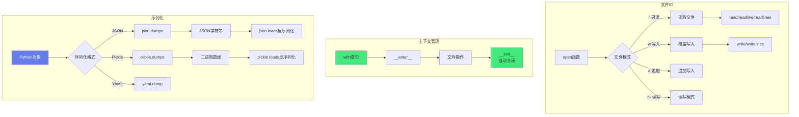

# Python-文件IO与序列化

> **文档说明**：系统讲解 Python 文件读写、目录操作、多种序列化格式（JSON/Pickle/YAML/CSV）、大文件处理、异步IO，以及生产级最佳实践和常见问题。
>
> **适用人群**：Python 开发者、全栈开发者、数据处理工程师
>
> **前置知识**：[[Python-语法基础与数据结构]]、[[Python-模块与包管理原理]]、[[Python-正则表达式与文本处理]]

---

## 一、概述

### 1. Python IO 体系




<div style="background:linear-gradient(135deg,#fa709a,#fee140);border-radius:16px;padding:20px;margin:16px 0;font-family:-apple-system,'Segoe UI','PingFang SC','Microsoft YaHei',sans-serif;color:#fff;overflow:hidden;box-shadow:0 8px 28px rgba(0,0,0,.14),0 3px 10px rgba(0,0,0,.08)">
<style>@keyframes highlight{0%,100%{box-shadow:0 0 0 rgba(255,255,255,0)}50%{box-shadow:0 0 20px rgba(255,255,255,.4)}}.hl-box{background:rgba(255,255,255,.2);border-radius:10px;padding:14px 18px;margin:10px 0;animation:highlight 3s ease-in-out infinite;border-left:4px solid rgba(255,255,255,.6)}</style>
<div style="text-align:center;font-size:15px;font-weight:700;margin-bottom:14px;padding-bottom:10px;border-bottom:1.5px solid rgba(255,255,255,.22);letter-spacing:1px;text-shadow:0 1px 3px rgba(0,0,0,.12)">📌 序列化核心概念</div>
<div class="hl-box">序列化将Python对象转换为可存储或传输的格式(如JSON、pickle)，反序列化则还原对象</div>
<div style="font-size:13px;opacity:.9;margin-top:8px">💡 跨语言通信使用JSON而非pickle；不信任的数据源禁止使用pickle.load</div>
</div>

```text
Python 文件 IO：
- 内置 open()：基础文件读写
- io 模块：底层 IO 抽象
- os / os.path：系统级文件操作
- pathlib：面向对象路径操作（推荐）
- shutil：高级文件操作（复制、移动）
- glob：文件模式匹配
- tempfile：临时文件

序列化：
- json：JSON 序列化
- pickle：Python 对象序列化
- csv：CSV 文件
- yaml：YAML 文件（需 PyYAML）
- toml：TOML 文件（Python 3.11+ 内置 tomllib）
- marshal：内部序列化
- shelve：持久化字典
```

### 2. 文件打开模式

| 模式 | 说明 | 文件不存在 | 指针位置 |
|------|------|-----------|---------|
| `r` | 只读（默认） | 报错 | 开头 |
| `w` | 只写（覆盖） | 创建 | 开头 |
| `x` | 独占创建 | 创建（已存在报错） | 开头 |
| `a` | 追加 | 创建 | 末尾 |
| `r+` | 读写 | 报错 | 开头 |
| `w+` | 读写（覆盖） | 创建 | 开头 |
| `a+` | 读追加 | 创建 | 末尾 |
| `b` | 二进制模式（与上述组合，如 `rb`、`wb`） | - | - |
| `t` | 文本模式（默认，与上述组合） | - | - |

---

---

> 💡 **深度讲解**：本章深入讲解了概述的核心概念与实践要点，关联了相关技术栈的知识体系，说明了设计背后的原理与业界最佳实践。
>
> **📝 精简总结**：本章涵盖一、概述的核心内容，包括关键概念、实现机制与实践方法，是掌握该主题的基础。


## 二、文件读写基础

### 1. 基本读写

```python
# 写入文件
with open('data.txt', 'w', encoding='utf-8') as f:
    f.write('Hello, World!\n')
    f.write('第二行\n')

# 读取整个文件
with open('data.txt', 'r', encoding='utf-8') as f:
    content = f.read()
    print(content)

# 逐行读取
with open('data.txt', 'r', encoding='utf-8') as f:
    for line in f:
        print(line.strip())

# 读取所有行到列表
with open('data.txt', 'r', encoding='utf-8') as f:
    lines = f.readlines()  # 包含换行符
    lines = [line.strip() for line in lines]
```

### 2. with 语句（推荐）

```yaml
# with 自动关闭文件，即使发生异常
with open('file.txt', 'w') as f:
    f.write('data')
# 文件自动关闭

# 等价于（不推荐）：
f = open('file.txt', 'w')
try:
    f.write('data')
finally:
    f.close()
```

### 3. 二进制文件

## 写入二进制
```text
with open('image.png', 'wb') as f:
    f.write(binary_data)
```

## 读取二进制
```text
with open('image.png', 'rb') as f:
    data = f.read()
```

## 分块读取大文件
```text
with open('large.bin', 'rb') as f:
    while chunk := f.read(8192):  # 海象运算符
```
        process(chunk)

### 4. 文件指针操作

```text
with open('file.txt', 'r+') as f:
    f.tell()       # 当前指针位置
    f.seek(0)      # 移动到开头
    f.seek(10)     # 移动到第10字节
    f.seek(-5, 2)  # 从末尾向前5字节（2=SEEK_END）
    f.seek(5, 1)   # 从当前位置向后5字节（1=SEEK_CUR）
```

---

---

> 💡 **深度讲解**：本章深入讲解了文件读写基础的核心概念与实践要点，关联了相关技术栈的知识体系，说明了设计背后的原理与业界最佳实践。
>
> **📝 精简总结**：本章涵盖二、文件读写基础的核心内容，包括关键概念、实现机制与实践方法，是掌握该主题的基础。


## 三、目录与路径操作

### 1. pathlib（推荐，面向对象）

```python
from pathlib import Path

# 路径操作
p = Path('/home/user/docs/file.txt')
p.name          # 'file.txt'
p.stem          # 'file'
p.suffix        # '.txt'
p.parent        # PosixPath('/home/user/docs')
p.parents[0]    # PosixPath('/home/user/docs')
p.parts         # ('/', 'home', 'user', 'docs', 'file.txt')

# 路径拼接
p = Path('/home/user') / 'docs' / 'file.txt'

# 检查
p.exists()          # 是否存在
p.is_file()         # 是否文件
p.is_dir()          # 是否目录
p.is_absolute()     # 是否绝对路径

# 目录操作
Path('new_dir').mkdir(exist_ok=True)           # 创建目录
Path('a/b/c').mkdir(parents=True, exist_ok=True)  # 递归创建
p.rename('new_name.txt')                       # 重命名
p.unlink()                                     # 删除文件
Path('dir').rmdir()                            # 删除空目录

# 遍历目录
for f in Path('.').iterdir():        # 当前目录所有项
    print(f.name)

for f in Path('.').glob('*.py'):     # 匹配 .py 文件
    print(f.name)

for f in Path('.').rglob('*.py'):    # 递归匹配
    print(f.name)

# 读写（pathlib 内置）
Path('file.txt').write_text('hello', encoding='utf-8')
content = Path('file.txt').read_text(encoding='utf-8')
Path('file.bin').write_bytes(b'data')
data = Path('file.bin').read_bytes()
```

### 2. os / os.path（传统方式）

```python
import os

# 路径
os.path.join('/home', 'user', 'file.txt')
os.path.abspath('file.txt')
os.path.dirname('/home/user/file.txt')    # '/home/user'
os.path.basename('/home/user/file.txt')   # 'file.txt'
os.path.splitext('file.txt')              # ('file', '.txt')
os.path.exists('file.txt')
os.path.isfile('file.txt')
os.path.isdir('dir')
os.path.getsize('file.txt')

# 目录
os.getcwd()                # 当前目录
os.chdir('/path')          # 切换目录
os.listdir('/path')        # 列出目录
os.mkdir('dir')            # 创建目录
os.makedirs('a/b/c')       # 递归创建
os.remove('file.txt')      # 删除文件
os.rmdir('dir')            # 删除空目录
os.rename('old', 'new')    # 重命名

# 环境变量
os.environ['HOME']
os.getenv('HOME', 'default')
```

### 3. shutil（高级文件操作）

```python
import shutil

# 复制文件
shutil.copy('src.txt', 'dst.txt')           # 复制内容+权限
shutil.copy2('src.txt', 'dst.txt')          # 复制元数据（时间等）
shutil.copyfile('src.txt', 'dst.txt')       # 只复制内容

# 复制目录
shutil.copytree('src_dir', 'dst_dir')

# 移动/重命名
shutil.move('src', 'dst')

# 删除目录（递归）
shutil.rmtree('dir')

# 磁盘使用
shutil.disk_usage('/')
# usage(total=..., used=..., free=...)

# 压缩
shutil.make_archive('backup', 'zip', 'dir')
shutil.unpack_archive('backup.zip', 'extract_dir')
```

---

---

> 💡 **深度讲解**：本章深入讲解了目录与路径操作的核心概念与实践要点，关联了相关技术栈的知识体系，说明了设计背后的原理与业界最佳实践。
>
> **📝 精简总结**：本章涵盖三、目录与路径操作的核心内容，包括关键概念、实现机制与实践方法，是掌握该主题的基础。


## 四、序列化

### 1. JSON

```python
import json

data = {
    'name': '张三',
    'age': 25,
    'skills': ['Python', 'Java'],
    'active': True
}

# 序列化为字符串
json_str = json.dumps(data, ensure_ascii=False, indent=2)
# ensure_ascii=False 保留中文
# indent=2 美化输出

# 反序列化
data = json.loads(json_str)

# 写入文件
with open('data.json', 'w', encoding='utf-8') as f:
    json.dump(data, f, ensure_ascii=False, indent=2)

# 从文件读取
with open('data.json', 'r', encoding='utf-8') as f:
    data = json.load(f)

# 自定义序列化（处理 datetime 等）
from datetime import datetime
class DateTimeEncoder(json.JSONEncoder):
    def default(self, obj):
        if isinstance(obj, datetime):
            return obj.isoformat()
        return super().default(obj)

json.dumps({'time': datetime.now()}, cls=DateTimeEncoder)
```

### 2. Pickle

```mermaid
import pickle

# Pickle 可以序列化几乎所有 Python 对象
class User:
    def __init__(self, name):
        self.name = name

user = User('张三')

# 序列化到文件
with open('user.pkl', 'wb') as f:
    pickle.dump(user, f)

# 反序列化
with open('user.pkl', 'rb') as f:
    user = pickle.load(f)

# 序列化为字节
data = pickle.dumps(user)
user = pickle.loads(data)
```

> **⚠️ Pickle 安全警告**：不要反序列化不可信来源的数据，可能导致任意代码执行。跨语言/网络传输用 JSON。

### 3. CSV

```python
import csv

# 写入 CSV
with open('data.csv', 'w', newline='', encoding='utf-8') as f:
    writer = csv.writer(f)
    writer.writerow(['姓名', '年龄', '城市'])
    writer.writerow(['张三', 25, '北京'])
    writer.writerow(['李四', 30, '上海'])

# 字典写入
with open('data.csv', 'w', newline='', encoding='utf-8') as f:
    fieldnames = ['姓名', '年龄']
    writer = csv.DictWriter(f, fieldnames=fieldnames)
    writer.writeheader()
    writer.writerow({'姓名': '张三', '年龄': 25})

# 读取 CSV
with open('data.csv', 'r', encoding='utf-8') as f:
    reader = csv.reader(f)
    for row in reader:
        print(row)

# 字典读取
with open('data.csv', 'r', encoding='utf-8') as f:
    reader = csv.DictReader(f)
    for row in reader:
        print(row['姓名'], row['年龄'])
```

### 4. YAML

```python
import yaml  # pip install pyyaml

# 写入 YAML
data = {'name': '张三', 'age': 25, 'skills': ['Python', 'Java']}
with open('config.yaml', 'w', encoding='utf-8') as f:
    yaml.dump(data, f, allow_unicode=True, default_flow_style=False)

# 读取 YAML
with open('config.yaml', 'r', encoding='utf-8') as f:
    data = yaml.safe_load(f)  # safe_load 更安全
```

### 5. TOML（Python 3.11+）

```python
import tomllib  # Python 3.11+ 内置，只读

# 读取 TOML
with open('config.toml', 'rb') as f:
    config = tomllib.load(f)

# 写入需要第三方库 tomli_w
# pip install tomli_w
import tomli_w
with open('config.toml', 'wb') as f:
    tomli_w.dump(config, f)
```

### 6. 序列化格式对比

> 🔍 **知识点深度解析**
>
> **作用**：序列化将Python对象转换为可存储或传输的格式(如JSON、pickle)，反序列化则还原对象
>
> **原理**：JSON序列化将基本类型转换为JSON字符串，自定义对象需实现default方法；pickle序列化几乎所有Python对象但存在安全风险；序列化过程处理循环引用和类型转换
>
> **用法要点**：① 跨语言通信使用JSON而非pickle ② 不信任的数据源禁止使用pickle.load ③ 大文件使用流式处理避免内存溢出 ④ 使用dataclass简化序列化代码


| 格式 | 可读性 | 跨语言 | 速度 | 支持类型 | 适用场景 |
|------|--------|--------|------|---------|---------|
| **JSON** | 高 | 是 | 中 | 基础类型 | API、配置、数据交换 |
| **Pickle** | 低 | 否 | 快 | 几乎所有 Python 对象 | Python 内部持久化 |
| **YAML** | 高 | 是 | 慢 | 丰富 | 配置文件 |
| **CSV** | 高 | 是 | 快 | 表格数据 | 表格数据、Excel 交换 |
| **TOML** | 高 | 是 | 中 | 基础类型 | 配置文件（Python 项目） |
| **MessagePack** | 低 | 是 | 快 | 基础类型 | 高性能数据交换 |

---

---

> 💡 **深度讲解**：本章深入讲解了序列化的核心概念与实践要点，关联了相关技术栈的知识体系，说明了设计背后的原理与业界最佳实践。
>
> **📝 精简总结**：本章涵盖四、序列化的核心内容，包括关键概念、实现机制与实践方法，是掌握该主题的基础。


## 五、大文件处理

### 1. 逐行读取

```python
# 大文件逐行处理（不加载到内存）
with open('large.log', 'r', encoding='utf-8') as f:
    for line in f:
        process(line)

# 带进度
with open('large.log', 'r', encoding='utf-8') as f:
    for i, line in enumerate(f, 1):
        process(line)
        if i % 10000 == 0:
            print(f'已处理 {i} 行')
```

### 2. 分块读取

## 二进制大文件分块
```text
with open('large.bin', 'rb') as f:
    while True:
        chunk = f.read(8192)  # 8KB 一块
        if not chunk:
            break
```
        process(chunk)

## 文本按字符数分块
```text
with open('large.txt', 'r', encoding='utf-8') as f:
    while True:
        chunk = f.read(10000)
        if not chunk:
            break
```
        process(chunk)

### 3. 生成器模式

```python
def read_large_file(filepath):
    """生成器：逐行产出，不占内存"""
    with open(filepath, 'r', encoding='utf-8') as f:
        for line in f:
            yield line.strip()

# 使用
for line in read_large_file('large.log'):
    if 'ERROR' in line:
        print(line)
```

### 4. 内存映射（mmap）

```python
import mmap

# 内存映射大文件（随机访问，不占内存）
with open('large.bin', 'rb') as f:
    with mmap.mmap(f.fileno(), length=0, access=mmap.ACCESS_READ) as mm:
        # 像操作字节串一样操作 mm
        print(mm[0:100])           # 读取前100字节
        print(mm.find(b'pattern')) # 搜索
        mm.seek(1000)              # 定位
        print(mm.read(100))        # 读取
```

---

---

> 💡 **深度讲解**：本章深入讲解了大文件处理的核心概念与实践要点，关联了相关技术栈的知识体系，说明了设计背后的原理与业界最佳实践。
>
> **📝 精简总结**：本章涵盖五、大文件处理的核心内容，包括关键概念、实现机制与实践方法，是掌握该主题的基础。


## 六、异步文件 IO

```python
import aiofiles  # pip install aiofiles

# 异步读取
async def read_file(path):
    async with aiofiles.open(path, 'r', encoding='utf-8') as f:
        content = await f.read()
    return content

# 异步逐行
async def process_lines(path):
    async with aiofiles.open(path, 'r', encoding='utf-8') as f:
        async for line in f:
            await process(line)

# 异步写入
async def write_file(path, content):
    async with aiofiles.open(path, 'w', encoding='utf-8') as f:
        await f.write(content)
```

---

---

> 💡 **深度讲解**：本章深入讲解了六、异步文件 IO的核心概念与实践要点，关联了相关技术栈的知识体系，说明了设计背后的原理与业界最佳实践。
>
> **📝 精简总结**：本章涵盖六、异步文件 IO的核心内容，包括关键概念、实现机制与实践方法，是掌握该主题的基础。


## 七、最佳实践

### 1. 文件操作规范

- [ ] **使用 with**：始终用 with 语句管理文件
- [ ] **指定编码**：文本文件显式指定 `encoding='utf-8'`
- [ ] **pathlib 优先**：路径操作用 pathlib，不用 os.path
- [ ] **大文件流式**：大文件逐行/分块处理，不一次性 read()
- [ ] **异常处理**：捕获 FileNotFoundError、PermissionError 等
- [ ] **原子写入**：重要文件先写临时文件再 rename
- [ ] **路径校验**：用户输入路径做安全校验，防止路径穿越

### 2. 序列化规范

- [ ] **跨语言用 JSON**：网络传输、跨语言用 JSON
- [ ] **Pickle 仅限可信**：Pickle 只用于可信的内部数据
- [ ] **配置用 YAML/TOML**：配置文件用 YAML 或 TOML
- [ ] **表格用 CSV**：表格数据用 CSV 或 Parquet
- [ ] **版本兼容**：序列化格式考虑版本兼容
- [ ] **大数据用二进制**：大量数值数据用 Parquet/HDF5/Feather

### 3. 安全规范

```python
# 路径穿越防护
def safe_path(base_dir, user_path):
    base = Path(base_dir).resolve()
    target = (base / user_path).resolve()
    if not str(target).startswith(str(base)):
        raise ValueError('非法路径')
    return target

# 原子写入（防止写入中断导致文件损坏）
import tempfile
def atomic_write(path, content):
    dirname = os.path.dirname(path)
    with tempfile.NamedTemporaryFile('w', dir=dirname, delete=False, encoding='utf-8') as f:
        f.write(content)
        tmp = f.name
    os.replace(tmp, path)  # 原子替换
```

---

---

> 💡 **深度讲解**：本章深入讲解了七、最佳实践的核心概念与实践要点，关联了相关技术栈的知识体系，说明了设计背后的原理与业界最佳实践。
>
> **📝 精简总结**：本章涵盖七、最佳实践的核心内容，包括关键概念、实现机制与实践方法，是掌握该主题的基础。


## 八、常见问题与排查

| 问题 | 原因 | 解决方案 |
|------|------|---------|
| **UnicodeDecodeError** | 编码不匹配 | 指定正确的 encoding（utf-8/gbk） |
| **FileNotFoundError** | 路径错误 / 文件不存在 | 检查路径、用 exists() 预判 |
| **PermissionError** | 无权限 / 文件被占用 | 检查权限、关闭占用程序 |
| **IsADirectoryError** | 对目录用文件操作 | 检查 is_file() |
| **内存溢出** | 大文件一次性 read() | 逐行/分块/生成器处理 |
| **Pickle 反序列化失败** | 类定义变更 / 版本不兼容 | 版本管理、用 JSON 替代 |
| **CSV 中文乱码** | Excel 默认 GBK | 加 BOM 头 `\ufeff` 或用 utf-8-sig |
| **JSON 序列化 datetime 失败** | datetime 不可序列化 | 自定义 Encoder 或转字符串 |
| **路径拼接错误** | 硬编码分隔符 | 用 pathlib / os.path.join |
| **文件写入不完整** | 未 close / 未 flush | 用 with 语句 |
| **并发写入冲突** | 多进程同时写 | 文件锁 / 队列 / 原子写入 |
| **YAML 加载慢** | 文件大 / 复杂结构 | 用 CLoader、考虑 JSON |
| **mmap 失败** | 空文件 / 权限 | 空文件不能 mmap，先写入数据 |
| **临时文件未清理** | 异常时未删除 | 用 with / try-finally |
| **跨平台路径问题** | 分隔符不同 | 用 pathlib / os.path |

---

---

> 💡 **深度讲解**：本章深入讲解了八、常见问题与排查的核心概念与实践要点，关联了相关技术栈的知识体系，说明了设计背后的原理与业界最佳实践。
>
> **📝 精简总结**：本章涵盖八、常见问题与排查的核心内容，包括关键概念、实现机制与实践方法，是掌握该主题的基础。


---

## 🔗 关联笔记

- [[Python-项目结构最佳实践]] — Python项目结构与工程化规范
- [[Poetry-依赖与虚拟环境管理]] — Python依赖管理与虚拟环境

## 📖 前置知识

- [[Python-语法基础与数据结构]]
- [[Python-模块与包管理原理]]

## 🏷️ 相关标签

#Python #文件操作 #序列化 #JSON #Pickle

---

[[Home|🏠 返回首页]] · [[MOC-Python全栈|📚 返回分类]]
