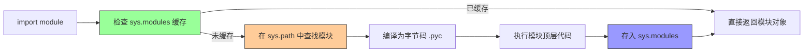

# Python-模块与包管理原理

> **文档说明**：系统讲解 Python 模块与包的底层原理，包括 import 机制、包结构、虚拟环境、包管理工具（pip/poetry/uv）、pyproject.toml 配置、打包发布、依赖管理，以及生产级最佳实践和常见问题排查。
>
> **适用人群**：Python 开发者、全栈开发者、AI 应用开发者、需要构建 Python 项目的开发者
>
> **前置知识**：[[Python-语法基础与数据结构]]、[[Python-面向对象编程]]、[[Python全栈学习路线图]]

---

## 一、概述

### 1. 模块与包的概念

> 🔍 **知识点深度解析**
>
> **作用**：Python import机制负责模块查找、加载和缓存，是代码组织和复用的基础，支持绝对导入和相对导入
>
> **原理**：import触发sys.modules缓存查找→sys.path路径搜索→找到模块文件→编译字节码→执行模块代码→绑定命名空间，包通过__init__.py定义公共API
>
> **用法要点**：① 理解sys.path的组成和搜索顺序 ② 避免循环导入通过重构或延迟导入 ③ 使用__init__.py控制包的公共API ④ 虚拟环境隔离项目依赖


<div style="background:linear-gradient(135deg,#fa709a,#fee140);border-radius:16px;padding:20px;margin:16px 0;font-family:-apple-system,'Segoe UI','PingFang SC','Microsoft YaHei',sans-serif;color:#fff;overflow:hidden;box-shadow:0 8px 28px rgba(0,0,0,.14),0 3px 10px rgba(0,0,0,.08)">
<style>@keyframes highlight{0%,100%{box-shadow:0 0 0 rgba(255,255,255,0)}50%{box-shadow:0 0 20px rgba(255,255,255,.4)}}.hl-box{background:rgba(255,255,255,.2);border-radius:10px;padding:14px 18px;margin:10px 0;animation:highlight 3s ease-in-out infinite;border-left:4px solid rgba(255,255,255,.6)}</style>
<div style="text-align:center;font-size:15px;font-weight:700;margin-bottom:14px;padding-bottom:10px;border-bottom:1.5px solid rgba(255,255,255,.22);letter-spacing:1px;text-shadow:0 1px 3px rgba(0,0,0,.12)">📌 import机制核心概念</div>
<div class="hl-box">Python的import机制负责模块查找、加载和缓存，是代码组织和复用的基础</div>
<div style="font-size:13px;opacity:.9;margin-top:8px">💡 理解sys.path的组成和搜索顺序；避免循环导入通过重构或延迟导入</div>
</div>

| 概念 | 说明 | 示例 |
|------|------|------|
| **模块（Module）** | 单个 `.py` 文件，包含函数、类、变量 | `utils.py` |
| **包（Package）** | 包含多个模块的目录，需有 `__init__.py` | `my_package/` |
| **命名空间包** | 无 `__init__.py` 的包，可分散在多个目录 | PEP 420 |
| **第三方包** | 从 PyPI 安装的包 | `requests`、`numpy` |
| **标准库** | Python 内置的模块 | `os`、`sys`、`json` |

### 2. 为什么需要包管理

- [ ] **代码复用**：将功能封装为模块/包，跨项目复用
- [ ] **依赖管理**：明确项目依赖的第三方包及其版本
- [ ] **环境隔离**：不同项目使用不同的依赖版本，互不干扰
- [ ] **可复现构建**：确保开发、测试、生产环境一致
- [ ] **分发发布**：将自己的包发布到 PyPI 供他人使用

---

---

> 💡 **深度讲解**：本章深入讲解了概述的核心概念与实践要点，关联了相关技术栈的知识体系，说明了设计背后的原理与业界最佳实践。
>
> **📝 精简总结**：本章涵盖一、概述的核心内容，包括关键概念、实现机制与实践方法，是掌握该主题的基础。


## 二、import 机制原理

### 1. import 执行流程



### 2. sys.path 搜索路径

```python
import sys
print(sys.path)
# [
#   '',                          # 当前脚本所在目录
#   '/usr/lib/python3.12',       # 标准库目录
#   '/usr/lib/python3.12/lib-dynload',
#   '/path/to/venv/lib/python3.12/site-packages',  # 第三方包
# ]
```

| 路径来源 | 说明 | 优先级 |
|---------|------|--------|
| `''` | 当前运行脚本的目录 | 最高 |
| `PYTHONPATH` | 环境变量指定的路径 | 高 |
| 标准库目录 | Python 安装目录的 Lib | 中 |
| `.pth` 文件 | site-packages 下的 .pth 文件 | 中 |
| `site-packages` | 第三方包安装目录 | 低 |

### 3. sys.modules 缓存

```python
import sys

# 查看已导入的模块
print(sys.modules.keys())

# 模块只被导入一次，后续 import 返回缓存的对象
import math
import math  # 不会重复执行，返回缓存

# 强制重新加载（开发调试用）
import importlib
importlib.reload(math)
```

### 4. 字节码缓存（.pyc）

```text
__pycache__/
├── utils.cpython-312.pyc   # Python 3.12 编译的字节码
└── utils.cpython-311.pyc   # Python 3.11 编译的字节码

.pyc 文件作用：
- 加速模块加载（跳过编译步骤）
- 按 Python 版本区分（cpython-312）
- 源文件修改后自动重新编译
- 不影响运行结果，仅影响加载速度
```

---

---

> 💡 **深度讲解**：本章深入讲解了import 机制原理的核心概念与实践要点，关联了相关技术栈的知识体系，说明了设计背后的原理与业界最佳实践。
>
> **📝 精简总结**：本章涵盖二、import 机制原理的核心内容，包括关键概念、实现机制与实践方法，是掌握该主题的基础。


## 三、包的结构

### 1. 常规包结构

```mermaid
my_package/
├── __init__.py          # 包初始化文件（标识这是一个包）
├── module_a.py          # 子模块
├── module_b.py
└── sub_package/         # 子包
    ├── __init__.py
    └── module_c.py
```

### 2. __init__.py 的作用

```mermaid
# my_package/__init__.py

# 1. 包级别的初始化代码
print("my_package 被导入")

# 2. 控制 from package import * 的导出内容
__all__ = ["module_a", "ModuleA", "helper_function"]

# 3. 便捷导入（用户可直接 from my_package import ModuleA）
from .module_a import ModuleA
from .module_b import helper_function

# 4. 包版本
__version__ = "1.0.0"
__author__ = "Your Name"
```

### 3. 相对导入

```python
# my_package/sub_package/module_c.py

# 绝对导入（推荐，清晰明确）
from my_package.module_a import ModuleA
from my_package.sub_package import module_c

# 相对导入（包内部使用）
from . import module_c           # 导入当前包的 module_c
from .. import module_a          # 导入父包的 module_a
from ..module_b import helper    # 从父包的 module_b 导入

# 相对导入的点号含义：
# .   当前包
# ..  父包
# ... 祖父包
```

> **注意**：相对导入只能在包内部使用，直接运行脚本（`python module_c.py`）时不能用相对导入，需要用 `python -m my_package.sub_package.module_c`。

### 4. 命名空间包（PEP 420）

```mermaid
# 无 __init__.py 的目录自动成为命名空间包
# 可以分散在多个 sys.path 目录中

# 目录1: /path1/my_namespace/module_a.py
# 目录2: /path2/my_namespace/module_b.py
# 两者合并为同一个命名空间包 my_namespace

import sys
sys.path.extend(['/path1', '/path2'])

import my_namespace.module_a  # 从 /path1 导入
import my_namespace.module_b  # 从 /path2 导入
```

---

---

> 💡 **深度讲解**：本章深入讲解了包的结构的核心概念与实践要点，关联了相关技术栈的知识体系，说明了设计背后的原理与业界最佳实践。
>
> **📝 精简总结**：本章涵盖三、包的结构的核心内容，包括关键概念、实现机制与实践方法，是掌握该主题的基础。


## 四、虚拟环境

### 1. 为什么需要虚拟环境

```text
问题场景：
项目A 需要 requests==2.28.0
项目B 需要 requests==2.31.0
全局安装只能有一个版本 → 冲突！

解决方案：
每个项目独立的虚拟环境，各自安装依赖版本
```

### 2. venv（官方推荐）

```python
# 创建虚拟环境
python -m venv .venv

# 激活虚拟环境
# Windows (PowerShell)
.venv\Scripts\Activate.ps1
# Windows (CMD)
.venv\Scripts\activate.bat
# macOS/Linux
source .venv/bin/activate

# 激活后命令行前缀显示 (.venv)
# 此时 pip/python 都指向虚拟环境

# 退出虚拟环境
deactivate
```

### 3. conda（数据科学常用）

```python
# 创建环境
conda create -n myenv python=3.12

# 激活环境
conda activate myenv

# 安装包
conda install numpy pandas
# 或使用 pip
pip install requests

# 查看环境列表
conda env list

# 导出环境
conda env export > environment.yml

# 从文件创建环境
conda env create -f environment.yml

# 删除环境
conda remove -n myenv --all
```

### 4. 虚拟环境对比

| 工具 | 优点 | 缺点 | 适用场景 |
|------|------|------|---------|
| **venv** | Python 官方、轻量、无需安装 | 仅管理 Python 包 | 通用 Python 项目 |
| **conda** | 管理 Python+系统依赖、跨平台 | 较重、包可能不全 | 数据科学、机器学习 |
| **poetry** | 依赖+打包+发布一体化 | 学习曲线稍陡 | 库开发、现代项目 |
| **pipenv** | Pipfile 管理、虚拟环境集成 | 维护活跃度下降 | 中小型项目 |
| **uv** | 极快、Rust 编写、兼容 pip | 较新 | 追求性能的项目 |

---

---

> 💡 **深度讲解**：本章深入讲解了虚拟环境的核心概念与实践要点，关联了相关技术栈的知识体系，说明了设计背后的原理与业界最佳实践。
>
> **📝 精简总结**：本章涵盖四、虚拟环境的核心内容，包括关键概念、实现机制与实践方法，是掌握该主题的基础。


## 五、包管理工具

### 1. pip 基础命令

```python
# 安装包
pip install requests
pip install requests==2.31.0
pip install "requests>=2.28.0,<3.0.0"
pip install requests[security]  # 安装额外依赖

# 从文件安装
pip install -r requirements.txt

# 从 Git 安装
pip install git+https://github.com/user/repo.git
pip install git+https://github.com/user/repo.git@v1.0.0  # 指定标签

# 从本地安装
pip install ./my_package
pip install ./my_package-1.0.0-py3-none-any.whl

# 升级包
pip install --upgrade requests

# 卸载包
pip uninstall requests

# 查看已安装包
pip list
pip show requests

# 导出依赖
pip freeze > requirements.txt

# 检查依赖冲突
pip check
```

### 2. requirements.txt 规范

## 生产依赖
```text
requests==2.31.0
flask==3.0.0
sqlalchemy==2.0.23
```

## 开发依赖（单独文件 requirements-dev.txt）
```text
pytest==7.4.0
black==23.10.0
mypy==1.6.1
```

## 从基础文件继承（-r）
-r requirements.txt
pytest==7.4.0

### 3. Poetry（现代包管理）

```python
# 安装
pip install poetry
# 或官方安装脚本
curl -sSL https://install.python-poetry.org | python3 -

# 初始化项目
poetry new my_project
cd my_project

# 添加依赖
poetry add requests
poetry add --dev pytest  # 开发依赖
poetry add "requests>=2.28.0,<3.0.0"

# 移除依赖
poetry remove requests

# 安装依赖（根据 pyproject.toml/poetry.lock）
poetry install

# 运行命令（在虚拟环境中）
poetry run python app.py
poetry run pytest

# 激活虚拟环境
poetry shell

# 查看依赖树
poetry show --tree

# 打包
poetry build

# 发布到 PyPI
poetry publish
```

### 4. uv（极速包管理）

```python
# 安装
pip install uv
# 或
curl -LsSf https://astral.sh/uv/install.sh | sh

# 创建虚拟环境
uv venv

# 安装包（比 pip 快 10-100 倍）
uv pip install requests
uv pip install -r requirements.txt

# 同步依赖
uv sync

# 添加依赖到 pyproject.toml
uv add requests
uv add --dev pytest

# 运行
uv run python app.py
```

---

---

> 💡 **深度讲解**：本章深入讲解了包管理工具的核心概念与实践要点，关联了相关技术栈的知识体系，说明了设计背后的原理与业界最佳实践。
>
> **📝 精简总结**：本章涵盖五、包管理工具的核心内容，包括关键概念、实现机制与实践方法，是掌握该主题的基础。


## 六、pyproject.toml 配置

### 1. 现代 Python 项目配置

```json
[build-system]
requires = ["setuptools>=68.0", "wheel"]
build-backend = "setuptools.build_meta"

[project]
name = "my-package"
version = "1.0.0"
description = "一个示例 Python 包"
readme = "README.md"
requires-python = ">=3.9"
license = { text = "MIT" }
authors = [
    { name = "Your Name", email = "you@example.com" }
]
keywords = ["example", "package"]
classifiers = [
    "Development Status :: 4 - Beta",
    "Intended Audience :: Developers",
    "License :: OSI Approved :: MIT License",
    "Programming Language :: Python :: 3",
    "Programming Language :: Python :: 3.9",
    "Programming Language :: Python :: 3.10",
    "Programming Language :: Python :: 3.11",
    "Programming Language :: Python :: 3.12",
]
dependencies = [
    "requests>=2.28.0",
    "pydantic>=2.0.0",
]

[project.optional-dependencies]
dev = [
    "pytest>=7.0.0",
    "black>=23.0.0",
    "mypy>=1.0.0",
]
docs = [
    "mkdocs>=1.5.0",
]

[project.urls]
Homepage = "https://github.com/user/my-package"
Documentation = "https://my-package.readthedocs.io"
Repository = "https://github.com/user/my-package"
Issues = "https://github.com/user/my-package/issues"

[project.scripts]
my-command = "my_package.cli:main"

[tool.setuptools.packages.find]
where = ["src"]
include = ["my_package*"]

[tool.pytest.ini_options]
testpaths = ["tests"]
python_files = ["test_*.py"]
addopts = "-v --tb=short"

[tool.black]
line-length = 100
target-version = ["py39", "py310", "py311", "py312"]

[tool.mypy]
python_version = "3.9"
strict = true
warn_return_any = true
warn_unused_configs = true
```

### 2. 项目结构（src layout）

```mermaid
my-package/
├── src/
│   └── my_package/
│       ├── __init__.py
│       ├── __main__.py      # python -m my_package 入口
│       ├── cli.py
│       ├── core.py
│       └── utils.py
├── tests/
│   ├── __init__.py
│   ├── test_core.py
│   └── test_utils.py
├── docs/
├── pyproject.toml
├── README.md
├── LICENSE
├── .gitignore
└── CHANGELOG.md
```

---

---

> 💡 **深度讲解**：本章深入讲解了六、pyproject.toml 配置的核心概念与实践要点，关联了相关技术栈的知识体系，说明了设计背后的原理与业界最佳实践。
>
> **📝 精简总结**：本章涵盖六、pyproject.toml 配置的核心内容，包括关键概念、实现机制与实践方法，是掌握该主题的基础。


## 七、打包与发布

### 1. 构建包

```python
# 安装构建工具
pip install build

# 构建（生成 sdist 和 wheel）
python -m build

# 产物在 dist/ 目录
# dist/
# ├── my_package-1.0.0.tar.gz        # 源码包（sdist）
# └── my_package-1.0.0-py3-none-any.whl  # 二进制包（wheel）
```

### 2. 发布到 PyPI

```python
# 安装 twine
pip install twine

# 检查包
twine check dist/*

# 上传到 TestPyPI（测试）
twine upload --repository testpypi dist/*

# 上传到 PyPI（正式）
twine upload dist/*

# 使用 API Token 认证
# ~/.pypirc
[pypi]
  username = __token__
  password = pypi-xxxxxxxxxxxxxxxx
```

### 3. wheel vs sdist

| 格式 | 说明 | 优点 | 缺点 |
|------|------|------|------|
| **wheel** | 预编译的二进制包 | 安装快、无需编译、纯 Python 跨平台 | 含 C 扩展时需多平台构建 |
| **sdist** | 源码包 | 通用、可审查 | 安装慢、需编译环境 |

> **最佳实践**：同时发布 wheel 和 sdist，wheel 优先安装。

---

---

> 💡 **深度讲解**：本章深入讲解了七、打包与发布的核心概念与实践要点，关联了相关技术栈的知识体系，说明了设计背后的原理与业界最佳实践。
>
> **📝 精简总结**：本章涵盖七、打包与发布的核心内容，包括关键概念、实现机制与实践方法，是掌握该主题的基础。


## 八、依赖管理最佳实践

### 1. 版本锁定

```python
开发环境：
pyproject.toml  → 声明依赖范围（如 requests>=2.28.0,<3.0.0）
poetry.lock     → 锁定精确版本（如 requests==2.31.0）

生产部署：
pip install -r requirements.txt  → 使用锁定的精确版本
```

### 2. 依赖分层

| 层级 | 说明 | 示例 |
|------|------|------|
| **核心依赖** | 运行必需 | requests, flask |
| **可选依赖** | 特定功能需要 | requests[security] |
| **开发依赖** | 开发/测试需要 | pytest, black, mypy |
| **文档依赖** | 文档构建 | mkdocs, sphinx |

### 3. 安全检查

```python
# 检查已知漏洞
pip install safety
safety check

# 使用 pip-audit
pip install pip-audit
pip-audit

# Poetry 安全检查
poetry run safety check
```

### 4. 依赖更新

## 查看过时的包
```bash
pip list --outdated

# Poetry 更新
poetry update
poetry update requests  # 更新指定包
```

## 使用 dependabot（GitHub）自动更新

---

---

> 💡 **深度讲解**：本章深入讲解了八、依赖管理最佳实践的核心概念与实践要点，关联了相关技术栈的知识体系，说明了设计背后的原理与业界最佳实践。
>
> **📝 精简总结**：本章涵盖八、依赖管理最佳实践的核心内容，包括关键概念、实现机制与实践方法，是掌握该主题的基础。


## 九、常见问题与排查

| 问题 | 原因 | 解决方案 |
|------|------|---------|
| **ModuleNotFoundError** | 模块不在 sys.path / 未安装 | 检查安装、PYTHONPATH、工作目录 |
| **ImportError: attempted relative import** | 直接运行脚本使用相对导入 | 用 `python -m package.module` 运行 |
| **循环导入** | A 导入 B，B 导入 A | 重构代码、延迟导入、合并模块 |
| **依赖版本冲突** | 多个包要求不同版本 | 使用 poetry/uv 解析、锁定版本 |
| **虚拟环境不生效** | 未激活 / PATH 问题 | 检查命令行前缀、which python |
| **pip 安装慢** | PyPI 源在国外 | 使用国内镜像（清华、阿里） |
| **.pyc 文件提交到 Git** | 未配置 .gitignore | 添加 `__pycache__/`、`*.pyc` |
| **包名冲突** | 自定义包与标准库/第三方同名 | 重命名、使用命名空间包 |
| **conda 和 pip 混用** | 包管理混乱 | 尽量统一，conda 装系统依赖，pip 装 Python 包 |
| **安装包后仍找不到** | 安装到其他 Python 环境 | 检查 `which python`、`pip --version` |
| **__init__.py 不执行** | 命名空间包 / 导入方式问题 | 确认是常规包，检查 sys.path |
| **打包后资源文件丢失** | 未配置 package_data | pyproject.toml 配置 [tool.setuptools.package-data] |
| ** editable install 不生效** | 旧版 setuptools / 配置问题 | 升级 setuptools，使用 `pip install -e .` |
| **C 扩展编译失败** | 缺少编译环境 | 安装 wheel 版本 / 安装 build-essential |
| **导入时执行副作用** | 模块顶层有执行代码 | 将代码放入 `if __name__ == "__main__"` 或函数中 |

### 国内镜像源

```python
# 临时使用
pip install requests -i https://pypi.tuna.tsinghua.edu.cn/simple

# 永久配置
pip config set global.index-url https://pypi.tuna.tsinghua.edu.cn/simple

# 常用镜像源
# 清华：https://pypi.tuna.tsinghua.edu.cn/simple
# 阿里：https://mirrors.aliyun.com/pypi/simple
# 中科大：https://pypi.mirrors.ustc.edu.cn/simple
```

---

---

> 💡 **深度讲解**：本章深入讲解了九、常见问题与排查的核心概念与实践要点，关联了相关技术栈的知识体系，说明了设计背后的原理与业界最佳实践。
>
> **📝 精简总结**：本章涵盖九、常见问题与排查的核心内容，包括关键概念、实现机制与实践方法，是掌握该主题的基础。


## 十、最佳实践

### 1. 项目规范

- [ ] **使用虚拟环境**：每个项目独立虚拟环境，提交 .gitignore
- [ ] **使用 pyproject.toml**：现代项目统一配置，替代 setup.py/setup.cfg
- [ ] **锁定依赖版本**：使用 poetry.lock 或 requirements.txt 锁定版本
- [ ] **src layout**：使用 src 目录结构，避免导入未安装的本地包
- [ ] **区分依赖**：核心依赖、开发依赖、可选依赖分开管理
- [ ] **Python 版本**：明确 requires-python，使用 pyenv 管理多版本
- [ ] **类型标注**：使用 mypy 进行类型检查
- [ ] **代码格式化**：使用 black/ruff 统一代码风格

### 2. .gitignore 模板

```python
# Python
__pycache__/
*.py[cod]
*$py.class
*.so
.Python

# 虚拟环境
.venv/
venv/
env/
ENV/

# 构建产物
build/
dist/
*.egg-info/
*.egg

# 测试/覆盖率
.pytest_cache/
.coverage
htmlcov/

# IDE
.idea/
.vscode/
*.swp

# 环境变量
.env
.env.local
```

### 3. 工具链推荐

| 用途 | 推荐工具 |
|------|---------|
| **包管理** | poetry 或 uv |
| **虚拟环境** | venv（poetry/uv 自动管理） |
| **代码格式化** | ruff（含 lint + format） |
| **类型检查** | mypy |
| **测试** | pytest |
| **安全检查** | pip-audit / safety |
| **版本管理** | pyenv（多 Python 版本） |
| **预提交** | pre-commit |

---

---

> 💡 **深度讲解**：本章深入讲解了十、最佳实践的核心概念与实践要点，关联了相关技术栈的知识体系，说明了设计背后的原理与业界最佳实践。
>
> **📝 精简总结**：本章涵盖十、最佳实践的核心内容，包括关键概念、实现机制与实践方法，是掌握该主题的基础。


---

## 🔗 关联笔记

- [[Python-项目结构最佳实践]] — Python项目结构与工程化规范
- [[Poetry-依赖与虚拟环境管理]] — Python依赖管理与虚拟环境

## 📖 前置知识

- [[Python-语法基础与数据结构]]
- [[Python-模块与包管理原理]]

## 🏷️ 相关标签

#Python #包管理 #pip #虚拟环境 #原子笔记

---

[[Home|🏠 返回首页]] · [[MOC-Python全栈|📚 返回分类]]
