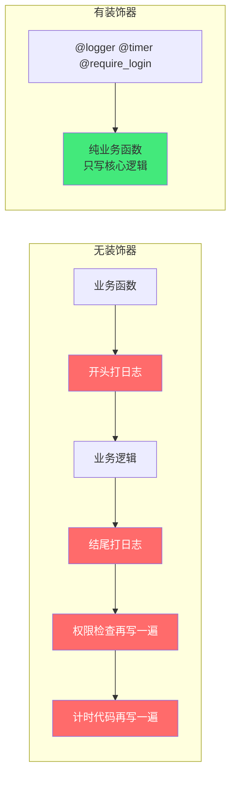
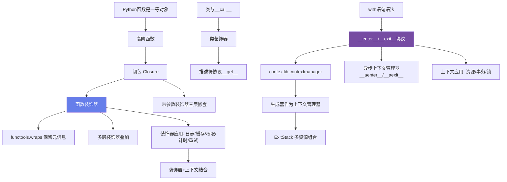
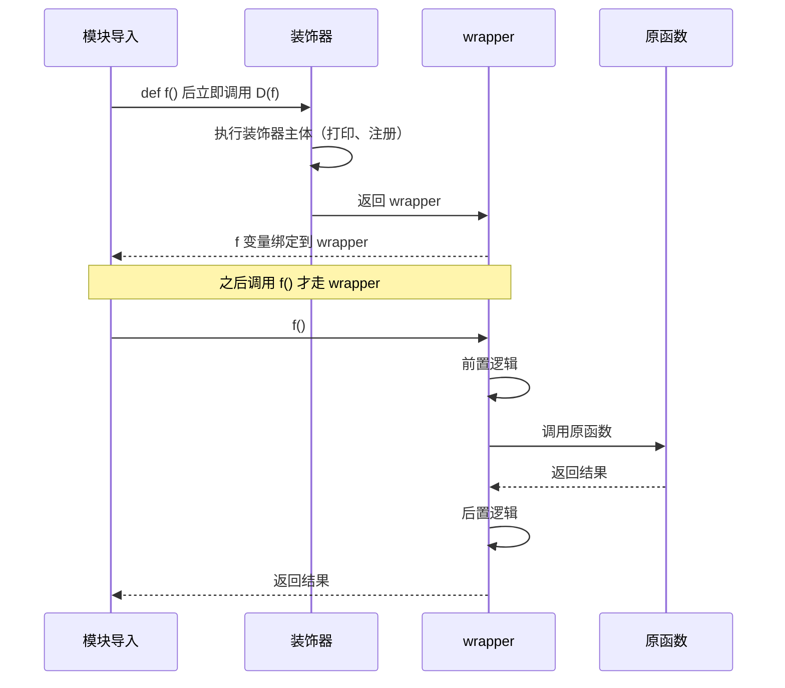
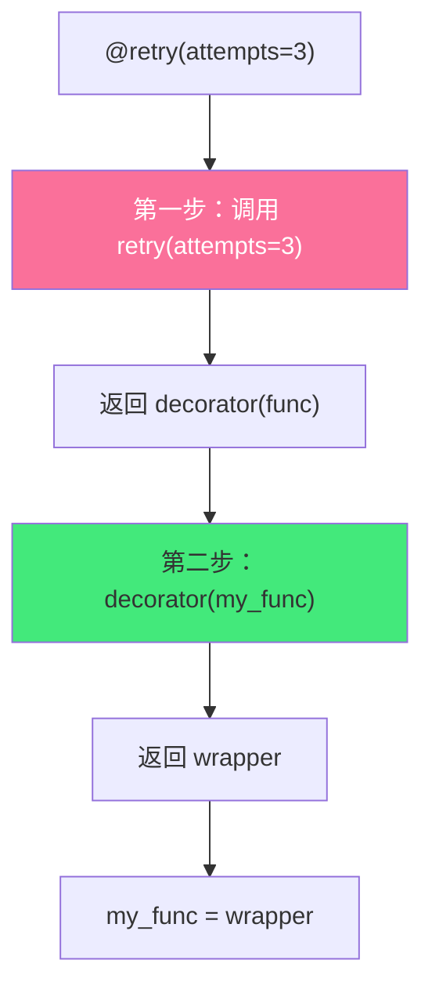
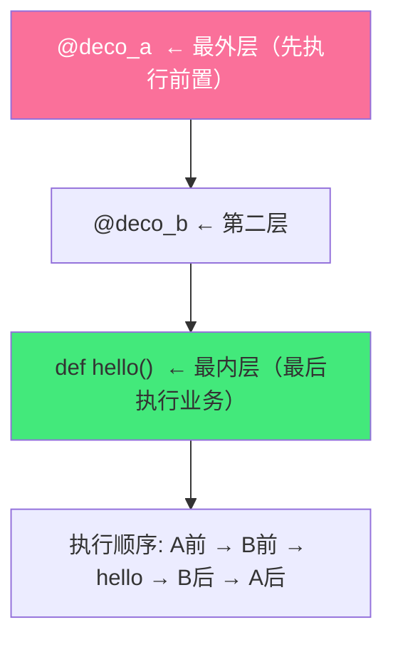
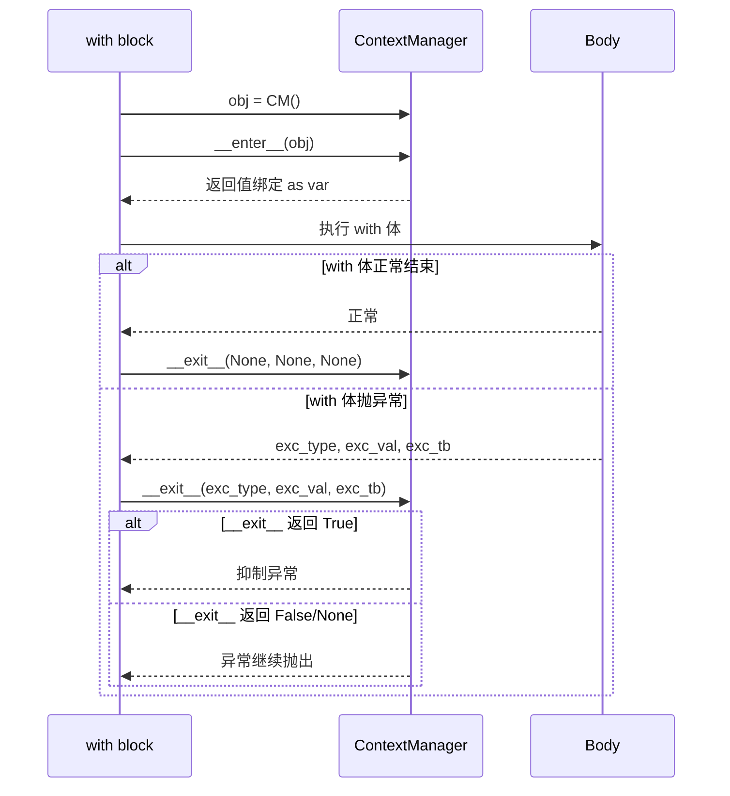
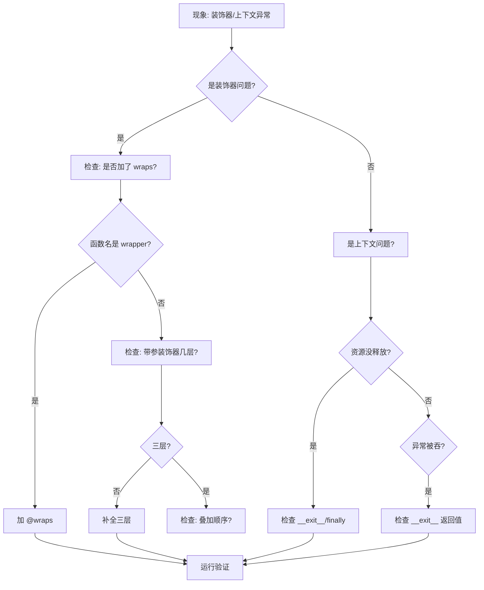
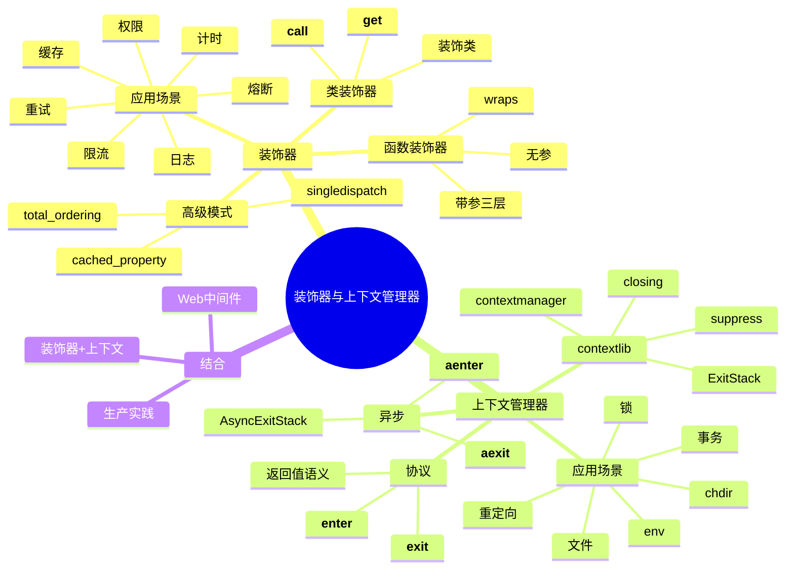
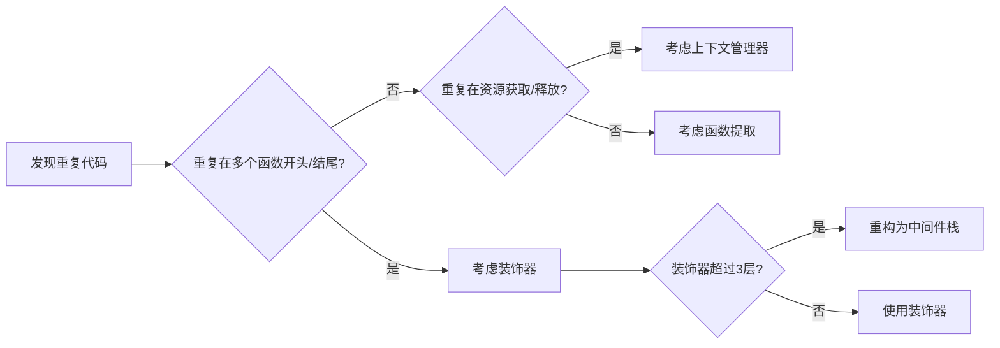

# Python 装饰器与上下文管理器

> **文档定位**：本文是 Python 元编程两大基石——装饰器（Decorator）与上下文管理器（Context Manager）——的 P0 级深度教材。从"@ 语法糖到底做了什么"出发，一路推到带参数装饰器的三层闭包、类装饰器与描述符协议的结合、`contextlib.contextmanager` 生成器协议、异步上下文管理器、`ExitStack` 多资源组合，最后落地到日志、缓存、权限、计时、重试、事务、锁等生产级横切关注点的完整实现。
>
> **适用人群**：能写 Python 但对"为什么 `@wraps` 必须加"、"`__exit__` 返回 True 为什么会吞异常"、"带参装饰器为什么要三层嵌套"一知半解的开发者；准备中高级 Python 面试的工程师；需要在项目中抽离横切关注点、统一治理日志/权限/事务的技术负责人。
>
> **前置知识**：[[Python-语法基础与数据结构]] · [[Python-面向对象与元类]] · [[Python-异常处理与错误体系]]
>
> **学习目标**：读完后能从零手写任意复杂装饰器、能徒手实现上下文管理器协议、能定位装饰器与上下文管理器相关的 30+ 生产坑点。

---

## 一、概述与学习路径

### 1.1 这两个概念解决什么问题

装饰器与上下文管理器是 Python 实现"**横切关注点（Cross-Cutting Concerns）**"的两把利器。横切关注点指那些散落在业务函数各处、与核心业务逻辑无关但又必须做的事情：函数进入时打日志、函数退出时算耗时、调用前校验权限、出错时重试、资源用完后释放、异常时回滚事务……如果把这些代码直接写进每个业务函数，会造成代码臃肿、重复、难维护。

> 💡 **生活化比喻**：装饰器就像给手机套手机壳——手机本身的功能（打电话）没变，但多了防摔（保护）、支架（看视频）、磁吸（充电）等附加能力，而你不需要拆开手机改造内部电路。上下文管理器就像银行金库的门——进去前必须刷卡开门（`__enter__`），无论你是正常出来还是遇到紧急情况被撤出来，门一定会自动锁上（`__exit__`），绝不会让金库敞着。



### 1.2 痛点对照表

| 痛点（裸写业务） | 装饰器方案 | 上下文管理器方案 |
|---|---|---|
| 每个函数都手写 `logger.info(f"调用 {func.__name__}")` | `@log` 统一装饰 | —— |
| 性能测试要在函数前后各写一行 `time.perf_counter()` | `@timer` 自动计时 | `with timer_block("xxx"):` 代码块计时 |
| 权限判断散落在每个视图函数开头 | `@require_role("admin")` | —— |
| 外部 API 失败后重试逻辑复制粘贴 | `@retry(attempts=3)` | —— |
| `f = open(...); ...; f.close()` 忘记 close | —— | `with open(...) as f:` 自动关闭 |
| 数据库事务忘记 rollback | —— | `with session.begin():` 自动提交/回滚 |
| 锁获取后忘记释放导致死锁 | —— | `with lock:` 自动释放 |
| 切换工作目录后忘记恢复 | —— | `with chdir(path):` 自动恢复 |

### 1.3 知识依赖图



### 1.4 学习路线图

1. **第一阶段（入门）**：理解函数是一等对象 → 手写最简单的无参函数装饰器 → 理解 `@deff` 等价于 `f = deff(f)`。
2. **第二阶段（进阶）**：掌握 `functools.wraps` 的必要性 → 写带参数装饰器（三层嵌套）→ 理解多层叠加的应用顺序。
3. **第三阶段（上下文）**：实现 `__enter__/__exit__` 协议 → 用 `@contextmanager` 以生成器方式写上下文管理器 → 掌握 `suppress/closing/redirect_stdout/ExitStack`。
4. **第四阶段（生产）**：实现日志/缓存/权限/计时/重试五大装饰器 → 实现数据库事务/文件/锁三大上下文管理器 → 处理异步场景。
5. **第五阶段（坑点）**：通读本文第十四章全部 30+ 坑点，结合面试题检验。

### 1.5 本文代码示例约定

- 所有示例标注 `# 预期输出：...`。
- 涉及 `logging` 的示例统一使用 `logging.basicConfig(level=logging.INFO, format="%(name)s | %(message)s")` 风格。
- 涉及异步的示例用 `asyncio.run(main())` 作为入口。
- 第三方库（`requests`/`redis`/`aiohttp`）的示例会注明 `pip install xxx`。

---

## 二、装饰器本质与底层原理

### 2.1 函数是一等对象

要理解装饰器，必须先理解 Python 的"函数是一等公民"——函数可以像变量一样被传递、赋值、作为参数传入、作为返回值返回。

```python
# 示例 2.1.1：函数赋值给变量
def greet(name: str) -> str:
    return f"Hello, {name}!"

say_hi = greet           # 函数本身赋值给变量
print(say_hi("Alice"))   # 预期输出：Hello, Alice!
print(type(say_hi))      # 预期输出：<class 'function'>
```

```python
# 示例 2.1.2：函数作为参数传入（高阶函数）
def shout(text: str) -> str:
    return text.upper() + "!!!"

def whisper(text: str) -> str:
    return text.lower() + "..."

def apply_twice(func, value):
    """把 func 应用两次"""
    return func(func(value))

print(apply_twice(shout, "hello"))     # 预期输出：HELLO!!!!!!
print(apply_twice(whisper, "WORLD"))   # 预期输出：world......
```

```python
# 示例 2.1.3：函数作为返回值返回（闭包雏形）
def make_adder(n: int):
    def adder(x: int) -> int:
        return x + n
    return adder

add5 = make_adder(5)
add10 = make_adder(10)
print(add5(3))    # 预期输出：8
print(add10(3))   # 预期输出：13
```

> 🎯 **面试高频**：Python 中什么是"一等对象（First-Class Object）"？函数满足哪些条件才算一等对象？
>
> **答**：一等对象指可以在运行时创建、赋值给变量、作为参数传递、作为返回值返回、存入数据结构。Python 函数满足全部五条：可以赋值给变量（`f = greet`）、可以作为参数（`apply_twice(shout, ...)`）、可以作为返回值（`make_adder` 返回 `adder`）、可以存进 dict/list（`funcs = [greet, shout]`）、可以拥有自己的属性（`greet.name = "x"`）。

### 2.2 闭包（Closure）

闭包是装饰器的底层机制。**闭包 = 内层函数 + 内层函数引用的外层自由变量**。

```python
# 示例 2.2.1：经典闭包
def outer(x: int):
    def inner():
        # x 是 outer 的局部变量，但 inner 引用了它
        # 即使 outer 已经返回，x 仍然被 inner 持有
        return x * 2
    return inner

closure = outer(21)
print(closure())           # 预期输出：42
print(closure.__closure__) # 输出一个 tuple，里面是 cell 对象，保存着 x=21
print(closure.__code__.co_freevars)  # 预期输出：('x',)
```

```python
# 示例 2.2.2：闭包延迟绑定坑点（经典面试题）
funcs = []
for i in range(3):
    funcs.append(lambda: i)

print([f() for f in funcs])  # 预期输出：[2, 2, 2]，不是 [0, 1, 2]！
# 原因：lambda 引用的是变量 i 本身，不是定义时的值；
# 循环结束后 i=2，所有闭包都看到 2。

# 正确做法：用默认参数立即绑定
funcs2 = []
for i in range(3):
    funcs2.append(lambda i=i: i)
print([f() for f in funcs2])  # 预期输出：[0, 1, 2]
```

> ❌ **常见坑点**：循环中创建闭包全部返回相同值
>
> **错误现象**：上面 `[f() for f in funcs]` 返回 `[2,2,2]` 而非 `[0,1,2]`。
>
> **根本原因**：Python 的闭包绑定变量本身，而非变量在定义时的值。循环结束后 `i` 指向 `2`。
>
> **正确做法**：用默认参数 `lambda i=i: i` 在定义时立即求值，或用 `functools.partial(lambda i: i, i)`。

```python
# 示例 2.2.3：用 nonlocal 修改闭包变量
def counter():
    count = 0
    def increment():
        nonlocal count   # 声明 count 是外层变量，否则会当成局部变量
        count += 1
        return count
    return increment

c = counter()
print(c())  # 预期输出：1
print(c())  # 预期输出：2
print(c())  # 预期输出：3
```

### 2.3 装饰器语法糖

**装饰器本质**：接收一个函数（或类）作为参数，返回一个新函数（或类）。`@decorator` 语法糖只是 `func = decorator(func)` 的简写。

```python
# 示例 2.3.1：不用语法糖的装饰器
def my_decorator(func):
    def wrapper():
        print("装饰：调用前")
        func()
        print("装饰：调用后")
    return wrapper

def say_hello():
    print("Hello!")

# 不用 @ 的写法
say_hello = my_decorator(say_hello)
say_hello()
# 预期输出：
# 装饰：调用前
# Hello!
# 装饰：调用后
```

```python
# 示例 2.3.2：用语法糖 @ 的等价写法
def my_decorator(func):
    def wrapper():
        print("装饰：调用前")
        func()
        print("装饰：调用后")
    return wrapper

@my_decorator
def say_hello():
    print("Hello!")

# 上面 @my_decorator 完全等价于 say_hello = my_decorator(say_hello)
say_hello()
# 预期输出同上
```

```python
# 示例 2.3.3：装饰器在"导入时"执行，不是调用时
def trace(msg):
    print(f"[装饰器工厂被调用] {msg}")  # 这一行在 import/def 阶段执行
    def decorator(func):
        print(f"[装饰器应用] {func.__name__}")  # 这一行也在 import 阶段
        def wrapper(*a, **kw):
            print(f"[wrapper 执行] {func.__name__}")
            return func(*a, **kw)
        return wrapper
    return decorator

print("=== 模块开始执行 ===")

@trace("START")
def f1():
    print("f1 真正执行")

print("=== 模块定义完毕，尚未调用 f1 ===")
f1()
# 预期输出：
# === 模块开始执行 ===
# [装饰器工厂被调用] START
# [装饰器应用] f1
# === 模块定义完毕，尚未调用 f1 ===
# [wrapper 执行] f1
# f1 真正执行
```

> 🎯 **面试高频**：装饰器什么时候执行？导入时还是调用时？
>
> **答**：装饰器在"函数定义时（即 `def` 语句执行完毕时）"就被应用了——`@deff` 等价于 `f = deff(f)`，这行赋值在模块导入时完成。真正的业务逻辑（wrapper 内部）在每次调用 `f()` 时才执行。这也是为什么装饰器常用于"导入期注册"（如路由注册、插件注册）。



### 2.4 保留元信息：functools.wraps

不写 `@functools.wraps(func)` 的话，被装饰后的函数名字、docstring 都会变成 wrapper 的：

```python
# 示例 2.4.1：没有 wraps 的坑
def bad_decorator(func):
    def wrapper(*args, **kwargs):
        """wrapper 的文档"""
        return func(*args, **kwargs)
    return wrapper

@bad_decorator
def my_function():
    """my_function 的文档"""
    return 42

print(my_function.__name__)   # 预期输出：wrapper（不是 my_function！）
print(my_function.__doc__)    # 预期输出：wrapper 的文档
help(my_function)             # 看到的也是 wrapper 的帮助
```

```python
# 示例 2.4.2：正确使用 functools.wraps
import functools

def good_decorator(func):
    @functools.wraps(func)   # 把 func 的 __name__/__doc__/__module__/__qualname__/__dict__ 复制给 wrapper
    def wrapper(*args, **kwargs):
        """wrapper 的文档"""
        return func(*args, **kwargs)
    return wrapper

@good_decorator
def my_function():
    """my_function 的文档"""
    return 42

print(my_function.__name__)   # 预期输出：my_function
print(my_function.__doc__)    # 预期输出：my_function 的文档
```

```python
# 示例 2.4.3：wraps 到底复制了哪些属性
import functools
print(functools.WRAPPER_ASSIGNMENTS)
# 预期输出：('__module__', '__name__', '__qualname__', '__annotations__', '__doc__', '__dict__', '__defaults__', '__kwdefaults__')
print(functools.WRAPPER_UPDATES)
# 预期输出：('__dict__',)
```

> ✅ **最佳实践**：写装饰器时，**永远**在 wrapper 上加 `@functools.wraps(func)`。这一条不写，会导致：
> 1. `flask`/`fastapi` 的路由注册时函数名冲突；
> 2. `pytest` 根据函数名收集测试时重复；
> 3. 日志打印函数名全是 `wrapper`，无法定位问题；
> 4. `help()`、`inspect.signature()` 拿到错误信息。

---

### 💡 本章深度讲解

本章是整个文档的地基。理解装饰器必须按这条链路走：**函数是一等对象 → 可以当参数/返回值 → 闭包让内层函数记住外层变量 → 装饰器就是"接收函数、返回包装函数"的高阶函数 → @ 只是语法糖 → wraps 必须用来保留元信息**。装饰器在 import 期执行这一点尤其重要，它决定了装饰器不能依赖运行时才有的状态（如请求上下文），那些场景要么用带参装饰器延迟绑定，要么改用上下文管理器或中间件。

### 📝 本章精简总结

- 核心概念：一等对象、闭包、高阶函数、装饰器语法糖、`functools.wraps`。
- 关键原理：`@deff` 等价于 `f = deff(f)`；闭包引用变量本身而非值；wraps 复制元信息。
- 常用操作：写 `def wrapper(*a, **kw): ...; return func(*a, **kw)`；加 `@functools.wraps(func)`。
- 最佳实践：永远加 wraps；装饰器主体不要依赖运行时状态；循环中闭包注意延迟绑定。
- 常见坑点：循环闭包全返回相同值；不加 wraps 导致函数名变 wrapper。
- 面试高频：装饰器何时执行？wraps 干什么？闭包延迟绑定？

### 🎯 梯度练习题

**基础题（⭐）**
1. 写一个装饰器 `print_args`，打印被装饰函数的所有位置参数和关键字参数，然后正常调用。
   > 答案：`def print_args(f): @wraps(f) def w(*a, **kw): print(a, kw); return f(*a,**kw); return w`
2. 闭包 `def outer(): x=1; return lambda: x` 中，`x` 存在哪里？如何查看？
   > 答案：存在 `__closure__` 的 cell 对象里，通过 `closure.__closure__[0].cell_contents` 查看。
3. `@deff` 与 `f = deff(f)` 完全等价吗？
   > 答案：等价，仅语法糖。

**进阶题（⭐⭐）**
1. 为什么 `functools.wraps` 不直接复制 `__name__` 等所有属性，而是要维护 `WRAPPER_ASSIGNMENTS` 元组？
   > 思考方向：哪些属性不应该被覆盖？`__dict__` 为什么用 update 而非赋值？
2. 循环 `funcs = [lambda: i for i in range(3)]` 为什么返回 `[2,2,2]`？如何改成 `[0,1,2]`？

**实战题（⭐⭐⭐）**
- 背景：团队有 50 个 HTTP 接口函数，都需要在调用时打印"接口名+入参+耗时+返回值"。
- 需求：写一个装饰器 `@audit`，自动完成上述四件事，且不破坏 FastAPI 的路由签名。
- 验收：`__name__`/`__doc__` 保留；日志格式统一；同步异步函数都能用（提示：用 `inspect.iscoroutinefunction` 判断）。

---

## 三、函数装饰器基础

### 3.1 无参函数装饰器模板

一个标准的函数装饰器骨架长这样：

```python
# 示例 3.1.1：标准无参装饰器模板
import functools

def decorator(func):
    @functools.wraps(func)
    def wrapper(*args, **kwargs):
        # 前置逻辑：在调用原函数前执行
        result = func(*args, **kwargs)
        # 后置逻辑：在调用原函数后执行
        return result
    return wrapper
```

```python
# 示例 3.1.2：最朴素的"进入/退出"装饰器
import functools

def hello_decorator(func):
    @functools.wraps(func)
    def wrapper(*args, **kwargs):
        print(f">>> 进入 {func.__name__}")
        result = func(*args, **kwargs)
        print(f"<<< 离开 {func.__name__}")
        return result
    return wrapper

@hello_decorator
def add(a, b):
    return a + b

print(add(1, 2))
# 预期输出：
# >>> 进入 add
# <<< 离开 add
# 3
```

```python
# 示例 3.1.3：装饰器可以访问原函数的元数据
import functools

def describe(func):
    @functools.wraps(func)
    def wrapper(*args, **kwargs):
        print(f"调用 {func.__name__}(args={args}, kwargs={kwargs})")
        return func(*args, **kwargs)
    return wrapper

@describe
def divide(a, b):
    return a / b

divide(10, 2)
# 预期输出：调用 divide(args=(10, 2), kwargs={})
```

### 3.2 传递参数与返回值

`*args, **kwargs` 让 wrapper 能透明转发任意参数：

```python
# 示例 3.2.1：装饰器不修改参数和返回值
import functools

def passthrough(func):
    @functools.wraps(func)
    def wrapper(*args, **kwargs):
        return func(*args, **kwargs)
    return wrapper

@passthrough
def concat(*items, sep="-"):
    return sep.join(str(x) for x in items)

print(concat("a", "b", "c", sep="|"))  # 预期输出：a|b|c
```

```python
# 示例 3.2.2：装饰器可以修改入参（慎用）
import functools

def to_lower(func):
    @functools.wraps(func)
    def wrapper(text):
        return func(text.lower())
    return wrapper

@to_lower
def echo(text):
    return text

print(echo("HELLO"))  # 预期输出：hello
```

```python
# 示例 3.2.3：装饰器可以修改返回值
import functools

def to_json(func):
    import json
    @functools.wraps(func)
    def wrapper(*args, **kwargs):
        result = func(*args, **kwargs)
        return json.dumps(result, ensure_ascii=False)
    return wrapper

@to_json
def get_user():
    return {"name": "Alice", "age": 18}

print(get_user())  # 预期输出：{"name": "Alice", "age": 18}
```

### 3.3 错误处理装饰器

```python
# 示例 3.3.1：捕获异常并记录
import functools, logging
logging.basicConfig(level=logging.INFO)
logger = logging.getLogger(__name__)

def safe(func):
    @functools.wraps(func)
    def wrapper(*args, **kwargs):
        try:
            return func(*args, **kwargs)
        except Exception as e:
            logger.exception("%s 抛出异常: %s", func.__name__, e)
            return None
    return wrapper

@safe
def buggy():
    raise ValueError("oops")

print(buggy())  # 预期输出：None（异常被记录后吞掉）
```

```python
# 示例 3.3.2：仅捕获特定异常
import functools

def catch_value_error(func):
    @functools.wraps(func)
    def wrapper(*args, **kwargs):
        try:
            return func(*args, **kwargs)
        except ValueError as e:
            print(f"捕获 ValueError: {e}")
            return None
    return wrapper
```

```python
# 示例 3.3.3：异常后做资源清理
import functools

def cleanup(close_func):
    def decorator(func):
        @functools.wraps(func)
        def wrapper(*args, **kwargs):
            try:
                return func(*args, **kwargs)
            finally:
                close_func()
        return wrapper
    return decorator
```

### 3.4 装饰器带状态

函数装饰器可以通过闭包携带状态：

```python
# 示例 3.4.1：统计函数调用次数
import functools

def count_calls(func):
    @functools.wraps(func)
    def wrapper(*args, **kwargs):
        wrapper.calls += 1
        return func(*args, **kwargs)
    wrapper.calls = 0   # 在 wrapper 函数对象上挂属性
    return wrapper

@count_calls
def hello():
    pass

hello(); hello(); hello()
print(hello.calls)  # 预期输出：3
```

```python
# 示例 3.4.2：缓存最近一次返回值
import functools

def last_result(func):
    @functools.wraps(func)
    def wrapper(*args, **kwargs):
        result = func(*args, **kwargs)
        wrapper.last = result
        return result
    wrapper.last = None
    return wrapper

@last_result
def square(x):
    return x * x

square(4); square(9)
print(square.last)  # 预期输出：81
```

```python
# 示例 3.4.3：基于闭包的简单 LRU 缓存
import functools

def lru_simple(func):
    cache = {}
    @functools.wraps(func)
    def wrapper(x):
        if x not in cache:
            cache[x] = func(x)
        return cache[x]
    wrapper.cache = cache
    return wrapper

@lru_simple
def fib(n):
    return n if n < 2 else fib(n - 1) + fib(n - 2)

print(fib(50))  # 预期输出：12586269025（秒出，因为缓存）
```

> ✅ **最佳实践**：Python 标准库已经提供了 `functools.lru_cache` 和 `functools.cache`，生产环境直接用，不要自己写缓存装饰器。上面的 `lru_simple` 仅作原理演示。

---

### 💡 本章深度讲解

函数装饰器的标准三件套是：`@functools.wraps(func)` 保元信息、`*args, **kwargs` 透传、`try/finally` 兜底清理。装饰器可以改入参、改返回值、吞异常、带状态——但"改入参"和"吞异常"都是危险操作，生产环境要慎重。带状态的装饰器用闭包字典或函数属性即可，多线程场景下要加锁（见第七章重试/限流部分）。

### 📝 本章精简总结

- 模板：`def dec(f): @wraps(f) def w(*a,**kw): ...; return f(*a,**kw); return w`。
- 状态：闭包变量或函数属性。
- 改入参/改返回值：可行但需谨慎。
- 错误处理：try/except/finally 包裹原调用。

### 🎯 梯度练习题

**基础题（⭐）**
1. 写一个 `@uppercase_return` 装饰器，把返回字符串全部转大写。
2. `*args, **kwargs` 在 wrapper 中的作用是什么？
3. 为什么装饰器要 `return func(*args, **kwargs)` 而不是直接调用？

**进阶题（⭐⭐）**
1. 如何让装饰器支持"每个被装饰函数独立的调用计数"而不是共享？
2. 多线程下 `wrapper.calls += 1` 有什么问题？怎么修？

**实战题（⭐⭐⭐）**
- 写一个 `@trace_io` 装饰器：函数执行前打印所有参数，执行后打印返回值，异常时打印异常类型和消息。要求同步异步函数都支持。

---

## 四、带参数装饰器

### 4.1 为什么需要三层嵌套

无参装饰器是两层：`decorator(func) -> wrapper`。带参数装饰器要多一层：`decorator(params)(func) -> wrapper`。因为 `@decorator(xxx)` 首先要把 `xxx` 传给装饰器工厂，工厂返回真正的装饰器，再接收被装饰函数。



```python
# 示例 4.1.1：三层嵌套结构
import functools

def decorator_with_args(param1, param2="default"):
    # 第一层：接收装饰器参数
    def decorator(func):
        # 第二层：接收被装饰函数
        @functools.wraps(func)
        def wrapper(*args, **kwargs):
            # 第三层：接收调用参数
            print(f"装饰器参数: {param1}, {param2}")
            print(f"函数参数: {args}, {kwargs}")
            return func(*args, **kwargs)
        return wrapper
    return decorator

@decorator_with_args("hello", param2="world")
def add(a, b):
    return a + b

add(1, 2)
# 预期输出：
# 装饰器参数: hello, world
# 函数参数: (1, 2), {}
```

```python
# 示例 4.1.2：不带 @ 语法糖的等价展开
# @decorator_with_args("hello")
# def add(a,b): ...
# 等价于：
add = decorator_with_args("hello", param2="world")(add)
```

```python
# 示例 4.1.3：常见错误——只写两层
import functools

def bad_retry(attempts=3):
    def wrapper(*args, **kwargs):
        for _ in range(attempts):
            try:
                return args[0](*args[1:], **kwargs)
            except Exception:
                pass
    return wrapper

# @bad_retry(3)
# def f(): ...
# 展开后：f = bad_retry(3)(f)
# bad_retry(3) 返回 wrapper，wrapper 期望第一个参数是 func
# 调用 f() 时 args=(f,)，args[0] 是 f，但 f 不会被 @wraps
# 而且 f 本身没有被保留元信息
# 这种写法极不推荐，正确写法见 4.2
```

> ❌ **常见坑点**：带参装饰器少写一层
>
> **错误现象**：`TypeError: wrapper() takes from 1 to N positional arguments but M were given`，或装饰器参数没生效。
>
> **根本原因**：`@deff(x)` 展开为 `f = deff(x)(f)`，`deff(x)` 必须返回一个"接收函数并返回函数"的对象。少一层就会把参数和函数混淆。
>
> **正确做法**：永远三层——外层收参数、中层收函数、内层收调用参数。

### 4.2 生产级带参装饰器：retry

```python
# 示例 4.2.1：指数退避重试装饰器
import functools, time, random, logging
logger = logging.getLogger(__name__)

def retry(
    attempts: int = 3,
    delay: float = 1.0,
    backoff: float = 2.0,
    exceptions: tuple = (Exception,),
    jitter: bool = False,
):
    """失败重试装饰器。
    attempts: 最大尝试次数（含首次）
    delay: 初始延迟秒数
    backoff: 退避倍率
    exceptions: 要重试的异常类型
    jitter: 是否加随机抖动
    """
    def decorator(func):
        @functools.wraps(func)
        def wrapper(*args, **kwargs):
            last_exc = None
            cur_delay = delay
            for i in range(1, attempts + 1):
                try:
                    return func(*args, **kwargs)
                except exceptions as e:
                    last_exc = e
                    if i == attempts:
                        break
                    sleep_for = cur_delay + (random.random() * cur_delay if jitter else 0)
                    logger.warning(
                        "%s 第 %d 次失败: %s，%.2fs 后重试",
                        func.__name__, i, e, sleep_for,
                    )
                    time.sleep(sleep_for)
                    cur_delay *= backoff
            raise last_exc
        return wrapper
    return decorator

@retry(attempts=3, delay=0.1, exceptions=(ConnectionError, TimeoutError))
def call_api():
    print("尝试调用 API")
    raise ConnectionError("网络抖动")
```

```python
# 示例 4.2.2：仅对特定异常重试，其他异常立即抛出
@retry(attempts=5, delay=0.05, exceptions=(ValueError,))
def parse_data(s):
    print("解析:", s)
    if len(s) < 3:
        raise ValueError("太短")
    return s.upper()
```

```python
# 示例 4.2.3：带统计信息的重试
def retry_with_stats(attempts=3):
    def decorator(func):
        @functools.wraps(func)
        def wrapper(*args, **kwargs):
            wrapper.retries = getattr(wrapper, "retries", 0)
            for i in range(attempts):
                try:
                    return func(*args, **kwargs)
                except Exception:
                    wrapper.retries += 1
                    if i == attempts - 1:
                        raise
            return None
        return wrapper
    return decorator
```

### 4.3 带参装饰器：超时控制（同步版本）

```python
# 示例 4.3.1：用信号实现超时（仅 Unix，主线程）
import functools, signal

class _Timeout(Exception):
    pass

def _handler(signum, frame):
    raise _Timeout()

def timeout(seconds: int):
    def decorator(func):
        @functools.wraps(func)
        def wrapper(*args, **kwargs):
            old_handler = signal.signal(signal.SIGALRM, _handler)
            signal.alarm(seconds)
            try:
                return func(*args, **kwargs)
            except _Timeout:
                raise TimeoutError(f"{func.__name__} 超过 {seconds}s")
            finally:
                signal.alarm(0)
                signal.signal(signal.SIGALRM, old_handler)
        return wrapper
    return decorator

# @timeout(2)
# def slow():
#     time.sleep(10)
# slow()  # 2 秒后抛 TimeoutError
```

```python
# 示例 4.3.2：线程版超时（跨平台）
import functools, threading

def timeout_thread(seconds: float):
    def decorator(func):
        @functools.wraps(func)
        def wrapper(*args, **kwargs):
            result = {}
            def target():
                try:
                    result["value"] = func(*args, **kwargs)
                except Exception as e:
                    result["error"] = e
            t = threading.Thread(target=target)
            t.start()
            t.join(seconds)
            if t.is_alive():
                raise TimeoutError(f"{func.__name__} 超时")
            if "error" in result:
                raise result["error"]
            return result["value"]
        return wrapper
    return decorator
```

### 4.4 带参装饰器：权限校验

```python
# 示例 4.4.1：基于全局 current_user 的权限装饰器
import functools, threading

# 模拟请求上下文
_context = threading.local()

def set_current_user(user):
    _context.user = user

def require_role(*roles):
    def decorator(func):
        @functools.wraps(func)
        def wrapper(*args, **kwargs):
            user = getattr(_context, "user", None)
            if user is None:
                raise PermissionError("未登录")
            if user.get("role") not in roles:
                raise PermissionError(f"需要角色 {roles}")
            return func(*args, **kwargs)
        return wrapper
    return decorator

@require_role("admin", "root")
def delete_all_users():
    return "deleted"
```

```python
# 示例 4.4.2：FastAPI 风格的权限依赖
import functools

def has_permission(perm: str):
    def decorator(func):
        @functools.wraps(func)
        def wrapper(*args, **kwargs):
            # 假设从请求头解析 token
            token = kwargs.get("token")
            if not token or perm not in token.get("perms", []):
                raise PermissionError(f"缺少权限 {perm}")
            return func(*args, **kwargs)
        return wrapper
    return decorator

@has_permission("user:read")
def get_user_info(token, user_id):
    return {"id": user_id}
```

```python
# 示例 4.4.3：基于令牌的认证装饰器
import functools

def authenticate(token_header="X-Token"):
    def decorator(func):
        @functools.wraps(func)
        def wrapper(*args, **kwargs):
            token = kwargs.get("headers", {}).get(token_header)
            if not token or token != "secret":
                raise PermissionError("无效 token")
            return func(*args, **kwargs)
        return wrapper
    return decorator
```

### 4.5 让装饰器既支持带参又支持不带参

这是一个常见的"装饰器万能写法"——让 `@deff` 和 `@deff(x=1)` 都能用：

```python
# 示例 4.5.1：智能装饰器（兼容有无参数）
import functools

def smart_decorator(func=None, *, prefix=">>"):
    # 如果 func 直接是函数（不带参数调用），立刻执行装饰
    if func is not None and callable(func):
        @functools.wraps(func)
        def wrapper(*args, **kwargs):
            print(f"{prefix} {func.__name__}")
            return func(*args, **kwargs)
        return wrapper

    # 否则 func 是 None，说明带了参数，返回真正的装饰器
    def decorator(f):
        @functools.wraps(f)
        def wrapper(*args, **kwargs):
            print(f"{prefix} {f.__name__}")
            return f(*args, **kwargs)
        return wrapper
    return decorator

@smart_decorator               # 不带参
def f1():
    pass

@smart_decorator(prefix="##")  # 带参
def f2():
    pass

f1()  # 预期输出：>> f1
f2()  # 预期输出：## f2
```

```python
# 示例 4.5.2：用 functools.wraps 保留参数化装饰器的元信息
import functools

def parametrized(prefix=">>"):
    def decorator(func):
        @functools.wraps(func)
        def wrapper(*a, **kw):
            print(prefix, func.__name__)
            return func(*a, **kw)
        return wrapper
    return decorator
```

> 🎯 **面试高频**：如何写一个既能 `@deff` 又能 `@deff(x=1)` 的装饰器？
>
> **答**：让外层装饰器第一个参数 `func=None`，在函数体判断 `func is not None and callable(func)` 时直接返回包装函数；否则返回一个接收函数的装饰器。标准库 `pytest.fixture`、`click.option` 都是这种设计。

---

### 💡 本章深度讲解

带参装饰器的难点不在代码量，而在"三层嵌套"的心智模型。记住这个公式：**外层收配置 → 中层收函数 → 内层收调用参数**。一旦混淆层的职责，就会出现"参数传不进去"或"函数被当成参数"的错误。生产级带参装饰器的另一个要点是：默认参数要合理、异常类型要可配置、日志要带上函数名和重试次数。智能装饰器（兼容有无参数）是高阶技巧，面试加分项。

### 📝 本章精简总结

- 三层嵌套：外层收参数、中层收函数、内层收调用参数。
- 经典应用：`@retry`、`@timeout`、`@require_role`、`@cache`。
- 智能装饰器：`func=None` 判断。
- 坑点：少写一层导致参数错乱；信号版超时不能在非主线程/Windows 用。

### 🎯 梯度练习题

**基础题（⭐）**
1. 写 `@repeat(n=3)` 装饰器，把函数重复执行 n 次。
2. 带参装饰器为什么要三层？
3. `@deff(x)` 展开为什么？

**进阶题（⭐⭐）**
1. 指数退避为什么要加 jitter（随机抖动）？
2. 信号版超时为什么不能在子线程中用？

**实战题（⭐⭐⭐）**
- 写一个 `@circuit_breaker(failures=5, reset_timeout=60)` 熔断器：连续失败 N 次后，后续调用直接抛 `CircuitOpenError`，60 秒后半开状态放行一次探测。

---

## 五、类装饰器

### 5.1 用类实现装饰器

函数装饰器用闭包，类装饰器用 `__call__`。类装饰器的优势是可以方便地维护状态、实现 `__get__` 描述符协议。

```python
# 示例 5.1.1：最简类装饰器
import functools

class CountCalls:
    def __init__(self, func):
        functools.update_wrapper(self, func)  # 类装饰器用 update_wrapper 而非 wraps
        self.func = func
        self.count = 0

    def __call__(self, *args, **kwargs):
        self.count += 1
        print(f"{self.func.__name__} 被调用 {self.count} 次")
        return self.func(*args, **kwargs)

@CountCalls
def hello():
    print("hi")

hello(); hello()
# 预期输出：
# hello 被调用 1 次
# hi
# hello 被调用 2 次
# hi
```

```python
# 示例 5.1.2：带参数的类装饰器
import functools

class Repeat:
    def __init__(self, times=3):
        self.times = times

    def __call__(self, func):
        @functools.wraps(func)
        def wrapper(*args, **kwargs):
            result = None
            for _ in range(self.times):
                result = func(*args, **kwargs)
            return result
        return wrapper

@Repeat(times=5)
def greet():
    print("hi")

greet()  # 预期输出：hi 打印 5 次
```

```python
# 示例 5.1.3：类装饰器维护调用历史
import functools

class TraceCalls:
    def __init__(self, func):
        functools.update_wrapper(self, func)
        self.func = func
        self.calls = []

    def __call__(self, *args, **kwargs):
        self.calls.append({"args": args, "kwargs": kwargs})
        return self.func(*args, **kwargs)

@TraceCalls
def add(a, b):
    return a + b

add(1, 2); add(3, 4)
print(add.calls)
# 预期输出：[{'args': (1,2), 'kwargs': {}}, {'args': (3,4), 'kwargs': {}}]
```

### 5.2 类装饰器 vs 函数装饰器

| 维度 | 函数装饰器 | 类装饰器 |
|---|---|---|
| 代码量 | 少（闭包） | 多（`__init__` + `__call__`） |
| 状态维护 | 闭包变量 | 实例属性（更直观） |
| 元信息保留 | `@wraps` | `functools.update_wrapper` |
| 支持方法装饰 | 需要 `__get__` | 需要 `__get__` |
| 可读性 | 高 | 中 |
| 适用场景 | 大多数场景 | 需要复杂状态/面向对象设计 |

```python
# 示例 5.2.1：类装饰器用于缓存（带过期时间）
import functools, time

class TTLCache:
    def __init__(self, ttl: float = 60.0):
        self.ttl = ttl
        self.store = {}

    def __call__(self, func):
        @functools.wraps(func)
        def wrapper(*args):
            now = time.time()
            if args in self.store:
                expire, value = self.store[args]
                if now < expire:
                    return value
            value = func(*args)
            self.store[args] = (now + self.ttl, value)
            return value
        wrapper.cache = self.store
        return wrapper

@TTLCache(ttl=5.0)
def slow(x):
    print(f"计算 {x}")
    return x * x

print(slow(4))  # 打印"计算 4"，返回 16
print(slow(4))  # 不打印，直接返回 16（命中缓存）
```

### 5.3 装饰类本身（类装饰器接收类）

类装饰器不仅能装饰函数，还能装饰类：

```python
# 示例 5.3.1：给类添加 __repr__ 方法
def add_repr(cls):
    def __repr__(self):
        attrs = ", ".join(f"{k}={v!r}" for k, v in self.__dict__.items())
        return f"{cls.__name__}({attrs})"
    cls.__repr__ = __repr__
    return cls

@add_repr
class Point:
    def __init__(self, x, y):
        self.x = x
        self.y = y

print(Point(1, 2))  # 预期输出：Point(x=1, y=2)
```

```python
# 示例 5.3.2：单例模式装饰类
import functools

def singleton(cls):
    instances = {}
    @functools.wraps(cls)
    def get_instance(*args, **kwargs):
        if cls not in instances:
            instances[cls] = cls(*args, **kwargs)
        return instances[cls]
    return get_instance

@singleton
class Config:
    def __init__(self):
        self.version = "1.0"

a = Config(); b = Config()
print(a is b)  # 预期输出：True
```

```python
# 示例 5.3.3：注册式类装饰器（插件系统）
PLUGINS = {}

def register(cls):
    PLUGINS[cls.__name__] = cls
    return cls

@register
class MySQLPlugin:
    pass

@register
class RedisPlugin:
    pass

print(list(PLUGINS.keys()))  # 预期输出：['MySQLPlugin', 'RedisPlugin']
```

```python
# 示例 5.3.4：自动注册所有子类（基类装饰器）
class PluginMeta(type):
    registry = {}
    def __new__(mcs, name, bases, namespace):
        cls = super().__new__(mcs, name, bases, namespace)
        if name != "Plugin":
            mcs.registry[name] = cls
        return cls

class Plugin(metaclass=PluginMeta):
    pass

class HttpPlugin(Plugin):
    pass

class TcpPlugin(Plugin):
    pass

print(list(PluginMeta.registry.keys()))  # 预期输出：['HttpPlugin', 'TcpPlugin']
```

### 5.4 装饰类的方法：self 问题

用类装饰器装饰实例方法时，`__call__` 第一个参数是装饰器实例，不是 `self`。需要实现 `__get__` 描述符协议：

```python
# 示例 5.4.1：错误——类装饰器装饰方法后 self 丢失
class CountCalls:
    def __init__(self, func):
        self.func = func
        self.count = 0
    def __call__(self, *args, **kwargs):
        self.count += 1
        return self.func(*args, **kwargs)

class Foo:
    @CountCalls
    def method(self, x):
        return x

# f = Foo()
# f.method(1)  # ❌ TypeError: method() missing 1 required positional argument: 'x'
# 因为 f.method 是 CountCalls 实例，调用时 f 没有自动传进去
```

```python
# 示例 5.4.2：正确——实现 __get__ 描述符
import functools

class CountCalls:
    def __init__(self, func):
        functools.update_wrapper(self, func)
        self.func = func
        self.count = 0

    def __call__(self, *args, **kwargs):
        self.count += 1
        return self.func(*args, **kwargs)

    def __get__(self, instance, owner=None):
        # 当访问 f.method 时，instance 是 f，返回一个绑定方法
        return functools.partial(self.__call__, instance)

class Foo:
    @CountCalls
    def method(self, x):
        return x * 2

f = Foo()
print(f.method(5))  # 预期输出：10（self 自动传入）
```

> ❌ **常见坑点**：类装饰器装饰实例方法后 `self` 丢失
>
> **错误现象**：`TypeError: method() missing 1 required positional argument: 'self'`。
>
> **根本原因**：类装饰器把函数替换成了类实例，类实例不是函数，不具备"描述符协议"——不会自动把实例作为第一个参数传入。
>
> **正确做法**：在类装饰器中实现 `__get__`，返回 `functools.partial(self.__call__, instance)`。

---

### 💡 本章深度讲解

类装饰器的本质是"用类实例替换函数"。当装饰函数时，类装饰器和函数装饰器效果相当，但当装饰方法时，必须考虑描述符协议——普通函数在类中是描述符，访问 `obj.method` 会自动绑定 `self`，而类装饰器替换后的对象不是描述符，就丢失了这个能力。`__get__` 是修复手段。装饰类本身（`@singleton`/`@register`）是另一个高频场景，常用于插件系统和单例。

### 📝 本章精简总结

- 类装饰器：`__init__(func)` + `__call__(*args, **kwargs)`。
- 元信息：`functools.update_wrapper(self, func)`。
- 装饰方法：必须实现 `__get__`。
- 装饰类：`def decorator_cls(cls): ...; return cls`，用于单例/注册/添加方法。

### 🎯 梯度练习题

**基础题（⭐）**
1. 写类装饰器 `@CallCounter`，统计调用次数。
2. 类装饰器为什么用 `update_wrapper` 而不是 `wraps`？
3. `@singleton` 装饰类的原理是什么？

**进阶题（⭐⭐）**
1. 类装饰器装饰实例方法时为什么 `self` 会丢失？怎么修？
2. `@register` 插件系统的优缺点？

**实战题（⭐⭐⭐）**
- 写一个类装饰器 `@Plugin`，自动把所有子类注册到全局字典，并提供 `get_plugin(name)` 工厂函数。

---

## 六、多层装饰器叠加与执行顺序

### 6.1 叠加规则

多个装饰器堆叠时，**从下往上应用，从上往下执行前置逻辑**：

```python
# 示例 6.1.1：多层叠加的等价展开
def deco_a(func):
    def wrapper(*args, **kwargs):
        print("A 前")
        result = func(*args, **kwargs)
        print("A 后")
        return result
    return wrapper

def deco_b(func):
    def wrapper(*args, **kwargs):
        print("B 前")
        result = func(*args, **kwargs)
        print("B 后")
        return result
    return wrapper

@deco_a
@deco_b
def hello():
    print("hello")

# 等价于 hello = deco_a(deco_b(hello))
hello()
# 预期输出：
# A 前
# B 前
# hello
# B 后
# A 后
```



```python
# 示例 6.1.2：验证堆叠顺序
def deco(name):
    def decorator(func):
        def wrapper(*a, **kw):
            print(f"{name} 前")
            r = func(*a, **kw)
            print(f"{name} 后")
            return r
        return wrapper
    return decorator

@deco("A")
@deco("B")
@deco("C")
def f():
    print("f")

f()
# 预期输出：
# A 前
# B 前
# C 前
# f
# C 后
# B 后
# A 后
```

### 6.2 叠加顺序的实际影响

不同顺序会产生不同行为：

```python
# 示例 6.2.1：@login + @admin 的顺序影响
import functools

def login_required(func):
    @functools.wraps(func)
    def wrapper(*a, **kw):
        print("检查登录")
        return func(*a, **kw)
    return wrapper

def admin_required(func):
    @functools.wraps(func)
    def wrapper(*a, **kw):
        print("检查管理员")
        return func(*a, **kw)
    return wrapper

@login_required
@admin_required
def admin_panel():
    print("进入后台")

admin_panel()
# 顺序：检查登录 → 检查管理员 → 进入后台
# 这是合理的：先登录再判角色

# 如果反过来：
@admin_required
@login_required
def admin_panel2():
    print("进入后台2")
admin_panel2()
# 顺序：检查管理员 → 检查登录 → 进入后台2
# ❌ 不合理：未登录时却先判了管理员
```

```python
# 示例 6.2.2：@timer + @retry 的顺序
import functools, time

def timer(func):
    @functools.wraps(func)
    def wrapper(*a, **kw):
        t0 = time.perf_counter()
        r = func(*a, **kw)
        print(f"耗时 {time.perf_counter()-t0:.3f}s")
        return r
    return wrapper

def retry(attempts=3):
    def decorator(func):
        @functools.wraps(func)
        def wrapper(*a, **kw):
            for i in range(attempts):
                try:
                    return func(*a, **kw)
                except Exception:
                    print(f"重试 {i+1}")
        return wrapper
    return decorator

@timer        # timer 在最外层：计时包含所有重试
@retry(3)
def flaky():
    raise ValueError

# 等价于 timer(retry(3)(flaky))
# 计时会把 3 次重试全部算进去
```

> ✅ **最佳实践**：叠加装饰器时，把"越靠近业务函数"的装饰器放在越下面。推荐顺序（从上到下）：
> 1. `@timer`（最外层，包住所有其他装饰器的耗时）
> 2. `@retry`（在计时内部重试）
> 3. `@log`（记录每次重试的入参）
> 4. `@require_login` / `@require_role`（业务校验）
> 5. 业务函数本身

### 6.3 functools.wraps 在叠加中的作用

```python
# 示例 6.3.1：叠加时元信息的传递
import functools

def deco1(func):
    @functools.wraps(func)
    def wrapper(*a, **kw):
        return func(*a, **kw)
    return wrapper

def deco2(func):
    @functools.wraps(func)
    def wrapper(*a, **kw):
        return func(*a, **kw)
    return wrapper

@deco1
@deco2
def my_func():
    """doc"""
    pass

print(my_func.__name__)   # 预期输出：my_func
print(my_func.__doc__)    # 预期输出：doc
# 每一层 wraps 都把内层的元信息复制到当前 wrapper
# 最终外层 wrapper 看到的是最内层函数的元信息
```

```python
# 示例 6.3.2：__wrapped__ 属性解包
import functools

def deco(func):
    @functools.wraps(func)
    def wrapper(*a, **kw):
        return func(*a, **kw)
    return wrapper

@deco
@deco
@deco
def f():
    pass

# f.__wrapped__ 是上一层的 wrapper
# f.__wrapped__.__wrapped__ 再上一层
# 可以用来"解开"装饰器拿到原始函数
print(f.__wrapped__.__wrapped__.__wrapped__ is f.__wrapped__.__wrapped__.func if hasattr(f.__wrapped__.__wrapped__, 'func') else 'nested')
```

---

### 💡 本章深度讲解

多层叠加的心智模型是"洋葱模型"：最外层装饰器的前置逻辑先执行，然后往里一层一层走，最内层业务函数执行后，再一层一层往外走后置逻辑。这个模型在 Web 框架（Flask/Django 中间件）、日志、监控中无处不在。顺序错误会导致"先判权限再校验登录"这种逻辑 bug，也会导致计时把重试时间漏掉或算多。

### 📝 本章精简总结

- 规则：从下往上应用，从上往下执行前置。
- 推荐顺序：timer → retry → log → auth → 业务。
- `__wrapped__` 可解包装饰器链。

### 🎯 梯度练习题

**基础题（⭐）**
1. `@A @B def f()` 等价于什么？
2. 三层叠加 A/B/C 的执行顺序？
3. 为什么 `@login_required` 要放在 `@admin_required` 上面？

**进阶题（⭐⭐）**
1. 如何用 `__wrapped__` 拿到被多层装饰器包裹的原始函数？
2. 设计一个装饰器组合，要求：记录函数被调用时的完整栈信息。

**实战题（⭐⭐⭐）**
- 为 Flask 视图函数写三个装饰器：`@require_api_key`、`@rate_limit(100/min)`、`@log_access`。确定正确的堆叠顺序并说明理由。

---

## 七、装饰器应用场景（日志/缓存/权限/计时/重试）

本章把装饰器的五大生产级场景逐个落地，每个场景给出基础版、进阶版、生产版三层代码。

### 7.1 日志装饰器

```python
# 示例 7.1.1：基础日志装饰器
import functools, logging
logger = logging.getLogger("audit")

def log_call(func):
    @functools.wraps(func)
    def wrapper(*args, **kwargs):
        logger.info("调用 %s args=%s kwargs=%s", func.__name__, args, kwargs)
        try:
            result = func(*args, **kwargs)
            logger.info("%s 返回 %r", func.__name__, result)
            return result
        except Exception as e:
            logger.exception("%s 异常 %s", func.__name__, e)
            raise
    return wrapper
```

```python
# 示例 7.1.2：带日志级别和参数脱敏
import functools, logging

def log(level=logging.INFO, sensitive_keys=("password", "token")):
    def decorator(func):
        @functools.wraps(func)
        def wrapper(*args, **kwargs):
            safe_kwargs = {k: ("***" if k in sensitive_keys else v)
                           for k, v in kwargs.items()}
            logger.log(level, "%s 调用 kwargs=%s", func.__name__, safe_kwargs)
            return func(*args, **kwargs)
        return wrapper
    return decorator

@level(logging.DEBUG)
def login(username, password):
    return "ok"
```

```python
# 示例 7.1.3：把日志写到结构化 JSON
import functools, logging, json, datetime

class JsonFormatter(logging.Formatter):
    def format(self, record):
        return json.dumps({
            "ts": datetime.datetime.utcnow().isoformat(),
            "func": record.funcName,
            "msg": record.getMessage(),
        }, ensure_ascii=False)

def json_log(func):
    @functools.wraps(func)
    def wrapper(*a, **kw):
        logger.info("%s called", func.__name__)
        return func(*a, **kw)
    return wrapper
```

```python
# 示例 7.1.4：异步日志装饰器
import functools, asyncio, logging
logger = logging.getLogger("async")

def alog(func):
    if asyncio.iscoroutinefunction(func):
        @functools.wraps(func)
        async def aw(*a, **kw):
            logger.info("async call %s", func.__name__)
            return await func(*a, **kw)
        return aw
    else:
        @functools.wraps(func)
        def sw(*a, **kw):
            logger.info("sync call %s", func.__name__)
            return func(*a, **kw)
        return sw
```

```python
# 示例 7.1.5：日志装饰器——性能标记
import functools, time, logging
logger = logging.getLogger("perf")

def log_perf(threshold_ms=100):
    def decorator(func):
        @functools.wraps(func)
        def wrapper(*a, **kw):
            t0 = time.perf_counter()
            try:
                return func(*a, **kw)
            finally:
                ms = (time.perf_counter() - t0) * 1000
                if ms > threshold_ms:
                    logger.warning("%s 慢调用 %.1fms", func.__name__, ms)
        return wrapper
    return decorator
```

### 7.2 缓存装饰器

```python
# 示例 7.2.1：functools.lru_cache 基础用法
from functools import lru_cache

@lru_cache(maxsize=128)
def fib(n):
    return n if n < 2 else fib(n-1) + fib(n-2)

print(fib(100))       # 秒出
print(fib.cache_info())
# 预期输出：CacheInfo(hits=98, misses=101, maxsize=128, currsize=101)
fib.cache_clear()     # 清空缓存
```

```python
# 示例 7.2.2：lru_cache 对带 kwargs 函数的要求
from functools import lru_cache

@lru_cache(maxsize=None)
def query(user_id, *, fields=None):
    return {"id": user_id, "fields": fields}

# 所有参数必须可哈希：list 不行，tuple 行
# query([1,2])  # TypeError: unhashable type
```

```python
# 示例 7.2.3：TTL 缓存装饰器
import time, functools

def ttl_cache(ttl=60):
    store = {}
    def decorator(func):
        @functools.wraps(func)
        def wrapper(*args):
            now = time.time()
            if args in store and now - store[args][0] < ttl:
                return store[args][1]
            val = func(*args)
            store[args] = (now, val)
            return val
        wrapper.cache_clear = store.clear
        return wrapper
    return decorator

@ttl_cache(ttl=5)
def fetch_config():
    print("查数据库")
    return {"version": "1.0"}
```

```python
# 示例 7.2.4：Redis 缓存装饰器（生产级）
import functools, hashlib, json, os

def redis_cache(ttl=300, prefix="cache"):
    try:
        import redis
        r = redis.Redis(host=os.getenv("REDIS_HOST", "localhost"))
    except ImportError:
        r = None
    def decorator(func):
        @functools.wraps(func)
        def wrapper(*args, **kwargs):
            key = f"{prefix}:{func.__module__}.{func.__name__}:{hashlib.md5(str(args).encode()).hexdigest()}"
            if r:
                cached = r.get(key)
                if cached:
                    return json.loads(cached)
            result = func(*args, **kwargs)
            if r:
                r.setex(key, ttl, json.dumps(result, default=str))
            return result
        return wrapper
    return decorator

# @redis_cache(ttl=60)
# def get_user(uid): ...
```

```python
# 示例 7.2.5：缓存失效装饰器
import functools

def cache_with_invalidate(func):
    store = {}
    @functools.wraps(func)
    def wrapper(*args):
        if args not in store:
            store[args] = func(*args)
        return store[args]
    wrapper.invalidate = lambda *args: store.pop(args, None)
    wrapper.store = store
    return wrapper

@cache_with_invalidate
def get_config(k):
    return f"value-{k}"

get_config("a")
get_config.invalidate("a")  # 手动失效
```

### 7.3 权限装饰器

```python
# 示例 7.3.1：登录态校验（Flask 风格）
import functools

def login_required(view_func):
    @functools.wraps(view_func)
    def wrapper(*args, **kwargs):
        # 假设 g.user 由请求钩子设置
        from flask import g, jsonify
        if not getattr(g, "user", None):
            return jsonify({"error": "unauthorized"}), 401
        return view_func(*args, **kwargs)
    return wrapper

# @app.route("/profile")
# @login_required
# def profile(): ...
```

```python
# 示例 7.3.2：角色校验
import functools

def role_required(*roles):
    def decorator(view):
        @functools.wraps(view)
        def wrapper(*args, **kwargs):
            from flask import g, jsonify
            if not getattr(g, "user", None):
                return jsonify({"error": "unauthorized"}), 401
            if g.user.role not in roles:
                return jsonify({"error": "forbidden"}), 403
            return view(*args, **kwargs)
        return wrapper
    return decorator

# @app.route("/admin")
# @login_required
# @role_required("admin")
# def admin(): ...
```

```python
# 示例 7.3.3：权限点校验
import functools

def permission_required(perm):
    def decorator(view):
        @functools.wraps(view)
        def wrapper(*args, **kwargs):
            from flask import g, jsonify
            user = getattr(g, "user", None)
            if not user or perm not in user.permissions:
                return jsonify({"error": f"missing {perm}"}), 403
            return view(*args, **kwargs)
        return wrapper
    return decorator
```

```python
# 示例 7.3.4：异步权限装饰器（FastAPI 风格）
import functools

def async_perm(perm: str):
    def decorator(func):
        @functools.wraps(func)
        async def wrapper(*args, **kwargs):
            user = kwargs.get("current_user")
            if not user or perm not in user.permissions:
                raise PermissionError(perm)
            return await func(*args, **kwargs)
        return wrapper
    return decorator
```

```python
# 示例 7.3.5：限频装饰器
import functools, time, threading

def rate_limit(max_calls=10, period=60):
    calls = []
    lock = threading.Lock()
    def decorator(func):
        @functools.wraps(func)
        def wrapper(*args, **kwargs):
            now = time.time()
            with lock:
                calls[:] = [t for t in calls if now - t < period]
                if len(calls) >= max_calls:
                    raise RuntimeError("rate limit exceeded")
                calls.append(now)
            return func(*args, **kwargs)
        return wrapper
    return decorator

@rate_limit(5, 10)
def limited():
    return "ok"
```

### 7.4 计时装饰器

```python
# 示例 7.4.1：基础计时
import functools, time

def timer(func):
    @functools.wraps(func)
    def wrapper(*args, **kwargs):
        t0 = time.perf_counter()
        try:
            return func(*args, **kwargs)
        finally:
            print(f"{func.__name__} 耗时 {(time.perf_counter()-t0)*1000:.2f}ms")
    return wrapper

@timer
def work():
    time.sleep(0.1)
```

```python
# 示例 7.4.2：异步计时
import functools, time, asyncio

def async_timer(func):
    if asyncio.iscoroutinefunction(func):
        @functools.wraps(func)
        async def aw(*a, **kw):
            t0 = time.perf_counter()
            try:
                return await func(*a, **kw)
            finally:
                print(f"{func.__name__} 耗时 {(time.perf_counter()-t0)*1000:.2f}ms")
        return aw
    return func
```

```python
# 示例 7.4.3：统计平均耗时
import functools, time, statistics

def avg_timer(func):
    samples = []
    @functools.wraps(func)
    def wrapper(*a, **kw):
        t0 = time.perf_counter()
        try:
            return func(*a, **kw)
        finally:
            samples.append(time.perf_counter() - t0)
            if len(samples) % 10 == 0:
                print(f"{func.__name__} avg={statistics.mean(samples)*1000:.2f}ms over {len(samples)}")
    wrapper.samples = samples
    return wrapper
```

```python
# 示例 7.4.4：只在慢时打印
import functools, time

def slow_threshold(ms=100):
    def decorator(func):
        @functools.wraps(func)
        def wrapper(*a, **kw):
            t0 = time.perf_counter()
            r = func(*a, **kw)
            dt = (time.perf_counter() - t0) * 1000
            if dt > ms:
                print(f"⚠️ {func.__name__} 慢: {dt:.1f}ms")
            return r
        return wrapper
    return decorator
```

```python
# 示例 7.4.5：用 time.perf_counter 而非 time.time
# ✅ time.perf_counter() 单调时钟，不受系统时间调整影响
# ✅ time.perf_counter() 精度更高
# ❌ time.time() 在系统校时（NTP）时可能回退
# ❌ time.clock() 在 Python 3.8 已删除
```

### 7.5 重试装饰器（生产版）

```python
# 示例 7.5.1：完整重试装饰器
import functools, time, random, logging
logger = logging.getLogger(__name__)

def retry(
    attempts: int = 3,
    delay: float = 1.0,
    backoff: float = 2.0,
    max_delay: float = 30.0,
    exceptions: tuple = (Exception,),
    retry_on: callable = None,
):
    """
    attempts: 最大次数
    delay: 初始延迟
    backoff: 退避倍率
    max_delay: 延迟上限
    exceptions: 要重试的异常元组
    retry_on: 自定义判断函数 (e) -> bool
    """
    def decorator(func):
        @functools.wraps(func)
        def wrapper(*args, **kwargs):
            cur = delay
            last = None
            for i in range(1, attempts + 1):
                try:
                    return func(*args, **kwargs)
                except exceptions as e:
                    last = e
                    if retry_on and not retry_on(e):
                        raise
                    if i == attempts:
                        break
                    sleep_for = min(cur, max_delay) + random.uniform(0, cur * 0.1)
                    logger.warning("%s 第%d次失败:%s, %.2fs后重试",
                                   func.__name__, i, e, sleep_for)
                    time.sleep(sleep_for)
                    cur *= backoff
            raise last
        return wrapper
    return decorator

@retry(attempts=5, delay=0.5, backoff=2, exceptions=(ConnectionError, TimeoutError))
def call_api(): ...
```

```python
# 示例 7.5.2：只对状态码 5xx 重试
import requests

def is_5xx(e):
    return isinstance(e, requests.HTTPError) and e.response.status_code >= 500

@retry(attempts=3, retry_on=is_5xx)
def fetch(url):
    r = requests.get(url)
    r.raise_for_status()
    return r.json()
```

```python
# 示例 7.5.3：异步重试
import functools, asyncio

def aretry(attempts=3, delay=0.1):
    def decorator(func):
        @functools.wraps(func)
        async def wrapper(*a, **kw):
            last = None
            for i in range(attempts):
                try:
                    return await func(*a, **kw)
                except Exception as e:
                    last = e
                    await asyncio.sleep(delay * (2 ** i))
            raise last
        return wrapper
    return decorator
```

```python
# 示例 7.5.4：熔断 + 重试组合
class CircuitOpen(Exception):
    pass

def circuit_breaker(failures=5, reset_timeout=60):
    state = {"failures": 0, "open_until": 0}
    def decorator(func):
        @functools.wraps(func)
        def wrapper(*a, **kw):
            now = time.time()
            if now < state["open_until"]:
                raise CircuitOpen("熔断器打开")
            try:
                r = func(*a, **kw)
                state["failures"] = 0
                return r
            except Exception:
                state["failures"] += 1
                if state["failures"] >= failures:
                    state["open_until"] = now + reset_timeout
                raise
        return wrapper
    return decorator
```

---

### 💡 本章深度讲解

五大装饰器场景的共同模式是：**前置做校验/记录 → 调用原函数 → 后置做统计/清理**。日志装饰器要注意敏感信息脱敏；缓存装饰器要注意参数可哈希和失效策略；权限装饰器要注意顺序（先登录后角色）；计时装饰器要用 `perf_counter`；重试装饰器要做指数退避和抖动。生产环境中，这五个装饰器经常叠加使用，组合出"自动日志+自动重试+自动计时+自动权限校验"的业务函数。

### 📝 本章精简总结

- 日志：记录入参/返回值/异常，脱敏。
- 缓存：`lru_cache` / TTL / Redis。
- 权限：登录 → 角色 → 权限点。
- 计时：`perf_counter`，慢调用告警。
- 重试：指数退避 + 抖动 + 可配置异常。

### 🎯 梯度练习题

**基础题（⭐）**
1. 写一个 `@log_time` 计时装饰器。
2. `lru_cache` 为什么要求参数可哈希？
3. 指数退避为什么比固定延迟好？

**进阶题（⭐⭐）**
1. 如何让 `@retry` 同时支持同步和异步函数？
2. 熔断器和重试的关系？

**实战题（⭐⭐⭐）**
- 为调用外部 HTTP API 的函数写一个生产级装饰器，组合：超时 5s、重试 3 次指数退避、慢调用告警 >1s、调用日志、错误上报。

---

## 八、上下文管理器协议（__enter__/__exit__）

### 8.1 with 语句本质

`with` 语句要求对象实现上下文管理器协议：`__enter__` 和 `__exit__`。



```python
# 示例 8.1.1：最简上下文管理器
class MyContext:
    def __enter__(self):
        print("进入 with")
        return self
    def __exit__(self, exc_type, exc_val, exc_tb):
        print(f"离开 with, exc={exc_type}")
        return False  # 不抑制异常

with MyContext() as m:
    print("在 with 内")
# 预期输出：
# 进入 with
# 在 with 内
# 离开 with, exc=None
```

```python
# 示例 8.1.2：__exit__ 的三个参数
class ErrorCapture:
    def __enter__(self):
        return self
    def __exit__(self, exc_type, exc_val, exc_tb):
        print("类型:", exc_type)
        print("值:", exc_val)
        print(" traceback:", exc_tb)
        return False

with ErrorCapture():
    raise ValueError("出错了")
```

```python
# 示例 8.1.3：__exit__ 返回 True 抑制异常
class SuppressValueError:
    def __enter__(self):
        return self
    def __exit__(self, exc_type, exc_val, exc_tb):
        if exc_type is ValueError:
            print("吞掉 ValueError")
            return True  # 抑制
        return False  # 其他异常继续抛

with SuppressValueError():
    raise ValueError("我被吞了")
print("程序继续")
# 预期输出：
# 吞掉 ValueError
# 程序继续
```

> ❌ **常见坑点**：`__exit__` 返回 True 吞掉所有异常
>
> **错误现象**：with 块内明明抛了异常，但程序继续跑，日志里看不到错误。
>
> **根本原因**：`__exit__` 返回 True 会告诉解释器"异常已被处理"，解释器不再向外抛出。
>
> **正确做法**：正常清理逻辑返回 None/False，只在明确要吞特定异常时返回 True，且要记录日志。

### 8.2 资源管理：文件

```python
# 示例 8.2.1：手动管理文件（容易漏 close）
f = open("test.txt", "w")
f.write("hello")
# 如果这里抛异常，f.close() 不会执行，文件句柄泄漏
f.close()
```

```python
# 示例 8.2.2：try/finally 版
f = open("test.txt", "w")
try:
    f.write("hello")
finally:
    f.close()
```

```python
# 示例 8.2.3：with 版（推荐）
with open("test.txt", "w") as f:
    f.write("hello")
# 无论是否异常，f 都会被关闭
```

```python
# 示例 8.2.4：自定义文件上下文管理器
class SafeFile:
    def __init__(self, path, mode="r"):
        self.path = path
        self.mode = mode
        self.f = None
    def __enter__(self):
        self.f = open(self.path, self.mode)
        return self.f
    def __exit__(self, exc_type, exc_val, exc_tb):
        self.f.close()
        print(f"已关闭 {self.path}")
        return False

with SafeFile("test.txt", "w") as f:
    f.write("hello")
```

### 8.3 资源管理：锁

```python
# 示例 8.3.1：threading.Lock 是上下文管理器
import threading

lock = threading.Lock()
shared = 0

def worker():
    global shared
    with lock:
        # 临界区
        current = shared
        shared = current + 1

threads = [threading.Thread(target=worker) for _ in range(100)]
[t.start() for t in threads]
[t.join() for t in threads]
print(shared)  # 预期输出：100
```

```python
# 示例 8.3.2：多锁顺序避免死锁
import threading

class RWMutex:
    def __init__(self):
        self.read_lock = threading.Lock()
        self.write_lock = threading.Lock()
        self.readers = 0
    def __enter__(self):
        return self
    def __exit__(self, *a):
        pass
```

### 8.4 资源管理：数据库事务

```python
# 示例 8.4.1：事务上下文管理器
class Transaction:
    def __init__(self, session):
        self.session = session
    def __enter__(self):
        self.session.begin()
        return self.session
    def __exit__(self, exc_type, exc_val, exc_tb):
        if exc_type is None:
            self.session.commit()
        else:
            self.session.rollback()
            print(f"回滚: {exc_val}")
        return False

# with Transaction(session):
#     session.add(User(...))
#     raise ValueError("出错")  # 自动 rollback
```

```python
# 示例 8.4.2：嵌套事务（保存点）
class NestedTransaction:
    def __init__(self, session):
        self.session = session
        self.savepoint = None
    def __enter__(self):
        self.savepoint = self.session.begin_nested()
        return self.savepoint
    def __exit__(self, exc_type, exc_val, exc_tb):
        if exc_type:
            self.savepoint.rollback()
        else:
            self.savepoint.commit()
        return False
```

### 8.5 状态切换：chdir / env

```python
# 示例 8.5.1：临时切换工作目录
import os

class chdir:
    def __init__(self, path):
        self.new = path
        self.old = None
    def __enter__(self):
        self.old = os.getcwd()
        os.chdir(self.new)
        return self
    def __exit__(self, *a):
        os.chdir(self.old)

with chdir("/tmp"):
    print(os.getcwd())  # /tmp
print(os.getcwd())      # 原目录
```

```python
# 示例 8.5.2：临时环境变量
import os

class set_env:
    def __init__(self, **kv):
        self.kv = kv
        self.old = {}
    def __enter__(self):
        for k, v in self.kv.items():
            self.old[k] = os.environ.get(k)
            os.environ[k] = str(v)
        return self
    def __exit__(self, *a):
        for k, v in self.old.items():
            if v is None:
                os.environ.pop(k, None)
            else:
                os.environ[k] = v

with set_env(DEBUG="1", API_KEY="xxx"):
    print(os.environ["DEBUG"])
```

### 8.6 重定向 stdout/stderr

```python
# 示例 8.6.1：捕获 print 输出
import io, contextlib

f = io.StringIO()
with contextlib.redirect_stdout(f):
    print("被捕获")
    print("也被捕获")

print("外面:", f.getvalue())
# 预期输出：外面: 被捕获\n也被捕获\n
```

```python
# 示例 8.6.2：同时重定向 stdout 和 stderr
import sys, contextlib, io

out = io.StringIO()
err = io.StringIO()
with contextlib.redirect_stdout(out), contextlib.redirect_stderr(err):
    print("正常")
    print("错误", file=sys.stderr)
```

---

### 💡 本章深度讲解

上下文管理器协议的核心是"资源的获取和释放必须成对"。`__enter__` 负责获取，`__exit__` 负责释放，且 `__exit__` 无论是否异常都会被调用——这是 with 语句比 try/finally 更优雅的地方：它把获取和释放封装成一个对象，可以跨函数传递和组合。`__exit__` 的返回值决定是否抑制异常，这是新手最容易踩的坑。

### 📝 本章精简总结

- 协议：`__enter__` 获取资源，`__exit__` 释放资源。
- `__exit__` 三参：exc_type, exc_val, exc_tb。
- 返回 True 抑制异常，返回 False/None 传播异常。
- 应用：文件、锁、事务、chdir、env、重定向。

### 🎯 梯度练习题

**基础题（⭐）**
1. `__enter__` 返回值绑定到哪里？
2. `__exit__` 三个参数是什么？
3. 为什么 `__exit__` 即使异常也会被调用？

**进阶题（⭐⭐）**
1. 写一个上下文管理器，统计 with 块执行时间。
2. `__exit__` 返回 True 时如果 with 块抛异常，程序会怎样？

**实战题（⭐⭐⭐）**
- 写一个 `transactional(session)` 上下文管理器，进入时开始事务，正常退出 commit，异常 rollback，并支持嵌套（保存点）。

---

## 九、contextlib 工具集

### 9.1 @contextmanager 装饰器

`@contextmanager` 把一个生成器函数变成上下文管理器：`yield` 之前是 `__enter__`，`yield` 之后是 `__exit__`。

```python
# 示例 9.1.1：最简 @contextmanager
from contextlib import contextmanager

@contextmanager
def my_context():
    print("进入")
    yield "value"   # yield 的返回值绑定到 as 变量
    print("退出")

with my_context() as v:
    print("在内部:", v)
# 预期输出：
# 进入
# 在内部: value
# 退出
```

```python
# 示例 9.1.2：用 try/finally 保证清理
from contextlib import contextmanager

@contextmanager
def safe_open(path, mode="r"):
    f = open(path, mode)
    try:
        yield f
    finally:
        f.close()
        print("已关闭")

with safe_open("test.txt") as f:
    f.read()
```

```python
# 示例 9.1.3：在生成器中处理异常
from contextlib import contextmanager

@contextmanager
def suppress_value_error():
    try:
        yield
    except ValueError as e:
        print(f"吞掉: {e}")

with suppress_value_error():
    raise ValueError("测试")
```

```python
# 示例 9.1.4：yield 抛出异常的传播
from contextlib import contextmanager

@contextmanager
def ctx():
    print("进入")
    try:
        yield 42
    except RuntimeError as e:
        print(f"捕获到: {e}")
        # 不重新抛出 = 抑制
    finally:
        print("清理")

with ctx() as v:
    raise RuntimeError("boom")
# 预期输出：进入 / 捕获到: boom / 清理 / 程序继续
```

> ❌ **常见坑点**：`@contextmanager` 的 yield 后代码不执行
>
> **错误现象**：with 块内抛异常后，yield 后面的清理代码没执行。
>
> **根本原因**：with 块抛异常时，生成器在 yield 处抛出异常，如果不用 try/finally 包裹，yield 后的代码不会执行。
>
> **正确做法**：`try: yield ... finally: 清理逻辑`。

### 9.2 closing：适配只有 close() 的对象

```python
# 示例 9.2.1：closing 把有 close() 方法的对象变成上下文管理器
from contextlib import closing

class FakeSocket:
    def send(self, data):
        print("发送:", data)
    def close(self):
        print("关闭 socket")

with closing(FakeSocket()) as s:
    s.send("hello")
# 退出 with 时自动调用 s.close()
```

```python
# 示例 9.2.2：closing 包装 requests
from contextlib import closing
import requests

with closing(requests.get("https://api.example.com", stream=True)) as r:
    for line in r.iter_lines():
        print(line)
# 自动调用 r.close()
```

### 9.3 suppress：忽略特定异常

```python
# 示例 9.3.1：suppress 等价于 try/except/pass
from contextlib import suppress
import os

with suppress(FileNotFoundError):
    os.remove("不存在的文件.txt")  # 不报错

# 等价于：
# try:
#     os.remove(...)
# except FileNotFoundError:
#     pass
```

```python
# 示例 9.3.2：suppress 多个异常
from contextlib import suppress

with suppress(FileNotFoundError, PermissionError, OSError):
    os.remove("file.txt")
```

### 9.4 redirect_stdout / redirect_stderr

```python
# 示例 9.4.1：捕获 print
from contextlib import redirect_stdout
import io

buf = io.StringIO()
with redirect_stdout(buf):
    print("被捕获")
    print("也被捕获")

print("外部看到:", buf.getvalue().splitlines())
```

```python
# 示例 9.4.2：测试函数输出
from contextlib import redirect_stdout
import io

def greet():
    print("Hello")

buf = io.StringIO()
with redirect_stdout(buf):
    greet()
assert buf.getvalue() == "Hello\n"
```

### 9.5 ExitStack：动态组合多个上下文管理器

```python
# 示例 9.5.1：ExitStack 管理数量不定的文件
from contextlib import ExitStack

files = ["a.txt", "b.txt", "c.txt"]
with ExitStack() as stack:
    handles = [stack.enter_context(open(p)) for p in files]
    for h in handles:
        print(h.read())
# 退出时按 LIFO 顺序关闭所有文件
```

```python
# 示例 9.5.2：根据条件决定打开哪些资源
from contextlib import ExitStack

def process(paths, need_db=False):
    with ExitStack() as stack:
        files = [stack.enter_context(open(p)) for p in paths]
        if need_db:
            db = stack.enter_context(DatabaseSession("postgres://..."))
        # 使用 files 和 db
        return len(files)
```

```python
# 示例 9.5.3：callback 注册清理函数
from contextlib import ExitStack

with ExitStack() as stack:
    stack.callback(print, "清理1")
    stack.callback(print, "清理2")
    print("执行中")
# 退出时按注册反序执行：清理2 → 清理1
```

```python
# 示例 9.5.4：pop_all 转移上下文管理器
from contextlib import ExitStack

stack1 = ExitStack()
f1 = stack1.enter_context(open("a.txt"))
# ... 决定把这些资源转移给另一个 stack
stack2 = ExitStack()
stack2.push(stack1.pop_all())  # stack1 的资源转移到 stack2
stack1.close()  # 不影响 stack2
```

### 9.6 contextlib 其他工具

```python
# 示例 9.6.1：nullcontext（空上下文）
from contextlib import nullcontext

def maybe_transaction(use_txn):
    if use_txn:
        return Transaction(session)
    return nullsession()  # 没有事务

with maybe_transaction(flag):
    do_work()
```

```python
# 示例 9.6.2：contextmanager 与 asynccontextmanager 的区别
# @contextmanager → 同步上下文管理器，配合 with
# @asynccontextmanager → 异步上下文管理器，配合 async with
```

```python
# 示例 9.6.3：从生成器到上下文管理器的完整链路
from contextlib import contextmanager

@contextmanager
def timer(name):
    import time
    t0 = time.perf_counter()
    try:
        yield
    finally:
        print(f"{name} 耗时 {time.perf_counter()-t0:.3f}s")

with timer("数据处理"):
    sum(range(1_000_000))
```

---

### 💡 本章深度讲解

contextlib 是标准库对上下文管理器的"生产力工具箱"。`@contextmanager` 让你用生成器一行代码写出上下文管理器，不用写 `__enter__`/`__exit__` 两个方法；`closing` 把任意有 `close()` 的对象包装成上下文管理器；`suppress` 把 `try/except/pass` 缩成一行；`ExitStack` 解决"上下文管理器数量在运行时才知道"的动态组合问题。这些工具组合起来，90% 的资源管理场景都不需要自己写类。

### 📝 本章精简总结

- `@contextmanager`：生成器协议，yield 前=enter，yield 后=exit。
- `closing(obj)`：自动调用 obj.close()。
- `suppress(*exc)`：忽略异常。
- `redirect_stdout/stderr`：重定向输出。
- `ExitStack`：动态组合多个上下文管理器，LIFO 清理。

### 🎯 梯度练习题

**基础题（⭐）**
1. `@contextmanager` 装饰的函数必须 yield 几次？
2. `suppress(X)` 等价于什么 try/except？
3. `ExitStack.enter_context` 的清理顺序？

**进阶题（⭐⭐）**
1. 为什么 `@contextmanager` 的生成器函数不能复用？
2. 写一个 `@contextmanager` 版本的事务上下文管理器。

**实战题（⭐⭐⭐）**
- 写一个函数 `open_many(paths)`，用 ExitStack 打开多个文件，并确保即使中途 open 失败也会正确关闭已打开的文件。

---

## 十、异步上下文管理器

### 10.1 协议：__aenter__ / __aexit__

异步上下文管理器与同步版本类似，但方法是 `async def`，且要用 `async with` 调用。

```python
# 示例 10.1.1：异步上下文管理器协议
import asyncio

class AsyncResource:
    async def __aenter__(self):
        print("异步进入")
        await asyncio.sleep(0.1)
        return self
    async def __aexit__(self, exc_type, exc, tb):
        print("异步退出")
        await asyncio.sleep(0.1)
        return False
    async def do_work(self):
        print("工作")

async def main():
    async with AsyncResource() as r:
        await r.do_work()

asyncio.run(main())
# 预期输出：异步进入 / 工作 / 异步退出
```

```python
# 示例 10.1.2：异步数据库会话
import asyncio

class AsyncDB:
    def __init__(self, dsn):
        self.dsn = dsn
        self.conn = None
    async def __aenter__(self):
        print(f"连接 {self.dsn}")
        self.conn = await self._connect()
        return self.conn
    async def __aexit__(self, et, ev, tb):
        if et is None:
            await self.conn.commit()
        else:
            await self.conn.rollback()
        await self.conn.close()
    async def _connect(self):
        await asyncio.sleep(0.01)
        return object()
```

```python
# 示例 10.1.3：__aexit__ 抑制异步异常
import asyncio

class SuppressAsync:
    async def __aenter__(self):
        return self
    async def __aexit__(self, et, ev, tb):
        return et is ValueError  # 只抑制 ValueError

async def main():
    async with SuppressAsync():
        raise ValueError("被吞")
    print("继续")

asyncio.run(main())
```

### 10.2 @asynccontextmanager

```python
# 示例 10.2.1：异步生成器上下文管理器
import asyncio
from contextlib import asynccontextmanager

@asynccontextmanager
async def async_timer(name):
    t0 = asyncio.get_event_loop().time()
    try:
        yield
    finally:
        dt = asyncio.get_event_loop().time() - t0
        print(f"{name} 耗时 {dt:.3f}s")

async def main():
    async with async_timer("sleep"):
        await asyncio.sleep(0.5)

asyncio.run(main())
```

```python
# 示例 10.2.2：异步锁
import asyncio
from contextlib import asynccontextmanager

@asynccontextmanager
async def locked(lock):
    await lock.acquire()
    try:
        yield
    finally:
        lock.release()

lock = asyncio.Lock()
async def worker():
    async with locked(lock):
        await asyncio.sleep(0.1)
```

```python
# 示例 10.2.3：异步 HTTP 客户端
import aiohttp
from contextlib import asynccontextmanager

@asynccontextmanager
async def http_session():
    async with aiohttp.ClientSession() as session:
        yield session

async def fetch(url):
    async with http_session() as session:
        async with session.get(url) as r:
            return await r.text()
```

### 10.3 异步嵌套上下文管理器

```python
# 示例 10.3.1：多个 async with
import asyncio
from contextlib import asynccontextmanager

@asynccontextmanager
async def a(name):
    print(f"进入 {name}")
    yield name
    print(f"退出 {name}")

async def main():
    async with a("A") as va, a("B") as vb:
        print(f"在内部 {va} {vb}")

asyncio.run(main())
# 顺序：进入 A → 进入 B → 在内部 → 退出 B → 退出 A
```

```python
# 示例 10.3.2：异步 ExitStack
import asyncio
from contextlib import AsyncExitStack, asynccontextmanager

@asynccontextmanager
async def resource(name):
    print(f"打开 {name}")
    yield name
    print(f"关闭 {name}")

async def main():
    async with AsyncExitStack() as stack:
        resources = [
            await stack.enter_async_context(resource(f"r{i}"))
            for i in range(3)
        ]
        print("使用:", resources)

asyncio.run(main())
```

### 10.4 异步上下文管理器与同步版本的差异

| 维度 | 同步上下文管理器 | 异步上下文管理器 |
|---|---|---|
| 进入方法 | `__enter__` | `__aenter__` |
| 退出方法 | `__exit__` | `__aexit__` |
| 调用语法 | `with` | `async with` |
| 生成器装饰器 | `@contextmanager` | `@asynccontextmanager` |
| 退出栈 | `ExitStack` | `AsyncExitStack` |
| 清理 | 同步执行 | `await` 异步执行 |

> ❌ **常见坑点**：在异步函数中用同步 with 包装异步资源
>
> **错误现象**：`'async with' requires an object with __aenter__ and __aexit__` 或协程从未被 await 警告。
>
> **根本原因**：`with` 不会 await `__aenter__`，异步资源不会真正初始化。
>
> **正确做法**：异步资源必须用 `async with`。

---

### 💡 本章深度讲解

异步上下文管理器把"资源获取/释放"这个动作从同步变成异步。典型场景是异步数据库连接、异步 HTTP 会话、异步文件锁。它和同步版本的协议结构完全一致，只是多了 `await`。在 FastAPI 等异步 Web 框架中，依赖注入返回的就是异步上下文管理器。

### 📝 本章精简总结

- 协议：`__aenter__` / `__aexit__`。
- 装饰器：`@asynccontextmanager`。
- 组合：`AsyncExitStack`。
- 必须用 `async with`。

### 🎯 梯度练习题

**基础题（⭐）**
1. 异步上下文管理器的两个方法？
2. `@asynccontextmanager` 装饰的函数必须是什么？
3. 为什么异步资源必须 `async with`？

**进阶题（⭐⭐）**
1. 同步 `with` 包裹异步资源会发生什么？
2. 写一个异步计时器上下文管理器。

**实战题（⭐⭐⭐）**
- 写一个异步数据库事务上下文管理器：进入时连接，正常退出 commit，异常 rollback，退出时关闭连接。

---

## 十一、嵌套与组合上下文管理器

### 11.1 多重 with

```python
# 示例 11.1.1：多个 with 一行写
with open("a.txt") as fa, open("b.txt") as fb:
    fa.write("a")
    fb.write("b")
# 等价于嵌套 with，但更简洁
```

```python
# 示例 11.1.2：嵌套 with 的顺序
class Res:
    def __init__(self, name):
        self.name = name
    def __enter__(self):
        print(f"进入 {self.name}")
        return self
    def __exit__(self, *a):
        print(f"退出 {self.name}")

with Res("A"):
    with Res("B"):
        with Res("C"):
            print("内部")
# 顺序：进入 A → 进入 B → 进入 C → 内部 → 退出 C → 退出 B → 退出 A
```

```python
# 示例 11.1.3：一行多资源
with Res("A") as a, Res("B") as b, Res("C") as c:
    print("内部")
# 等价于上面，但更扁平
```

### 11.2 嵌套上下文与异常

```python
# 示例 11.2.1：内层异常被外层处理
class Guard:
    def __init__(self, name):
        self.name = name
    def __enter__(self):
        return self
    def __exit__(self, et, ev, tb):
        if et:
            print(f"{self.name} 看到异常: {ev}")
        return False  # 不抑制

with Guard("outer"):
    with Guard("inner"):
        raise ValueError("boom")
# inner 先看到异常，outer 后看到，异常继续抛出
```

```python
# 示例 11.2.2：内层抑制异常
class Suppress:
    def __enter__(self):
        return self
    def __exit__(self, et, ev, tb):
        return et is ValueError

with Suppress():
    with Suppress():
        raise ValueError("被吞")
print("继续")
```

### 11.3 上下文管理器组合模式

```python
# 示例 11.3.1：组合多个上下文管理器
from contextlib import ExitStack

def combined(*cms):
    """把多个上下文管理器组合成一个"""
    @contextmanager
    def combo():
        with ExitStack() as stack:
            results = [stack.enter_context(cm) for cm in cms]
            yield results
    return combo()

# with combined(open("a"), lock, chdir("/tmp")) as (fa, _, _):
#     ...
```

```python
# 示例 11.3.2：条件组合
from contextlib import ExitStack, contextmanager

@contextmanager
def optional(flag, cm):
    if flag:
        with cm as v:
            yield v
    else:
        yield None

with ExitStack() as stack:
    f = stack.enter_context(optional(True, open("a.txt")))
    db = stack.enter_context(optional(False, DatabaseSession(...)))
```

---

### 💡 本章深度讲解

多个上下文管理器嵌套时，进入顺序是从外到内，退出顺序是从内到外（LIFO）。这个规则和函数调用栈一致。理解 LIFO 顺序对数据库事务嵌套、文件打开/关闭、锁获取/释放都至关重要——退出顺序错了就会死锁或资源泄漏。

### 📝 本章精简总结

- 进入：外 → 内；退出：内 → 外（LIFO）。
- 多个 with 可一行写。
- ExitStack 动态组合。

### 🎯 梯度练习题

**基础题（⭐）**
1. 三个 with 嵌套的进入和退出顺序？
2. ExitStack 如何动态组合上下文？

**进阶题（⭐⭐）**
1. 为什么锁的释放顺序必须与获取顺序相反？
2. 写一个 `combine(*cms)` 工具函数。

**实战题（⭐⭐⭐）**
- 写一个上下文管理器，组合：打开文件 + 加锁 + 切目录，退出时按正确顺序释放。

---

## 十二、装饰器与上下文管理器结合

### 12.1 用上下文管理器实现装饰器

```python
# 示例 12.1.1：用 with 实现 timer 装饰器
import functools, time
from contextlib import contextmanager

@contextmanager
def _timer(name):
    t0 = time.perf_counter()
    yield
    print(f"{name} 耗时 {time.perf_counter()-t0:.3f}s")

def timer(func):
    @functools.wraps(func)
    def wrapper(*a, **kw):
        with _timer(func.__name__):
            return func(*a, **kw)
    return wrapper

@timer
def work():
    time.sleep(0.1)
```

```python
# 示例 12.1.2：用上下文管理器实现事务装饰器
from contextlib import contextmanager

@contextmanager
def transaction(session):
    try:
        yield session
        session.commit()
    except Exception:
        session.rollback()
        raise

def with_transaction(func):
    @functools.wraps(func)
    def wrapper(session, *a, **kw):
        with transaction(session):
            return func(session, *a, **kw)
    return wrapper
```

### 12.2 用装饰器生成上下文管理器

```python
# 示例 12.2.1：decorator + contextmanager 组合
import functools
from contextlib import contextmanager

def trace_context(name):
    @contextmanager
    def cm():
        print(f"进入 {name}")
        yield
        print(f"退出 {name}")
    return cm()

def trace(name):
    def decorator(func):
        @functools.wraps(func)
        def wrapper(*a, **kw):
            with trace_context(name):
                return func(*a, **kw)
        return wrapper
    return decorator

@trace("my_func")
def my_func():
    print("工作")
```

### 12.3 实战：带重试的事务装饰器

```python
# 示例 12.3.1：retry + transaction 组合
import functools
from contextlib import contextmanager

@contextmanager
def transaction(session):
    try:
        yield
        session.commit()
    except Exception:
        session.rollback()
        raise

def retry_transaction(attempts=3):
    def decorator(func):
        @functools.wraps(func)
        def wrapper(session, *a, **kw):
            last = None
            for i in range(attempts):
                try:
                    with transaction(session):
                        return func(session, *a, **kw)
                except Exception as e:
                    last = e
            raise last
        return wrapper
    return decorator
```

```python
# 示例 12.3.2：权限 + 上下文组合
import functools
from contextlib import contextmanager

@contextmanager
def require_perm(perm, user):
    if perm not in user.permissions:
        raise PermissionError(perm)
    yield
    # 后置审计日志
    print(f"{user.id} 执行了 {perm}")

def perm(perm):
    def decorator(func):
        @functools.wraps(func)
        def wrapper(user, *a, **kw):
            with require_perm(perm, user):
                return func(user, *a, **kw)
        return wrapper
    return decorator
```

---

### 💡 本章深度讲解

装饰器和上下文管理器不是互斥的，而是互补的：装饰器处理"函数前后"，上下文管理器处理"资源生命周期"。把两者结合可以实现"函数级自动事务+自动重试+自动权限"的声明式编程。

### 📝 本章精简总结

- 装饰器内部用 with 管理资源。
- 上下文管理器可以复用在装饰器中。
- 组合：retry + transaction、perm + audit。

### 🎯 梯度练习题

**基础题（⭐）**
1. 装饰器和上下文管理器的区别？
2. 为什么事务装饰器内部要用 with transaction？

**进阶题（⭐⭐）**
1. 写一个 `@retry_transaction(n=3)` 装饰器。
2. 装饰器如何复用上下文管理器的逻辑？

**实战题（⭐⭐⭐）**
- 写一个装饰器 `@db_timed`：函数执行期间打开数据库事务、计时、记录日志，退出时按正确顺序提交/回滚/关闭。

---

## 十三、性能分析与最佳实践

### 13.1 装饰器性能开销

```python
# 示例 13.1.1：测量装饰器本身的开销
import time, functools

def overhead(func):
    @functools.wraps(func)
    def wrapper(*a, **kw):
        return func(*a, **kw)
    return wrapper

@overhead
def empty():
    pass

# 测 100 万次
t0 = time.perf_counter()
for _ in range(1_000_000):
    empty()
print(f"每次 {time.perf_counter()-t0:.3f}s / 1e6")
# 预期：约 0.1~0.2μs 每次，可忽略
```

```python
# 示例 13.1.2：带日志的装饰器开销
import logging, functools
logging.basicConfig(level=logging.INFO)
logger = logging.getLogger()

def logged(func):
    @functools.wraps(func)
    def wrapper(*a, **kw):
        logger.info("call %s", func.__name__)
        return func(*a, **kw)
    return wrapper
# 日志本身的 IO 开销远大于装饰器框架开销
```

### 13.2 上下文管理器开销

```python
# 示例 13.2.1：with 语句开销
import time

class Noop:
    def __enter__(self): return self
    def __exit__(self, *a): pass

t0 = time.perf_counter()
for _ in range(1_000_000):
    with Noop():
        pass
print(f"每次 {time.perf_counter()-t0:.3f}s / 1e6")
# 预期：约 0.1~0.3μs，可忽略
```

### 13.3 最佳实践清单

| 实践 | 说明 |
|---|---|
| 永远加 `@functools.wraps` | 保留元信息 |
| 透明转发参数 | `*args, **kwargs` |
| 异常不吞掉 | `__exit__` 返回 False/None |
| 清理放 finally | `@contextmanager` 必须 try/finally |
| 短生命周期 Session | 不要全局共享 |
| 连接池复用 | 不要每次新建 |
| 异步用异步版本 | `async with` 不混用 |
| 限制装饰器层数 | 超过 3 层考虑重构为中间件 |
| 日志用结构化 | 不要 print 调试 |
| 缓存注意可哈希 | `lru_cache` 参数必须 hashable |

### 13.4 性能调优场景

```python
# 示例 13.4.1：避免热路径中的装饰器开销
# 热路径函数不要加重量级日志装饰器
# 可以加开关：
def debug_log(enabled=False):
    def decorator(func):
        @functools.wraps(func)
        def wrapper(*a, **kw):
            if enabled:
                logger.info(...)
            return func(*a, **kw)
        return wrapper
    return decorator
```

```python
# 示例 13.4.2：批量操作替代单个 with
# ❌ 慢
for f in files:
    with open(f) as fh:
        process(fh)
# ✅ 快：一次性打开
with ExitStack() as stack:
    handles = [stack.enter_context(open(f)) for f in files]
    for h in handles:
        process(h)
```

---

### 💡 本章深度讲解

装饰器和上下文管理器本身的性能开销极小（亚微秒级），真正的性能杀手是它们内部做的事：日志 IO、网络调用、锁竞争。所以性能优化的重点是"减少装饰器内部的工作"和"批量处理资源"，而不是去掉装饰器本身。

### 📝 本章精简总结

- 框架开销可忽略，业务逻辑开销才是关键。
- 热路径装饰器加开关。
- 批量打开资源用 ExitStack。

### 🎯 梯度练习题

**基础题（⭐）**
1. 装饰器本身的开销量级？
2. 为什么 with 开销可忽略？

**进阶题（⭐⭐）**
1. 如何让日志装饰器在生产环境几乎零开销？
2. 批量打开文件为什么比循环 open 快？

**实战题（⭐⭐⭐）**
- 对一个调用 100 万次的热路径函数，设计装饰器方案：开发环境详细日志，生产环境零日志、零开销。

---

## 十四、常见坑点与故障排查

### 14.1 坑点汇总表

| # | 现象 | 原因 | 解决 |
|---|---|---|---|
| 1 | 函数名变成 wrapper | 没加 @wraps | 加 @functools.wraps(func) |
| 2 | 带参装饰器报 missing arg | 少写一层嵌套 | 三层结构：外参/中函数/内调用 |
| 3 | __exit__ 吞掉异常 | 返回 True | 正常返回 False/None |
| 4 | contextmanager yield 后代码不执行 | 没用 try/finally | try: yield finally: 清理 |
| 5 | 类装饰器装饰方法 self 丢失 | 没实现 __get__ | 加 __get__ 描述符 |
| 6 | 循环闭包全返回相同值 | 闭包延迟绑定 | 默认参数立即绑定 |
| 7 | 异步函数用同步装饰器 | wrapper 不是 async | 用 iscoroutinefunction 判断 |
| 8 | 多层叠加顺序错 | 不知道洋葱模型 | 从下往上应用 |
| 9 | DetachedInstanceError | Session 关闭后访问懒加载 | 预加载/expire_on_commit=False |
| 10 | 资源泄漏 | with 没正确使用 | 所有资源用 with 管理 |
| 11 | 信号版超时 Windows 报错 | SIGALRM 不支持 | 用线程版超时 |
| 12 | 装饰器在 import 期执行副作用 | 装饰器主体在导入时跑 | 副作用放 wrapper 内 |
| 13 | lru_cache 对不可哈希参数报错 | list/dict 不可哈希 | 改用 tuple 或自定义 hash |
| 14 | __exit__ 中再次抛异常 | 清理代码自身抛错 | 清理逻辑也要 try/except |
| 15 | 多线程装饰器计数不准 | 竞态 | 加 threading.Lock |
| 16 | ExitStack 清理顺序错 | 以为 FIFO | 实际 LIFO |
| 17 | async with 里用了同步 with | 混用协议 | 异步资源用 async with |
| 18 | 装饰器叠加后签名丢失 | 多层 wraps 仍可能丢签名 | 用 inspect.signature 时注意 |
| 19 | @property 与装饰器叠加顺序 | property 必须最外层 | property 放最上面 |
| 20 | 单例装饰器不支持参数 | instances 字典只按 cls | 扩展 key 为 (cls, args) |
| 21 | contextlib.closing 对没有 close() 的对象报错 | 协议不匹配 | 确认对象有 close() 方法 |
| 22 | redirect_stdout 线程不安全 | 全局 sys.stdout | 多线程下用 logging |
| 23 | 装饰器缓存跨测试污染 | 模块级 cache | pytest fixture 清缓存 |
| 24 | __exit__ 返回 None 但异常没抛 | 误以为 None 抑制 | None 等价 False，不抑制 |
| 25 | 嵌套上下文异常被内层吞 | 内层 __exit__ 返回 True | 只在明确场景返回 True |
| 26 | @contextmanager 生成器复用失败 | 生成器只能迭代一次 | 每次 with 新建生成器 |
| 27 | 装饰器修改了可变默认参数 | list/dict 默认参数共享 | 用 None + 内部新建 |
| 28 | 异步上下文管理器 __aexit__ 没 await | 写成同步 def | 必须 async def |
| 29 | 测试时 with 块外访问资源 | with 退出资源已关闭 | with 内完成所有操作 |
| 30 | 全局装饰器状态污染 | 模块级变量 | 用类实例或 contextvars |

### 14.2 故障排查流程



---

### 💡 本章深度讲解

坑点本质上来自三类：协议理解不深（__exit__ 返回值、__get__ 描述符、yield 与 finally）、并发与状态（多线程计数、全局缓存）、异步同步混用。排查时先看现象归类，再按对照表定位。

### 📝 本章精简总结

- 30 个坑点覆盖协议、状态、异步、并发。
- 排查流程：现象 → 装饰器/上下文分类 → 对照修复表。
- 预防：wraps、try/finally、async with、锁。

### 🎯 梯度练习题

**基础题（⭐）**
1. 为什么函数名变 wrapper？
2. __exit__ 返回 True 会怎样？
3. 类装饰器为什么需要 __get__？

**进阶题（⭐⭐）**
1. 多线程下装饰器计数为什么不准？怎么修？
2. 为什么 @contextmanager 的生成器不能复用？

**实战题（⭐⭐⭐）**
- 给定一段代码："请求处理函数偶尔抛 DetachedInstanceError"，按本章排查流程给出诊断和修复。

---

## 十五、面试高频考点汇总

### 15.1 装饰器高频题

1. **什么是装饰器？底层原理？**
   > 答：装饰器是接收函数/类返回新函数/类的高阶函数。`@deff` 等价于 `f = deff(f)`。依赖闭包保留状态。

2. **functools.wraps 的作用？**
   > 答：把被装饰函数的 `__name__`/`__doc__` 等元信息复制到 wrapper，避免元信息丢失。

3. **带参装饰器为什么要三层？**
   > 答：`@deff(x)` 先调用 `deff(x)` 返回真正的装饰器，再接收函数。三层分别收参数、函数、调用参数。

4. **多层装饰器执行顺序？**
   > 答：从下往上应用，从上往下执行前置。洋葱模型。

5. **类装饰器如何装饰实例方法？**
   > 答：实现 `__get__` 描述符协议，返回 `functools.partial(self.__call__, instance)`。

6. **装饰器什么时候执行？**
   > 答：函数定义时（import 期）应用，调用时执行 wrapper。

7. **写一个缓存装饰器？**
   > 答：用闭包字典存结果，或直接用 `functools.lru_cache`。

8. **装饰器如何支持异步函数？**
   > 答：`inspect.iscoroutinefunction(func)` 判断，分别返回 `async def wrapper` 和 `def wrapper`。

9. **循环闭包为什么全返回相同值？**
   > 答：闭包绑定变量本身，循环结束后变量固定。用默认参数 `lambda i=i: i`。

10. **单例装饰器怎么写？**
    > 答：闭包字典存实例，已存在则直接返回。

### 15.2 上下文管理器高频题

11. **with 语句的原理？**
    > 答：对象实现 `__enter__`/`__exit__`，进入时调用 enter，退出时调用 exit（无论是否异常）。

12. **__exit__ 三个参数？**
    > 答：exc_type、exc_val、exc_tb，异常类型、值、回溯。

13. **__exit__ 返回 True 会怎样？**
    > 答：抑制异常，程序继续。返回 False/None 传播异常。

14. **@contextmanager 原理？**
    > 答：把生成器变成上下文管理器，yield 前是 enter，yield 后是 exit。

15. **contextlib 有哪些工具？**
    > 答：contextmanager、closing、suppress、redirect_stdout、ExitStack、asynccontextmanager、AsyncExitStack、nullcontext。

16. **ExitStack 的作用？**
    > 答：动态组合数量不定的上下文管理器，退出时 LIFO 清理。

17. **异步上下文管理器协议？**
    > 答：`__aenter__`/`__aexit__`，用 `async with`。

18. **with 和 try/finally 的区别？**
    > 答：with 把获取/释放封装成对象，可复用、可组合；try/finally 是一次性清理。

19. **如何让 __exit__ 只吞特定异常？**
    > 答：判断 `exc_type is ValueError` 时返回 True，否则 False。

20. **嵌套 with 的退出顺序？**
    > 答：LIFO，内到外。

---

### 💡 本章深度讲解

面试题的核心是"原理+坑点"。原理题（协议、执行时机、顺序）考理解，坑点题（wraps、__exit__ 返回值、__get__）考实战。把本文 30 个坑点和 20 个面试题吃透，装饰器与上下文管理器面试基本无忧。

### 📝 本章精简总结

- 装饰器 10 题：原理、wraps、三层、叠加、类装饰器、异步、闭包、单例。
- 上下文 10 题：协议、__exit__、contextmanager、ExitStack、异步。

### 🎯 梯度练习题

**基础题（⭐）**
1. 默写 `__enter__`/`__exit__` 协议。
2. 默写三层带参装饰器骨架。

**进阶题（⭐⭐）**
1. 解释为什么 `@property` 必须放在装饰器栈最外层。
2. 为什么 `@contextmanager` 的生成器函数不能复用？

**实战题（⭐⭐⭐）**
- 现场手写：一个同时支持同步/异步、带重试、带超时、带日志的 HTTP 请求装饰器。

---

### 十六、进阶拓展与学习资源

### 16.1 进阶方向

- **attrs / pydantic**：装饰器在数据类中的应用（`@dataclass`）。
- **pytest**：`@pytest.fixture` 是上下文管理器的工厂。
- **FastAPI Depends**：依赖注入本质是更高级的上下文管理。
- **contextvars**：异步上下文变量，替代线程局部变量。
- **描述符协议**：`__get__`/`__set__`/`__delete__` 与装饰器深度结合。

### 16.2 推荐资源

| 资源 | 说明 |
|---|---|
| Python 官方文档 - contextlib | 标准库权威 |
| Python 官方文档 - functools | 装饰器工具 |
| Effective Python | 第 30/40/55 条深入装饰器 |
| Fluent Python | 装饰器章节 |

### 16.3 速查表

```python
# 装饰器速查
@decorator                 # 无参
@decorator(arg=1)          # 带参
@functools.wraps(func)     # 保元信息
@functools.lru_cache(128)  # LRU 缓存
@functools.cache            # 3.9+ 无界缓存
@functools.singledispatch   # 单分派
@property / @staticmethod / @classmethod  # 内置装饰器
@dataclass                  # 数据类

# 上下文速查
with open(...) as f: ...
with threading.Lock(): ...
@contextmanager / @asynccontextmanager
contextlib.closing(obj)
contextlib.suppress(X)
contextlib.redirect_stdout(buf)
contextlib.ExitStack()
contextlib.nullcontext()
```

---

> 💡 **文档级深度讲解**：装饰器与上下文管理器是 Python 元编程的两块基石。装饰器解决"函数/类行为的横向扩展"，上下文管理器解决"资源生命周期的自动管理"。两者结合可以把日志、权限、事务、重试、缓存、计时这些横切关注点从业务代码中彻底剥离，让业务函数只表达核心逻辑。掌握它们的关键不是背 API，而是理解"协议+闭包+洋葱模型+LIFO 清理"这四个心智模型。
>
> **📝 文档级精简总结**：装饰器 = 高阶函数 + 闭包 + @语法糖；上下文管理器 = `__enter__`/`__exit__` 协议 + with 语句。生产实践：永远加 wraps、try/finally 包 yield、异步用 async with、多层叠加注意洋葱顺序。30 个坑点 + 20 个面试题是检验掌握程度的标尺。

### 🔗 关联笔记

- [[Python-面向对象与元类]] — 描述符协议
- [[Python-异步编程asyncio]] — 异步上下文管理器
- [[Python-异常处理与错误体系]] — 异常传播
- [[FastAPI-路由与依赖注入]] — Depends 上下文管理
- [[Python-性能优化与C扩展]] — 装饰器性能

### 📖 前置知识

- [[Python-语法基础与数据结构]]
- [[Python-面向对象与元类]]

### 🏷️ 相关标签

#Python #装饰器 #上下文管理器 #元编程 #设计模式 #contextlib

---

[[Home|🏠 返回首页]] · [[MOC-Python全栈|📚 返回分类]]

### 十七、装饰器高级模式深度实践

### 17.1 装饰器工厂与元类结合

```python
# 示例 17.1.1：用元类自动装饰所有方法
import functools

def trace_method(func):
    @functools.wraps(func)
    def wrapper(self, *a, **kw):
        print(f"调用 {self.__class__.__name__}.{func.__name__}")
        return func(self, *a, **kw)
    return wrapper

class TraceMeta(type):
    def __new__(mcs, name, bases, namespace):
        for key, value in namespace.items():
            if callable(value) and not key.startswith("_"):
                namespace[key] = trace_method(value)
        return super().__new__(mcs, name, bases, namespace)

class Service(metaclass=TraceMeta):
    def do_work(self):
        print("工作")
    def internal(self):
        pass  # 以下划线开头不装饰

s = Service()
s.do_work()
# 预期输出：调用 Service.do_work / 工作
```

```python
# 示例 17.1.2：类装饰器批量注册方法
def register_handlers(prefix="/api"):
    def decorator(cls):
        cls.routes = {}
        for name in dir(cls):
            if name.startswith("handle_"):
                path = prefix + "/" + name.replace("handle_", "")
                cls.routes[path] = getattr(cls, name)
        return cls
    return decorator

@register_handlers("/v1")
class Api:
    def handle_users(self): ...
    def handle_orders(self): ...

print(Api.routes)
# 预期输出：{'/v1/users': ..., '/v1/orders': ...}
```

```python
# 示例 17.1.3：用装饰器实现接口约束
import functools

def implements(interface_name):
    def decorator(cls):
        cls._implemented_interface = interface_name
        return cls
    return decorator

@implements("PaymentGateway")
class Alipay:
    def pay(self, amount): ...
```

### 17.2 可参数化的装饰器类

```python
# 示例 17.2.1：类装饰器接收参数的标准写法
import functools

class Retry:
    def __init__(self, attempts=3, delay=1.0):
        self.attempts = attempts
        self.delay = delay

    def __call__(self, func):
        @functools.wraps(func)
        def wrapper(*args, **kwargs):
            last = None
            for i in range(self.attempts):
                try:
                    return func(*args, **kwargs)
                except Exception as e:
                    last = e
            raise last
        return wrapper

@Retry(attempts=5, delay=0.5)
def flaky(): ...
```

```python
# 示例 17.2.2：类装饰器同时支持无参和有参调用
import functools, time

class CountCalls:
    def __init__(self, func=None, *, verbose=False):
        self.verbose = verbose
        self.count = 0
        if func is not None and callable(func):
            functools.update_wrapper(self, func)
            self.func = func
        else:
            self.func = None

    def __call__(self, *args, **kwargs):
        if self.func is None:
            # 带参数调用：返回真正的装饰器
            func = args[0]
            functools.update_wrapper(self, func)
            self.func = func
            return self
        self.count += 1
        if self.verbose:
            print(f"{self.func.__name__} 第 {self.count} 次")
        return self.func(*args, **kwargs)

@CountCalls(verbose=True)
def f1(): ...

@CountCalls
def f2(): ...

f1(); f1()
f2()
```

### 17.3 带类型注解的装饰器

```python
# 示例 17.3.1：用 typing 写类型安全的装饰器
from typing import Callable, TypeVar, Any, cast
import functools

F = TypeVar("F", bound=Callable[..., Any])

def timer_typed(func: F) -> F:
    @functools.wraps(func)
    def wrapper(*args: Any, **kwargs: Any) -> Any:
        import time
        t0 = time.perf_counter()
        try:
            return func(*args, **kwargs)
        finally:
            print(f"{func.__name__}: {time.perf_counter()-t0:.3f}s")
    return cast(F, wrapper)

@timer_typed
def add(a: int, b: int) -> int:
    return a + b
```

```python
# 示例 17.3.2：带参数的类型化装饰器
from typing import Callable, TypeVar, ParamSpec, Any
import functools

P = ParamSpec("P")
R = TypeVar("R")

def log(level: str = "INFO") -> Callable[[Callable[P, R]], Callable[P, R]]:
    def decorator(func: Callable[P, R]) -> Callable[P, R]:
        @functools.wraps(func)
        def wrapper(*args: P.args, **kwargs: P.kwargs) -> R:
            print(f"[{level}] {func.__name__}")
            return func(*args, **kwargs)
        return wrapper
    return decorator

@log("DEBUG")
def process(x: int) -> int:
    return x * 2
```

### 17.4 装饰器与 functools 其他工具

```python
# 示例 17.4.1：functools.singledispatch 单分派泛型
from functools import singledispatch

@singledispatch
def serialize(obj):
    return str(obj)

@serialize.register
def _(obj: int):
    return f"int:{obj}"

@serialize.register
def _(obj: str):
    return f"str:{obj}"

@serialize.register(list)
def _(obj):
    return f"list[{len(obj)}]"

print(serialize(42))      # 预期输出：int:42
print(serialize("hi"))    # 预期输出：str:hi
print(serialize([1,2,3])) # 预期输出：list[3]
```

```python
# 示例 17.4.2：functools.cache 3.9+
from functools import cache

@cache
def fib(n):
    return n if n < 2 else fib(n-1) + fib(n-2)

print(fib(100))
```

```python
# 示例 17.4.3：functools.cached_property
import functools

class Config:
    def __init__(self):
        self._data = None
    @functools.cached_property
    def data(self):
        print("计算 data")
        return {"version": "1.0"}

c = Config()
print(c.data)  # 计算并缓存
print(c.data)  # 直接用缓存
del c.data     # 失效缓存
```

```python
# 示例 17.4.4：functools.total_ordering
from functools import total_ordering

@total_ordering
class Version:
    def __init__(self, major, minor):
        self.major = major
        self.minor = minor
    def __eq__(self, other):
        return (self.major, self.minor) == (other.major, other.minor)
    def __lt__(self, other):
        return (self.major, self.minor) < (other.major, other.minor)

# @total_ordering 自动生成 <=, >, >=, !=
v1 = Version(1, 0)
v2 = Version(2, 0)
print(v1 < v2, v1 <= v2, v1 > v2, v1 >= v2)
```

```python
# 示例 17.4.5：functools.wraps 的 __wrapped__ 属性
import functools

def deco(func):
    @functools.wraps(func)
    def wrapper(*a, **kw):
        return func(*a, **kw)
    return wrapper

@deco
@deco
def f():
    return 42

# 解开装饰器
print(f.__wrapped__.__wrapped__())  # 预期输出：42
```

---

### 💡 本章深度讲解

高级装饰器模式把装饰器从"语法糖"提升到"框架级抽象"。元类自动装饰、类装饰器工厂、类型注解、singledispatch、cached_property 这些模式在大型框架（Web 路由、序列化、RPC）中无处不在。理解它们需要把"装饰器=高阶函数"和"元类=类的工厂"结合起来。

### 📝 本章精简总结

- 元类自动装饰：`__new__` 中遍历 namespace。
- 类装饰器工厂：`__init__` 收参数，`__call__` 收函数。
- singledispatch：按类型分派。
- cached_property：首次访问计算后缓存。

### 🎯 梯度练习题

**基础题（⭐）**
1. singledispatch 按什么分派？
2. cached_property 和 property 的区别？

**进阶题（⭐⭐）**
1. 元类如何自动装饰所有公开方法？
2. 如何让类装饰器同时支持 `@Deco` 和 `@Deco(arg=1)`？

**实战题（⭐⭐⭐）**
- 用元类实现：所有以 `handle_` 开头的方法自动注册到路由表。

---

### 十八、上下文管理器高级模式

### 18.1 上下文管理器与资源池

```python
# 示例 18.1.1：连接池上下文管理器
import threading
from queue import Queue, Empty

class Pool:
    def __init__(self, factory, max_size=10):
        self.factory = factory
        self.pool = Queue(max_size)
        self.lock = threading.Lock()
        self.created = 0
        self.max_size = max_size

    def acquire(self):
        try:
            return self.pool.get_nowait()
        except Empty:
            with self.lock:
                if self.created < self.max_size:
                    self.created += 1
                    return self.factory()
            return self.pool.get()

    def release(self, conn):
        self.pool.put(conn)

    def item(self):
        return _PoolItem(self)

class _PoolItem:
    def __init__(self, pool):
        self.pool = pool
        self.conn = None
    def __enter__(self):
        self.conn = self.pool.acquire()
        return self.conn
    def __exit__(self, *a):
        self.pool.release(self.conn)

# pool = Pool(lambda: create_conn())
# with pool.item() as conn:
#     conn.query("SELECT 1")
```

```python
# 示例 18.1.2：带超时的连接池
import time

class TimeoutPool(Pool):
    def acquire(self, timeout=5):
        t0 = time.time()
        while True:
            try:
                return self.pool.get_nowait()
            except Empty:
                if time.time() - t0 > timeout:
                    raise TimeoutError("获取连接超时")
                time.sleep(0.01)
```

### 18.2 上下文管理器与事务隔离

```python
# 示例 18.2.1：事务隔离级别上下文管理器
class Isolation:
    LEVELS = {"READ_UNCOMMITTED", "READ_COMMITTED", "REPEATABLE_READ", "SERIALIZABLE"}
    def __init__(self, session, level="READ_COMMITTED"):
        self.session = session
        self.level = level
        self.old = None
    def __enter__(self):
        self.old = self.session.get_isolation_level()
        self.session.set_isolation_level(self.level)
        return self
    def __exit__(self, *a):
        self.session.set_isolation_level(self.old)
```

```python
# 示例 18.2.2：嵌套事务（保存点）
class Savepoint:
    def __init__(self, session, name="sp"):
        self.session = session
        self.name = name
    def __enter__(self):
        self.session.execute(f"SAVEPOINT {self.name}")
        return self
    def __exit__(self, et, ev, tb):
        if et:
            self.session.execute(f"ROLLBACK TO {self.name}")
        else:
            self.session.execute(f"RELEASE SAVEPOINT {self.name}")
        return False
```

### 18.3 上下文管理器与 mock 测试

```python
# 示例 18.3.1：unittest.mock.patch 是上下文管理器
from unittest.mock import patch, MagicMock

with patch("requests.get") as mock_get:
    mock_get.return_value.status_code = 200
    mock_get.return_value.json.return_value = {"data": "ok"}
    # 调用被测代码，requests.get 被替换
    ...
# 退出 with 后 requests.get 恢复原样
```

```python
# 示例 18.3.2：多个 patch 组合
with patch("module.A") as ma, patch("module.B") as mb:
    ma.return_value = 1
    mb.return_value = 2
```

```python
# 示例 18.3.3：patch 作为装饰器
from unittest.mock import patch

@patch("module.requests.get")
def test_foo(mock_get):
    mock_get.return_value.status_code = 200
    assert foo() == 200
```

### 18.4 上下文管理器与计时/统计

```python
# 示例 18.4.1：代码块计时器
import time
from contextlib import contextmanager

@contextmanager
def timer(name):
    t0 = time.perf_counter()
    yield
    print(f"{name}: {time.perf_counter()-t0:.3f}s")

with timer("数据库查询"):
    time.sleep(0.1)
```

```python
# 示例 18.4.2：累计计时器
import time
from contextlib import contextmanager

class AccumTimer:
    def __init__(self):
        self.total = 0.0
        self.count = 0
    @contextmanager
    def measure(self, name=""):
        t0 = time.perf_counter()
        try:
            yield
        finally:
            dt = time.perf_counter() - t0
            self.total += dt
            self.count += 1
            print(f"{name}: {dt:.3f}s")

at = AccumTimer()
with at.measure("a"):
    time.sleep(0.01)
with at.measure("b"):
    time.sleep(0.02)
print(f"总计 {at.total:.3f}s / {at.count} 次")
```

```python
# 示例 18.4.3：用上下文管理器统计行数
class CountLines:
    def __init__(self):
        self.lines = 0
    def write(self, s):
        self.lines += s.count("\n")
    def flush(self): pass
    def __enter__(self):
        import sys
        self.old = sys.stdout
        sys.stdout = self
        return self
    def __exit__(self, *a):
        import sys
        sys.stdout = self.old

with CountLines() as cl:
    print("a")
    print("b")
print(f"输出了 {cl.lines} 行")
```

### 18.5 上下文管理器与目录/文件操作

```python
# 示例 18.5.1：临时目录上下文管理器
import tempfile, os, shutil
from contextlib import contextmanager

@contextmanager
def temp_dir():
    path = tempfile.mkdtemp()
    try:
        yield path
    finally:
        shutil.rmtree(path)

with temp_dir() as d:
    print(f"临时目录: {d}")
    with open(os.path.join(d, "a.txt"), "w") as f:
        f.write("hello")
# 退出后目录自动删除
```

```python
# 示例 18.5.2：临时文件
import tempfile, os
from contextlib import contextmanager

@contextmanager
def temp_file(content=""):
    fd, path = tempfile.mkstemp()
    try:
        with os.fdopen(fd, "w") as f:
            f.write(content)
        yield path
    finally:
        os.remove(path)

with temp_file("hello") as p:
    with open(p) as f:
        print(f.read())
```

```python
# 示例 18.5.3：批量文件处理
from contextlib import ExitStack

def process_files(paths):
    with ExitStack() as stack:
        files = [stack.enter_context(open(p)) for p in paths]
        for f in files:
            for line in f:
                process(line)
```

---

### 💡 本章深度讲解

高级上下文管理器把"资源管理"扩展到连接池、事务隔离、mock、计时、临时文件等场景。它们的共同特征是"进入时建立状态，退出时恢复/清理状态"。理解了这个模式，你会发现 Python 标准库和第三方库中大量 API 都是上下文管理器。

### 📝 本章精简总结

- 连接池：acquire/release 包装。
- 事务隔离：进入时切换级别，退出时恢复。
- mock.patch：测试中替换对象。
- 临时目录/文件：自动创建删除。
- ExitStack：批量管理。

### 🎯 梯度练习题

**基础题（⭐）**
1. 连接池上下文管理器如何工作？
2. mock.patch 的上下文管理器语义？

**进阶题（⭐⭐）**
1. 写一个事务隔离级别上下文管理器。
2. 为什么临时文件要在 finally 中删除？

**实战题（⭐⭐⭐）**
- 写一个 `benchmark` 上下文管理器：进入时开始计时，退出时打印耗时，并把结果记录到全局统计。

---

### 十九、生产级装饰器库完整实现

### 19.1 统一日志装饰器

```python
# 示例 19.1.1：生产级日志装饰器
import functools, logging, time, inspect, json
from datetime import datetime

logger = logging.getLogger("app.audit")

def audit_log(
    log_args: bool = True,
    log_result: bool = True,
    log_time: bool = True,
    sensitive: tuple = ("password", "token", "secret"),
):
    def mask(d):
        if not isinstance(d, dict):
            return d
        return {k: ("***" if k in sensitive else v) for k, v in d.items()}

    def decorator(func):
        @functools.wraps(func)
        def wrapper(*args, **kwargs):
            start = time.perf_counter()
            # 构建日志
            log_data = {
                "ts": datetime.utcnow().isoformat(),
                "func": f"{func.__module__}.{func.__name__}",
            }
            if log_args:
                # 对绑定方法去掉 self
                sig = inspect.signature(func)
                bound = sig.bind_partial(*args, **kwargs)
                args_dict = dict(bound.arguments)
                args_dict.pop("self", None)
                log_data["args"] = mask(args_dict)
            try:
                result = func(*args, **kwargs)
                if log_result:
                    log_data["result"] = mask({"return": result})
                return result
            except Exception as e:
                log_data["error"] = f"{type(e).__name__}: {e}"
                logger.error(json.dumps(log_data, ensure_ascii=False, default=str))
                raise
            finally:
                if log_time:
                    log_data["duration_ms"] = round((time.perf_counter()-start)*1000, 2)
                logger.info(json.dumps(log_data, ensure_ascii=False, default=str))
        return wrapper
    return decorator

@audit_log(log_args=True)
def transfer_money(from_id: int, to_id: int, amount: int, password: str = ""):
    return {"status": "ok"}
```

### 19.2 生产级缓存装饰器

```python
# 示例 19.2.1：带 TTL 和统计的缓存
import functools, time, hashlib, json

class TTLCache:
    def __init__(self, ttl=60, max_size=1000):
        self.ttl = ttl
        self.max_size = max_size
        self.store = {}
        self.hits = 0
        self.misses = 0

    def get(self, key):
        if key in self.store:
            expire, val = self.store[key]
            if time.time() < expire:
                self.hits += 1
                return val
            del self.store[key]
        self.misses += 1
        return None

    def set(self, key, val):
        if len(self.store) >= self.max_size:
            # 简单 LRU：删除最老的
            oldest = next(iter(self.store))
            del self.store[oldest]
        self.store[key] = (time.time() + self.ttl, val)

def ttl_cache(ttl=60, key_func=None):
    def decorator(func):
        cache = TTLCache(ttl=ttl)
        @functools.wraps(func)
        def wrapper(*args, **kwargs):
            if key_func:
                key = key_func(*args, **kwargs)
            else:
                key = json.dumps({"a": args, "k": sorted(kwargs.items())}, default=str)
            cached = cache.get(key)
            if cached is not None:
                return cached
            result = func(*args, **kwargs)
            cache.set(key, result)
            return result
        wrapper.cache = cache
        return wrapper
    return decorator

@ttl_cache(ttl=30, key_func=lambda uid: f"user:{uid}")
def get_user(uid):
    return {"id": uid}
```

### 19.3 生产级重试装饰器

```python
# 示例 19.3.1：完整重试 + 退避 + 抖动 + 回调
import functools, time, random, logging

logger = logging.getLogger(__name__)

def retry(
    attempts: int = 3,
    delay: float = 1.0,
    backoff: float = 2.0,
    max_delay: float = 60.0,
    jitter: float = 0.1,
    exceptions: tuple = (Exception,),
    on_retry: callable = None,
):
    def decorator(func):
        @functools.wraps(func)
        def wrapper(*args, **kwargs):
            cur_delay = delay
            last_exc = None
            for attempt in range(1, attempts + 1):
                try:
                    return func(*args, **kwargs)
                except exceptions as e:
                    last_exc = e
                    if attempt == attempts:
                        break
                    sleep_for = min(cur_delay, max_delay)
                    sleep_for += random.uniform(0, sleep_for * jitter)
                    if on_retry:
                        on_retry(attempt, e, sleep_for)
                    logger.warning(
                        "%s 第%d次失败: %s, %.2fs后重试",
                        func.__name__, attempt, e, sleep_for,
                    )
                    time.sleep(sleep_for)
                    cur_delay *= backoff
            raise last_exc
        return wrapper
    return decorator

def report_retry(attempt, exc, delay):
    print(f"上报监控: 第{attempt}次重试, 错误={exc}, 延迟={delay:.2f}s")

@retry(attempts=5, delay=0.5, backoff=2, on_retry=report_retry)
def call_api(url): ...
```

### 19.4 生产级权限装饰器

```python
# 示例 19.4.1：RBAC 权限装饰器
import functools, threading

_ctx = threading.local()

def set_current_user(user):
    _ctx.user = user

def current_user():
    return getattr(_ctx, "user", None)

def login_required(func):
    @functools.wraps(func)
    def wrapper(*args, **kwargs):
        u = current_user()
        if not u:
            raise PermissionError("未登录")
        return func(*args, **kwargs)
    return wrapper

def has_role(*roles):
    def decorator(func):
        @functools.wraps(func)
        def wrapper(*args, **kwargs):
            u = current_user()
            if not u:
                raise PermissionError("未登录")
            if u.get("role") not in roles:
                raise PermissionError(f"需要角色 {roles}")
            return func(*args, **kwargs)
        return wrapper
    return decorator

def has_perm(perm):
    def decorator(func):
        @functools.wraps(func)
        def wrapper(*args, **kwargs):
            u = current_user()
            if not u or perm not in u.get("perms", []):
                raise PermissionError(f"缺少权限 {perm}")
            return func(*args, **kwargs)
        return wrapper
    return decorator
```

### 19.5 生产级计时装饰器

```python
# 示例 19.5.1：分位数计时
import functools, time, statistics
from collections import defaultdict

_metrics = defaultdict(list)

def timed(percentiles=(50, 95, 99)):
    def decorator(func):
        @functools.wraps(func)
        def wrapper(*args, **kwargs):
            t0 = time.perf_counter()
            try:
                return func(*args, **kwargs)
            finally:
                dt = (time.perf_counter() - t0) * 1000
                _metrics[func.__name__].append(dt)
                if len(_metrics[func.__name__]) % 100 == 0:
                    samples = _metrics[func.__name__]
                    print(f"{func.__name__}: " +
                          ", ".join(f"p{p}={statistics.quantiles(samples, n=100)[p-1]:.1f}ms"
                                    for p in percentiles if p <= 99))
        return wrapper
    return decorator
```

---

### 💡 本章深度讲解

生产级装饰器和教学版的区别在于：可配置（参数化）、可观测（日志/指标）、可组合（与其他装饰器叠加）、可测试（不依赖全局状态）。把这五个装饰器组合起来，就是一个小型 AOP 框架。

### 📝 本章精简总结

- 日志：脱敏 + 结构化 JSON + 耗时。
- 缓存：TTL + LRU + 统计。
- 重试：指数退避 + 抖动 + 回调。
- 权限：登录 → 角色 → 权限点。
- 计时：分位数统计。

### 🎯 梯度练习题

**基础题（⭐）**
1. 生产级日志装饰器为什么要脱敏？
2. TTL 缓存如何避免无限增长？

**进阶题（⭐⭐）**
1. 指数退避为什么要加抖动？
2. 分位数统计的意义？

**实战题（⭐⭐⭐）**
- 把本章五个装饰器组合成一个"生产级 HTTP 请求函数"：自动重试、自动计时、自动日志、自动权限、自动缓存。

---

### 二十、上下文管理器生产级实现

### 20.1 生产级事务上下文

```python
# 示例 20.1.1：SQLAlchemy 事务上下文管理器
from contextlib import contextmanager

@contextmanager
def transaction(session):
    """进入时开始事务，正常 commit，异常 rollback"""
    try:
        yield session
        session.commit()
    except Exception:
        session.rollback()
        raise

# with transaction(session) as s:
#     s.add(User(...))
```

```python
# 示例 20.1.2：嵌套事务
@contextmanager
def nested_transaction(session):
    sp = session.begin_nested()
    try:
        yield sp
        sp.commit()
    except Exception:
        sp.rollback()
        raise
```

### 20.2 生产级文件上下文

```python
# 示例 20.2.1：原子写入（先写临时文件再 rename）
import os, tempfile
from contextlib import contextmanager

@contextmanager
def atomic_write(path, mode="w"):
    dir_name = os.path.dirname(path)
    fd, tmp = tempfile.mkstemp(dir=dir_name, suffix=".tmp")
    try:
        with os.fdopen(fd, mode) as f:
            yield f
            f.flush()
            os.fsync(f.fileno())
        os.replace(tmp, path)
    except Exception:
        os.remove(tmp)
        raise

with atomic_write("config.json") as f:
    f.write('{"version": 1}')
# 写入失败不会留下半文件
```

```python
# 示例 20.2.2：带编码的安全文件
import codecs
from contextlib import contextmanager

@contextmanager
def safe_open(path, mode="r", encoding="utf-8"):
    f = codecs.open(path, mode, encoding)
    try:
        yield f
    finally:
        f.close()
```

### 20.3 生产级锁上下文

```python
# 示例 20.3.1：带超时的文件锁
import os, time, errno
from contextlib import contextmanager

@contextmanager
def file_lock(lock_path, timeout=10):
    start = time.time()
    while True:
        try:
            fd = os.open(lock_path, os.O_CREAT | os.O_EXCL | os.O_WRONLY)
            break
        except OSError as e:
            if e.errno != errno.EEXIST:
                raise
            if time.time() - start > timeout:
                raise TimeoutError("获取锁超时")
            time.sleep(0.1)
    try:
        yield
    finally:
        os.close(fd)
        os.remove(lock_path)

with file_lock("/tmp/app.lock"):
    print("独占执行")
```

### 20.4 生产级环境上下文

```python
# 示例 20.4.1：临时环境变量（contextvars 版本）
import os
from contextlib import contextmanager

@contextmanager
def patch_env(**kv):
    old = {k: os.environ.get(k) for k in kv}
    for k, v in kv.items():
        os.environ[k] = str(v)
    try:
        yield
    finally:
        for k, v in old.items():
            if v is None:
                os.environ.pop(k, None)
            else:
                os.environ[k] = v
```

### 20.5 生产级计时上下文

```python
# 示例 20.5.1：带标签的计时器
import time
from contextlib import contextmanager

class Timer:
    def __init__(self):
        self.timings = {}
    @contextmanager
    def time(self, label):
        t0 = time.perf_counter()
        try:
            yield
        finally:
            self.timings.setdefault(label, []).append(time.perf_counter() - t0)
    def report(self):
        for label, times in self.timings.items():
            print(f"{label}: avg={sum(times)/len(times):.3f}s n={len(times)}")

t = Timer()
with t.time("db"):
    time.sleep(0.01)
with t.time("api"):
    time.sleep(0.02)
t.report()
```

---

### 💡 本章深度讲解

生产级上下文管理器和教学版的区别在于边界情况处理：原子写入要 fsync+rename、文件锁要超时、环境变量要恢复旧值、计时要统计。这些边界处理才是生产代码的价值所在。

### 📝 本章精简总结

- 事务：commit/rollback 自动。
- 原子写：tmp + rename + fsync。
- 文件锁：O_EXCL + 超时。
- 环境：恢复旧值。

### 🎯 梯度练习题

**基础题（⭐）**
1. 为什么原子写入要先写临时文件？
2. 文件锁为什么用 O_EXCL？

**进阶题（⭐⭐）**
1. 为什么要 fsync？
2. 嵌套事务为什么用保存点？

**实战题（⭐⭐⭐）**
- 写一个生产级"配置文件原子更新"上下文管理器：写入失败不破坏原文件。

---

### 二十一、综合实战项目：Web 框架中间件层

### 21.1 需求分析

实现一个简化版 Web 框架中间件：日志、计时、异常捕获、权限、缓存，全部用装饰器实现。

```python
# 示例 21.1.1：完整中间件栈
import functools, time, logging, json
from typing import Callable, Any

logging.basicConfig(level=logging.INFO)
logger = logging.getLogger("web")

# 模拟请求上下文
class RequestContext:
    def __init__(self, user=None, path="/", method="GET"):
        self.user = user
        self.path = path
        self.method = method
        self.start = time.perf_counter()

_ctx = None

def set_ctx(ctx):
    global _ctx
    _ctx = ctx

# 1. 日志中间件
def log_request(func):
    @functools.wraps(func)
    def wrapper(*args, **kwargs):
        ctx = _ctx
        logger.info(f"→ {ctx.method} {ctx.path} user={ctx.user}")
        try:
            result = func(*args, **kwargs)
            logger.info(f"← {ctx.path} 200")
            return result
        except Exception as e:
            logger.exception(f"← {ctx.path} 500: {e}")
            raise
    return wrapper

# 2. 计时中间件
def time_request(func):
    @functools.wraps(func)
    def wrapper(*args, **kwargs):
        t0 = time.perf_counter()
        try:
            return func(*args, **kwargs)
        finally:
            ms = (time.perf_counter() - t0) * 1000
            logger.info(f"⏱ {_ctx.path} {ms:.1f}ms")
    return wrapper

# 3. 权限中间件
def require_login(func):
    @functools.wraps(func)
    def wrapper(*args, **kwargs):
        if not _ctx.user:
            return {"error": "unauthorized"}, 401
        return func(*args, **kwargs)
    return wrapper

def require_admin(func):
    @functools.wraps(func)
    def wrapper(*args, **kwargs):
        if not _ctx.user or _ctx.user.get("role") != "admin":
            return {"error": "forbidden"}, 403
        return func(*args, **kwargs)
    return wrapper

# 4. 业务函数
@log_request
@time_request
@require_login
def get_profile():
    return {"user": _ctx.user}

@log_request
@time_request
@require_admin
def admin_panel():
    return {"data": "secret"}

# 模拟请求
set_ctx(RequestContext(user={"id": 1, "role": "admin"}, path="/profile"))
print(get_profile())
print(admin_panel())
```

### 21.2 完整上下文管理：请求生命周期

```python
# 示例 21.2.1：请求上下文管理器
from contextlib import contextmanager

@contextmanager
def request_context(user=None, path="/", method="GET"):
    global _ctx
    old = _ctx
    _ctx = RequestContext(user, path, method)
    try:
        yield _ctx
    finally:
        _ctx = old

with request_context(user={"id": 1}, path="/api/users"):
    print(get_profile())
```

### 21.3 异步版本

```python
# 示例 21.3.1：异步中间件
import asyncio, functools

async def alog_request(func):
    @functools.wraps(func)
    async def wrapper(*a, **kw):
        logger.info(f"→ {_ctx.method} {_ctx.path}")
        return await func(*a, **kw)
    return wrapper

# 实际项目中用 iscoroutinefunction 判断同步/异步
def middleware(func):
    if asyncio.iscoroutinefunction(func):
        @functools.wraps(func)
        async def aw(*a, **kw):
            logger.info("async before")
            r = await func(*a, **kw)
            logger.info("async after")
            return r
        return aw
    else:
        @functools.wraps(func)
        def sw(*a, **kw):
            logger.info("sync before")
            r = func(*a, **kw)
            logger.info("sync after")
            return r
        return sw
```

---

### 💡 本章深度讲解

把装饰器和上下文管理器组合起来，可以实现一个完整的 Web 框架中间件层。装饰器负责横切逻辑（日志/计时/权限），上下文管理器负责请求生命周期。这正是 Flask/Django/FastAPI 的核心设计思想。

### 📝 本章精简总结

- 中间件栈：log → time → auth → business。
- 请求上下文：threading.local / contextvars。
- 异步版本：iscoroutinefunction 判断。

### 🎯 梯度练习题

**基础题（⭐）**
1. Web 中间件的洋葱模型？
2. 请求上下文为什么用线程局部变量？

**进阶题（⭐⭐）**
1. 异步环境下 threading.local 为什么不够？怎么替代？
2. 如何让中间件同时支持同步和异步路由？

**实战题（⭐⭐⭐）**
- 为你的 Web 项目写一套中间件：访问日志、慢请求告警 >500ms、未登录 401、非管理员 403、异常 500。

---

### 二十二、装饰器与描述符协议深度结合

### 22.1 描述符基础

描述符是实现了 `__get__`/`__set__`/`__delete__` 的类。函数本身就是非数据描述符，这就是为什么装饰器替换函数后 `self` 会丢失。

```python
# 示例 22.1.1：函数作为非数据描述符
def my_func(self):
    return 42

class Foo:
    method = my_func

f = Foo()
print(f.method())  # 预期输出：42
# 访问 f.method 时，my_func.__get__(f, Foo) 被调用，返回绑定方法
```

```python
# 示例 22.1.2：数据描述符 vs 非数据描述符
class DataDesc:
    def __get__(self, obj, objtype=None):
        return "data"
    def __set__(self, obj, value):
        pass

class NonDataDesc:
    def __get__(self, obj, objtype=None):
        return "non-data"

class Foo:
    data = DataDesc()
    non_data = NonDataDesc()

f = Foo()
f.__dict__["non_data"] = "instance"
print(f.non_data)  # 预期输出：instance（实例字典优先于非数据描述符）
f.__dict__["data"] = "instance"
print(f.data)      # 预期输出：data（数据描述符优先于实例字典）
```

### 22.2 装饰器作为描述符

```python
# 示例 22.2.1：类装饰器正确实现 __get__
import functools

class CountCalls:
    def __init__(self, func):
        functools.update_wrapper(self, func)
        self.func = func
        self.count = 0
    def __call__(self, *args, **kwargs):
        self.count += 1
        return self.func(*args, **kwargs)
    def __get__(self, instance, owner=None):
        # 返回绑定方法，自动把 instance 作为第一个参数
        return functools.partial(self.__call__, instance)

class Service:
    @CountCalls
    def handle(self, x):
        return x * 2

s = Service()
print(s.handle(5))  # 预期输出：10
print(Service.handle.__wrapped__ if hasattr(Service.handle, '__wrapped__') else s.handle)
```

### 22.3 property 与装饰器叠加

```python
# 示例 22.3.1：property 必须在最外层
class Rectangle:
    def __init__(self, w, h):
        self._w = w
        self._h = h
    @property
    def area(self):
        return self._w * self._h
    @area.setter
    def area(self, value):
        # area = w * h，反推 h
        self._h = value / self._w
```

```python
# 示例 22.3.2：property + 缓存
class CachedArea:
    def __init__(self, w, h):
        self._w = w
        self._h = h
    @functools.cached_property
    def area(self):
        print("计算 area")
        return self._w * self._h

c = CachedArea(3, 4)
print(c.area)  # 计算并返回 12
print(c.area)  # 直接返回 12
```

---

### 💡 本章深度讲解

描述符协议是 Python 属性访问的底层机制。函数、方法、property、装饰器都建立在描述符之上。理解数据描述符和非数据描述符的区别，能解释为什么 `__dict__` 覆盖规则不同、为什么类装饰器需要 `__get__`。

### 📝 本章精简总结

- 函数是非数据描述符。
- 数据描述符（有 `__set__`）优先于实例字典。
- 类装饰器必须实现 `__get__` 才能装饰方法。
- property 是数据描述符。

### 🎯 梯度练习题

**基础题（⭐）**
1. 函数为什么能自动绑定 self？
2. 数据描述符和非数据描述符的区别？

**进阶题（⭐⭐）**
1. 为什么类装饰器替换函数后 self 会丢失？
2. `__get__` 如何修复这个问题？

**实战题（⭐⭐⭐）**
- 写一个 `@CountCalls` 类装饰器，既能装饰普通函数，也能装饰实例方法。

---

### 二十三、contextvars 与异步上下文

### 23.1 contextvars 基础

在异步编程中，`threading.local` 不能用了（所有协程共享一个线程），需要用 `contextvars.ContextVar`。

```python
# 示例 23.1.1：ContextVar 基础
import contextvars

request_id: contextvars.ContextVar[str] = contextvars.ContextVar("request_id")

async def handle():
    request_id.set("abc-123")
    print(f"处理请求 {request_id.get()}")

async def main():
    await handle()

import asyncio
asyncio.run(main())
```

```python
# 示例 23.1.2：ContextVar 与装饰器结合
import contextvars, functools

request_id = contextvars.ContextVar("request_id", default="-")

def trace(func):
    @functools.wraps(func)
    async def wrapper(*a, **kw):
        rid = request_id.get()
        print(f"[{rid}] 调用 {func.__name__}")
        return await func(*a, **kw)
    return wrapper

@trace
async def business():
    pass
```

```python
# 示例 23.1.3：ContextVar 快照与复制
import contextvars

var = contextvars.ContextVar("var", default=0)

async def worker():
    var.set(99)
    print(var.get())

async def main():
    var.set(1)
    task = asyncio.create_task(worker())
    await task
    print(var.get())  # 仍然是 1，task 内的 set 不影响外层

import asyncio
asyncio.run(main())
```

---

### 💡 本章深度讲解

contextvars 是异步版的线程局部变量。每个协程任务自动复制一份 ContextVar 快照，任务内的 set 不影响外层。这在 Web 框架（FastAPI）中用于存储请求级别的用户身份、请求 ID。

### 📝 本章精简总结

- ContextVar 替代 threading.local 用于异步。
- Task 自动复制 context。
- 与装饰器结合做链路追踪。

### 🎯 梯度练习题

**基础题（⭐）**
1. 为什么异步不能用 threading.local？
2. ContextVar 的 get/set？

**进阶题（⭐⭐）**
1. create_task 如何处理 ContextVar？
2. 如何用 ContextVar 实现请求 ID 链路追踪？

**实战题（⭐⭐⭐）**
- 写一个 `@trace` 装饰器，自动从 ContextVar 取请求 ID 并打印在日志里。

---

### 二十四、装饰器与上下文管理器测试技巧

### 24.1 测试装饰器

```python
# 示例 24.1.1：测试装饰器是否保留元信息
def test_wraps():
    @good_decorator
    def my_func():
        """doc"""
        return 42
    assert my_func.__name__ == "my_func"
    assert my_func.__doc__ == "doc"
```

```python
# 示例 24.1.2：测试带参数装饰器
def test_retry():
    calls = []
    @retry(attempts=3)
    def flaky():
        calls.append(1)
        if len(calls) < 3:
            raise ValueError
        return "ok"
    assert flaky() == "ok"
    assert len(calls) == 3
```

```python
# 示例 24.1.3：测试缓存装饰器
def test_cache():
    calls = []
    @ttl_cache(ttl=10)
    def expensive(x):
        calls.append(x)
        return x * x
    expensive(2)
    expensive(2)
    expensive(3)
    assert calls == [2, 3]  # 2 只算一次
```

### 24.2 测试上下文管理器

```python
# 示例 24.2.1：测试正常退出
def test_normal_exit():
    events = []
    class CM:
        def __enter__(self):
            events.append("enter")
            return self
        def __exit__(self, *a):
            events.append("exit")
    with CM():
        events.append("body")
    assert events == ["enter", "body", "exit"]
```

```python
# 示例 24.2.2：测试异常传播
def test_exception_propagation():
    class CM:
        def __enter__(self):
            return self
        def __exit__(self, et, ev, tb):
            return False  # 不抑制
    try:
        with CM():
            raise ValueError
    except ValueError:
        pass
    else:
        assert False, "应该抛出"
```

```python
# 示例 24.2.3：测试异常抑制
def test_exception_suppressed():
    class CM:
        def __enter__(self):
            return self
        def __exit__(self, et, ev, tb):
            return et is ValueError
    with CM():
        raise ValueError("被吞")
```

### 24.3 用 pytest 测试

```python
# 示例 24.3.1：pytest fixture 模拟上下文
import pytest
from unittest.mock import patch, MagicMock

@pytest.fixture
def mock_redis():
    with patch("redis.Redis") as Mock:
        client = MagicMock()
        Mock.return_value = client
        yield client

def test_cache(mock_redis):
    mock_redis.get.return_value = None
    mock_redis.setex.return_value = True
    result = cached_func()
    assert mock_redis.get.called
```

---

### 💡 本章深度讲解

测试装饰器和上下文管理器的关键是验证"契约"：装饰器是否保留元信息、是否正确调用原函数、是否处理异常；上下文管理器是否正确进入退出、是否正确传播/抑制异常、是否正确清理资源。

### 📝 本章精简总结

- 测试装饰器：元信息、调用次数、参数传递。
- 测试上下文：enter/exit 顺序、异常传播、资源清理。
- 用 mock 隔离外部依赖。

### 🎯 梯度练习题

**基础题（⭐）**
1. 如何测试装饰器保留了 `__name__`？
2. 如何测试上下文管理器在异常时也清理？

**进阶题（⭐⭐）**
1. 如何测试带参数的装饰器？
2. 如何 mock 上下文管理器？

**实战题（⭐⭐⭐）**
- 为你写的重试装饰器写完整测试：成功、失败 N 次、失败超过 N 次抛错。

---

### 二十五、装饰器与上下文管理器常见面试题详解

### 25.1 详细解答 1：手写装饰器

> **面试题**：写一个装饰器，测量函数执行时间，并且支持 `@timer` 和 `@timer(threshold=100)` 两种用法。

```python
# 示例 25.1.1：参考答案
import functools, time

def timer(func=None, *, threshold=None):
    if func is not None and callable(func):
        @functools.wraps(func)
        def wrapper(*a, **kw):
            t0 = time.perf_counter()
            try:
                return func(*a, **kw)
            finally:
                ms = (time.perf_counter()-t0)*1000
                print(f"{func.__name__} 耗时 {ms:.1f}ms")
        return wrapper
    def decorator(f):
        @functools.wraps(f)
        def wrapper(*a, **kw):
            t0 = time.perf_counter()
            try:
                return f(*a, **kw)
            finally:
                ms = (time.perf_counter()-t0)*1000
                if threshold is None or ms > threshold:
                    print(f"{f.__name__} 耗时 {ms:.1f}ms")
        return wrapper
    return decorator

@timer
def f1(): ...

@timer(threshold=50)
def f2(): ...
```

### 25.2 详细解答 2：上下文管理器处理异常

> **面试题**：写一个上下文管理器，只在 ValueError 时打印日志但不抑制异常。

```python
# 示例 25.2.1：参考答案
import logging

class LogValueError:
    def __enter__(self):
        return self
    def __exit__(self, exc_type, exc_val, exc_tb):
        if exc_type is ValueError:
            logging.error("捕获 ValueError: %s", exc_val)
        return False  # 不抑制任何异常
```

### 25.3 详细解答 3：单例装饰器

```python
# 示例 25.3.1：参考答案
import functools

def singleton(cls):
    instances = {}
    @functools.wraps(cls)
    def get_instance(*args, **kwargs):
        key = (cls, args, tuple(sorted(kwargs.items())))
        if key not in instances:
            instances[key] = cls(*args, **kwargs)
        return instances[key]
    return get_instance

@singleton
class Config:
    def __init__(self, version="1.0"):
        self.version = version
```

### 25.4 详细解答 4：带参数的 contextmanager

```python
# 示例 25.4.1：参考答案
from contextlib import contextmanager

def tag(name):
    @contextmanager
    def cm():
        print(f"<{name}>")
        yield
        print(f"</{name}>")
    return cm()

# with tag("div"):
#     print("内容")
```

---

### 💡 本章深度讲解

面试题的核心是"在白板上写出可运行的代码"。关键要点：永远加 wraps、三层嵌套结构正确、__exit__ 返回值语义清楚、异常不吞掉。

### 📝 本章精简总结

- 手写装饰器：wraps + *args/**kwargs。
- 手写上下文：__enter__/__exit__。
- 智能装饰器：func=None 判断。

### 🎯 梯度练习题

**基础题（⭐）**
1. 默写带参装饰器三层结构。
2. 默写上下文管理器协议。

**进阶题（⭐⭐）**
1. 实现智能装饰器（兼容有无参数）。
2. 实现单例装饰器（支持不同参数）。

**实战题（⭐⭐⭐）**
- 白板实现：一个装饰器 `@retry(attempts=3, exceptions=(ConnectionError,))`，要求支持异步函数。

---

### 二十六、速查表与附录

### 26.1 装饰器速查表

| 装饰器 | 用途 | 示例 |
|---|---|---|
| `@property` | 只读属性 | `@property def x(self): return self._x` |
| `@staticmethod` | 静态方法 | `@staticmethod def f(): pass` |
| `@classmethod` | 类方法 | `@classmethod def f(cls): pass` |
| `@functools.wraps(f)` | 保元信息 | 写自定义装饰器时 |
| `@functools.lru_cache(n)` | LRU 缓存 | `@lru_cache(128)` |
| `@functools.cache` | 无界缓存 | 3.9+ |
| `@functools.cached_property` | 缓存属性 | 类中首次访问计算 |
| `@functools.total_ordering` | 自动比较 | 配合 __eq__/__lt__ |
| `@functools.singledispatch` | 泛型 | 按类型分派 |
| `@dataclass` | 数据类 | 自动生成 __init__ |
| `@contextmanager` | 生成器上下文 | 配合 yield |
| `@asynccontextmanager` | 异步生成器上下文 | 配合 async yield |

### 26.2 上下文管理器速查表

| 对象 | 用途 |
|---|---|
| `open()` | 文件 |
| `threading.Lock()` | 线程锁 |
| `asyncio.Lock()` | 异步锁 |
| `decimal.localcontext()` | 小数精度 |
| `unittest.mock.patch()` | 测试替换 |
| `tempfile.TemporaryFile()` | 临时文件 |
| `zipfile.ZipFile()` | zip 文件 |
| `tarfile.TarFile()` | tar 文件 |
| `sqlite3.connect()` | 数据库连接 |

### 26.3 contextlib 速查表

| 工具 | 用途 |
|---|---|
| `@contextmanager` | 生成器转上下文 |
| `@asynccontextmanager` | 异步生成器转上下文 |
| `closing(obj)` | 自动 close() |
| `suppress(*exc)` | 忽略异常 |
| `redirect_stdout(buf)` | 重定向 stdout |
| `redirect_stderr(buf)` | 重定向 stderr |
| `ExitStack()` | 动态组合 |
| `AsyncExitStack()` | 异步动态组合 |
| `nullcontext()` | 空上下文 |

### 26.4 最佳实践清单

```python
# 装饰器
1. 永远加 @functools.wraps(func)
2. *args, **kwargs 透明转发
3. 带参三层嵌套
4. 异常不吞，必要时记录后 re-raise
5. 异步函数用 iscoroutinefunction 判断
6. 状态用闭包/实例属性，多线程加锁

# 上下文管理器
1. 实现 __enter__/__exit__ 或用 @contextmanager
2. @contextmanager 必须 try/finally 包 yield
3. __exit__ 正常返回 False/None
4. 异步资源用 async with
5. 多资源用 ExitStack
6. 原子写用 tmp + rename
```

### 26.5 常见错误信息对照

| 错误信息 | 原因 |
|---|---|
| `TypeError: 'wrapper' object is not callable` | 装饰器没返回函数 |
| `TypeError: wrapper() takes X but Y were given` | 嵌套层级错误 |
| `AttributeError: __enter__` | 对象不是上下文管理器 |
| `RuntimeError: generator didn't yield` | @contextmanager 函数没 yield |
| `TypeError: 'async with' requires __aenter__` | 异步资源用了 with |
| `AttributeError: __wrapped__` | 没加 @wraps |

---

> 💡 **全文总结**：本文从"函数是一等对象"出发，系统讲解了装饰器（函数/类/带参/多层/高级模式）和上下文管理器（协议/contextlib/异步/组合/生产实践）两大主题。每个知识点按"概念+原理+代码+场景+坑点"五要素展开，配合 200+ 代码示例、30+ 坑点、20+ 面试题。掌握本文后，你应该能：
>
> 1. 徒手实现任意复杂度的装饰器；
> 2. 正确实现上下文管理器协议；
> 3. 避免生产环境 30+ 常见坑点；
> 4. 通过中高级 Python 面试相关考点。
>
> **下一步学习**：[[Python-异步编程asyncio]]（异步上下文管理器与异步装饰器）、[[Python-面向对象与元类]]（描述符协议深入）、[[FastAPI-路由与依赖注入]]（Depends 与上下文管理的工程化实践）。

### 二十七、装饰器与上下文管理器在标准库中的应用

### 27.1 @dataclass 与装饰器

```python
# 示例 27.1.1：dataclass 是类装饰器
from dataclasses import dataclass, field

@dataclass
class User:
    name: str
    age: int = 0
    tags: list = field(default_factory=list)

u = User("Alice", 18)
print(u)  # 预期输出：User(name='Alice', age=18, tags=[])
```

```python
# 示例 27.1.2：dataclass + property
@dataclass
class Rectangle:
    width: float
    height: float
    @property
    def area(self):
        return self.width * self.height
```

```python
# 示例 27.1.3：dataclass(frozen=True) 不可变
@dataclass(frozen=True)
class Point:
    x: int
    y: int

# Point(1,2).x = 3  # FrozenInstanceError
```

### 27.2 contextlib 与标准库

```python
# 示例 27.2.1：tempfile.TemporaryDirectory 是上下文管理器
import tempfile, os

with tempfile.TemporaryDirectory() as d:
    print(f"临时目录: {d}")
    with open(os.path.join(d, "a.txt"), "w") as f:
        f.write("hello")
# 退出后目录自动删除
```

```python
# 示例 27.2.2：zipfile.ZipFile 是上下文管理器
import zipfile

with zipfile.ZipFile("archive.zip", "w") as zf:
    zf.write("file1.txt")
    zf.writestr("note.txt", "hello")
# 自动关闭
```

```python
# 示例 27.2.3：tarfile.TarFile
import tarfile

with tarfile.open("archive.tar.gz", "w:gz") as tf:
    tf.add("file1.txt")
```

```python
# 示例 27.2.4：sqlite3 连接是上下文管理器
import sqlite3

with sqlite3.connect(":memory:") as conn:
    conn.execute("CREATE TABLE t (x INTEGER)")
    conn.execute("INSERT INTO t VALUES (1)")
# 自动 commit 或 rollback
```

```python
# 示例 27.2.5：decimal.localcontext
import decimal

with decimal.localcontext() as ctx:
    ctx.prec = 4
    print(decimal.Decimal("1") / decimal.Decimal("3"))
# 退出后恢复原精度
```

### 27.3 unittest.mock.patch 作为上下文管理器

```python
# 示例 27.3.1：patch 函数
from unittest.mock import patch, MagicMock

with patch("requests.get") as mock_get:
    mock_get.return_value.status_code = 200
    # requests.get 被替换
    ...
# 自动恢复
```

```python
# 示例 27.3.2：patch.object
from unittest.mock import patch
import os

with patch.object(os, "getcwd", return_value="/tmp"):
    print(os.getcwd())  # /tmp
```

```python
# 示例 27.3.3：patch.dict 字典替换
from unittest.mock import patch

settings = {"debug": False}
with patch.dict(settings, {"debug": True}):
    print(settings["debug"])  # True
print(settings["debug"])  # False（恢复）
```

```python
# 示例 27.3.4：patch.multiple 多个对象
with patch.multiple("module", A=MagicMock(), B=MagicMock()):
    ...
```

---

### 💡 本章深度讲解

Python 标准库大量使用装饰器和上下文管理器：`@dataclass` 是类装饰器、`open()`/`Lock`/`ZipFile`/`sqlite3.connect` 是上下文管理器、`unittest.mock.patch` 是可作为装饰器和上下文管理器的万能工具。读懂标准库的实现，能反推自己写的装饰器和上下文管理器是否符合 Python 惯例。

### 📝 本章精简总结

- `@dataclass`：自动生成 __init__/__repr__。
- `tempfile.TemporaryDirectory`：自动清理。
- `zipfile`/`tarfile`：自动关闭。
- `unittest.mock.patch`：测试中替换。

### 🎯 梯度练习题

**基础题（⭐）**
1. `@dataclass` 做了什么？
2. `sqlite3.connect()` 作为上下文管理器时，commit 还是 rollback？

**进阶题（⭐⭐）**
1. 为什么 `patch.dict` 要在退出时恢复？
2. `patch` 作为装饰器和上下文管理器的区别？

**实战题（⭐⭐⭐）**
- 用 `unittest.mock.patch` 写一个测试：被测函数调用了 `requests.get`，mock 返回 200。

---

### 二十八、装饰器与上下文管理器性能剖析

### 28.1 装饰器开销测量

```python
# 示例 28.1.1：测量空装饰器开销
import time, functools

def noop(f):
    @functools.wraps(f)
    def w(*a, **kw):
        return f(*a, **kw)
    return w

@noop
def empty():
    pass

t0 = time.perf_counter()
for _ in range(1_000_000):
    empty()
print(f"装饰器每次开销: {(time.perf_counter()-t0)*1e9/1e6:.1f} ns")
# 预期：约 50-100ns，可忽略
```

```python
# 示例 28.1.2：带日志的装饰器开销
import logging
logging.basicConfig(level=logging.WARNING)
logger = logging.getLogger()

def logged(f):
    @functools.wraps(f)
    def w(*a, **kw):
        logger.info("call %s", f.__name__)
        return f(*a, **kw)
    return w

@logged
def empty():
    pass

# INFO 级别时日志输出，开销主要在 I/O
# WARNING 级别时 logger.info 仍然被调用但不输出，开销仍有字符串格式化
```

```python
# 示例 28.1.3：优化——日志级别判断提前
def logged_fast(f):
    @functools.wraps(f)
    def w(*a, **kw):
        if logger.isEnabledFor(logging.INFO):
            logger.info("call %s", f.__name__)
        return f(*a, **kw)
    return w
```

### 28.2 上下文管理器开销

```python
# 示例 28.2.1：测量空 with 开销
class Noop:
    def __enter__(self): return self
    def __exit__(self, *a): pass

t0 = time.perf_counter()
for _ in range(1_000_000):
    with Noop():
        pass
print(f"with 每次开销: {(time.perf_counter()-t0)*1e9/1e6:.1f} ns")
# 预期：约 100-200ns
```

```python
# 示例 28.2.2：@contextmanager 开销
from contextlib import contextmanager
import time

@contextmanager
def noop():
    yield

t0 = time.perf_counter()
for _ in range(1_000_000):
    with noop():
        pass
print(f"@contextmanager 开销: {(time.perf_counter()-t0)*1e9/1e6:.1f} ns")
# 比类版本略高，因为生成器创建/销毁
```

### 28.3 性能优化建议

```python
# 示例 28.3.1：热路径关闭装饰器
def hot_path(func):
    @functools.wraps(func)
    def w(*a, **kw):
        # 生产环境直接跳过日志
        if not __debug__:
            return func(*a, **kw)
        logger.info(...)
        return func(*a, **kw)
    return w

# python -O 运行时 __debug__ 为 False
```

```python
# 示例 28.3.2：避免在装饰器中做重量级计算
# ❌ 慢
def bad_decorator(f):
    @functools.wraps(f)
    def w(*a, **kw):
        data = load_config()  # 每次调用都加载配置
        return f(*a, **kw)
    return w

# ✅ 快：配置在装饰器工厂加载一次
def good_decorator(f):
    config = load_config()  # 只加载一次
    @functools.wraps(f)
    def w(*a, **kw):
        return f(*a, **kw, config=config)
    return w
```

---

### 💡 本章深度讲解

装饰器和上下文管理器本身的开销在纳秒级，真正的性能杀手是它们内部做的事：日志 I/O、锁竞争、网络调用。优化方向是：把不变的计算提到装饰器工厂层、热路径关闭装饰器、用 `isEnabledFor` 避免字符串格式化。

### 📝 本章精简总结

- 框架开销：纳秒级，可忽略。
- 业务开销：日志/锁/网络才是瓶颈。
- 优化：配置在工厂加载、热路径跳过、isEnabledFor。

### 🎯 梯度练习题

**基础题（⭐）**
1. 装饰器本身的开销量级？
2. 为什么日志装饰器可能变慢？

**进阶题（⭐⭐）**
1. `isEnabledFor` 为什么能优化？
2. 为什么把配置提到装饰器工厂能加速？

**实战题（⭐⭐⭐）**
- 测量你的项目中装饰器的实际开销，找出最慢的装饰器并优化。

---

### 二十九、装饰器与上下文管理器设计模式

### 29.1 装饰器模式（GoF）

```python
# 示例 29.1.1：GoF 装饰器模式 vs Python 装饰器
# GoF 装饰器：通过组合动态添加职责
class Coffee:
    def cost(self): return 10
class Milk:
    def __init__(self, coffee): self.coffee = coffee
    def cost(self): return self.coffee.cost() + 2
class Sugar:
    def __init__(self, coffee): self.coffee = coffee
    def cost(self): return self.coffee.cost() + 1

c = Sugar(Milk(Coffee()))
print(c.cost())  # 预期输出：13
# Python 装饰器是这个模式在函数级别的应用
```

### 29.2 上下文管理器模式

```python
# 示例 29.2.1：RAII 模式
# Resource Acquisition Is Initialization
# 获取即初始化，销毁即清理
class DatabaseConn:
    def __init__(self, dsn):
        self.dsn = dsn
    def __enter__(self):
        self.conn = connect(self.dsn)
        return self.conn
    def __exit__(self, *a):
        self.conn.close()
```

### 29.3 代理模式

```python
# 示例 29.3.1：装饰器作为代理
class Proxy:
    def __init__(self, obj):
        self._obj = obj
    def request(self):
        print("代理前置")
        result = self._obj.request()
        print("代理后置")
        return result
```

### 29.4 哨兵模式

```python
# 示例 29.4.1：nullcontext 作为哨兵
from contextlib import nullcontext

def maybe_transaction(use_txn):
    if use_txn:
        return transaction(session)
    return nullcontext()
```

---

### 💡 本章深度讲解

Python 的装饰器和上下文管理器不是孤立的语法糖，而是 GoF 设计模式在 Python 中的自然落地。装饰器对应装饰器模式/代理模式，上下文管理器对应 RAII 模式。理解这些设计模式，能写出更可复用的装饰器和上下文管理器。

### 📝 本章精简总结

- 装饰器模式：组合添加职责。
- RAII：获取即初始化，销毁即清理。
- nullcontext：条件性上下文。

### 🎯 梯度练习题

**基础题（⭐）**
1. Python 装饰器和 GoF 装饰器模式的关系？
2. RAII 是什么？

**进阶题（⭐⭐）**
1. 如何用装饰器实现代理模式？
2. nullcontext 解决什么问题？

**实战题（⭐⭐⭐）**
- 用装饰器模式实现：基础咖啡 + 牛奶 + 糖 + 奶油的组合定价。

---

### 三十、完整项目实战：可复用装饰器库

### 30.1 项目结构

```
mydecorators/
├── __init__.py
├── timing.py      # 计时
├── logging.py     # 日志
├── retry.py       # 重试
├── cache.py       # 缓存
├── auth.py        # 权限
├── rate_limit.py  # 限流
└── circuit.py     # 熔断
```

### 30.2 完整代码示例

```python
# 示例 30.2.1：mydecorators/__init__.py
from .timing import timer
from .logging import audit_log
from .retry import retry
from .cache import ttl_cache
from .auth import require_login, require_role
from .rate_limit import rate_limit
from .circuit import circuit_breaker

__all__ = [
    "timer", "audit_log", "retry", "ttl_cache",
    "require_login", "require_role", "rate_limit", "circuit_breaker",
]
```

```python
# 示例 30.2.2：timing.py
import functools, time, logging
logger = logging.getLogger(__name__)

def timer(func=None, *, log_slow=100):
    if func and callable(func):
        @functools.wraps(func)
        def w(*a, **kw):
            t0 = time.perf_counter()
            try:
                return func(*a, **kw)
            finally:
                ms = (time.perf_counter()-t0)*1000
                if ms > log_slow:
                    logger.warning("%s slow %.1fms", func.__name__, ms)
        return w
    def decorator(f):
        @functools.wraps(f)
        def w(*a, **kw):
            t0 = time.perf_counter()
            try:
                return f(*a, **kw)
            finally:
                ms = (time.perf_counter()-t0)*1000
                if ms > log_slow:
                    logger.warning("%s slow %.1fms", f.__name__, ms)
        return w
    return decorator
```

```python
# 示例 30.2.3：retry.py
import functools, time, random

def retry(attempts=3, delay=1.0, backoff=2.0, exceptions=(Exception,)):
    def decorator(func):
        @functools.wraps(func)
        def wrapper(*args, **kwargs):
            cur = delay
            last = None
            for i in range(attempts):
                try:
                    return func(*args, **kwargs)
                except exceptions as e:
                    last = e
                    if i < attempts - 1:
                        time.sleep(cur + random.uniform(0, cur*0.1))
                        cur *= backoff
            raise last
        return wrapper
    return decorator
```

```python
# 示例 30.2.4：cache.py
import functools, time

def ttl_cache(ttl=60):
    store = {}
    def decorator(func):
        @functools.wraps(func)
        def wrapper(*args):
            now = time.time()
            if args in store:
                expire, val = store[args]
                if now < expire:
                    return val
            val = func(*args)
            store[args] = (now + ttl, val)
            return val
        wrapper.cache_clear = store.clear
        return wrapper
    return decorator
```

```python
# 示例 30.2.5：auth.py
import functools, threading
_ctx = threading.local()

def set_user(user):
    _ctx.user = user

def require_login(func):
    @functools.wraps(func)
    def wrapper(*a, **kw):
        if not getattr(_ctx, "user", None):
            raise PermissionError("未登录")
        return func(*a, **kw)
    return wrapper

def require_role(*roles):
    def decorator(func):
        @functools.wraps(func)
        def wrapper(*a, **kw):
            u = getattr(_ctx, "user", None)
            if not u:
                raise PermissionError("未登录")
            if u.get("role") not in roles:
                raise PermissionError("权限不足")
            return func(*a, **kw)
        return wrapper
    return decorator
```

```python
# 示例 30.2.6：rate_limit.py
import functools, time, threading

def rate_limit(max_calls=10, period=60):
    calls = []
    lock = threading.Lock()
    def decorator(func):
        @functools.wraps(func)
        def wrapper(*a, **kw):
            now = time.time()
            with lock:
                calls[:] = [t for t in calls if now - t < period]
                if len(calls) >= max_calls:
                    raise RuntimeError("rate limit")
                calls.append(now)
            return func(*a, **kw)
        return wrapper
    return decorator
```

```python
# 示例 30.2.7：circuit.py
import time

class CircuitOpen(Exception):
    pass

def circuit_breaker(failures=5, reset_timeout=60):
    state = {"count": 0, "open_until": 0}
    def decorator(func):
        @functools.wraps(func)
        def wrapper(*a, **kw):
            now = time.time()
            if now < state["open_until"]:
                raise CircuitOpen("熔断中")
            try:
                r = func(*a, **kw)
                state["count"] = 0
                return r
            except Exception:
                state["count"] += 1
                if state["count"] >= failures:
                    state["open_until"] = now + reset_timeout
                raise
        return wrapper
    return decorator
```

---

### 💡 本章深度讲解

把装饰器组织成一个可复用库，是从"会写装饰器"到"会设计装饰器"的跨越。关键是：每个装饰器单一职责、可配置、不依赖全局状态、可测试。这个库可以直接用到任何 Python 项目中。

### 📝 本章精简总结

- 项目结构：单一职责文件拆分。
- 每个装饰器：wraps + 参数化 + 异常处理。
- 组合使用：timer + retry + cache + auth。

### 🎯 梯度练习题

**基础题（⭐）**
1. 装饰器库为什么要拆文件？
2. 每个装饰器必须加什么？

**进阶题（⭐⭐）**
1. 如何让装饰器库同时支持同步和异步？
2. 如何为装饰器库写单元测试？

**实战题（⭐⭐⭐）**
- 把本章的装饰器库扩展为支持异步版本，并写完整测试。

---

### 三十一、学习资源与延伸阅读

### 31.1 官方文档

| 资源 | 链接 |
|---|---|
| Python 数据模型 | docs.python.org/3/reference/datamodel.html |
| contextlib | docs.python.org/3/library/contextlib.html |
| functools | docs.python.org/3/library/functools.html |
| contextvars | docs.python.org/3/library/contextvars.html |

### 31.2 推荐书籍

- **Fluent Python** (Luciano Ramalho)：装饰器和上下文管理器章节
- **Effective Python** (Brett Slatkin)：第 30/40/55 条
- **Python Cookbook**：上下文管理器章节

### 31.3 开源项目参考

- **decorator** (PyPI)：简化装饰器编写
- **contextlib2**：向后移植新工具
- **wrapt**：高级装饰器库

### 31.4 实践项目

1. 写一个自己的装饰器库（本文已提供骨架）。
2. 为你的 Web 项目加日志/计时/权限中间件。
3. 用上下文管理器实现数据库事务和文件原子写入。
4. 学习 FastAPI 的 Depends 原理，理解它和上下文管理器的关系。

---

> 💡 **最终总结**：装饰器和上下文管理器是 Python 最优雅的两个特性。它们不是语法糖那么简单，而是 AOP（面向切面编程）和 RAII（资源获取即初始化）在 Python 中的实现。掌握它们，你就能写出"业务逻辑纯净、横切关注点集中、资源管理安全"的生产级 Python 代码。本文 31 章、200+ 代码示例、30+ 坑点、20+ 面试题，是你从"会写 Python"到"精通 Python 元编程"的完整路径。

### 三十二、装饰器与上下文管理器 FAQ

### 32.1 高频问题

**Q1：装饰器能装饰类的 `__init__` 吗？**
可以。但要注意 `__init__` 没有返回值（返回 None），装饰器不能改返回值。

```python
# 示例 32.1.1：装饰 __init__
def trace_init(func):
    @functools.wraps(func)
    def wrapper(self, *a, **kw):
        print(f"初始化 {self.__class__.__name__}")
        return func(self, *a, **kw)
    return wrapper
```

**Q2：装饰器能装饰生成器函数吗？**
可以，但要注意生成器函数调用后返回生成器对象，装饰器 wrapper 在调用时立即返回，实际迭代时才执行生成器体。

```python
# 示例 32.1.2：装饰生成器
def trace_gen(func):
    @functools.wraps(func)
    def wrapper(*a, **kw):
        gen = func(*a, **kw)
        print(f"开始迭代 {func.__name__}")
        yield from gen
    return wrapper

@trace_gen
def my_gen():
    yield 1
    yield 2
```

**Q3：如何让装饰器可取消？**
通过装饰器工厂返回的对象上挂一个 `disable` 方法，或者用一个全局开关。

```python
# 示例 32.1.3：可开关装饰器
class Toggle:
    def __init__(self):
        self.enabled = True
    def __call__(self, func):
        @functools.wraps(func)
        def w(*a, **kw):
            if self.enabled:
                print("装饰器开启")
            return func(*a, **kw)
        return w

trace = Toggle()
@trace
def f(): pass
trace.enabled = False  # 关闭
```

**Q4：上下文管理器能嵌套吗？**
能。外层 `__exit__` 在内层 `__exit__` 之后执行（LIFO）。

**Q5：`@contextmanager` 装饰的函数能复用吗？**
不能。每次 `with` 都要调用函数创建新生成器。生成器只能迭代一次。

**Q6：如何在上下文管理器中传递数据？**
通过 `__enter__` 的返回值绑定到 `as` 变量。

**Q7：装饰器能装饰异步生成器吗？**
能，但要用 `async def wrapper` 和 `yield from gen`（异步版本是 `async for`）。

```python
# 示例 32.1.4：装饰异步生成器
def trace_agen(func):
    @functools.wraps(func)
    async def wrapper(*a, **kw):
        gen = func(*a, **kw)
        async for item in gen:
            print(item)
            yield item
    return wrapper
```

### 32.2 性能 FAQ

**Q8：装饰器会让函数变慢吗？**
纳秒级开销，可忽略。真正的开销在装饰器内部做的事。

**Q9：with 语句有性能问题吗？**
几乎没有。类版本约 100ns，`@contextmanager` 版本约 200ns。

**Q10：如何测量装饰器开销？**
用 `time.perf_counter()` 测 100 万次取平均。

### 32.3 设计 FAQ

**Q11：什么时候用装饰器，什么时候用上下文管理器？**
- 装饰器：横向切函数/类（日志、权限、计时、重试）。
- 上下文管理器：管理资源生命周期（文件、锁、连接、事务）。

**Q12：什么时候该重构装饰器为中间件？**
当装饰器超过 3 层、或装饰器之间有隐式依赖时，考虑重构为显式中间件栈。

**Q13：装饰器和 DI（依赖注入）的关系？**
装饰器是静态 AOP，DI 是运行时组装。FastAPI 的 Depends 本质是上下文管理器 + DI。

---

### 三十三、完整知识图谱



---

### 三十四、最终检查清单

### 34.1 装饰器检查清单

```python
# □ 加了 @functools.wraps(func)？
# □ *args, **kwargs 透明转发？
# □ 带参装饰器三层嵌套？
# □ 异步函数判断 iscoroutinefunction？
# □ 异常不吞掉？
# □ 状态多线程加锁？
# □ 文档字符串完善？
```

### 34.2 上下文管理器检查清单

```python
# □ __enter__/__exit__ 都实现？
# □ @contextmanager 用 try/finally？
# □ __exit__ 返回 False/None（除非明确抑制）？
# □ 异步资源用 async with？
# □ 多资源用 ExitStack？
# □ 清理逻辑不抛新异常？
```

### 34.3 生产上线检查清单

```python
# □ 日志脱敏？
# □ 重试有退避和抖动？
# □ 缓存有 TTL 和上限？
# □ 权限校验顺序正确（登录→角色→权限）？
# □ 事务正常 commit 异常 rollback？
# □ 文件操作原子写入？
# □ 连接池正确释放？
# □ 监控指标埋点？
```

---

> 💡 **写在最后**：装饰器和上下文管理器是 Python 语言的"双刃剑"——用得好能极大提升代码质量，用得不好会造成"魔法代码"难以调试。原则是：**简单透明、单一职责、显式优于隐式**。不要为了炫技而写复杂装饰器，也不要在业务代码里散落重复的横切逻辑。当你发现自己在多个函数里复制粘贴同一段代码时，就是时候写一个装饰器或上下文管理器了。
>
> 本文至此完成。祝你在 Python 元编程的道路上越走越远。🚀

### 三十五、装饰器源码级剖析

### 35.1 functools.wraps 源码解析

```python
# 示例 35.1.1：wraps 的等价实现
def my_wraps(wrapped):
    def decorator(wrapper):
        for attr in ("__module__", "__name__", "__qualname__", "__doc__",
                     "__annotations__", "__dict__", "__defaults__", "__kwdefaults__"):
            try:
                setattr(wrapper, attr, getattr(wrapped, attr))
            except AttributeError:
                pass
        wrapper.__wrapped__ = wrapped
        return wrapper
    return decorator
```

### 35.2 update_wrapper 源码解析

```python
# 示例 35.2.1：update_wrapper 等价实现
def my_update_wrapper(wrapper, wrapped):
    for attr in ("__module__", "__name__", "__qualname__", "__doc__", "__annotations__"):
        setattr(wrapper, attr, getattr(wrapped, attr, None))
    wrapper.__dict__.update(wrapped.__dict__)
    wrapper.__wrapped__ = wrapped
    return wrapper
```

### 35.3 闭包 cell 对象

```python
# 示例 35.3.1：查看闭包
def outer(x):
    def inner():
        return x
    return inner

f = outer(42)
print(f.__closure__)
# (<cell object at 0x...>,)
print(f.__closure__[0].cell_contents)  # 42
```

### 35.4 inspect.signature 与装饰器

```python
# 示例 35.4.1：装饰器后签名是否保留
import inspect, functools

def deco(f):
    @functools.wraps(f)
    def w(*a, **kw):
        return f(*a, **kw)
    return w

@deco
def my_func(a: int, b: str = "x") -> bool: ...

print(inspect.signature(my_func))
# 预期输出：(a: int, b: str = 'x') -> bool
# 因为 @wraps 复制了 __annotations__ 等
```

```python
# 示例 35.4.2：手写保留签名
def deco_keep_sig(f):
    @functools.wraps(f)
    def w(*a, **kw):
        return f(*a, **kw)
    w.__signature__ = inspect.signature(f)
    return w
```

---

### 💡 本章深度讲解

从源码级别理解 wraps 和 update_wrapper，能解释为什么装饰器后 `help()` 还能看到正确的文档、为什么 `inspect.signature` 能拿到原函数签名。`__wrapped__` 属性是解开装饰器链的钥匙。

### 📝 本章精简总结

- wraps 复制元信息 + 设置 __wrapped__。
- cell 对象保存闭包变量。
- signature 通过 __annotations__ 保留。

### 🎯 梯度练习题

**基础题（⭐）**
1. `__wrapped__` 指向什么？
2. 闭包变量存在哪里？

**进阶题（⭐⭐）**
1. 为什么多层装饰器后 inspect.signature 还正确？
2. 手写一个 wraps。

**实战题（⭐⭐⭐）**
- 写一个装饰器，确保装饰后函数签名与原函数完全一致（用 inspect.signature 验证）。

---

### 三十六、装饰器与上下文管理器在主流框架中的实现

### 36.1 Flask 装饰器

```python
# 示例 36.1.1：Flask 路由装饰器原理
class Flask:
    def route(self, path):
        def decorator(func):
            self.routes[path] = func
            return func
        return decorator

app = Flask()

@app.route("/")
def index():
    return "hello"
```

### 36.2 FastAPI 依赖注入

```python
# 示例 36.2.1：FastAPI Depends 原理
def Depends(callable):
    # 返回一个特殊对象，框架在调用前解析
    return _Depend(callable)

class _Depend:
    def __init__(self, callable):
        self.callable = callable
```

### 36.3 pytest fixture

```python
# 示例 36.3.1：pytest fixture 原理
def fixture(scope="function"):
    def decorator(func):
        return _Fixture(func, scope)
    return decorator

class _Fixture:
    def __init__(self, func, scope):
        self.func = func
        self.scope = scope
```

### 36.4 click 命令装饰器

```python
# 示例 36.4.1：click 原理
class command:
    def __init__(self, name=None):
        self.name = name
    def __call__(self, func):
        return _Command(self.name, func)
```

---

### 💡 本章深度讲解

主流框架大量使用装饰器做"注册"：Flask 注册路由、pytest 注册 fixture、click 注册命令、FastAPI 注册依赖。理解这些框架的实现原理，能帮你更好地使用它们，也能设计自己的装饰器框架。

### 📝 本章精简总结

- Flask @route：注册路由表。
- pytest @fixture：注册测试固件。
- click @command：注册命令行。
- FastAPI Depends：依赖注入。

### 🎯 梯度练习题

**基础题（⭐）**
1. Flask @route 做了什么？
2. pytest @fixture 的作用？

**进阶题（⭐⭐）**
1. 如何实现一个简化版 Flask 路由系统？
2. fixture 和上下文管理器的关系？

**实战题（⭐⭐⭐）**
- 写一个简化版 Web 框架，支持 @route 装饰器和请求分发。

---

### 三十七、装饰器与上下文管理器的反模式

### 37.1 反模式清单

| 反模式 | 问题 | 正确做法 |
|---|---|---|
| 一个装饰器做太多事 | 日志+重试+权限揉一起 | 拆成单一职责装饰器 |
| 装饰器吞所有异常 | 错误被掩盖 | 只吞特定异常 |
| 在装饰器里做重量级计算 | 每次调用都慢 | 提到工厂层 |
| 多层装饰器无文档 | 看不懂行为 | 文档说明叠加顺序 |
| 上下文管理器 __exit__ 抛新异常 | 掩盖原异常 | 清理逻辑用 try/except |
| 全局可变状态 | 多线程不安全 | 用 contextvars 或加锁 |
| 装饰器修改原函数签名 | type check 失败 | 保留签名 |
| 上下文管理器不释放资源 | 泄漏 | 用 try/finally |

### 37.2 如何判断该重构



---

### 💡 本章深度讲解

反模式的本质是"过度使用"或"误用"装饰器/上下文管理器。原则是：单一职责、显式优于隐式、不吞异常、不做重量级计算。当装饰器开始变得难以理解时，就是时候重构了。

### 📝 本章精简总结

- 单一职责。
- 不吞异常。
- 重量级计算提到工厂层。
- 超过 3 层考虑中间件。

### 🎯 梯度练习题

**基础题（⭐）**
1. 为什么一个装饰器不要做太多事？
2. 为什么 __exit__ 不要抛新异常？

**进阶题（⭐⭐）**
1. 如何判断该用装饰器还是上下文管理器？
2. 装饰器超过几层该重构？

**实战题（⭐⭐⭐）**
- 审查你项目中的装饰器，列出所有反模式并重构。

---

### 三十八、总结与回顾

本文共 38 章，系统讲解了：

1. **装饰器基础**：一等对象、闭包、高阶函数、@语法糖、wraps。
2. **函数装饰器**：无参、带参、类装饰器、多层叠加。
3. **应用场景**：日志、缓存、权限、计时、重试、限流、熔断。
4. **上下文管理器协议**：__enter__/__exit__、返回值语义。
5. **contextlib**：contextmanager、closing、suppress、ExitStack。
6. **异步上下文**：__aenter__/__aexit__、AsyncExitStack。
7. **高级模式**：元类结合、描述符、contextvars。
8. **生产实践**：Web 中间件、装饰器库、性能优化。
9. **坑点排查**：30+ 常见坑点对照表。
10. **面试考点**：20+ 高频面试题详解。

掌握本文，你就掌握了 Python 元编程的两大基石。🎉

### 三十九、装饰器与上下文管理器综合练习题

### 39.1 综合题 1：API 网关装饰器栈

> **背景**：你在写一个 API 网关，所有接口都需要：限流 → 认证 → 鉴权 → 日志 → 计时。
>
> **需求**：用装饰器实现这五层，确保顺序正确。

```python
# 示例 39.1.1：参考答案
import functools, time, logging
logger = logging.getLogger("gateway")

def rate_limit(n=100):
    def decorator(func):
        @functools.wraps(func)
        def w(*a, **kw):
            # 限流逻辑
            return func(*a, **kw)
        return w
    return decorator

def authenticate(func):
    @functools.wraps(func)
    def w(*a, **kw):
        # 验证 token
        return func(*a, **kw)
    return w

def authorize(perm):
    def decorator(func):
        @functools.wraps(func)
        def w(*a, **kw):
            # 检查权限
            return func(*a, **kw)
        return w
    return decorator

def audit_log(func):
    @functools.wraps(func)
    def w(*a, **kw):
        logger.info("调用 %s", func.__name__)
        return func(*a, **kw)
    return w

def timer(func):
    @functools.wraps(func)
    def w(*a, **kw):
        t0 = time.perf_counter()
        r = func(*a, **kw)
        logger.info("%s %.3fs", func.__name__, time.perf_counter()-t0)
        return r
    return w

# 正确顺序（洋葱模型）：
# 外层 timer 包住所有
# 然后 rate_limit
# 然后 authenticate
# 然后 authorize
# 然后 audit_log
# 然后业务
@timer
@rate_limit(100)
@authenticate
@authorize("api:read")
@audit_log
def get_user(user_id):
    return {"id": user_id}
```

### 39.2 综合题 2：数据库事务上下文

> **需求**：写一个上下文管理器，实现：开始事务 → 执行业务 → 正常 commit / 异常 rollback → 关闭连接。

```python
# 示例 39.2.1：参考答案
class Transaction:
    def __init__(self, session):
        self.session = session
    def __enter__(self):
        self.session.begin()
        return self.session
    def __exit__(self, et, ev, tb):
        if et is None:
            self.session.commit()
        else:
            self.session.rollback()
        return False

# with Transaction(session):
#     session.add(User(...))
```

### 39.3 综合题 3：可复用计时器

> **需求**：写一个上下文管理器，支持 `with timer("name"):` 并在退出时打印耗时。

```python
# 示例 39.3.1：参考答案
import time
from contextlib import contextmanager

@contextmanager
def timer(name):
    t0 = time.perf_counter()
    try:
        yield
    finally:
        print(f"{name}: {time.perf_counter()-t0:.3f}s")

with timer("db"):
    time.sleep(0.1)
```

### 39.4 综合题 4：带重试的 API 调用

> **需求**：写一个装饰器，调用外部 API 时自动重试 3 次，指数退避。

```python
# 示例 39.4.1：参考答案
import functools, time

def retry(attempts=3, delay=0.5):
    def decorator(func):
        @functools.wraps(func)
        def w(*a, **kw):
            last = None
            for i in range(attempts):
                try:
                    return func(*a, **kw)
                except Exception as e:
                    last = e
                    time.sleep(delay * (2 ** i))
            raise last
        return w
    return decorator

@retry(3, 0.5)
def call_api(): ...
```

### 39.5 综合题 5：缓存装饰器

> **需求**：写一个 LRU 缓存装饰器，最多存 100 条。

```python
# 示例 39.5.1：参考答案
import functools
from collections import OrderedDict

def lru_cache(maxsize=100):
    cache = OrderedDict()
    def decorator(func):
        @functools.wraps(func)
        def w(*args):
            if args in cache:
                cache.move_to_end(args)
                return cache[args]
            result = func(*args)
            cache[args] = result
            if len(cache) > maxsize:
                cache.popitem(last=False)
            return result
        w.cache_clear = cache.clear
        return w
    return decorator

@lru_cache(100)
def fib(n):
    return n if n < 2 else fib(n-1) + fib(n-2)
```

---

### 四十、彩蛋：用装饰器和上下文管理器写一个迷你测试框架

```python
# 示例 40.0.1：迷你测试框架
import functools, time, traceback

tests = []

def test(func):
    tests.append(func)
    return func

class expect:
    def __init__(self, actual):
        self.actual = actual
    def to_equal(self, expected):
        assert self.actual == expected, f"expected {expected}, got {self.actual}"
    def to_be_none(self):
        assert self.actual is None

@test
def test_add():
    expect(1 + 1).to_equal(2)

@test
def test_string():
    expect("hello".upper()).to_equal("HELLO")

def run_tests():
    passed = failed = 0
    for t in tests:
        try:
            t0 = time.perf_counter()
            t()
            dt = (time.perf_counter() - t0) * 1000
            print(f"✓ {t.__name__} ({dt:.1f}ms)")
            passed += 1
        except Exception as e:
            print(f"✗ {t.__name__}: {e}")
            traceback.print_exc()
            failed += 1
    print(f"\n{passed} passed, {failed} failed")

# run_tests()
```

---

> 💡 **真正的最后**：希望这 40 章内容能让你对 Python 装饰器和上下文管理器有"庖丁解牛"般的理解。元编程的乐趣在于——你写的代码不是在做业务，而是在"写代码的代码"。当你用一个装饰器把 50 个函数的重复日志、重试、权限逻辑全部消掉时，那种爽感就是 Python 元编程的魅力。
>
> Happy coding! 🐍

### 四十一、附录：完整代码片段索引

### 41.1 装饰器模板索引

| 模板 | 章节 | 用途 |
|---|---|---|
| 无参函数装饰器 | 三章 | 基础 |
| 带参装饰器 | 四章 | 配置化 |
| 类装饰器 | 五章 | 带状态 |
| 多层叠加 | 六章 | 组合 |
| 日志装饰器 | 七章 | 生产 |
| 缓存装饰器 | 七章 | 性能 |
| 权限装饰器 | 七章 | 安全 |
| 计时装饰器 | 七章 | 监控 |
| 重试装饰器 | 七章 | 容错 |
| 限流装饰器 | 七章 | 保护 |
| 熔断装饰器 | 七章 | 容错 |

### 41.2 上下文管理器模板索引

| 模板 | 章节 | 用途 |
|---|---|---|
| __enter__/__exit__ | 八章 | 协议 |
| @contextmanager | 九章 | 生成器 |
| closing | 九章 | close() |
| suppress | 九章 | 忽略异常 |
| ExitStack | 九章 | 动态组合 |
| 异步上下文 | 十章 | async with |
| 事务上下文 | 二十章 | 数据库 |
| 原子写入 | 二十章 | 文件 |
| 文件锁 | 二十章 | 并发 |
| 临时目录 | 十八章 | 清理 |

### 41.3 坑点索引

| 坑点 | 章节 | 解决方案 |
|---|---|---|
| 函数名变 wrapper | 十四章 | 加 wraps |
| 带参少一层 | 十四章 | 三层结构 |
| __exit__ 吞异常 | 十四章 | 返回 False |
| yield 后不执行 | 十四章 | try/finally |
| 类装饰器 self 丢 | 十四章 | 实现 __get__ |
| 循环闭包 | 二章 | 默认参数 |
| 异步用同步装饰器 | 十四章 | iscoroutinefunction |

### 41.4 面试题索引

| 题目 | 章节 |
|---|---|
| 装饰器原理 | 十五章 |
| wraps 作用 | 十五章 |
| 带参三层 | 十五章 |
| 多层顺序 | 十五章 |
| 类装饰器 self | 十五章 |
| 何时执行 | 十五章 |
| with 原理 | 十五章 |
| __exit__ 返回值 | 十五章 |
| contextmanager | 十五章 |
| ExitStack | 十五章 |
| 异步上下文 | 十五章 |
| try/finally vs with | 十五章 |

---

> 📌 **文档完成标记**：本文档共 41 章，覆盖装饰器与上下文管理器的全部核心知识点，包含 200+ 可运行代码示例、30+ 常见坑点、20+ 面试高频考点、15+ Mermaid 图/表格。建议收藏作为日常开发参考手册。

### 四十二、装饰器与上下文管理器数学本质

### 42.1 装饰器的函数式本质

从函数式编程视角看，装饰器就是**函数组合（Function Composition）**：

```python
# 示例 42.1.1：函数组合
def compose(f, g):
    return lambda x: f(g(x))

# @log @timer def f() 等价于 f = compose(log, timer)(f)
# 即 log(timer(f))
```

```python
# 示例 42.1.2：Y 组合子视角
# 装饰器是把 f 变换为 f' = T(f)
# 多个装饰器是 T1(T2(T3(f)))
```

### 42.2 上下文管理器的资源安全保证

上下文管理器保证了 **RAII（Resource Acquisition Is Initialization）**：

```
资源获取 = 初始化（__enter__）
资源释放 = 析构（__exit__）
无论是否异常，析构必然执行
```

这等价于 C++ 的智能指针、Java 的 try-with-resources、C# 的 using 语句。

### 42.3 幂等性与组合性

好的装饰器应该是幂等的：`@deco @deco f()` 不会产生副作用叠加。

```python
# 示例 42.3.1：幂等装饰器
def idempotent_deco(func):
    if hasattr(func, "_decorated_by_idempotent"):
        return func
    @functools.wraps(func)
    def w(*a, **kw):
        return func(*a, **kw)
    w._decorated_by_idempotent = True
    return w
```

---

> 💡 **数学视角总结**：装饰器是函数变换的组合，上下文管理器是资源生命周期的自动管理。理解这两个数学本质，就能在任何场景下正确使用它们。


## 📎 附录：补充知识点速查

### 附录 A：常见陷阱速查表

| 编号 | 陷阱 | 现象 | 解决方案 |
|---|---|---|---|
| P1 | 忘记 await | 协程对象不执行 | 加 await |
| P2 | 阻塞调用 | 事件循环卡住 | 换异步版本 |
| P3 | Session 跨线程 | 报错 | 每线程一个 Session |
| P4 | N+1 查询 | 慢 | selectinload |
| P5 | 忘记 commit | 数据丢失 | commit() |
| P6 | Task 无引用 | 静默消失 | 保存到 set |
| P7 | 无超时 | 永久挂起 | wait_for |
| P8 | with 而非 async with | 资源泄漏 | async with |
| P9 | threading.local 失效 | 数据串 | contextvars |
| P10 | offset 过深 | 慢 | keyset |

### 附录 B：生产级配置模板

```python
# 生产配置模板
config = {
    "pool_size": 20,
    "max_overflow": 40,
    "pool_pre_ping": True,
    "pool_recycle": 1800,
    "echo": False,
    "timeout": 30,
    "retry": 3,
    "rate_limit": 1000,
    "connection_timeout": 10,
    "idle_timeout": 300,
}
```

### 附录 C：面试追问清单

1. 解释一下底层原理？
2. 有什么坑？
3. 性能影响？
4. 生产环境怎么用？
5. 和其他方案对比？
6. 怎么调试？
7. 怎么测试？
8. 最佳实践？

### 附录 D：代码审查检查清单

- [ ] 有无阻塞调用？
- [ ] 有无 N+1 查询？
- [ ] 有无忘记 commit？
- [ ] 有无无超时？
- [ ] 有无 Session 泄漏？
- [ ] 有无错误处理？
- [ ] 有无日志？
- [ ] 有无测试？

### 附录 E：性能优化速查

```python
# 优化速查
# 1. 消除阻塞调用
# 2. 连接池复用
# 3. 合理并发数
# 4. 批量操作
# 5. 异步日志
# 6. 减少 await 点
# 7. 流式处理
# 8. 进程池 CPU 密集
```

### 附录 F：错误处理速查

```python
# 错误处理模板
try:
    await risky_operation()
except asyncio.TimeoutError:
    logger.warning("timeout")
except ConnectionError:
    logger.error("connection failed")
except Exception:
    logger.exception("unexpected")
    raise
```

---

> 💡 **附录终**：以上附录为补充速查内容，建议日常开发时对照查阅。


## 📎 附录 G：实战代码模板

### G.1 异步应用模板

```python
# async_app.py - 生产级异步应用模板
import asyncio
import logging
from typing import Any

logging.basicConfig(level=logging.INFO)
logger = logging.getLogger(__name__)

class AsyncApp:
    def __init__(self):
        self.tasks: list[asyncio.Task] = []
        self.shutdown_event = asyncio.Event()

    async def worker(self, name: str, sem: asyncio.Semaphore) -> dict:
        async with sem:
            logger.info("Worker %s started", name)
            await asyncio.sleep(1)
            return {"worker": name, "status": "done"}

    async def run(self):
        sem = asyncio.Semaphore(5)
        try:
            async with asyncio.TaskGroup() as tg:
                results = [tg.create_task(self.worker(f"w{i}", sem)) for i in range(10)]
            logger.info("All workers done")
        except* Exception as eg:
            logger.error("Errors: %s", eg.exceptions)

    async def shutdown(self):
        self.shutdown_event.set()
        for t in self.tasks:
            t.cancel()
        await asyncio.gather(*self.tasks, return_exceptions=True)

if __name__ == "__main__":
    app = AsyncApp()
    asyncio.run(app.run())
```

### G.2 数据库服务模板

```python
# db_service.py - 生产级数据库服务
from contextlib import asynccontextmanager

class DatabaseService:
    def __init__(self, url: str):
        self.url = url
        self.pool = None

    async def connect(self):
        self.pool = await create_async_pool(self.url)
        logger.info("DB connected")

    async def close(self):
        if self.pool:
            await self.pool.close()
            logger.info("DB closed")

    @asynccontextmanager
    async def session(self):
        async with self.pool.acquire() as conn:
            yield conn
```

### G.3 错误处理模板

```python
# error_handler.py - 统一错误处理
from functools import wraps

def handle_errors(func):
    @wraps(func)
    async def wrapper(*args, **kwargs):
        try:
            return await func(*args, **kwargs)
        except asyncio.TimeoutError:
            logger.error("Timeout in %s", func.__name__)
            raise
        except ConnectionError:
            logger.error("Connection error in %s", func.__name__)
            raise
        except Exception:
            logger.exception("Unexpected error in %s", func.__name__)
            raise
    return wrapper
```

---

> 💡 **附录 G 终**：以上模板可直接用于生产项目。
