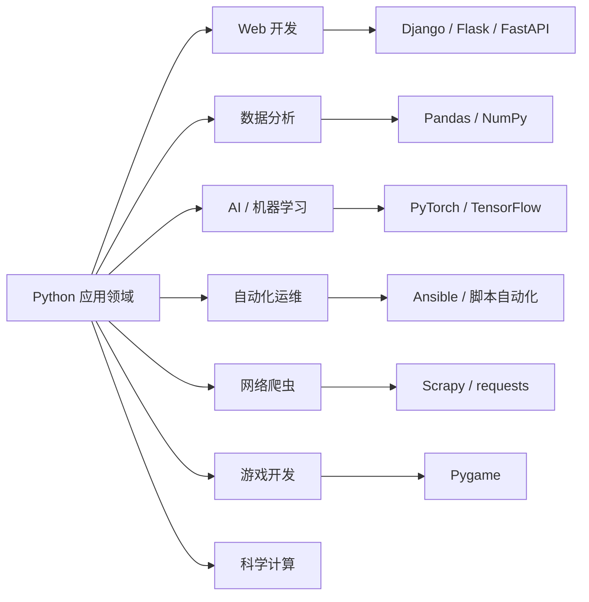
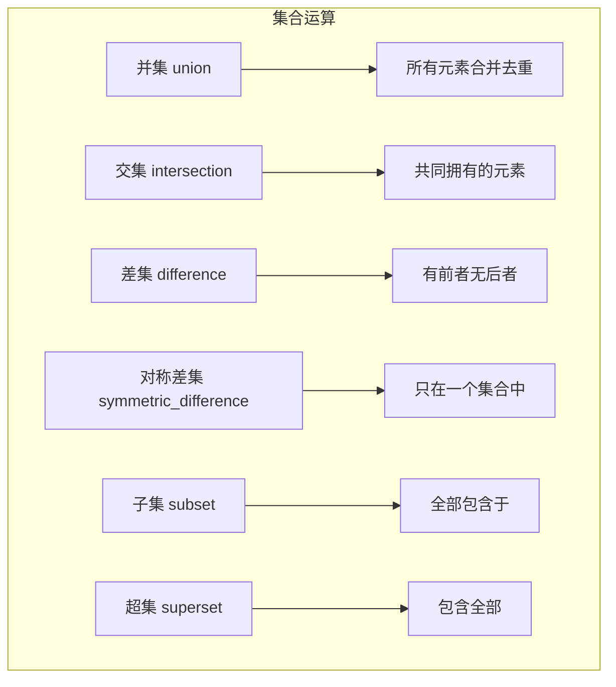
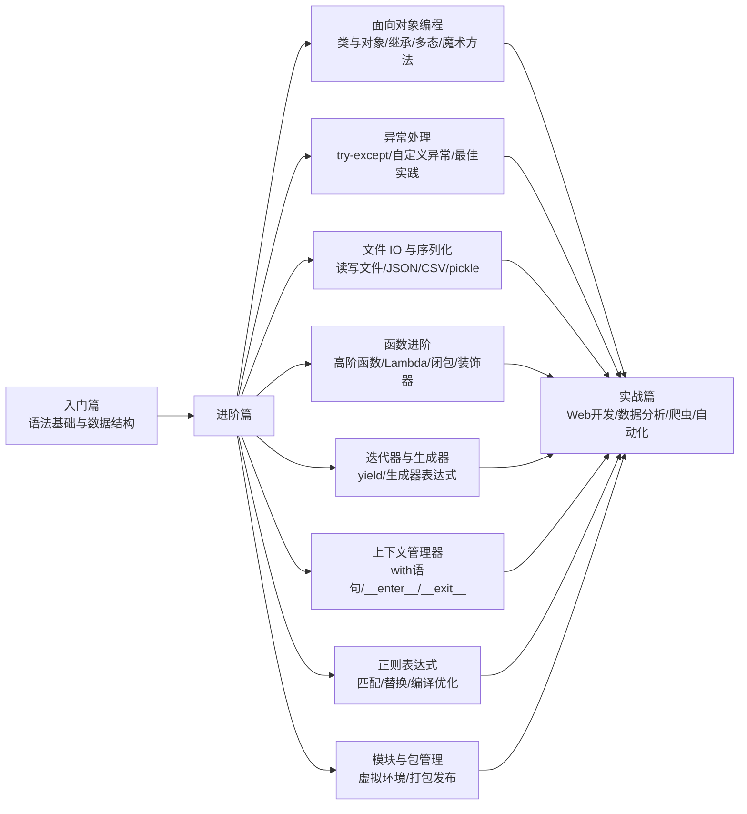

# Python 语法基础与数据结构

> **📖 文档说明**
>
> 本文档是「从零基础新手到实战老手」三部曲的**第一篇：零基础入门篇**。我们将从"Python 是什么"开始，一步步带你掌握 Python 的核心语法和内置数据结构。每个知识点都配有通俗解释和可直接运行的代码示例，即使你完全没有编程经验也能跟上。
>
> **👥 适用人群**
> - 完全没有编程经验的纯新手
> - 从其他语言（Java/C/JavaScript 等）转 Python 的开发者
> - 学过一点 Python 但基础不扎实、想系统补课的同学
>
> **📚 前置知识**
> - 无。会用电脑、会打字就够了。
>
> **🗺️ 学习路径提示**
> - 建议按章节顺序学习，每章看完后动手敲一遍代码示例
> - 每章末尾的「练习题」务必尝试完成，编程是练出来的
> - 学完本文档后，可继续学习「进阶篇」（面向对象、异常处理、文件 IO、装饰器等）

---

## 1. Python 概述与环境搭建

### 1.1 Python 是什么

#### Python 的诞生与历史

Python 由荷兰程序员 **Guido van Rossum**（吉多·范罗苏姆）于 1989 年圣诞节期间开始设计，1991 年发布第一个版本。名字来源于英国喜剧团体 Monty Python，而不是蟒蛇——Guido 希望这门语言既有趣又好用。

> 💡 **小知识**：Python 的官方吉祥物是一条蓝色的蟒蛇，但语言名字确实来自喜剧团体 Monty Python's Flying Circus。Guido 当时正在看这个剧，觉得名字好玩就用了。

#### Python 的核心特点

| 特点 | 通俗解释 |
|------|----------|
| **简洁优雅** | 语法接近自然语言，同样的功能 Python 代码量通常只有 Java 的 1/3 到 1/2 |
| **解释型语言** | 不需要编译，写一行就能运行一行，开发效率高 |
| **动态类型** | 变量不需要声明类型，你给它什么值它就是什么类型 |
| **多范式** | 支持面向对象、函数式、过程式等多种编程风格 |
| **丰富生态** | PyPI（Python 包索引）上有超过 50 万个第三方库，几乎什么功能都有现成的轮子 |
| **跨平台** | 同一份代码可以在 Windows、macOS、Linux 上运行 |

#### Python 的应用领域



- **Web 开发**：用 Django、Flask、FastAPI 等框架搭建网站和 API 服务
- **数据分析**：用 Pandas、NumPy 处理和分析海量数据
- **AI / 机器学习**：PyTorch、TensorFlow 等深度学习框架的首选语言
- **自动化运维**：写脚本自动完成重复工作，如批量处理文件、定时任务
- **网络爬虫**：自动抓取网页数据，是数据采集的利器
- **游戏开发**：用 Pygame 做 2D 小游戏
- **科学计算**：Matplotlib 画图、SciPy 做科学计算

#### Python 2 vs Python 3

Python 有两个大版本：Python 2 和 Python 3。

- **Python 2**：2000 年发布，2020 年 1 月 1 日正式停止维护（EOL）。不再有安全更新和 bug 修复。
- **Python 3**：2008 年发布，是当前唯一推荐使用的版本。Python 3 不完全兼容 Python 2，修复了很多设计缺陷。

> ⚠️ **注意**：现在所有新项目都必须使用 Python 3。如果你在网上看到 Python 2 的教程（比如 `print "hello"` 不带括号），直接关掉，那已经过时了。

---

### 1.2 安装 Python 环境

#### Windows 安装步骤

1. **下载安装包**：打开 Python 官网 [https://www.python.org/downloads/](https://www.python.org/downloads/)，点击黄色的 "Download Python 3.x.x" 按钮下载最新稳定版。
2. **运行安装程序**：双击下载的 `.exe` 文件。
3. **关键一步**：在安装界面底部，**务必勾选 "Add Python.exe to PATH"**（将 Python 添加到环境变量）。这一步不勾，后面命令行里会找不到 Python。
4. **选择安装方式**：
   - "Install Now"：默认安装，适合新手
   - "Customize installation"：自定义安装，可以改安装路径
5. **等待安装完成**，点击 "Close"。

> ⚠️ **新手最容易踩的坑**：忘记勾选 "Add Python to PATH"。如果忘了，可以重新运行安装程序选择 "Modify" 修复，或者手动添加环境变量。

#### macOS 安装

**方法一：官网安装包（推荐新手）**
1. 去 [https://www.python.org/downloads/macos/](https://www.python.org/downloads/macos/) 下载 `.pkg` 安装包
2. 双击运行，按提示下一步即可

**方法二：Homebrew（推荐开发者）**
```bash
# 先安装 Homebrew（如果没装的话）
/bin/bash -c "$(curl -fsSL https://raw.githubusercontent.com/Homebrew/install/HEAD/install.sh)"

# 安装 Python
brew install python
```

#### Linux 安装

大多数 Linux 发行版已经预装了 Python 3。

**Ubuntu / Debian（apt）**：
```bash
sudo apt update
sudo apt install python3 python3-pip
```

**CentOS / RHEL（yum）**：
```bash
sudo yum install python3 python3-pip
```

> 💡 **进阶选读**：纯新手可先跳过 pyenv，装好 Python 能跑起来即可。等你需要同时维护多个不同 Python 版本的项目时，再回来学也不迟。

**多版本管理（pyenv）**：如果你需要在一台电脑上同时管理多个 Python 版本（比如项目 A 用 3.9，项目 B 用 3.12），推荐使用 pyenv：
```bash
# 安装 pyenv（以 macOS/Linux 为例）
curl https://pyenv.run | bash

# 安装指定版本
pyenv install 3.12.0

# 设置全局默认版本
pyenv global 3.12.0
```

#### 验证安装

打开命令行（Windows 按 `Win + R` 输入 `cmd`，macOS 打开终端），输入：

```bash
python --version
# 或者 Linux/macOS 上可能是
python3 --version
```

如果输出类似 `Python 3.12.0` 的版本号，说明安装成功。

再验证 pip（Python 的包管理工具）：
```bash
pip --version
# 或者
pip3 --version
```

> 💡 **提示**：Windows 上如果 `python` 命令打不开 Microsoft Store，说明 PATH 没配好。可以尝试 `py --version`（Python 启动器），或者重新安装并勾选 PATH。

---

### 1.3 开发工具选择

#### VS Code 配置 Python（强烈推荐）

VS Code 是微软出品的免费轻量级代码编辑器，通过插件可以变成强大的 Python IDE。

**安装步骤**：
1. 下载安装 VS Code：[https://code.visualstudio.com/](https://code.visualstudio.com/)
2. 打开 VS Code，点击左侧扩展图标（或按 `Ctrl + Shift + X`）
3. 搜索 "Python"，安装微软官方的 Python 扩展（作者是 Microsoft）
4. 新建一个文件，保存为 `hello.py`（`.py` 是 Python 文件的后缀名）
5. 按 `Ctrl + Shift + P`，输入 "Python: Select Interpreter"，选择你安装的 Python 版本
6. 写代码，按右上角的运行按钮（或按 `F5`）运行

> 💡 **VS Code 常用快捷键**：
> - `Ctrl + S`：保存文件
> - `F5`：调试运行
> - `Ctrl + Alt + N`（装 Code Runner 插件后）：直接运行
> - `Ctrl + /`：注释/取消注释当前行

#### PyCharm 介绍

PyCharm 是 JetBrains 出品的专业 Python IDE，功能非常强大，但相对较重。

- **PyCharm Community（社区版）**：免费，功能足够日常开发和学习
- **PyCharm Professional（专业版）**：付费，支持 Web 开发、数据库工具、远程开发等高级功能

新手建议先用 VS Code，轻量且够用。等项目复杂了再考虑 PyCharm。

#### 在线编辑器

如果你暂时不想安装任何软件，可以用在线编辑器直接在浏览器里写 Python：

- **Google Colab**：[https://colab.research.google.com/](https://colab.research.google.com/) — 免费，支持 GPU，适合数据分析和机器学习
- **Replit**：[https://replit.com/](https://replit.com/) — 支持多种语言，界面友好
- **Python 官方在线 Shell**：[https://www.python.org/shell/](https://www.python.org/shell/)

#### 交互式解释器 REPL 的使用

Python 自带一个交互式环境，叫 REPL（Read-Eval-Print Loop，读取-求值-输出循环）。你输入一行代码，它立刻执行并显示结果，非常适合测试小片段代码。

**打开方式**：在命令行输入 `python`（或 `python3`），你会看到 `>>>` 提示符：

```python
Python 3.12.0 (main, Oct  2 2023, 12:03:00) [GCC 11.4.0] on linux
Type "help", "copyright", "credits" or "license" for more information.
>>> print("Hello, Python!")
Hello, Python!
>>> 1 + 2 * 3
7
>>> name = "小明"
>>> print(f"你好，{name}")
你好，小明
>>> exit()  # 或者按 Ctrl + Z（Windows）/ Ctrl + D（macOS/Linux）退出
```

> 💡 **REPL 的用途**：快速验证语法、测试小函数、当计算器用。但写完整项目还是要用 `.py` 文件。

---

### 1.4 第一个 Python 程序

#### Hello World 详解

按照编程界的传统，我们的第一个程序是输出 "Hello, World!"。

新建一个文件 `hello.py`，写入：

```python
# 这是我的第一个 Python 程序
print("Hello, World!")
```

运行它：
```bash
python hello.py
```

输出：
```text
Hello, World!
```

就这么简单！一行代码就能输出内容。对比一下其他语言：

| 语言 | Hello World 代码 |
|------|------------------|
| Python | `print("Hello, World!")` |
| Java | `public class Main { public static void main(String[] args) { System.out.println("Hello, World!"); } }` |
| C | `#include <stdio.h> int main() { printf("Hello, World!"); return 0; }` |

看到了吧，Python 的简洁不是吹的。

#### 脚本运行 vs 交互运行

- **脚本运行**：把代码写在 `.py` 文件里，用 `python 文件名.py` 运行。适合写完整程序。
- **交互运行（REPL）**：在命令行输入 `python` 进入交互模式，逐行输入逐行执行。适合测试和学习。

#### print() 函数基础

`print()` 是 Python 中最常用的函数之一，用来在屏幕上输出内容。

```python
# 输出字符串
print("你好，世界！")

# 输出数字
print(42)

# 输出多个内容，用逗号分隔，默认用空格隔开
print("我的年龄是", 25, "岁")

# 输出变量
name = "小红"
print(name)

# 不换行输出（默认 print 会在末尾加换行）
print("第一行", end="")
print("第二行")  # 输出：第一行第二行

# 自定义分隔符
print("a", "b", "c", sep="-")  # 输出：a-b-c
```

#### 代码注释

注释是给人看的说明文字，Python 解释器会忽略它们。写注释是好习惯，能让你（和别人）以后看懂代码在做什么。

**单行注释**：用 `#` 开头，`#` 后面的内容都是注释。

```python
# 这是一行注释，解释下面的代码在做什么
print("Hello")  # 注释也可以写在代码行的末尾
```

**多行注释**：Python 没有专门的多行注释语法，但可以用三引号字符串来实现（虽然严格来说这是字符串不是注释，但如果不赋值给变量，效果和注释一样）。

```python
"""
这是多行注释的第一行
这是第二行
这是第三行
"""
print("Hello")

'''
也可以用三个单引号
效果一样
'''
```

> ⚠️ **注意**：三引号字符串如果出现在函数、类或模块的开头，会被当作文档字符串（docstring），可以通过 `__doc__` 属性访问。这在后面函数章节会详细讲。

#### Python 之禅

Python 社区有一套设计哲学，叫做 "Python 之禅"（The Zen of Python），在 Python 交互环境里输入 `import this` 就能看到：

```python
>>> import this
The Zen of Python, by Tim Peters

Beautiful is better than ugly.
Explicit is better than implicit.
Simple is better than complex.
Complex is better than complicated.
Flat is better than nested.
Sparse is better than dense.
Readability counts.
Special cases aren't special enough to break the rules.
Although practicality beats purity.
Errors should never pass silently.
Unless explicitly silenced.
In the face of ambiguity, refuse the temptation to guess.
There should be one-- and preferably only one --obvious way to do it.
Although that way may not be obvious at first unless you're Dutch.
Now is better than never.
Although never is often better than *right* now.
If the implementation is hard to explain, it's a bad idea.
If the implementation is easy to explain, it may be a good idea.
Namespaces are one honking great idea -- let's do more of those!
```

翻译过来核心意思就是：**写代码要优美、明确、简单、可读**。这是 Python 社区的审美标准，也是你写 Python 代码时应该追求的方向。

---

### 📝 本章总结

1. Python 是 Guido van Rossum 于 1991 年发布的高级编程语言，以简洁优雅著称
2. Python 是解释型、动态类型、多范式语言，拥有极其丰富的第三方库生态
3. 应用领域广泛：Web 开发、数据分析、AI/机器学习、自动化、爬虫等
4. 必须使用 Python 3，Python 2 已于 2020 年停止维护
5. 安装时务必勾选 "Add Python to PATH"
6. 推荐使用 VS Code + Python 扩展作为开发工具
7. `print()` 是最基础的输出函数，`#` 是单行注释

### 🎯 练习题

1. 在你的电脑上安装 Python 3，并在命令行验证 `python --version` 输出正确版本号
2. 用 VS Code 创建一个 `hello.py` 文件，输出你的名字和一句自我介绍
3. 在 Python 交互环境（REPL）中计算 `(3 + 5) * 2 - 1` 的结果
4. 尝试用 `print()` 输出三行内容，分别使用默认换行和 `end=""` 不换行，观察区别
5. 输入 `import this`，读一读 Python 之禅，挑出你最喜欢的 3 条

---

## 2. 变量与基本数据类型

### 2.1 变量与命名

#### 什么是变量

想象你有一个贴了标签的盒子，你可以往里面放东西，也可以随时换掉里面的东西。**变量就是这个贴了标签的盒子**——标签是变量名，盒子里的东西是变量的值。

在 Python 中，变量不需要声明类型，直接赋值即可：

```python
# 把数字 10 放进名为 age 的变量里
age = 10

# 把字符串 "小明" 放进名为 name 的变量里
name = "小明"

# 查看变量的值
print(age)   # 输出：10
print(name)  # 输出：小明

# 修改变量的值（换掉盒子里的东西）
age = 11
print(age)   # 输出：11
```

> 💡 **与 C/Java 对比**：在 C 或 Java 中，你需要先声明变量类型（如 `int age = 10;`），而且这个变量以后只能存整数。Python 不需要声明类型，同一个变量可以先存数字，再存字符串——这就是「动态类型」。

#### 命名规则

变量名不是随便起的，必须遵守以下规则：

1. 只能包含**字母（a-z, A-Z）、数字（0-9）、下划线（_）**
2. **不能以数字开头**（`1name` 是非法的，`name1` 是合法的）
3. **区分大小写**（`age` 和 `Age` 是两个不同的变量）
4. 不能使用 Python 的**保留字**（关键字）

Python 的保留字（关键字）有这些，它们有特殊含义，不能用作变量名：

```text
False, None, True, and, as, assert, async, await, break, class,
continue, def, del, elif, else, except, finally, for, from, global,
if, import, in, is, lambda, nonlocal, not, or, pass, raise, return,
try, while, with, yield
```

> ⚠️ **常见错误**：
> - `1name = "小明"` → 数字开头，报错
> - `my-name = "小明"` → 用了连字符，报错（应该用下划线 `my_name`）
> - `class = "一班"` → `class` 是关键字，报错
> - `print = 123` → 虽然 `print` 不是关键字，但它是内置函数名，覆盖后会导致 `print()` 不能用了，强烈不建议

#### 命名规范（PEP 8）

规则是必须遵守的，规范是建议遵守的。Python 社区有一套编码风格指南叫 **PEP 8**，其中关于变量命名的建议：

- **变量名和函数名**：用小写字母 + 下划线分隔（snake_case），如 `user_name`, `max_score`
- **常量**：全大写 + 下划线，如 `MAX_SIZE`, `PI`
- **类名**：大驼峰（PascalCase），如 `StudentInfo`（后面面向对象章节会讲）
- **变量名要有意义**：`age` 比 `a` 好，`user_name` 比 `un` 好

```python
# 好的命名
student_name = "小红"
max_attempts = 3
is_active = True

# 不好的命名（虽然能运行，但可读性差）
s = "小红"
ma = 3
ia = True
```

#### 变量赋值与多重赋值

```python
# 普通赋值
x = 10

# 多重赋值：一行给多个变量赋值
a, b, c = 1, 2, 3
print(a, b, c)  # 输出：1 2 3

# 交换两个变量的值（Python 特色，不需要临时变量）
x, y = 5, 10
x, y = y, x
print(x, y)  # 输出：10 5

# 给多个变量赋同一个值
a = b = c = 0
print(a, b, c)  # 输出：0 0 0
```

> 💡 **Python 特色**：在很多语言中交换两个变量需要一个临时变量（`temp = x; x = y; y = temp`），Python 直接 `x, y = y, x` 就搞定了。

#### 动态类型特性

Python 变量的类型是在运行时确定的，而且可以随时改变：

```python
x = 10          # x 现在是整数
print(type(x))  # <class 'int'>

x = 3.14        # x 变成了浮点数
print(type(x))  # <class 'float'>

x = "hello"     # x 又变成了字符串
print(type(x))  # <class 'str'>
```

这种灵活性是双刃剑：好处是写代码快，坏处是如果变量类型和你预期的不一样，可能会在运行时报错。后面我们会学到类型注解来缓解这个问题。

---

### 2.2 整数 int

整数就是没有小数点的数字，比如 `0`, `42`, `-7`, `1000000`。

#### 整数表示

```python
# 十进制（日常用的）
a = 42
print(a)  # 42

# 二进制（0b 开头）
b = 0b1010  # 二进制的 1010 = 十进制的 10
print(b)    # 10

# 八进制（0o 开头）
c = 0o52  # 八进制的 52 = 十进制的 42
print(c)  # 42

# 十六进制（0x 开头）
d = 0x2A  # 十六进制的 2A = 十进制的 42
print(d)  # 42
```

> 💡 **什么时候用其他进制**：日常开发基本只用十进制。二进制常用于位运算，十六进制常用于表示颜色（如 `0xFF0000` 表示红色）和内存地址。新手了解即可。

Python 还提供了三个内置函数，可以把十进制整数转换成对应进制的**字符串**：

```python
n = 42

# bin()：转二进制字符串（带 0b 前缀）
print(bin(n))   # 0b101010

# oct()：转八进制字符串（带 0o 前缀）
print(oct(n))   # 0o52

# hex()：转十六进制字符串（带 0x 前缀）
print(hex(n))   # 0x2a

# 去掉前缀：用切片 [2:] 或 format()
print(bin(n)[2:])      # 101010
print(format(n, 'b'))  # 101010（format 的 b/o/x 格式也可以）
print(format(n, 'o'))  # 52
print(format(n, 'x'))  # 2a
print(format(n, 'X'))  # 2A（大写）
```

> ⚠️ **注意**：`bin()`/`oct()`/`hex()` 返回的是**字符串**，不是数字。如果需要把其他进制的字符串转回整数，用 `int("1010", 2)`（前面类型转换章节讲过）。

#### 整数大小无限制

很多语言（如 C、Java）的整数有大小限制（比如 32 位 int 最大约 21 亿），超过就会溢出。**Python 的整数没有大小限制**，想多大就多大：

```python
# 超级大的整数也没问题
big_number = 9999999999999999999999999999999999999999
print(big_number)  # 正常输出

# 计算 2 的 1000 次方
huge = 2 ** 1000
print(huge)  # 一个 302 位的超级大数，Python 轻松处理
```

#### 常用运算

```python
a = 10
b = 3

print(a + b)  # 加法：13
print(a - b)  # 减法：7
print(a * b)  # 乘法：30
print(a / b)  # 除法：3.3333333333333335（注意结果是浮点数）
print(a // b) # 整除（地板除）：3（只取整数部分）
print(a % b)  # 取模（余数）：1
print(a ** b) # 幂运算：1000（10 的 3 次方）
```

> ⚠️ **注意**：`/` 除法的结果永远是浮点数，即使能整除（如 `10 / 2 = 5.0`）。想要整数结果用 `//`。

---

### 2.3 浮点数 float

浮点数就是带小数点的数字，比如 `3.14`, `-0.5`, `1.0`。

#### 浮点数表示

```python
pi = 3.14159
temperature = -2.5
score = 95.5

print(type(pi))  # <class 'float'>
```

#### 浮点数精度问题

这是编程中一个经典的坑：

```python
print(0.1 + 0.2)  # 输出：0.30000000000000004，而不是 0.3！
```

**为什么会这样？** 因为计算机内部用二进制存储浮点数，而 `0.1` 和 `0.2` 在二进制中是无限循环小数（就像十进制中 `1/3 = 0.333...` 一样），存储时只能近似，所以相加会有微小误差。

这不是 Python 的 bug，所有编程语言都有这个问题。

**怎么解决？**
- 日常开发中，这个误差通常可以忽略
- 如果需要精确计算（比如金融场景），使用 `Decimal` 模块
- `Decimal` 会直接解析字符串，**不会经过 float 二进制存储的失真过程**，直接用十进制高精度运算

```python
from decimal import Decimal

result = Decimal('0.1') + Decimal('0.2')
print(result)  # 0.3（精确！）
```

> ⚠️ **面试高频考点**：`0.1 + 0.2 != 0.3` 是经典面试题。答案要点：浮点数二进制表示的精度限制，不是语言 bug；精确计算用 Decimal。

#### 科学计数法

特别大或特别小的数可以用科学计数法表示：

```python
# 1e6 表示 1 × 10^6 = 1000000
big = 1e6
print(big)  # 1000000.0

# 1.5e-3 表示 1.5 × 10^-3 = 0.0015
small = 1.5e-3
print(small)  # 0.0015
```

#### Decimal 模块简介

`decimal` 模块提供了高精度的十进制浮点数运算，适合金融、会计等对精度要求高的场景：

```python
from decimal import Decimal, getcontext

# 设置精度为 30 位有效数字
getcontext().prec = 30

# 用字符串创建 Decimal（不要用浮点数创建，否则会带入浮点数的误差）
a = Decimal('0.1')
b = Decimal('0.2')
print(a + b)  # 0.3

# 高精度计算
print(Decimal('1') / Decimal('7'))  # 0.142857142857142857142857142857（30位精度）
```

---

### 2.4 布尔值 bool

布尔值只有两个：`True`（真）和 `False`（假）。注意首字母大写。

#### True 和 False

```python
is_student = True
is_adult = False

print(type(is_student))  # <class 'bool'>
```

布尔值通常来自比较运算的结果：

```python
print(10 > 5)    # True
print(10 == 5)   # False
print(10 != 5)   # True
```

#### 布尔运算

```python
a = True
b = False

# and（与）：两个都为 True 才是 True
print(a and b)  # False
print(True and True)  # True

# or（或）：只要有一个为 True 就是 True
print(a or b)   # True
print(False or False)  # False

# not（非）：取反
print(not a)    # False
print(not b)    # True
```

#### 真值测试（什么是 falsy 值）

在 Python 中，所有值都可以用来判断真假。以下值在条件判断中会被当作 `False`（称为 **falsy 值**）：

| falsy 值 | 说明 |
|----------|------|
| `False` | 布尔假 |
| `None` | 空值 |
| `0` | 整数零 |
| `0.0` | 浮点数零 |
| `""` | 空字符串 |
| `[]` | 空列表 |
| `{}` | 空字典 |
| `()` | 空元组 |
| `set()` | 空集合 |

除此之外的所有值都是 `True`（称为 **truthy 值**）。

```python
# 这些在 if 中都为 False
if not 0:
    print("0 是假的")  # 会输出

if not "":
    print("空字符串是假的")  # 会输出

if not []:
    print("空列表是假的")  # 会输出

# 非空字符串、非零数字都是 True
if "hello":
    print("非空字符串是真的")  # 会输出

if -1:
    print("非零数字是真的")  # 会输出
```

> 💡 **实用技巧**：判断列表是否为空时，直接 `if my_list:` 比 `if len(my_list) > 0:` 更 Pythonic（更符合 Python 风格）。

#### bool 与 int 的关系

在 Python 中，`bool` 是 `int` 的子类。`True` 等于 `1`，`False` 等于 `0`：

```python
print(True == 1)   # True
print(False == 0)  # True

print(True + 1)    # 2（True 当作 1 参与运算）
print(False * 10)  # 0

print(isinstance(True, int))  # True（bool 确实是 int 的子类）
```

> ⚠️ **注意**：虽然 `True == 1`，但 `True is 1` 是 `False`（它们是不同的对象）。`is` 和 `==` 的区别在后面运算符章节会详细讲。

---

### 2.5 类型转换与类型检查

#### 类型转换函数

Python 提供了内置函数来在不同类型之间转换：

```python
# int()：转整数
print(int(3.14))      # 3（浮点数转整数，直接截断小数部分，不是四舍五入）
print(int("123"))     # 123（字符串转整数）
print(int("0xFF", 16))  # 255（按十六进制解析字符串）
# print(int("3.14"))  # 报错！字符串 "3.14" 不能直接转 int

# float()：转浮点数
print(float(42))       # 42.0
print(float("3.14"))   # 3.14

# str()：转字符串
print(str(42))         # "42"
print(str(3.14))       # "3.14"
print(str(True))       # "True"

# bool()：转布尔值
print(bool(0))         # False
print(bool("hello"))   # True
print(bool(""))        # False
```

> ⚠️ **常见坑**：
> - `int(3.9)` 的结果是 `3`，不是 `4`——它是截断，不是四舍五入。想要四舍五入用 `round(3.9)`。
> - `int("12.5")` 会报错，因为字符串里有小数点。需要先 `float("12.5")` 再 `int()`。
> - `bool("False")` 的结果是 `True`！因为非空字符串都是 truthy。要把字符串 "False" 转成布尔假，需要手动判断。

#### type() 和 isinstance()

**type()**：返回变量的精确类型。

```python
x = 42
print(type(x))        # <class 'int'>
print(type(x) == int) # True
```

**isinstance()**：判断变量是否是某个类型（或其子类）的实例。

```python
x = 42
print(isinstance(x, int))    # True
print(isinstance(x, float))  # False

# bool 是 int 的子类，所以 isinstance(True, int) 为 True
print(isinstance(True, int))  # True
print(type(True) == int)      # False（type 是精确匹配）
```

> 💡 **type() vs isinstance() 怎么选**：
> - 想知道变量「到底是什么类型」用 `type()`
> - 想判断变量「能不能当作某类型来用」用 `isinstance()`（推荐，因为它考虑了继承关系）
> - 大多数情况下推荐用 `isinstance()`

#### 类型转换的常见坑

```python
# 坑1：字符串拼接时忘记转换类型
age = 25
# print("我今年" + age + "岁")  # 报错！不能把字符串和整数直接拼接
print("我今年" + str(age) + "岁")  # 正确：先转字符串

# 坑2：input() 返回的永远是字符串
# num = input("请输入一个数字：")  # 假设输入 10
# print(num + 5)  # 报错！num 是字符串 "10"，不是数字
# 正确做法：
# num = int(input("请输入一个数字："))
# print(num + 5)

# 坑3：浮点数转整数是截断不是四舍五入
print(int(2.999))   # 2
print(round(2.999))  # 3（round 才是四舍五入）
```

---

### 📝 本章总结

1. 变量是「贴了标签的盒子」，Python 是动态类型语言，变量不需要声明类型
2. 变量命名规则：字母数字下划线、不能数字开头、区分大小写、不能用关键字
3. 命名规范：变量用 snake_case，常量用全大写
4. Python 整数没有大小限制；浮点数有精度问题（0.1+0.2≠0.3），精确计算用 Decimal
5. 布尔值只有 True 和 False；所有值都能判断真假，falsy 值包括 0、空字符串、空列表等
6. 类型转换用 int()/float()/str()/bool()；类型检查推荐用 isinstance()
7. `input()` 返回的是字符串，需要手动转换类型

### 🎯 练习题

1. 创建三个变量分别存储你的姓名、年龄、是否是学生，然后用 `print()` 输出它们的值和类型
2. 写代码验证 `0.1 + 0.2` 的结果，并尝试用 `Decimal` 得到精确的 `0.3`
3. 用多重赋值一行代码交换 `a = 100` 和 `b = 200` 的值
4. 判断以下哪些是 falsy 值：`0`, `0.0`, `""`, `"False"`, `[]`, `None`, `False`, `1`, `-1`, `"0"`
5. 用户输入一个数字字符串（如 `"123"`），将其转换为整数并乘以 2，输出结果

---

## 3. 运算符与表达式

### 3.1 算术运算符

#### 基本算术运算符

| 运算符 | 含义 | 示例 | 结果 |
|--------|------|------|------|
| `+` | 加法 | `3 + 2` | `5` |
| `-` | 减法 | `3 - 2` | `1` |
| `*` | 乘法 | `3 * 2` | `6` |
| `/` | 除法（结果为浮点数） | `7 / 2` | `3.5` |
| `//` | 整除（地板除，向下取整） | `7 // 2` | `3` |
| `%` | 取模（余数） | `7 % 2` | `1` |
| `**` | 幂运算 | `3 ** 2` | `9` |

```python
a = 10
b = 3

print("加法:", a + b)        # 13
print("减法:", a - b)        # 7
print("乘法:", a * b)        # 30
print("除法:", a / b)        # 3.3333333333333335
print("整除:", a // b)       # 3
print("取模:", a % b)        # 1
print("幂运算:", a ** b)     # 1000
```

#### 除法注意事项（/ vs //）

```python
# / 永远返回浮点数
print(10 / 2)   # 5.0（即使能整除也是浮点数）
print(9 / 2)    # 4.5

# // 是地板除（向下取整），注意负数的情况
print(9 // 2)    # 4
print(-9 // 2)   # -5（向下取整！-4.5 向下取整是 -5，不是 -4）
print(9 // -2)   # -5

# 如果你想要的是「截断小数部分」（向零取整），用 int()
print(int(-9 / 2))  # -4（向零取整）
```

> ⚠️ **面试高频考点**：`//` 是地板除（向下取整），不是截断。负数时容易搞混：`-9 // 2 = -5` 而不是 `-4`。

#### 取模运算的应用

取模运算（`%`）返回除法的余数，实际开发中非常有用：

```python
# 应用1：判断奇偶
num = 7
if num % 2 == 0:
    print("偶数")
else:
    print("奇数")  # 输出：奇数

# 应用2：获取数字的最后几位
print(12345 % 10)    # 5（最后一位）
print(12345 % 100)   # 45（最后两位）

# 应用3：循环计数（每隔 N 次执行一次）
for i in range(1, 11):
    if i % 3 == 0:
        print(f"{i} 是 3 的倍数")

# 应用4：负数取模（Python 的结果符号与除数一致）
print(7 % 3)    # 1
print(-7 % 3)   # 2（-7 = (-3)*3 + 2，余数是 2）
print(7 % -3)   # -2
```

> 💡 **与 C/Java 对比**：C/Java 中负数取模结果可能是负数（如 `-7 % 3 = -1`），Python 中余数的符号与除数一致（`-7 % 3 = 2`）。这是因为 Python 的 `%` 和 `//` 配套，满足 `a = (a // b) * b + a % b`。

---

### 3.2 比较运算符

#### 基本比较运算符

| 运算符 | 含义 | 示例 | 结果 |
|--------|------|------|------|
| `==` | 等于 | `3 == 3` | `True` |
| `!=` | 不等于 | `3 != 2` | `True` |
| `>` | 大于 | `3 > 2` | `True` |
| `<` | 小于 | `3 < 2` | `False` |
| `>=` | 大于等于 | `3 >= 3` | `True` |
| `<=` | 小于等于 | `3 <= 2` | `False` |

```python
a = 10
b = 20

print(a == b)  # False
print(a != b)  # True
print(a > b)   # False
print(a < b)   # True
print(a >= 10) # True
print(b <= 20) # True
```

#### 链式比较

Python 支持链式比较，这是一个很方便的特性：

```python
age = 25

# 判断 age 是否在 18 到 30 之间
print(18 <= age <= 30)  # True

# 等价于
print(18 <= age and age <= 30)  # True

# 更多链式比较
x = 5
print(1 < x < 10)        # True
print(10 > x > 0)        # True
print(x == 5 == 5.0)     # True（5 == 5 且 5 == 5.0）
```

> 💡 **与其他语言对比**：在 C/Java 中，`18 <= age <= 30` 会被解析为 `(18 <= age) <= 30`，结果是 `True <= 30`（即 `1 <= 30`），永远为 True，这是个经典 bug。Python 的链式比较是正确的数学语义。

#### is vs ==（身份比较 vs 值比较）

这是 Python 中非常重要的区别，也是面试高频考点：

- `==`：比较两个对象的**值**是否相等
- `is`：比较两个对象的**身份**（内存地址）是否相同，即是否是同一个对象

```python
a = [1, 2, 3]
b = [1, 2, 3]
c = a

print(a == b)  # True（值相同）
print(a is b)  # False（不是同一个对象，内存地址不同）
print(a is c)  # True（c 是 a 的引用，指向同一个对象）

# 用 id() 查看内存地址
print(id(a))  # 比如 140234567890
print(id(b))  # 不同的地址
print(id(c))  # 和 a 一样
```

```python
# 小整数缓存：Python 对 -5 到 256 之间的整数做了缓存，所以 is 也为 True
x = 100
y = 100
print(x is y)  # True（因为 100 在缓存范围内）

x = 1000
y = 1000
print(x is y)  # False（1000 不在缓存范围内，是两个不同对象）
print(x == y)  # True（值相等）
```

> 🔥 **面试高频考点**：
> - `==` 比较值，`is` 比较身份（内存地址）
> - 比较值用 `==`，比较是否是同一个对象用 `is`
> - 判断 `None` 时必须用 `is None`，不要用 `== None`（因为某些对象可能重写了 `__eq__` 导致 `== None` 返回 True）
> - 小整数缓存范围是 -5 到 256，这是 CPython 的实现细节，不要在代码中依赖它

---

### 3.3 逻辑运算符

#### and / or / not 的短路求值

逻辑运算符有一个重要特性叫**短路求值**（short-circuit evaluation）：从左到右计算，一旦能确定结果就停止，后面的表达式不会执行。

```python
# and 的短路：左边为 False 时，结果已经确定为 False，右边不会执行
def func():
    print("func 被执行了")
    return True

print(False and func())  # 输出：False（func 没有被执行！）
print(True and func())   # 输出：func 被执行了 \n True
```

```python
# or 的短路：左边为 True 时，结果已经确定为 True，右边不会执行
print(True or func())   # 输出：True（func 没有被执行！）
print(False or func())  # 输出：func 被执行了 \n True
```

```python
# not 没有短路，因为它只有一个操作数
print(not True)   # False
print(not False)  # True
```

> 💡 **短路求值的实用场景**：
> - 防止除零错误：`if b != 0 and a / b > 2:`（如果 b 为 0，`a / b` 不会执行）
> - 防止空对象访问：`if user is not None and user.name == "admin":`

#### 逻辑运算符返回值的特点

Python 的逻辑运算符**不一定返回布尔值**，它返回的是决定结果的那个操作数本身：

```python
# and：如果左边为 falsy，返回左边；否则返回右边
print(0 and "hello")     # 0（0 是 falsy，返回 0）
print("hello" and 0)     # 0（左边是 truthy，返回右边 0）
print("hello" and "world")  # "world"（左边 truthy，返回右边）

# or：如果左边为 truthy，返回左边；否则返回右边
print("hello" or 0)      # "hello"（左边 truthy，返回左边）
print(0 or "hello")      # "hello"（左边 falsy，返回右边）
print(0 or "")           # ""（左边 falsy，返回右边（也是 falsy））

# not：永远返回布尔值
print(not "hello")       # False
print(not 0)             # True
```

> 💡 **实用技巧**：利用 `or` 的返回值特性设置默认值：
> ```python
> name = user_input or "匿名"  # 如果 user_input 是空字符串或 None，就用 "匿名"
> ```
> 注意：如果 `user_input` 是 `0` 或 `False` 这种合法的 falsy 值，这种写法会出问题。

---

### 3.4 赋值运算符

#### 基本赋值运算符

| 运算符 | 含义 | 示例 | 等价于 |
|--------|------|------|--------|
| `=` | 赋值 | `x = 5` | - |
| `+=` | 加后赋值 | `x += 3` | `x = x + 3` |
| `-=` | 减后赋值 | `x -= 3` | `x = x - 3` |
| `*=` | 乘后赋值 | `x *= 3` | `x = x * 3` |
| `/=` | 除后赋值 | `x /= 3` | `x = x / 3` |
| `//=` | 整除后赋值 | `x //= 3` | `x = x // 3` |
| `%=` | 取模后赋值 | `x %= 3` | `x = x % 3` |
| `**=` | 幂后赋值 | `x **= 3` | `x = x ** 3` |

```python
x = 10
x += 5    # x = 15
x -= 3    # x = 12
x *= 2    # x = 24
x /= 4    # x = 6.0（注意变成浮点数了）
x //= 2   # x = 3.0
x **= 2   # x = 9.0
print(x)  # 9.0
```

> ⚠️ **注意**：Python 没有 `++` 和 `--` 运算符！在 C/Java 中常见的 `i++` 在 Python 中是非法的。要用 `i += 1`。

#### 海象运算符 :=（Python 3.8+）

海象运算符（walrus operator）`:=` 可以在表达式中同时完成赋值和使用，让代码更简洁。因为 `:=` 长得像海象的眼睛和獠牙而得名。

```python
# 传统写法：先赋值再判断
line = input("请输入：")
while line != "quit":
    print(f"你输入了：{line}")
    line = input("请输入：")

# 海象运算符写法：在条件中赋值
while (line := input("请输入：")) != "quit":
    print(f"你输入了：{line}")
```
这里用的是 Python f-string 格式化，`{name}`会自动读取变量 name 里面的文字
```python
# 另一个例子：列表推导式中避免重复计算
data = [1, 2, 3, 4, 5]

# 传统写法：计算两次
result = [x * 2 for x in data if x * 2 > 5]

# 海象运算符：只计算一次
result = [y for x in data if (y := x * 2) > 5]
```

> ⚠️ **注意**：海象运算符必须加括号，否则优先级可能出问题。它适合用在「赋值后立即使用」的场景，不要滥用，否则会降低可读性。

---

### 3.5 位运算符（了解）

位运算符直接操作二进制位，日常开发用得不多，但在某些场景（如底层开发、算法优化、标志位）很有用。

| 运算符 | 含义 | 示例（十进制） | 二进制说明 |
|--------|------|----------------|------------|
| `&` | 按位与 | `6 & 3 = 2` | `110 & 011 = 010` |
| `\|` | 按位或 | `6 \| 3 = 7` | `110 \| 011 = 111` |
| `^` | 按位异或 | `6 ^ 3 = 5` | `110 ^ 011 = 101` |
| `~` | 按位取反 | `~6 = -7` | `~000...0110 = 111...1001`（补码） |
| `<<` | 左移 | `6 << 1 = 12` | `110 << 1 = 1100`（相当于 ×2） |
| `>>` | 右移 | `6 >> 1 = 3` | `110 >> 1 = 11`（相当于 ÷2 取整） |

```python
a = 6   # 二进制：110
b = 3   # 二进制：011

print(a & b)   # 2（010）
print(a | b)   # 7（111）
print(a ^ b)   # 5（101）
print(~a)      # -7
print(a << 1)  # 12（左移一位 = 乘以 2）
print(a >> 1)  # 3（右移一位 = 除以 2 取整）
```

#### 位运算的实际应用场景

```python
# 应用1：用一个整数存储多个布尔标志（权限管理）
READ = 1 << 0    # 0001 = 1
WRITE = 1 << 1   # 0010 = 2
EXECUTE = 1 << 2 # 0100 = 4

# 用户有读和写的权限
permission = READ | WRITE  # 0011 = 3

# 检查是否有写权限
print(bool(permission & WRITE))  # True
# 检查是否有执行权限
print(bool(permission & EXECUTE))  # False

# 添加执行权限
permission |= EXECUTE  # 0111 = 7

# 移除写权限
permission &= ~WRITE  # 0101 = 5
```

```python
# 应用2：交换两个变量（不使用临时变量）
a = 5
b = 10
a ^= b
b ^= a
a ^= b
print(a, b)  # 10 5
# 不过 Python 中直接 a, b = b, a 更简洁，这个只是展示位运算能力
```

```python
# 应用3：判断奇偶（比 % 2 稍快，虽然现代编译器/解释器已经优化了）
x = 7
print(x & 1)  # 1（奇数）
x = 8
print(x & 1)  # 0（偶数）
```

> 💡 **新手提示**：位运算在日常 Web 开发、数据分析中很少用到，了解概念即可。如果做算法竞赛、底层开发、嵌入式，会用得比较多。

---

### 3.6 运算符优先级与结合性

#### 优先级表

当一个表达式中有多个运算符时，Python 按照优先级从高到低计算。以下是常用运算符的优先级（从高到低）：

| 优先级 | 运算符 | 说明 |
|--------|--------|------|
| 1 | `()` | 括号 |
| 2 | `**` | 幂运算 |
| 3 | `+x`, `-x`, `~x` | 正号、负号、按位取反 |
| 4 | `*`, `/`, `//`, `%` | 乘除类 |
| 5 | `+`, `-` | 加减 |
| 6 | `<<`, `>>` | 位移 |
| 7 | `&` | 按位与 |
| 8 | `^` | 按位异或 |
| 9 | `\|` | 按位或 |
| 10 | `==`, `!=`, `>`, `<`, `>=`, `<=`, `is`, `is not`, `in`, `not in` | 比较 |
| 11 | `not` | 逻辑非 |
| 12 | `and` | 逻辑与 |
| 13 | `or` | 逻辑或 |
| 14 | `if-else` | 条件表达式 |
| 15 | `lambda` | lambda 表达式 |
| 16 | `:=` | 海象运算符 |

```python
# 优先级示例
result = 2 + 3 * 4
print(result)  # 14（先乘后加）

result = (2 + 3) * 4
print(result)  # 20（括号改变优先级）

result = 2 ** 3 ** 2
print(result)  # 512（幂运算右结合，先算 3**2=9，再算 2**9=512）
```

#### 用括号提升可读性

> 💡 **最佳实践**：不要试图记住所有优先级！当表达式复杂时，直接加括号，既保证正确又提升可读性。

```python
# 不好的写法：依赖优先级，可读性差
if a > b and c < d or e == f:
    pass

# 好的写法：加括号明确意图
if (a > b and c < d) or (e == f):
    pass
```

---

### 📝 本章总结

1. 算术运算符：`+ - * / // % **`，注意 `/` 返回浮点数，`//` 是地板除
2. 比较运算符支持链式比较（`18 <= age <= 30`），这是 Python 特色
3. `==` 比较值，`is` 比较身份（内存地址）；判断 None 必须用 `is None`
4. 逻辑运算符有短路求值特性，且 `and`/`or` 返回的是操作数本身而非布尔值
5. Python 没有 `++`/`--`，用 `+= 1`；海象运算符 `:=` 可在表达式中赋值
6. 位运算符了解即可，日常开发用得少
7. 复杂表达式加括号，不要依赖优先级记忆

### 🎯 练习题

1. 计算并解释：`7 // 2`、`7 / 2`、`-7 // 2`、`7 % 2`、`-7 % 2` 的结果
2. 写一个函数判断一个数是否是 3 的倍数（用取模运算）
3. 解释 `==` 和 `is` 的区别，各举一个使用场景
4. 利用 `or` 的短路特性，写一行代码：如果 `name` 是空字符串或 None，就设为 `"游客"`
5. 用海象运算符 `:=` 改写以下代码：
   ```python
   nums = [1, 2, 3, 4, 5]
   result = []
   for n in nums:
       square = n * n
       if square > 10:
           result.append(square)
   ```

---

## 4. 控制流

### 4.1 条件语句 if

#### if/elif/else 语法

条件语句让程序根据不同情况执行不同的代码块。Python 的条件语句用 `if`、`elif`（else if 的缩写）、`else`。

```python
age = 20

if age < 18:
    print("你是未成年人")
elif age < 60:
    print("你是成年人")
else:
    print("你是老年人")
```

输出：
```text
你是成年人
```

语法要点：
- `if` 后面跟条件表达式，以冒号 `:` 结尾
- 满足条件时执行的代码要**缩进**（通常 4 个空格）
- `elif` 可以有 0 个或多个
- `else` 最多一个，可以省略
- 条件是从上到下依次判断的，**第一个满足的分支会被执行**，后面的都跳过

```python
# 多分支示例：成绩评级
score = 85

if score >= 90:
    grade = "A"
elif score >= 80:
    grade = "B"
elif score >= 70:
    grade = "C"
elif score >= 60:
    grade = "D"
else:
    grade = "F"

print(f"你的等级是：{grade}")  # B
```

> ⚠️ **注意**：上面的 `elif score >= 80` 实际上隐含了 `score < 90` 的条件，因为如果 `score >= 90` 第一个分支就已经匹配了。这是 if-elif 链的特点。

#### 缩进规则（Python 的灵魂）

Python 用**缩进**来表示代码块的层级，这和其他语言用大括号 `{}` 不同。缩进是 Python 语法的一部分，缩进错了代码就会报错或逻辑错误。

```python
# 正确的缩进
if True:
    print("这行在 if 里面")  # 缩进 4 个空格
    print("这行也在 if 里面")  # 同一层级缩进要一致
print("这行在 if 外面")      # 没有缩进，不属于 if
```

```python
# 错误的缩进：IndentationError
if True:
print("没有缩进")  # 报错：IndentationError: expected an indented block
```

```python
# 错误的缩进：同一层级缩进不一致
if True:
    print("4个空格")
      print("6个空格")  # 报错：IndentationError: unexpected indent
```

> 💡 **缩进规范（PEP 8）**：
> - 每个缩进层级用 **4 个空格**
> - 不要用 Tab 键（虽然 Python 3 允许 Tab 和空格混用，但强烈不建议）
> - 同一代码块的缩进必须一致
> - VS Code 等编辑器会自动帮你缩进

#### 嵌套条件

条件语句可以嵌套，即在一个 if 里面再写 if：

```python
age = 25
has_license = True

if age >= 18:
    print("你是成年人")
    if has_license:
        print("你可以开车")
    else:
        print("你还没有驾照，不能开车")
else:
    print("你是未成年人，不能开车")
```

> ⚠️ **注意**：嵌套层级不要太深（一般不超过 3 层），否则可读性会很差。可以用「提前返回」或「合并条件」来减少嵌套。

#### 三元表达式

Python 提供了一种简洁的写法来处理简单的 if-else 赋值，叫**三元表达式**（条件表达式）：

```python
# 语法：value = 结果1 if 条件 else 结果2

age = 20
status = "成年" if age >= 18 else "未成年"
print(status)  # 成年

# 等价于
if age >= 18:
    status = "成年"
else:
    status = "未成年"
```

```python
# 更多示例
score = 85
result = "及格" if score >= 60 else "不及格"
print(result)  # 及格

# 求两个数的较大值
a, b = 10, 20
max_val = a if a > b else b
print(max_val)  # 20
```

> ⚠️ **注意**：三元表达式适合简单的二选一赋值。如果逻辑复杂或有多个分支，还是用普通的 if-elif-else，不要为了「一行代码」牺牲可读性。

---

### 4.2 for 循环

#### for 循环语法与可迭代对象

`for` 循环用于遍历一个**可迭代对象**（iterable）中的每个元素。可迭代对象包括：字符串、列表、元组、字典、集合、range 对象等。

```python
# 语法：for 变量 in 可迭代对象:
#           循环体

# 遍历字符串
for char in "Python":
    print(char)
```

输出：
```text
P
y
t
h
o
n
```

```python
# 遍历列表
fruits = ["苹果", "香蕉", "橙子"]
for fruit in fruits:
    print(f"我喜欢吃{fruit}")
```

> 💡 **与 C/Java 对比**：C/Java 的 for 循环是 `for(int i=0; i<n; i++)` 这种计数器风格。Python 的 for 循环是「for each」风格，直接遍历元素，不需要手动管理索引。如果需要索引，用 `enumerate()`。

#### range() 函数详解

`range()` 生成一个数字序列，是 for 循环中最常用的可迭代对象之一。

```python
# range(stop)：生成 0 到 stop-1 的整数
for i in range(5):
    print(i)  # 输出：0, 1, 2, 3, 4

# range(start, stop)：生成 start 到 stop-1 的整数
for i in range(2, 6):
    print(i)  # 输出：2, 3, 4, 5

# range(start, stop, step)：按步长 step 生成
for i in range(0, 10, 2):
    print(i)  # 输出：0, 2, 4, 6, 8

# 步长可以是负数（倒序）
for i in range(5, 0, -1):
    print(i)  # 输出：5, 4, 3, 2, 1
```

> ⚠️ **注意**：`range()` 的结束值是**不包含**的（左闭右开区间）。`range(5)` 是 0-4，不包含 5。这是新手最容易搞错的地方之一。

```python
# range 不是列表，它是一个惰性生成的对象，节省内存
print(range(5))        # range(0, 5)
print(type(range(5)))  # <class 'range'>

# 可以转成列表
print(list(range(5)))  # [0, 1, 2, 3, 4]
```

#### 遍历字符串/列表

```python
# 遍历字符串
word = "hello"
for char in word:
    print(char.upper())  # H, E, L, L, O

# 遍历列表
numbers = [1, 2, 3, 4, 5]
total = 0
for num in numbers:
    total += num
print(f"总和是：{total}")  # 总和是：15
```

#### enumerate() 和 zip()

**enumerate()**：同时获取索引和元素。

```python
fruits = ["苹果", "香蕉", "橙子"]

# 不用 enumerate 的传统写法（不推荐）
for i in range(len(fruits)):
    print(f"第{i+1}个水果是：{fruits[i]}")

# 用 enumerate（推荐）
for index, fruit in enumerate(fruits):
    print(f"第{index+1}个水果是：{fruit}")

# enumerate 可以指定起始索引
for index, fruit in enumerate(fruits, start=1):
    print(f"第{index}个水果是：{fruit}")
```

**zip()**：同时遍历多个可迭代对象，按位置配对。

```python
names = ["小明", "小红", "小刚"]
ages = [20, 21, 22]
scores = [90, 85, 95]

# 同时遍历三个列表
for name, age, score in zip(names, ages, scores):
    print(f"{name}，{age}岁，成绩{score}")

# 输出：
# 小明，20岁，成绩90
# 小红，21岁，成绩85
# 小刚，22岁，成绩95
```

> ⚠️ **注意**：如果 zip 的多个可迭代对象长度不一样，以最短的为准，多出的元素会被忽略。如果想以最长的为准（缺失值用 None 填充），用 `itertools.zip_longest()`。

---

### 4.3 while 循环

#### while 语法

`while` 循环在条件为真时重复执行代码块：

```python
# 语法：while 条件:
#           循环体

count = 1
while count <= 5:
    print(f"第 {count} 次")
    count += 1  # 一定要有改变条件的语句，否则会死循环！
```

输出：
```text
第 1 次
第 2 次
第 3 次
第 4 次
第 5 次
```

> ⚠️ **新手最容易犯的错**：忘记在循环体内更新计数器，导致条件永远为 True，变成**无限循环（死循环）**。如果程序卡住了，按 `Ctrl + C` 中断。

#### 无限循环与 break

有时候我们故意写无限循环，然后用 `break` 在合适的时候跳出：

```python
# 模拟菜单系统
while True:
    print("\n===== 菜单 =====")
    print("1. 打招呼")
    print("2. 说再见")
    print("3. 退出")
    choice = input("请选择（1-3）：")

    if choice == "1":
        print("你好！")
    elif choice == "2":
        print("再见！")
    elif choice == "3":
        print("程序退出")
        break  # 跳出循环
    else:
        print("无效选择，请重新输入")
```

#### while...else 结构

Python 的 while 循环可以带一个 `else` 子句，当循环**正常结束**（没有被 break 打断）时执行：

```python
# 找一个数是否在列表中
numbers = [1, 3, 5, 7, 9]
target = 4

index = 0
while index < len(numbers):
    if numbers[index] == target:
        print(f"找到了 {target}，在位置 {index}")
        break
    index += 1
else:
    # 循环正常结束（没有 break），说明没找到
    print(f"没有找到 {target}")
```

输出：
```text
没有找到 4
```

> 💡 **while...else 的使用场景**：主要用于「搜索循环」——在循环中搜索某个东西，找到了就 break，没找到（循环正常结束）就在 else 中处理。不过实际开发中用得不多，了解即可。

---

### 4.4 循环控制

#### break（跳出循环）

`break` 立即终止当前循环，跳出循环体执行后面的代码。

```python
# 找到第一个偶数就停止
numbers = [1, 3, 5, 4, 7, 8]
for num in numbers:
    if num % 2 == 0:
        print(f"找到第一个偶数：{num}")
        break  # 找到后立即停止，后面的 7、8 不会被遍历
    print(f"检查 {num}，不是偶数")
```

> ⚠️ **注意**：`break` 只能跳出**当前这一层**循环。如果有嵌套循环，break 只会跳出内层循环。

#### continue（跳过本次）

`continue` 跳过当前循环的剩余代码，直接进入下一次循环。

```python
# 只打印奇数
for i in range(1, 11):
    if i % 2 == 0:
        continue  # 偶数就跳过，不执行下面的 print
    print(i)  # 只输出 1, 3, 5, 7, 9
```

#### pass（占位符）

`pass` 是一个空语句，什么都不做。它的作用是**占位**——当语法上需要有代码但你还没想好写什么时，用 pass 填充，避免语法错误。

```python
# 定义了一个函数但还没实现
def my_function():
    pass  # 没有 pass 会报 IndentationError

# 条件分支中占位
if x > 0:
    print("正数")
elif x == 0:
    pass  # 暂时不处理零的情况
else:
    print("负数")

# 循环中占位
for i in range(10):
    pass  # 空循环
```

> 💡 **pass vs continue 的区别**：
> - `pass`：什么都不做，继续执行循环体中 pass 后面的代码
> - `continue`：跳过本次循环剩余代码，直接进入下一次迭代

#### 循环中的 else 子句（for...else, while...else）

前面讲了 while...else，for 循环也有 else 子句，规则一样：**循环正常结束（没有被 break）时执行 else**。

```python
# 检查列表中是否有负数
numbers = [1, 2, 3, 4, 5]

for num in numbers:
    if num < 0:
        print("发现负数！")
        break
else:
    print("列表中没有负数")  # 循环正常结束，执行这里
```

> ⚠️ **新手容易误解**：`for...else` 的 else 不是「循环不执行时才执行」，而是「循环没有被 break 时执行」。即使循环一次都没执行（如空列表），else 也会执行（因为没有 break）。

---

### 4.5 控制流实战

#### 猜数字游戏

```python
import random

# 生成 1-100 的随机数
secret = random.randint(1, 100)
attempts = 0
max_attempts = 7

print("欢迎来到猜数字游戏！")
print(f"我想了一个 1-100 之间的数字，你有 {max_attempts} 次机会。")

while attempts < max_attempts:
    guess = int(input(f"第 {attempts + 1} 次猜测，请输入数字："))
    attempts += 1

    if guess < secret:
        print("太小了！")
    elif guess > secret:
        print("太大了！")
    else:
        print(f"恭喜你！猜对了！答案就是 {secret}，你用了 {attempts} 次。")
        break
else:
    print(f"很遗憾，{max_attempts} 次机会用完了。答案是 {secret}。")
```

#### 九九乘法表

```python
# 方法一：嵌套 for 循环
for i in range(1, 10):
    for j in range(1, i + 1):
        print(f"{j}×{i}={i*j}", end="\t")
    print()  # 换行

# 方法二：用一行代码（列表推导式 + join）
print("\n".join("\t".join(f"{j}×{i}={i*j}" for j in range(1, i+1)) for i in range(1, 10)))
```

输出（部分）：
```text
1×1=1
1×2=2   2×2=4
1×3=3   2×3=6   3×3=9
1×4=4   2×4=8   3×4=12  4×4=16
...
```

#### 质数判断

```python
def is_prime(n):
    """判断一个数是否是质数"""
    if n < 2:
        return False
    if n == 2:
        return True
    if n % 2 == 0:
        return False
    # 只需要检查到 sqrt(n)，且只检查奇数
    for i in range(3, int(n ** 0.5) + 1, 2):
        if n % i == 0:
            return False
    return True

# 找出 1-100 之间的所有质数
primes = [n for n in range(2, 101) if is_prime(n)]
print("1-100 之间的质数：")
print(primes)
print(f"共有 {len(primes)} 个质数")
```

---

### 4.6 用户输入 input()

在实际程序中，我们经常需要让用户输入数据。Python 提供了内置函数 `input()` 来获取用户的键盘输入。

#### input() 基本用法

`input()` 会暂停程序执行，等待用户在命令行输入一行文字，用户按回车键后，`input()` 返回用户输入的内容。

```python
# 基本用法：提示用户输入名字
name = input("请输入你的名字：")
print(f"你好，{name}！")
```

运行效果：
```text
请输入你的名字：小明
你好，小明！
```

> 💡 **提示文字**：`input()` 的参数是显示给用户的提示文字，可以为空（`input()`），但加上提示文字用户体验更好。

#### 返回值始终是字符串

这是新手最容易踩的坑：**`input()` 的返回值永远是字符串（str），即使用户输入的是数字。**

```python
age = input("请输入你的年龄：")
print(f"你的年龄是：{age}")
print(f"age 的类型是：{type(age)}")  # <class 'str'>

# 错误：不能直接把字符串和数字相加
# print(f"明年你就 {age + 1} 岁了")  # 报错！TypeError
```

#### 与 int() / float() 配合转换

如果需要用户输入数字，必须用 `int()` 或 `float()` 手动转换：

```python
# 输入整数
age = int(input("请输入你的年龄："))
print(f"明年你就 {age + 1} 岁了")

# 输入浮点数
height = float(input("请输入你的身高（米）："))
weight = float(input("请输入你的体重（千克）："))
bmi = weight / (height ** 2)
print(f"你的 BMI 是：{bmi:.2f}")
```

> ⚠️ **常见错误**：如果用户输入的内容无法转换为数字（比如输入了 "abc"），`int("abc")` 会报 `ValueError`。后面异常处理章节会学怎么优雅地处理这种情况。

#### 多行输入场景

`input()` 每次只能读取一行。如果需要用户输入多行内容，可以用循环：

```python
# 方法一：让用户输入多行，空行结束
print("请输入多行内容（输入空行结束）：")
lines = []
while True:
    line = input()
    if not line:  # 空行结束
        break
    lines.append(line)
print("你输入的内容是：")
print("\n".join(lines))

# 方法二：先问要输入几行，再循环读取
n = int(input("请输入要输入的行数："))
lines = []
for i in range(n):
    line = input(f"第 {i+1} 行：")
    lines.append(line)
print("所有行：", lines)
```
```python
lines：一个列表（List），通常会提前初始化为空列表 lines = []，专门用来存放所有行的内容。
.append()：列表自带的内置方法，功能是在列表的末尾添加一个元素。
line：要添加进去的元素，在你之前的代码里，就是每次循环通过 input() 读取到的一行输入内容。
在多行输入场景里的作用
结合你之前的代码：

lines = []          # 先准备一个空列表，用来装所有行
while True:
    line = input()  # 读取一行内容，赋值给 line
    if not line:
        break
    lines.append(line)  # 把这一行内容，追加到 lines 列表里
每循环一次，就会把当前读到的一行文本放进列表里。循环结束后，lines 列表里就按顺序存好了所有输入的行。
举个直观的小例子：

lines = []
lines.append("第一行")
lines.append("第二行")
lines.append("第三行")

print(lines)
# 输出：['第一行', '第二行', '第三行']
关键注意点
原地修改：append() 是直接修改原列表，不会生成新列表。
返回值是 None：不要写成 lines = lines.append(line)，这会把 lines 变成空值。
每次只加一个元素：如果传多个元素会报错；如果传一个列表，会把整个列表当成一个元素嵌套进去。

```

为什么按回车还能继续输入？

核心原因：**回车的作用是「提交当前这一行」，而不是「结束整个输入」；只有输入「空行」才会终止循环**。

我们顺着你的代码，一步步拆解执行逻辑就清楚了：

```python
lines = []
while True:
    line = input()     # 1. 程序暂停，等待你输入一行，input接收到回车才算输入完成
    if not line:       # 3. 判断这一行是不是空的
        break          # 只有空行才会走到这里，跳出循环
    lines.append(line) # 4. 非空行就存起来，然后回到第1步继续等下一行
```

1. 当你输入内容（比如 “你好”）然后按回车：
    - `input()` 会读取这一行内容，得到字符串 `"你好"`，赋值给 `line`
    - 因为 `line` 不是空字符串，`if not line` 条件不成立，不会触发 `break`
    - 内容被存入列表后，循环回到开头，再次调用 `input()` 等待你输入下一行
    - → 所以你感觉 “按了回车还能继续输”
2. 只有当你**什么都不打，直接按回车**：
    - `input()` 读取到的就是空字符串 `""`
    - `if not line` 条件成立，执行 `break` 跳出循环，输入才真正结束

简单总结：回车是「换行 / 提交当前行」的信号，不是「结束输入」的信号；空行才是结束信号。

---

除了换行，还可以用其他字符连接列表元素吗？

完全可以。

`"\n".join(lines)` 里的 `"\n"`（换行符）只是**分隔符**的一个例子，你可以换成**任意字符串**作为连接分隔符，语法都是：

```
分隔符字符串.join(字符串列表)
```
**`.join()`**：字符串自带的方法，功能是「用当前字符串作为分隔符，把可迭代对象里的所有字符串拼接成一个大字符串

举几个常用的例子：

```python
lines = ["第一行", "第二行", "第三行"]

1. 逗号 + 空格 拼接成一行
print(", ".join(lines))
输出：第一行, 第二行, 第三行

2. 竖线分隔
print(" | ".join(lines))
输出：第一行 | 第二行 | 第三行

3. 无缝拼接（中间什么都不加）
print("".join(lines))
输出：第一行第二行第三行

4. 用自定义文字分隔
print(" —— ".join(lines))
输出：第一行 —— 第二行 —— 第三行
```

> 注意：`join()` 要求列表里的元素必须都是字符串类型；如果有数字、布尔值等，需要先用 `str()` 转成字符串再拼接。

#### 输入验证示例

实际开发中，用户输入往往不可靠，需要做验证：

```python
# 验证用户输入的是 1-100 之间的整数
while True:
    user_input = input("请输入一个 1-100 之间的整数：")
    # 先尝试转换为整数
    try:
        num = int(user_input)
    except ValueError:
        print("输入无效，请输入一个整数！")
        continue
    # 再检查范围
    if 1 <= num <= 100:
        print(f"输入有效：{num}")
        break
    else:
        print("数字超出范围，请输入 1-100 之间的数！")
```

> 💡 **上面的 try/except 是异常处理**，在进阶篇会详细讲解。这里先有个印象：用 try 包裹可能出错的代码，用 except 捕获错误并给出友好提示。

#### input() 与控制流结合的实战

```python
# 简单的菜单交互程序
while True:
    print("\n===== 小菜单 =====")
    print("1. 打招呼")
    print("2. 计算平方")
    print("3. 退出")
    choice = input("请选择（1-3）：")

    if choice == "1":
        name = input("你叫什么名字？")
        print(f"你好，{name}！")
    elif choice == "2":
        num = int(input("请输入一个数字："))
        print(f"{num} 的平方是 {num ** 2}")
    elif choice == "3":
        print("再见！")
        break
    else:
        print("无效选择，请重新输入")
```

---

### 📝 本章总结

1. 条件语句用 if/elif/else，Python 用缩进而非大括号表示代码块
2. 缩进必须一致，推荐 4 个空格；缩进错误是新手最常见的报错之一
3. 三元表达式 `value = a if condition else b` 适合简单二选一
4. for 循环遍历可迭代对象；range() 生成数字序列（左闭右开）
5. enumerate() 同时获取索引和元素；zip() 同时遍历多个序列
6. while 循环要注意更新条件，避免死循环
7. break 跳出循环，continue 跳过本次，pass 占位
8. 循环的 else 子句在「没有被 break」时执行，不是「循环不执行时」

### 🎯 练习题

1. 写一个程序，输入一个年份，判断是否是闰年（闰年规则：能被 4 整除但不能被 100 整除，或者能被 400 整除）
2. 用 for 循环打印 1-100 中所有 3 的倍数，并统计它们的和
3. 用 while 循环实现：用户输入密码，最多尝试 3 次，密码正确则提示成功，否则提示失败（假设密码是 "123456"）
4. 写一个程序，打印如下图案（用嵌套循环）：
   ```text
   *
   **
   ***
   ****
   *****
   ```
5. 用 for...else 实现：检查一个列表中是否有重复元素，如果有则打印重复元素并 break，没有则打印"无重复"

---


## 5. 字符串

字符串（String）是 Python 中最常用的数据类型之一，用来表示文本信息。比如人的名字、一段文章、一个网址，都是字符串。

### 5.1 字符串基础

#### 创建字符串

Python 中有三种方式创建字符串：单引号、双引号、三引号。

```python
# 单引号
s1 = 'Hello, World!'

# 双引号
s2 = "Hello, World!"

# 单引号和双引号效果完全一样，选哪种看个人习惯
# 但如果字符串内部包含引号，用另一种引号更方便
s3 = "I'm a student"       # 字符串里有单引号，外面用双引号
s4 = '他说："你好"'          # 字符串里有双引号，外面用单引号

# 三引号：用于多行字符串
s5 = """这是第一行
这是第二行
这是第三行"""
print(s5)

# 三引号也可以用三个单引号
s6 = '''多行字符串
也可以用三个单引号'''
```

> 💡 **单引号 vs 双引号**：Python 中两者完全等价，不像其他语言（如 Shell）有区别。PEP 8 不强制要求，保持一致即可。如果字符串里有单引号就用双引号包，反之亦然，这样可以避免转义。

#### 字符串不可变性

Python 的字符串是**不可变**（immutable）的——一旦创建，就不能修改其中的某个字符。

```python
s = "hello"
# s[0] = "H"  # 报错！TypeError: 'str' object does not support item assignment

# 想要"修改"字符串，只能创建一个新的字符串
s = "H" + s[1:]  # 用切片拼接创建新字符串
print(s)  # Hello

# 或者用 replace 方法（也是返回新字符串，原字符串不变）
s = "hello"
new_s = s.replace("h", "H")
print(s)      # hello（原字符串没变）
print(new_s)  # Hello
```

> 💡 **为什么字符串不可变？** 不可变对象有几个好处：1）可以作为字典的键（因为哈希值不变）；2）多线程下安全，不需要锁；3）Python 内部可以做字符串驻留（intern）优化，相同的字符串只存一份，节省内存。

#### 转义字符

有些特殊字符无法直接输入，需要用反斜杠 `\` 加字母来表示，这叫**转义字符**。

| 转义字符 | 含义 |
|----------|------|
| `\n` | 换行符 |
| `\t` | 制表符（Tab，通常等于 4 个空格） |
| `\\` | 反斜杠本身 |
| `\'` | 单引号 |
| `\"` | 双引号 |
| `\r` | 回车符（Windows 换行是 `\r\n`） |
| `\b` | 退格符 |
| `\0` | 空字符 |

```python
print("第一行\n第二行")   # 换行
print("姓名\t年龄")        # 制表符对齐
print("路径：C:\\Users\\test")  # 反斜杠需要转义
print('I\'m fine')         # 单引号转义
```

输出：
```text
第一行
第二行
姓名    年龄
路径：C:\Users\test
I'm fine
```

#### 原始字符串 r"..."

如果你不想让反斜杠被当作转义字符，可以在字符串前加 `r`（raw string，原始字符串），反斜杠就会保持原样。

```python
# 普通字符串：\n 被当作换行
print("C:\new_folder\test")  # 输出会换行，因为 \n 是换行符

# 原始字符串：反斜杠就是反斜杠
print(r"C:\new_folder\test")  # 输出：C:\new_folder\test（正确的路径）

# 正则表达式中经常用原始字符串
import re
pattern = r"\d{3}-\d{4}"  # 如果不用 r，\d 会被当作转义
```

> ⚠️ **注意**：原始字符串不能以单个反斜杠结尾（如 `r"test\"` 会报错），因为 Python 解析器仍然会把 `\"` 当作转义的引号。如果需要以反斜杠结尾，可以写 `r"test" + "\\"`。

---

### 5.2 字符串访问与切片

#### 索引访问

字符串中的每个字符都有一个编号（索引），从 **0** 开始。可以用 `字符串[索引]` 来访问单个字符。

```python
s = "Python"

# 正索引：从左往右，0 开始
print(s[0])  # P
print(s[1])  # y
print(s[5])  # n

# 负索引：从右往左，-1 开始（-1 是最后一个字符）
print(s[-1])  # n
print(s[-2])  # o
print(s[-6])  # P
```

```text
字符串：  P   y   t   h   o   n
正索引：  0   1   2   3   4   5
负索引： -6  -5  -4  -3  -2  -1
```

> ⚠️ **索引越界**：如果索引超出范围，会报 `IndexError: string index out of range`。比如 `s[10]` 对于长度为 6 的字符串就会报错。

#### 切片操作 s[start:stop:step]

切片（slicing）可以获取字符串的一部分（子串），语法是 `s[start:stop:step]`。

- `start`：起始索引（包含），默认为 0
- `stop`：结束索引（**不包含**），默认为字符串长度
- `step`：步长，默认为 1

```python
s = "Hello, World!"

print(s[0:5])    # Hello（索引 0 到 4）
print(s[:5])     # Hello（start 省略，默认从 0 开始）
print(s[7:])     # World!（stop 省略，默认到末尾）
print(s[:])      # Hello, World!（全部复制）
print(s[::2])    # Hlo ol!（每隔一个字符取一个）
print(s[::-1])   # !dlroW ,olleH（步长为 -1，反转字符串！）
print(s[-6:])    # World!（从倒数第 6 个到末尾）
print(s[0:10:2]) # Hlo o（0 到 9，步长 2）
```

> 💡 **切片的好处**：切片不会报索引越界错误！比如 `s[100:200]` 对于短字符串会返回空字符串 `""`，而不是报错。这是 Python 切片的友好设计。

> 🔥 **面试高频考点**：`s[::-1]` 是 Python 中反转字符串最简洁的方式。另外，切片返回的是新字符串，原字符串不变（因为字符串不可变）。

#### 字符串遍历

```python
# 方法一：for 循环直接遍历每个字符
for char in "Python":
    print(char)

# 方法二：用 range + len 按索引遍历（不推荐，Pythonic 写法是方法一）
s = "Python"
for i in range(len(s)):
    print(s[i])

# 方法三：用 enumerate 同时获取索引和字符
for i, char in enumerate("Python"):
    print(f"第 {i+1} 个字符是 {char}")

# 统计字符出现次数
s = "hello world"
count = 0
for char in s:
    if char == "l":
        count += 1
print(f"字母 l 出现了 {count} 次")  # 3
```

---

### 5.3 字符串常用方法

字符串有很多内置方法，下面分类介绍最常用的。

#### 大小写转换

```python
s = "Hello, World!"

print(s.upper())       # HELLO, WORLD!（全部大写）
print(s.lower())       # hello, world!（全部小写）
print(s.title())       # Hello, World!（每个单词首字母大写）
print(s.capitalize())  # Hello, world!（只有第一个字符大写）
print(s.swapcase())    # hELLO, wORLD!（大小写互换）

# 实际应用：用户输入不区分大小写
user_input = "PyThOn"
if user_input.lower() == "python":
    print("输入正确")
```

#### 去除空白

```python
s = "   Hello, World!   "

print(s.strip())    # "Hello, World!"（去除两端空白）
print(s.lstrip())   # "Hello, World!   "（只去除左边空白）
print(s.rstrip())   # "   Hello, World!"（只去除右边空白）

# 也可以指定要去除的字符
s2 = "---Hello---"
print(s2.strip("-"))  # Hello

# 实际应用：处理用户输入时去除多余空格
name = input("请输入姓名：").strip()
```

> 💡 **空白字符包括**：空格、制表符 `\t`、换行符 `\n`、回车符 `\r` 等。

#### 查找与替换

```python
s = "Hello, World! Hello, Python!"

# find()：查找子串，返回第一次出现的索引；找不到返回 -1
print(s.find("Hello"))   # 0
print(s.find("hello"))   # -1（区分大小写，找不到）
print(s.find("Hello", 5))  # 14（从索引 5 开始找）

# index()：和 find 类似，但找不到会报错 ValueError
print(s.index("World"))  # 7
# print(s.index("Java"))  # 报错！

# rfind()：从右边开始找，返回最后一次出现的索引
print(s.rfind("Hello"))  # 14

# count()：统计子串出现次数
print(s.count("Hello"))  # 2
print(s.count("l"))      # 5

# replace()：替换子串，返回新字符串
print(s.replace("Hello", "Hi"))  # Hi, World! Hi, Python!
print(s.replace("Hello", "Hi", 1))  # Hi, World! Hello, Python!（只替换 1 次）
```
```python
rfind() 的作用是从字符串右侧（末尾）反向搜索
返回子串「最后一次出现」的起始索引（索引依然从左往右、从 0 开始计数，只是搜索方向反过来）
```
> ⚠️ **find vs index**：`find` 找不到返回 `-1`，`index` 找不到抛异常。如果你不确定子串是否存在，用 `find` 更安全；如果确定存在且找不到就是 bug，用 `index` 可以快速发现问题。

#### 判断方法

这些方法返回布尔值，用于判断字符串的特征。

```python
s = "Hello123"

print(s.startswith("He"))    # True（是否以指定前缀开头）
print(s.endswith("123"))     # True（是否以指定后缀结尾）
print("abc".isalpha())       # True（是否全是字母）
print("123".isdigit())       # True（是否全是数字）
print("abc123".isalnum())    # True（是否全是字母或数字）
print("   ".isspace())       # True（是否全是空白字符）
print("Hello".isupper())     # False（是否全大写）
print("hello".islower())     # True（是否全小写）
print("Hello World".istitle())  # True（是否每个单词首字母大写）

# 实际应用：验证用户输入
phone = "13812345678"
if phone.isdigit() and len(phone) == 11:
    print("手机号格式正确")
```

#### 分割与连接

```python
# split()：按分隔符分割字符串，返回列表
s = "苹果,香蕉,橙子,葡萄"
fruits = s.split(",")
print(fruits)  # ['苹果', '香蕉', '橙子', '葡萄']

# 不指定分隔符时，按任意空白字符分割
s2 = "hello   world\tpython"
print(s2.split())  # ['hello', 'world', 'python']

# 可以指定最大分割次数
s3 = "a,b,c,d"
print(s3.split(",", 2))  # ['a', 'b', 'c,d']（只分割 2 次）

# rsplit()：从右边开始分割
print(s3.rsplit(",", 1))  # ['a,b,c', 'd']

# splitlines()：按换行符分割
text = "第一行\n第二行\n第三行"
print(text.splitlines())  # ['第一行', '第二行', '第三行']

# join()：把列表中的字符串用指定分隔符连接起来
fruits = ['苹果', '香蕉', '橙子']
result = "、".join(fruits)
print(result)  # 苹果、香蕉、橙子

# 用空字符串连接
chars = ['P', 'y', 't', 'h', 'o', 'n']
print("".join(chars))  # Python
```

> 💡 **split 和 join 是一对**：`split` 把字符串拆成列表，`join` 把列表拼成字符串。这是文本处理中最常用的操作之一。

---

### 5.4 字符串格式化

字符串格式化就是把变量的值插入到字符串中，生成动态文本。

#### f-string（推荐，Python 3.6+）

f-string 是 Python 3.6 引入的格式化方式，也是目前**最推荐**的方式。在字符串前加 `f`，然后用 `{变量名}` 插入变量。

```python
name = "小明"
age = 20
score = 95.5

# 基本用法
print(f"我叫{name}，今年{age}岁，成绩是{score}分")

# 可以在 {} 中做运算
print(f"明年我就{age + 1}岁了")
print(f"成绩的一半是{score / 2}")

# 可以调用方法
print(f"名字大写是{name.upper()}")

# 可以用字典
person = {"name": "小红", "age": 21}
print(f"姓名：{person['name']}，年龄：{person['age']}")
```

#### 格式化精度与对齐

f-string 支持在 `{}` 中用冒号 `:` 指定格式：

```python
pi = 3.1415926535

# 保留小数位数
print(f"π 保留 2 位小数：{pi:.2f}")   # 3.14
print(f"π 保留 4 位小数：{pi:.4f}")   # 3.1416（四舍五入）

# 百分比格式
rate = 0.8567
print(f"增长率：{rate:.2%}")  # 85.67%

# 科学计数法
big = 1234567890
print(f"{big:.2e}")  # 1.23e+09

# 对齐与填充
name = "小明"
print(f"[{name:<10}]")  # [小明        ]（左对齐，宽度 10）
print(f"[{name:>10}]")  # [        小明]（右对齐）
print(f"[{name:^10}]")  # [    小明    ]（居中对齐）
print(f"[{name:*<10}]") # [小明********]（用 * 填充）

# 数字补零
num = 42
print(f"{num:05d}")  # 00042（宽度 5，不足补零）

# 千位分隔符
money = 1234567.89
print(f"¥{money:,.2f}")  # ¥1,234,567.89
```

#### str.format() 方法

`str.format()` 是 Python 3.0 引入的格式化方式，在 f-string 出现之前是主流。现在新项目推荐用 f-string，但维护老代码时还是会遇到。

```python
name = "小明"
age = 20

# 按位置
print("我叫{}，今年{}岁".format(name, age))

# 按索引
print("我叫{0}，今年{1}岁，{0}喜欢编程".format(name, age))

# 按关键字
print("我叫{name}，今年{age}岁".format(name=name, age=age))

# 格式控制
pi = 3.14159
print("π ≈ {:.2f}".format(pi))  # 3.14
```

#### %格式化（旧式，了解即可）

这是 Python 2 时代的格式化方式，来源于 C 语言的 `printf`。现在已经不推荐使用，但在老代码中可能看到。

```python
name = "小明"
age = 20

print("我叫%s，今年%d岁" % (name, age))
print("π ≈ %.2f" % 3.14159)
```

> 💡 **三种格式化方式对比**：
> - f-string：最推荐，可读性最好，性能也最好（Python 3.6+）
> - str.format()：功能强大，适合 Python 3.5 及以下版本
> - %格式化：旧式，不推荐，只在维护老代码时遇到

---

### 5.5 字符串高级技巧

#### 字符串拼接效率（+ vs join）

```python
# 方法一：用 + 拼接（不推荐用于大量拼接）
# 因为字符串不可变，每次 + 都会创建新字符串，时间复杂度 O(n^2)
result = ""
for i in range(10000):
    result += str(i)  # 每次都创建新字符串，慢

# 方法二：用 join 拼接（推荐）
# 先把所有字符串放到列表里，最后一次性 join，时间复杂度 O(n)
parts = []
for i in range(10000):
    parts.append(str(i))
result = "".join(parts)  # 快很多
```

> 🔥 **面试高频考点**：为什么 `+` 拼接字符串慢而 `join` 快？因为字符串不可变，每次 `+` 都要分配新内存并复制所有字符，n 次拼接的总复制量是 1+2+3+...+n = O(n²)。而 `join` 先计算总长度，一次性分配内存，只复制一次，O(n)。

> ⚠️ **注意**：CPython 对少量 `+` 拼接有优化（如 `a = a + b` 在某些情况下会原地修改），但不要依赖这个实现细节。大量拼接一律用 `join`。

#### 多行字符串

```python
# 三引号多行字符串
multi_line = """这是第一行
这是第二行
这是第三行"""

# 用括号隐式拼接（适合长字符串，不会引入换行）
long_str = ("这是一段非常长的字符串，"
            "我们可以用括号把它分成多行，"
            "Python 会自动把它们拼接起来。")
print(long_str)  # 这是一段非常长的字符串，我们可以用括号把它分成多行，Python 会自动把它们拼接起来。

# 用反斜杠续行（不推荐，不如括号优雅）
long_str2 = "这是第一段" \
            "这是第二段"
```

#### 字符串与编码（ASCII/Unicode/UTF-8）

```python
# Python 3 的字符串是 Unicode 字符串，可以表示世界上几乎所有字符
s = "你好，世界！🌍"
print(s)  # 正常显示中文和 emoji

# ord()：获取字符的 Unicode 码点
print(ord("A"))   # 65
print(ord("你"))  # 20320

# chr()：根据 Unicode 码点获取字符
print(chr(65))    # A
print(chr(20320)) # 你

# encode()：字符串转字节（指定编码）
s = "你好"
b = s.encode("utf-8")
print(b)  # b'\xe4\xbd\xa0\xe5\xa5\xbd'（每个中文占 3 个字节）

# decode()：字节转字符串
s2 = b.decode("utf-8")
print(s2)  # 你好

# 常见编码对比
print(len("你好".encode("utf-8")))   # 6（UTF-8 每个中文 3 字节）
print(len("你好".encode("gbk")))     # 4（GBK 每个中文 2 字节）
print(len("你好".encode("utf-16")))  # 6（含 BOM 头）
```

> 💡 **编码问题是新手大坑**：打开文件时如果不指定编码，Windows 默认用 GBK，macOS/Linux 默认用 UTF-8，可能导致乱码。最佳实践：读写文件时始终指定 `encoding="utf-8"`。

---

### 📝 本章总结

1. 字符串用单引号、双引号或三引号创建，单双引号等价
2. 字符串不可变，修改只能创建新字符串
3. 转义字符用 `\`，原始字符串 `r"..."` 让反斜杠保持原样
4. 索引从 0 开始，支持负索引；切片 `s[start:stop:step]` 功能强大
5. 常用方法：大小写转换、strip 去空白、find/index 查找、replace 替换、split/join 分割连接
6. 字符串格式化推荐用 f-string（Python 3.6+），支持精度、对齐、补零等
7. 大量字符串拼接用 `join` 而非 `+`，性能差异巨大
8. Python 3 字符串是 Unicode，编码转换用 encode/decode，读写文件指定 UTF-8

### 🎯 练习题

1. 写一个程序，输入一个字符串，统计其中大写字母、小写字母、数字、其他字符的个数
2. 用切片实现：将字符串 `"abcdef"` 反转，并取出所有偶数位置的字符
3. 写一个函数，判断一个字符串是否是回文（正读反读一样，如 "level"、"上海自来水来自海上"）
4. 将列表 `["张三", "李四", "王五"]` 用 `、` 连接成字符串，然后再用 `、` 分割回列表
5. 用 f-string 格式化输出：姓名左对齐 10 位、年龄右对齐 3 位、成绩保留 1 位小数并带百分号

---

## 6. 列表 List

列表（List）是 Python 中最常用、最灵活的数据结构。它是一个**有序、可变**的序列，可以存储任意类型的元素。

### 6.1 列表基础

#### 创建列表

```python
# 用方括号创建
fruits = ["苹果", "香蕉", "橙子"]

# 用 list() 函数创建
numbers = list([1, 2, 3, 4, 5])

# 空列表
empty1 = []
empty2 = list()

# 列表可以包含不同类型的元素（虽然通常不建议）
mixed = [1, "hello", 3.14, True, [1, 2, 3]]

# 用 range 创建数字列表
nums = list(range(1, 11))
print(nums)  # [1, 2, 3, 4, 5, 6, 7, 8, 9, 10]

# 列表推导式创建（后面详细讲）
squares = [x ** 2 for x in range(1, 6)]
print(squares)  # [1, 4, 9, 16, 25]
```

#### 列表的特点

| 特点 | 说明 |
|------|------|
| **有序** | 元素有固定的顺序，通过索引访问 |
| **可变** | 可以增删改元素 |
| **可混合类型** | 可以同时存整数、字符串、列表等 |
| **可重复** | 允许有重复的元素 |
| **动态大小** | 不需要预先指定长度，可以随意增减 |

#### 访问元素（索引、负索引）

```python
fruits = ["苹果", "香蕉", "橙子", "葡萄", "西瓜"]

# 正索引（从 0 开始）
print(fruits[0])  # 苹果
print(fruits[2])  # 橙子

# 负索引（从 -1 开始，-1 是最后一个）
print(fruits[-1])  # 西瓜
print(fruits[-2])  # 葡萄

# 嵌套列表（二维列表）
matrix = [[1, 2, 3], [4, 5, 6], [7, 8, 9]]
print(matrix[0])      # [1, 2, 3]（第一行）
print(matrix[0][1])   # 2（第一行第二列）
print(matrix[2][2])   # 9（第三行第三列）
```

> ⚠️ **索引越界**：和字符串一样，列表索引超出范围会报 `IndexError`。但切片不会越界。

#### 列表切片

列表的切片语法和字符串完全一样：`list[start:stop:step]`。

```python
nums = [0, 1, 2, 3, 4, 5, 6, 7, 8, 9]

print(nums[2:5])     # [2, 3, 4]
print(nums[:5])      # [0, 1, 2, 3, 4]
print(nums[5:])      # [5, 6, 7, 8, 9]
print(nums[::2])     # [0, 2, 4, 6, 8]（偶数索引）
print(nums[::-1])    # [9, 8, 7, 6, 5, 4, 3, 2, 1, 0]（反转）
print(nums[1:8:2])   # [1, 3, 5, 7]

# 切片赋值：可以用切片批量修改列表元素
nums[0:3] = [100, 200, 300]
print(nums)  # [100, 200, 300, 3, 4, 5, 6, 7, 8, 9]

# 切片赋值长度可以不一样（会插入或删除元素）
nums[0:3] = [1]
print(nums)  # [1, 3, 4, 5, 6, 7, 8, 9]（3 个元素被 1 个替换）
```

> 💡 **列表切片 vs 字符串切片**：语法一样，但列表切片返回的是新列表（浅拷贝），字符串切片返回新字符串。列表还支持「切片赋值」，字符串因为不可变不支持。

---

### 6.2 列表修改操作

#### 添加元素

```python
fruits = ["苹果", "香蕉"]

# append()：在末尾添加一个元素
fruits.append("橙子")
print(fruits)  # ['苹果', '香蕉', '橙子']

# extend()：在末尾添加多个元素（把另一个可迭代对象的元素逐个加进去）
fruits.extend(["葡萄", "西瓜"])
print(fruits)  # ['苹果', '香蕉', '橙子', '葡萄', '西瓜']

# insert()：在指定位置插入元素
fruits.insert(1, "芒果")  # 在索引 1 处插入
print(fruits)  # ['苹果', '芒果', '香蕉', '橙子', '葡萄', '西瓜']
```

> ⚠️ **append vs extend**：
> - `append([1, 2])` 会把 `[1, 2]` 当作**一个元素**加进去：`[..., [1, 2]]`
> - `extend([1, 2])` 会把 `1` 和 `2` **逐个**加进去：`[..., 1, 2]`
>
> 这是新手最容易搞混的地方！

```python
a = [1, 2]
a.append([3, 4])
print(a)  # [1, 2, [3, 4]]（长度 3）

b = [1, 2]
b.extend([3, 4])
print(b)  # [1, 2, 3, 4]（长度 4）
```

#### 删除元素

```python
fruits = ["苹果", "香蕉", "橙子", "香蕉", "葡萄"]

# remove()：删除第一个匹配的元素
fruits.remove("香蕉")
print(fruits)  # ['苹果', '橙子', '香蕉', '葡萄']（只删了第一个香蕉）
# fruits.remove("西瓜")  # 报错！ValueError: list.remove(x): x not in list

# pop()：删除并返回指定索引的元素（默认删除最后一个）
last = fruits.pop()
print(last)    # 葡萄
print(fruits)  # ['苹果', '橙子', '香蕉']

second = fruits.pop(1)  # 删除索引 1 的元素
print(second)  # 橙子
print(fruits)  # ['苹果', '香蕉']

# del：删除指定索引或切片的元素（不返回值）
nums = [0, 1, 2, 3, 4, 5]
del nums[0]
print(nums)  # [1, 2, 3, 4, 5]
del nums[1:3]
print(nums)  # [1, 4, 5]

# clear()：清空列表
nums.clear()
print(nums)  # []
```

> 💡 **删除方法怎么选**：
> - 知道要删什么值，用 `remove()`
> - 知道要删的位置，并且需要拿到被删的值，用 `pop()`
> - 知道要删的位置，不需要返回值，用 `del`
> - 清空整个列表，用 `clear()`

#### 修改元素

```python
fruits = ["苹果", "香蕉", "橙子"]

# 通过索引直接修改
fruits[1] = "芒果"
print(fruits)  # ['苹果', '芒果', '橙子']

# 通过切片批量修改
fruits[0:2] = ["西瓜", "葡萄"]
print(fruits)  # ['西瓜', '葡萄', '橙子']
```

#### 列表的 + 和 * 运算

```python
# +：拼接两个列表，返回新列表
a = [1, 2]
b = [3, 4]
c = a + b
print(c)  # [1, 2, 3, 4]
print(a)  # [1, 2]（原列表不变）

# *：重复列表
d = [0] * 5
print(d)  # [0, 0, 0, 0, 0]

e = [1, 2] * 3
print(e)  # [1, 2, 1, 2, 1, 2]

# ⚠️ 注意：用 * 创建嵌套列表时的坑
matrix = [[0] * 3] * 3  # 看起来是 3x3 的零矩阵
print(matrix)  # [[0, 0, 0], [0, 0, 0], [0, 0, 0]]
matrix[0][0] = 1
print(matrix)  # [[1, 0, 0], [1, 0, 0], [1, 0, 0]]（三行都变了！）
# 原因：* 3 复制的是同一个内层列表的引用，三行指向同一个列表

# 正确做法：用列表推导式
matrix = [[0] * 3 for _ in range(3)]
matrix[0][0] = 1
print(matrix)  # [[1, 0, 0], [0, 0, 0], [0, 0, 0]]（只有第一行变了）
```

整体拆分

```
matrix = [[0] * 3 for i in range(3)]
```

可以翻译成普通 for 循环写法，**两段代码完全等价**：

```
matrix = []
for i in range(3):
    row = [0] * 3    # 每次循环，新建一行 [0,0,0]
    matrix.append(row)
```

> 🔥 **面试高频考点**：`[[0]*3]*3` 创建的嵌套列表，修改一个元素会影响所有行，因为三行是同一个列表对象的引用。正确做法是用列表推导式 `[[0]*3 for _ in range(3)]`。

---

### 6.3 列表常用方法

#### index / count / sort / reverse / copy

```python
nums = [3, 1, 4, 1, 5, 9, 2, 6]

# index()：返回元素第一次出现的索引
print(nums.index(4))   # 2
# print(nums.index(100))  # 报错！ValueError

# count()：统计元素出现次数
print(nums.count(1))   # 2
print(nums.count(100)) # 0

# sort()：原地排序（修改原列表，返回 None）
nums.sort()
print(nums)  # [1, 1, 2, 3, 4, 5, 6, 9]

# reverse()：原地反转
nums.reverse()
print(nums)  # [9, 6, 5, 4, 3, 2, 1, 1]

# copy()：浅拷贝
original = [1, 2, 3]
copied = original.copy()
copied[0] = 100
print(original)  # [1, 2, 3]（原列表不变）
print(copied)    # [100, 2, 3]
```

#### sort vs sorted（原地排序 vs 返回新列表）

这是非常重要的区别，也是面试高频考点。

```python
nums = [3, 1, 4, 1, 5, 9, 2, 6]

# sort()：原地排序，修改原列表，返回 None
result = nums.sort()
print(nums)    # [1, 1, 2, 3, 4, 5, 6, 9]（原列表被修改）
print(result)  # None（sort 返回 None！）

# sorted()：返回排序后的新列表，原列表不变
nums = [3, 1, 4, 1, 5, 9, 2, 6]
result = sorted(nums)
print(nums)    # [3, 1, 4, 1, 5, 9, 2, 6]（原列表不变）
print(result)  # [1, 1, 2, 3, 4, 5, 6, 9]（新列表）

# 降序排序
print(sorted(nums, reverse=True))  # [9, 6, 5, 4, 3, 2, 1, 1]

# 常见错误：把 sort 的返回值赋给变量
# my_list = my_list.sort()  # 错误！my_list 变成 None
# 正确：my_list.sort()  # 直接调用，不需要赋值
```

> 🔥 **面试高频考点**：
> - `list.sort()`：原地排序，返回 `None`，只适用于列表
> - `sorted(iterable)`：返回新列表，原对象不变，适用于任何可迭代对象（列表、元组、字符串、字典等）
> - 新手常见错误：`my_list = my_list.sort()` 导致列表变成 `None`

#### 自定义排序 key 参数

`sort` 和 `sorted` 都支持 `key` 参数，指定一个函数来决定排序的依据。

```python
# 按字符串长度排序
words = ["banana", "apple", "cherry", "date"]
print(sorted(words, key=len))  # ['date', 'apple', 'banana', 'cherry']

# 按绝对值排序
nums = [-5, 3, -2, 8, -1]
print(sorted(nums, key=abs))  # [-1, -2, 3, -5, 8]

# 按字典的某个键排序
students = [
    {"name": "小明", "score": 85},
    {"name": "小红", "score": 92},
    {"name": "小刚", "score": 78},
]

# 按成绩排序，`lambda x: x["score"]`
# `x`：依次代表列表里**每一个学生字典**
#`x["score"]`：取出当前学生的 score 分数作为排序的比较值
print(sorted(students, key=lambda x: x["score"]))
# 按成绩降序
print(sorted(students, key=lambda x: x["score"], reverse=True))

sorted 默认升序，元组会**从左到右依次比较**
# 多条件排序：先按成绩降序，成绩相同按名字升序，
#第一优先级：`-x["score"]` 分数取负数，第二优先级：`x["name"]` 学生名字
#如果 `-x["score"]` 相等（分数一样），就比较第二个元素姓名
#字符串默认字典升序（`李四` < `王五`）
# 分数越高，负数越小。例如 92 → -92；85 → -85
#sorted 升序排负数，`-92 < -85`，所以高分排在前面，**实现成绩降序**
print(sorted(students, key=lambda x: (-x["score"], x["name"])))
```

> 💡 **lambda 表达式**：`lambda x: x["score"]` 是一个匿名函数，输入 `x` 返回 `x["score"]`。后面函数章节会详细讲 lambda。

---

### 6.4 列表推导式

列表推导式（List Comprehension）是 Python 中最具特色的语法之一，可以用一行简洁的代码创建列表。

#### 基础语法

```python
# 语法：[表达式 for 变量 in 可迭代对象]

# 传统写法
squares = []
for x in range(1, 6):
    squares.append(x ** 2)
print(squares)  # [1, 4, 9, 16, 25]

# 列表推导式写法（一行搞定）
squares = [x ** 2 for x in range(1, 6)]
print(squares)  # [1, 4, 9, 16, 25]
```

```python
# 更多示例
print([x * 2 for x in range(5)])           # [0, 2, 4, 6, 8]
print([str(x) for x in [1, 2, 3]])          # ['1', '2', '3']
print([c.upper() for c in "hello"])          # ['H', 'E', 'L', 'L', 'O']
print([len(word) for word in ["apple", "banana", "cherry"]])  # [5, 6, 6]
```

#### 带条件的推导式

```python
# 语法：[表达式 for 变量 in 可迭代对象 if 条件]

# 筛选偶数
evens = [x for x in range(1, 11) if x % 2 == 0]
print(evens)  # [2, 4, 6, 8, 10]

# 筛选并转换：大于 5 的数取平方
result = [x ** 2 for x in range(1, 11) if x > 5]
print(result)  # [36, 49, 64, 81, 100]

# 多个条件
result = [x for x in range(1, 51) if x % 3 == 0 and x % 5 == 0]
print(result)  # [15, 30, 45]（同时是 3 和 5 的倍数）

# if-else 在推导式中的位置（注意和上面的 if 筛选不一样）
# 语法：[表达式1 if 条件 else 表达式2 for 变量 in 可迭代对象]
result = ["偶数" if x % 2 == 0 else "奇数" for x in range(1, 6)]
print(result)  # ['奇数', '偶数', '奇数', '偶数', '奇数']
```

> ⚠️ **注意两种 if 的位置区别**：
> - 筛选条件（if 在 for 后面）：`[x for x in range if x > 5]` — 不满足的元素被跳过
> - 条件表达式（if-else 在 for 前面）：`[a if cond else b for x in range]` — 每个元素都被处理，只是值不同

#### 嵌套推导式

```python
# 嵌套循环的推导式
# 语法：[表达式 for 变量1 in 可迭代1 for 变量2 in 可迭代2]

# 展开二维列表
matrix = [[1, 2, 3], [4, 5, 6], [7, 8, 9]]
flat = [num for row in matrix for num in row]
print(flat)  # [1, 2, 3, 4, 5, 6, 7, 8, 9]

# 等价于
flat = []
for row in matrix:
    for num in row:
        flat.append(num)

# 笛卡尔积：两个列表的所有组合
colors = ["红", "蓝"]
sizes = ["S", "M", "L"]
combinations = [(c, s) for c in colors for s in sizes]
print(combinations)  # [('红', 'S'), ('红', 'M'), ('红', 'L'), ('蓝', 'S'), ('蓝', 'M'), ('蓝', 'L')]

# 带条件的嵌套推导式
# 找出所有和为 5 的数对
pairs = [(a, b) for a in range(1, 5) for b in range(1, 5) if a + b == 5]
print(pairs)  # [(1, 4), (2, 3), (3, 2), (4, 1)]
```

#### 推导式的优势与注意事项

**优势**：
- 代码更简洁，一行搞定
- 性能比 `for + append` 略快（Python 内部优化）
- 可读性好（对于简单的推导式）

**注意事项**：
- 不要写过于复杂的推导式，否则可读性会变差。如果嵌套超过 2 层或条件很多，建议用普通 for 循环。
- 推导式中不要有副作用（如修改外部变量、打印等），推导式应该是纯表达式。

```python
# 不好的例子：过于复杂，可读性差
# result = [x if x > 0 else -x for x in some_list if x != 0 for y in another_list if y > x]

# 好的做法：复杂逻辑用普通循环
result = []
for x in some_list:
    if x != 0:
        for y in another_list:
            if y > x:
                result.append(x if x > 0 else -x)
```

---

### 6.5 列表的其他操作

#### 列表解包

```python
# 基本解包
a, b, c = [1, 2, 3]
print(a, b, c)  # 1 2 3

# 用 * 收集剩余元素
first, *rest = [1, 2, 3, 4, 5]
print(first)  # 1
print(rest)   # [2, 3, 4, 5]

*head, last = [1, 2, 3, 4, 5]
print(head)  # [1, 2, 3, 4]
print(last)  # 5

first, *middle, last = [1, 2, 3, 4, 5]
print(first)   # 1
print(middle)  # [2, 3, 4]
print(last)    # 5

# 交换变量（本质是元组解包，但列表也可以）
a, b = b, a
```

#### 列表复制（浅拷贝 vs 深拷贝引入）

```python
# 直接赋值：不是拷贝，两个变量指向同一个列表
a = [1, 2, 3]
b = a
b[0] = 100
print(a)  # [100, 2, 3]（a 也变了！因为 a 和 b 是同一个对象）
### ✅ 作用
理解 Python **可变对象（list/dict/set）赋值不是拷贝，而是共享引用**，这是 Python 最经典的坑。
### ✅ 底层原理
Python 中**变量只是对象的名字（标签），不是容器**Python
1. `a = [1,2,3]`：在内存创建列表对象 `[1,2,3]`，标签 `a` 贴在这个对象上。
2. `b = a`：**不会新建列表**，只是把标签 `b` 也贴到同一个列表对象上。
    ```
    a ──┐
        ├─→ [1,2,3] （同一个内存对象）
    b ──┘
    ```
    
    `id(a) == id(b)` → `True`，内存地址完全相同。
3. `b[0]=100`：**原地修改这个可变列表对象**，不是让 b 指向新对象。
4. 因为 `a` 也指向这个对象，所以读取 `a` 自然看到修改后的内容。
> 区分重点：
> - `b[0]=100`：**修改对象内容（原地变更）** → a 跟着变
> - `b = [9,9,9]`：**重新绑定标签 b，指向新对象** → a 不受影响

# 浅拷贝：创建新列表，但内层元素还是引用
a = [1, 2, [3, 4]]
b = a.copy()  # 或者 b = a[:] 或者 b = list(a)
b[0] = 100
print(a)  # [1, 2, [3, 4]]（外层元素独立，a 没变）
b[2][0] = 300
print(a)  # [1, 2, [300, 4]]（内层元素是共享的，a 也变了！）
### ✅ 作用
理解**浅拷贝只复制顶层容器对象，不会递归复制内部嵌套可变对象**。 适合一维列表；**嵌套可变对象场景下会踩坑**，内层数据依然共享。
### ✅ 底层原理
1. `a = [1, 2, [3, 4]]` 内存创建顶层列表对象 `L1`，里面 3 个元素：`1`、`2`、以及指向内层列表对象 `L2=[3,4]` 的引用。
   a → L1 [ 1 , 2 , → L2[3,4] ]
2. `b = a.copy()` 浅拷贝 新建**顶层列表对象 L3**，`id(a) != id(b)`。 L3 的元素直接复制原列表里的**引用地址**，所以 L3 的第三个元素，依然指向同一个内层列表 `L2`。
   a → L1 [ 1 , 2 , → L2[3,4] ]
   b → L3 [ 1 , 2 , → L2[3,4] ]
> L1 和 L3 是两个独立列表；但是两者共用同一个内层列表 L2。

3. `b[0] = 100` 修改**顶层列表 L3**的元素，只是修改 b 这个独立容器，和 a 的 L1 无关 → a 不变。
4. `b[2][0] = 300``b[2]` 获取的是引用 `L2`，原地修改共享的内层列表 L2。 因为 a 也指向 L2，所以读取 a 的时候，内层数据被改变。

> 验证地址代码：
a = [1, 2, [3, 4]]
b = a.copy()
print(id(a), id(b))         # 顶层地址不同
print(id(a[2]), id(b[2]))   # 内层嵌套列表地址完全相同！

### ✅ 用法要点
1. 浅拷贝的 4 种写法（列表）
b = a.copy()
b = a[:]
b = list(a)
import copy; b = copy.copy(a)
2. 什么时候不能用浅拷贝？ 当列表里面嵌套 `list/dict/set` 等可变对象，
   想做到**完全隔离**，就要用**深拷贝 `copy.deepcopy()`**。
# 深拷贝：完全独立的拷贝，包括内层元素
import copy
a = [1, 2, [3, 4]]
b = copy.deepcopy(a)
b[2][0] = 300
print(a)  # [1, 2, [3, 4]]（a 完全没变）
print(b)  # [100, 2, [300, 4]]
```

```python
> 💡 **浅拷贝 vs 深拷贝**：
> - 浅拷贝（`copy()`、`[:]`、`list()`）：创建新列表，但列表中的元素还是原列表元素的引用。
>   如果元素是不可变的（数字、字符串），没问题；如果元素是可变的（嵌套列表），修改内层会互相影响。
> - 深拷贝（`copy.deepcopy()`）：递归拷贝所有层级，完全独立，修改任何地方都不会互相影响。
> - 一维列表用浅拷贝就够了，嵌套列表需要深拷贝。

#### 列表作为栈和队列

```python
# 栈（Stack）：后进先出（LIFO）
# 用 append() 入栈，pop() 出栈（默认弹出最后一个）
stack = []
stack.append(1)  # 入栈：[1]
stack.append(2)  # 入栈：[1, 2]
stack.append(3)  # 入栈：[1, 2, 3]
print(stack.pop())  # 3（出栈）
print(stack.pop())  # 2（出栈）
print(stack)        # [1]

# 队列（Queue）：先进先出（FIFO）
# 用 append() 入队，pop(0) 出队
# ⚠️ 注意：pop(0) 效率低，因为要移动所有元素 O(n)
queue = []
queue.append("任务1")
queue.append("任务2")
queue.append("任务3")
print(queue.pop(0))  # 任务1（出队）
print(queue)         # ['任务2', '任务3']

# 高效队列：用 collections.deque
from collections import deque
queue = deque()
queue.append("任务1")
queue.append("任务2")
print(queue.popleft())  # 任务1（O(1) 效率）
```
✅ 作用
实现**FIFO 先进先出队列**，解决 Python list 作为队列时头部弹出性能极差的问题，常用于 BFS 广度优先搜索、任务调度、消息队列。
✅ 底层原理
`deque` 全称 double-ended queue（双端队列），底层不是普通数组，而是**分块双向链表**，两端增删都是**O (1) 均摊时间复杂度**Python。
对比 list 的坑：
- `list.pop(0)`：删除头部元素后，后面所有元素整体左移，**O(n)**，数据量大时性能爆炸。
- `deque.popleft()`：只修改头尾指针，不需要移动大量元素，**O(1)**。
```python
queue.append("任务1") → 尾部入队
queue.append("任务2") → 尾部入队
deque: [任务1 ↔ 任务2]
queue.popleft() → 取出头部任务1，只移动头指针
deque: [任务2]
```
✅ 用法要点
核心方法
```python
from collections import deque
dq = deque()

dq.append(x)      # 右侧入队（队列常用）
dq.appendleft(x)  # 左侧入队
dq.pop()          # 右侧弹出，O(1)
dq.popleft()      # 左侧弹出，O(1)

dq[0]             # 查看队首（不删除）
dq[-1]            # 查看队尾（不删除）
len(dq)           # 获取长度
```
限制
`deque` 支持两端快速增删，但**随机索引访问 `dq[i]` 是 O (n)**，不像 list 数组随机访问 O (1)。适合频繁两端增删场景，不适合大量随机下标读取。
边界：空队列调用 popleft ()
```python
dq = deque()
dq.popleft() # IndexError: pop from an empty deque
```
业务代码可以用 `if dq:` 判断队列非空再弹出。
```python
from collections import deque
dq = deque([1,2,3])

while dq:  # 只要队列不为空就循环
    item = dq.popleft()
    print(item)
```
限定最大长度（很实用）
```python
dq = deque(maxlen=3) # 最多保留3个元素，满了自动丢弃最旧
dq.append(1)
dq.append(2)
dq.append(3)
dq.append(4)
print(dq) # deque([2, 3, 4], maxlen=3)
```
## 一句话记忆

list 尾部增删快，头部删慢；**deque 左右两端增删都 O (1)，做队列首选，BFS 标配**。
> 💡 **列表做队列的问题**：`pop(0)` 和 `insert(0, ...)` 的时间复杂度是 O(n)，因为要移动所有元素。如果需要频繁在两端操作，用 `collections.deque`（双端队列），两端操作都是 O(1)。

## BFS（广度优先搜索 Breadth-First Search）

`visited = set()`
Python 代码，**创建一个空集合，变量名 `visited`**，中文常叫「已访问集合」，是图 / 网格遍历（DFS、BFS）最经典写法。
```python
visited = set()
```
- `set()`：Python 内置哈希集合，**查询 `x in visited` 平均时间复杂度 O (1)**，这是优先用 set 而不是 list 的核心原因（list 查询是 O (n)）
- 作用：**记录已经访问过的节点 / 坐标，防止重复访问、死循环（环）**
核心操作
```python
visited.add(node)          # 把节点标记为已访问
if node not in visited:    # 判断节点是否还没访问过
    ...
```

```python
from collections import deque

# 图：邻接表表示
graph = {
    "A": ["B", "C"],
    "B": ["A", "D", "E"],
    "C": ["A", "F"],
    "D": ["B"],
    "E": ["B", "F"],
    "F": ["C", "E"]
}

def bfs(start):
    visited = set()          # 记录已经访问过的节点，防止环重复遍历
    q = deque([start])       # 初始化队列，起点入队
    visited.add(start)
    
    while q:                 # while q 等价 while q不为空，就是 if dq 那个知识点
        node = q.popleft()   # 队首出队 O(1)
        print(node)
        # 遍历当前节点所有邻居
        for neighbor in graph[node]:
            if neighbor not in visited:
                visited.add(neighbor)
                q.append(neighbor) # 邻居入队
bfs("A")
# 输出：A B C D E F

```
```python
## 核心知识点拆解
1. **邻接表 vs 邻接矩阵**
    - 邻接表（本示例）：适合**稀疏图**，节省空间；遍历邻居很快。算法题最常用。
    - 邻接矩阵：二维数组，适合稠密图。
2. **`visited` 集合作用** 无向图存在双向边，如果不标记已访问，
   会在两个节点之间无限来回递归（A→B→A→B… 栈溢出）。
3. 遍历顺序说明
    - DFS：一路往深处走，走到底再回溯。起点 A，优先走 A→B，B→D，D 回退，B→E，E→F，F→C。
    - BFS：一层一层向外扩散（按离起点距离）。第一层 A；第二层 B、C；第三层 D、E、F。
#把所有边提取出来：
4. A ↔ B
5. A ↔ C
6. B ↔ D
7. B ↔ E
8. C ↔ F
9. E ↔ F
> 一共 6 条双向边，这就是图的全部连接关系。

为什么叫【无向图】

边没有方向：`A-B` 等价于 `B-A`。 ✅ 所以在邻接表里必须两边互相记录对方。

- A 的列表写 B
- B 的列表写 A

如果是**有向图**（单向）就不用这么写，例如 `A:["B"]`，只代表 A→B，B 不能回到 A。

手绘拓扑文字版
      A
    /   \
   B     C
  / \     \
 D   E --- F

对照：

- A 连 B、C
- B 连 A、D、E
- C 连 A、F
- D 只连 B
- E 连 B、F
- F 连 C、E

结合 visited 再理解

如果没有 `visited = set()`，DFS 走到 A→B 之后，B 又看到邻居 A，又跑回 A，无限循环 `A<->B<->A`，
栈溢出。 `visited` 的作用：**标记已经走过的节点，不再回头访问**。
```

三位一体深度拆解
✅ 作用
BFS 是**按层遍历**的搜索算法。优先访问离起点距离近的节点，一层一层向外扩散。 适用场景：

1. 无权图/网格**最短路径**（BFS 最核心优势）
2. 二叉树层序遍历
3. 连通块数量统计（岛屿问题）
4. 迷宫、多源BFS、拓扑排序

> 特点：**先近后远**，找到的第一条路径一定是最短路径（无权）。

✅ 底层原理

1. 使用**队列（FIFO）**保存待访问节点：先入队的节点先处理。
2. 维护 `visited` 集合标记已访问节点，避免有环图无限循环。
3. 执行流程：
    - 起点入队，标记已访问
    - 循环：取出队首节点 → 处理节点 → 将未访问邻居加入队尾

```python
队列变化示例（起点A）
初始：[A]
取出A，邻居B、C入队 → [B,C]
取出B，邻居D、E入队 → [C,D,E]
取出C，邻居F入队 → [D,E,F]
取出D → [E,F]
取出E → [F]
取出F → []，队列空，循环结束
```

时间复杂度：$(O(V+E))$，V节点数，E边数 空间复杂度：$(O(V))$，队列+访问集合存储节点

✅ 用法要点

1. 队列必须用 `collections.deque`，不要用 list+pop(0)，list.pop(0) O(n)，大数据会很慢。
2. `visited` 什么时候加标记：**入队的时候就标记**（标准写法），不要等到出队再标记，否则同一个节点会多次入队。
3. BFS vs DFS
    - BFS：队列，层序，无权最短路径；空间开销大
    - DFS：栈/递归，一路往深处钻；不保证最短路径，递归容易栈溢出

经典变形：网格BFS（岛屿问题模板）

```python
from collections import deque
grid = [
    ["1","1","0","0"],
    ["1","1","0","0"],
    ["0","0","1","1"]
]
rows, cols = len(grid), len(grid[0])
dirs = [(-1,0),(1,0),(0,-1),(0,1)] # 上下左右四个方向

def bfs(r,c):
    q = deque([(r,c)])
    grid[r][c] = "0" # 原地标记访问，省掉visited集合
    while q:
        x,y = q.popleft()
        for dx, dy in dirs:
            nx, ny = x+dx, y+dy
            if 0<=nx<rows and 0<=ny<cols and grid[nx][ny]=="1":
                grid[nx][ny] = "0"
                q.append((nx,ny))

count = 0
for i in range(rows):
    for j in range(cols):
        if grid[i][j] == "1":
            count +=1
            bfs(i,j)
print(count) #岛屿数量：2
```

踩坑点

1. 忘记 visited，遇到环 → 死循环
2. 使用 list.pop(0)，大数据超时
3. 出队才标记 visited，节点重复入队，内存爆炸
4. 有权图不能用BFS求最短路径（要用Dijkstra）

一句话记忆：**BFS 队列层层扫，无权图找最短路；DFS 栈往深处钻，适合枚举和回溯。**

## 岛屿数量 BFS 代码详解

这是 LeetCode 经典题 **200. 岛屿数量** 的标准 BFS 解法，核心特点是**原地修改网格标记已访问**，省去了额外的 `visited` 集合，是网格遍历类题目的常用优化技巧。

---

### 一、代码模块逐行解析

1. 初始化与常量定义

```
from collections import deque
grid = [
    ["1","1","0","0"],
    ["1","1","0","0"],
    ["0","0","1","1"]
]
rows, cols = len(grid), len(grid[0])
dirs = [(-1,0),(1,0),(0,-1),(0,1)] # 上下左右四个方向
```

- `deque`：双端队列，BFS 必备，`popleft()` 时间复杂度 O(1)
- `grid`：输入网格，`"1"` 代表陆地，`"0"` 代表水域
- `rows / cols`：网格的行数、列数，用于边界判断
- `dirs`：四连通方向偏移量，对应「上、下、左、右」；如果是八连通题目，再增加 4 个对角线方向

2. BFS 核心函数

```
def bfs(r,c):
    q = deque([(r,c)])
    grid[r][c] = "0" # 原地标记访问，省掉visited集合
    while q:
        x,y = q.popleft()
        for dx, dy in dirs:
            nx, ny = x+dx, y+dy
            if 0<=nx<rows and 0<=ny<cols and grid[nx][ny]=="1":
                grid[nx][ny] = "0"
                q.append((nx,ny))
```

核心逻辑：从起点 `(r,c)` 出发，把**整个连通的陆地全部沉没（改成"0"）**，相当于标记已访问。

1. 队列初始化，存入起点，同时立刻把起点改为 `"0"`（标记已访问）
2. 循环出队，对当前格子的四个方向依次检查
3. 边界判断 + 陆地判断：不越界、且是未访问的陆地 `"1"`，就标记为 `"0"` 并入队
    
    > 关键细节：**入队时就标记访问**，而不是出队时标记，避免同一个节点被重复入队。
    

3. 主循环：统计岛屿数量

```
count = 0
for i in range(rows):
    for j in range(cols):
        if grid[i][j] == "1":
            count += 1
            bfs(i,j)
print(count) #岛屿数量：2
```

- 双层遍历网格每一个格子
- 只要遇到 `"1"`，说明发现了一个新岛屿，计数 `+1`
- 调用 BFS 把整个岛屿全部沉没，保证后续不会重复统计

---

### 二、示例执行过程演示

初始网格

|行\列|0|1|2|3|
|---|---|---|---|---|
|0|1|1|0|0|
|1|1|1|0|0|
|2|0|0|1|1|

第 1 个岛屿（左上角）

遍历到 `(0,0)` 为 `"1"`，`count = 1`，启动 BFS：

1. 入队 `(0,0)`，`grid[0][0] = 0`
2. 出队 `(0,0)`，扩散到邻居 `(1,0)`、`(0,1)`，均标记为 0 并入队
3. 依次出队扩散，最终把左上角 4 个 `"1"` 全部改成 `"0"`

第 2 个岛屿（右下角）

继续遍历，直到 `(2,2)` 为 `"1"`，`count = 2`，启动 BFS：

1. 入队 `(2,2)`，`grid[2][2] = 0`
2. 扩散到邻居 `(2,3)`，标记为 0 并入队
3. 最终右下角 2 个 `"1"` 全部沉没

遍历结束，最终 `count = 2`，和代码输出一致。

---

### 三、核心技巧与对比

1. 原地标记 vs visited 集合

|实现方式|空间开销|适用场景|
|---|---|---|
|`visited = set()`|额外 O(V) 空间|图结构、节点不可修改的场景|
|原地修改 grid|无额外空间（不计递归/队列栈）|网格题、允许修改输入的场景|

> 原地标记也叫「沉没法」，是网格 DFS/BFS 的标准优化，面试中非常常用。

2. 复杂度分析

- **时间复杂度：O(rows × cols)** 每个格子最多被访问 1 次（改成 0 后不会再处理），总操作量和网格面积成正比。
- **空间复杂度：O(rows × cols)** 最坏情况（整个网格全是陆地），队列最多同时容纳接近全部节点；平均场景下远小于该值。

---

### 四、易错点提醒

1. 网格元素是字符串 `"1"` / `"0"`，判断时必须写 `== "1"`，不能写成数字 `1`
2. 边界判断必须是**左闭右开**：`0 <= nx < rows`，不能写成 `<= rows`
3. 标记访问的时机：**入队时标记**，不要等到出队时，否则会出现重复入队、超时问题


## DFS 深度优先遍历

```python
def dfs(graph, node, visited=None):
    if visited is None:
        visited = set()
    visited.add(node)
    print(node)
    遍历邻居
    for neighbor in graph[node]:
        if neighbor not in visited:
            dfs(graph, neighbor, visited)
    return visited

graph = {0:[1,2],1:[0,3],2:[0],3:[1]}
dfs(graph, 0)
```

常见存放内容

1. 普通图：直接存节点编号 `0,1,2`
2. 二维网格（迷宫、岛屿）：存坐标元组 `(i,j)`

```python
visited.add((row, col))
```

区分容易混淆写法

- `visited = set()`：空集合 ✅
- `visited = {}`：**空字典，不是集合！** ❌

适用场景

- DFS / BFS 图遍历、岛屿问题、迷宫
- 判环
- 回溯去重
- LeetCode 算法题高频模板

> 一句话底层原理：利用哈希表特性，快速标记 + 快速查找，避免重复处理同一个节点，解决有环图无限递归 / 循环的问题。

### 一、岛屿数量：DFS 递归写法

这是和 BFS 完全等价的深度优先实现，同样采用**原地沉没标记法**省去 `visited` 集合，核心逻辑是「一路走到底，走不通再回溯」。

#### 完整代码

```
grid = [
    ["1","1","0","0"],
    ["1","1","0","0"],
    ["0","0","1","1"]
]
rows, cols = len(grid), len(grid[0])
dirs = [(-1,0),(1,0),(0,-1),(0,1)]

def dfs(r, c):
    # 终止条件：越界 或 当前不是陆地（已访问/是水域）
    if r < 0 or r >= rows or c < 0 or c >= cols or grid[r][c] != "1":
        return
    # 标记已访问：原地沉没
    grid[r][c] = "0"
    # 递归遍历四个方向
    for dx, dy in dirs:
        dfs(r + dx, c + dy)

count = 0
for i in range(rows):
    for j in range(cols):
        if grid[i][j] == "1":
            count += 1
            dfs(i, j)

print(count) # 输出：2
```

#### 核心逻辑拆解

1. **递归终止条件**：坐标超出网格边界，或者当前格子不是未访问的陆地（`"1"`），直接返回，不再深入。
2. **标记访问**：进入递归后立刻把当前格子改为 `"0"`，保证不会重复访问、避免无限递归。
3. **深度优先扩散**：对四个方向依次发起递归，先沿着一个方向走到尽头，再回溯回来走其他方向。

#### 与 BFS 的对比

|维度|DFS 递归|BFS 队列|
|---|---|---|
|遍历顺序|深度优先，一路到底再回溯|广度优先，按层一圈圈向外扩散|
|数据结构|系统调用栈（递归栈）|手动维护的双端队列 `deque`|
|适用场景|代码简洁、网格规模不大|避免栈溢出、适合大规模网格|
|时间/空间复杂度|均为 $O(rows \times cols)$|均为 $O(rows \times cols)$|

---

### 二、变体 1：岛屿的最大面积（LeetCode 695）

#### 题目大意

给定同样的 `0/1` 网格，计算面积最大的岛屿的面积。岛屿面积 = 该岛屿包含的陆地格子总数。

#### DFS 完整代码

```
grid = [
    ["1","1","0","0"],
    ["1","1","0","0"],
    ["0","0","1","1"]
]
rows, cols = len(grid), len(grid[0])
dirs = [(-1,0),(1,0),(0,-1),(0,1)]

def dfs(r, c):
    if r < 0 or r >= rows or c < 0 or c >= cols or grid[r][c] != "1":
        return 0
    grid[r][c] = "0"
    # 当前格子面积1 + 四个方向的面积之和
    area = 1
    for dx, dy in dirs:
        area += dfs(r + dx, c + dy)
    return area

max_area = 0
for i in range(rows):
    for j in range(cols):
        if grid[i][j] == "1":
            current_area = dfs(i, j)
            max_area = max(max_area, current_area)

print(max_area) # 输出：4
```

#### 思路讲解

- 在基础 DFS 模板上，让递归函数**返回当前岛屿的面积**：
    - 越界/非陆地：返回 0，不贡献面积
    - 未访问陆地：先标记为已访问，自身贡献 1 个面积，再累加四个方向递归得到的面积
- 主循环中每发现一个新岛屿，就计算它的总面积，和全局最大值比较更新。

---

### 三、变体 2：岛屿的周长（LeetCode 463）

#### 题目大意

网格中只有一个岛屿（无内部湖泊），求这个岛屿的周长。周长是岛屿所有与水域/边界相邻的边长之和。

#### 解法 1：逐格统计法（最直观、最高效）

```
grid = [
    ["1","1","0","0"],
    ["1","1","0","0"],
    ["0","0","0","0"]
]
rows, cols = len(grid), len(grid[0])
dirs = [(-1,0),(1,0),(0,-1),(0,1)]

perimeter = 0
for i in range(rows):
    for j in range(cols):
        if grid[i][j] == "1":
            # 检查四个方向：每遇到边界/水域，周长+1
            for dx, dy in dirs:
                ni, nj = i + dx, j + dy
                if ni < 0 or ni >= rows or nj < 0 or nj >= cols or grid[ni][nj] == "0":
                    perimeter += 1

print(perimeter) # 输出：8
```

#### 解法 2：DFS 遍历法（与前面模板统一）

```
def dfs(r, c):
    # 遇到边界/水域：贡献1条边长
    if r < 0 or r >= rows or c < 0 or c >= cols or grid[r][c] == "0":
        return 1
    # 遇到已访问陆地：不贡献边长
    if grid[r][c] == "2":
        return 0
    # 标记已访问（用2区分原始水域0）
    grid[r][c] = "2"
    length = 0
    for dx, dy in dirs:
        length += dfs(r + dx, c + dy)
    return length

# 主逻辑
for i in range(rows):
    for j in range(cols):
        if grid[i][j] == "1":
            print(dfs(i, j)) # 输出：8
```

#### 思路讲解

- **核心原理**：岛屿的周长 = 所有陆地格子与「边界/水域」相邻的边的总数。每条交界边只会被统计一次，不会重复。
- 逐格法：遍历每个陆地格子，四个方向逐一检查，每有一个方向是边界或水，周长就 +1。
- DFS 法：把「遇到边界/水」作为递归的返回条件，每碰到一次就返回 1（代表一条边）；碰到已访问的陆地则返回 0。

---

### 四、同类题通用规律总结

1. **网格遍历模板通用**：`dirs 方向数组 + 边界判断 + 访问标记` 是所有网格 DFS/BFS 题的固定框架。
2. **访问标记的选择**：
    - 允许修改输入：优先原地修改（沉没法），空间最优
    - 不允许修改输入：使用 `visited` 集合或布尔数组
3. **问法对应改造点**：
    - 计数岛屿数：主循环里 `count += 1`
    - 求最大面积：DFS 返回面积，主循环更新最大值
    - 求周长：DFS 遇到边界/水返回 1，累加边长


## 进阶变体代码与思路讲解

#### 变体1：多岛屿周长总和

##### 题目说明

网格中存在多个互不相连的岛屿，计算所有岛屿的周长之和。岛屿内部无湖泊，周长定义为陆地与水域/网格边界相邻的边长总和。

##### 解法1：逐格统计法（最高效）

**核心思路**：所有岛屿的周长总和，等于所有陆地格子的「邻水/邻边界边数」之和。每条周长边只属于一个岛屿，不会重复统计，因此无需区分岛屿，直接全局遍历即可。

```
grid = [
    ["1","1","0","0"],
    ["1","0","0","0"],
    ["0","0","1","1"]
]
rows, cols = len(grid), len(grid[0])
dirs = [(-1,0),(1,0),(0,-1),(0,1)]

total_perimeter = 0
for i in range(rows):
    for j in range(cols):
        if grid[i][j] == "1":
            # 检查四个方向，每遇到边界/水域，周长+1
            for dx, dy in dirs:
                ni, nj = i + dx, j + dy
                if ni < 0 or ni >= rows or nj < 0 or nj >= cols or grid[ni][nj] == "0":
                    total_perimeter += 1

print(total_perimeter) # 输出：8（左上方岛屿周长4，右下方岛屿周长4）
```

##### 解法2：DFS逐岛累加

**核心思路**：和单岛屿周长逻辑完全一致，主循环中每发现一个新岛屿，就用DFS计算它的周长，累加到总和中。适合需要同时记录每个岛屿单独周长的场景。

```
def dfs(r, c):
    # 边界/水域：贡献1条边长
    if r < 0 or r >= rows or c < 0 or c >= cols or grid[r][c] == "0":
        return 1
    # 已访问陆地：不贡献边长
    if grid[r][c] == "2":
        return 0
    grid[r][c] = "2" # 标记已访问
    length = 0
    for dx, dy in dirs:
        length += dfs(r + dx, c + dy)
    return length

total_perimeter = 0
for i in range(rows):
    for j in range(cols):
        if grid[i][j] == "1":
            total_perimeter += dfs(i, j)

print(total_perimeter) # 输出：8
```

---

#### 变体2：封闭岛屿数量（LeetCode 1254）

##### 题目说明

**封闭岛屿**：完全被水域包围、不与网格的四条边界接壤的岛屿。求网格中封闭岛屿的总数。

##### 核心思路：先淹边界，再统计

这是这类题的标准最优解法：

1. **预处理边界**：遍历网格的四条边，把所有边界上的陆地，以及和边界连通的陆地，全部用DFS淹没（改为"0"）。这些陆地都接触边界，不属于封闭岛屿。
2. **统计剩余岛屿**：预处理完成后，网格中剩下的所有岛屿，都是完全被水包围的封闭岛屿，再用基础的岛屿计数方法统计即可。

```
grid = [
    ["1","1","1","1","1","1","1","0"],
    ["1","0","0","0","0","1","1","0"],
    ["1","0","1","0","1","1","1","0"],
    ["1","0","0","0","0","1","0","1"],
    ["1","1","1","1","1","1","1","0"]
]
rows, cols = len(grid), len(grid[0])
dirs = [(-1,0),(1,0),(0,-1),(0,1)]

def dfs(r, c):
    if r < 0 or r >= rows or c < 0 or c >= cols or grid[r][c] != "1":
        return
    grid[r][c] = "0" # 淹没陆地
    for dx, dy in dirs:
        dfs(r + dx, c + dy)

# 第一步：淹没所有边界连通的陆地
# 上下边界
for j in range(cols):
    if grid[0][j] == "1":
        dfs(0, j)
    if grid[rows-1][j] == "1":
        dfs(rows-1, j)
# 左右边界
for i in range(rows):
    if grid[i][0] == "1":
        dfs(i, 0)
    if grid[i][cols-1] == "1":
        dfs(i, cols-1)

# 第二步：统计剩余的封闭岛屿数量
count = 0
for i in range(rows):
    for j in range(cols):
        if grid[i][j] == "1":
            count += 1
            dfs(i, j)

print(count) # 输出：2（中间两个独立的封闭陆地）
```

---

#### 变体3：飞地的数量（LeetCode 1020）

##### 题目说明

**飞地**：不与网格边界相连的陆地格子。求网格中飞地的总格子数（即所有封闭岛屿的面积之和）。

##### 核心思路

和封闭岛屿逻辑完全同源，只是把「统计岛屿个数」换成「统计剩余陆地的总格子数」：

1. 同样先淹没所有边界连通的陆地；
2. 遍历整个网格，统计剩余"1"的总数量，就是飞地的总数。

```
# 沿用上面的grid和dfs函数，先执行边界淹没步骤

# 统计剩余飞地的总格子数
enclaves_count = 0
for i in range(rows):
    for j in range(cols):
        if grid[i][j] == "1":
            enclaves_count += 1

print(enclaves_count) # 输出对应示例中剩余陆地的格子总数
```

---

### 岛屿问题的实际意义

岛屿问题本质是**二维网格上的连通分量分析**，是图论DFS/BFS算法在平面空间上的典型应用，绝非单纯的算法题，在很多真实产业中都有直接落地：

#### 1. 地理信息与遥感测绘

这是最贴合“岛屿”字面含义的应用。卫星/航空拍摄的遥感影像经过二值化处理后，岛屿算法可以：

- 自动统计海洋中岛屿、岛礁的数量、面积和海岸线长度（对应周长）；
- 识别陆地上的湖泊、湿地、森林斑块的分布与碎片化程度；
- 洪水灾害后，通过影像快速计算被淹没区域范围，识别孤立的被困高地与居民区，指导救援；
- 监测极地冰川分裂后独立冰块的数量与面积变化，分析消融速度。

#### 2. 医学影像分析

在医学影像领域，连通域算法是计算机辅助诊断的基础工具之一：

- 细胞病理切片：自动统计显微镜视野内的细胞个数、肿瘤病灶的数量、大小和边界轮廓；
- CT/MRI影像：识别连通的血管、神经组织，判断是否出现狭窄、断裂或阻塞；
- 病灶分割：提取肺部结节、出血点等独立病灶区域，量化评估病情。

#### 3. 工业检测与图像处理

- 产品缺陷检测：电路板线路断路、金属表面裂纹、玻璃气泡等缺陷，都可以通过二值化后标记为“陆地”，自动统计缺陷的数量、面积和长度，实现自动化质检；
- 文档与票据处理：通过连通域提取印章、字符、条码，用于OCR识别、票据防伪验真；
- 语义分割后处理：对AI分割出的目标区域做连通域去噪，剔除零散的误识别点。

#### 4. 生态与城市规划

- 栖息地碎片化评估：将自然栖息地作为“陆地”，城市、农田、道路作为“水域”，统计孤立的生态斑块数量、面积和连通性，评估生物多样性受威胁程度，指导自然保护区规划；
- 城市绿地系统规划：统计城市中独立公园、街头绿地的数量与服务半径，优化城市生态空间布局。

#### 5. 游戏与仿真

- 沙盒游戏程序生成地图后，用连通域算法识别独立的大陆、岛屿、内湖，用于生物群系划分、领地归属判定；
- 流体仿真中，计算液体在网格空间中的扩散范围，识别封闭的孤立空腔。

简单来说：**只要是在二维平面上识别“连在一起的同类型区域”，并统计它们的数量、大小、边界特征，都是岛屿类算法的应用场景**。DFS/BFS是解决这类问题最基础、最高效的手段。

岛屿问题的本质是**网格/图上的连通分量分析与区域生长算法**，核心是DFS/BFS，它并非只存在于算法题的抽象题目，在AI尤其是计算机视觉方向的工程落地中非常常用，在全栈AI的全链路里都有对应的落地场景。

### 一、人工智能各细分领域的具体应用

#### 1. 计算机视觉（最核心、最高频的领域）

连通域标记、区域生长、种子填充（岛屿问题的工程化形态）是CV工程化中最基础的后处理算法之一，几乎所有分割、检测类CV项目都会用到。

- **图像分割后处理** 语义分割/实例分割模型（如U-Net、SAM）输出的原始概率图转成二值掩码后，通常存在大量零散噪点、断裂区域。通过连通域分析可以：
    - 剔除面积小于阈值的微小噪点（微小“岛屿”直接过滤），提升结果干净度；
    - 将同一目标的连通像素聚合为一个实例，区分不同的独立目标；
    - 计算每个目标区域的面积、周长、中心点、外接矩形等结构化属性，供业务逻辑使用。
- **医学影像AI** 是临床AI产品的核心技术之一：
    - 肺部CT结节、肿瘤病灶的三维连通域分析（3D版岛屿问题，三维BFS/DFS），精准计算病灶体积、边界长度、浸润范围；
    - 病理切片AI分析中，每个细胞就是一个“岛屿”，自动统计细胞数量、密度、异常细胞占比，替代人工镜检计数。
- **工业视觉缺陷检测** 电路板划痕、金属表面裂纹、光伏板隐裂、玻璃气泡等缺陷检测场景中：
    - 模型识别出缺陷像素后，通过连通域将零散的缺陷像素聚合成完整缺陷；
    - 量化每个缺陷的面积、长度、位置，自动判定缺陷等级（合格/次品/报废），是工业质检AI系统的核心量化逻辑。
- **文本检测与OCR** 自然场景文本检测中，将模型输出的零散文本像素，通过连通域聚合为文本行/文本块，再送入识别模型，提升OCR的准确率和效率。
- **自动驾驶感知** 激光点云投影为栅格地图后，通过连通域对障碍物点云聚类，区分不同的车辆、行人障碍物；同时对可行驶区域分割结果做连通域去噪，避免零散误分割影响规划决策。

#### 2. 机器人与强化学习

- **栅格地图与路径规划** 机器人SLAM构建的栅格地图中，障碍物为“水域”，可通行区域为“陆地”。连通域分析用于：
    - 识别孤立的可通行区域，判断目标点是否可达；
    - 划分独立房间、封闭区域，实现地图语义分区。
- **强化学习环境生成** 网格世界、迷宫类强化学习环境中，用DFS/BFS自动生成连通的迷宫地图，或者验证关卡的可达性，批量生成训练环境。

#### 3. 图神经网络与数据处理

- **GNN数据预处理** 图神经网络训练前，通常需要检测图数据的连通分量，将大图拆分为多个独立的连通子图，或者剔除孤立的离散节点，保证训练样本的有效性。这本质就是图结构上的“岛屿问题”，每个连通分量对应一个“岛屿”。
- **知识图谱与社群发现** 知识图谱实体聚类、社交网络社群识别中，连通分量分析是最基础的社群划分方法之一，用于识别孤立的实体簇与关系孤岛。

#### 4. 多模态与内容生成

- 图像修复/抠图：识别连通的破损区域、待填充区域，作为生成模型的输入掩码；
- 智能标注工具：基于种子填充算法（DFS区域生长），用户点选一个点，自动填充连通的同色区域，大幅提升图像标注效率。

---

### 二、全栈AI工作中的落地场景

全栈AI工程师覆盖「数据处理→模型开发→后端服务→前端可视化→部署上线」全链路，**连通域/岛屿类算法最常出现在模型工程化与业务落地环节**，是连接模型输出和业务需求的关键工具，具体落地在以下环节：

#### 1. 数据预处理与数据集清洗

做CV项目时，人工标注的掩码数据经常存在噪点、漏标、断裂。你可以用连通域算法批量清洗标注数据：

- 剔除标注中零散的误标记像素；
- 修复断裂的标注边界，合并同一目标的分散标注；
- 自动统计标注目标的数量、面积，做数据集质量校验。 无需人工逐张修改，大幅提升数据处理效率。

#### 2. 模型推理后处理（最核心、最高频的场景）

这是全栈AI工程师的核心工作之一：AI模型输出的原始结果无法直接给业务使用，必须经过后处理转化为结构化业务数据，连通域分析就是最常用的后处理手段。

举一个完整的项目例子：**光伏板缺陷检测AI系统**

1. 模型层：用U-Net分割出光伏板表面的缺陷区域，输出二值掩码；
2. 后处理层（Python/C++实现）：
    - 用BFS/DFS做连通域分析，提取每个独立缺陷；
    - 计算每个缺陷的面积、长度、中心点坐标；
    - 根据业务规则判定缺陷等级（轻微/严重/不合格）；
3. 后端层：将处理后的缺陷数据封装成API接口；
4. 前端层：接收数据，在图片上高亮每个缺陷，展示数量、等级、位置信息。

> 整个链路中，连通域算法就是把“模型输出的像素级结果”转化为“业务可用的量化结果”的核心桥梁，也是全栈工程师和纯算法岗的核心区别之一：纯算法岗聚焦模型精度，全栈工程师负责把模型变成可用的产品。

#### 3. 后端业务服务与API开发

在地理空间AI、医疗AI、工业AI等后端服务中，连通域逻辑会被封装成通用工具函数或服务接口：

- 卫星影像分析服务：统计地块数量、水体面积、建筑分布，本质就是不同地物类别的“岛屿”统计；
- 医疗AI报告生成：根据病灶连通域的量化结果，自动生成诊断报告中的数值指标。

#### 4. 前端可视化与交互

- 结果渲染：根据后端返回的连通域数据，给每个独立区域标色、标注编号、显示面积周长，实现可视化交互；
- 智能标注工具：前端实现种子填充算法（DFS区域生长），用户点击一个点，自动选中连通的同类型区域，提升标注效率，是标注平台的常用功能。

#### 5. 边缘AI与嵌入式部署

在端侧嵌入式设备（如工业相机、边缘盒子）部署AI时，算力和内存有限，不会部署复杂的后处理网络。轻量的BFS/DFS连通域算法占用资源极少、运行速度极快，是边缘端后处理的首选方案，能在端侧直接完成从模型推理到业务结果的全流程。

---

### 三、总结

LeetCode上的“岛屿数量”是高度抽象的算法题，但它背后的**连通分量分析、区域生长、种子填充**是AI工程化，尤其是CV方向全栈开发的高频基础工具。它不属于高深的算法模型，但是属于“拿来就能解决实际问题”的工程利器，在数据处理、后处理、前后端交互中都能快速落地。

## 工业缺陷检测场景：完整后处理代码示例

下面以**光伏电池片表面缺陷检测**为真实业务场景，完整实现「模型输出二值掩码 → 连通域提取 → 缺陷属性计算 → 缺陷等级判定」的全流程后处理。 这正是岛屿算法在AI工程化中的直接落地：**缺陷 = 岛屿，背景 = 水域**，所有DFS/BFS、面积、周长的知识点全部复用。

---

### 完整可运行代码

```python
from collections import deque

# ===================== 1. 业务配置（可根据实际标准调整）=====================
# 四连通方向：上下左右；若需八连通，补充4个对角线方向即可
DIRS = [(-1, 0), (1, 0), (0, -1), (0, 1)]

# 缺陷等级判定阈值（单位：像素面积，按工业标准定义）
DEFECT_LEVEL = {
    "轻微": {"max_area": 10, "desc": "不影响性能，可放行"},
    "一般": {"max_area": 50, "desc": "需记录，批次抽检"},
    "严重": {"max_area": float("inf"), "desc": "不合格品，需剔除"}
}

# 最小有效缺陷面积（小于该值视为噪点，直接过滤）
MIN_VALID_AREA = 3


# ===================== 2. 核心：BFS连通域提取（对应岛屿遍历）=====================
def extract_defect(mask, start_r, start_c):
    """
    从起点出发，BFS提取单个完整缺陷的所有像素坐标
    :param mask: 二值掩码，0=背景，1=缺陷
    :param start_r: 起点行坐标
    :param start_c: 起点列坐标
    :return: 该缺陷所有像素的坐标列表 [(r1,c1), (r2,c2)...]
    """
    rows, cols = len(mask), len(mask[0])
    q = deque([(start_r, start_c)])
    mask[start_r][start_c] = 0  # 原地标记已访问，避免重复提取
    defect_pixels = []

    while q:
        r, c = q.popleft()
        defect_pixels.append((r, c))

        for dr, dc in DIRS:
            nr, nc = r + dr, c + dc
            # 边界判断 + 缺陷像素判断
            if 0 <= nr < rows and 0 <= nc < cols and mask[nr][nc] == 1:
                mask[nr][nc] = 0  # 入队即标记，防止重复入队
                q.append((nr, nc))

    return defect_pixels


# ===================== 3. 缺陷属性计算（面积、周长、中心点、外接矩形）=====================
def calc_defect_properties(defect_pixels, mask_shape):
    """
    计算单个缺陷的结构化属性
    :param defect_pixels: 缺陷像素坐标列表
    :param mask_shape: 原图尺寸 (rows, cols)
    :return: 缺陷属性字典
    """
    rows, cols = mask_shape
    area = len(defect_pixels)

    # 计算中心点
    sum_r = sum(r for r, c in defect_pixels)
    sum_c = sum(c for r, c in defect_pixels)
    center = (round(sum_r / area, 2), round(sum_c / area, 2))

    # 计算外接矩形
    r_list = [r for r, c in defect_pixels]
    c_list = [c for r, c in defect_pixels]
    bbox = {
        "x_min": min(c_list),
        "y_min": min(r_list),
        "x_max": max(c_list),
        "y_max": max(r_list),
        "width": max(c_list) - min(c_list) + 1,
        "height": max(r_list) - min(r_list) + 1
    }

    # 计算周长（对应岛屿周长算法）
    perimeter = 0
    pixel_set = set(defect_pixels)
    for r, c in defect_pixels:
        for dr, dc in DIRS:
            nr, nc = r + dr, c + dc
            # 越界 或 相邻是背景，贡献1条边长
            if nr < 0 or nr >= rows or nc < 0 or nc >= cols or (nr, nc) not in pixel_set:
                perimeter += 1

    return {
        "area": area,
        "perimeter": perimeter,
        "center": center,
        "bbox": bbox
    }


# ===================== 4. 缺陷等级判定（业务规则）=====================
def judge_defect_level(area):
    """根据面积判定缺陷等级"""
    if area < DEFECT_LEVEL["轻微"]["max_area"]:
        return "轻微", DEFECT_LEVEL["轻微"]["desc"]
    elif area < DEFECT_LEVEL["一般"]["max_area"]:
        return "一般", DEFECT_LEVEL["一般"]["desc"]
    else:
        return "严重", DEFECT_LEVEL["严重"]["desc"]


# ===================== 5. 主流程：批量处理整张掩码 =====================
def defect_postprocess(mask):
    """
    缺陷检测后处理主函数
    :param mask: 模型输出的二值掩码，二维列表，0=背景，1=缺陷
    :return: 结构化缺陷列表 + 统计信息
    """
    # 深拷贝，避免修改原始输入（工程中根据需求决定是否原地修改）
    mask_copy = [row.copy() for row in mask]
    rows, cols = len(mask_copy), len(mask_copy[0])
    defect_list = []

    # 遍历整张图，逐个提取缺陷
    for i in range(rows):
        for j in range(cols):
            if mask_copy[i][j] == 1:
                # 1. 提取单个缺陷连通域
                pixels = extract_defect(mask_copy, i, j)

                # 2. 过滤微小噪点
                if len(pixels) < MIN_VALID_AREA:
                    continue

                # 3. 计算属性
                props = calc_defect_properties(pixels, (rows, cols))

                # 4. 判定等级
                level, desc = judge_defect_level(props["area"])

                # 5. 组装结构化结果
                defect_info = {
                    "defect_id": len(defect_list) + 1,
                    "level": level,
                    "level_desc": desc,
                    **props
                }
                defect_list.append(defect_info)

    # 全局统计信息
    stats = {
        "total_defects": len(defect_list),
        "level_count": {
            "轻微": sum(1 for d in defect_list if d["level"] == "轻微"),
            "一般": sum(1 for d in defect_list if d["level"] == "一般"),
            "严重": sum(1 for d in defect_list if d["level"] == "严重")
        },
        "is_qualified": sum(1 for d in defect_list if d["level"] == "严重") == 0
    }

    return defect_list, stats


# ===================== 6. 测试运行 =====================
if __name__ == "__main__":
    # 模拟模型输出的二值掩码：1代表缺陷，0代表正常背景
    # 包含：1个小噪点、1个轻微缺陷、1个一般缺陷、1个严重缺陷
    test_mask = [
        [1, 1, 0, 0, 0, 0, 0, 0, 0, 0],
        [1, 1, 0, 0, 1, 1, 0, 0, 0, 0],
        [0, 0, 0, 0, 1, 1, 1, 0, 0, 0],
        [0, 0, 0, 0, 0, 1, 1, 0, 0, 0],
        [0, 0, 0, 0, 0, 0, 0, 0, 1, 1],
        [0, 1, 0, 0, 0, 0, 0, 1, 1, 1],
        [0, 0, 0, 0, 0, 0, 0, 1, 1, 1],
        [0, 0, 0, 0, 0, 0, 0, 1, 1, 1]
    ]

    defects, statistics = defect_postprocess(test_mask)

    # 输出结果
    print("=== 缺陷检测后处理结果 ===")
    for d in defects:
        print(f"\n缺陷ID: {d['defect_id']}")
        print(f"等级: {d['level']} | 说明: {d['level_desc']}")
        print(f"面积: {d['area']} 像素 | 周长: {d['perimeter']} 像素")
        print(f"中心点: {d['center']}")
        print(f"外接矩形: {d['bbox']}")

    print("\n=== 全局统计 ===")
    print(f"有效缺陷总数: {statistics['total_defects']}")
    print(f"各等级数量: {statistics['level_count']}")
    print(f"产品是否合格: {'合格' if statistics['is_qualified'] else '不合格'}")
```

---

### 代码对应业务与知识点映射

|代码模块|对应岛屿问题知识点|工业业务作用|
|---|---|---|
|`extract_defect` BFS遍历|岛屿数量、岛屿面积|把零散的缺陷像素聚合成一个完整的缺陷实例|
|原地标记`mask[r][c]=0`|原地沉没法|省掉额外visited集合，内存最优，适合高速工业线|
|`calc_defect_properties`|岛屿面积、岛屿周长、外接矩形|量化缺陷的大小、位置、形状，为分级提供数据|
|`MIN_VALID_AREA` 过滤|剔除微小岛屿|过滤图像噪点、灰尘干扰，避免误检|
|`judge_defect_level`|—|对接工业质量标准，自动判定是否合格|

---

## 全栈AI链路中的位置与工程化说明

### 1. 在项目中的完整链路

```
工业相机采集图像 → 预处理 → AI分割模型推理 → 输出二值掩码
→ 【本后处理代码】 → 结构化JSON数据
→ 后端封装成API接口 → 前端渲染高亮缺陷、展示统计报表
→ PLC控制执行机构剔除不合格品
```

> 这段代码就是**模型输出到业务逻辑的桥梁**，也是全栈AI工程师区别于纯算法工程师的核心工作之一。

### 2. 工程化优化方向（真实项目落地必做）

1. **性能加速**：实际项目中用`numpy`/`opencv`实现，`cv2.connectedComponentsWithStats()`可以一步完成连通域提取+属性计算，速度比原生Python快百倍，原理和上面完全一致。
2. **多类别缺陷**：如果模型输出多类别分割（不同类型缺陷），可以按通道分别做连通域分析，再合并结果。
3. **形状特征**：可以扩展计算长宽比、圆形度、矩形度等特征，用于区分划痕、气泡、隐裂等不同缺陷类型。
4. **坐标映射**：将像素坐标转换为物理坐标（毫米级），对接机械臂定位剔除。

### 3. 可直接复用的场景

这套代码只需修改阈值和业务规则，即可快速复用到：

- 电路板焊点缺陷检测
- 金属表面裂纹检测
- 玻璃气泡杂质检测
- 医学影像病灶量化
- 遥感影像地物统计

#### 项目场景文档：[[C:\Users\23981\Desktop\AI文档\DouBao Document\BewhY_L知识库\全栈工程知识库\99-项目实战\工业 AI 缺陷检测系统]]


### 列表常见坑

**坑1：可变默认参数**

```python
# 错误写法：默认参数是可变对象，会在多次调用间共享
def add_item(item, my_list=[]):
    my_list.append(item)
    return my_list

print(add_item(1))  # [1]
print(add_item(2))  # [1, 2]（不是预期的 [2]！）
print(add_item(3))  # [1, 2, 3]

# 正确写法：用 None 作为默认值
def add_item(item, my_list=None):
    if my_list is None:
        my_list = []
    my_list.append(item)
    return my_list

print(add_item(1))  # [1]
print(add_item(2))  # [2]（正确）
```

> 🔥 **面试高频考点**：可变默认参数是 Python 经典坑。默认参数在函数定义时就被创建了，而不是每次调用时创建。所以可变默认参数会在多次调用间共享状态。解决方案是用 `None` 作为默认值，在函数内部初始化。

**坑2：别名问题**

```python
# 两个变量指向同一个列表，修改一个会影响另一个
a = [1, 2, 3]
b = a  # b 是 a 的别名（引用），不是拷贝
b.append(4)
print(a)  # [1, 2, 3, 4]（a 也变了）

# 解决：用拷贝
a = [1, 2, 3]
b = a.copy()  # 或者 b = a[:]
b.append(4)
print(a)  # [1, 2, 3]（a 没变）
```

**坑3：遍历列表时删除元素**

```python
# 错误：遍历列表时删除元素，会导致跳过元素
nums = [1, 2, 3, 4, 5]
for num in nums:
    if num % 2 == 0:
        nums.remove(num)
print(nums)  # [1, 3, 5]？实际是 [1, 3, 5]（这个例子碰巧对了）

# 换一个例子看问题
nums = [1, 2, 2, 3, 4]
for num in nums:
    if num == 2:
        nums.remove(num)
print(nums)  # [1, 3, 4]？实际是 [1, 2, 3, 4]（有一个 2 被跳过了！）
# 原因：删除第一个 2 后，列表变成 [1, 2, 3, 4]，迭代器移到下一个位置（索引 2），
# 也就是 3，跳过了移动到索引 1 的第二个 2。

'''正确做法1：遍历副本，修改原列表
 一边**删除原列表**里满足条件的元素，又不会出现元素漏删的 bug。`nums[:]`生成列表完整浅拷贝，
 **for 循环遍历拷贝出来的新列表，删除操作作用在原 nums 上**，
 副本不受影响，所有元素都能被检查到。

## 底层原理

1. `nums[:]`：列表切片，起始、结束下标都不写，等价`nums.copy()`，
   **创建一份全新副本**，拷贝瞬间固定快照`[1,2,2,3,4]`。
   for 循环迭代的是这个副本，不是原列表。
2. `nums.remove(num)`：**修改的是原始 nums**，原列表长度、元素位置会发生变化；
   但副本不变，循环不会受原列表改动干扰，两个`2`都能被遍历检测到并删除。
3. 反面：如果直接写`for num in nums:`（遍历原列表），删除元素后后面元素整体左移，
   迭代器下标继续 + 1，会**跳过相邻元素**，只能删掉第一个 2，结果变成`[1,2,3,4]`。

## 用法要点

1. `nums[:]`只做**浅拷贝**，普通数字字符串列表完全够用；嵌套列表要用 deepcopy。
2. 适用场景：需要**原地修改原列表**、删除多个重复元素。
3. 缺点：额外开辟内存复制列表，超大列表会多消耗 O (n) 空间。
4. 等价写法：`for num in nums.copy():`，效果一模一样。

## 执行流程分步

- 原始 nums = `[1, 2, 2, 3, 4]`
- 副本 nums [:] = `[1, 2, 2, 3, 4]`，循环依次取出：1、2、2、3、4

1. num=1：不等于 2，不删除 → nums 不变
2. num=2：触发`nums.remove(2)`，原 nums 变成`[1,2,3,4]`
3. num=2：副本里第二个 2，再次触发`nums.remove(2)`，原 nums 变成`[1,3,4]`
4. num=3：不删除
5. num=4：不删除

- 最终 print 输出：`[1, 3, 4]` '''
nums = [1, 2, 2, 3, 4]
for num in nums[:]:  # 遍历切片副本
    if num == 2:
        nums.remove(num)
print(nums)  # [1, 3, 4]

# 正确做法2：用列表推导式创建新列表（推荐）
nums = [1, 2, 2, 3, 4]
nums = [num for num in nums if num != 2]
print(nums)  # [1, 3, 4]
```

---

### 📝 本章总结

1. 列表是有序、可变、可混合类型的序列，用 `[]` 或 `list()` 创建
2. 索引从 0 开始，支持负索引和切片；切片返回新列表（浅拷贝）
3. 添加元素：`append()`（末尾加一个）、`extend()`（末尾加多个）、`insert()`（指定位置插入）
4. 删除元素：`remove()`（按值删）、`pop()`（按索引删并返回）、`del`（按索引删）、`clear()`（清空）
5. `sort()` 原地排序返回 None，`sorted()` 返回新列表；都支持 `key` 和 `reverse` 参数
6. 列表推导式 `[expr for x in iterable if cond]` 简洁高效，但不要过度嵌套
7. 浅拷贝（`copy()`/`[:]`）只拷贝外层，深拷贝（`copy.deepcopy()`）递归拷贝所有层级
8. 经典坑：可变默认参数、别名问题、遍历时删除元素、`[[0]*3]*3` 嵌套列表

### 🎯 练习题

1. 创建一个包含 1-10 的列表，然后用切片取出所有偶数，再反转
2. 写一个函数，接收一个列表，返回其中所有偶数组成的新列表（用列表推导式）
3. 解释 `append()` 和 `extend()` 的区别，各举一个例子
4. 写一个函数，找出列表中第二大的数（不使用 sort）
5. 修复以下代码的 bug（可变默认参数）：
   ```python
   def func(data, target=[]):
       target.append(data)
       return target
   ```

---

## 7. 元组 Tuple

元组（Tuple）和列表很像，也是有序序列，但**元组是不可变的**——一旦创建就不能修改。可以把元组理解为「只读的列表」。

### 7.1 元组基础

#### 创建元组

```python
# 用圆括号创建
t1 = (1, 2, 3, 4, 5)

# 用 tuple() 函数创建
t2 = tuple([1, 2, 3])  # 从列表转换
t3 = tuple("abc")       # 从字符串转换：('a', 'b', 'c')

# 逗号创建（圆括号可以省略）
t4 = 1, 2, 3  # 这也是元组！
print(t4)      # (1, 2, 3)
print(type(t4))  # <class 'tuple'>

# 空元组
empty1 = ()
empty2 = tuple()
```

#### 单元素元组的注意事项

这是元组最容易踩的坑！创建只有一个元素的元组时，**必须在元素后面加一个逗号**。

```python
# 错误：这不是元组，只是一个整数
t = (1)
print(type(t))  # <class 'int'>

# 正确：加逗号才是元组
t = (1,)
print(type(t))  # <class 'tuple'>

# 不加括号也要加逗号
t = 1,
print(type(t))  # <class 'tuple'>
```

> ⚠️ **为什么需要逗号？** 因为圆括号在 Python 中还可以用来表示运算优先级（如 `(1 + 2) * 3`），如果只有一个元素且没有逗号，Python 会把它当作普通的括号表达式而不是元组。逗号才是元组的本质标志，圆括号只是可选的。

#### 元组的不可变性

```python
t = (1, 2, 3)
# t[0] = 100  # 报错！TypeError: 'tuple' object does not support item assignment
# t.append(4)  # 报错！元组没有 append 方法
# del t[0]     # 报错！

# 但如果元组中包含可变对象（如列表），那个可变对象本身是可以修改的
t = (1, [2, 3], 4)
t[1].append(5)  # 修改元组中的列表，这是允许的
print(t)  # (1, [2, 3, 5], 4)
# 注意：元组本身没变（它仍然指向同一个列表），变的是列表的内容
```

> 💡 **元组不可变的准确含义**：元组存储的是元素的「引用」，不可变指的是这些引用不能改变（不能指向新的对象）。但如果引用指向的是可变对象（如列表），那个对象的内容是可以变的。

---

### 7.2 元组操作

#### 访问与切片

元组的访问和切片语法和列表完全一样：

```python
t = (1, 2, 3, 4, 5)

print(t[0])    # 1
print(t[-1])   # 5
print(t[1:4])  # (2, 3, 4)
print(t[::2])  # (1, 3, 5)
print(t[::-1]) # (5, 4, 3, 2, 1)

# 遍历
for item in t:
    print(item)

# 长度、成员测试
print(len(t))       # 5
print(3 in t)       # True
print(t.count(2))   # 1
print(t.index(3))   # 2
```

#### 元组解包

元组解包（Tuple Unpacking）是 Python 中非常实用的特性，可以把元组中的元素一次性赋值给多个变量。

```python
# 基本解包
point = (3, 4)
x, y = point
print(f"x={x}, y={y}")  # x=3, y=4

# 交换变量（最常见的用法）
a, b = 10, 20
a, b = b, a
print(a, b)  # 20 10

# 用 * 收集剩余元素
numbers = (1, 2, 3, 4, 5)
first, *rest = numbers
print(first)  # 1
print(rest)   # [2, 3, 4, 5]（注意是列表，不是元组）

first, *middle, last = numbers
print(first)   # 1
print(middle)  # [2, 3, 4]
print(last)    # 5

# 函数返回多个值（本质是返回元组）
def get_name_and_age():
    return "小明", 20  # 省略括号，返回元组

name, age = get_name_and_age()
print(name, age)  # 小明 20

# 遍历时解包
students = [("小明", 20), ("小红", 21), ("小刚", 22)]
for name, age in students:
    print(f"{name}，{age}岁")
```

#### 元组的方法（count / index）

因为元组不可变，所以它的方法很少，只有两个：

```python
t = (1, 2, 2, 3, 3, 3)

# count()：统计元素出现次数
print(t.count(3))  # 3
print(t.count(9))  # 0

# index()：返回元素第一次出现的索引
print(t.index(2))  # 1
# print(t.index(9))  # 报错！ValueError
```

> 💡 **对比列表**：列表有 `append`、`extend`、`insert`、`remove`、`pop`、`clear`、`sort`、`reverse` 等修改方法，元组因为不可变，这些方法都没有，只有 `count` 和 `index` 两个只读方法。

---

### 7.3 元组 vs 列表

#### 性能对比

元组比列表更轻量、性能更好：

```python
import sys

# 内存占用：元组更小
list_obj = [1, 2, 3, 4, 5]
tuple_obj = (1, 2, 3, 4, 5)
print(f"列表占用：{sys.getsizeof(list_obj)} 字节")   # 96 字节（具体数值因平台而异）
print(f"元组占用：{sys.getsizeof(tuple_obj)} 字节")  # 80 字节

# 创建速度：元组更快
import timeit
print(timeit.timeit("(1, 2, 3, 4, 5)", number=1000000))  # 元组创建
print(timeit.timeit("[1, 2, 3, 4, 5]", number=1000000))  # 列表创建
```

> 💡 **为什么元组更快更省内存？** 因为元组不可变，Python 可以在创建时就确定大小并分配固定内存，不需要像列表那样预留额外空间（over-allocation）来支持动态增长。而且元组可以被缓存（如小元组），创建时不需要每次都分配内存。

#### 使用场景选择

| 场景 | 推荐用 | 原因 |
|------|--------|------|
| 数据不需要修改 | 元组 | 更安全，防止意外修改 |
| 函数返回多个值 | 元组 | 轻量，解包方便 |
| 作为字典的键 | 元组 | 不可变才能哈希 |
| 数据需要增删改 | 列表 | 可变，操作灵活 |
| 同构数据（相同类型元素） | 列表 | 语义上更合适 |
| 异构数据（不同类型元素，如坐标点） | 元组 | 表示一个固定结构 |

```python
# 元组适合表示固定结构的数据
point = (3, 4)  # 坐标点
person = ("小明", 20, "男")  # 个人信息（名字、年龄、性别）
rgb_color = (255, 128, 0)  # RGB 颜色

# 列表适合存储同类型的可变数据
scores = [85, 92, 78, 90, 88]  # 成绩列表
names = ["小明", "小红", "小刚"]  # 名字列表
```

#### 元组作为字典的键

因为元组不可变，所以它可以被哈希，能作为字典的键。列表不行。

```python
# 用元组作为字典的键（如坐标 -> 值的映射）
grid = {
    (0, 0): "起点",
    (0, 1): "右",
    (1, 0): "下",
    (1, 1): "右下",
}
print(grid[(0, 0)])  # 起点

# 列表不能作为字典的键
# bad_dict = {[1, 2]: "value"}  # 报错！TypeError: unhashable type: 'list'
```

#### namedtuple 简介

`collections.namedtuple` 可以创建带字段名的元组，让代码更可读：

```python
from collections import namedtuple

# 定义一个 namedtuple 类型
Point = namedtuple("Point", ["x", "y"])
Person = namedtuple("Person", ["name", "age", "gender"])

# 创建实例
p = Point(3, 4)
print(p.x, p.y)  # 3 4（可以用字段名访问，比 p[0] 更可读）
print(p[0], p[1])  # 3 4（也可以用索引访问）

person = Person(name="小明", age=20, gender="男")
print(person.name)    # 小明
print(person.age)     # 20

# namedtuple 仍然是元组，不可变
# p.x = 10  # 报错！AttributeError: can't set attribute

# 可以转成字典
print(person._asdict())  # {'name': '小明', 'age': 20, 'gender': '男'}
```

> 💡 **namedtuple vs 普通类**：如果你需要一个简单的、不可变的数据结构，只有属性没有方法，用 `namedtuple` 比定义一个类更轻量。Python 3.7+ 还有 `dataclass` 可以实现类似功能且更灵活，后面进阶篇会讲。

---

### 📝 本章总结

1. 元组是不可变的有序序列，用 `()` 或 `tuple()` 创建，逗号是元组的本质标志
2. 单元素元组必须加逗号：`(1,)` 而不是 `(1)`
3. 元组不可变指的是引用不可变，如果包含可变对象（如列表），内层仍可修改
4. 元组支持索引、切片、遍历、`count()`、`index()`，但不支持任何修改操作
5. 元组解包是 Python 特色，可用于多变量赋值、交换变量、函数多返回值
6. 元组比列表更省内存、创建更快，适合存储不需要修改的数据
7. 元组可哈希，能作为字典的键；列表不行
8. `namedtuple` 让元组有字段名，可读性更好

### 🎯 练习题

1. 创建一个包含你姓名、年龄、性别的元组，然后用解包赋值给三个变量并打印
2. 写一个函数，接收一个列表，返回其中的最大值和最小值（用元组返回两个值）
3. 解释为什么 `(1)` 是整数而 `(1,)` 是元组
4. 用元组作为字典的键，实现一个简单的「坐标 -> 地名」映射，至少包含 3 个坐标
5. 对比元组和列表的内存占用（用 `sys.getsizeof`），解释为什么元组更小

---

## 8. 字典 Dict

字典（Dictionary）是 Python 中最重要的数据结构之一，用**键值对**（key-value pair）的形式存储数据。可以把字典想象成一本真实的字典：键是单词，值是对应的解释。通过键可以快速找到值，时间复杂度是 O(1)。

### 8.1 字典基础

#### 创建字典

```python
# 用花括号创建（最常用）
student = {
    "name": "小明",
    "age": 20,
    "major": "计算机科学",
    "scores": [85, 92, 78]
}

# 用 dict() 函数创建
student2 = dict(name="小红", age=21, major="数学")

# 从键值对列表创建
pairs = [("name", "小刚"), ("age", 22)]
student3 = dict(pairs)

# 空字典
empty1 = {}
empty2 = dict()

# fromkeys()：用指定的键和统一的默认值创建字典
keys = ["name", "age", "gender"]
default_dict = dict.fromkeys(keys, "未知")
print(default_dict)  # {'name': '未知', 'age': '未知', 'gender': '未知'}
```

#### 字典的特点

| 特点 | 说明 |
|------|------|
| **键唯一** | 同一个键只能出现一次，重复赋值会覆盖旧值 |
| **键不可变** | 键必须是可哈希的（不可变类型），如字符串、数字、元组 |
| **值任意** | 值可以是任意类型，包括另一个字典 |
| **有序** | Python 3.7+ 字典保持插入顺序（3.6 是实现细节，3.7 成为语言规范） |
| **动态大小** | 可以随意增删键值对 |

```python
# 键唯一：重复的键会覆盖
d = {"a": 1, "b": 2, "a": 3}
print(d)  # {'a': 3, 'b': 2}（后面的覆盖前面的）
```

#### 访问值（[]、get()）

```python
student = {"name": "小明", "age": 20}

# 用 [] 访问
print(student["name"])  # 小明
# print(student["gender"])  # 报错！KeyError: 'gender'

# 用 get() 访问（推荐，更安全）
print(student.get("name"))    # 小明
print(student.get("gender"))  # None（键不存在时返回 None，不报错）
print(student.get("gender", "未知"))  # 未知（可以指定默认值）
```

> 💡 **[] vs get()**：
> - `[]`：键不存在时抛 `KeyError`，适合确定键一定存在的场景
> - `get()`：键不存在时返回 `None` 或指定默认值，适合不确定键是否存在的场景
> - 大多数情况下推荐用 `get()`，更安全

#### 可哈希性（什么能做字典的键）

字典的键必须是**可哈希的**（hashable），也就是不可变的。因为字典内部用哈希表实现，需要根据键计算哈希值来定位存储位置。

```python
# 可以做键的类型（不可变）
d = {}
d["字符串"] = 1        # 字符串可以
d[123] = 2             # 整数可以
d[3.14] = 3            # 浮点数可以（但不推荐，因为精度问题）
d[True] = 4            # 布尔值可以
d[(1, 2, 3)] = 5       # 元组可以（但元组中的元素也必须是不可变的）
d[None] = 6            # None 可以

# 不能做键的类型（可变）
# d[[1, 2, 3]] = 7     # 报错！列表不可哈希
# d[{"a": 1}] = 8       # 报错！字典不可哈希
# d[{1, 2, 3}] = 9      # 报错！集合不可哈希

# 包含可变元素的元组也不能做键
# d[(1, [2, 3])] = 10   # 报错！元组中包含列表，不可哈希
```

> 💡 **可哈希的判断**：可以用 `hash()` 函数测试一个对象是否可哈希。`hash("abc")` 能返回整数说明可哈希，`hash([1,2])` 会报 `TypeError`。所有不可变类型（str、int、float、tuple、frozenset）都是可哈希的，可变类型（list、dict、set）不可哈希。

---

### 8.2 字典修改操作

#### 添加/修改键值对

```python
student = {"name": "小明", "age": 20}

# 添加新键值对
student["gender"] = "男"
print(student)  # {'name': '小明', 'age': 20, 'gender': '男'}

# 修改已有键的值
student["age"] = 21
print(student)  # {'name': '小明', 'age': 21, 'gender': '男'}

# setdefault()：键不存在时添加并设默认值，键存在时返回已有值（不修改）
age = student.setdefault("age", 99)
print(age)      # 21（键已存在，返回已有值，不修改）
print(student)  # age 还是 21

major = student.setdefault("major", "计算机")
print(major)    # 计算机（键不存在，添加并返回默认值）
print(student)  # 新增了 major: 计算机
```

#### 删除（pop / popitem / del / clear）

```python
student = {"name": "小明", "age": 20, "gender": "男", "major": "计算机"}

# pop()：删除指定键并返回对应的值
age = student.pop("age")
print(age)      # 20
print(student)  # {'name': '小明', 'gender': '男', 'major': '计算机'}
# student.pop("不存在的键")  # 报错！KeyError
student.pop("不存在的键", "默认值")  # 键不存在时返回默认值，不报错

# popitem()：删除并返回最后一个插入的键值对（Python 3.7+）
last = student.popitem()
print(last)     # ('major', '计算机')
print(student)  # {'name': '小明', 'gender': '男'}

# del：删除指定键（不返回值）
del student["gender"]
print(student)  # {'name': '小明'}
# del student["不存在的键"]  # 报错！KeyError

# clear()：清空字典
student.clear()
print(student)  # {}
```

#### update() 合并字典

```python
d1 = {"a": 1, "b": 2}
d2 = {"b": 3, "c": 4}

# update()：把 d2 的键值对更新到 d1 中（已存在的键会被覆盖）
d1.update(d2)
print(d1)  # {'a': 1, 'b': 3, 'c': 4}（b 被覆盖为 3）

# 也可以用关键字参数
d1.update(d=5, e=6)
print(d1)  # {'a': 1, 'b': 3, 'c': 4, 'd': 5, 'e': 6}

# Python 3.9+：用 | 运算符合并字典（返回新字典，不修改原字典）
d1 = {"a": 1, "b": 2}
d2 = {"b": 3, "c": 4}
d3 = d1 | d2
print(d3)  # {'a': 1, 'b': 3, 'c': 4}
print(d1)  # {'a': 1, 'b': 2}（原字典不变）

# Python 3.9+：用 |= 原地合并
d1 |= d2
print(d1)  # {'a': 1, 'b': 3, 'c': 4}
```

#### 字典解包（**）

```python
# 用 ** 解包字典，在函数调用或字典合并中使用
def print_info(name, age, **kwargs):
    print(f"姓名：{name}，年龄：{age}")
    print(f"其他信息：{kwargs}")

student = {"name": "小明", "age": 20, "gender": "男", "major": "计算机"}
print_info(**student)
# 输出：
# 姓名：小明，年龄：20
# 其他信息：{'gender': '男', 'major': '计算机'}

# 合并多个字典（Python 3.5+ 通用写法）
d1 = {"a": 1, "b": 2}
d2 = {"c": 3, "d": 4}
d3 = {**d1, **d2, "e": 5}
print(d3)  # {'a': 1, 'b': 2, 'c': 3, 'd': 4, 'e': 5}
```

---

### 8.3 字典遍历与方法

#### keys() / values() / items()

```python
student = {"name": "小明", "age": 20, "gender": "男"}

# keys()：获取所有键
print(student.keys())    # dict_keys(['name', 'age', 'gender'])
for key in student.keys():
    print(key)

# values()：获取所有值
print(student.values())  # dict_values(['小明', 20, '男'])
for value in student.values():
    print(value)

# items()：获取所有键值对（返回元组）
print(student.items())   # dict_items([('name', '小明'), ('age', 20), ('gender', '男')])
for key, value in student.items():
    print(f"{key}: {value}")
```

> 💡 **dict_keys / dict_values / dict_items**：这些不是列表，是「视图对象」（view object），它们会动态反映字典的变化。如果需要列表，可以用 `list(student.keys())` 转换。

#### 遍历字典的最佳方式

```python
student = {"name": "小明", "age": 20, "gender": "男"}

# 方式一：遍历键（默认就是遍历键）
for key in student:
    print(f"{key}: {student[key]}")

# 方式二：遍历键值对（最推荐，同时拿到键和值）
for key, value in student.items():
    print(f"{key}: {value}")

# 方式三：只遍历值
for value in student.values():
    print(value)

# 按值排序遍历，`lambda` 就是**匿名小函数**，不用写 `def`，一行定义简单函数。
# 语法：`lambda 参数 : 返回值，x是传入这个匿名函数的参数，代表 items 里的每一个元组，
#例如 `('语文',85)`，含义：按照元组第 2 个元素（分数）作为排序依据
#`x[0]` = 科目名称（键），`x[1]` = 分数（值）
scores = {"语文": 85, "数学": 92, "英语": 78}
for subject, score in sorted(scores.items(), key=lambda x: x[1], reverse=True):
    print(f"{subject}: {score}")
# 输出（按分数降序）：
# 数学: 92
# 语文: 85
# 英语: 78
```

#### in 操作符（检查键）

```python
student = {"name": "小明", "age": 20}

# in 检查的是「键」是否存在，不是值
print("name" in student)    # True
print("gender" in student)  # False
print("小明" in student)    # False（检查的是键，不是值）

# 检查值是否存在，用 in + values()
print("小明" in student.values())  # True

# 不存在时的安全访问
if "gender" in student:
    print(student["gender"])
else:
    print("没有 gender 这个键")
```

> ⚠️ **注意**：`in` 操作符在字典中检查的是键，不是值。这是新手容易搞错的地方。检查值要用 `value in dict.values()`。

---

### 8.4 字典推导式

和列表推导式类似，字典也有推导式，可以用一行代码创建字典。

#### 基础语法

```python
# 语法：{键表达式: 值表达式 for 变量 in 可迭代对象}

# 从列表创建字典：数字 -> 平方
squares = {x: x ** 2 for x in range(1, 6)}
print(squares)  # {1: 1, 2: 4, 3: 9, 4: 16, 5: 25}

# 从两个列表创建字典
keys = ["name", "age", "gender"]
values = ["小明", 20, "男"]
student = {k: v for k, v in zip(keys, values)}
print(student)  # {'name': '小明', 'age': 20, 'gender': '男'}

# 字典的键值互换（值必须是可哈希的）
original = {"a": 1, "b": 2, "c": 3}
swapped = {v: k for k, v in original.items()}
print(swapped)  # {1: 'a', 2: 'b', 3: 'c'}
```

#### 带条件的推导式

```python
# 筛选：只保留值大于 2 的键值对
original = {"a": 1, "b": 2, "c": 3, "d": 4, "e": 5}
filtered = {k: v for k, v in original.items() if v > 2}
print(filtered)  # {'c': 3, 'd': 4, 'e': 5}

# 转换：把所有值乘以 2
doubled = {k: v * 2 for k, v in original.items()}
print(doubled)  # {'a': 2, 'b': 4, 'c': 6, 'd': 8, 'e': 10}

# 带条件的转换：偶数乘以 2，奇数保持不变
result = {k: v * 2 if v % 2 == 0 else v for k, v in original.items()}
print(result)  # {'a': 1, 'b': 4, 'c': 3, 'd': 8, 'e': 5}
```

#### 实际应用示例

```python
''' 统计字符串中每个字符的出现次数，
`set(text)` 将字符串转成集合，自动去重，拿到所有不重复字符
text = "hello world" print(set(text)) # {'h','e','l','o',' ','w','r','d'}
`for char in set(text)`：循环每一个不重复字符
`text.count(char)`：在原始字符串 `text` 里统计该字符出现多少次
`char: text.count(char)`：组装成字典的键值对，`字符:出现次数'''
text = "hello world"
char_count = {char: text.count(char) for char in set(text)}
print(char_count)  # {'h': 1, 'e': 1, 'l': 3, 'o': 2, ' ': 1, 'w': 1, 'r': 1, 'd': 1}
# 注意：上面的写法 text.count(char) 会重复遍历，效率不高,
#时间复杂度：O (n * m)，n 是不同字符数量，m 字符串总长度；字符串很长的时候很慢
# 更高效的写法用 collections.Counter（后面有详细介绍）
#从头到尾**只遍历字符串一次**，一边遍历一边计数，复杂度 O (m)
from collections import Counter 
text = "hello world" 
char_count = Counter(text) 
print(dict(char_count))

#等价普通 for 循环（不用推导式，方便理解底层）
text = "hello world"
char_count = {} # 遍历去重后的字符 
for char in set(text): 
    char_count[char] = text.count(char) 
print(char_count)

# 从字典中提取子集
full_data = {"name": "小明", "age": 20, "gender": "男", "phone": "13800138000", "email": "xm@example.com"}
# 只提取需要的字段
subset = {k: full_data[k] for k in ["name", "age"] if k in full_data}
print(subset)  # {'name': '小明', 'age': 20}
```

---

### 8.5 字典高级技巧

#### 默认值处理（get / setdefault / defaultdict）

```python
# 场景：统计单词出现次数
''' 执行流程（结合示例`words = ["apple", "banana", "apple", "cherry", "banana", "apple"]`）
1. 第一次 `word="apple"`
    - `count1.get("apple",0)` → 字典无 apple，返回`0`
    - `0 + 1 = 1`
    - `count1["apple"] = 1`
2. `word="banana"`
    - `count1.get("banana",0)` → 返回`0`，+1 → `count1["banana"] =1`
3. 第二次 `word="apple"`
    - `count1.get("apple",0)` → 拿到已有值`1`，+1 → `count1["apple"] =2`
4. 以此循环遍历列表，不断累加。
words = ["apple", "banana", "apple", "cherry", "banana", "apple"]
### 底层原理

`dict.get(key, default)` 是字典内置方法：

1. 去字典 `count1` 查找 `key=word`
2. ✅ 如果 key**存在**：返回 key 对应的 value
3. ❌ 如果 key**不存在**：不会抛出`KeyError`，直接返回第二个参数，也就是`0`

> 和直接写 `count1[word]` 的区别：直接访问不存在 key 会报错，`get`提供兜底默认值。'''
# 方法一：用 get()
count1 = {}
for word in words:
    count1[word] = count1.get(word, 0) + 1
print(count1)  # {'apple': 3, 'banana': 2, 'cherry': 1}
✅ 优点：**不用导入包，纯原生字典**，面试手写最常用 
❌ 缺点：每次都要写`.get(word,0)`，代码略长

# 方法二：用 setdefault()
count2 = {}
for word in words:
    count2.setdefault(word, 0)
    count2[word] += 1
print(count2)
✅ 优点：原生字典 
❌ 缺点：会修改字典；可读性不如 get；不常用

# 方法三：用 collections.defaultdict（最优雅）
from collections import defaultdict
count3 = defaultdict(int)  # 默认值是 int() 的结果，即 0
for word in words:
    count3[word] += 1
print(dict(count3))  # {'apple': 3, 'banana': 2, 'cherry': 1}
底层原理：继承字典，重写`__missing__`方法。访问不存在的 key 时，
自动调用传入的工厂函数（`int`/`list`）生成默认值。
- `defaultdict(int)`：缺省值 = `int()` → `0`
- `defaultdict(list)`：缺省值 = `list()` → `[]` 
✅ 优点：代码最短、最优雅，写统计、分组代码首选
❌ 缺点：需要导入模块；类型是`defaultdict`，转普通字典要`dict(count3)`

#第 4 种标准库方案 `collections.Counter`（单词统计首选！面试加分）
from collections import Counter 
words = ["apple", "banana", "apple", "cherry", "banana", "apple"] 
res = Counter(words) 
print(res) # Counter({'apple': 3, 'banana': 2, 'cherry': 1}) 
print(dict(res))
专门用来计数，一行搞定

# defaultdict 可以用其他默认类型
dd_list = defaultdict(list)  # 默认值是空列表
dd_list["fruits"].append("apple")
dd_list["fruits"].append("banana")
print(dict(dd_list))  # {'fruits': ['apple', 'banana']}
```

#### 有序字典 OrderedDict

Python 3.7+ 的普通字典已经是有序的（保持插入顺序），但 `OrderedDict` 提供了一些额外的方法：

```python
from collections import OrderedDict

od = OrderedDict()
od["a"] = 1
od["b"] = 2
od["c"] = 3

# move_to_end()：把指定键移到末尾或开头
od.move_to_end("a")  # 移到末尾
print(list(od.keys()))  # ['b', 'c', 'a']

od.move_to_end("a", last=False)  # 移到开头
print(list(od.keys()))  # ['a', 'b', 'c']

# popitem()：可以指定删除最后一个（last=True）或第一个（last=False）
print(od.popitem(last=True))   # ('c', 3)（删除最后一个）
print(od.popitem(last=False))  # ('a', 1)（删除第一个）
```

> 💡 **什么时候用 OrderedDict**：普通字典已经有序，大多数场景不需要 OrderedDict。只有当你需要 `move_to_end()` 或 `popitem(last=False)` 这些特殊方法时才用。另外，OrderedDict 的相等比较会考虑顺序（`OrderedDict([('a',1),('b',2)]) != OrderedDict([('b',2),('a',1)])`），而普通字典的相等比较不考虑顺序。

#### 计数器 Counter

`collections.Counter` 是专门用来计数的字典子类，非常实用：

```python
from collections import Counter

# 统计可迭代对象中元素的出现次数
words = ["apple", "banana", "apple", "cherry", "banana", "apple"]
counter = Counter(words)
print(counter)  # Counter({'apple': 3, 'banana': 2, 'cherry': 1})

# 统计字符串中字符出现次数
print(Counter("hello world"))  # Counter({'l': 3, 'o': 2, 'h': 1, 'e': 1, ' ': 1, 'w': 1, 'r': 1, 'd': 1})

# most_common(n)：返回出现次数最多的前 n 个元素
print(counter.most_common(2))  # [('apple', 3), ('banana', 2)]

# 访问计数
print(counter["apple"])   # 3
print(counter["grape"])   # 0（不存在的键返回 0，不报错）

# 更新计数
counter.update(["apple", "grape"])  # 增加计数
print(counter["apple"])  # 4
print(counter["grape"])  # 1

# 数学运算
c1 = Counter({"a": 3, "b": 2})
c2 = Counter({"a": 1, "b": 2, "c": 3})
print(c1 + c2)  # Counter({'a': 4, 'b': 4, 'c': 3})（相加）
print(c1 - c2)  # Counter({'a': 2})（相减，只保留正数）
print(c1 & c2)  # Counter({'a': 1, 'b': 2})（交集，取较小值）
print(c1 | c2)  # Counter({'a': 3, 'b': 2, 'c': 3})（并集，取较大值）
```

#### 字典常见坑

**坑1：遍历字典时修改字典**

```python
# 错误：遍历字典时删除键，会报 RuntimeError
d = {"a": 1, "b": 2, "c": 3}
# for key in d:
#     if key == "b":
#         del d[key]  # 报错！RuntimeError: dictionary changed size during iteration

# 正确：遍历键的列表（副本）
for key in list(d.keys()):
    if key == "b":
        del d[key]
print(d)  # {'a': 1, 'c': 3}
## 底层原理
1. `for key in d` 等价于 `for key in d.keys()`，拿到的是**字典迭代器**。 
   Python 字典迭代器内部维护一个计数器，记录当前遍历位置。
2. 在迭代过程中执行 `del d[key]`：字典元素数量（size）改变。 
   迭代器的内部计数器和字典实际长度不再匹配，Python 为防止遍历混乱，直接抛出
   `RuntimeError: dictionary changed size during iteration`。
3. `list(d.keys())`：一次性把所有 key 抓取出来，生成**普通列表**。 
   列表是独立对象，和原字典迭代器解绑。后续原字典删除 key，
   **不会影响这个列表副本**，循环可以正常跑完。
> 补充：Python3 中 `d.keys()` 返回的不是普通 list，是 dict_keys 视图对象，
> 它**动态跟随字典变化**；转成 list 之后才是静态快照。

# 或者用字典推导式创建新字典
d = {"a": 1, "b": 2, "c": 3}
d = {k: v for k, v in d.items() if k != "b"}
print(d)  # {'a': 1, 'c': 3}
```

**坑2：用可变对象作为键**

```python
# 列表不能做键
# d = {[1, 2]: "value"}  # 报错！TypeError: unhashable type: 'list'

# 但可以把列表转成元组做键
d = {(1, 2): "value"}
print(d[(1, 2)])  # value
```

**坑3：浮点数作为键**

```python
# 浮点数精度问题可能导致意外结果
d = {}
d[0.1 + 0.2] = "value"
print(0.3 in d)  # False！因为 0.1 + 0.2 = 0.30000000000000004，不是 0.3
```

---


### 📝 本章总结

1. 字典用键值对存储数据，键唯一且不可变（可哈希），值任意
2. Python 3.7+ 字典保持插入顺序
3. 访问值用 `[]`（键不存在报错）或 `get()`（返回 None 或默认值，推荐）
4. 修改操作：`dict[key] = value` 添加/修改、`pop()` 删除并返回、`popitem()` 删除末尾、`del` 删除、`clear()` 清空、`update()` 合并
5. 遍历用 `items()` 同时拿键值（最推荐），`keys()` 拿键，`values()` 拿值
6. `in` 检查的是键，不是值；检查值用 `value in dict.values()`
7. 字典推导式 `{k: v for ...}` 简洁高效
8. 高级工具：`defaultdict`（默认值）、`Counter`（计数器）、`OrderedDict`（有序字典）
9. 经典坑：遍历时修改字典、浮点数做键、可变对象做键

### 🎯 练习题

1. 创建一个字典存储你的个人信息（姓名、年龄、爱好列表），然后添加一个「学校」键，修改年龄，最后遍历打印所有键值对
2. 写一个函数，接收一个字符串，返回每个字符出现次数的字典（用三种方法：普通循环+get、setdefault、Counter）
3. 解释 `dict[key]` 和 `dict.get(key)` 的区别，各举一个适用场景
4. 用字典推导式把 `{"a": 1, "b": 2, "c": 3}` 的键值互换，并筛选出值大于 1 的项
5. 修复以下代码的 bug（遍历字典时删除键）：
   ```python
   d = {"a": 1, "b": 2, "c": 3, "d": 4}
   for k in d:
       if d[k] % 2 == 0:
           del d[k]
    d = {"a": 1, "b": 2, "c": 3, "d": 4} 
    
    #方案1：遍历list(d.keys())副本（原地删除） 
    for k in list(d.keys()): 
    if d[k] % 2 == 0: 
        del d[k] 
    print(d)  {'a': 1, 'c': 3} 
    
    #方案2：字典推导式（推荐，不原地修改） 
    d = {"a": 1, "b": 2, "c": 3, "d": 4} 
    d = {k:v for k,v in d.items() if v % 2 != 0} 
    print(d)
    
    **字典推导式新建了一个独立字典对象，然后把变量名 `d` 重新绑定指向这个新对象；
    原来的旧字典并没有被原地改动。**
    
    ## 拆解
    d = {"a": 1, "b": 2, "c": 3, "d": 4}
    d = {k:v for k,v in d.items() if v % 2 != 0}
    print(d)
    
    1. 等号**右边**：`{k:v ...}` 字典推导式，**创建一块新内存，
       生成全新字典 `{'a':1, 'c':3}`**。
    - 这个过程**完全没有修改原始字典本身**，原始字典在推导式遍历的时候完好无损。
    2. 等号**左边**：`d =`，是**变量重新赋值、重新绑定**。
    - 变量名`d`只是一个标签，不是盒子本身。
    - 原来`d`贴在旧字典`{"a":1,"b":2,"c":3,"d":4}`上；
    - 推导式生成新字典后，把标签`d`撕下来，贴到新字典上。
    - 旧字典如果没有其他变量引用，后续会被垃圾回收。
    区分两个概念：
    
    - **原地修改（in-place）**：不新建对象，直接改动对象内部内容（`del d[k]`就是原地修改，同一个字典内存不变）
     - **变量重绑定**：创建新对象，然后让变量指向新对象。不是修改原来对象，只是换标签。
    
    ## 加代码演示，一眼看懂
    
    d = {"a": 1, "b": 2, "c": 3, "d": 4}
    # 保存旧字典的引用
    old_d = d
    print(id(d)) # 旧字典内存地址
    
    # 推导式生成新字典，d重新绑定
    d = {k:v for k,v in d.items() if v % 2 != 0}
    print(id(d)) # 新字典内存地址，数字不一样！
    
    print(old_d) # old_d仍然指向原来完整的旧字典 {'a':1,'b':2,'c':3,'d':4}
    print(d)     # d指向新字典 {'a':1, 'c':3}
    
    `id()` 可以查看对象内存编号，**id变了代表对象换了，就是非原地**。
    
    ## 和原地删除写法对比
    
    # 原地修改：同一个字典对象，id不变
    d = {"a": 1, "b": 2, "c": 3, "d": 4}
    print(id(d))
    for k in list(d.keys()):
        if d[k] % 2 == 0:
        del d[k]
    print(id(d)) # id 和上面完全相同，修改的是同一个字典
    
    ## 一句话总结
    
    变量名`d`只是标签。字典推导式生成**全新字典对象**，再让标签`d`指向新对象；旧字典还在内存里，没有被改动，只是不再由`d`引用，这就叫**不原地修改**。
    
    
    对比列表原地修改 / 列表推导式的同样逻辑
    # 列表原地修改 VS 列表推导式（和字典完全一样的逻辑）
    核心概念：
    
    - **原地修改**：不创建新对象，直接改动容器内部元素，`id()`不变
    - **推导式**：生成**全新对象**，再把变量标签绑定到新对象；原对象不受影响，`id()`改变
    
    ## 1. 原地修改示例（直接改原列表）
    
      
    lst = [1,2,3,4]
    old_lst = lst
    print(id(lst))
    
    # 遍历副本，原地删除偶数
    for item in list(lst):
        if item % 2 == 0:
            lst.remove(item)
    
    print(id(lst)) # 和上面id相同，同一个列表对象，原地改动
    print(old_lst) # old_lst 和 lst 指向同一个，内容一起变 [1,3]
    
    
      特点：直接修改原容器本身；所有指向这个对象的变量都会看到改动。
    
    ## 2. 列表推导式（非原地，新建对象）
    
    
    lst = [1,2,3,4]
    old_lst = lst
    print(id(lst))
    
    # 推导式生成新列表，变量lst重新绑定
    lst = [x for x in lst if x % 2 != 0]
    
    print(id(lst)) # id变了！全新列表
    print(old_lst) # old_lst仍然保留原始列表 [1,2,3,4]，完全不受影响
    print(lst)     # lst指向新列表 [1,3]
    
    
    # 字典 VS 列表 横向对照
    
    |方式|字典写法|列表写法|是否新建对象|id变化|原对象是否被改动|
    |---|---|---|---|---|---|
    |原地修改|`del d[k]` / pop|`lst.remove()` / pop|❌ 不新建|不变|✅ 直接修改原对象|
    |推导式|`d = {k:v ...}`|`lst = [x ...]`|✅ 创建新容器|改变|❌ 原对象保持原样|
    
    ## 3. 容易混淆的补充：列表方法哪些是原地修改
    
    
    lst = [1,2,3]
    lst.append(4)      # 原地修改，id不变
    lst.pop()          # 原地修改
    lst.remove(2)      # 原地修改
    lst.sort()         # 原地排序
    
    new_lst = sorted(lst) # sorted 返回新列表，不改动原列表（对比lst.sort()）
    
    
    类比字典： `d.pop()` / `del d[k]` 
    等价 `lst.append/pop/remove`（原地） 推导式等价 `sorted()`，产出新对象。
    
    ## 4. 一句话区分记忆
    
    - **原地操作**：在原来那个盒子里面增删东西，盒子没变，
      所有拿着这个盒子引用的人都能看见变化。
      - **推导式**：拿旧盒子里的数据，**造一个全新盒子**；
      变量名只是把标签贴到新盒子，旧盒子完好还在内存。
    
    ## 面试小坑
    
   
    # ❌ 误区：以为 lst = xxx 就是原地修改
    # 只要等号右边是推导式，就是新建对象，和左边变量名字无关！
    
    
    ## 拓展：字符串（不可变类型，不存在原地修改）
    
    字符串是不可变对象，**永远无法原地修改**，任何操作都会生成新字符串：
    
    
    s = "abc"
    s2 = s.replace("a","x")
    print(id(s))
    print(id(s2)) # id不同，产生新字符串，原字符串不变
    
   ```

---

## 9. 集合 Set

集合（Set）是一个**无序、不重复**的元素集合。它的概念和数学中的集合一样，支持并集、交集、差集等运算。集合的主要用途是**去重**和**成员测试**（判断某个元素是否存在），这两个操作的平均时间复杂度都是 O(1)。

### 9.1 集合基础

#### 创建集合
`{}` 这个字面量**被 Python 预留给字典**；想要创建空集合，只能调用内置构造函数 `set()`。

> 非空集合可以用花括号：`{1,2,3}`，里面只有元素、**没有冒号键值对**，Python 就能识别是集合。
#### 底层原理
Python 语法解析规则：

1. `{k:v, k2:v2}` → 键值带冒号，判定为**字典**
2. `{1,2,3}` → 只有元素逗号分隔，**没有冒号**，判定为**集合**
3. `{}` 里面什么都没有，没有任何标记区分，Python 默认解析成**空字典**（字典比集合更早加入 Python，占用了空花括号语法）Python

```python
# 用 set() 函数创建（空集合只能用 set()，不能用 {}）
s1 = set([1, 2, 3, 4, 5])  # 从列表创建
s2 = set("hello")            # 从字符串创建（自动去重）
print(s2)                     # {'h', 'e', 'l', 'o'}（注意 l 只出现一次，且无序）

# 用花括号创建（注意：{} 创建的是空字典，不是空集合！）
s3 = {1, 2, 3, 4, 5}

# 空集合
empty_set = set()  # 正确
# empty_set = {}   # 错误！这是空字典

# 集合会自动去重
numbers = [1, 2, 2, 3, 3, 3, 4, 5, 5]
unique_numbers = set(numbers)
print(unique_numbers)  # {1, 2, 3, 4, 5}
```

> ⚠️ **空集合的坑**：`{}` 创建的是空字典，不是空集合！创建空集合必须用 `set()`。这是 Python 中一个经典的新手陷阱。

#### 集合的特点

| 特点 | 说明 |
|------|------|
| **无序** | 元素没有固定顺序，不能通过索引访问 |
| **不重复** | 自动去重，同一个元素只能出现一次 |
| **可变** | 可以添加和删除元素 |
| **元素可哈希** | 集合中的元素必须是不可变类型（可哈希） |
| **动态大小** | 可以随意增减元素 |

```python
# 集合无序，不能索引访问
s = {1, 2, 3}
# print(s[0])  # 报错！TypeError: 'set' object is not subscriptable

# 集合元素必须可哈希（不可变）
s = {1, "hello", (1, 2, 3)}  # 数字、字符串、元组都可以
# s = {[1, 2, 3]}  # 报错！列表不可哈希
# s = {{1, 2}}     # 报错！集合不可哈希
```

#### 集合与字典的关系

集合和字典在 Python 内部都是用**哈希表**实现的，所以它们有很多相似之处：

- 元素/键都必须可哈希
- 成员测试都是 O(1) 平均时间复杂度
- 都是无序的（Python 3.7+ 字典有序了，但集合仍然无序）

可以把集合理解为「只有键没有值的字典」。

```python
# 字典和集合的创建语法对比
d = {"a": 1, "b": 2}  # 字典：键值对
s = {"a", "b"}         # 集合：只有键
empty_d = {}            # 空字典
empty_s = set()         # 空集合
```

---

### 9.2 集合操作

#### 添加（add / update）

```python
s = {1, 2, 3}

# add()：添加一个元素
s.add(4)
print(s)  # {1, 2, 3, 4}
s.add(2)  # 添加已存在的元素，无效果（不会报错）
print(s)  # {1, 2, 3, 4}

# update()：添加多个元素（从可迭代对象中批量添加）
s.update([5, 6, 7])
print(s)  # {1, 2, 3, 4, 5, 6, 7}
s.update({8, 9}, [10])  # 可以同时传多个可迭代对象
print(s)  # {1, 2, 3, 4, 5, 6, 7, 8, 9, 10}
```

#### 删除（remove / discard / pop / clear）

```python
s = {1, 2, 3, 4, 5}

# remove()：删除指定元素，不存在时报错
s.remove(3)
print(s)  # {1, 2, 4, 5}
# s.remove(100)  # 报错！KeyError: 100

# discard()：删除指定元素，不存在时不报错（推荐）
s.discard(4)
print(s)  # {1, 2, 5}
s.discard(100)  # 不存在，无效果，不报错

# pop()：随机删除并返回一个元素（因为集合无序，所以是随机的）
removed = s.pop()
print(removed)  # 可能是 1、2 或 5 中的任意一个
print(s)

# clear()：清空集合
s.clear()
print(s)  # set()
```

> 💡 **remove vs discard**：两者都删除指定元素，区别在于元素不存在时 `remove()` 抛 `KeyError`，`discard()` 静默忽略。大多数情况下推荐用 `discard()`，更安全。

#### 成员测试（in）

```python
s = {1, 2, 3, 4, 5}

print(3 in s)      # True
print(10 in s)     # False
print(10 not in s) # True

# 集合的成员测试比列表快得多！
# 列表：O(n)，需要逐个比较
# 集合：O(1) 平均，直接哈希定位
import time

# 构建大数据
big_list = list(range(1000000))
big_set = set(range(1000000))

# 列表查找
start = time.time()
print(999999 in big_list)
end = time.time()
print("列表查找耗时：", end - start)

# 集合查找
start = time.time()
print(999999 in big_set)
end = time.time()
print("集合查找耗时：", end - start)
```

---

### 9.3 集合运算

集合支持数学中的集合运算，这是集合最强大的功能之一。

#### 并集 | / union()

并集：两个集合的所有元素合在一起（去重）。

```python
a = {1, 2, 3, 4}
b = {3, 4, 5, 6}

# 并集：a 和 b 的所有元素
print(a | b)        # {1, 2, 3, 4, 5, 6}
print(a.union(b))   # {1, 2, 3, 4, 5, 6}

# union() 可以接受多个参数
print(a.union(b, {7, 8}))  # {1, 2, 3, 4, 5, 6, 7, 8}
```

#### 交集 & / intersection()

交集：两个集合中都存在的元素。

```python
a = {1, 2, 3, 4}
b = {3, 4, 5, 6}

# 交集：a 和 b 共有的元素
print(a & b)              # {3, 4}
print(a.intersection(b))  # {3, 4}

# intersection_update()：原地修改，只保留交集
a.intersection_update(b)
print(a)  # {3, 4}
1. `&` 只能用于**集合 set 之间**，不能混用列表 / 元组；
2. `intersection()` 可以直接接收**可迭代对象**（列表、元组都可以传）
   
a = {1,2,3}
print(a.intersection([2,3,4])) # {2,3}
# print(a & [2,3,4]) 会报错！&右边必须是集合
```

#### 差集 - / difference()

差集：在第一个集合中但不在第二个集合中的元素。

```python
a = {1, 2, 3, 4}
b = {3, 4, 5, 6}

# 差集：在 a 中但不在 b 中的元素
print(a - b)             # {1, 2}
print(a.difference(b))   # {1, 2}

# 注意差集不满足交换律
print(b - a)             # {5, 6}（在 b 中但不在 a 中）

# difference_update()：原地修改，移除交集部分
a.difference_update(b)
print(a)  # {1, 2}
```

#### 对称差集 ^ / symmetric_difference() 

对称差集：只在其中一个集合中出现的元素（即并集减去交集）。

```python
a = {1, 2, 3, 4}
b = {3, 4, 5, 6}

# 对称差集：只在 a 或只在 b 中的元素（不同时在两个集合中）
print(a ^ b)                        # {1, 2, 5, 6}
print(a.symmetric_difference(b))    # {1, 2, 5, 6}

# 等价于 (a - b) | (b - a)
print((a - b) | (b - a))  # {1, 2, 5, 6}

# symmetric_difference_update()：原地修改
a.symmetric_difference_update(b)
print(a)  # {1, 2, 5, 6}
```

#### 子集与超集判断

```python
a = {1, 2, 3}
b = {1, 2, 3, 4, 5}

# 子集：a 的所有元素都在 b 中
print(a <= b)              # True（a 是 b 的子集）
print(a.issubset(b))       # True
print({1, 2, 6} <= b)      # False（6 不在 b 中）

# 真子集：a 是 b 的子集且 a != b
print(a < b)               # True（a 是 b 的真子集）
print({1, 2, 3} < {1, 2, 3})  # False（相等，不是真子集）

# 超集：b 包含 a 的所有元素
print(b >= a)              # True（b 是 a 的超集）
print(b.issuperset(a))     # True

# 真超集
print(b > a)               # True

# 判断两个集合是否不相交（没有共同元素）
print(a.isdisjoint({4, 5, 6}))  # False（有共同元素吗？a={1,2,3}, {4,5,6}，没有交集，所以是 True）
print(a.isdisjoint({3, 4, 5}))   # False（有共同元素 3）
```



---

### 9.4 不可变集合 frozenset

#### 创建与特点

`frozenset` 是不可变版本的集合，一旦创建就不能修改（不能添加、删除元素）。因为不可变，所以它是可哈希的，可以作为字典的键或另一个集合的元素。

```python
# 创建 frozenset
fs = frozenset([1, 2, 3, 4, 5])
print(fs)  # frozenset({1, 2, 3, 4, 5})
print(type(fs))  # <class 'frozenset'>

# frozenset 不可变
# fs.add(6)    # 报错！AttributeError: 'frozenset' object has no attribute 'add'
# fs.remove(1) # 报错！

# 但 frozenset 支持集合运算（返回新的 frozenset）
fs1 = frozenset([1, 2, 3])
fs2 = frozenset([3, 4, 5])
print(fs1 | fs2)  # frozenset({1, 2, 3, 4, 5})
print(fs1 & fs2)  # frozenset({3})
```

#### 使用场景

```python
# 场景1：作为字典的键（普通集合不行）
# 用 frozenset 表示一组标签，映射到对应的分类
tag_map = {
    frozenset(["python", "编程"]): "技术",
    frozenset(["美食", "旅行"]): "生活",
}
print(tag_map[frozenset(["python", "编程"])])  # 技术

# 场景2：作为集合的元素（普通集合不行，因为集合不可哈希）
# 集合的集合
set_of_sets = {frozenset([1, 2]), frozenset([3, 4])}
print(set_of_sets)  # {frozenset({1, 2}), frozenset({3, 4})}

# 场景3：需要一个不可变的集合常量
ALLOWED_ROLES = frozenset(["admin", "user", "guest"])
# 防止代码意外修改这个集合
```

> 💡 **frozenset vs tuple**：两者都是不可变的。区别在于：
> - frozenset 是集合，元素不重复、无序，支持集合运算
> - tuple 是序列，元素可重复、有序，支持索引和切片
> - 根据需求选择：需要集合语义用 frozenset，需要序列语义用 tuple


### 为什么不能写 frozenset{[1,2,3,4,5]}

`frozenset` 是内置类，实例化调用必须 `frozenset(可迭代对象)`

- `()`：函数 / 构造调用
- `{}`：只用于字典或者普通集合字面量

```
# ❌ 语法错误！
fs = frozenset{[1, 2, 3, 4, 5]}
# SyntaxError: invalid syntax
```

`{}` 在这里不能用来传参，这是基础语法规则，和 frozenset 本身无关。

### frozenset([1,2,3,4,5]) vs frozenset({1,2,3,4,5})`

两种写法**都能正常运行，结果完全相同**：

```
# 写法A：传入列表
fs1 = frozenset([1, 2, 3, 4, 5])
# 写法B：传入普通set
fs2 = frozenset({1, 2, 3, 4, 5})

print(fs1 == fs2) # True
```

#### 两者细微差别

- `frozenset([1,2,3,4,5])`：直接拿**列表**（有序可迭代）交给 frozenset 去遍历生成冻结集合。 优点：写的时候不用额外创建一个临时 set，简单直观，代码更常用。
- `frozenset({1,2,3,4,5})`：Python 会**先创建临时普通集合 `{1,2,3,4,5}`**，再把这个临时 set 传给 frozenset。 多余一步：先构造 set，再转 frozenset，多了一次对象创建，**无收益，属于多余操作**。

> 所以文档、示例大多写 `frozenset([1,2])`，而不是传一个普通 set 进去。

#### 额外：还有第三种写法，传元组

```
fs3 = frozenset((1,2,3,4,5))
```

同样合法，原理一样：元组是可迭代对象。

#### 重要对比，区分字面量

- `{1,2,3}` → 普通可变 set 的**字面量**
- `frozenset(...)` → frozenset**没有专属字面量语法**，只能调用构造函数创建！

> Python 没有 `{frozenset内容}` 这种写法，这是很多人踩坑点。set 有字面量`{}`，frozenset 没有。
---

### 9.5 集合推导式与应用

#### 集合推导式

和列表推导式、字典推导式类似，集合也有推导式：

```python
# 语法：{表达式 for 变量 in 可迭代对象 if 条件}

# 基础：生成平方数集合（自动去重）
squares = {x ** 2 for x in range(1, 11)}
print(squares)  # {1, 4, 9, 16, 25, 36, 49, 64, 81, 100}

# 带条件：偶数的平方
even_squares = {x ** 2 for x in range(1, 11) if x % 2 == 0}
print(even_squares)  # {64, 4, 36, 100, 16}（注意无序）

# 去重应用：从列表中获取不重复的偶数
numbers = [1, 2, 2, 3, 4, 4, 5, 6, 6, 6]
unique_evens = {x for x in numbers if x % 2 == 0}
print(unique_evens)  # {2, 4, 6}
```

#### 去重实战

```python
# 场景1：列表去重（保持顺序用 dict.fromkeys，不保持顺序用 set）
data = [3, 1, 2, 3, 1, 4, 2, 5]

# 方法一：用 set 去重（不保持原顺序）
unique_data = list(set(data))
print(unique_data)  # [1, 2, 3, 4, 5]（顺序可能不同）

# 方法二：用 dict.fromkeys 去重（保持原顺序，Python 3.7+）
unique_data_ordered = list(dict.fromkeys(data))
print(unique_data_ordered)  # [3, 1, 2, 4, 5]（保持首次出现的顺序）

# 场景2：去除文本中的重复单词
text = "python is great python is fun python is powerful"
words = text.split()
unique_words = set(words)
print(f"原文有 {len(words)} 个单词，去重后有 {len(unique_words)} 个不同单词")
print(unique_words)  # {'python', 'is', 'great', 'fun', 'powerful'}

# 场景3：找出两个列表中的共同元素
list1 = [1, 2, 3, 4, 5]
list2 = [4, 5, 6, 7, 8]
common = set(list1) & set(list2)
print(common)  # {4, 5}

'''列表本身没有 `& |` 交并集运算符；但可以先转成集合，做完交并集，再转回列表。
** 列表原生不支持交、并、差集运算，**交并差是集合（set/frozenset）的专属运算**。

## 原理
`&` `|` `-` 这些运算符底层调用的是集合的特殊方法 `__and__`、`__or__`、`__sub__`，
list 没有实现这套魔法方法'''

# 场景4：找出只在第一个列表中出现的元素
only_in_list1 = set(list1) - set(list2)
print(only_in_list1)  # {1, 2, 3}
```

#### 集合的性能优势

集合最大的优势就是**成员测试和去重的高性能**：

| 操作 | 列表（list） | 集合（set） |
|------|-------------|------------|
| 成员测试 `x in s` | O(n) | O(1) 平均 |
| 添加元素 | O(1) 末尾 | O(1) 平均 |
| 删除元素 | O(n) | O(1) 平均 |
| 去重 | O(n²) 或 O(n log n) | O(n) |

```python
# 性能对比示例：检查大量元素是否存在
import time

# 生成大数据
data_list = list(range(1000000))
data_set = set(range(1000000))

# 列表成员测试（慢）
start = time.time()
for i in range(1000):
    _ = 999999 in data_list
list_time = time.time() - start

# 集合成员测试（快）
start = time.time()
for i in range(1000):
    _ = 999999 in data_set
set_time = time.time() - start

print(f"列表成员测试耗时：{list_time:.4f} 秒")
print(f"集合成员测试耗时：{set_time:.4f} 秒")
print(f"集合比列表快约 {list_time / set_time:.0f} 倍")

1. `range(n)`：生成从 0 开始，到`n-1`的整数迭代器，总共有`n`个元素。
   `range(1000)` → 0~999，循环执行 1000 轮。
2. 循环体：`_ = 999999 in data_list`，每一轮都做一次成员判断。

> 目的：**重复查询 1000 次，放大时间差异，方便看出性能差距**。 
> 如果只查 1 次，耗时太短，数值很小，误差大，不容易对比快慢。
```

> 💡 **什么时候用集合**：
> - 需要去重时
> - 需要频繁判断元素是否存在时
> - 需要做集合运算（交集、并集、差集）时
> - **不需要**用集合的场景：需要保持顺序、需要通过索引访问、需要存储重复元素——这些用列表

---

### 📝 本章总结

1. 集合是无序、不重复的元素集合，用 `set()` 或 `{}` 创建（空集合必须用 `set()`）
2. 集合元素必须可哈希（不可变类型），和字典的键一样
3. 添加用 `add()`（单个）和 `update()`（多个）；删除用 `remove()`（不存在报错）、`discard()`（不存在不报错，推荐）、`pop()`（随机删除）、`clear()`（清空）
4. 集合运算：并集 `|`、交集 `&`、差集 `-`、对称差集 `^`、子集 `<=`、超集 `>=`
5. `frozenset` 是不可变集合，可哈希，能作为字典键或集合元素
6. 集合推导式 `{expr for x in iterable if cond}` 自动去重
7. 集合最大优势：成员测试 O(1)、去重 O(n)，比列表快得多
8. 经典坑：`{}` 是空字典不是空集合、集合无序不能索引、`remove()` 不存在元素报错

### 🎯 练习题

1. 用集合找出两个列表 `[1, 2, 3, 4, 5]` 和 `[4, 5, 6, 7, 8]` 的共同元素、只在第一个列表中的元素、所有不重复元素
2. 写一个函数，接收一个列表，返回去重后的列表（要求保持原顺序，用 `dict.fromkeys`）
```python
# dict.fromkeys() 详细解释

## 1. 函数基础

dict.fromkeys(iterable, value=None)

- **作用**：快速新建一个字典，把可迭代对象里的每一项，作为字典的**key**；
  所有key共用同一个`value`，不写value默认是`None`。
- 返回值：新字典。

示例：

lst = [2,2,1,3,2,4,1]
d = dict.fromkeys(lst)
print(d)
# {2: None, 1: None, 3: None, 4: None}

> 字典的key**天然不允许重复**，重复传入的元素只会保留第一次出现的key，
> 后面重复元素直接被丢弃。 Python3.7+：字典**保留key插入顺序**，
> 也就是元素第一次出现的顺序。

## 2. 为什么 `list(dict.fromkeys(lst))` 能有序去重

执行流程拆解：

1. `dict.fromkeys(lst)`：遍历列表，依次拿元素做key。遇到重复元素，
   不会新增key，所以自动去重，key顺序 = 元素首次出现顺序。
2. `list(字典)`：遍历字典的key，把所有key转为列表。

lst = [2,2,1,3,2,4,1]
res = list(dict.fromkeys(lst))
print(res)
# [2, 1, 3, 4]

✅ 特点：保留**第一次出现的顺序**，删掉后面重复项。

## 3. 底层原理

字典底层是哈希表，key必须不可变，不能重复。

- 当传入重复元素时，`fromkeys`不会覆盖已存在的key，直接跳过；
- Python3.7之前字典无序，这种写法不能保证顺序；3.7及以上版本规范保证插入有序。

## 4. 优缺点

✅ 优点：代码极简，性能不错，一行实现有序去重。 
❌ 限制：
1. 只能处理**可哈希元素**（int/str/tuple等，不能是列表、字典这类可变对象）
2. Python3.6及更早版本，顺序无法保证。

## 5. 和 set 去重对比

lst = [2,2,1,3,2,4,1]
print(list(set(lst)))
# 集合去重：顺序打乱，无法保留原始顺序

> set本身无序，适合只需要去重不关心顺序的场景； 
> `dict.fromkeys`适合**需要保留原顺序**的去重场景。

## 6. 拓展：fromkeys 的value参数

# 给所有key统一设置value
d = dict.fromkeys([1,2,3], 0)
print(d) # {1:0, 2:0, 3:0}

> ⚠️ 坑：value是同一个对象的引用，如果传可变对象（列表），所有key共享同一个列表：

d = dict.fromkeys([1,2,3], [])
d[1].append(99)
print(d) # {1: [99], 2: [99], 3: [99]}

如果你想，我可以顺便对比：`dict.fromkeys`、集合去重、循环判断去重三种方案的性能。
```
3. 解释为什么 `{}` 创建的是空字典而不是空集合，创建空集合应该用什么
4. 用集合推导式从 `[1, 2, 3, 4, 5, 6, 7, 8, 9, 10]` 中生成所有奇数的平方集合
5. 对比列表和集合的成员测试性能（生成 100 万个元素，测试 1000 次成员查询，打印耗时对比）

---

## 10. 函数基础

函数（Function）是一段可以重复使用的代码块，它接收输入（参数），执行特定操作，然后返回输出（返回值）。函数是编程中最基本的「代码复用」手段，能让代码更清晰、更易维护。

### 10.1 函数定义与调用

#### def 关键字

Python 用 `def` 关键字定义函数：

```python
# 语法：
# def 函数名(参数列表):
#     函数体
#     return 返回值

# 最简单的函数
def greet():
    print("Hello, World!")

# 调用函数
greet()  # 输出：Hello, World!
greet()  # 可以多次调用
```

#### 函数命名规范

- 函数名用小写字母 + 下划线（snake_case），和变量名一样
- 函数名应该是动词或动词短语，描述函数做什么
- 不要用 Python 关键字和内置函数名（如 `print`、`list`、`type`）

```python
# 好的命名
def calculate_area(radius):
    pass

def get_user_info(user_id):
    pass

def is_prime(n):
    pass

# 不好的命名
def func1():  # 没有描述性
    pass
def CalculateArea():  # 应该用 snake_case
    pass
def print():  # 覆盖了内置函数 print！
    pass
```

#### 函数调用与返回值

```python
# 带参数和返回值的函数
def add(a, b):
    """返回两个数的和"""
    result = a + b
    return result

# 调用函数，把返回值赋给变量
sum_result = add(3, 5)
print(sum_result)  # 8

# 函数调用可以嵌套
print(add(add(1, 2), add(3, 4)))  # 10（先算 1+2=3，3+4=7，再 3+7=10）
```

#### 无返回值函数（返回 None）

如果函数没有 `return` 语句，或者 `return` 后面没有值，函数默认返回 `None`（Python 中的「空值」）。

```python
def say_hello(name):
    print(f"你好，{name}！")
    # 没有 return 语句

result = say_hello("小明")
print(result)  # None（函数没有返回值）

# 显式返回 None
def do_nothing():
    return None

# return 也可以用来提前退出函数
def check_age(age):
    if age < 0:
        print("年龄不能为负数")
        return  # 提前退出，后面的代码不执行
    print(f"你的年龄是 {age}")

check_age(-5)  # 输出：年龄不能为负数
check_age(20)  # 输出：你的年龄是 20
```

> 💡 **None 是什么**：`None` 是 Python 中的特殊值，表示「没有值」或「空」。它的类型是 `NoneType`。函数没有返回值时默认返回 None。注意 `None` 不是 `0`、不是 `""`、不是 `False`，虽然它们在条件判断中都是 falsy。

---

### 10.2 函数参数

函数参数是函数的输入，Python 的参数系统非常灵活，有多种参数类型。

#### 位置参数

最基本的参数类型，按位置顺序传递：

```python
def introduce(name, age, city):
    print(f"我叫{name}，今年{age}岁，来自{city}")

# 按位置传递参数
introduce("小明", 20, "北京")  # 输出：我叫小明，今年20岁，来自北京

# 位置不能乱，否则语义就错了
introduce(20, "北京", "小明")  # 输出：我叫20，今年北京岁，来自小明（虽然不报错，但语义错了）
```

#### 默认参数

可以给参数设置默认值，调用时如果不传这个参数，就用默认值：

```python
def greet(name, greeting="你好"):
    print(f"{greeting}，{name}！")

greet("小明")           # 你好，小明！（用默认 greeting）
greet("小明", "早上好")  # 早上好，小明！（覆盖默认值）

# 多个默认参数
def create_user(name, age=18, city="未知"):
    print(f"用户：{name}，年龄：{age}，城市：{city}")

create_user("小红")              # 用户：小红，年龄：18，城市：未知
create_user("小红", 25)          # 用户：小红，年龄：25，城市：未知
create_user("小红", 25, "上海")  # 用户：小红，年龄：25，城市：上海
```

> ⚠️ **默认参数的位置规则**：有默认值的参数必须放在没有默认值的参数后面。
> ```python
> # 错误：有默认值的参数在前面
> # def func(a=1, b):  # 报错！SyntaxError
> #     pass
>
> # 正确
> def func(b, a=1):
>     pass
> ```

#### 可变默认参数陷阱（重点！）

这是 Python 函数最经典的坑之一：**默认参数在函数定义时就被创建了，而不是每次调用时创建**。如果默认参数是可变对象（如列表、字典），它会在多次调用间共享状态。

```python
# 错误写法：可变默认参数
def add_item(item, my_list=[]):
    my_list.append(item)
    return my_list

print(add_item(1))  # [1]
print(add_item(2))  # [1, 2]（不是预期的 [2]！）
print(add_item(3))  # [1, 2, 3]（列表在多次调用间累积了）

# 正确写法：用 None 作为默认值
def add_item(item, my_list=None):
    if my_list is None:
        my_list = []  # 每次调用都创建新列表
    my_list.append(item)
    return my_list

print(add_item(1))  # [1]
print(add_item(2))  # [2]（正确！）
print(add_item(3))  # [3]
```

> 🔥 **面试高频考点**：可变默认参数是必考题。核心要点：默认参数在函数定义时求值一次，可变对象会在多次调用间共享。解决方案：用 `None` 作为默认值，在函数体内初始化可变对象。

#### 关键字参数

调用函数时，可以用 `参数名=值` 的方式传递参数，这样就不用关心参数顺序了：

```python
def introduce(name, age, city):
    print(f"我叫{name}，今年{age}岁，来自{city}")

# 用关键字参数传递，顺序可以任意
introduce(name="小明", age=20, city="北京")
introduce(city="上海", name="小红", age=25)  # 顺序乱了也没问题

# 位置参数和关键字参数可以混合使用
# 但位置参数必须在关键字参数前面
introduce("小刚", city="广州", age=22)  # 正确
# introduce(name="小刚", 22, "广州")  # 错误！位置参数不能在关键字参数后面
```

#### 可变位置参数 *args

`*args` 可以接收任意数量的位置参数，它们会被打包成一个元组：

```python
def sum_all(*args):
    """计算所有参数的和"""
    print(f"args 的类型：{type(args)}")  # <class 'tuple'>
    print(f"args 的内容：{args}")
    total = 0
    for num in args:
        total += num
    return total

print(sum_all(1, 2, 3))          # 6
print(sum_all(1, 2, 3, 4, 5))    # 15
print(sum_all(10))                # 10
print(sum_all())                  # 0（没有参数也可以）

# *args 可以和普通参数混合使用
def print_info(name, *hobbies):
    print(f"{name} 的爱好：")
    for hobby in hobbies:
        print(f"  - {hobby}")

print_info("小明", "读书", "游泳", "编程")
# 输出：
# 小明 的爱好：
#   - 读书
#   - 游泳
#   - 编程
```

> 💡 **`*args` 这个名字不是必须的**，`*` 后面的名字可以随便取，如 `*numbers`、`*values`。但约定俗成用 `args`（arguments 的缩写）。

#### 可变关键字参数 **kwargs

`**kwargs` 可以接收任意数量的关键字参数，它们会被打包成一个字典：

```python
def print_person(**kwargs):
    print(f"kwargs 的类型：{type(kwargs)}")  # <class 'dict'>
    print(f"kwargs 的内容：{kwargs}")
    for key, value in kwargs.items():
        print(f"  {key}: {value}")

print_person(name="小明", age=20, city="北京")
# 输出：
# kwargs 的内容：{'name': '小明', 'age': 20, 'city': '北京'}
#   name: 小明
#   age: 20
#   city: 北京

# **kwargs 可以和普通参数、*args 混合
def func(a, b, *args, **kwargs):
    print(f"a={a}, b={b}")
    print(f"args={args}")
    print(f"kwargs={kwargs}")

func(1, 2, 3, 4, name="小明", age=20)
# 输出：
# a=1, b=2
# args=(3, 4)
# kwargs={'name': '小明', 'age': 20}
```

> 💡 **`**kwargs` 这个名字也不是必须的**，约定俗成用 `kwargs`（keyword arguments 的缩写）。

#### 参数顺序规则

当多种参数类型混合使用时，必须遵循以下顺序：

```text
位置参数 → 默认参数 → *args → 仅限关键字参数 → **kwargs
```

```python
# 完整的参数顺序示例
def complete_func(pos1, pos2, default1=1, default2=2, *args, keyword_only, **kwargs):
    print(f"位置参数：{pos1}, {pos2}")
    print(f"默认参数：{default1}, {default2}")
    print(f"可变位置参数：{args}")
    print(f"仅限关键字参数：{keyword_only}")
    print(f"可变关键字参数：{kwargs}")

complete_func(1, 2, 3, 4, 5, 6, keyword_only="必须用关键字传", extra1="a", extra2="b")
```

#### 仅限关键字参数（Python 3.8+）

放在 `*args` 后面的参数，必须用关键字方式传递，不能用位置传递：

```python
def func(a, b, *, c, d):
    # * 后面的 c 和 d 必须用关键字参数传递
    print(f"a={a}, b={b}, c={c}, d={d}")

func(1, 2, c=3, d=4)  # 正确
# func(1, 2, 3, 4)    # 报错！c 和 d 必须用关键字传递
```

> 💡 **仅限关键字参数的用途**：强制调用者使用关键字参数，提高代码可读性。比如 `sorted(data, key=..., reverse=True)` 中的 `key` 和 `reverse` 就是仅限关键字参数（虽然它们是 C 实现的，但语义上是这样）。

---

### 10.3 返回值

#### return 语句

`return` 语句用于从函数返回值，并结束函数执行：

```python
def square(x):
    return x * x

result = square(5)
print(result)  # 25

# return 后面的代码不会执行
def func():
    print("执行 return 前")
    return 1
    print("执行 return 后")  # 这行永远不会执行

func()  # 只输出：执行 return 前
```

#### 返回多个值（元组解包）

Python 函数可以返回多个值，本质上是返回一个元组：

```python
def get_name_and_age():
    return "小明", 20  # 省略括号，实际返回元组 ("小明", 20)

# 方式一：用一个变量接收（得到元组）
result = get_name_and_age()
print(result)        # ('小明', 20)
print(type(result))  # <class 'tuple'>

# 方式二：解包到多个变量（推荐）
name, age = get_name_and_age()
print(name)  # 小明
print(age)   # 20

# 返回三个值
def get_point():
    return 3, 4, 5

x, y, z = get_point()
print(f"坐标：({x}, {y}, {z})")  # 坐标：(3, 4, 5)

# 用 _ 忽略不需要的返回值
def get_user():
    return "小明", 20, "北京", "计算机"

name, _, _, major = get_user()  # 只关心 name 和 major
print(name, major)  # 小明 计算机
```

#### 函数文档字符串 docstring

函数的第一个字符串字面量就是文档字符串（docstring），用于说明函数的用途、参数、返回值等：

```python
def calculate_bmi(weight, height):
    """计算 BMI（身体质量指数）。

    参数：
        weight (float): 体重，单位千克
        height (float): 身高，单位米

    返回：
        float: BMI 值

    示例：
        >>> calculate_bmi(70, 1.75)
        22.857142857142858
    """
    return weight / (height ** 2)

# 用 help() 查看文档字符串
help(calculate_bmi)

# 用 __doc__ 属性访问
print(calculate_bmi.__doc__)
```

> 💡 **docstring 的好处**：
> - 别人（或几个月后的你）调用函数时，用 `help()` 就能看到说明
> - IDE（如 VS Code、PyCharm）会自动显示 docstring 作为提示
> - 可以用工具（如 Sphinx）自动生成 API 文档
> - 写 docstring 是专业程序员的好习惯

---

### 10.4 变量作用域

变量的**作用域**（Scope）指的是变量在程序中可以被访问的范围。Python 中有四种作用域，按搜索顺序排列叫 **LEGB 规则**。

#### 局部变量与全局变量

```python
# 全局变量：在函数外部定义，整个文件都能访问
global_var = "我是全局变量"

def func():
    # 局部变量：在函数内部定义，只能在函数内部访问
    local_var = "我是局部变量"
    print(local_var)   # 可以访问局部变量
    print(global_var)  # 可以访问全局变量

func()
# print(local_var)  # 报错！NameError: name 'local_var' is not defined（外部不能访问局部变量）
print(global_var)   # 可以访问全局变量
```

#### LEGB 规则

当你访问一个变量时，Python 按以下顺序搜索：

1. **L（Local，局部）**：当前函数内部
2. **E（Enclosing，嵌套）**：外层函数（闭包场景）
3. **G（Global，全局）**：模块级别
4. **B（Built-in，内置）**：Python 内置（如 `print`、`len`、`True`）

```python
# 全局作用域
x = "全局 x"

def outer():
    # 嵌套作用域
    x = "外层 x"

    def inner():
        # 局部作用域
        x = "内层 x"
        print(x)  # 先找局部，找到 "内层 x"

    inner()
    print(x)  # 先找嵌套（outer 的局部），找到 "外层 x"

outer()
print(x)  # 找全局，找到 "全局 x"

# 输出：
# 内层 x
# 外层 x
# 全局 x
```

```python
# 内置作用域示例
def func():
    # print = "局部 print"  # 如果取消注释，下面的 print 就会用这个字符串而不是内置函数
    print("Hello")  # 搜索顺序：局部没有 → 嵌套没有 → 全局没有 → 内置找到 print 函数

func()
```

#### global 和 nonlocal 关键字

默认情况下，函数内部只能读取全局变量，不能修改它。如果要修改全局变量，需要用 `global` 关键字声明。

```python
count = 0

def increment():
    global count  # 声明要使用全局变量 count
    count += 1    # 修改全局变量
    print(f"count = {count}")

increment()  # count = 1
increment()  # count = 2
print(count)  # 2（全局变量被修改了）

# 不使用 global 的情况
count2 = 0
def increment2():
    # count2 += 1  # 报错！UnboundLocalError: cannot access local variable 'count2'
    # Python 认为 count2 是局部变量（因为在函数内赋值了），但还没赋值就用了
    pass
```

`nonlocal` 用于嵌套函数中，声明要使用外层函数的变量：

```python
def outer():
    count = 0

    def inner():
        nonlocal count  # 声明使用外层函数的 count
        count += 1
        print(f"内层 count = {count}")

    inner()
    inner()
    print(f"外层 count = {count}")

outer()
# 输出：
# 内层 count = 1
# 内层 count = 2
# 外层 count = 2
```

> 💡 **global vs nonlocal**：
> - `global`：声明使用全局（模块级）变量
> - `nonlocal`：声明使用外层（嵌套）函数的变量，不能用于全局变量
> - 两者都应该谨慎使用，过多地修改外部变量会让代码难以理解和调试。更好的做法是用参数传入、用返回值传出。

#### 作用域常见坑

```python
# 坑1：在函数内修改全局变量忘记 global
x = 10
def func():
    # x += 5  # 报错！UnboundLocalError
    pass

# 坑2：局部变量和全局变量同名
x = 10
def func():
    x = 20  # 这是局部变量，不会修改全局变量
    print(x)  # 20
func()
print(x)  # 10（全局变量没变）

# 坑3：在定义前使用局部变量
def func():
    # print(x)  # 报错！UnboundLocalError
    x = 10
    # Python 扫描整个函数体，发现 x 被赋值，就认为 x 是局部变量
    # 但在赋值前就访问了，所以报错
```

---

### 10.5 递归入门

#### 递归的概念

**递归**（Recursion）就是函数调用自身。一个递归函数在执行过程中会调用自己，每次调用处理一个更小的子问题，直到达到基线条件（不再递归）。

生活中的递归例子：俄罗斯套娃（打开一个套娃，里面还有一个更小的套娃，直到最小的那个不能再打开）。

#### 递归三要素

1. **基线条件（Base Case）**：递归终止的条件，没有它就会无限递归导致栈溢出
2. **递归条件（Recursive Case）**：函数调用自身，处理更小的子问题
3. **进度（Progress）**：每次递归都要向基线条件靠近，问题规模要缩小

```python
# 示例：倒计时
def countdown(n):
    # 基线条件：n <= 0 时停止
    if n <= 0:
        print("发射！")
        return
    # 递归条件：打印当前数字，然后递归调用 n-1
    print(n)
    countdown(n - 1)  # 进度：n 每次减 1，向基线条件靠近

countdown(5)
# 输出：
# 5
# 4
# 3
# 2
# 1
# 发射！
```

#### 经典示例：阶乘

阶乘 `n! = n × (n-1) × (n-2) × ... × 1`，且 `0! = 1`。

```python
def factorial(n):
    """计算 n 的阶乘"""
    # 基线条件
    if n == 0 or n == 1:
        return 1
    # 递归条件：n! = n × (n-1)!
    return n * factorial(n - 1)

print(factorial(5))  # 120（5×4×3×2×1 = 120）
print(factorial(0))  # 1
print(factorial(1))  # 1

# 执行过程：
# factorial(5) = 5 * factorial(4)
# factorial(4) = 4 * factorial(3)
# factorial(3) = 3 * factorial(2)
# factorial(2) = 2 * factorial(1)
# factorial(1) = 1（基线条件，返回）
# 然后逐层返回：1 → 2 → 6 → 24 → 120
```

#### 经典示例：斐波那契数列

斐波那契数列：`1, 1, 2, 3, 5, 8, 13, ...`，从第三项开始，每一项等于前两项之和。

```python
def fibonacci(n):
    """返回斐波那契数列的第 n 项（从 1 开始计数）"""
    # 基线条件
    if n == 1 or n == 2:
        return 1
    # 递归条件：第 n 项 = 第 n-1 项 + 第 n-2 项
    return fibonacci(n - 1) + fibonacci(n - 2)

print(fibonacci(1))  # 1
print(fibonacci(2))  # 1
print(fibonacci(5))  # 5
print(fibonacci(10)) # 55

# 打印前 10 项
for i in range(1, 11):
    print(fibonacci(i), end=" ")
# 输出：1 1 2 3 5 8 13 21 34 55
```

> ⚠️ **注意**：上面的斐波那契递归实现效率很低，因为有大量重复计算。比如 `fibonacci(5)` 会计算 `fibonacci(4)` 和 `fibonacci(3)`，而 `fibonacci(4)` 又会计算 `fibonacci(3)`，`fibonacci(3)` 被算了两次。计算 `fibonacci(40)` 就会明显变慢。优化方法是用「记忆化」（memoization）或直接用循环，进阶篇会详细讲。

#### 递归的优缺点与栈溢出

**优点**：
- 代码简洁优雅，某些问题（如树遍历、分治算法）用递归非常自然
- 逻辑清晰，容易理解

**缺点**：
- 效率可能比循环低（函数调用有开销）
- 可能有大量重复计算（如朴素斐波那契）
- 递归深度太大时会**栈溢出**（RecursionError）

```python
# Python 默认递归深度限制约为 1000
import sys
print(sys.getrecursionlimit())  # 1000（默认值）

# 尝试递归 2000 次会报错
def deep_recursion(n):
    if n == 0:
        return
    deep_recursion(n - 1)

# deep_recursion(2000)  # 报错！RecursionError: maximum recursion depth exceeded

# 可以修改递归深度限制（不推荐，可能导致 Python 崩溃）
# sys.setrecursionlimit(10000)
```

> 💡 **递归 vs 循环怎么选**：
> - 问题天然是递归结构（如树、图、分治），用递归
> - 简单的重复操作，用循环（效率更高，不会栈溢出）
> - 任何递归都可以改写成循环，反之亦然
> - 新手建议先理解递归思想，实际开发中优先考虑循环实现

---

### 📝 本章总结

1. 函数用 `def` 定义，函数名用 snake_case，应该是动词短语
2. 没有 `return` 的函数默认返回 `None`
3. 参数类型：位置参数、默认参数、关键字参数、`*args`（可变位置，打包成元组）、`**kwargs`（可变关键字，打包成字典）
4. 参数顺序：位置参数 → 默认参数 → `*args` → 仅限关键字参数 → `**kwargs`
5. 可变默认参数是经典坑：默认参数在函数定义时创建，可变对象会在多次调用间共享，用 `None` 作为默认值解决
6. 函数可以返回多个值（本质是元组），支持解包
7. docstring 是函数的文档字符串，用 `help()` 或 `__doc__` 查看
8. 变量作用域遵循 LEGB 规则：Local → Enclosing → Global → Built-in
9. 修改全局变量用 `global`，修改外层函数变量用 `nonlocal`
10. 递归三要素：基线条件、递归条件、进度；注意栈溢出问题

### 🎯 练习题

1. 写一个函数 `is_even(n)`，判断一个数是否是偶数，返回布尔值
2. 写一个函数 `max_of_three(a, b, c)`，返回三个数中的最大值（不使用内置 max 函数）
3. 修复以下代码的可变默认参数 bug：
   ```python
   def append_to_list(item, lst=[]):
       lst.append(item)
       return lst
   ```
4. 写一个函数，用 `*args` 接收任意数量的数字，返回它们的平均值
5. 用递归实现：计算一个正整数各位数字之和（如 `12345 → 1+2+3+4+5 = 15`）

---

## 11. 模块与包入门

### 11.1 模块基础

#### 什么是模块

**模块**（Module）就是一个包含 Python 代码的 `.py` 文件。把代码分成模块的好处：

- **代码复用**：写好的功能可以在多个项目中重复使用
- **命名空间隔离**：不同模块可以有同名的函数和变量，不会冲突
- **便于维护**：代码按功能分文件，结构清晰
- **多人协作**：不同的人负责不同的模块

Python 本身自带了很多标准库模块（如 `math`、`random`、`os`），也可以安装第三方模块，还可以自己写模块。

#### import 语句

```python
# 方式一：导入整个模块
import math
print(math.pi)          # 3.141592653589793
print(math.sqrt(16))    # 4.0

# 方式二：从模块中导入特定的函数/变量
from math import pi, sqrt
print(pi)    # 3.141592653589793（直接用，不需要 math. 前缀）
print(sqrt(25))  # 5.0

# 方式三：导入模块中的所有内容（不推荐，可能污染命名空间）
from math import *
print(pi)  # 可以直接用，但不知道哪些名字被导入了

# 方式四：导入时用 as 起别名
import math as m
print(m.pi)  # 3.141592653589793

from math import sqrt as square_root
print(square_root(16))  # 4.0
```

> 💡 **import 最佳实践**：
> - 优先用 `import module`，然后用 `module.name` 访问，这样能清楚知道名字来自哪个模块
> - 如果只需要模块中的一两个函数，可以用 `from module import name`
> - 避免用 `from module import *`，因为会导入所有名字，可能和你自己的变量冲突
> - import 语句通常放在文件开头

#### as 别名

别名常用于：
- 模块名太长，简化使用
- 避免命名冲突
- 社区约定俗成的缩写（如 `numpy as np`、`pandas as pd`）

```python
# 社区约定俗成的别名
import numpy as np
import pandas as pd
import matplotlib.pyplot as plt

# 避免命名冲突
from module1 import func as func1
from module2 import func as func2
```

#### 模块搜索路径

当你 `import` 一个模块时，Python 会按以下顺序搜索：

1. **当前目录**：脚本所在的目录
2. **PYTHONPATH 环境变量**中的目录
3. **标准库目录**：Python 安装目录下的 `Lib` 文件夹
4. **第三方库目录**：`site-packages` 文件夹

可以用 `sys.path` 查看搜索路径：

```python
import sys
for path in sys.path:
    print(path)
```

> ⚠️ **常见坑**：如果你自己的文件名和标准库/第三方库同名（如 `math.py`、`random.py`），import 时会优先导入你自己的文件，导致标准库用不了。**永远不要用标准库名作为自己的文件名**。

#### __name__ 和 "__main__"

每个模块都有一个 `__name__` 属性。当模块被直接运行时，`__name__` 的值是 `"__main__"`；当模块被 import 时，`__name__` 的值是模块名。

这个特性常用于写模块的测试代码：

```python
# my_module.py
def greet(name):
    return f"你好，{name}！"

# 只有直接运行这个文件时才执行下面的代码
# 被 import 时不执行
if __name__ == "__main__":
    print("测试 greet 函数：")
    print(greet("小明"))
    print(greet("小红"))
```

```bash
# 直接运行
python my_module.py
# 输出：
# 测试 greet 函数：
# 你好，小明！
# 你好，小红！

# 在另一个文件中 import
# import my_module
# 不会执行测试代码，只有 greet 函数可用
```

> 💡 **`if __name__ == "__main__":` 的作用**：让一个 `.py` 文件既可以作为模块被导入（不执行测试代码），又可以直接运行（执行测试代码）。这是 Python 模块的标准写法。

---

### 11.2 常用标准库

Python 标准库（Standard Library）是 Python 自带的一组模块，不需要额外安装，功能非常丰富。下面介绍几个最常用的。

#### math（数学函数、常量）

```python
import math

# 常量
print(math.pi)    # 3.141592653589793（圆周率）
print(math.e)     # 2.718281828459045（自然对数的底）
print(math.inf)   # inf（正无穷大）
print(math.nan)   # nan（不是一个数，Not a Number）

# 常用函数
print(math.sqrt(16))      # 4.0（平方根）
print(math.pow(2, 3))     # 8.0（幂运算，等价于 2**3）
print(math.ceil(3.2))     # 4（向上取整）
print(math.floor(3.8))    # 3（向下取整）
print(math.trunc(3.8))    # 3（截断小数部分，向零取整）
print(math.fabs(-5))      # 5.0（绝对值，返回浮点数）
print(math.factorial(5))  # 120（阶乘）
print(math.gcd(12, 8))    # 4（最大公约数）

# 三角函数（参数是弧度）
print(math.sin(math.pi / 2))  # 1.0
print(math.cos(0))            # 1.0
print(math.tan(math.pi / 4))  # 0.9999999999999999

# 对数函数
print(math.log(math.e))   # 1.0（自然对数）
print(math.log(100, 10))  # 2.0（以 10 为底）
print(math.log2(8))       # 3.0（以 2 为底）
print(math.log10(1000))   # 3.0（以 10 为底）

# 角度和弧度转换
print(math.degrees(math.pi))  # 180.0（弧度转角度）
print(math.radians(180))      # 3.141592653589793（角度转弧度）
```

#### random（随机数）

```python
import random

# 随机浮点数：[0.0, 1.0) 之间
print(random.random())  # 比如 0.573...

# 随机整数：[a, b] 之间（包含两端）
print(random.randint(1, 10))  # 1 到 10 之间的随机整数

# 随机整数：[start, stop) 之间，可指定步长
print(random.randrange(0, 100, 2))  # 0 到 99 之间的随机偶数

# 从序列中随机选一个
fruits = ["苹果", "香蕉", "橙子", "葡萄"]
print(random.choice(fruits))  # 随机选一个水果

# 从序列中随机选多个（不重复）
print(random.sample(fruits, 2))  # 随机选 2 个不重复的水果

# 随机打乱列表（原地修改）
numbers = [1, 2, 3, 4, 5]
random.shuffle(numbers)
print(numbers)  # 比如 [3, 1, 5, 2, 4]

# 随机浮点数：[a, b] 之间
print(random.uniform(1.0, 10.0))  # 1.0 到 10.0 之间的随机浮点数

# 设置随机种子（用于复现随机结果）
random.seed(42)
print(random.randint(1, 100))  # 每次运行 seed=42 后，第一个随机数都一样
```

> 💡 **random 模块不是真正的随机**：它是伪随机数生成器（PRNG），通过算法生成看似随机的序列。设置相同的种子会得到相同的随机序列，这在测试和调试时很有用。如果需要密码学安全的随机数，用 `secrets` 模块。

#### datetime（日期时间）

```python
from datetime import datetime, date, time, timedelta

# 获取当前日期时间
now = datetime.now()
print(now)  # 比如 2026-09-09 14:30:00.123456

# 获取各部分
print(now.year)    # 2026
print(now.month)   # 9
print(now.day)     # 9
print(now.hour)    # 14
print(now.minute)  # 30
print(now.second)  # 0
print(now.weekday())  # 2（周一=0，周二=1，周三=2...）

# 创建指定日期时间
dt = datetime(2026, 10, 1, 12, 0, 0)
print(dt)  # 2026-10-01 12:00:00

# 日期和时间
d = date(2026, 10, 1)
t = time(12, 30, 0)
print(d)  # 2026-10-01
print(t)  # 12:30:00

# 时间差 timedelta
delta = timedelta(days=7, hours=3, minutes=30)
future = now + delta
print(f"一周半后的时间：{future}")

past = now - timedelta(days=30)
print(f"30天前的时间：{past}")

# 两个日期相减得到 timedelta
d1 = date(2026, 1, 1)
d2 = date(2026, 12, 31)
diff = d2 - d1
print(f"相差 {diff.days} 天")  # 364 天

# 格式化输出 strftime
print(now.strftime("%Y-%m-%d %H:%M:%S"))  # 2026-09-09 14:30:00
print(now.strftime("%Y年%m月%d日"))         # 2026年09月09日
print(now.strftime("%A, %B %d, %Y"))       # Wednesday, September 09, 2026

# 解析字符串为 datetime strptime
date_str = "2026-10-01 12:00:00"
parsed = datetime.strptime(date_str, "%Y-%m-%d %H:%M:%S")
print(parsed)  # 2026-10-01 12:00:00
```

常用格式化符号：

| 符号 | 含义 | 示例 |
|------|------|------|
| `%Y` | 四位年份 | 2026 |
| `%m` | 两位月份 | 09 |
| `%d` | 两位日期 | 09 |
| `%H` | 24小时制小时 | 14 |
| `%M` | 分钟 | 30 |
| `%S` | 秒 | 00 |
| `%A` | 星期全名 | Wednesday |
| `%B` | 月份全名 | September |

#### os（操作系统接口）

```python
import os

# 文件和目录操作
print(os.getcwd())           # 获取当前工作目录
os.chdir("/path/to/dir")     # 切换工作目录
os.mkdir("new_folder")        # 创建目录
os.makedirs("a/b/c", exist_ok=True)  # 递归创建目录
os.rmdir("empty_folder")      # 删除空目录
os.rename("old.txt", "new.txt")  # 重命名文件
os.remove("file.txt")         # 删除文件

# 路径操作
path = "/home/user/documents/report.txt"
print(os.path.basename(path))  # report.txt（文件名）
print(os.path.dirname(path))   # /home/user/documents（目录名）
print(os.path.splitext(path))  # ('/home/user/documents/report', '.txt')（分离扩展名）
print(os.path.join("a", "b", "c.txt"))  # a/b/c.txt（拼接路径，自动用正确的分隔符）
print(os.path.exists(path))    # True/False（路径是否存在）
print(os.path.isfile(path))    # True/False（是否是文件）
print(os.path.isdir(path))     # True/False（是否是目录）
print(os.path.getsize(path))   # 文件大小（字节）

# 遍历目录
for item in os.listdir("."):   # 列出当前目录下的所有文件和子目录
    print(item)

# 环境变量
print(os.environ.get("PATH"))   # 获取 PATH 环境变量
os.environ["MY_VAR"] = "value"  # 设置环境变量

# 执行系统命令（不推荐，推荐用 subprocess 模块）
os.system("dir")  # Windows 上列出目录
```

> 💡 **Python 3.4+ 推荐用 pathlib**：`os.path` 是传统的路径操作方式，Python 3.4 引入了更面向对象的 `pathlib` 模块，用起来更优雅。进阶篇会详细讲 `pathlib`。

#### sys（系统相关）

```python
import sys

# 命令行参数
print(sys.argv)  # 列表，第一个元素是脚本名，后面是命令行参数
# 运行：python script.py arg1 arg2
# sys.argv = ['script.py', 'arg1', 'arg2']

# Python 版本
print(sys.version)       # 完整版本信息
print(sys.version_info)  # 命名元组：sys.version_info(major=3, minor=12, ...)
print(sys.version_info.major)  # 3

# 平台信息
print(sys.platform)  # win32 / darwin / linux 等

# 模块搜索路径
print(sys.path)

# 退出程序
# sys.exit(0)   # 正常退出，退出码 0
# sys.exit(1)   # 异常退出，退出码非 0

# 标准输入输出
sys.stdout.write("Hello\n")  # 等价于 print，但更底层
# sys.stderr.write("错误信息\n")  # 标准错误输出

# 递归深度限制
print(sys.getrecursionlimit())  # 1000
# sys.setrecursionlimit(2000)   # 修改限制
```

---

### 11.3 第三方库与 pip

#### pip 安装/卸载/升级

`pip` 是 Python 的包管理工具，用来安装和管理第三方库。

```bash
# 安装包
pip install requests
pip install requests==2.28.0    # 安装指定版本
pip install "requests>=2.28.0"  # 安装最低版本

# 升级包
pip install --upgrade requests
pip install -U requests  # 简写

# 卸载包
pip uninstall requests

# 查看已安装的包
pip list
pip freeze  # 以 requirements.txt 格式输出

# 查看包的信息
pip show requests

# 搜索包（pip 21.3+ 已移除 search 命令，建议去 PyPI 网站搜索）
```

> ⚠️ **注意**：如果系统中有多个 Python 版本，可能需要用 `pip3` 而不是 `pip`，或者用 `python -m pip` 确保用的是当前 Python 的 pip。推荐用 `python -m pip install xxx` 的方式，最不容易搞混。

#### requirements.txt

`requirements.txt` 是一个文本文件，列出项目依赖的所有第三方库及其版本，方便在其他环境中复现。

```text
# requirements.txt 示例
requests==2.31.0
numpy==1.26.0
pandas==2.1.0
flask==3.0.0
```

```bash
# 生成 requirements.txt
pip freeze > requirements.txt

# 从 requirements.txt 安装所有依赖
pip install -r requirements.txt
```

> 💡 **最佳实践**：每个项目都应该有 `requirements.txt`（或 `pyproject.toml`、`Pipfile` 等现代替代方案），并提交到版本控制。这样别人拿到你的代码后，一条命令就能安装所有依赖。

#### 常用第三方库简介

| 库名 | 用途 | 安装命令 |
|------|------|----------|
| **requests** | HTTP 请求，爬虫和 API 调用必备 | `pip install requests` |
| **numpy** | 数值计算，多维数组 | `pip install numpy` |
| **pandas** | 数据分析，DataFrame 表格 | `pip install pandas` |
| **flask** | 轻量级 Web 框架 | `pip install flask` |
| **django** | 全功能 Web 框架 | `pip install django` |
| **fastapi** | 高性能 API 框架 | `pip install fastapi` |
| **matplotlib** | 数据可视化，画图 | `pip install matplotlib` |
| **scikit-learn** | 机器学习 | `pip install scikit-learn` |
| **beautifulsoup4** | HTML 解析，爬虫 | `pip install beautifulsoup4` |
| **selenium** | 浏览器自动化 | `pip install selenium` |
| **pytest** | 单元测试框架 | `pip install pytest` |
| **pillow** | 图像处理 | `pip install pillow` |

```python
# requests 示例（需要先 pip install requests）
import requests

response = requests.get("https://api.github.com/users/python")
data = response.json()
print(f"Python 官方 GitHub 账号：{data['name']}")
print(f"关注者：{data['followers']}")
```

#### 国内镜像源配置

默认情况下 pip 从国外的 PyPI 下载包，速度可能很慢。可以配置国内镜像源加速。

**临时使用镜像源**：
```bash
pip install requests -i https://pypi.tuna.tsinghua.edu.cn/simple
```

**常用国内镜像源**：

| 镜像源 | URL |
|--------|-----|
| 清华大学 | https://pypi.tuna.tsinghua.edu.cn/simple |
| 阿里云 | https://mirrors.aliyun.com/pypi/simple |
| 豆瓣 | https://pypi.douban.com/simple |
| 中科大 | https://pypi.mirrors.ustc.edu.cn/simple |

**永久配置（Windows）**：
```python
pip config set global.index-url https://pypi.tuna.tsinghua.edu.cn/simple
```

或者在用户目录下创建 `pip/pip.ini` 文件：
```ini
[global]
index-url = https://pypi.tuna.tsinghua.edu.cn/simple
```

---

### 📝 本章总结

1. 模块就是一个 `.py` 文件，用 `import` 导入，实现代码复用和命名空间隔离
2. 导入方式：`import module`、`from module import name`、`import module as alias`
3. 避免用 `from module import *`，避免用标准库名作为自己的文件名
4. `if __name__ == "__main__":` 让模块既可导入又可直接运行
5. 常用标准库：`math`（数学）、`random`（随机数）、`datetime`（日期时间）、`os`（操作系统）、`sys`（系统相关）
6. `pip` 是包管理工具，用 `pip install` 安装第三方库，`pip freeze > requirements.txt` 导出依赖
7. 国内下载慢可以配置镜像源（清华、阿里等）
8. 常用第三方库：requests（HTTP）、numpy（数值计算）、pandas（数据分析）、flask/django（Web）等

### 🎯 练习题

1. 写一个模块 `math_utils.py`，包含 `add(a, b)` 和 `multiply(a, b)` 两个函数，并用 `if __name__ == "__main__":` 写测试代码
2. 用 `random` 模块写一个程序：随机生成 10 个 1-100 之间的整数，找出其中的最大值和最小值
3. 用 `datetime` 模块计算：从今天到 2027 年元旦还有多少天
4. 用 `os` 模块列出当前目录下所有 `.py` 文件（提示：用 `os.listdir` + `endswith`）
5. 安装 `requests` 库，写一个程序获取 `https://api.github.com/users/python` 的 JSON 数据并打印用户名和关注者数

---

## 12. 入门综合实战

学完了前面的基础知识，现在通过两个完整的小项目来综合运用所学知识。

### 12.1 项目一：命令行待办事项管理器

#### 功能设计

我们要做一个命令行待办事项（Todo）管理器，支持以下功能：

- **添加任务**：输入任务内容，添加到待办列表
- **查看任务**：列出所有任务，显示编号、内容、完成状态
- **完成任务**：输入任务编号，标记为已完成
- **删除任务**：输入任务编号，删除任务
- **持久化**：任务保存到文件中，程序退出后不丢失
- **菜单交互**：循环显示菜单，用户选择操作

#### 完整代码实现

```python
# todo_manager.py
import json
import os

# 数据文件路径
TODO_FILE = "todos.json"


def load_todos():
    if not os.path.exists(TODO_FILE):
        return []
    try:
        with open(TODO_FILE, "r", encoding="utf-8") as f:
            return json.load(f)
    except (json.JSONDecodeError, IOError):
        return []
"""从文件加载待办事项，如果文件不存在则返回空列表

## ✅ 关键区分：`json.load()` vs `json.loads()`（高频考点）
都属于 Python 内置`json`模块
json.load()从文件对象读取 JSON 内容，直接转换成 Python 对象（字典 dict / 列表 list）Python
- `json.load(f)`：**load file**，参数是**文件对象**，读磁盘文件
- `json.loads(s)`：**load string**，参数是**JSON 字符串**，解析内存里的文本串
  # loads示例：直接解析字符串 
json_str = '[{"id":1,"content":"学Python","done":false}]' todos = json.loads(json_str)

文件打开会占用操作系统资源，如果一直不关闭句柄，会出现**文件占用、无法修改、程序资源泄漏
 `with` 会自动帮我们关闭句柄，是行业推荐写法。

区分三个容易混淆概念
1. **文件路径字符串**：`TODO_FILE = "todo.json"`，
   只是一段文字，告诉程序文件在哪，**不能用来读写**
2. **文件句柄 f**：`open` 返回的对象，是**和操作系统连接的通道**，用来读写文件
3. **文件内容**：`f.read()` 拿到的文本字符串，是磁盘里真实存储的数据

常见误区
❌ 错误写法：`json.load("todo.json")`
`json.load()` 需要传入**句柄对象**，不是路径字符串。字符串只是名字，没有打开文件通道，直接传会报错。
✅ 正确：先`open`拿到句柄 f，再传给`json.load(f)`"""

def save_todos(todos):
    """将待办事项保存到文件"""
    with open(TODO_FILE, "w", encoding="utf-8") as f:
        json.dump(todos, f, ensure_ascii=False, indent=2)
"""
|函数|作用|参数特点|
|---|---|---|
|json.dump|Python 对象 → 写入文件|参数：对象，文件对象|
|json.dumps|Python 对象 → JSON 字符串|参数：对象，返回字符串|
|json.load|文件 → Python 对象|参数：文件对象|
|json.loads|JSON 字符串 → Python 对象|参数：json 字符串|
"""


def add_task(todos):
    """添加新任务"""
    content = input("请输入任务内容：").strip()
    if not content:
        print("任务内容不能为空！")
        return
    task = {
        "id": len(todos) + 1,
        "content": content,
        "completed": False
    }
    todos.append(task)
    save_todos(todos)
    print(f"任务已添加：{content}")
"""
`not` 把后面表达式真假反转
print(f"任务添加成功，{task['id']}：{task['content']}")
- `task['id']`：引号在**字典方括号里面**，代表字符串 key `"id"`
- f-string 的 `{content}`：大括号里面，不加引号代表**变量**
  
`.strip()` 详解
**删除字符串【开头】和【末尾】的空白字符** 空白字符包含：空格、换行符`\n`、制表符`\t`。
> ⚠️ 注意：**不会删除字符串中间的空格**
"""

def show_todos(todos):
    """显示所有任务"""
    if not todos:
        print("暂无任务，快去添加吧！")
        return

    print("\n===== 待办事项 =====")
    for task in todos:
        status = "✅" if task["completed"] else "⬜"
        print(f"{task['id']}. [{status}] {task['content']}")

    # 统计
    total = len(todos)
    completed = sum(1 for t in todos if t["completed"])
    print(f"\n共 {total} 项任务，已完成 {completed} 项，未完成 {total - completed} 项")
    print("====================\n")

"""
1. `{task['id']}`
    - 大括号内是表达式：从字典`task`取出`id`的值
    - `task['id']` 字典取值，**单引号不能丢**，因为`'id'`是字符串 key
    - 运行后替换成任务数字 id，例如`1`
2. `.` 普通文本（原样打印的小数点 / 点符号）
3. `[` 普通文本，原样输出左方括号
4. `{status}`
    - 读取变量`status`的值，比如`✓已完成`
5. `]` 普通文本，原样输出右方括号
> 输出模板：`任务id.[状态文字]文本内容`

## ⚠️ 重点坑：引号冲突
如果外层 f-string 用**双引号**，`task['id']`里面**必须用单引号**
✅ 正确：外层双引号，字典key用单引号 f"{task['id']}.[{status}]" # 
❌ 语法报错！里外都用双引号，Python以为字符串提前结束 f"{task["id"]}.[{status}]"

快捷键：**Win + .**"✅"，Windows表情包

## 原理区分
- `t` 在这里是**字典 dict**
- `t["completed"]` → **字典取值，使用方括号 `[]`**
- `t(...)` → **调用函数 / 方法，使用圆括号 `()`**

Python 看到 `t("completed")` 时，会理解成：
> `t` 是一个函数，执行这个函数，传入字符串参数 `"completed"`
但是`t`是字典，**字典不是可调用的函数**，
运行直接报错：TypeError: 'dict' object is not callable

## 两种字典取值方式（✅都合法）

1. 方括号：`t["completed"]` （我们代码里用的）
    - 键不存在时，直接抛出 `KeyError`
2. `.get()` 方法：`t.get("completed")`
"""


def complete_task(todos):
    """标记任务为已完成"""
    show_todos(todos)
    if not todos:
        return
    try:
        task_id = int(input("请输入要完成的任务编号："))
        for task in todos:
            if task["id"] == task_id:
                task["completed"] = True
                save_todos(todos)
                print(f"任务已完成：{task['content']}")
                return
        print(f"未找到编号为 {task_id} 的任务")
    except ValueError:
        print("请输入有效的数字编号")

"""
如果删掉 show_todos
✅ 语法正常运行 
❌ 缺点：执行任务的时候，不会自动列出当前任务，用户不知道要操作的是哪一条。
"""

def delete_task(todos):
    """删除任务"""
    show_todos(todos)
    if not todos:
        return
    try:
        task_id = int(input("请输入要删除的任务编号："))
        for i, task in enumerate(todos):
            if task["id"] == task_id:
                deleted = todos.pop(i)
                # 重新编号
                for j, t in enumerate(todos):
                    t["id"] = j + 1
                save_todos(todos)
                print(f"任务已删除：{deleted['content']}")
                return
        print(f"未找到编号为 {task_id} 的任务")
    except ValueError:
        print("请输入有效的数字编号")
"""
这段是**升级版本的删除任务逻辑**：删除任务之后，**剩下所有任务的 id 自动重新连续编号**，
保证 id 永远是 1,2,3,4…… 不间断。 前面我们原版代码是：删掉任务后，**不会自动重编号**，
会出现 id 断号（1,3,4），这就是两段代码最大差别。、

一、查找并删除目标任务
1. `enumerate(todos)`：遍历列表，拿到**列表下标 i**和任务字典`task`
`enumerate(todos)` 本质是一个迭代器，**每一轮循环产出一个元组 `(下标, 列表元素)`**
默认下标从 0 开始。
举例子，`todos = [{"id":1}, {"id":2}]`
print(list(enumerate(todos))) # 输出：[(0, {"id":1}), (1, {"id":2})]
2. 判断任务字典里`task["id"]`等于用户输入的`task_id`
3. `todos.pop(i)`：按下标 i 删除这条任务，**pop 会把被删掉的任务对象返回，
   赋值给变量 deleted**（可以打印出来提示用户删除了什么任务）

> 举例：任务列表 id=[1,2,3,4]，删除 id=2 pop 之后列表变成 id=[1,3,4]，出现 id 断层。

二、重新编号的循环（核心新增逻辑）
- `enumerate(todos)`：再次遍历**删除之后新的 todos 列表**
- `j`：列表下标，从 0 开始
- `t`：遍历取出的每一条任务字典
- `t["id"] = j + 1`：**直接修改字典里的 id 字段**
    - j=0 → id=1
    - j=1 → id=2
    - j=2 → id=3

承接上面例子：删除 id=2 之后，列表剩下 3 条任务，执行这个循环： 
原来 id：1，3，4 重写 id 后：1，2，3 ✅ 编号恢复连续。

> 为什么写 `j+1`？ Python 列表下标 j 从 0 开始，但是给用户展示的任务编号习惯**从 1 开始**。

## 考点 & 坑点

1. **字典是可变对象**`t`是列表里任务字典的**引用**，修改`t["id"]`，
   会直接修改原列表`todos`里面字典的值，不需要额外赋值。
2. 执行时机：**必须在 pop 删除之后，再做重编号** 顺序不能颠倒：先编号再删除，没有意义。
3. 和原版 delete_task 对比

- 原版：删除任务，**不重编号**，id 会断号，简单；
- 这个版本：删除任务，**立刻全部任务重新编号**，编号永远连续，用户体验更好。

缺点 任务数量很大的时候，每次删除都要完整遍历一次全部任务，效率变低；小的待办程序完全无所谓。

deleted['content'] 是取出字典里面 `content` 字段的值；
{deleted} 会直接打印整个字典，`{'delete'}` 根本不是变量。
"""


def show_menu():
    """显示主菜单"""
    print("\n===== 待办事项管理器 =====")
    print("1. 查看所有任务")
    print("2. 添加新任务")
    print("3. 标记任务完成")
    print("4. 删除任务")
    print("5. 退出")
    print("===========================")


def main():
    """主函数"""
    todos = load_todos()
    print("欢迎使用待办事项管理器！")

    while True:
        show_menu()
        choice = input("请选择操作（1-5）：").strip()

        if choice == "1":
            show_todos(todos)
        elif choice == "2":
            add_task(todos)
        elif choice == "3":
            complete_task(todos)
        elif choice == "4":
            delete_task(todos)
        elif choice == "5":
            print("感谢使用，再见！")
            break
        else:
            print("无效选择，请输入 1-5 之间的数字")
"""
上述函数也要根据主函数的调用关系和函数间的调用关系进行设计
"""

if __name__ == "__main__":
    main()
```

#### 代码讲解

这个项目综合运用了以下知识点：

| 知识点 | 在项目中的应用 |
|--------|---------------|
| 函数定义与调用 | 每个功能封装成一个函数（`add_task`、`show_todos` 等） |
| 列表 | `todos` 列表存储所有任务 |
| 字典 | 每个任务是一个字典（`id`、`content`、`completed`） |
| 循环 | `while True` 主循环、`for` 遍历任务列表 |
| 条件语句 | `if/elif/else` 处理用户菜单选择 |
| 异常处理 | `try/except ValueError` 处理用户输入非数字的情况 |
| 文件操作 | `open()` + `json.dump/load` 实现数据持久化 |
| 模块导入 | `import json`、`import os` |
| 列表推导式 | `sum(1 for t in todos if t["completed"])` 统计完成数 |
| `if __name__ == "__main__"` | 程序入口 |

运行方式：
```bash
python todo_manager.py
```

任务数据会保存在同目录下的 `todos.json` 文件中。

**Python 对象 和 文件对象 的区别**

> 一句话概括：**文件对象只是众多Python对象中的一种；Python对象是统称，文件对象是子类。**

1. 概念定义

Python 对象（广义）

Python里**一切皆对象**。 变量、数字、字符串、列表、字典、函数、类实例、文件对象，**全部都是对象**。 对象 = 一段内存，里面包装了**数据（属性）+ 可执行的方法**。 例子：

- `100` 整数对象
- `"abc"` 字符串对象
- `[1,2,3]` 列表对象
- `{"id":1}` 字典对象
- `f = open("todos.json")` → **文件对象**

文件对象（file object，属于Python对象的其中一种）

通过 `open()` 函数打开文件后返回的**专门用来操作磁盘文件**的对象。

```
f = open("todos.json", "r", encoding="utf-8")
f 就是【文件对象】，它是Python对象的一员
```

文件对象代表**操作系统上的一个文件连接**，不是文件本身。

> 文件本身存在硬盘；文件对象是内存里的“文件手柄/通道”，用来读写硬盘文件。

2. 对比表

|项目|普通Python对象（列表/字典/字符串）|文件对象|
|---|---|---|
|创建方式|直接字面量：`[]` `{}` `"xxx"`|只能用`open()`函数创建|
|存储位置|**全部数据在内存RAM**，程序关闭就消失|对象本身在内存；读写的数据存在**硬盘**|
|作用|保存程序业务数据（任务、数字、文字）|读写磁盘上的外部文件（txt/json）|
|生命周期|变量销毁就回收|需要关闭，释放操作系统资源：`f.close()`；`with`自动关闭|
|自带方法|列表：`.append()`；字典：`.get()`|文件对象：`.read()` `.write()` `.close()`|
|持久化|程序退出，数据丢失|写入硬盘，程序关闭后文件仍然保留|

3. 核心关键区别（考试重点）

4. **普通对象只在内存**

```
todos = [{"id":1,"content":"学习","completed":False}]
todos 是列表对象，数据在内存。程序关闭直接消失，不会自动保存到硬盘。
```

2. **文件对象是程序和硬盘文件之间的通道** 文件对象**不保存全部数据**，它提供方法去硬盘读/写。

```
f = open("todos.json","r")
data = f.read() # 通过文件对象，从硬盘读取文本到内存字符串对象
```

> 重点：
> 
> - 字典/列表：存放**业务数据**
> - 文件对象：**不存业务数据，负责打通硬盘**

4. 结合我们待办项目举例

```
1. todos：【列表对象】，内存里存放任务数据
todos = [{"id": 1, "content": "学Python", "completed": False}]

2. f：【文件对象】，打开硬盘上的 todos.json
with open(TODO_FILE, "w", encoding="utf-8") as f:
    json.dump(todos, f) 
    把内存列表对象的数据，通过文件对象写入硬盘文件
```

流程： 内存列表对象 → 通过文件对象 → 写入硬盘文件。

5. 易错考点

6. 文件对象也是Python对象，**属于包含关系，不是并列** ✅ 正确：文件对象是Python对象 ❌ 错误：文件对象不是Python对象
7. 文件对象必须释放资源 普通列表、字典不用手动关闭；文件对象占用操作系统文件句柄，用完要close，`with`上下文管理器自动帮你close。
8. 不要混淆：

- 硬盘上的 `todos.json` 文件：磁盘上的真实文件
- `f`：内存里的**文件对象（通道）**
- `todos`：内存里**列表对象**

一句话总结

**Python对象是所有对象的总称；文件对象是open()产生的特殊对象，专门用来读写硬盘文件。普通对象的数据放在内存，文件对象充当内存和硬盘之间的桥梁。**


三个核心对象流转区分（结合todo_manager代码：`json.load` / `json.dump`）

**三者：硬盘json文件 → 文件对象f → json字符串 → Python列表对象**

定义
1. **硬盘上的 todos.json** 存放在磁盘里的**真实文件**，是一堆文本字符。程序关闭依然保留。
    
    > 它**不是对象**，是操作系统里的文件。 内容示例：
    
    ```
       [{"id":1,"content":"学Python","completed":false}]
    ```
    
2. **文件对象 f** `open()` 返回的Python对象，**只是读写通道/手柄**，不存储完整任务数据。
    
    ```
    with open(TODO_FILE, "r", encoding="utf-8") as f:
    ```
    
    - 作用：打通程序内存 ↔ 磁盘文件
    - 方法：`f.read()`（读全部文本）、`f.write()`（写入文本）
    - 不保存业务数据，用完要关闭
3. **JSON字符串** 普通**字符串对象**，是文件读出来的纯文本，符合JSON格式语法。
    
    ```
    str_data = '[{"id":1,"content":"学Python","completed":false}]'
    ```
    
    ✅ 本质：字符串，只能存文本；**不能直接当作列表来访问 task["content"]** ❌ 不能直接 `str_data[0]["content"]`，会报错
    
4. **Python列表对象 todos** 内存里原生Python容器对象（list），里面嵌套字典。**可以直接操作、增删改任务**
    
    ```
    todos = [{"id":1,"content":"学Python","completed":False}]
    ```
    
    ✅ 可以：`todos.append()`、`task["completed"] = True` 只在内存存在，程序退出就消失，除非写入硬盘
    

---

数据流方向1：加载 `load_todos()`（读文件）

> 磁盘文件 → 文件对象f → JSON字符串 → Python列表对象

```
with open(TODO_FILE, "r", encoding="utf-8") as f:
    todos = json.load(f)
```

拆解底层等价写法（方便理解`json.load`做了两件事）

```
with open(TODO_FILE, "r", encoding="utf-8") as f:
    json_str = f.read()       # 1.文件对象读取磁盘，得到JSON字符串
    todos = json.loads(json_str) # 2.字符串解析，转成Python列表对象
```

`json.load(f)` = 封装好的简写：**读取文件对象，并直接解析成Python对象**

数据流方向2：保存 `save_todos()`（写文件）

> Python列表对象 → JSON字符串 → 文件对象f → 磁盘文件

```
with open(TODO_FILE, "w", encoding="utf-8") as f:
    json.dump(todos, f, ensure_ascii=False, indent=2)
```

等价底层写法：

```
1.Python列表对象 转为 JSON字符串
json_str = json.dumps(todos, ensure_ascii=False, indent=2)
2.通过文件对象，把字符串写入磁盘文件
with open(TODO_FILE, "w", encoding="utf-8") as f:
    f.write(json_str)
```

`json.dump(todos, f)` = 简写：把Python对象转为json文本，写入文件对象

四个函数对照（必背考点）

|函数|转换方向|参数|
|---|---|---|
|`json.load(f)`|文件对象 → Python对象|参数：文件对象|
|`json.loads(s)`|JSON字符串 → Python对象|参数：字符串|
|`json.dump(obj, f)`|Python对象 → 写入文件对象|参数：python对象，文件对象|
|`json.dumps(obj)`|Python对象 → JSON字符串|参数：python对象，返回字符串|

极简记忆口诀

- 带 **s** = string字符串（loads / dumps，和字符串打交道）
- 不带s = file文件对象（load / dump，直接读写文件）

易错坑点

1. Python对象（列表字典）**不能直接写入硬盘**，必须先转成JSON文本字符串
2. 磁盘里的文件是纯文本，不能直接拿来当列表操作，要解析成Python对象
3. 文件对象只是通道，不是数据本身

流程图（文字版）

读取：

磁盘文件 → `open()`→文件对象f → `f.read()`→JSON字符串 → `json.loads()`→Python列表`todos`

保存：

Python列表`todos` → `json.dumps()`→JSON字符串 → `f.write()`→文件对象f → 写入磁盘文件

代码片段（delete_task）

```
def delete_task(todos):
    show_todos(todos)
    num = input("请输入要删除任务的编号：")
    try:
        idx = int(num)
        遍历，找到id等于输入编号的任务下标
        for i, task in enumerate(todos):
            if task["id"] == idx:
                todos.pop(i)
                save_todos(todos)
                print("删除成功！")
                break
        else:
            print("没有找到该编号的任务")
    except ValueError:
        print("输入不是有效数字！")
```

重点讲解：**`enumerate()`** 和 **`todos.pop(i)`**

1. enumerate()

```
for i, task in enumerate(todos):
```

作用

`enumerate(可迭代对象)`，**同时拿到 下标索引i 和 元素task**。

普通for循环只能拿到元素：

```
for task in todos:
    只有task，不知道它在列表的位置
```

enumerate 一次性取出：

- `i`：元素在列表中的**下标（索引，从0开始）**
- `task`：列表里面的任务字典

等价普通写法（方便理解）

```
i = 0
for task in todos:
    i是下标，task是元素
    i = i + 1
```

举例

```
todos = [
    {"id":1, "content":"看书"},
    {"id":2, "content":"写代码"},
    {"id":3, "content":"跑步"}
]
for i, task in enumerate(todos):
    print(i, task["id"])
```

输出：

```
0 1
1 2
2 3
```

> ⚠️ 区分两个概念：
> 
> - `i`：**列表下标，从0开始**（Python列表的位置）
> - `task["id"]`：**任务的业务编号，从1开始**（我们自己写在任务字典里的id） 这两个**不一定相等！**

2. todos.pop(i)

```
todos.pop(i)
```

- `pop(索引)`：**删除列表中下标为i的元素，并且返回被删掉的元素**
- 直接修改原列表 `todos`（原地修改）

示例：

```
lst = ["A","B","C"]
lst.pop(1)  # 删除下标1的元素"B"
print(lst)  # ["A","C"]
```

为什么这里要用 pop？

我们用`enumerate`拿到了**任务在列表里的下标i**，找到匹配`task["id"] == idx`时，直接`pop(i)`删掉这条任务。 删除之后立刻调用`save_todos(todos)`，把更新后的列表保存到`json`文件。

3. 配套的 for ... else（考点）

```
for i, task in enumerate(todos):
    if task["id"] == idx:
        todos.pop(i)
        save_todos(todos)
        print("删除成功！")
        break
else:
    print("没有找到该编号的任务")
```

> `for else`：**只有循环正常跑完、没有触发break的时候，才会执行else里的代码**
> 
> - 找到任务 → 执行break → else不运行
> - 遍历全部都没匹配上 → 循环结束，执行else，提示找不到任务

4. try-except ValueError

```
try:
    idx = int(num)
    ...循环查找删除
except ValueError:
    print("输入不是有效数字！")
```

用户输入文字（比如`abc`），执行`int("abc")`会抛出`ValueError`，被except捕获，提示输入无效，程序不会崩溃。

5. 易错坑

> ❗ 遍历列表的同时删除元素，有坑！ 如果是连续多条匹配任务，直接遍历删除会造成元素移位，部分元素跳过不检查。 在我们这个代码里：找到目标就`break`，**只删除一条任务**，所以不会踩坑。

整段执行流程

1. 调用`show_todos`展示全部任务
2. 用户输入想要删除的任务编号字符串
3. try块把输入转整数idx
4. enumerate遍历todos，同时获取列表下标i和任务task
5. 判断`task["id"]`是否等于用户输入编号
6. 匹配成功：`todos.pop(i)`删除这条任务 → 保存json，打印成功，break跳出循环
7. 循环结束没找到匹配：进入for-else，提示找不到任务
8. 如果用户输入不能转为数字，捕获ValueError，提示输入无效

一句话总结： `enumerate(todos)` 一边遍历任务，一边拿到元素在列表里的下标；`todos.pop(i)` 根据下标直接删除列表对应的任务。


---

### 12.2 项目二：文本分析工具

#### 功能设计

做一个文本分析工具，对用户输入的文本（或文件内容）进行分析：

- **词频统计**：统计每个单词出现的次数，输出 Top N
- **字符分析**：统计字符总数、字母数、数字数、空格数、标点符号数
- **句子分析**：统计句子数量、平均句子长度
- **可读性指标**：简单的可读性评分

#### 完整实现

```python
# text_analyzer.py
import re
from collections import Counter
import string


def analyze_text(text):
    """分析文本，返回分析结果字典"""
    result = {}

    # ===== 字符分析 =====
    result["total_chars"] = len(text)
    result["letters"] = sum(1 for c in text if c.isalpha())
    result["digits"] = sum(1 for c in text if c.isdigit())
    result["spaces"] = sum(1 for c in text if c.isspace())
    result["punctuation"] = sum(1 for c in text if c in string.punctuation)
    result["other_chars"] = result["total_chars"] - result["letters"] 
    result["digits"] - result["spaces"] - result["punctuation"]
    """
    ## 坑点提醒
    .isalpha()` **汉字会被算作 letters 字母**，如果你想区分英文和中文，这个代码不行
    string.punctuation` **只识别英文标点**，中文的 `，。！？` 会跑到 `other_chars`
    isspace()` 会把换行、Tab 都当成空格统计，不只是普通空格
    """
    

    # ===== 单词分析 =====
    # 用正则表达式提取单词（连续的字母序列，转小写）
    words = re.findall(r"[a-zA-Z]+", text.lower())
    result["total_words"] = len(words)
    result["unique_words"] = len(set(words))
    """
    这里开头的 **`r`**，全称 raw string，**原始字符串**。
    ## 作用
    关闭 Python 字符串里**转义字符**的特殊含义。
    - 普通字符串 `"\\b"`：需要写两个反斜杠，才代表正则的 `\b`
    - 原始字符串 `r"\b"`：`\` 就是普通的反斜杠，**不用额外转义**
      
    正则 `r"[a-zA-Z]+"`：
    - `[a-zA-Z]`：只匹配大写 / 小写英文字母；
    - `+`：**一个或多个连续字母**；
    - 数字、标点、空格、符号全部忽略，不会被提取。
    示例输入：`Hello! Hello world 123` 得到 `words = ['hello','hello','world']`
    
    `set(words)`：列表转集合，**自动去重**，`{'hello','world'}`- 
    `len(set(...))`：**不重复单词数量**
    """

    # 词频统计
    word_counts = Counter(words)
    result["word_freq"] = word_counts

    # 平均单词长度
    if words:
        result["avg_word_length"] = sum(len(w) for w in words) / len(words)
    else:
        result["avg_word_length"] = 0

    # ===== 句子分析 =====
    # 按句号、问号、感叹号分割句子
    sentences = re.split(r"[.!?]+", text)
    # 过滤空字符串
    sentences = [s.strip() for s in sentences if s.strip()]
    result["total_sentences"] = len(sentences)

    if sentences:
        words_per_sentence = [len(re.findall(r"[a-zA-Z]+", s)) for s in sentences]
        result["avg_words_per_sentence"] = sum(words_per_sentence) / len(sentences)
    else:
        result["avg_words_per_sentence"] = 0

    # ===== 可读性评分（简单版 Flesch Reading Ease）=====
    # 公式：206.835 - 1.015 * (每句平均词数) - 84.6 * (每词平均音节数)
    # 这里简化：用平均单词长度近似音节数
    if result["total_words"] > 0 and result["total_sentences"] > 0:
        avg_syllables = result["avg_word_length"] / 3  # 简化估算
        readability = 206.835 - 1.015 * result["avg_words_per_sentence"] - 84.6 * avg_syllables
        result["readability_score"] = max(0, min(100, readability))
        if readability >= 80:
            result["readability_level"] = "非常容易（小学水平）"
        elif readability >= 60:
            result["readability_level"] = "容易（初中水平）"
        elif readability >= 40:
            result["readability_level"] = "中等（高中水平）"
        elif readability >= 20:
            result["readability_level"] = "较难（大学水平）"
        else:
            result["readability_level"] = "很难（专业水平）"
    else:
        result["readability_score"] = 0
        result["readability_level"] = "无法评估（文本太短）"

    return result


def print_report(result, top_n=10):
    """打印分析报告"""
    print("\n" + "=" * 50)
    print("           文本分析报告")
    print("=" * 50)

    print("\n【字符统计】")
    print(f"  总字符数：{result['total_chars']}")
    print(f"  字母：{result['letters']}")
    print(f"  数字：{result['digits']}")
    print(f"  空格：{result['spaces']}")
    print(f"  标点符号：{result['punctuation']}")
    print(f"  其他字符：{result['other_chars']}")

    print("\n【单词统计】")
    print(f"  总单词数：{result['total_words']}")
    print(f"  不重复单词数：{result['unique_words']}")
    print(f"  平均单词长度：{result['avg_word_length']:.2f} 个字母")

    print(f"\n【高频词 Top {top_n}】")
    for i, (word, count) in enumerate(result["word_freq"].most_common(top_n), 1):
        # 用柱状图可视化
        bar = "█" * count
        print(f"  {i:2d}. {word:<15s} {count:3d}次  {bar}")

    print("\n【句子统计】")
    print(f"  总句子数：{result['total_sentences']}")
    print(f"  平均每句词数：{result['avg_words_per_sentence']:.2f}")

    print("\n【可读性评估】")
    print(f"  可读性评分：{result['readability_score']:.1f}/100")
    print(f"  难度等级：{result['readability_level']}")

    print("\n" + "=" * 50)


def main():
    print("欢迎使用文本分析工具！")
    print("1. 输入文本进行分析")
    print("2. 从文件读取文本进行分析")
    choice = input("请选择（1/2）：").strip()

    if choice == "1":
        print("\n请输入文本（输入空行结束）：")
        lines = []
        while True:
            line = input()
            if not line.strip():
                break
            lines.append(line)
        text = "\n".join(lines)
    elif choice == "2":
        filepath = input("请输入文件路径：").strip()
        try:
            with open(filepath, "r", encoding="utf-8") as f:
                text = f.read()
        except FileNotFoundError:
            print(f"错误：文件 {filepath} 不存在")
            return
        except IOError as e:
            print(f"读取文件出错：{e}")
            return
    else:
        print("无效选择")
        return

    if not text.strip():
        print("文本为空，无法分析")
        return

    result = analyze_text(text)
    print_report(result)


if __name__ == "__main__":
    main()
```

#### 代码讲解

这个项目综合运用了以下知识点：

| 知识点 | 在项目中的应用 |
|--------|---------------|
| 字符串方法 | `isalpha()`、`isdigit()`、`isspace()`、`lower()`、`strip()` |
| 正则表达式 | `re.findall()` 提取单词、`re.split()` 分割句子 |
| 字典 | 分析结果用字典存储 |
| 列表推导式 | 统计各类字符数量、计算平均单词长度 |
| Counter | 词频统计，`most_common()` 获取 Top N |
| 集合 | `set(words)` 统计不重复单词数 |
| 文件操作 | `open()` 读取文本文件，`encoding="utf-8"` |
| 异常处理 | `try/except FileNotFoundError`、`IOError` |
| 函数 | `analyze_text()`、`print_report()`、`main()` 分工明确 |
| 格式化输出 | f-string 对齐、柱状图可视化 |

运行方式：
```bash
python text_analyzer.py
```

可以输入一段英文文本进行分析，或者读取一个 `.txt` 文件。

---

### 📝 本章总结

1. **待办事项管理器**综合运用了：列表+字典存储数据、while循环做菜单交互、if/elif处理用户选择、json模块做数据持久化、os.path检查文件存在性
2. **文本分析工具**综合运用了：字符串方法（isalpha/isdigit等）、正则表达式（re.findall/re.split）、Counter做词频统计、集合统计不重复单词、文件读取、异常处理、f-string格式化输出
3. 两个项目都遵循了「函数分工明确」的设计原则：每个函数只做一件事，main()负责整体流程
4. 数据持久化是实际项目的必备能力：JSON格式简单通用，适合中小规模数据
5. 用户输入验证是健壮程序的标志：永远不要相信用户输入，要做类型转换和范围检查

### 🎯 练习题

**基础题**：扩展 Todo 管理器支持优先级
1. 给每个任务添加 `priority` 字段（高/中/低），添加任务时让用户选择优先级
2. 修改 `show_todos()`，按优先级排序显示（高→中→低），同优先级按编号排序
3. 提示：可以用字典映射优先级到数字 `{"高": 0, "中": 1, "低": 2}`，然后用 `sorted(..., key=lambda t: priority_map[t["priority"]])`

**进阶题**：为文本分析工具添加句子级统计
1. 在 `analyze_text()` 中添加「最长句子」统计：找出文本中单词数最多的句子及其单词数
2. 添加「平均句子长度」（已有 `avg_words_per_sentence`，但请在报告中增加可视化：用柱状图展示每个句子的长度对比）
3. 挑战：添加「最长单词」和「平均单词长度分布」（按单词长度区间统计：1-3字母、4-6字母、7+字母各有多少个）

**实战题**：给 Todo 管理器添加截止日期和逾期提醒
1. 给每个任务添加 `deadline` 字段（格式 YYYY-MM-DD），添加任务时可选输入
2. 程序启动时，用 `datetime` 模块检查所有未完成任务的截止日期
3. 如果截止日期已过，在任务前标注 `⚠️ 已逾期 X 天`；如果截止日期在3天内，标注 `⏰ 即将到期`
4. 提示：用 `datetime.datetime.strptime(deadline_str, "%Y-%m-%d").date()` 解析日期，用 `datetime.date.today()` 获取今天

**思考题**：大数据量下的存储改进
1. 如果 Todo 数据量达到 10 万条，当前的 JSON 文件存储有什么问题？（提示：每次保存都要序列化全部数据、每次加载都要读入全部内存、不支持高效查询）
2. 可以用什么方案改进？（提示：SQLite 数据库、CSV 文件、按需加载分页等，任选一个说说思路即可，后面进阶篇会详细讲数据库）

### 📝 全文总结

恭喜你完成了 Python 零基础入门篇的学习！本文档从「Python 是什么」开始，循序渐进地覆盖了以下核心内容：

1. **Python 概述与环境搭建**：Python 的历史、特点、应用领域，安装配置和第一个程序
2. **变量与基本数据类型**：变量命名、整数、浮点数、布尔值、类型转换
3. **运算符与表达式**：算术、比较、逻辑、赋值、位运算符，优先级
4. **控制流**：if 条件、for 循环、while 循环、break/continue/pass
5. **字符串**：创建、索引切片、常用方法、格式化、编码
6. **列表**：创建、增删改查、排序、列表推导式、深浅拷贝
7. **元组**：不可变序列、解包、与列表对比
8. **字典**：键值对、增删改查、遍历、字典推导式、defaultdict/Counter
9. **集合**：去重、集合运算、frozenset、性能优势
10. **函数基础**：定义调用、参数类型、返回值、作用域、递归
11. **模块与包入门**：import、标准库、pip、第三方库
12. **综合实战**：待办事项管理器、文本分析工具

掌握了这些，你已经具备了 Python 编程的基础能力。继续学习进阶篇和实战篇，你就能成为一名真正的 Python 开发者！

---

---

### 🗺️ 学习路径与结语

恭喜你学完了 Python 零基础入门篇！你已经掌握了 Python 的核心语法和内置数据结构，可以写一些简单的程序了。但这只是开始，下面是推荐的进阶学习路径。

#### 进阶篇推荐学习内容



**按优先级排序的进阶主题**：

1. **面向对象编程**：类、对象、继承、多态、魔术方法——Python 是面向对象语言，必须掌握
2. **异常处理**：try-except-finally、自定义异常、异常最佳实践——写健壮代码的基础
3. **文件 IO**：读写文本文件、CSV、JSON、二进制文件——实际项目必备
4. **函数进阶**：Lambda、高阶函数（map/filter/sorted）、闭包、装饰器——Python 优雅编程的核心
5. **迭代器与生成器**：yield、生成器表达式、惰性计算——处理大数据的关键
6. **上下文管理器**：with 语句、自定义上下文管理器——资源管理的标准方式
7. **正则表达式**：re 模块、匹配、替换、分组——文本处理利器
8. **模块与包管理**：虚拟环境、requirements、打包发布——工程化必备

#### 练习资源推荐

| 资源 | 类型 | 说明 |
|------|------|------|
| **LeetCode** | 算法练习 | 用 Python 刷简单题，巩固语法和逻辑 |
| **Codewars** | 编程挑战 | 有趣的 kata 练习，有各种难度 |
| **Exercism** | 编程练习 | 有导师点评的 Python 练习 |
| **Python 官方文档** | 参考手册 | docs.python.org/zh-cn/3/，最权威的参考 |
| **《Python Cookbook》** | 书籍 | 大量实用技巧和最佳实践 |
| **《流畅的 Python》** | 书籍 | 深入理解 Python 的经典之作 |
| **Real Python** | 教程网站 | realpython.com，高质量的 Python 教程 |
| **GitHub** | 开源项目 | 阅读优秀的 Python 开源项目源码 |

**学习建议**：
- 不要只看教程，**一定要动手写代码**。编程是练出来的，不是看出来的
- 每天写一点，保持手感。哪怕每天只写 30 分钟，也比一周突击一次效果好
- 遇到 bug 不要怕，**学会读报错信息**和用 `print()` 调试是新手的必修课
- 多写小项目，从简单的开始（计算器、猜数字、待办事项），逐渐增加复杂度
- 学会查文档和搜索引擎，这是程序员的核心技能

> 💡 **最后的话**：编程学习是一个螺旋上升的过程。第一遍学不懂很正常，多写代码、多做项目，回头再看就会豁然开朗。保持耐心，享受编程的乐趣！

---
