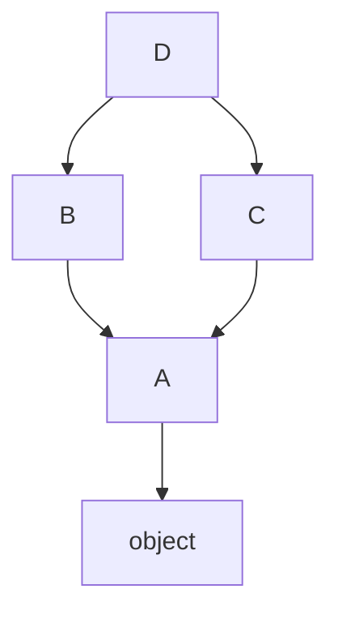
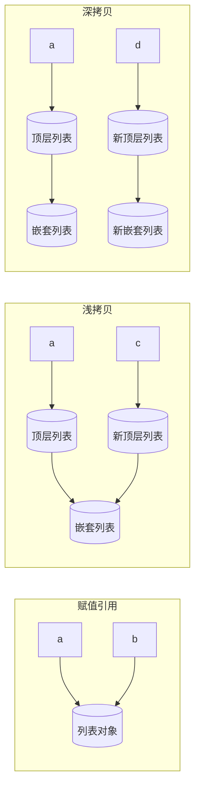

# Python 语言基础与进阶知识点系统梳理

> **文档定位**：本文档是「从零基础新手到实战老手」三部曲的**第二篇：进阶提升篇**。面向已掌握 Python 基础语法（变量、控制流、函数、基本数据结构）的开发者，系统深入讲解 Python 进阶特性。
>
> **适用人群**：
> - 已学完 Python 基础语法，希望系统提升的初中级开发者
> - 准备 Python 后端开发面试的求职者
> - 希望深入理解 Python 底层原理的进阶学习者
>
> **前置知识**：变量与数据类型、运算符、条件与循环、函数定义与调用、列表/字典/元组/集合基本操作。
>
> **学习路径**：入门篇（语法基础与数据结构）→ **进阶篇（本文档）** → 实战篇（Web 框架/项目实战）
>
> **阅读建议**：每个知识点均包含「概念解释 → 原理说明 → 代码示例 → 最佳实践 → 常见坑点 → 🔥面试高频考点」，建议边读边敲代码，章末练习题用于检验掌握程度。

---
## Iterable（可迭代对象）、Iterator（迭代器）、Generator（生成器）三位一体区分

> 面试高频考点，三者层级关系：**Generator 是 Iterator 的子类；Iterator 一定是 Iterable，但 Iterable 不一定是 Iterator**

### 1. Iterable 可迭代对象

#### 作用

只要对象可以使用 `iter(obj)` 拿到迭代器，就是**可迭代对象**，可以直接放在 `for` 循环里。

> 核心标记：实现 `__iter__()` 方法。

#### 底层原理

`iter(iterable)` 调用对象的 `__iter__`，返回一个 Iterator。

- list / dict / str / tuple / set 都是 Iterable
- 它们本身**不是迭代器**，只是能产出迭代器

#### 示例

```python
lst = [1,2,3]
print(hasattr(lst, "__iter__"))  # True，是可迭代对象
print(hasattr(lst, "__next__")) # False，不是迭代器
it = iter(lst) # 从可迭代对象，生成迭代器
```

### 2. Iterator 迭代器

#### 作用

负责**逐个产出元素**，保存遍历状态。`next()` 函数调用它，拿到下一个元素；元素耗尽抛出`StopIteration`。

> 必须同时实现两个魔术方法：
> 
> 1. `__iter__()`：返回自身
> 2. `__next__()`：返回下一个元素，没有元素抛 StopIteration

#### 底层原理

迭代器自带**状态指针**，记住遍历到哪了。每次`next()`指针往后移动。 像字典迭代器 `iter(dict)`、`iter(list)` 返回的对象，都是 Iterator。

```python
lst = [1,2,3]
it = iter(lst)
print(hasattr(it, "__iter__")) # True
print(hasattr(it, "__next__")) # True，是迭代器

print(next(it)) #1
print(next(it)) #2
print(next(it)) #3
# next(it) # StopIteration，取完了
```

> 重点：Iterator 也是 Iterable，因为它有`__iter__`。

### 3. Generator 生成器

#### 作用

**一种特殊的迭代器**，用`yield`关键字创建，不用手动写`__iter__`、`__next__`。 函数遇到`yield`暂停执行，保存现场；下次`next()`进来，从暂停位置继续运行。

#### 底层原理

函数里写`yield`，调用函数不会直接执行代码，而是返回一个Generator对象。

- Generator自动拥有`__iter__`与`__next__`，属于Iterator
- 惰性求值：**一次只生成一个元素，不一次性把所有数据存入内存**（大数据场景优势）

```python
def gen():
    yield 1
    yield 2
    yield 3

g = gen()
print(type(g)) # generator
print(hasattr(g, "__next__")) # True，属于迭代器

print(next(g)) #1
print(next(g)) #2
print(next(g)) #3
```

生成器表达式简写：

```python
g = (x for x in range(3)) # 生成器
lst = [x for x in range(3)] # 列表，一次性全部加载
```

#### 核心对比表

|对象|必备方法|是否是Iterable|是否是Iterator|特点|
|---|---|---|---|---|
|可迭代对象 Iterable|`__iter__`|✅|❌|list/dict/str；保存全部数据，不保存遍历状态|
|迭代器 Iterator|`__iter__` + `__next__`|✅|✅|保存遍历指针，`next()`逐个取值；数据可以不一次性加载|
|生成器 Generator|自动生成`__iter__`+`__next__`，使用yield|✅|✅|Iterator子类；惰性求值，暂停恢复函数执行|

✅ 生成器：数据量巨大、不需要随机索引，只需要**顺序遍历一次**，节省内存（读取大文件、海量数据迭代） 

✅ 列表：需要多次读取、索引、切片，数据量不大

#### 关系一句话串讲

1. **Iterable**：原材料，能生成迭代器（list、dict），自己不能`next()`。
2. **Iterator**：遍历工具，带状态指针，可以`next()`；从Iterable通过`iter()`拿到。
3. **Generator**：简化写法的Iterator，靠`yield`实现惰性产出，适合大数据。

#### 面试一句话背诵版

- 可迭代对象：能放进for循环，可以用iter()拿到迭代器，但不能直接next。
- 迭代器：带`__next__`，保存遍历位置，调用next逐个拿元素。
- 生成器：使用yield实现的特殊迭代器，惰性计算，节省内存。

#### 易错点

1. list是Iterable，**不是Iterator**
2. Generator本质就是Iterator，只是语法糖
3. for循环底层逻辑：`for x in obj` → `it=iter(obj)` → 反复`next(it)`直到StopIteration


## 1. 函数进阶

函数是 Python 中最核心的抽象机制。本章深入探讨函数的参数机制、高阶函数、闭包、装饰器等进阶特性，这些是理解 Python 函数式编程和元编程的基础。

### 1.1 函数参数深入

#### 参数传递机制（传对象引用）

Python 的参数传递机制常被误解为"传值"或"传引用"，准确说法是**传对象引用（pass by object reference）**。

**原理说明**：
- Python 中一切皆对象，变量存储的是对象的引用（内存地址）
- 函数调用时，实参将对象引用复制给形参，形参和实参指向同一个对象
- 因此：如果形参指向**可变对象**，在函数内修改该对象会影响实参；如果对形参执行**重新赋值**，则只是让形参指向新对象，不影响实参

```python
# 示例1：可变对象作为参数，函数内修改会影响外部
def modify_list(lst):
    lst.append(4)  # 修改原对象
    print(f"函数内: {lst}")  # [1, 2, 3, 4]

my_list = [1, 2, 3]
modify_list(my_list)
print(f"函数外: {my_list}")  # [1, 2, 3, 4] —— 被修改了！

# 示例2：重新赋值不影响外部
def reassign_list(lst):
    lst = [4, 5, 6]  # 重新赋值，指向新对象
    print(f"函数内: {lst}")  # [4, 5, 6]

my_list = [1, 2, 3]
reassign_list(my_list)
print(f"函数外: {my_list}")  # [1, 2, 3] —— 未受影响

# 示例3：不可变对象作为参数
def modify_int(x):
    x += 10  # 不可变对象，+= 实际创建新对象并重新绑定
    print(f"函数内: {x}")  # 20

n = 10
modify_int(n)
print(f"函数外: {n}")  # 10 —— 未受影响
```

> 可变对象 list：函数内原地修改，**不需要 return、不需要外部赋值，外面变量直接变**
   不可变对象 int/str/tuple：函数内只能生成新对象，**想拿到新值，必须 return + 外部赋值接收**
>🔥 **面试高频考点**：Python 参数传递是传值还是传引用？标准答案：传对象引用。关键区分"修改对象"和"重新赋值"。

#### 可变对象 vs 不可变对象作为参数

| 类型 | 示例 | 函数内修改 | 函数内重新赋值 |
|------|------|-----------|--------------|
| 不可变 | int, str, tuple, float, bool | 不影响外部（实际是创建新对象） | 不影响外部 |
| 可变 | list, dict, set | **影响外部** | 不影响外部 |

```python
# 经典坑：使用可变对象作为默认参数
def add_item(item, lst=[]):  # ⚠️ 危险！默认参数在函数定义时创建一次
    lst.append(item)
    return lst

print(add_item(1))  # [1]
print(add_item(2))  # [1, 2] —— 不是预期的 [2]！
print(add_item(3))  # [1, 2, 3]

# 正确写法：使用 None 作为哨兵
def add_item(item, lst=None):
    if lst is None:
        lst = []
    lst.append(item)
    return lst

print(add_item(1))  # [1]
print(add_item(2))  # [2] —— 符合预期
```

> ⚠️ **常见坑点**：可变默认参数是 Python 最经典的坑之一。默认参数在函数定义（def 语句执行）时求值一次，之后所有调用共享同一个对象。

#### *args 和 **kwargs 深入

`*args` 和 `**kwargs` 用于接收任意数量的位置参数和关键字参数。

**原理说明**：
- `*args`：将多余的位置参数收集为一个**元组**
- `**kwargs`：将多余的关键字参数收集为一个**字典**
- `*` 和 `**` 也可用于**解包**：在函数调用时将可迭代对象/字典展开为参数

```python
def demo_args(*args, **kwargs):
    print(f"args类型: {type(args)}, 值: {args}")
    print(f"kwargs类型: {type(kwargs)}, 值: {kwargs}")

demo_args(1, 2, 3, name="Alice", age=25)
# 输出:
# args类型: <class 'tuple'>, 值: (1, 2, 3)
# kwargs类型: <class 'dict'>, 值: {'name': 'Alice', 'age': 25}

# 解包操作
def add(a, b, c):
    return a + b + c

numbers = [1, 2, 3]
print(add(*numbers))  # 6 —— 列表解包为位置参数

params = {"a": 1, "b": 2, "c": 3}
print(add(**params))  # 6 —— 字典解包为关键字参数
```

> 💡 **最佳实践**：`*args` 和 `**kwargs` 命名是约定俗成的，也可以用其他名字（如 `*values, **options`），但遵循约定能提高代码可读性。在装饰器中几乎必然用到它们。

#### 仅限位置参数 `/`（Python 3.8+）

Python 3.8 引入了仅限位置参数（positional-only parameters），用 `/` 标记。

```python
def pos_only(a, b, /, c, d):
    # a, b 只能通过位置传递
    # c, d 可以位置或关键字传递
    return a + b + c + d

print(pos_only(1, 2, 3, 4))       # 10 ✓
print(pos_only(1, 2, c=3, d=4))   # 10 ✓
# pos_only(a=1, b=2, c=3, d=4)   # TypeError: a is positional-only
```

**使用场景**：
- 内置函数大量使用（如 `len(obj)` 不能写 `len(obj=...)`）
- 参数名称无实际意义时，强制位置传递更清晰
- 保持与 C 扩展 API 的兼容性

#### 仅限关键字参数 `*`

`*` 之后的参数只能通过关键字传递。

```python
def kw_only(a, b, *, c, d):
    # a, b 可以位置或关键字
    # c, d 只能通过关键字传递
    return a + b + c + d

print(kw_only(1, 2, c=3, d=4))    # 10 ✓
# kw_only(1, 2, 3, 4)             # TypeError: takes 2 positional args but 4 were given
```

> 💡 **最佳实践**：对于含义容易混淆的参数（如布尔标志位），使用仅限关键字参数强制调用者写出参数名，大幅提升可读性。例如 `connect(host, port, *, timeout=30, retry=True)`。

#### 参数顺序完整规则

函数定义中参数的完整顺序为：

```python
def func(positional-only, /, positional_or_keyword, *args, keyword-only, **kwargs):
```

```python
def complete_example(a, b, /, c, d=10, *args, e, f=20, **kwargs):
    pass
# a, b: 仅限位置
# c, d: 位置或关键字（d有默认值）
# *args: 收集多余位置参数
# e, f: 仅限关键字（f有默认值）
# **kwargs: 收集多余关键字参数
```

### 1.2 高阶函数

高阶函数（Higher-Order Function）是指**接受函数作为参数**或**返回函数**的函数。这是函数式编程的核心特征。

#### 函数作为参数

```python
def apply_operation(x, y, operation):
    """operation 是一个函数参数"""
    return operation(x, y)

def add(a, b):
    return a + b

def multiply(a, b):
    return a * b

print(apply_operation(3, 4, add))       # 7
print(apply_operation(3, 4, multiply))  # 12
```

#### 函数作为返回值

```python
def make_adder(n):
    """返回一个加法函数"""
    def adder(x):
        return x + n
    return adder

add_5 = make_adder(5)
add_10 = make_adder(10)
print(add_5(3))   # 8
print(add_10(3))  # 13
```

#### 内置高阶函数

```python
# map：对每个元素应用函数
numbers = [1, 2, 3, 4, 5]
squared = list(map(lambda x: x ** 2, numbers))
print(squared)  # [1, 4, 9, 16, 25]
"""
## 关键特点
✅ map 是惰性迭代器，不转 list 时不会一次性加载全部结果（大数据节省内存，类似生成器） 
✅ 适合做统一批量元素转换 ⚠️ lambda 只能写**单个表达式**，不能写 if 多分支、循环、多行代码
"""

# filter：过滤满足条件的元素
evens = list(filter(lambda x: x % 2 == 0, numbers))
print(evens)  # [2, 4]
"""
## filter 语法
`filter(判断函数, 可迭代对象)`
- 作用：遍历可迭代对象，**保留判断函数返回 True 的元素**，丢弃返回 False 的元素
- 返回值：**惰性迭代器**（和 map 一样，不会一次性加载全部数据，
  必须套 `list()` 转成列表才能直接查看）
"""

# sorted：自定义排序键
words = ["banana", "apple", "cherry", "date"]
sorted_by_length = sorted(words, key=len, reverse=True)
print(sorted_by_length)  # ['banana', 'cherry', 'apple', 'date']

# reduce：累积计算（需从 functools 导入）
from functools import reduce
sum_result = reduce(lambda acc, x: acc + x, numbers)
print(sum_result)  # 15
```

> 🔍 **深度解析**：`map` 和 `filter` 在 Python 3 中返回**迭代器**（惰性求值），而非列表。这意味着它们不会立即计算所有结果，而是在迭代时逐个生成，节省内存。需要列表时用 `list()` 转换。

#### 函数式编程思想

函数式编程强调：
1. **纯函数**：相同输入总是产生相同输出，无副作用
2. **不可变性**：不修改数据，而是创建新数据
3. **函数组合**：通过组合简单函数构建复杂逻辑

```python
# 纯函数示例：无副作用，输入决定输出
def pure_sum(lst):
    total = 0
    for item in lst:
        total += item
    return total  # 不修改 lst

# 非纯函数示例：有副作用
def impure_sum(lst):
    total = sum(lst)
    lst.clear()  # ⚠️ 修改了输入参数！
    return total
```

### 1.3 Lambda 匿名函数

#### lambda 语法

```python
lambda 参数列表: 表达式
```

lambda 函数是匿名的、单行的函数，只能包含一个表达式，不能包含语句。

```python
# 简单 lambda
square = lambda x: x ** 2
print(square(5))  # 25

# 多参数 lambda
add = lambda a, b: a + b
print(add(3, 4))  # 7

# 带默认参数的 lambda
greet = lambda name, greeting="Hello": f"{greeting}, {name}!"
print(greet("Alice"))  # Hello, Alice!
```

#### lambda 与 def 的区别

| 特性 | lambda | def |
|------|--------|-----|
| 名称 | 匿名（可赋值给变量） | 有函数名 |
| 主体 | 单个表达式 | 任意语句块 |
| 返回值 | 表达式结果自动返回 | 需 return 语句 |
| 文档字符串 | 不支持 | 支持 docstring |
| 适用场景 | 简单、一次性操作 | 复杂、可复用逻辑 |

#### lambda 的使用场景与限制

**适用场景**：
- 作为高阶函数的参数（`map`, `filter`, `sorted` 的 key）
- 简单的回调函数
- 字典中的函数分发

```python
# 场景1：sorted 的 key
students = [("Alice", 25), ("Bob", 20), ("Charlie", 30)]
sorted_by_age = sorted(students, key=lambda x: x[1])
print(sorted_by_age)  # [('Bob', 20), ('Alice', 25), ('Charlie', 30)]

# 场景2：字典分发
operations = {
    "add": lambda a, b: a + b,
    "sub": lambda a, b: a - b,
    "mul": lambda a, b: a * b,
}
print(operations["add"](5, 3))  # 8
```

**限制**：
- 只能有一个表达式，不能写多行逻辑
- 不能使用 `if/elif/else` 语句（但可以用三元表达式）
- 不能使用 `for`、`while` 循环
- 调试困难（traceback 中显示 `<lambda>`）

> ⚠️ **常见坑点**：不要为了用 lambda 而用 lambda。如果逻辑复杂或需要复用，应该用 `def` 定义命名函数。PEP 8 不鼓励将 lambda 赋值给变量后使用（`f = lambda x: x` 应写为 `def f(x): return x`）。

### 1.4 闭包

#### 闭包的概念与形成条件

**闭包（Closure）** 是指**引用了自由变量的函数**，这个函数与定义它的环境绑定在一起。自由变量是指在函数中使用但不是局部变量也不是全局变量的变量。

**形成闭包的三个条件**：
1. 必须有一个内嵌函数
2. 内嵌函数必须引用外层函数中的变量
3. 外层函数必须返回内嵌函数

```python
def outer(x):
    def inner(y):
        return x + y  # x 是自由变量，引用自外层函数
    return inner

closure = outer(10)
print(closure(5))   # 15
print(closure(20))  # 30
```

#### 自由变量与 cell 对象

**原理说明**：
- CPython 中，闭包的自由变量存储在 `cell` 对象中
- 外层函数的局部变量如果被内嵌函数引用，会被提升为 `cell` 变量
- `cell` 对象持有对实际值的引用，使得外层函数执行完毕后，自由变量仍然存活
- 可以通过 `__closure__` 属性查看闭包的 cell 对象

```python
def make_counter():
    count = 0
    def counter():
        nonlocal count
        count += 1
        return count
    return counter

c = make_counter()
print(c())  # 1
print(c())  # 2
print(c())  # 3

# 查看闭包信息
print(c.__closure__)           # (<cell at 0x...: int object at 0x...>,)
print(c.__closure__[0].cell_contents)  # 3 —— 查看自由变量的当前值
print(c.__code__.co_freevars)  # ('count',) —— 自由变量名称
```

> 🔍 **深度解析**：`nonlocal` 关键字用于声明变量来自外层（非全局）作用域。如果不用 `nonlocal`，对 `count += 1` 这样的赋值操作会被 Python 视为创建局部变量，导致 `UnboundLocalError`。

#### 闭包的实际应用

```python
# 应用1：工厂函数 —— 生成配置化的函数
def make_multiplier(factor):
    def multiplier(x):
        return x * factor
    return multiplier

double = make_multiplier(2)
triple = make_multiplier(3)
print(double(5))  # 10
print(triple(5))  # 15

# 应用2：缓存（记忆化）
def memoize(func):
    cache = {}
    def wrapper(*args):
        if args not in cache:
            cache[args] = func(*args)
        return cache[args]
    return wrapper

@memoize
def fibonacci(n):
    if n < 2:
        return n
    return fibonacci(n-1) + fibonacci(n-2)

print(fibonacci(100))  # 354224848179261915075 —— 瞬间完成
```

#### 闭包的坑（延迟绑定、变量捕获）

```python
# 经典坑：闭包的延迟绑定
def create_multipliers():
    multipliers = []
    for i in range(5):
        multipliers.append(lambda x: x * i)  # ⚠️ i 是延迟绑定的
    return multipliers

multipliers = create_multipliers()
print([m(2) for m in multipliers])  # [8, 8, 8, 8, 8] —— 不是 [0, 2, 4, 6, 8]！

# 原因：lambda 中的 i 是自由变量，在调用时才查找，此时循环已结束，i=4

# 解决方案1：使用默认参数捕获当前值
def create_multipliers_fixed():
    multipliers = []
    for i in range(5):
        multipliers.append(lambda x, i=i: x * i)  # i=i 立即捕获当前值
    return multipliers

multipliers = create_multipliers_fixed()
print([m(2) for m in multipliers])  # [0, 2, 4, 6, 8] ✓

# 解决方案2：使用 functools.partial
from functools import partial
def create_multipliers_partial():
    return [partial(lambda x, i: x * i, i=i) for i in range(5)]
```

> 🔥 **面试高频考点**：闭包的延迟绑定问题是经典面试题。核心原因是自由变量在**调用时**查找而非**定义时**。解决方案是用默认参数或 `functools.partial` 立即捕获值。

### 1.5 装饰器

装饰器是 Python 中最强大的特性之一，本质是**闭包的应用**：接受一个函数作为参数，返回一个新函数，在不修改原函数代码的情况下增强其功能。

#### 装饰器本质（函数包装函数）

```python
# 最简单的装饰器
def simple_decorator(func):
    def wrapper():
        print("函数执行前")
        func()
        print("函数执行后")
    return wrapper

# 使用装饰器
@simple_decorator
def say_hello():
    print("Hello!")

say_hello()
# 输出:
# 函数执行前
# Hello!
# 函数执行后

# @simple_decorator 等价于:
# say_hello = simple_decorator(say_hello)
```

#### 无参装饰器实现

```python
import time
from functools import wraps

def timer(func):
    """计时装饰器：统计函数执行时间"""
    @wraps(func)  # 保留原函数的元信息
    def wrapper(*args, **kwargs):
        start = time.perf_counter()
        result = func(*args, **kwargs)
        end = time.perf_counter()
        print(f"[{func.__name__}] 执行时间: {end - start:.6f}秒")
        return result
    return wrapper

@timer
def slow_function():
    time.sleep(0.5)
    return "done"

slow_function()
# [slow_function] 执行时间: 0.500123秒
```

#### 带参数装饰器

带参数的装饰器需要**多嵌套一层**：最外层接收装饰器参数，中间层接收被装饰函数，最内层是包装函数。

```python
from functools import wraps

def repeat(times):
    """重复执行函数指定次数"""
    def decorator(func):
        @wraps(func)
        def wrapper(*args, **kwargs):
            results = []
            for _ in range(times):
                results.append(func(*args, **kwargs))
            return results
        return wrapper
    return decorator

@repeat(times=3)
def greet(name):
    return f"Hello, {name}!"

print(greet("Alice"))
# ['Hello, Alice!', 'Hello, Alice!', 'Hello, Alice!']

# 等价于: greet = repeat(3)(greet)
```

#### 类装饰器

类装饰器通过实现 `__call__` 方法，使类实例可以像函数一样被调用。

```python
from functools import wraps

class CountCalls:
    """统计函数被调用次数的类装饰器"""
    def __init__(self, func):
        wraps(func)(self)  # 保留原函数元信息
        self.func = func
        self.call_count = 0

    def __call__(self, *args, **kwargs):
        self.call_count += 1
        print(f"[{self.func.__name__}] 第 {self.call_count} 次调用")
        return self.func(*args, **kwargs)

@CountCalls
def say_hi(name):
    return f"Hi, {name}!"

print(say_hi("Alice"))  # 第 1 次调用
print(say_hi("Bob"))    # 第 2 次调用
print(say_hi.call_count)  # 2
```

#### 多个装饰器的执行顺序

```python
def decorator_a(func):
    def wrapper():
        print("A 前")
        func()
        print("A 后")
    return wrapper

def decorator_b(func):
    def wrapper():
        print("B 前")
        func()
        print("B 后")
    return wrapper

@decorator_a
@decorator_b
def target():
    print("目标函数")

target()
# 输出顺序:
# A 前
# B 前
# 目标函数
# B 后
# A 后
```

> 🔍 **深度解析**：多个装饰器的应用顺序是**自底向上**（靠近函数的先应用），执行顺序是**自顶向下**（外层先进入、后退出）。`@decorator_a` `@decorator_b` 等价于 `target = decorator_a(decorator_b(target))`。

#### functools.wraps 的作用

`functools.wraps` 是一个装饰器，用于将原函数的元信息（`__name__`, `__doc__`, `__module__` 等）复制到包装函数上。

```python
from functools import wraps

def without_wraps(func):
    def wrapper(*args, **kwargs):
        return func(*args, **kwargs)
    return wrapper

def with_wraps(func):
    @wraps(func)
    def wrapper(*args, **kwargs):
        return func(*args, **kwargs)
    return wrapper

@without_wraps
def func1():
    """这是函数1的文档"""
    pass

@with_wraps
def func2():
    """这是函数2的文档"""
    pass

print(func1.__name__)  # wrapper —— 丢失了原函数名！
print(func1.__doc__)   # None —— 丢失了文档字符串！
print(func2.__name__)  # func2 —— 保留了原函数名
print(func2.__doc__)   # 这是函数2的文档 —— 保留了文档字符串
```

> ⚠️ **常见坑点**：忘记使用 `@wraps(func)` 会导致被装饰函数丢失元信息，在调试、序列化、文档生成时出现问题。**写装饰器时务必加上 `@wraps`**。

#### 装饰器应用（计时、日志、缓存、权限）

```python
import time
import logging
from functools import wraps, lru_cache

logging.basicConfig(level=logging.INFO)
logger = logging.getLogger(__name__)

# 1. 日志装饰器
def log_execution(func):
    @wraps(func)
    def wrapper(*args, **kwargs):
        logger.info(f"调用 {func.__name__}, args={args}, kwargs={kwargs}")
        result = func(*args, **kwargs)
        logger.info(f"{func.__name__} 返回: {result}")
        return result
    return wrapper

# 2. 权限校验装饰器
def require_role(role):
    def decorator(func):
        @wraps(func)
        def wrapper(user, *args, **kwargs):
            if user.get("role") != role:
                raise PermissionError(f"需要 {role} 角色")
            return func(user, *args, **kwargs)
        return wrapper
    return decorator

# 3. 重试装饰器
def retry(max_attempts=3, delay=1):
    def decorator(func):
        @wraps(func)
        def wrapper(*args, **kwargs):
            for attempt in range(1, max_attempts + 1):
                try:
                    return func(*args, **kwargs)
                except Exception as e:
                    if attempt == max_attempts:
                        raise
                    logger.warning(f"第 {attempt} 次失败: {e}，{delay}秒后重试...")
                    time.sleep(delay)
        return wrapper
    return decorator

# 使用示例
@log_execution
@lru_cache(maxsize=128)
def expensive_computation(n):
    time.sleep(1)
    return n * n

@require_role("admin")
def delete_user(user, user_id):
    return f"用户 {user_id} 已删除"

print(expensive_computation(10))  # 第一次耗时1秒
print(expensive_computation(10))  # 第二次命中缓存，瞬间返回

admin = {"name": "Alice", "role": "admin"}
print(delete_user(admin, 123))  # 用户 123 已删除
```

> 🔥 **面试高频考点**：装饰器是 Python 面试必考题。常考点包括：装饰器本质（闭包+高阶函数）、带参装饰器的三层嵌套、多个装饰器的执行顺序、`functools.wraps` 的作用、类装饰器的实现。

### 1.6 偏函数与函数工具

#### functools.partial

`partial` 用于**固定函数的部分参数**，返回一个新的可调用对象，减少重复传参。

```python
from functools import partial

def power(base, exponent):
    return base ** exponent

# 固定 exponent=2，创建平方函数
square = partial(power, exponent=2)
print(square(5))   # 25
print(square(10))  # 100

# 固定 base=2，创建2的幂函数
pow2 = partial(power, base=2)
print(pow2(exponent=10))  # 1024

# 实际应用：配置化的日志函数
import logging
debug_log = partial(logging.log, logging.DEBUG)
debug_log("这是一条调试信息")  # 等价于 logging.log(logging.DEBUG, "这是一条调试信息")
```

#### functools.reduce

`reduce` 对序列中的元素**累积应用**函数，最终返回单个值。

```python
from functools import reduce

# 求和
numbers = [1, 2, 3, 4, 5]
total = reduce(lambda acc, x: acc + x, numbers)
print(total)  # 15

# 带初始值
total_with_init = reduce(lambda acc, x: acc + x, numbers, 100)
print(total_with_init)  # 115

# 求最大值
max_val = reduce(lambda a, b: a if a > b else b, numbers)
print(max_val)  # 5

# 实际应用：嵌套字典查找
def deep_get(dictionary, keys, default=None):
    return reduce(lambda d, key: d.get(key, default) if isinstance(d, dict) else default, keys, dictionary)

data = {"user": {"profile": {"name": "Alice", "age": 25}}}
print(deep_get(data, ["user", "profile", "name"]))  # Alice
print(deep_get(data, ["user", "profile", "email"]))  # None
```

#### functools.cache / lru_cache

`lru_cache` 是**最近最少使用缓存**装饰器，自动缓存函数的返回值。`cache` 是 Python 3.9+ 中 `lru_cache(maxsize=None)` 的简写。

```python
from functools import lru_cache, cache
import time

@lru_cache(maxsize=128)
def fibonacci(n):
    if n < 2:
        return n
    return fibonacci(n-1) + fibonacci(n-2)

# 第一次计算（耗时）
start = time.perf_counter()
print(fibonacci(40))
print(f"第一次耗时: {time.perf_counter() - start:.6f}秒")

# 第二次直接从缓存取
start = time.perf_counter()
print(fibonacci(40))
print(f"第二次耗时: {time.perf_counter() - start:.6f}秒")

# 查看缓存信息
print(fibonacci.cache_info())
# CacheInfo(hits=1, misses=41, maxsize=128, currsize=41)

# 清除缓存
fibonacci.cache_clear()
```

> ⚠️ **常见坑点**：`lru_cache` 缓存的键是函数参数，因此参数必须是**可哈希的**（不可变类型）。如果参数是列表、字典等可变类型，会抛出 `TypeError`。另外，缓存会持有对象引用，可能导致内存不释放，注意设置合理的 `maxsize`。

#### 可调用对象 `__call__`

实现了 `__call__` 方法的类的实例可以像函数一样被调用。

```python
class Adder:
    def __init__(self, base):
        self.base = base

    def __call__(self, x):
        return self.base + x

add_10 = Adder(10)
print(add_10(5))   # 15
print(add_10(20))  # 30
print(callable(add_10))  # True —— 可调用对象检测

# 实际应用：有状态的函数对象
class RunningAverage:
    def __init__(self):
        self.total = 0
        self.count = 0

    def __call__(self, value):
        self.total += value
        self.count += 1
        return self.total / self.count

avg = RunningAverage()
print(avg(10))  # 10.0
print(avg(20))  # 15.0
print(avg(30))  # 20.0
```

---

### 本章总结

| 知识点 | 核心要点 |
|--------|---------|
| 参数传递 | 传对象引用；区分"修改对象"与"重新赋值" |
| 可变默认参数 | 默认参数在定义时求值一次，共享同一对象 |
| 高阶函数 | 函数作为参数/返回值；map/filter/sorted/reduce |
| Lambda | 单行匿名函数；适用于简单一次性操作 |
| 闭包 | 引用自由变量的函数；延迟绑定是经典坑 |
| 装饰器 | 闭包+高阶函数；带参装饰器三层嵌套；务必用@wraps |
| 偏函数 | functools.partial 固定部分参数 |
| 缓存 | lru_cache 自动记忆化；参数必须可哈希 |

### 练习题/思考题

1. **基础题**：解释为什么 `def f(x, lst=[])` 是危险的写法，并给出正确写法。
2. **进阶题**：实现一个带参数的装饰器 `@retry(times=3, delay=1)`，在函数抛出异常时自动重试。
3. **原理题**：闭包的延迟绑定问题原因是什么？给出两种解决方案。
4. **实战题**：实现一个通用的计时装饰器，支持输出到日志而非 print，并能统计函数的平均执行时间。
5. **思考题**：`functools.lru_cache` 和手写闭包缓存有什么区别？`lru_cache` 的淘汰策略是什么？


---

## 2. 面向对象编程

面向对象编程（OOP）是 Python 的核心范式。Python 是纯面向对象语言——一切皆对象，包括类本身。本章深入讲解类与对象、继承多态、封装、魔术方法、描述符和元类等进阶特性。

### 2.1 类与对象基础

#### 类的定义与实例化

```python
class Person:
    """人类的定义"""
    species = "Homo sapiens"  # 类属性

    def __init__(self, name, age):
        self.name = name  # 实例属性
        self.age = age

    def greet(self):
        return f"你好，我是{self.name}，今年{self.age}岁"

# 实例化
p1 = Person("张三", 25)
p2 = Person("李四", 30)

print(p1.greet())  # 你好，我是张三，今年25岁
print(p2.greet())  # 你好，我是李四，今年30岁
```

#### `__init__` 构造方法

`__init__` 是初始化方法，在对象创建后自动调用，用于设置实例的初始状态。

> 🔍 **深度解析**：`__init__` 不是构造方法，真正的构造方法是 `__new__`。`__new__` 负责创建并返回对象实例，`__init__` 负责对已创建的实例进行初始化。`__new__` 是静态方法（隐式），接收类作为第一个参数；`__init__` 接收实例作为第一个参数。只有当 `__new__` 返回当前类的实例时，`__init__` 才会被自动调用。

```python
class Singleton:
    _instance = None

    def __new__(cls, *args, **kwargs):
        if cls._instance is None:
            cls._instance = super().__new__(cls)
        return cls._instance

    def __init__(self, value):
        if not hasattr(self, 'initialized'):
            self.value = value
            self.initialized = True
'''
## 两个魔术方法分工（面试重点）

1. `__new__(cls)`：**真正创建对象、分配内存**，第一个参数是 `cls`（当前类），在 `__init__` 之前执行。
    - 如果 `cls._instance` 是空，就新建实例，保存到类属性 `_instance`
    - 后续再调用，直接返回已经创建好的旧实例，不再新建
2. `__init__(self)`：**对象创建完成之后，填充属性**

> ⚠️ 大坑：只要 `__new__` 返回了本类实例，**每次 `Singleton()` 都会触发 `__init__`**！ 如果不做判断，
第二次 `s2 = Singleton("second")` 会把 `self.value` 覆盖成 `"second"`。

### 这里 `if not hasattr(self, 'initialized')` 的作用

`hasattr(self, 'initialized')` 判断实例身上有没有 `initialized` 属性

- 第一次创建实例：没有这个属性 → 执行赋值 `self.value = value`，再打上标记 `self.initialized=True`
- 第二次获取旧实例：已经存在 `initialized`，跳过初始化，**不会覆盖旧的 value**
'''
s1 = Singleton("first")
s2 = Singleton("second")
print(s1 is s2)      # True —— 同一个实例
print(s1.value)      # first —— 第一次初始化的值保留
```

#### 实例属性与类属性

| 特性 | 实例属性 | 类属性 |
|------|---------|--------|
| 定义位置 | `__init__` 中通过 `self.xxx` | 类体内直接定义 |
| 存储位置 | 实例的 `__dict__` | 类的 `__dict__` |
| 共享性 | 每个实例独立 | 所有实例共享 |
| 修改影响 | 只影响当前实例 | 影响所有实例（除非实例遮蔽） |

```python
class Dog:
    species = "Canis lupus"  # 类属性
    count = 0  # 类属性：计数

    def __init__(self, name):
        self.name = name  # 实例属性
        Dog.count += 1    # 修改类属性
'''
### 类属性（`species`、`count`）

写在 `class` 内部、`def` 方法外面，属于**类本身**，**所有实例共享同一份**。

- 访问方式：`Dog.count`（推荐，直接用类访问）或者 `d1.count`（实例访问）
- 内存：只有一份，所有对象共用
  
### 实例属性（`self.name`）

在 `__init__` 里通过 `self.xxx` 创建，**属于单个实例，每个实例独立**。

- `d1.name` 是旺财，`d2.name` 是大黄，互不干扰
- 存在于各自实例对象中
'''

d1 = Dog("旺财")
d2 = Dog("大黄")

print(Dog.count)   # 2 —— 类属性，所有实例共享
print(d1.count)    # 2 —— 实例访问类属性（查找顺序：实例→类）
print(d1.name)     # 旺财 —— 实例属性
'''
## 属性查找顺序（重点面试考点）

当你写 `d1.count`：

1. 先去**实例对象 d1**里面找有没有 `count` 属性 → 找不到
2. 再去**所属类 Dog** 里面找 → 找到类属性 `count`，返回值

> 查找链：实例 → 类 → 父类（继承链）

## ⚠️ 高频坑：不要用实例去赋值类属性

# 错误示范！
d1.count = 999
print(Dog.count) # 仍然是 2！
print(d1.count)  # 999
print(d2.count)  # 2

原因： `d1.count = 999` **不是修改类属性**，而是**给 d1 新建了一个实例属性 count**，把类属性屏蔽了。

> ✅ 修改类属性，必须用类名：`Dog.count +=1`
'''

# 实例属性遮蔽类属性
d1.species = "自定义"  # 这会创建实例属性，而非修改类属性
print(d1.species)      # 自定义 —— 实例属性遮蔽了类属性
print(d2.species)      # Canis lupus —— 其他实例不受影响
print(Dog.species)     # Canis lupus —— 类属性未变
```

> ⚠️ **常见坑点**：通过实例修改类属性（`instance.class_attr = value`）实际上是创建了一个同名的实例属性，遮蔽了类属性，而非真正修改类属性。要修改类属性必须通过类名（`Class.class_attr = value`）。

#### self 的含义

`self` 是对实例对象本身的引用，类似于其他语言中的 `this`。

**原理说明**：
- 调用**实例方法**时，Python 会**自动把当前实例对象，作为第一个实参传给方法的第一个形参（惯例命名为 `self`）**，
- 我们代码里不用手动传这个参数。
- `self` 不是关键字，只是约定俗成的参数名（可以用其他名字，但强烈不建议）
- `self` 确保方法能访问和修改当前实例的属性

```python
class Example:
    def method(this, x):  # 用 this 代替 self 也能运行，但违反约定
        this.x = x

e = Example()
e.method(42)
print(e.x)  # 42
```

### 2.2 方法类型

#### 实例方法

最常见的方法类型，第一个参数为 `self`，通过实例调用，可访问实例属性和类属性。

```python
class MyClass:
    def instance_method(self):
        return f"实例方法，self={self}"
```

#### 类方法 `@classmethod`

第一个参数为 `cls`（类本身），通过类或实例调用，只能访问类属性，不能访问实例属性。

```python
class Person:
    count = 0

    def __init__(self, name):
        self.name = name
        Person.count += 1

    @classmethod
    def get_count(cls):
        return f"当前共有{cls.count}个Person实例"

    @classmethod
    def from_dict(cls, data):
        """工厂方法：从字典创建实例"""
        return cls(data["name"])

p1 = Person("张三")
p2 = Person("李四")
print(Person.get_count())  # 当前共有2个Person实例

# 工厂方法应用
p3 = Person.from_dict({"name": "王五"})
print(p3.name)  # 王五
```

#### 静态方法 `@staticmethod`

不接收 `self` 或 `cls`，与普通函数无异，只是逻辑上属于类的命名空间。

```python
class MathUtils:
    @staticmethod
    def is_even(n):
        return n % 2 == 0

    @staticmethod
    def gcd(a, b):
        """计算最大公约数"""
        while b:
            a, b = b, a % b
        return a

print(MathUtils.is_even(4))    # True
print(MathUtils.gcd(48, 18))   # 6
```

#### 三种方法的使用场景对比

| 方法类型 | 装饰器 | 第一个参数 | 能访问实例属性 | 能访问类属性 | 典型用途 |
|---------|--------|-----------|--------------|------------|---------|
| 实例方法 | 无 | `self` | ✅ | ✅ | 操作实例状态 |
| 类方法 | `@classmethod` | `cls` | ❌ | ✅ | 工厂方法、修改类状态 |
| 静态方法 | `@staticmethod` | 无 | ❌ | ❌（需通过类名） | 工具函数、与类相关但不依赖类/实例 |

> 🔥 **面试高频考点**：实例方法、类方法、静态方法的区别是高频面试题。关键区分点：第一个参数是什么、能访问什么、典型应用场景。类方法常用于**工厂模式**（如 `datetime.fromtimestamp()`），静态方法常用于**工具函数**。


普通函数：独立函数，不属于任何对象，**没有自动传参**，参数全部要你自己传。 

**带 self 的是【实例方法（instance method）】**，它写在 class 里面，属于这个类的实例；Python 语法规定：调用实例方法时，**自动把实例塞给第一个参数（self）**。

1. 先看两种函数对比

① 普通独立函数（你平时写的，不需要 self）

```
def show_temp(val):
    print(val)

show_temp(25)  # 所有参数自己传，传一个 25
```

这个函数游离在类外面，它不属于任何对象，没有主人，谁都可以直接调用。 👉 参数完全由调用者手动提供，没有自动偷偷加参数。

② 类里面的实例方法（需要 self）

```
class Temperature:
    def show(self, val):
        print(val)

t = Temperature()
t.show(25)
```

你看起来只传了 `25`，**实际上 Python 偷偷传了两个参数：`t` 和 `25`** 等价底层写法（几乎不会这么写）：

```
Temperature.show(t, 25)
```

> 重点：`t.show(25)` → 自动把调用者 `t` 作为第一个实参传给 self。 这就是为什么定义的时候要多写一个 self 占位。

2. 类里面一共有 3 种方法，对比记忆

写在 class 内部的函数，分三类，规则完全不一样：

表格

|类型|装饰器|第一个参数|参数是谁|调用形式|
|---|---|---|---|---|
|**实例方法（最常用，带 self）**|无|`self`|当前调用的**实例对象**|`t.xxx()`，自动传实例给 self|
|类方法|`@classmethod`|`cls`|**类本身（Temperature）**|`Temperature.xxx()` / `t.xxx()`，自动传类|
|静态方法|`@staticmethod`|无强制参数|啥都不自动传|和普通函数一模一样，参数全手动传|

✅ **静态方法就是类里面的普通函数！不需要 self /cls**

```
class Temperature:
    @staticmethod
    def show(val):
        print(val)

Temperature.show(25) # 直接传25，没有自动参数，和外面普通函数一样
```

3. 为什么实例方法非要设计成带 self？

核心目的：**方法要访问 / 修改这个实例身上独有的数据**（`self._celsius`）

```
@celsius.setter
def celsius(self, value):
    self._celsius = value
```

`_celsius` 是**属于这个 t 对象自己的数据**。 当 `t1.celsius = 20` 和 `t2.celsius = 30`：

- 调用 setter 的时候 self 分别是 t1、t2
- 才能保证修改的是 t1 自己的 `_celsius`、t2 自己的 `_celsius`，互不干扰

> 如果实例方法没有 self，方法就分不清现在操作的是 t1 还是 t2。

4. 容易混淆的关键点

5. **self 只是一个占位形参，不是参数值** 定义方法的时候写 `def xxx(self, ...)` 只是占住第一个位置，等着 Python 自动塞实例进来。 不是你调用的时候要传。
6. 不是 “写在类里就一定有 self” 静态方法 `@staticmethod` 就不需要，它就是挂靠在类名下、但是没有绑定实例 / 类的普通函数。
7. 普通函数没有这个自动传参机制，因为它**不属于任何实例，没有属于自己的数据**。

8. 回到 property（我们前面的 celsius）

`@property`、`@xxx.setter`、`@xxx.deleter` 底层包装的依然是**实例方法**，所以定义的时候必须写 self。

```
@property
def celsius(self): # 实例方法，所以要有self
    return self._celsius
```

调用 `t.celsius`，Python 自动把 t 传给 self。

极简总结

- 外面单独写的函数：普通函数，**无自动传参 → 不用 self**
- class 里不加装饰器的函数：实例方法，**自动传入调用它的实例 → 必须留 self 位置**
- class 里`@staticmethod`：静态方法，普通函数，**无自动传参 → 不用 self**
- class 里`@classmethod`：类方法，自动传入类 → 参数叫 cls


#### 属性装饰器 `@property`

`@property` 将方法转换为只读属性，实现 getter/setter/deleter 模式。

```python
class Temperature:
    def __init__(self, celsius=0):
        self._celsius = celsius

    @property
    def celsius(self):
        """获取摄氏度（只读属性）"""
        return self._celsius
'''
# 逐行详细拆解

## 1. `class Temperature:`

定义一个名为 `Temperature`（温度）的**类**，用来封装温度相关的数据和行为。 类是创建对象的模板，我们可以通过这个类实例化多个温度对象。

## 2. `def __init__(self, celsius=0):`

`__init__` 是**构造方法**，在创建实例对象的时候自动执行。

- `self`：代表实例对象本身，必须写在第一个参数；
- `celsius=0`：形参，**默认值为 0**。创建对象时不传参数，温度默认就是 0℃。

## 3. `self._celsius = celsius`

- `self._celsius`：给当前实例绑定一个实例变量 `_celsius`
- **单下划线 `_` 含义**：Python 约定，代表**内部变量**。

> 约定：外部代码尽量不要直接读写 `_celsius`。⚠️ 语法层面没有强制保护，依然可以强行访问，只是规范，不是私有。

- 赋值：把传入的 `celsius` 参数保存到实例内部变量 `self._celsius`。

## 4. `@property`

**装饰器**，作用：把下面的方法 `celsius()` 变成一个**属性（getter 获取器）**。

> 使用区别：
> - 普通方法调用：`t.celsius()` 要加括号
> - @property 装饰后：`t.celsius`，**不加括号**，像读取普通变量一样调用，但底层执行的是这个函数。

## 5. `def celsius(self):`

定义一个方法，被 `@property` 修饰，对外暴露的属性名就叫 `celsius`。 文档字符串：`"""获取摄氏度（只读属性）"""`，说明这个属性作用。

## 6. `return self._celsius`

读取属性 `t.celsius` 的时候，返回内部存储的值 `self._celsius`。
'''

    @celsius.setter
    def celsius(self, value):
        """设置摄氏度，带校验"""
        if value < -273.15:
            raise ValueError("温度不能低于绝对零度(-273.15°C)")
        self._celsius = value

    @celsius.deleter
    def celsius(self):
        print("删除温度属性")
        del self._celsius
'''
@property 配套有三个组件：getter、setter、deleter。 
- getter：`@property`，读取属性时触发 
- setter：`@xxx.setter`，赋值属性时触发，用于参数校验 
- deleter：`@xxx.deleter`，`del 对象.属性` 时触发，自定义删除逻辑 

# 原理 property 是 Python 内置描述符。setter/deleter 是 property 对象的方法，用来注册赋值、删除回调。 
  必须先定义 getter，才能注册 setter、deleter。

# 问题
1. setter/deleter 的函数名必须和 getter 完全一致
2. 内部变量`_celsius`不能和属性名`celsius`重名，否则递归死循环
3. deleter 开发中使用频率很低，不是删除 property 本身，是执行自定义逻辑
   
## 常见使用场景
1. **setter**：最常用。入参校验、单位换算、修改时写日志。
2. **deleter**：日常开发用得很少。一般用于：
    - 释放文件句柄、数据库连接等资源
    - 标记对象状态为已销毁
    - 清理缓存数据

> 普通业务代码，90% 的场景只需要 `@property + @xxx.setter`

## 易错点
1. getter/setter/deleter 三个方法**函数名必须一模一样**
2. 内部存储变量必须加下划线 `_celsius`，不能和 property 同名，否则无限递归
3. deleter 只是钩子；`del t.celsius` 不一定删除 property，取决于你在 deleter 内部写了什么
'''

    @property
    def fahrenheit(self):
        """华氏度（计算属性，只读）"""
        return self._celsius * 9 / 5 + 32

t = Temperature(25)
print(t.celsius)     # 25 —— 像属性一样访问，无需括号
print(t.fahrenheit)  # 77.0 —— 计算属性

t.celsius = 30       # 触发 setter
print(t.celsius)     # 30

# t.celsius = -300   # ValueError: 温度不能低于绝对零度

'''
## 分步拆解执行流程

1. `celsius = property(getter函数)``@property` 本质：生成一个 **property 描述符对象**，存到类 `Temperature` 的命名空间里，
   名字叫 `celsius`。 👉 `Temperature.celsius` = property(getter)
2. `@celsius.setter` 做了什么？`celsius.setter(你写的set方法)`，它会**返回一个新的 property 对象**，
   这个新 property 同时绑定了：
    - getter（原来那个读取方法）
    - setter（现在传入的赋值方法） 再覆盖到类上，`Temperature.celsius` 现在变成 `property(get, set=None, del=None)`
3. 执行 `t.celsius = 30` Python 赋值语法的底层规则： 当给实例属性赋值 `obj.属性 = 值`：
    - 先去**类**上面查这个名字（`Temperature.celsius`）
    - 发现它是一个**描述符（property 就是描述符）**，并且实现了 `__set__` 方法
    - 于是自动调用：`Temperature.celsius.__set__(t, 30)`
    - `property.__set__` 内部就会调用你写的那个 setter 函数，`self=t，value=30`

## 重点易错点
1. 如果**没有写 @celsius.setter**，这个 property 对象的 `__set__` 不存在； 
   执行 `t.celsius=30` → 直接抛 `AttributeError: can't set attribute`
2. 不要写成 `self.celsius = value` 在 setter 内部！
    ```
    @celsius.setter
    def celsius(self, value):
        self.celsius = value   # ❌ 又触发 __set__，无限递归
    ```
    
    必须操作底层变量：`self._celsius = value`
    
3. 不是语法魔法字符串匹配名字！ 不是因为函数名都叫 `celsius` 才绑定，
   而是： `@property` 得到 property 实例 → 调用该实例的 `.setter()` 方法注册 set 回调，返回新 property。 
   函数同名只是装饰器语法要求、方便阅读。
'''
```

> 💡 **最佳实践**：`@property` 的优势在于可以在不破坏外部 API 的情况下，将简单属性升级为带校验/计算逻辑的属性。这遵循了**统一访问原则**（Uniform Access Principle）。Python 社区倾向于直接暴露属性，需要时再用 `@property` 包装，而非一开始就写 getter/setter。


### 2.3 继承与多态

#### 单继承

```python
class Animal:
    def __init__(self, name):
        self.name = name

    def speak(self):
        raise NotImplementedError("子类必须实现 speak 方法")

    def eat(self):
        return f"{self.name} 在吃东西"

class Dog(Animal):
    def speak(self):
        return f"{self.name} 汪汪叫！"

    def fetch(self):
        return f"{self.name} 去捡球了"

class Cat(Animal):
    def speak(self):
        return f"{self.name} 喵喵叫～"

dog = Dog("旺财")
cat = Cat("咪咪")
print(dog.speak())  # 旺财 汪汪叫！
print(cat.speak())  # 咪咪 喵喵叫～
print(dog.eat())    # 旺财 在吃东西 —— 继承自父类
```

#### 多继承与 MRO（C3 线性化算法）

Python 支持多继承，方法解析顺序（MRO）决定了在多继承中查找方法的顺序。

**原理说明**：
- Python 使用 **C3 线性化算法**计算 MRO
- MRO 保证：子类优先于父类、父类的声明顺序被尊重、不会出现歧义
- 可以通过 `ClassName.__mro__` 或 `ClassName.mro()` 查看

```python
class A:
    def method(self):
        return "A.method"

class B(A):
    def method(self):
        return "B.method"

class C(A):
    def method(self):
        return "C.method"

class D(B, C):
    pass

print(D.__mro__)
# (<class '__main__.D'>, <class '__main__.B'>, <class '__main__.C'>, <class '__main__.A'>, <class 'object'>)

d = D()
print(d.method())  # B.method —— 按 MRO 顺序查找，B 在 C 前面
```



> 🔥 **面试高频考点**：MRO 和 C3 算法是进阶面试题。需要理解：① MRO 的查找顺序；② `super()` 实际上是按 MRO 顺序调用下一个类的方法，而非简单的"调用父类"；③ 菱形继承问题如何通过 C3 算法解决。

#### `super()` 函数深入

`super()` 返回一个代理对象，按 MRO 顺序调用下一个类的方法。

```python
class Base:
    def __init__(self):
        print("Base.__init__")

class A(Base):
    def __init__(self):
        print("A.__init__ 开始")
        super().__init__()
        print("A.__init__ 结束")

class B(Base):
    def __init__(self):
        print("B.__init__ 开始")
        super().__init__()
        print("B.__init__ 结束")

class C(A, B):
    def __init__(self):
        print("C.__init__ 开始")
        super().__init__()
        print("C.__init__ 结束")

c = C()
# 输出:
# C.__init__ 开始
# A.__init__ 开始
# B.__init__ 开始
# Base.__init__
# B.__init__ 结束
# A.__init__ 结束
# C.__init__ 结束
```

> 🔍 **深度解析**：在多继承中，`super().__init__()` 不是简单地调用"父类"的 `__init__`，而是按 MRO 链依次调用。C 的 MRO 是 `C → A → B → Base → object`，所以 C 中的 `super()` 指向 A，A 中的 `super()` 指向 B（而非 Base！），B 中的 `super()` 指向 Base。这就是**协作式多继承**（cooperative multiple inheritance）。

#### 方法重写

子类可以重写父类的方法，改变或扩展其行为。

```python
class Employee:
    def __init__(self, name, salary):
        self.name = name
        self.salary = salary

    def get_bonus(self):
        return self.salary * 0.1

class Manager(Employee):
    def __init__(self, name, salary, team_size):
        super().__init__(name, salary)  # 调用父类初始化
        self.team_size = team_size

    def get_bonus(self):
        base_bonus = super().get_bonus()  # 调用父类方法
        team_bonus = self.team_size * 1000
        return base_bonus + team_bonus

m = Manager("张三", 20000, 5)
print(m.get_bonus())  # 2000 + 5000 = 7000
```

#### 多态与鸭子类型

Python 的多态基于**鸭子类型**（Duck Typing）："如果它走起来像鸭子，叫起来像鸭子，那它就是鸭子。"

```python
class Dog:
    def speak(self):
        return "汪汪"

class Cat:
    def speak(self):
        return "喵喵"

class Duck:
    def speak(self):
        return "嘎嘎"

def make_speak(animal):
    """不需要检查类型，只要有 speak 方法就行"""
    print(animal.speak())

animals = [Dog(), Cat(), Duck()]
for animal in animals:
    make_speak(animal)
# 汪汪
# 喵喵
# 嘎嘎
```

> 💡 **最佳实践**：Python 推崇鸭子类型而非显式类型检查。不要写 `if isinstance(x, SomeClass)` 来判断类型，而是直接调用方法，让异常在不支持时自然抛出（EAFP 风格）。需要类型约束时使用抽象基类（ABC）或 Protocol。

#### 抽象基类 ABC

抽象基类用于定义接口规范，强制子类实现特定方法。

```python
from abc import ABC, abstractmethod

class Shape(ABC):
    @abstractmethod
    def area(self):
        """计算面积"""
        pass

    @abstractmethod
    def perimeter(self):
        """计算周长"""
        pass

    def describe(self):
        """普通方法：可以有默认实现"""
        return f"这是一个{self.__class__.__name__}，面积={self.area()}"

class Circle(Shape):
    def __init__(self, radius):
        self.radius = radius

    def area(self):
        return 3.14159 * self.radius ** 2

    def perimeter(self):
        return 2 * 3.14159 * self.radius

class Rectangle(Shape):
    def __init__(self, width, height):
        self.width = width
        self.height = height

    def area(self):
        return self.width * self.height

    def perimeter(self):
        return 2 * (self.width + self.height)

# shape = Shape()  # TypeError: 不能实例化抽象类
circle = Circle(5)
rect = Rectangle(3, 4)
print(circle.describe())  # 这是一个Circle，面积=78.53975
print(rect.describe())    # 这是一个Rectangle，面积=12
```

> 🔍 **深度解析**：抽象基类通过 `ABCMeta` 元类实现。`@abstractmethod` 装饰的方法会被标记，在类创建时检查是否所有抽象方法都已实现。抽象基类也可以通过 `register()` 方法将不相关的类注册为虚拟子类。Python 的 `collections.abc` 模块提供了大量预定义抽象基类（`Iterable`, `Container`, `Sized` 等）。

### 2.4 封装与访问控制

#### 公有/受保护/私有属性

Python 没有真正的访问控制，通过命名约定实现：

| 约定 | 示例 | 含义 |
|------|------|------|
| 无前缀 | `name` | 公有（public），可自由访问 |
| 单下划线 | `_name` | 受保护（protected），约定为内部使用，子类可访问 |
| 双下划线 | `__name` | 私有（private），触发名称改写，外部不能直接访问 |

```python
class BankAccount:
    def __init__(self, owner, balance):
        self.owner = owner           # 公有
        self._account_number = "123456"  # 受保护（约定）
        self.__balance = balance     # 私有（名称改写）

    def get_balance(self):
        return self.__balance  # 类内部可以正常访问

account = BankAccount("张三", 10000)
print(account.owner)            # 张三 —— 公有可访问
print(account._account_number)  # 123456 —— 受保护也能访问（只是约定）
# print(account.__balance)      # AttributeError —— 私有不能直接访问
print(account.get_balance())    # 10000 —— 通过方法访问
print(account._BankAccount__balance)  # 10000 —— 通过改写后的名称仍可访问！
```

#### 名称改写（name mangling）机制

**原理说明**：
- 以双下划线开头（且不以双下划线结尾）的属性，会被自动改名为 `_ClassName__attrname`
- 这不是真正的私有，只是一种**避免命名冲突**的机制
- 防止子类意外覆盖父类的"私有"属性
- 可以通过 `_ClassName__attrname` 从外部访问（不推荐）

```python
class Parent:
    def __init__(self):
        self.__secret = "父类的秘密"

class Child(Parent):
    def __init__(self):
        super().__init__()
        self.__secret = "子类的秘密"  # 不会覆盖父类的 __secret

c = Child()
print(c._Child__secret)   # 子类的秘密
print(c._Parent__secret)  # 父类的秘密 —— 两个属性独立存在，互不冲突
```

> ⚠️ **常见坑点**：不要过度使用双下划线私有属性。Python 社区更倾向于使用单下划线作为"内部使用"的约定，相信使用者的自觉性。双下划线主要用于防止子类意外覆盖属性，而非真正的信息隐藏。过度使用会导致代码调试困难、子类扩展受限。

#### `__slots__` 节省内存

默认情况下，Python 实例使用 `__dict__` 字典存储属性，这会带来较大的内存开销。`__slots__` 可以显式声明允许的属性，禁用 `__dict__`，大幅节省内存。

```python
class Point:
    __slots__ = ('x', 'y')  # 只允许 x 和 y 属性

    def __init__(self, x, y):
        self.x = x
        self.y = y

p = Point(1, 2)
print(p.x, p.y)  # 1 2
# p.z = 3         # AttributeError: 'Point' object has no attribute 'z'
# print(p.__dict__) # AttributeError: 没有 __dict__

# 内存对比
import sys

class WithoutSlots:
    def __init__(self, x, y):
        self.x = x
        self.y = y

class WithSlots:
    __slots__ = ('x', 'y')
    def __init__(self, x, y):
        self.x = x
        self.y = y

# 创建大量实例对比内存
without = [WithoutSlots(i, i) for i in range(10000)]
with_slots = [WithSlots(i, i) for i in range(10000)]

print(f"无__slots__: {sys.getsizeof(without[0]) + sys.getsizeof(without[0].__dict__)} 字节/实例")
print(f"有__slots__: {sys.getsizeof(with_slots[0])} 字节/实例")

写成下面这样一样能拿到尺寸：
obj = WithoutSlots(1,1) 
print(sys.getsizeof(obj) + sys.getsizeof(obj.__dict__))

# ------------------------------ 
# 方式1：遍历，打印每一个实例的大小（0~9999） 
# ------------------------------ 
print("===== 无 slots 每个实例大小 =====") 
for idx, obj in enumerate(without): 
    size = sys.getsizeof(obj) + sys.getsizeof(obj.__dict__) 
    print(f"index {idx}: {size} B") 

print("\n===== 有 slots 每个实例大小 =====") 
for idx, obj in enumerate(with_slots): 
size = sys.getsizeof(obj) 
print(f"index {idx}: {size} B") 
# ------------------------------ 
# 方式2：把所有大小收集到列表里（存起来后续处理） 
# ------------------------------ 
without_sizes = [sys.getsizeof(o) + sys.getsizeof(o.__dict__) for o in without] 
with_sizes = [sys.getsizeof(o) for o in with_slots] 
# 现在 without_sizes[0] 是第0个，without_sizes[9999] 就是第9999个 
print("\n第9999个无slots实例大小：", without_sizes[9999]) 
print("第9999个带slots实例大小：", with_sizes[9999]) 
# ------------------------------ 
# 方式3：全部实例内存总和 
# ------------------------------ 
total_without = sum(without_sizes) 
total_with = sum(with_sizes) 
print(f"\n无slots全部10000个总字节：{total_without}") 
print(f"有slots全部10000个总字节：{total_with}") 
print(f"一共节省字节：{total_without - total_with}")
```

> 🔥 **面试高频考点**：`__slots__` 的原理和作用是面试常考点。要点：① 禁用 `__dict__`，用固定的描述符存储属性；② 内存节省显著（每个实例可省约 40-50%）；③ 属性访问速度更快；④ 不能动态添加属性；⑤ 继承时子类也需要定义 `__slots__` 才能继续节省内存。

### 2.5 魔术方法（Dunder Methods）

魔术方法（Magic Methods / Dunder Methods）是前后带双下划线的特殊方法，由 Python 解释器在特定场景自动调用，用于自定义类的行为。

#### 创建与销毁（`__new__`, `__init__`, `__del__`）

```python
class LifecycleDemo:
    def __new__(cls, *args, **kwargs):
        """创建实例（在 __init__ 之前调用）"""
        print(f"__new__ 被调用，创建 {cls.__name__} 实例")
        return super().__new__(cls)

    def __init__(self, name):
        """初始化实例"""
        print(f"__init__ 被调用，初始化 name={name}")
        self.name = name

    def __del__(self):
        """实例被垃圾回收时调用（不保证时机）"""
        print(f"__del__ 被调用，{self.name} 被销毁")

obj = LifecycleDemo("测试")
del obj  # 触发 __del__（实际回收时机由 GC 决定）
```

> ⚠️ **常见坑点**：`__del__` 的执行时机不确定，甚至可能在程序退出时才执行。不要在 `__del__` 中做关键的资源释放（如关闭文件、释放锁），应使用上下文管理器（`with` 语句）。另外，`__del__` 中抛出的异常会被忽略，只打印警告。

#### 字符串表示（`__str__`, `__repr__`, `__format__`）

| 方法 | 触发场景 | 目标受众 |
|------|---------|---------|
| `__str__` | `str(obj)`, `print(obj)` | 终端用户，可读 |
| `__repr__` | `repr(obj)`, 交互式环境, 容器中 | 开发者，无歧义 |
| `__format__` | `format(obj, spec)`, f-string | 自定义格式 |

```python
class Point:
    def __init__(self, x, y):
        self.x = x
        self.y = y

    def __str__(self):
        """用户友好的字符串表示"""
        return f"点({self.x}, {self.y})"

    def __repr__(self):
        """开发者友好的表示，通常是可重新创建对象的表达式"""
        return f"Point(x={self.x!r}, y={self.y!r})"

    def __format__(self, format_spec):
        """支持自定义格式，如 f"{p:.2f}" """
        if format_spec == "polar":
            import math
            r = math.sqrt(self.x**2 + self.y**2)
            theta = math.degrees(math.atan2(self.y, self.x))
            return f"(r={r:.2f}, θ={theta:.1f}°)"
        return f"({self.x}, {self.y})"

p = Point(3, 4)
print(str(p))    # 点(3, 4)
print(repr(p))   # Point(x=3, y=4)
print(f"{p}")    # 点(3, 4) —— f-string 默认调用 __str__
print(f"{p:polar}")  # (r=5.00, θ=53.1°) —— 自定义格式
```

> 💡 **最佳实践**：`__repr__` 的返回值应尽量是能重新创建该对象的有效 Python 表达式（如 `Point(3, 4)`），方便调试。如果只定义了 `__repr__` 而没有 `__str__`，`str()` 会回退到 `__repr__`。

#### 比较运算（`__eq__`, `__lt__`, `__gt__`, `__le__`, `__ge__`, `__ne__`）

```python
from functools import total_ordering

@total_ordering  # 只需定义 __eq__ 和 __lt__，自动生成其他比较方法
class Version:
    def __init__(self, major, minor, patch):
        self.major = major
        self.minor = minor
        self.patch = patch

    def _tuple(self):
        return (self.major, self.minor, self.patch)

    def __eq__(self, other):
        if not isinstance(other, Version):
            return NotImplemented
        return self._tuple() == other._tuple()

    def __lt__(self, other):
        if not isinstance(other, Version):
            return NotImplemented
        return self._tuple() < other._tuple()

    def __hash__(self):
        return hash(self._tuple())

v1 = Version(1, 2, 3)
v2 = Version(1, 3, 0)
v3 = Version(1, 2, 3)

print(v1 < v2)    # True
print(v1 == v3)   # True
print(v1 <= v2)   # True —— 由 @total_ordering 自动生成
print(v1 > v2)    # False —— 自动生成
```

> 🔍 **深度解析**：定义 `__eq__` 会将 `__hash__` 设为 `None`（使对象不可哈希），因为相等的对象应该有相同的哈希值。如果需要类可哈希，必须同时定义 `__hash__`。比较方法返回 `NotImplemented`（而非抛出异常）表示不支持与该类型比较，Python 会尝试反向比较。

#### 算术运算（`__add__`, `__sub__`, `__mul__` 等）

```python
class Vector:
    def __init__(self, *components):
        self.components = list(components)

    def __add__(self, other):
        """加法：v1 + v2"""
        if len(self.components) != len(other.components):
            raise ValueError("向量维度不匹配")
        return Vector(*[a + b for a, b in zip(self.components, other.components)])

    def __sub__(self, other):
        """减法：v1 - v2"""
        return Vector(*[a - b for a, b in zip(self.components, other.components)])

    def __mul__(self, scalar):
        """数乘：v * scalar"""
        if isinstance(scalar, (int, float)):
            return Vector(*[x * scalar for x in self.components])
        return NotImplemented

    def __rmul__(self, scalar):
        """反向数乘：scalar * v（当 scalar 不支持与 Vector 相乘时调用）"""
        return self.__mul__(scalar)

    def __repr__(self):
        return f"Vector({', '.join(map(str, self.components))})"

v1 = Vector(1, 2, 3)
v2 = Vector(4, 5, 6)
print(v1 + v2)      # Vector(5, 7, 9)
print(v2 - v1)      # Vector(3, 3, 3)
print(v1 * 2)       # Vector(2, 4, 6)
print(3 * v1)       # Vector(3, 6, 9) —— 触发 __rmul__

⭐ 重点区别：
不加 `*`：`Vector([5,7,9])` 是把**一个列表**传给 Vector，参数是单个列表
加 `*`：`Vector(5,7,9)` 是把列表拆开，作为**多个位置参数**传给 Vector
```

#### 反向运算（`__radd__` 等）

当 `a + b` 中 `a` 的 `__add__` 返回 `NotImplemented` 时，Python 会尝试调用 `b.__radd__(a)`。

```python
class MyInt:
    def __init__(self, value):
        self.value = value

    def __add__(self, other):
        if isinstance(other, MyInt):
            return MyInt(self.value + other.value)
        return NotImplemented  # 不支持与其他类型相加

    def __radd__(self, other):
        """other + self，当 other 不支持与 MyInt 相加时调用"""
        if isinstance(other, (int, float)):
            return MyInt(self.value + other)
        return NotImplemented

    def __repr__(self):
        return f"MyInt({self.value})"

a = MyInt(10)
print(5 + a)  # MyInt(15) —— int.__add__(5, a) 返回 NotImplemented，然后调用 a.__radd__(5)
```

#### 容器模拟（`__len__`, `__getitem__`, `__setitem__`, `__contains__`, `__iter__`）

实现这些方法可以让自定义类表现得像内置容器。

```python
class Playlist:
    def __init__(self, name, songs=None):
        self.name = name
        self._songs = list(songs) if songs else []

    def __len__(self):
        """len(playlist)"""
        return len(self._songs)

    def __getitem__(self, index):
        """playlist[index]，支持切片"""
        return self._songs[index]

    def __setitem__(self, index, value):
        """playlist[index] = value"""
        self._songs[index] = value

    def __delitem__(self, index):
        """del playlist[index]"""
        del self._songs[index]

    def __contains__(self, item):
        """item in playlist"""
        return item in self._songs

    def __iter__(self):
        """for song in playlist"""
        return iter(self._songs)

    def __repr__(self):
        return f"Playlist({self.name!r}, {self._songs})"

pl = Playlist("我的歌单", ["歌A", "歌B", "歌C"])
print(len(pl))          # 3
print(pl[0])            # 歌A
print(pl[1:])           # ['歌B', '歌C']
print("歌B" in pl)      # True
pl[0] = "新歌A"         # __setitem__
for song in pl:
    print(song)         # 新歌A, 歌B, 歌C
```

#### 可调用对象（`__call__`）

```python
class Multiplier:
    def __init__(self, factor):
        self.factor = factor
        self.call_count = 0

    def __call__(self, x):
        self.call_count += 1
        return x * self.factor

double = Multiplier(2)
print(double(5))    # 10
print(double(10))   # 20
print(double.call_count)  # 2
print(callable(double))   # True
```

#### 上下文管理（`__enter__`, `__exit__`）

详见第5章「上下文管理器」。

#### 属性访问（`__getattr__`, `__getattribute__`, `__setattr__`, `__delattr__`）

| 方法 | 触发时机 | 注意事项 |
|------|---------|---------|
| `__getattr__` | 属性查找失败时（正常查找路径之后） | 只在属性不存在时调用 |
| `__getattribute__` | 每次属性访问时（无条件调用） | 容易引发无限递归，需用 `super().__getattribute__` |
| `__setattr__` | 每次属性赋值时 | 需用 `super().__setattr__` 避免递归 |
| `__delattr__` | 删除属性时 | 需用 `super().__delattr__` 避免递归 |

```python
class SafeDict:
    """访问不存在的属性时返回 None 而非抛出异常"""
    def __init__(self, **kwargs):
        self._data = kwargs

    def __getattr__(self, name):
        """只在正常查找失败时调用"""
        return self._data.get(name)

    def __setattr__(self, name, value):
        if name == "_data":
            super().__setattr__(name, value)  # 必须用 super 避免递归
        else:
            self._data[name] = value
'''
- `_data` 只是一个名字，你完全可以改成 `_storage`、`_cache`，逻辑不变；只是大家习惯叫 `_data`
- 它不是特殊魔法变量，特殊的是配套的 `__setattr__` 代理逻辑
  
## 为什么单独判断 `name == "_data"`

因为 `__setattr__` 会拦截**所有属性赋值**： 当执行 `self._data = {}` 初始化的时候，等价于：
self.__setattr__("_data", {})

如果不加这个判断，代码会进入 `else` 分支执行：
self._data[name] = value

读取 `self._data` 又触发属性查找，造成无限递归 `RecursionError`。 所以用 `super().__setattr__` 走原生逻辑，把 `_data` 放到实例自己的 `__dict__` 里，**脱离代理逻辑**。
'''

    def __repr__(self):
        return f"SafeDict({self._data})"

obj = SafeDict(name="Alice", age=25)
print(obj.name)       # Alice
print(obj.age)        # 25
print(obj.email)      # None —— 不存在的属性返回 None
obj.city = "北京"      # __setattr__
print(obj.city)       # 北京

'''
## 先搞懂 `__setattr__` 是什么
只要你执行：
obj.abc = 123
Python 就会自动调用：
obj.__setattr__("abc", 123)
> ⚠️ **一旦你重写了 `__setattr__`，所有属性赋值都会进你这个函数，包括给 `self._data` 赋值！**

## 2. 如果不判断 `name == "_data"`，会发生什么？
假设写成错误版本：
# ❌ 错误写法！
def __setattr__(self, name, value):
    self._data[name] = value
当类初始化的时候执行：
self._data = {}
流程：
1. `self._data = {}` → 触发 `__setattr__("_data", {})`
2. 进入函数：执行 `self._data[name] = value`
3. 读取 `self._data` → 又调用 `__getattr__`（如果也自定义了），**或者赋值的时候再次触发 `__setattr__`** 直接无限递归，栈溢出 `RecursionError`。

> 关键点：`self._data = xxx` 本身也是一次属性赋值，也会跑进 `__setattr__`。

## 3. `super().__setattr__(name, value)` 的作用

`super().__setattr__` 调用**父类原生的、没有被重写的 `__setattr__`**，也就是 Python 默认行为：

> 把 `_data` 作为**实例本身的属性**，存入对象的 `__dict__`，**不经过我们自定义的转发逻辑**。

所以分支逻辑：

- 当赋值的名字是 `_data`：交给原生父类，挂载成对象属性
- 其他所有名字：不往对象 `__dict__` 存，全部塞到 `self._data` 这个字典里面
'''
```

> ⚠️ **常见坑点**：`__getattribute__` 是**每次**属性访问都调用，包括在方法内部访问 `self.xxx`，极易引发无限递归。必须通过 `super().__getattribute__(name)` 或 `object.__getattribute__(self, name)` 来访问属性。一般情况下只需重写 `__getattr__`（属性不存在时的回退），不要轻易重写 `__getattribute__`。

### 2.6 描述符

描述符是 Python 中最强大的底层机制之一，`property`、`classmethod`、`staticmethod` 都是基于描述符实现的。

#### 描述符协议（`__get__`, `__set__`, `__delete__`）

描述符是实现了以下任一方法的类：
- `__get__(self, instance, owner)`：获取属性时调用
- `__set__(self, instance, value)`：设置属性时调用
- `__delete__(self, instance)`：删除属性时调用

```python
class PositiveNumber:
    """描述符：确保数值为正数"""
    def __init__(self, name):
        self.name = name

    def __get__(self, instance, owner):
        if instance is None:
            return self  # 通过类访问时返回描述符本身
        return instance.__dict__.get(self.name, 0)

    def __set__(self, instance, value):
        if value <= 0:
            raise ValueError(f"{self.name} 必须为正数")
        instance.__dict__[self.name] = value

    def __delete__(self, instance):
        del instance.__dict__[self.name]

class Product:
    price = PositiveNumber("price")  # 描述符作为类属性
    quantity = PositiveNumber("quantity")

    def __init__(self, name, price, quantity):
        self.name = name
        self.price = price
        self.quantity = quantity

p = Product("手机", 5999, 10)
print(p.price)      # 5999
p.price = 6999      # 正常
# p.price = -100    # ValueError: price 必须为正数
```

#### 数据描述符 vs 非数据描述符

| 类型 | 实现方法 | 优先级 |
|------|---------|--------|
| 数据描述符 | 实现了 `__set__` 或 `__delete__` | **高于**实例 `__dict__` |
| 非数据描述符 | 只实现了 `__get__` | **低于**实例 `__dict__` |

**属性查找顺序**（`obj.attr`）：
1. 数据描述符（类上的）
2. 实例的 `__dict__`
3. 非数据描述符（类上的）
4. 类的 `__dict__` 中的其他属性
5. 父类的 `__dict__`（按 MRO）
6. `__getattr__`（如果定义了）

```python
class DataDesc:
    """数据描述符：实现了 __set__"""
    def __get__(self, instance, owner):
        return "数据描述符的值"
    def __set__(self, instance, value):
        pass  # 有 __set__ 就是数据描述符

class NonDataDesc:
    """非数据描述符：只实现了 __get__"""
    def __get__(self, instance, owner):
        return "非数据描述符的值"

class Demo:
    data_attr = DataDesc()
    nondata_attr = NonDataDesc()

d = Demo()
print(d.data_attr)     # 数据描述符的值
d.__dict__["data_attr"] = "实例值"
print(d.data_attr)     # 数据描述符的值 —— 数据描述符优先级更高，实例值被遮蔽

print(d.nondata_attr)  # 非数据描述符的值
d.__dict__["nondata_attr"] = "实例值"
print(d.nondata_attr)  # 实例值 —— 非数据描述符优先级低，实例值覆盖
```

> 🔥 **面试高频考点**：描述符是 Python 进阶面试的核心考点。常考：① 描述符协议的三个方法；② 数据描述符与非数据描述符的区别和优先级；③ 属性查找的完整顺序；④ `property` 的底层实现原理。

#### property 的底层实现

`property` 本质上是一个数据描述符类：

```python
class MyProperty:
    """简化版 property 实现"""
    def __init__(self, fget=None, fset=None, fdel=None, doc=None):
        self.fget = fget
        self.fset = fset
        self.fdel = fdel
        self.__doc__ = doc

    def __get__(self, instance, owner):
        if instance is None:
            return self
        if self.fget is None:
            raise AttributeError("unreadable attribute")
        return self.fget(instance)

    def __set__(self, instance, value):
        if self.fset is None:
            raise AttributeError("can't set attribute")
        self.fset(instance, value)

    def __delete__(self, instance):
        if self.fdel is None:
            raise AttributeError("can't delete attribute")
        self.fdel(instance)

    def setter(self, fset):
        return type(self)(self.fget, fset, self.fdel, self.__doc__)

    def deleter(self, fdel):
        return type(self)(self.fget, self.fset, fdel, self.__doc__)

# 使用 MyProperty
class Temperature:
    def __init__(self):
        self._celsius = 0

    @MyProperty
    def celsius(self):
        return self._celsius

    @celsius.setter
    def celsius(self, value):
        self._celsius = value

t = Temperature()
t.celsius = 25
print(t.celsius)  # 25
```

#### classmethod/staticmethod 的底层

`classmethod` 和 `staticmethod` 也是非数据描述符：

```python
class MyClassMethod:
    """简化版 classmethod 实现"""
    def __init__(self, func):
        self.func = func

    def __get__(self, instance, owner):
        # 绑定类作为第一个参数
        def wrapper(*args, **kwargs):
            return self.func(owner, *args, **kwargs)
        return wrapper

class MyStaticMethod:
    """简化版 staticmethod 实现"""
    def __init__(self, func):
        self.func = func

    def __get__(self, instance, owner):
        return self.func  # 直接返回原函数，不绑定任何参数
```

#### 自定义描述符示例

```python
class TypedAttribute:
    """类型校验描述符：确保属性为指定类型"""
    def __init__(self, name, expected_type):
        self.name = name
        self.expected_type = expected_type

    def __get__(self, instance, owner):
        if instance is None:
            return self
        return instance.__dict__.get(self.name)

    def __set__(self, instance, value):
        if not isinstance(value, self.expected_type):
            raise TypeError(f"{self.name} 必须是 {self.expected_type.__name__} 类型")
        instance.__dict__[self.name] = value

class User:
    name = TypedAttribute("name", str)
    age = TypedAttribute("age", int)

    def __init__(self, name, age):
        self.name = name
        self.age = age

u = User("Alice", 25)
print(u.name, u.age)  # Alice 25
# u.age = "25"         # TypeError: age 必须是 int 类型
```

### 2.7 元类入门

#### 类也是对象

在 Python 中，类本身也是对象——是元类（metaclass）的实例。

```python
class MyClass:
    pass

print(type(MyClass))   # <class 'type'> —— 类是 type 的实例
print(type(42))        # <class 'int'> —— 整数是 int 的实例
print(type(int))       # <class 'type'> —— int 类也是 type 的实例
print(type(type))      # <class 'type'> —— type 是它自身的实例
```

#### type 创建类

`type` 可以动态创建类，语法：`type(类名, 父类元组, 属性字典)`

```python
# 动态创建类
def greet(self):
    return f"你好，我是{self.name}"

Person = type("Person", (object,), {
    "species": "Homo sapiens",
    "__init__": lambda self, name: setattr(self, "name", name),
    "greet": greet,
})

p = Person("张三")
print(p.greet())       # 你好，我是张三
print(Person.__name__) # Person
```

#### 元类的概念

元类是**创建类的类**。默认情况下，所有类的元类都是 `type`。自定义元类通过继承 `type` 并重写 `__new__` 来控制类的创建过程。

```python
class MyMeta(type):
    """自定义元类"""
    def __new__(mcs, name, bases, namespace):
        print(f"元类创建类: {name}")
        print(f"  父类: {bases}")
        print(f"  属性: {list(namespace.keys())}")
        # 可以在这里修改类的属性、方法
        namespace["class_id"] = hash(name) % 10000
        return super().__new__(mcs, name, bases, namespace)

class MyClass(metaclass=MyMeta):
    x = 10
    def method(self):
        pass

# 输出:
# 元类创建类: MyClass
#   父类: (<class 'object'>,)
#   属性: ['__module__', '__qualname__', 'x', 'method']

print(MyClass.class_id)  # 某个数字 —— 元类自动添加的属性
```

#### 自定义元类基础

```python
class SingletonMeta(type):
    """单例元类：确保类只有一个实例"""
    _instances = {}

    def __call__(cls, *args, **kwargs):
        if cls not in cls._instances:
            cls._instances[cls] = super().__call__(*args, **kwargs)
        return cls._instances[cls]

class AppConfig(metaclass=SingletonMeta):
    def __init__(self):
        self.settings = {}

config1 = AppConfig()
config2 = AppConfig()
print(config1 is config2)  # True —— 同一个实例
```

#### 元类的应用场景（ORM 示例）

元类最经典的应用是 ORM（对象关系映射）框架，如 Django ORM、SQLAlchemy。

```python
class Field:
    """字段描述符"""
    def __init__(self, column_name, field_type):
        self.column_name = column_name
        self.field_type = field_type

    def __get__(self, instance, owner):
        if instance is None:
            return self
        return instance.__dict__.get(self.column_name)

    def __set__(self, instance, value):
        if not isinstance(value, self.field_type):
            raise TypeError(f"{self.column_name} 需要 {self.field_type.__name__} 类型")
        instance.__dict__[self.column_name] = value

class ModelMeta(type):
    """ORM 元类：自动收集字段信息"""
    def __new__(mcs, name, bases, namespace):
        fields = {}
        for key, value in namespace.items():
            if isinstance(value, Field):
                fields[key] = value
        namespace["_fields"] = fields
        namespace["_table_name"] = name.lower() + "s"
        return super().__new__(mcs, name, bases, namespace)

class Model(metaclass=ModelMeta):
    """ORM 基类"""
    def save(self):
        """模拟保存到数据库"""
        values = {name: getattr(self, name) for name in self._fields}
        print(f"INSERT INTO {self._table_name} ({', '.join(self._fields.keys())}) "
              f"VALUES ({', '.join(repr(v) for v in values.values())})")

class User(Model):
    name = Field("name", str)
    age = Field("age", int)
    email = Field("email", str)

user = User()
user.name = "张三"
user.age = 25
user.email = "zhangsan@example.com"
user.save()
# INSERT INTO users (name, age, email) VALUES ('张三', 25, 'zhangsan@example.com')

print(User._fields)       # 字段信息
print(User._table_name)   # users
```

> 🔥 **面试高频考点**：元类是高级面试题。常考点：① 什么是元类（类的类）；② `type` 创建类的三种用法；③ 元类的 `__new__` 方法参数；④ 元类的实际应用（ORM、单例、API 注册）；⑤ `__init_subclass__` 作为元类的轻量替代方案。大多数场景不需要元类，Python 社区有句名言："如果你不确定是否需要元类，那你就不需要。"

---

### 2.8 对象拷贝：copy模块

在 Python 中，赋值操作只是创建对象引用的绑定，而非创建新对象。当需要创建对象的独立副本时，需要使用 `copy` 模块进行浅拷贝或深拷贝。

#### 赋值引用 vs 浅拷贝 vs 深拷贝

```python
# 赋值引用：两个变量指向同一个对象
a = [1, 2, [3, 4]]
b = a  # 赋值引用
b[0] = 99
print(a)  # [99, 2, [3, 4]] —— a 也被修改了！
print(a is b)  # True —— 同一个对象

# 浅拷贝：创建新对象，但内部元素仍是引用
import copy
a = [1, 2, [3, 4]]
c = copy.copy(a)  # 浅拷贝
c[0] = 99
print(a)  # [1, 2, [3, 4]] —— 顶层元素独立，a 不受影响
c[2][0] = 999
print(a)  # [1, 2, [999, 4]] —— ⚠️ 嵌套的可变对象仍共享！

# 深拷贝：递归复制所有层级，完全独立
a = [1, 2, [3, 4]]
d = copy.deepcopy(a)  # 深拷贝
d[2][0] = 999
print(a)  # [1, 2, [3, 4]] —— 完全独立，a 不受影响
```



#### copy.copy() 和 copy.deepcopy() 用法

```python
import copy

# 浅拷贝的多种方式
lst = [1, 2, 3]
copy1 = copy.copy(lst)      # copy 模块
copy2 = lst[:]               # 切片
copy3 = list(lst)            # 构造函数
copy4 = lst.copy()           # 列表方法

# 字典的浅拷贝
d = {"a": 1, "b": [2, 3]}
d_copy = copy.copy(d)
d_copy2 = dict(d)
d_copy3 = d.copy()

# 深拷贝：只有 copy.deepcopy()
nested = {"a": [1, 2], "b": {"c": [3, 4]}}
deep = copy.deepcopy(nested)
deep["a"][0] = 99
deep["b"]["c"][0] = 88
print(nested)  # {'a': [1, 2], 'b': {'c': [3, 4]}} —— 原对象不变
```

> 🔍 **深度解析**：`copy.copy()` 对于不可变对象（int、str、tuple）可能直接返回原对象（因为不可变，不需要拷贝），对于可变对象创建新对象。`copy.deepcopy()` 递归复制所有层级，使用 `memo` 字典记录已复制的对象，处理循环引用（A引用B，B引用A）时不会无限递归。

#### 嵌套可变对象的拷贝陷阱

```python
# 经典坑：二维列表的浅拷贝
matrix = [[1, 2, 3], [4, 5, 6], [7, 8, 9]]
matrix_copy = copy.copy(matrix)  # 浅拷贝

matrix_copy[0][0] = 99
print(matrix[0][0])  # 99 —— ⚠️ 原矩阵也被修改了！

# 正确做法：深拷贝
matrix_deep = copy.deepcopy(matrix)
matrix_deep[0][0] = 100
print(matrix[0][0])  # 99 —— 原对象不受影响

# 或者手动逐行拷贝（列表推导式）
matrix_manual = [row[:] for row in matrix]
matrix_manual[0][0] = 101
print(matrix[0][0])  # 99 —— 不受影响
```

#### 自定义 `__copy__` / `__deepcopy__`

```python
import copy

class CustomObject:
    def __init__(self, data, metadata=None):
        self.data = data
        self.metadata = metadata or {}

    def __copy__(self):
        """自定义浅拷贝"""
        print("调用 __copy__")
        new_obj = CustomObject(self.data, self.metadata)
        return new_obj

    def __deepcopy__(self, memo):
        """自定义深拷贝，memo 用于处理循环引用"""
        print("调用 __deepcopy__")
        new_data = copy.deepcopy(self.data, memo)
        new_metadata = copy.deepcopy(self.metadata, memo)
        new_obj = CustomObject(new_data, new_metadata)
        memo[id(self)] = new_obj  # 记录到 memo，处理循环引用
        return new_obj

obj = CustomObject([1, 2, [3, 4]], {"created": "2026"})
shallow = copy.copy(obj)      # 调用 __copy__
deep = copy.deepcopy(obj)     # 调用 __deepcopy__
```

#### copy 模块的常见坑

```python
# 坑1：不可变对象的浅拷贝返回原对象
a = (1, 2, 3)
b = copy.copy(a)
print(a is b)  # True —— 元组不可变，浅拷贝直接返回原对象

# 坑2：模块/函数/类无法被拷贝
import os
# copy.copy(os)  # TypeError: cannot copy module

# 坑3：深拷贝大对象性能差
# deepcopy 需要递归遍历所有引用，对于复杂对象图可能很慢
# 大列表的 deepcopy 比列表推导式慢很多

# 坑4：带有外部资源的对象
# 文件句柄、网络连接、线程锁等资源无法被有意义地拷贝
# deepcopy 会尝试复制，但复制出的对象可能不可用
```

> 💡 **最佳实践**：① 只需要顶层独立时用浅拷贝（`list[:]`、`dict.copy()`），性能好；② 包含嵌套可变对象时必须用深拷贝；③ 深拷贝性能差，大对象考虑手动复制或重构数据结构；④ 不可变对象不需要拷贝；⑤ 自定义类需要特殊拷贝逻辑时实现 `__copy__`/`__deepcopy__`。

### 2.9 数据类 dataclass

`dataclass` 是 Python 3.7+ 引入的装饰器，自动为类生成 `__init__`、`__repr__`、`__eq__`、`__hash__` 等样板方法，大幅减少数据载体类的代码量。

#### @dataclass 装饰器基础

```python
from dataclasses import dataclass

@dataclass
class Point:
    x: float
    y: float
    label: str = "origin"  # 默认值

# 自动生成 __init__
p = Point(1.0, 2.0, "A")
print(p)  # Point(x=1.0, y=2.0, label='A') —— 自动生成 __repr__

p2 = Point(1.0, 2.0, "A")
print(p == p2)  # True —— 自动生成 __eq__（逐字段比较）

# 自动生成 __hash__（当 frozen=True 时）
# 自动生成排序方法（当 order=True 时）
```

> 🔍 **深度解析**：`@dataclass` 装饰器在类定义时读取类注解的字段（带类型注解的类变量），自动生成方法。生成的 `__init__` 按字段声明顺序赋值，`__repr__` 输出 `ClassName(field1=val1, field2=val2)` 格式，`__eq__` 逐字段比较。这本质上是一个**类装饰器+元编程**的应用，在类创建后动态添加方法。

#### field() 自定义

`field()` 函数用于自定义单个字段的行为。

```python
from dataclasses import dataclass, field
from typing import List

@dataclass
class Student:
    name: str
    age: int
    grades: List[int] = field(default_factory=list)  # 可变默认值必须用 default_factory
    school: str = field(default="默认学校", repr=False)  # 不在 repr 中显示
    student_id: str = field(default="", compare=False)  # 不参与比较
    _internal: str = field(default="secret", init=False, repr=False)  # 不在 __init__ 中

    def __post_init__(self):
        self._internal = f"internal_{self.name}"

s1 = Student("张三", 20, [90, 85])
s2 = Student("张三", 20, [90, 85], student_id="001")
print(s1)  # Student(name='张三', age=20, grades=[90, 85], student_id='')
print(s1 == s2)  # True —— student_id 不参与比较
print(s1._internal)  # internal_张三 —— __post_init__ 中设置
```

**field() 参数详解**：

| 参数 | 默认值 | 含义 |
|------|--------|------|
| `default` | `MISSING` | 字段默认值 |
| `default_factory` | `MISSING` | 生成默认值的零参数函数（用于可变类型） |
| `init` | `True` | 是否作为 `__init__` 参数 |
| `repr` | `True` | 是否包含在 `__repr__` 中 |
| `hash` | `None` | 是否包含在 `__hash__` 中 |
| `compare` | `True` | 是否参与 `__eq__` 和排序比较 |
| `metadata` | `None` | 元数据映射（供外部工具读取） |

> ⚠️ **常见坑点**：可变默认值（如 `grades: List[int] = []`）会触发 `ValueError`，因为 dataclass 检测到可变默认值会报错，防止与函数可变默认参数相同的坑。必须使用 `default_factory=list`。`default` 和 `default_factory` 不能同时使用。

#### `__post_init__`

`__post_init__` 在 `__init__` 执行完毕后自动调用，用于需要基于其他字段计算的派生字段或初始化逻辑。

```python
from dataclasses import dataclass, field

@dataclass
class Rectangle:
    width: float
    height: float
    area: float = field(init=False)  # 不在 __init__ 中，由 __post_init__ 计算
    perimeter: float = field(init=False)

    def __post_init__(self):
        if self.width <= 0 or self.height <= 0:
            raise ValueError("宽高必须为正数")
        self.area = self.width * self.height
        self.perimeter = 2 * (self.width + self.height)

r = Rectangle(3, 4)
print(r.area)       # 12.0
print(r.perimeter)  # 14.0
```

#### frozen=True 不可变数据类

```python
from dataclasses import dataclass

@dataclass(frozen=True)
class ImmutablePoint:
    x: float
    y: float

p = ImmutablePoint(1, 2)
# p.x = 3  # FrozenInstanceError —— 不可修改

# frozen=True 时自动生成 __hash__，可作为字典键和集合元素
d = {p: "原点"}
s = {p, ImmutablePoint(3, 4)}
print(d[p])  # 原点
```

> 💡 **最佳实践**：不可变数据类（`frozen=True`）是线程安全的，可哈希，适合作为配置对象、值对象、字典键。但如果需要修改字段，不能用 frozen。需要"修改"时用 `dataclasses.replace(obj, field=new_value)` 创建新实例。

#### dataclass vs NamedTuple vs TypedDict 选型对比

| 特性 | dataclass | NamedTuple | TypedDict |
|------|-----------|------------|-----------|
| 本质 | 普通类 | tuple 子类 | dict（运行时无影响） |
| 可变性 | 默认可变，frozen 可变不可变 | 不可变 | 可变（字典） |
| 方法 | 可定义任意方法 | 可定义方法（但不推荐） | 不能定义方法 |
| 默认值 | 支持（field/default_factory） | 支持 | 不支持（total=False） |
| 类型检查 | 运行时不检查 | 运行时不检查 | 运行时不检查 |
| 内存 | 中等（有 `__dict__`） | 小（元组结构） | 中等（字典） |
| 可哈希 | frozen=True 时可哈希 | 可哈希 | 不可哈希 |
| 继承 | 支持 | 支持（有限） | 支持 |
| 适用场景 | 复杂数据载体、需要方法 | 简单值对象、轻量数据 | JSON/API 数据、字典类型注解 |

```python
from dataclasses import dataclass
from typing import NamedTuple, TypedDict

# dataclass：复杂数据载体
@dataclass
class UserDC:
    name: str
    age: int
    def greet(self):
        return f"你好，我是{self.name}"

# NamedTuple：轻量不可变值对象
class PointNT(NamedTuple):
    x: float
    y: float

# TypedDict：字典的类型注解（运行时就是普通字典）
class UserTD(TypedDict):
    name: str
    age: int

user: UserTD = {"name": "张三", "age": 25}  # 就是字典
```

#### dataclass 的继承

```python
from dataclasses import dataclass

@dataclass
class Person:
    name: str
    age: int

@dataclass
class Employee(Person):
    company: str
    salary: float = 0.0

emp = Employee("张三", 25, "某公司", 15000)
print(emp)  # Employee(name='张三', age=25, company='某公司', salary=15000.0)

# 注意：父类有默认值的字段，子类新增字段也必须有默认值
# 否则会报 TypeError: non-default argument follows default argument
```

> ⚠️ **常见坑点**：dataclass 继承时，字段顺序是父类字段在前、子类字段在后。如果父类有带默认值的字段，子类的无默认值字段会排在后面，导致"非默认参数跟在默认参数后面"的错误。解决方案：子类所有字段都给默认值，或重构父类。

### 2.10 枚举类型 enum

枚举（Enum）是一组命名常量的集合，用于表示有限的、固定的选项集合，提高代码可读性和类型安全性。

#### Enum 基类用法

```python
from enum import Enum

class Color(Enum):
    RED = 1
    GREEN = 2
    BLUE = 3

# 访问枚举成员
print(Color.RED)        # Color.RED
print(Color.RED.name)   # 'RED' —— 成员名称
print(Color.RED.value)  # 1 —— 成员值

# 通过值获取成员
print(Color(2))         # Color.GREEN
print(Color["BLUE"])    # Color.BLUE

# 枚举成员是单例
print(Color.RED is Color(1))  # True

# 枚举类本身可迭代
for color in Color:
    print(f"{color.name} = {color.value}")
```

> 🔍 **深度解析**：`Enum` 使用元类 `EnumMeta` 实现。枚举成员在类定义时创建，是**单例**（每个成员只有一个实例），不可实例化（`Color()` 不能创建新成员，只能通过值查找已有成员）。枚举成员的 `name` 和 `value` 属性只读，不可修改。枚举类不可继承（除非父类没有定义任何成员）。

#### 枚举成员的唯一性与 @unique 装饰器

```python
from enum import Enum, unique

# 默认允许重复值（别名）
class Status(Enum):
    PENDING = 1
    ACTIVE = 2
    IN_PROGRESS = 2  # ⚠️ 与 ACTIVE 值相同，成为别名
    CLOSED = 3

print(Status.IN_PROGRESS)  # Status.ACTIVE —— 别名指向同一个成员
print(list(Status))  # 只列出3个（别名不列出）

# @unique 强制值唯一，重复值报错
@unique
class UniqueStatus(Enum):
    PENDING = 1
    ACTIVE = 2
    # IN_PROGRESS = 2  # ValueError: duplicate values found
    CLOSED = 3
```

#### IntEnum / StrEnum

```python
from enum import IntEnum, StrEnum

# IntEnum：成员是 int 的子类，可以直接与整数比较和运算
class Priority(IntEnum):
    LOW = 1
    MEDIUM = 2
    HIGH = 3
    CRITICAL = 4

print(Priority.HIGH > Priority.LOW)  # True
print(Priority.MEDIUM + 1)           # 3
print(Priority.HIGH == 3)            # True —— 直接与 int 比较

# StrEnum（Python 3.11+）：成员是 str 的子类
class HttpMethod(StrEnum):
    GET = "GET"
    POST = "POST"
    PUT = "PUT"
    DELETE = "DELETE"

print(HttpMethod.GET == "GET")  # True
print(f"方法: {HttpMethod.POST}")  # 方法: POST —— 直接作为字符串使用
```

> 💡 **最佳实践**：需要与整数比较/排序/运算时用 `IntEnum`（如优先级、状态码）。Python 3.11+ 推荐用 `StrEnum` 替代字符串常量（如 HTTP 方法、文件类型）。普通 `Enum` 用于不需要与基本类型直接比较的场景。

#### 枚举的常见使用场景

```python
from enum import Enum, auto

# 场景1：状态机
class OrderStatus(Enum):
    PENDING = "待支付"
    PAID = "已支付"
    SHIPPED = "已发货"
    DELIVERED = "已送达"
    CANCELLED = "已取消"

    def can_transition_to(self, target):
        """定义合法的状态转换"""
        transitions = {
            OrderStatus.PENDING: {OrderStatus.PAID, OrderStatus.CANCELLED},
            OrderStatus.PAID: {OrderStatus.SHIPPED, OrderStatus.CANCELLED},
            OrderStatus.SHIPPED: {OrderStatus.DELIVERED},
        }
        return target in transitions.get(self, set())

order = OrderStatus.PENDING
print(order.can_transition_to(OrderStatus.PAID))     # True
print(order.can_transition_to(OrderStatus.DELIVERED))  # False

# 场景2：配置选项
class LogLevel(Enum):
    DEBUG = auto()  # auto() 自动赋值（从1开始递增）
    INFO = auto()
    WARNING = auto()
    ERROR = auto()
    CRITICAL = auto()

# 场景3：错误码
class ErrorCode(Enum):
    SUCCESS = (0, "成功")
    NOT_FOUND = (404, "资源不存在")
    SERVER_ERROR = (500, "服务器内部错误")

    def __init__(self, code, message):
        self.code = code
        self.message = message

print(ErrorCode.NOT_FOUND.code)     # 404
print(ErrorCode.NOT_FOUND.message)  # 资源不存在
```

#### 枚举的迭代和比较

```python
from enum import Enum

class Direction(Enum):
    NORTH = (0, 1)
    SOUTH = (0, -1)
    EAST = (1, 0)
    WEST = (-1, 0)

# 迭代所有成员
for d in Direction:
    print(f"{d.name}: {d.value}")

# 枚举成员的身份比较（推荐用 is）
d = Direction.NORTH
print(d is Direction.NORTH)  # True
print(d == Direction.NORTH)  # True（Enum 默认实现了 __eq__）

# 枚举成员可哈希，可作为字典键
mapping = {Direction.NORTH: "向上", Direction.SOUTH: "向下"}
print(mapping[Direction.NORTH])  # 向上

# 获取所有成员名称和值
names = [d.name for d in Direction]   # ['NORTH', 'SOUTH', 'EAST', 'WEST']
values = [d.value for d in Direction] # [(0,1), (0,-1), (1,0), (-1,0)]
```

> 🔥 **面试高频考点**：枚举是中高级面试考点。常考：① Enum 和 IntEnum/StrEnum 的区别；② 枚举成员是单例、不可变；③ `@unique` 的作用；④ `auto()` 自动赋值；⑤ 枚举与普通类常量（`COLOR_RED = 1`）相比的优势（类型安全、命名空间、可迭代、可读性）。

> 💡 **最佳实践**：① 用枚举替代魔术数字/字符串常量，提高代码可读性；② 状态码、选项类型、有限集合优先用枚举；③ 需要与基本类型比较时用 IntEnum/StrEnum；④ 枚举值可以是元组/对象，通过 `__init__` 解包为多个属性；⑤ 枚举可以定义方法，实现与枚举相关的业务逻辑（如状态转换校验）。


### 本章总结

| 知识点 | 核心要点 |
|--------|---------|
| 类与对象 | `__init__` 是初始化非构造；实例属性 vs 类属性；self 是实例引用 |
| 方法类型 | 实例方法(self)、类方法(cls)、静态方法(无)；@property 统一访问 |
| 继承多态 | MRO=C3线性化；super()按MRO调用；鸭子类型；ABC抽象基类 |
| 封装 | 单下划线约定、双下划线名称改写；__slots__节省内存 |
| 魔术方法 | __str__/__repr__、比较运算、算术运算、容器模拟、属性访问 |
| 描述符 | __get__/__set__/__delete__；数据vs非数据描述符；property底层 |
| 元类 | 类是type的实例；type动态创建类；元类控制类创建；ORM应用 |
| 对象拷贝 | 赋值引用/浅拷贝/深拷贝；copy.copy/deepcopy；嵌套可变对象陷阱 |
| dataclass | @dataclass自动生成方法；field()自定义；__post_init__；frozen不可变 |
| 枚举类型 | Enum/IntEnum/StrEnum；@unique；auto()；状态机/错误码应用 |

### 练习题/思考题

1. **基础题**：解释 `__new__` 和 `__init__` 的区别，什么情况下需要重写 `__new__`？
2. **进阶题**：实现一个描述符 `RangeValidator`，确保属性值在指定范围内（如 `age = RangeValidator("age", 0, 150)`）。
3. **原理题**：详细说明 Python 属性查找的完整顺序（`obj.attr`），数据描述符和非数据描述符分别在哪个位置？
4. **实战题**：使用元类实现一个"自动注册"机制——所有继承自 `Plugin` 的子类自动注册到全局插件字典中。
5. **思考题**：`@total_ordering` 的实现原理是什么？为什么只需要定义 `__eq__` 和 `__lt__` 就能生成所有比较方法？


---

## 3. 异常处理

异常处理是 Python 中管理程序运行时错误的核心机制。Python 采用"异常优先"（EAFP）的编程风格，理解异常体系和处理机制对编写健壮的代码至关重要。

### 3.1 异常体系

#### BaseException 层级

Python 中所有异常都继承自 `BaseException`，完整的继承层级：

```text
BaseException
├── SystemExit        # sys.exit() 触发
├── KeyboardInterrupt # Ctrl+C 中断
├── GeneratorExit     # 生成器关闭时
└── Exception         # 所有常规异常的基类
    ├── ArithmeticError
    │   ├── ZeroDivisionError
    │   ├── OverflowError
    │   └── FloatingPointError
    ├── LookupError
    │   ├── IndexError
    │   └── KeyError
    ├── AttributeError
    ├── TypeError
    ├── ValueError
    │   └── UnicodeError
    ├── OSError
    │   ├── FileNotFoundError
    │   ├── PermissionError
    │   └── TimeoutError
    ├── RuntimeError
    │   ├── RecursionError
    │   └── NotImplementedError
    ├── ImportError
    │   └── ModuleNotFoundError
    ├── StopIteration
    ├── StopAsyncIteration
    ├── EOFError
    ├── NameError
    │   └── UnboundLocalError
    ├── SyntaxError
    │   └── IndentationError
    ├── MemoryError
    ├── BufferError
    ├── ReferenceError
    └── Warning
        ├── DeprecationWarning
        ├── UserWarning
        └── RuntimeWarning
```

> 🔍 **深度解析**：`BaseException` 是所有异常的根，但通常不应该直接捕获它。`Exception` 是所有非系统退出类异常的基类，日常开发中捕获 `Exception` 即可。`SystemExit`、`KeyboardInterrupt`、`GeneratorExit` 直接继承自 `BaseException` 而非 `Exception`，这样 `except Exception` 不会意外捕获这些特殊异常。

#### 常见内置异常

| 异常类 | 触发场景 |
|--------|---------|
| `ValueError` | 传入的值类型正确但值不合法（如 `int("abc")`） |
| `TypeError` | 操作/函数接收到不适当的类型（如 `1 + "2"`） |
| `KeyError` | 字典中不存在的键（如 `d["nonexistent"]`） |
| `IndexError` | 序列索引超出范围（如 `lst[100]`） |
| `AttributeError` | 对象没有该属性/方法（如 `obj.nonexistent`） |
| `NameError` | 变量未定义（如使用未赋值的变量） |
| `FileNotFoundError` | 文件不存在 |
| `PermissionError` | 权限不足 |
| `ZeroDivisionError` | 除以零 |
| `ImportError` / `ModuleNotFoundError` | 导入模块失败 |
| `RecursionError` | 递归深度超过限制 |

### 3.2 异常捕获与处理

#### try/except/else/finally 完整语法

```python
try:
    # 可能抛出异常的代码
    result = risky_operation()
except ValueError as e:
    # 捕获 ValueError
    print(f"值错误: {e}")
except (TypeError, KeyError) as e:
    # 同时捕获多种异常
    print(f"类型或键错误: {e}")
except Exception as e:
    # 捕获其他所有常规异常
    print(f"未知错误: {e}")
    raise  # 重新抛出
else:
    # try 块没有抛出异常时执行
    print(f"操作成功，结果: {result}")
finally:
    # 无论是否抛出异常都执行（用于清理资源）
    print("清理资源")
```

> 💡 **最佳实践**：`else` 块用于只有在 `try` 成功时才需要执行的代码，这样可以避免将过多代码放入 `try` 块导致意外捕获异常。`finally` 用于资源清理，即使 `try` 中有 `return`、`break`、`continue` 也会执行。

#### 多 except 捕获顺序

`except` 子句按**从上到下**的顺序匹配，第一个匹配的会被执行。因此**更具体的异常应该放在前面，更通用的异常放在后面**。

```python
try:
    f = open("nonexistent.txt")
except OSError as e:
    print(f"OS错误: {e}")
except FileNotFoundError as e:  # ⚠️ 永远不会执行！FileNotFoundError 是 OSError 的子类
    print(f"文件不存在: {e}")

# 正确顺序：子类在前，父类在后
try:
    f = open("nonexistent.txt")
except FileNotFoundError as e:
    print(f"文件不存在: {e}")
except OSError as e:
    print(f"其他OS错误: {e}")
```

> ⚠️ **常见坑点**：如果父类异常放在子类前面，子类异常永远不会被捕获。IDE 通常会警告这种问题，但仍需注意。

#### 异常对象的属性

```python
try:
    int("abc")
except ValueError as e:
    print(f"异常类型: {type(e).__name__}")  # ValueError
    print(f"异常消息: {e}")                   # invalid literal for int() with base 10: 'abc'
    print(f"args属性: {e.args}")              # ("invalid literal for int()...",)
    print(f"traceback: {e.__traceback__}")    # <traceback object>
```

#### finally 的执行时机与 return

`finally` 块**总是**执行，即使 `try` 或 `except` 中有 `return`。

```python
def func_with_return():
    try:
        return "try 的返回值"
    finally:
        print("finally 总是执行")
        # return "finally 的返回值"  # ⚠️ 如果 finally 中有 return，会覆盖 try 的返回值！

print(func_with_return())
# 输出:
# finally 总是执行
# try 的返回值
```

> ⚠️ **常见坑点**：不要在 `finally` 中使用 `return`，它会静默覆盖 `try`/`except` 中的返回值，也会吞掉未处理的异常。`finally` 只应该用于资源清理（关闭文件、释放锁等）。

### 3.3 抛出异常

#### raise 语句

```python
def validate_age(age):
    if not isinstance(age, int):
        raise TypeError("年龄必须是整数")
    if age < 0 or age > 150:
        raise ValueError(f"年龄必须在0-150之间，收到: {age}")
    return True

try:
    validate_age(200)
except (TypeError, ValueError) as e:
    print(f"校验失败: {e}")
```

#### 异常链（raise ... from）

Python 3 引入异常链，可以在捕获一个异常后抛出另一个异常，并保留原始异常信息。

```python
# 隐式异常链：except 中 raise 另一个异常，自动关联
try:
    int("abc")
except ValueError:
    raise RuntimeError("数据转换失败")
# 输出会包含:
# During handling of the above exception, another exception occurred:
# ValueError: ... → RuntimeError: 数据转换失败

# 显式异常链：用 from 明确关联
try:
    int("abc")
except ValueError as original:
    raise RuntimeError("数据转换失败") from original

# 抑制异常链：用 from None
try:
    int("abc")
except ValueError:
    raise RuntimeError("数据转换失败") from None
# 不会显示原始异常
```

> 🔍 **深度解析**：异常链通过 `__cause__`（显式，`from` 设置）和 `__context__`（隐式，except 中自动设置）属性记录。打印 traceback 时，`__cause__` 显示 "The above exception was the direct cause of the following exception"，`__context__` 显示 "During handling of the above exception, another exception occurred"。

#### 重新抛出异常

```python
try:
    risky_operation()
except ValueError as e:
    # 记录日志后重新抛出
    logging.error(f"操作失败: {e}")
    raise  # 不带参数，重新抛出当前异常，保留原始 traceback
```

### 3.4 自定义异常

#### 继承 Exception 创建自定义异常

```python
class BankError(Exception):
    """银行操作异常基类"""
    pass

class InsufficientFundsError(BankError):
    """余额不足异常"""
    def __init__(self, balance, amount):
        self.balance = balance
        self.amount = amount
        super().__init__(f"余额不足: 当前余额{balance}，尝试取款{amount}，差额{amount - balance}")

class InvalidAccountError(BankError):
    """无效账户异常"""
    pass

class BankAccount:
    def __init__(self, balance=0):
        self.balance = balance

    def withdraw(self, amount):
        if amount > self.balance:
            raise InsufficientFundsError(self.balance, amount)
        self.balance -= amount
        return self.balance

account = BankAccount(100)
try:
    account.withdraw(150)
except InsufficientFundsError as e:
    print(f"错误: {e}")
    print(f"当前余额: {e.balance}, 尝试取款: {e.amount}")
```

#### 自定义异常的最佳实践

1. **继承 `Exception` 而非 `BaseException`**：确保能被常规异常处理捕获
2. **建立异常层次**：定义基类异常，再派生子类异常，方便分类捕获
3. **提供有意义的错误消息**：包含足够的上下文信息
4. **携带额外属性**：将相关数据作为异常属性，方便处理者使用
5. **命名以 Error 结尾**：遵循约定

```python
# 良好的异常层次设计
class APIError(Exception):
    """API 异常基类"""
    def __init__(self, message, status_code=None, response_data=None):
        super().__init__(message)
        self.status_code = status_code
        self.response_data = response_data

class AuthenticationError(APIError):
    """认证失败"""
    pass

class RateLimitError(APIError):
    """请求频率超限"""
    def __init__(self, message, retry_after=None, **kwargs):
        super().__init__(message, **kwargs)
        self.retry_after = retry_after

class NotFoundError(APIError):
    """资源不存在"""
    pass
```

### 3.5 异常处理最佳实践

#### 不要裸 except

```python
# ❌ 危险：捕获所有异常，包括 KeyboardInterrupt、SystemExit
try:
    risky_operation()
except:
    print("出错了")

# ✅ 推荐：捕获具体异常
try:
    risky_operation()
except ValueError as e:
    print(f"值错误: {e}")
except Exception as e:
    print(f"未知错误: {e}")
```

> ⚠️ **常见坑点**：裸 `except:` 会捕获 `KeyboardInterrupt`（Ctrl+C）和 `SystemExit`（sys.exit()），导致程序无法正常退出。即使要用通用捕获，也应该写 `except Exception:`。

#### 异常处理粒度

```python
# ❌ 过大的 try 块：可能意外捕获不相关的异常
try:
    data = parse_input(raw)
    result = process(data)
    save_to_file(result)
    send_notification()
except Exception:
    print("操作失败")  # 不知道哪一步失败了

# ✅ 细粒度处理：每步单独处理
try:
    data = parse_input(raw)
except ValueError as e:
    logger.error(f"输入解析失败: {e}")
    return

try:
    result = process(data)
except ProcessingError as e:
    logger.error(f"数据处理失败: {e}")
    result = fallback_process(data)

try:
    save_to_file(result)
except OSError as e:
    logger.error(f"文件保存失败: {e}")
```

#### EAFP vs LBYL 风格

| 风格 | 全称 | 含义 | Python 偏好 |
|------|------|------|-------------|
| EAFP | Easier to Ask for Forgiveness than Permission | 先操作，出错再处理 | ✅ Python 推崇 |
| LBYL | Look Before You Leap | 先检查条件，再操作 | 其他语言常见 |

```python
# EAFP 风格（Pythonic）
try:
    value = my_dict["key"]
except KeyError:
    value = default_value

# LBYL 风格
if "key" in my_dict:
    value = my_dict["key"]
else:
    value = default_value
```

> 💡 **最佳实践**：Python 社区推崇 EAFP 风格，原因：① 代码更简洁；② 避免竞态条件（检查和操作之间状态可能改变）；③ 异常在 Python 中性能开销很小（不触发时几乎零开销）。但在异常会频繁触发的场景（如循环中每次都失败），LBYL 可能性能更好。

#### 异常的性能开销

```python
import timeit

# 异常不触发时几乎零开销
def eafp():
    d = {"key": "value"}
    try:
        return d["key"]
    except KeyError:
        return None

def lbyl():
    d = {"key": "value"}
    if "key" in d:
        return d["key"]
    return None

print(f"EAFP: {timeit.timeit(eafp, number=1000000):.4f}秒")
print(f"LBYL: {timeit.timeit(lbyl, number=1000000):.4f}秒")
# 两者性能接近，EAFP 甚至可能更快（单次字典查找 vs 两次）

# 但异常频繁触发时开销较大
def eafp_fail():
    d = {}
    try:
        return d["key"]
    except KeyError:
        return None

print(f"EAFP(频繁失败): {timeit.timeit(eafp_fail, number=1000000):.4f}秒")
# 频繁触发异常时性能明显下降
```

#### 常见反模式

```python
# ❌ 反模式1：吞掉异常
try:
    risky_operation()
except Exception:
    pass  # 静默忽略，调试噩梦

# ❌ 反模式2：过度宽泛的异常 + 打印
try:
    risky_operation()
except Exception as e:
    print(e)  # 应该用 logging，且应该有处理逻辑

# ❌ 反模式3：用异常做正常流程控制
while True:
    try:
        item = next(iterator)
    except StopIteration:
        break
    process(item)
# 应该用 for 循环: for item in iterator: process(item)

# ❌ 反模式4：在 finally 中 return
def func():
    try:
        return 1
    finally:
        return 2  # 永远返回 2，覆盖 try 的返回值
```

---

### 本章总结

| 知识点 | 核心要点 |
|--------|---------|
| 异常体系 | BaseException → Exception → 具体异常；不要捕获 BaseException |
| 捕获处理 | try/except/else/finally；具体异常在前、通用在后 |
| 抛出异常 | raise；异常链 __cause__/__context__；raise from None 抑制 |
| 自定义异常 | 继承 Exception；建立层次；携带额外属性 |
| 最佳实践 | 不裸except；细粒度；EAFP风格；不吞异常；finally不return |

### 练习题/思考题

1. **基础题**：`BaseException` 和 `Exception` 的区别是什么？为什么通常应该捕获 `Exception` 而非 `BaseException`？
2. **进阶题**：实现一个自定义异常层次体系，用于电商订单系统（包含订单不存在、库存不足、支付失败等异常），每个异常携带相关上下文信息。
3. **原理题**：解释异常链的 `__cause__` 和 `__context__` 属性的区别，`raise X from Y` 和 `raise X`（在 except 中）有什么不同？
4. **实战题**：编写一个带重试机制的函数装饰器，捕获指定异常后自动重试 N 次，每次重试间隔递增，并在最终失败时保留原始异常链。
5. **思考题**：EAFP 和 LBYL 两种风格各有什么优缺点？在什么场景下 LBYL 更合适？

---

## 4. 迭代器与生成器

迭代器和生成器是 Python 中处理数据流的核心机制，也是理解 Python 惰性求值和内存优化的关键。

### 4.1 迭代器协议

#### 可迭代对象 Iterable

可迭代对象是实现了 `__iter__()` 方法的对象，该方法返回一个迭代器。常见的可迭代对象：列表、元组、字符串、字典、集合、文件对象等。

```python
from collections.abc import Iterable, Iterator

# 检测可迭代对象
print(isinstance([1, 2, 3], Iterable))   # True
print(isinstance("hello", Iterable))      # True
print(isinstance({"a": 1}, Iterable))     # True
print(isinstance(42, Iterable))           # False

# 获取迭代器
lst = [1, 2, 3]
it = iter(lst)  # 调用 lst.__iter__()
print(type(it))  # <class 'list_iterator'>
```

#### 迭代器 Iterator

迭代器是实现了 `__iter__()` 和 `__next__()` 方法的对象：
- `__iter__()` 返回迭代器自身
- `__next__()` 返回下一个元素，没有更多元素时抛出 `StopIteration`

```python
class Countdown:
    """自定义迭代器：从 n 倒数到 1"""
    def __init__(self, start):
        self.current = start

    def __iter__(self):
        return self  # 返回自身

    def __next__(self):
        if self.current <= 0:
            raise StopIteration
        value = self.current
        self.current -= 1
        return value

# 使用
for num in Countdown(5):
    print(num, end=" ")  # 5 4 3 2 1
print()

# 手动迭代
it = Countdown(3)
print(next(it))  # 3
print(next(it))  # 2
print(next(it))  # 1
# print(next(it))  # StopIteration
```

> 🔍 **深度解析**：可迭代对象和迭代器的区别：可迭代对象可以被多次迭代（每次 `iter()` 返回新的迭代器），而迭代器是一次性的（迭代完后就耗尽了）。迭代器的 `__iter__` 返回自身，所以迭代器本身也是可迭代对象。

#### `__iter__` 和 `__next__`

```python
# 迭代器协议的本质
class MyIterator:
    def __iter__(self):
        return self

    def __next__(self):
        # 返回下一个值或抛出 StopIteration
        pass

# 等价于 collections.abc.Iterator 抽象基类
from collections.abc import Iterator

class BetterIterator(Iterator):
    def __next__(self):
        pass
    # __iter__ 由 Iterator 基类提供，返回 self
```

#### for 循环的底层机制

`for x in iterable` 的底层执行过程：

```python
# for 循环的等价实现
iterable = [1, 2, 3]

# Python 实际做的事情：
iterator = iter(iterable)  # 1. 调用 __iter__() 获取迭代器
while True:
    try:
        x = next(iterator)  # 2. 反复调用 __next__()
    except StopIteration:   # 3. 捕获 StopIteration 结束循环
        break
    # 循环体
    print(x)
```

> 🔥 **面试高频考点**：for 循环的底层机制是高频面试题。要点：① 调用 `iter()` 获取迭代器；② 循环调用 `next()`；③ 捕获 `StopIteration` 结束。这也是为什么自定义对象只要实现 `__iter__` 和 `__next__` 就能用 for 循环遍历。

#### `iter()` 函数的两种用法

```python
# 用法1：iter(iterable) —— 从可迭代对象创建迭代器
lst = [1, 2, 3]
it = iter(lst)

# 用法2：iter(callable, sentinel) —— 重复调用 callable 直到返回 sentinel
import sys
# 读取文件直到遇到空行
with open("data.txt") as f:
    for line in iter(f.readline, ""):
        print(line.strip())

# 实际应用：分块读取文件
from functools import partial
with open("large_file.bin", "rb") as f:
    for chunk in iter(partial(f.read, 1024), b""):
        process(chunk)
```

### 4.2 生成器函数

#### yield 关键字

生成器函数是包含 `yield` 语句的函数，调用时返回一个生成器对象，而非立即执行函数体。

```python
def simple_generator():
    print("开始执行")
    yield 1
    print("yield 1 之后")
    yield 2
    print("yield 2 之后")
    yield 3
    print("结束")

gen = simple_generator()  # 函数体不执行，只返回生成器对象
print(type(gen))  # <class 'generator'>

print(next(gen))  # 开始执行 → 1
print(next(gen))  # yield 1 之后 → 2
print(next(gen))  # yield 2 之后 → 3
# next(gen)       # 结束 → StopIteration
```

#### 生成器的执行流程

```python
def fibonacci():
    """斐波那契数列生成器"""
    a, b = 0, 1
    while True:  # 无限序列，但惰性求值不占内存
        yield a
        a, b = b, a + b

fib = fibonacci()
for i, num in enumerate(fib):
    if i >= 10:
        break
    print(num, end=" ")  # 0 1 1 2 3 5 8 13 21 34
```

> 🔍 **深度解析**：生成器函数在调用时不执行函数体，而是创建一个生成器对象。每次调用 `next()` 时，函数体执行到下一个 `yield`，返回值并**暂停**执行（保留局部变量状态）。下次 `next()` 从暂停处继续。当函数体执行完毕或遇到 `return` 时，抛出 `StopIteration`。

#### 生成器的状态

| 状态 | 说明 |
|------|------|
| `GEN_CREATED` | 已创建，未开始执行 |
| `GEN_SUSPENDED` | 在 yield 处暂停 |
| `GEN_RUNNING` | 正在执行（解释器内部状态） |
| `GEN_CLOSED` | 已关闭/执行完毕 |

```python
import inspect

def gen():
    yield 1

g = gen()
print(inspect.getgeneratorstate(g))  # GEN_CREATED
next(g)
print(inspect.getgeneratorstate(g))  # GEN_SUSPENDED
next(g, None)
print(inspect.getgeneratorstate(g))  # GEN_CLOSED
```

#### 生成器的方法（send/throw/close）

```python
def echo_generator():
    """演示 send/throw/close"""
    print("生成器启动")
    while True:
        try:
            received = yield  # 接收 send 传入的值
            print(f"收到: {received}")
        except ValueError as e:
            print(f"捕获到异常: {e}")

gen = echo_generator()
next(gen)  # 启动生成器，执行到第一个 yield（必须先 next 或 send(None)）

gen.send("Hello")   # 收到: Hello
gen.send("World")   # 收到: World

gen.throw(ValueError("自定义错误"))  # 捕获到异常: 自定义错误

gen.close()  # 关闭生成器
# next(gen)  # StopIteration —— 关闭后不能再迭代
```

> ⚠️ **常见坑点**：使用 `send()` 前必须先启动生成器（调用 `next()` 或 `send(None)`），否则会抛出 `TypeError: can't send non-None value to a just-started generator`。因为生成器刚创建时还没执行到 `yield`，无法接收值。

### 4.3 生成器表达式

#### 语法与列表推导式对比

```python
# 列表推导式：立即计算所有结果，占用内存
list_comp = [x ** 2 for x in range(1000000)]
print(type(list_comp))  # <class 'list'>
print(list_comp[0])     # 0 —— 支持索引

# 生成器表达式：惰性求值，不占内存
gen_exp = (x ** 2 for x in range(1000000))
print(type(gen_exp))  # <class 'generator'>
# print(gen_exp[0])   # TypeError —— 不支持索引

# 逐个取值
print(next(gen_exp))  # 0
print(next(gen_exp))  # 1
```

#### 惰性求值优势

```python
import sys

# 内存对比
list_result = [x ** 2 for x in range(1000000)]
gen_result = (x ** 2 for x in range(1000000))

print(f"列表内存: {sys.getsizeof(list_result):,} 字节")  # ~8MB
print(f"生成器内存: {sys.getsizeof(gen_result):,} 字节")  # ~128 字节

# 链式处理：每步都是惰性的，内存恒定
def process_pipeline():
    numbers = (x for x in range(1000000))           # 生成
    squared = (x ** 2 for x in numbers)               # 转换
    filtered = (x for x in squared if x % 2 == 0)    # 过滤
    return filtered

# 直到迭代时才真正计算
result = process_pipeline()
print(next(result))  # 0
print(next(result))  # 4
```

> 💡 **最佳实践**：当数据量大、只需迭代一次、不需要随机访问时，优先使用生成器表达式。当需要多次遍历、需要索引访问、数据量小时，使用列表推导式。生成器表达式可以直接作为函数参数（如 `sum(x for x in range(100))`），无需额外括号。

### 4.4 yield from

#### 语法与作用

`yield from` 用于在生成器中**委托**给另一个可迭代对象/生成器，简化嵌套生成器的编写。

```python
# 不用 yield from
def nested_generator():
    for item in [1, 2, 3]:
        yield item
    for item in (4, 5, 6):
        yield item

# 使用 yield from
def nested_generator_v2():
    yield from [1, 2, 3]
    yield from (4, 5, 6)

print(list(nested_generator()))     # [1, 2, 3, 4, 5, 6]
print(list(nested_generator_v2()))  # [1, 2, 3, 4, 5, 6]
```

#### 委托生成器

`yield from` 不只是简化语法，它还建立了**调用方 → 委托生成器 → 子生成器**之间的双向通信通道，自动传递 `send()`、`throw()`、`close()`。

```python
def sub_generator():
    """子生成器"""
    received = yield "子生成器准备就绪"
    print(f"子生成器收到: {received}")
    yield f"子生成器处理了: {received}"
    return "子生成器的返回值"

def delegating_generator():
    """委托生成器"""
    # yield from 自动建立双向通道
    result = yield from sub_generator()
    print(f"委托生成器收到子生成器返回值: {result}")

gen = delegating_generator()
print(next(gen))           # 子生成器准备就绪
print(gen.send("Hello"))   # 子生成器收到: Hello → 子生成器处理了: Hello
# next(gen)                # 委托生成器收到子生成器返回值: 子生成器的返回值 → StopIteration
```

> 🔍 **深度解析**：`yield from` 的核心价值在于：① 自动迭代子生成器并 yield 每个值；② 自动将 `send()`/`throw()`/`close()` 转发给子生成器；③ 捕获子生成器的 `return` 值（通过 `StopIteration.value`），赋值给 `yield from` 表达式的结果。这是实现协程的基础机制（asyncio 早期版本就是基于 `yield from` 实现的）。

### 4.5 itertools 模块

`itertools` 是 Python 标准库中处理迭代器的强大工具集，提供了一系列高效、内存友好的迭代器工具。

#### 无限迭代器

```python
import itertools

# count：无限计数
for i in itertools.count(10, 2):  # 从10开始，步长2
    if i > 20:
        break
    print(i, end=" ")  # 10 12 14 16 18 20
print()

# cycle：无限循环
counter = 0
for item in itertools.cycle("ABC"):
    if counter >= 6:
        break
    print(item, end=" ")  # A B C A B C
    counter += 1
print()

# repeat：重复指定次数（或无限）
print(list(itertools.repeat("hello", 3)))  # ['hello', 'hello', 'hello']
```

#### 处理输入序列

```python
import itertools
import operator

# accumulate：累积计算
data = [1, 2, 3, 4, 5]
print(list(itertools.accumulate(data)))                    # [1, 3, 6, 10, 15]（累加）
print(list(itertools.accumulate(data, operator.mul)))      # [1, 2, 6, 24, 120]（累乘）

# chain：链接多个可迭代对象
print(list(itertools.chain([1, 2], (3, 4), "ab")))        # [1, 2, 3, 4, 'a', 'b']

# chain.from_iterable：从可迭代的可迭代对象中展开
nested = [[1, 2], [3, 4], [5, 6]]
print(list(itertools.chain.from_iterable(nested)))          # [1, 2, 3, 4, 5, 6]

# groupby：分组（注意：需要先排序！）
data = [("A", 1), ("A", 2), ("B", 3), ("B", 4), ("A", 5)]
# data 未按 key 排序，groupby 不会合并不连续的同组
for key, group in itertools.groupby(data, key=lambda x: x[0]):
    print(f"{key}: {list(group)}")
# A: [('A', 1), ('A', 2)]
# B: [('B', 3), ('B', 4)]
# A: [('A', 5)]  —— 注意：A 被分成了两组！

# islice：切片迭代器（不支持负索引）
print(list(itertools.islice(range(10), 2, 8, 2)))          # [2, 4, 6]
```

> ⚠️ **常见坑点**：`groupby` 只对**连续的**相同 key 分组，不会全局排序后分组。使用前必须先按 key 排序（`sorted(data, key=...)`）。另外，`groupby` 返回的 group 是迭代器，只能消费一次。

#### 组合生成器

```python
import itertools

# product：笛卡尔积
print(list(itertools.product("AB", [1, 2])))
# [('A', 1), ('A', 2), ('B', 1), ('B', 2)]

# permutations：排列（顺序有关，不重复）
print(list(itertools.permutations("ABC", 2)))
# [('A', 'B'), ('A', 'C'), ('B', 'A'), ('B', 'C'), ('C', 'A'), ('C', 'B')]

# combinations：组合（顺序无关，不重复）
print(list(itertools.combinations("ABC", 2)))
# [('A', 'B'), ('A', 'C'), ('B', 'C')]

# combinations_with_replacement：组合（允许重复）
print(list(itertools.combinations_with_replacement("ABC", 2)))
# [('A', 'A'), ('A', 'B'), ('A', 'C'), ('B', 'B'), ('B', 'C'), ('C', 'C')]
```

#### 实际应用示例

```python
import itertools

# 应用1：滑动窗口
def sliding_window(iterable, size):
    iters = itertools.tee(iterable, size)
    for i in range(1, size):
        for j in range(i):
            next(iters[i], None)
    return zip(*iters)

print(list(sliding_window([1, 2, 3, 4, 5], 3)))
# [(1, 2, 3), (2, 3, 4), (3, 4, 5)]

# 应用2：展平嵌套列表
def flatten(nested):
    return itertools.chain.from_iterable(nested)

print(list(flatten([[1, 2], [3, 4], [5]])))  # [1, 2, 3, 4, 5]

# 应用3：生成唯一ID（无限序列）
id_generator = itertools.count(1)
print(next(id_generator))  # 1
print(next(id_generator))  # 2
```

---

### 本章总结

| 知识点 | 核心要点 |
|--------|---------|
| 迭代器协议 | Iterable有__iter__；Iterator有__iter__+__next__；StopIteration结束 |
| for循环底层 | iter()获取迭代器 → 循环next() → 捕获StopIteration |
| 生成器函数 | yield暂停执行；惰性求值；send/throw/close双向通信 |
| 生成器表达式 | (x for x in ...)；内存恒定；只能迭代一次 |
| yield from | 委托子生成器；自动转发send/throw/close；捕获return值 |
| itertools | count/cycle/repeat无限；accumulate/chain/groupby；permutations/combinations |

### 练习题/思考题

1. **基础题**：可迭代对象（Iterable）和迭代器（Iterator）有什么区别？为什么列表是可迭代对象但不是迭代器？
2. **进阶题**：实现一个自定义迭代器 `Range`，模拟 `range(start, stop, step)` 的行为，支持负数步长。
3. **原理题**：生成器的 `send()` 方法为什么必须先调用 `next()` 启动？`yield from` 相比手动 `for x in sub: yield x` 多了哪些能力？
4. **实战题**：使用生成器实现一个大文件的逐行读取+处理管道，包含读取、过滤、转换、聚合四个阶段，全程惰性求值。
5. **思考题**：`itertools.groupby` 为什么要求输入先排序？如果不排序会发生什么？给出一个不排序也能正确分组的替代方案。


---


---

## 5. collections 高效数据结构

`collections` 模块提供了 Python 内置数据结构（list、dict、tuple、set）之外的高性能、专用数据结构。掌握这些工具能大幅提升代码效率和可读性。

### 5.1 Counter（计数器）

`Counter` 是 `dict` 的子类，用于统计可迭代对象中元素的出现次数。

```python
from collections import Counter

# 基本用法
words = ["apple", "banana", "apple", "cherry", "banana", "apple"]
counter = Counter(words)
print(counter)  # Counter({'apple': 3, 'banana': 2, 'cherry': 1})

# 从字符串统计字符
char_counter = Counter("hello world")
print(char_counter)  # Counter({'l': 3, 'o': 2, 'h': 1, ...})

# 访问计数
print(counter["apple"])   # 3
print(counter["grape"])   # 0 —— 不存在的键返回0，不抛KeyError

# most_common：获取出现次数最多的元素
print(counter.most_common(2))  # [('apple', 3), ('banana', 2)]
print(counter.most_common())   # 全部，按次数降序

# 元素展开
print(list(counter.elements()))  # ['apple', 'apple', 'apple', 'banana', 'banana', 'cherry']

# 更新计数
counter.update(["apple", "grape"])  # 增加计数
print(counter["apple"])  # 4
print(counter["grape"])  # 1

counter.subtract(["apple", "apple"])  # 减少计数
print(counter["apple"])  # 2
```

**实际应用场景**：

```python
# 应用1：词频统计
text = "Python is great Python is easy Python is powerful"
word_freq = Counter(text.lower().split())
print(word_freq.most_common(3))  # [('python', 3), ('is', 3), ('great', 1)]

# 应用2：找出重复元素
numbers = [1, 2, 3, 2, 4, 3, 5, 1, 2]
duplicates = {k: v for k, v in Counter(numbers).items() if v > 1}
print(duplicates)  # {1: 2, 2: 3, 3: 2}

# 应用3：多集合运算
c1 = Counter(a=3, b=2, c=1)
c2 = Counter(a=1, b=2, d=1)
print(c1 + c2)  # 并集计数 Counter({'a': 4, 'b': 4, 'c': 1, 'd': 1})
print(c1 - c2)  # 差集（只保留正计数）Counter({'a': 2, 'c': 1})
print(c1 & c2)  # 交集（取较小计数）Counter({'a': 1, 'b': 2})
print(c1 | c2)  # 并集（取较大计数）Counter({'a': 3, 'b': 2, 'c': 1, 'd': 1})
```

> 💡 **最佳实践**：`Counter` 是 `dict` 的子类，所有字典方法都可用。不存在的键返回 0（而非 `KeyError`），这是 Counter 的特性。`most_common()` 内部使用 `heapq.nlargest`，时间复杂度 O(n log k)。需要注意：`Counter` 的值可以是 0 或负数（`subtract` 可能产生），`elements()` 只返回计数 > 0 的元素。

### 5.2 defaultdict（默认值字典）

`defaultdict` 是 `dict` 的子类，在访问不存在的键时自动创建默认值，避免 `KeyError`。

```python
from collections import defaultdict

# 基本用法：指定默认值工厂函数
dd = defaultdict(int)  # 默认值为 int() = 0
print(dd["nonexistent"])  # 0 —— 自动创建，不报错
print(dd)  # defaultdict(int, {'nonexistent': 0})

# 用 list 作为默认工厂（分组）
dd_list = defaultdict(list)
fruits = [("a", "apple"), ("b", "banana"), ("a", "apricot"), ("b", "blueberry")]
for key, value in fruits:
    dd_list[key].append(value)  # 不需要先判断 key 是否存在
print(dict(dd_list))  # {'a': ['apple', 'apricot'], 'b': ['banana', 'blueberry']}

# 用 set 作为默认工厂（去重分组）
dd_set = defaultdict(set)
for key, value in fruits:
    dd_set[key].add(value)

# 用 lambda 自定义默认值
dd_custom = defaultdict(lambda: "N/A")
print(dd_custom["missing"])  # N/A

# 嵌套 defaultdict
nested = defaultdict(lambda: defaultdict(int))
nested["user1"]["login_count"] += 1
nested["user1"]["login_count"] += 1
nested["user2"]["login_count"] += 5
print(dict(nested["user1"]))  # {'login_count': 2}
```

**与普通 dict 的对比**：

```python
# 普通 dict：需要先检查键是否存在
regular = {}
for key, value in fruits:
    if key not in regular:
        regular[key] = []
    regular[key].append(value)

# defaultdict：自动处理，代码更简洁
dd = defaultdict(list)
for key, value in fruits:
    dd[key].append(value)
```

> 🔍 **深度解析**：`defaultdict` 通过重写 `__missing__` 方法实现默认值创建。当访问不存在的键时，`dict.__getitem__` 会调用 `__missing__`（如果定义了），`defaultdict.__missing__` 调用 `default_factory()` 创建默认值并插入字典。注意：`default_factory` 必须是**无参数可调用对象**，且只在 `dd[key]` 访问时触发，`dd.get(key)` 不会触发（get 方法不经过 `__missing__`）。

> ⚠️ **常见坑点**：① `default_factory` 是 `list` 时，所有新键共享同一个工厂函数的调用结果吗？不，每次访问新键都会调用一次 `list()`，创建新的空列表。② 不要用 `defaultdict(list)` 然后 `dd[key] += [value]`，这会创建临时列表再拼接，效率低于 `dd[key].append(value)`。③ `defaultdict` 序列化到 JSON 时会变成普通字典，反序列化后不再是 defaultdict。

### 5.3 deque（双端队列）

`deque`（double-ended queue）是双端队列，支持 O(1) 时间复杂度的头尾添加和删除操作，是 `list` 的高效替代。

```python
from collections import deque

# 创建
d = deque([1, 2, 3])
print(d)  # deque([1, 2, 3])

# 两端操作（O(1)）
d.append(4)        # 右端添加：deque([1, 2, 3, 4])
d.appendleft(0)    # 左端添加：deque([0, 1, 2, 3, 4])
d.pop()            # 右端删除并返回：4
d.popleft()        # 左端删除并返回：0
print(d)           # deque([1, 2, 3])

# 批量操作
d.extend([4, 5])       # 右端扩展
d.extendleft([0, -1])  # 左端扩展（注意顺序：最后插入的在最左）
print(d)  # deque([-1, 0, 1, 2, 3, 4, 5])

# 旋转
d.rotate(2)   # 右旋2步：末尾2个移到开头
print(d)      # deque([4, 5, -1, 0, 1, 2, 3])
d.rotate(-1)  # 左旋1步：开头1个移到末尾
print(d)      # deque([5, -1, 0, 1, 2, 3, 4])

# 有界队列（maxlen）
bounded = deque(maxlen=3)
for i in range(5):
    bounded.append(i)
    print(f"添加{i}: {list(bounded)}")
# 添加0: [0]
# 添加1: [0, 1]
# 添加2: [0, 1, 2]
# 添加3: [1, 2, 3] —— 左端自动弹出
# 添加4: [2, 3, 4] —— 左端自动弹出
```

**deque vs list 性能对比**：

| 操作 | list | deque |
|------|------|-------|
| 末尾 append/pop | O(1) | O(1) |
| 开头 insert(0)/pop(0) | O(n) | O(1) |
| 随机访问 | O(1) | O(n) |
| 中间插入/删除 | O(n) | O(n) |
| 内存 | 连续存储 | 分块存储 |

```python
import timeit

# list 头部插入 vs deque 左端添加
def list_prepend():
    lst = []
    for i in range(10000):
        lst.insert(0, i)

def deque_prepend():
    d = deque()
    for i in range(10000):
        d.appendleft(i)

print(f"list头部插入: {timeit.timeit(list_prepend, number=100):.4f}秒")
print(f"deque左端添加: {timeit.timeit(deque_prepend, number=100):.4f}秒")
# deque 比 list 快几个数量级！
```

**实际应用场景**：

```python
# 应用1：队列（FIFO）
queue = deque()
queue.append("task1")  # 入队
queue.append("task2")
task = queue.popleft()  # 出队：task1

# 应用2：栈（LIFO）—— 用 list 也可以，但 deque 更明确
stack = deque()
stack.append("item1")
stack.append("item2")
item = stack.pop()  # item2

# 应用3：滑动窗口（有界 deque）
def sliding_window_max(nums, k):
    """滑动窗口最大值（单调队列经典算法）"""
    result = []
    dq = deque()  # 存储索引，保持对应值递减
    for i, num in enumerate(nums):
        # 移除超出窗口的元素
        while dq and dq[0] <= i - k:
            dq.popleft()
        # 移除比当前值小的元素
        while dq and nums[dq[-1]] <= num:
            dq.pop()
        dq.append(i)
        if i >= k - 1:
            result.append(nums[dq[0]])
    return result

print(sliding_window_max([1, 3, -1, -3, 5, 3, 6, 7], 3))
# [3, 3, 5, 5, 6, 7]

# 应用4：最近N条记录（有界队列自动淘汰旧数据）
recent_logs = deque(maxlen=100)
```

> 💡 **最佳实践**：① 需要频繁在两端操作时用 `deque`，比 `list` 的 `insert(0)`/`pop(0)` 快得多；② 需要随机访问（按索引）时用 `list`，`deque` 的随机访问是 O(n)；③ 有界 `deque`（`maxlen`）非常适合实现滑动窗口、最近记录、LRU 缓存等；④ `deque` 支持 `in`、`len()`、迭代等通用操作，与 `list` 用法一致。

### 5.4 namedtuple（命名元组）

`namedtuple` 创建带字段名的元组子类，可以通过属性名访问元素，同时保持元组的不可变性和高性能。

```python
from collections import namedtuple

# 创建命名元组类
Point = namedtuple("Point", ["x", "y"])
# 或用字符串：Point = namedtuple("Point", "x y")

# 创建实例
p = Point(3, 4)
print(p)        # Point(x=3, y=4) —— 友好的 repr
print(p.x)      # 3 —— 通过属性名访问
print(p.y)      # 4
print(p[0])     # 3 —— 也可以通过索引访问
print(p[1])     # 4

# 解包
x, y = p
print(x, y)  # 3 4

# 不可变
# p.x = 5    # AttributeError: can't set attribute

# _replace：创建修改了字段的新实例
p2 = p._replace(x=10)
print(p2)  # Point(x=10, y=4)
print(p)   # Point(x=3, y=4) —— 原实例不变

# _asdict：转换为字典
print(p._asdict())  # {'x': 3, 'y': 4}

# _fields：查看字段名
print(Point._fields)  # ('x', 'y')

# _make：从可迭代对象创建
p3 = Point._make([7, 8])
print(p3)  # Point(x=7, y=8)
```

**带默认值的 namedtuple**：

```python
# Python 3.7+ 支持 defaults 参数
Student = namedtuple("Student", ["name", "age", "grade"], defaults=["N/A", 0])
s1 = Student("张三", 20, "A")
s2 = Student("李四")  # age 和 grade 用默认值
print(s1)  # Student(name='张三', age=20, grade='A')
print(s2)  # Student(name='李四', age='N/A', grade=0)
```

**实际应用场景**：

```python
# 应用1：替代普通元组，提高可读性
# 普通元组：不知道每个位置代表什么
person = ("张三", 25, "北京")
print(person[0])  # 张三 —— 0 是什么？名字？

# namedtuple：自解释
Person = namedtuple("Person", ["name", "age", "city"])
person = Person("张三", 25, "北京")
print(person.name)  # 张三 —— 清晰明了

# 应用2：函数返回多个值（比 tuple 更清晰）
def get_user_info(user_id):
    # 查询数据库...
    return Person("张三", 25, "北京")

user = get_user_info(1)
print(f"{user.name}, {user.age}岁, 来自{user.city}")

# 应用3：CSV 记录
import csv
Employee = namedtuple("Employee", ["id", "name", "department", "salary"])
with open("employees.csv") as f:
    reader = csv.reader(f)
    next(reader)  # 跳过表头
    for row in map(Employee._make, reader):
        print(f"{row.name} - {row.department}")
```

> 🔍 **深度解析**：`namedtuple` 本质是动态创建一个继承自 `tuple` 的类，为每个字段创建一个 `property` 描述符。创建的类没有 `__dict__`（实例用元组存储），因此比普通类更省内存。`namedtuple` 是**不可变**的，可哈希，可作为字典键。Python 3.6+ 推荐用 `typing.NamedTuple`（类语法，支持类型注解）替代 `collections.namedtuple`（函数语法）。

> ⚠️ **常见坑点**：① 字段名不能是 Python 关键字（如 `class`、`def`），也不能以下划线开头。`namedtuple` 有 `rename=True` 参数可以自动重命名非法字段。② `namedtuple` 是元组子类，与普通元组比较时只比较值，不比较类型：`Point(1,2) == (1,2)` 为 `True`。③ 不要继承 `namedtuple` 来添加方法（虽然可以），推荐用 `typing.NamedTuple` 的类语法。

### 5.5 OrderedDict（有序字典）

`OrderedDict` 是保持插入顺序的字典。Python 3.7+ 普通 `dict` 也保持插入顺序，但 `OrderedDict` 提供了额外的顺序操作方法。

```python
from collections import OrderedDict

# 基本用法
od = OrderedDict()
od["a"] = 1
od["b"] = 2
od["c"] = 3
print(od)  # OrderedDict([('a', 1), ('b', 2), ('c', 3)])

# move_to_end：移动指定键到末尾或开头
od.move_to_end("a")  # 移到末尾
print(od)  # OrderedDict([('b', 2), ('c', 3), ('a', 1)])

od.move_to_end("a", last=False)  # 移到开头
print(od)  # OrderedDict([('a', 1), ('b', 2), ('c', 3)])

# popitem：删除并返回末尾（last=True，默认）或开头（last=False）的键值对
last_item = od.popitem()          # 删除末尾：('c', 3)
first_item = od.popitem(last=False)  # 删除开头：('a', 1)
print(od)  # OrderedDict([('b', 2)])

# 相等比较：OrderedDict 比较时考虑顺序，普通 dict 不考虑
od1 = OrderedDict([("a", 1), ("b", 2)])
od2 = OrderedDict([("b", 2), ("a", 1)])
print(od1 == od2)  # False —— 顺序不同

d1 = {"a": 1, "b": 2}
d2 = {"b": 2, "a": 1}
print(d1 == d2)    # True —— 普通 dict 不考虑顺序
```

**OrderedDict vs 普通 dict**：

| 特性 | 普通 dict (3.7+) | OrderedDict |
|------|-------------------|-------------|
| 保持插入顺序 | ✅ | ✅ |
| move_to_end | ❌ | ✅ |
| popitem(last=False) | ❌（只支持末尾） | ✅ |
| 相等比较考虑顺序 | ❌ | ✅ |
| 内存开销 | 较小 | 略大（双向链表） |
| 性能 | 略快 | 略慢 |

**实际应用：LRU 缓存实现**：

```python
from collections import OrderedDict

class LRUCache:
    """基于 OrderedDict 的 LRU 缓存"""
    def __init__(self, capacity: int):
        self.capacity = capacity
        self.cache = OrderedDict()

    def get(self, key):
        if key not in self.cache:
            return None
        # 访问时移到末尾（最近使用）
        self.cache.move_to_end(key)
        return self.cache[key]

    def put(self, key, value):
        if key in self.cache:
            self.cache.move_to_end(key)  # 更新时移到末尾
        self.cache[key] = value
        # 超过容量，删除最久未使用的（开头）
        if len(self.cache) > self.capacity:
            self.cache.popitem(last=False)

    def __repr__(self):
        return f"LRUCache({dict(self.cache)})"

cache = LRUCache(3)
cache.put("a", 1)
cache.put("b", 2)
cache.put("c", 3)
print(cache)  # LRUCache({'a': 1, 'b': 2, 'c': 3})

cache.get("a")  # 访问 a，移到末尾
print(cache)  # LRUCache({'b': 2, 'c': 3, 'a': 1})

cache.put("d", 4)  # 超过容量，删除最久未使用的 b
print(cache)  # LRUCache({'c': 3, 'a': 1, 'd': 4})
```

> 💡 **最佳实践**：① Python 3.7+ 普通 `dict` 已保持插入顺序，大多数场景用普通 `dict` 即可；② 需要 `move_to_end`、`popitem(last=False)`、顺序敏感的相等比较时用 `OrderedDict`；③ `OrderedDict` 最经典的应用是 LRU 缓存（`functools.lru_cache` 内部就是用 OrderedDict 实现的）；④ 注意：`OrderedDict` 的 `popitem()` 默认删除末尾（`last=True`），与普通 `dict.popitem()` 行为一致（普通 dict 也只支持末尾）。

---

### 本章总结

| 数据结构 | 核心特性 | 典型应用 |
|---------|---------|---------|
| Counter | dict子类，统计元素计数 | 词频统计、找重复、多集合运算 |
| defaultdict | 访问不存在键自动创建默认值 | 分组、嵌套字典、避免KeyError |
| deque | 双端队列，O(1)头尾操作 | 队列、栈、滑动窗口、有界缓存 |
| namedtuple | 带字段名的不可变元组 | 自解释数据载体、函数多返回值 |
| OrderedDict | 保持顺序+move_to_end/popitem | LRU缓存、顺序敏感场景 |

### 练习题/思考题

1. **基础题**：`Counter` 和普通 `dict` 有什么区别？访问不存在的键时行为有何不同？
2. **进阶题**：使用 `defaultdict` 实现一个函数，将学生列表按班级分组，每个班级内按成绩排序。
3. **原理题**：为什么 `deque` 的头部插入是 O(1) 而 `list` 的 `insert(0)` 是 O(n)？`deque` 内部是如何存储的？
4. **实战题**：使用 `deque` 实现一个最近最少使用（LRU）缓存，支持 `get` 和 `put` 操作，时间复杂度均为 O(1)。
5. **思考题**：Python 3.7+ 普通 `dict` 已经保持插入顺序了，`OrderedDict` 还有存在的必要吗？在什么场景下必须用 `OrderedDict`？


## 6. 上下文管理器

上下文管理器是 Python 中管理资源生命周期的优雅机制，通过 `with` 语句确保资源在使用后被正确释放，即使发生异常也不例外。

### 6.1 with 语句

#### with 语法与优势

```python
# 传统方式：需要手动关闭，异常时可能泄漏
f = open("file.txt", "r")
try:
    content = f.read()
finally:
    f.close()  # 必须手动关闭

# with 语句：自动管理，简洁安全
with open("file.txt", "r") as f:
    content = f.read()
# 离开 with 块后自动关闭，即使发生异常
```

**with 语句的优势**：
1. **自动资源释放**：离开 `with` 块时自动调用清理逻辑
2. **异常安全**：即使块内抛出异常，资源也能正确释放
3. **代码简洁**：避免重复的 try/finally 样板代码
4. **语义清晰**：明确表达资源的使用范围

#### 上下文管理协议

上下文管理器需要实现两个方法：
- `__enter__(self)`：进入 `with` 块时调用，返回值赋给 `as` 后的变量
- `__exit__(self, exc_type, exc_val, exc_tb)`：离开 `with` 块时调用，处理异常和清理

```python
class MyContext:
    def __enter__(self):
        print("进入上下文")
        return self  # 返回值赋给 as 后的变量

    def __exit__(self, exc_type, exc_val, exc_tb):
        print("离开上下文")
        if exc_type:
            print(f"发生异常: {exc_type.__name__}: {exc_val}")
        return False  # 返回 True 会抑制异常，False 不抑制

with MyContext() as ctx:
    print("在上下文中执行")
# 输出:
# 进入上下文
# 在上下文中执行
# 离开上下文
```

#### 多个上下文管理器

```python
# Python 3.10+ 支持括号包裹多个上下文
with (
    open("input.txt", "r") as infile,
    open("output.txt", "w") as outfile
):
    data = infile.read()
    outfile.write(data.upper())

# 旧版本写法
with open("input.txt", "r") as infile, open("output.txt", "w") as outfile:
    data = infile.read()
    outfile.write(data.upper())
```

### 6.2 实现上下文管理器

#### 基于类实现（`__enter__`/`__exit__`）

```python
import time

class Timer:
    """计时器上下文管理器"""
    def __enter__(self):
        self.start = time.perf_counter()
        return self

    def __exit__(self, exc_type, exc_val, exc_tb):
        self.end = time.perf_counter()
        self.elapsed = self.end - self.start
        print(f"耗时: {self.elapsed:.6f}秒")
        return False  # 不抑制异常

with Timer() as t:
    time.sleep(0.1)
    print("执行中...")
# 输出:
# 执行中...
# 耗时: 0.100123秒
```

#### `__exit__` 的返回值与异常抑制

`__exit__` 的三个参数在无异常时均为 `None`，有异常时分别为异常类型、异常值、traceback 对象。

```python
class SuppressError:
    """抑制指定类型异常的上下文管理器"""
    def __init__(self, *exception_types):
        self.exception_types = exception_types

    def __enter__(self):
        return self

    def __exit__(self, exc_type, exc_val, exc_tb):
        if exc_type is not None and issubclass(exc_type, self.exception_types):
            print(f"抑制异常: {exc_type.__name__}: {exc_val}")
            return True  # 返回 True 抑制异常
        return False  # 返回 False 不抑制，异常继续传播

with SuppressError(ValueError, TypeError):
    int("abc")  # ValueError 被抑制
    print("异常被抑制，继续执行")

# with SuppressError(ValueError):
#     raise RuntimeError("其他异常")  # RuntimeError 不被抑制，继续传播
```

> ⚠️ **常见坑点**：`__exit__` 返回 `True` 会**静默吞掉异常**，这可能导致 bug 难以调试。除非明确知道要抑制异常（如 `contextlib.suppress`），否则应返回 `False`（或不返回值，默认 `None` 即 falsy）。

#### 基于生成器实现（`@contextmanager`）

`contextlib.contextmanager` 装饰器可以将生成器函数转换为上下文管理器，更简洁。

```python
from contextlib import contextmanager
import time

@contextmanager
def timer(label="操作"):
    """基于生成器的计时器"""
    start = time.perf_counter()
    try:
        yield  # yield 之前是 __enter__，yield 的值是 as 变量
    finally:
        elapsed = time.perf_counter() - start
        print(f"[{label}] 耗时: {elapsed:.6f}秒")

with timer("数据处理"):
    time.sleep(0.1)
    print("处理中...")

# 带返回值的上下文管理器
@contextmanager
def temporary_change(obj, attr, value):
    """临时修改对象属性，退出时恢复"""
    original = getattr(obj, attr)
    setattr(obj, attr, value)
    try:
        yield obj
    finally:
        setattr(obj, attr, original)

class Config:
    debug = False

config = Config()
with temporary_change(config, "debug", True):
    print(f"上下文中: {config.debug}")  # True
print(f"上下文后: {config.debug}")      # False —— 自动恢复
```

> 🔍 **深度解析**：`@contextmanager` 的工作原理：`yield` 之前的代码在 `__enter__` 中执行，`yield` 的值作为 `__enter__` 的返回值；`yield` 之后的代码在 `__exit__` 中执行。`try/finally` 确保即使发生异常，清理代码也能执行。如果 `with` 块内发生异常，异常会在 `yield` 处被重新抛出，可以用 `try/except` 捕获。

#### contextlib 模块

```python
from contextlib import closing, suppress, ContextDecorator, redirect_stdout
import io

# closing：将有 close() 方法但不是上下文管理器的对象包装为上下文管理器
from urllib.request import urlopen
with closing(urlopen("https://example.com")) as response:
    html = response.read()

# suppress：抑制指定异常
with suppress(FileNotFoundError):
    with open("nonexistent.txt") as f:
        content = f.read()
# 文件不存在时静默跳过，不抛异常

# redirect_stdout：重定向标准输出
buffer = io.StringIO()
with redirect_stdout(buffer):
    print("这行输出被捕获")
print(f"捕获的内容: {buffer.getvalue()}")  # 捕获的内容: 这行输出被捕获

# ContextDecorator：上下文管理器同时作为装饰器
class TimeIt(ContextDecorator):
    def __enter__(self):
        self.start = time.perf_counter()
        return self
    def __exit__(self, *args):
        print(f"函数耗时: {time.perf_counter() - self.start:.6f}秒")
        return False

@TimeIt()  # 作为装饰器使用
def slow_function():
    time.sleep(0.1)

slow_function()  # 函数耗时: 0.100123秒
```

### 6.3 上下文管理器应用

#### 文件操作

```python
# 最常见的应用：文件操作
with open("data.txt", "r", encoding="utf-8") as f:
    for line in f:
        process(line)
# 文件自动关闭

# 同时读写多个文件
with open("input.txt", "r") as infile, open("output.txt", "w") as outfile:
    for line in infile:
        outfile.write(line.upper())
```

#### 数据库连接

```python
import sqlite3

class DatabaseConnection:
    def __init__(self, db_path):
        self.db_path = db_path
        self.conn = None

    def __enter__(self):
        self.conn = sqlite3.connect(self.db_path)
        return self.conn

    def __exit__(self, exc_type, exc_val, exc_tb):
        if exc_type is None:
            self.conn.commit()  # 无异常时提交
        else:
            self.conn.rollback()  # 有异常时回滚
        self.conn.close()
        return False

with DatabaseConnection("app.db") as conn:
    conn.execute("INSERT INTO users (name) VALUES (?)", ("Alice",))
# 自动 commit 或 rollback，并关闭连接
```

#### 线程锁

```python
import threading

lock = threading.Lock()
shared_data = []

def add_item(item):
    with lock:  # 自动获取和释放锁
        shared_data.append(item)
# 等价于:
# lock.acquire()
# try:
#     shared_data.append(item)
# finally:
#     lock.release()
```

#### 计时器

```python
from contextlib import contextmanager
import time

@contextmanager
def performance_timer(name, threshold=0.1):
    """性能监控计时器，超过阈值时警告"""
    start = time.perf_counter()
    try:
        yield
    finally:
        elapsed = time.perf_counter() - start
        if elapsed > threshold:
            print(f"⚠️ [{name}] 耗时 {elapsed:.3f}秒，超过阈值 {threshold}秒")
        else:
            print(f"✓ [{name}] 耗时 {elapsed:.3f}秒")

with performance_timer("数据库查询"):
    time.sleep(0.05)

with performance_timer("复杂计算", threshold=0.01):
    time.sleep(0.1)
```

#### 资源管理最佳实践

1. **优先使用标准库上下文管理器**：`open()`、`threading.Lock`、`sqlite3.connect` 等都已实现
2. **自定义资源用 `@contextmanager`**：比写类更简洁，注意用 `try/finally`
3. **不要在 `__exit__` 中吞异常**：除非明确需要抑制
4. **`__enter__` 返回有意义的对象**：返回资源对象供 `as` 变量使用
5. **嵌套资源用多个 `with`**：避免资源泄漏

---

### 本章总结

| 知识点 | 核心要点 |
|--------|---------|
| with语句 | 自动资源释放；异常安全；__enter__/__exit__协议 |
| 类实现 | __enter__返回as变量；__exit__三参数；返回True抑制异常 |
| 生成器实现 | @contextmanager；yield前=enter，yield后=exit；try/finally |
| contextlib | closing/suppress/redirect_stdout/ContextDecorator |
| 应用场景 | 文件、数据库、线程锁、计时器、临时修改 |

### 练习题/思考题

1. **基础题**：上下文管理器的 `__exit__` 方法的三个参数分别是什么？返回 `True` 和 `False` 有什么区别？
2. **进阶题**：使用 `@contextmanager` 实现一个 `cd` 上下文管理器，临时切换工作目录，退出时恢复原目录。
3. **原理题**：`@contextmanager` 装饰器是如何将生成器转换为上下文管理器的？`yield` 处发生异常时会怎样？
4. **实战题**：实现一个数据库事务上下文管理器，支持自动 commit/rollback，并能嵌套使用（保存点 savepoint）。
5. **思考题**：`contextlib.suppress` 和 `try/except: pass` 有什么区别？什么时候应该用 `suppress`？

---

## 7. 文件IO与序列化

文件操作是程序与外部世界交互的基础。本章深入讲解 Python 的文件 IO 机制、高效操作、路径处理和数据序列化。

### 7.1 文件操作基础

#### open() 函数与模式

```python
# 完整语法
open(file, mode='r', buffering=-1, encoding=None, errors=None, newline=None, closefd=True, opener=None)
```

| 模式 | 含义 | 文件不存在时 | 指针位置 |
|------|------|------------|---------|
| `r` | 只读（默认） | 报错 | 开头 |
| `w` | 只写（覆盖） | 创建 | 开头（清空） |
| `a` | 追加 | 创建 | 末尾 |
| `x` | 独占创建 | 报错（已存在时报错） | 开头 |
| `r+` | 读写 | 报错 | 开头 |
| `w+` | 读写（覆盖） | 创建 | 开头（清空） |
| `a+` | 读追加 | 创建 | 末尾 |
| `b` | 二进制模式（与上述组合，如 `rb`, `wb`） | - | - |
| `t` | 文本模式（默认，与上述组合） | - | - |

```python
# 文本模式读写
with open("example.txt", "w", encoding="utf-8") as f:
    f.write("第一行\n")
    f.write("第二行\n")

with open("example.txt", "r", encoding="utf-8") as f:
    content = f.read()
    print(content)

# 二进制模式读写
with open("binary.bin", "wb") as f:
    f.write(b"\x48\x65\x6c\x6c\x6f")  # "Hello" 的字节

with open("binary.bin", "rb") as f:
    data = f.read()
    print(data)  # b'Hello'
```

#### 文本文件读写

```python
# 读取整个文件
with open("data.txt", "r", encoding="utf-8") as f:
    content = f.read()  # 读取全部内容为字符串

# 逐行读取（推荐大文件）
with open("data.txt", "r", encoding="utf-8") as f:
    for line in f:  # 文件对象是可迭代对象，逐行惰性读取
        print(line.rstrip("\n"))

# 读取所有行到列表
with open("data.txt", "r", encoding="utf-8") as f:
    lines = f.readlines()  # 返回列表，每个元素是一行（含换行符）

# 写入
with open("output.txt", "w", encoding="utf-8") as f:
    f.write("单行写入\n")
    f.writelines(["行1\n", "行2\n", "行3\n"])  # 写入字符串列表
    # 注意：writelines 不会自动添加换行符！
```

#### 二进制文件读写

```python
# 读写二进制文件
with open("image.png", "rb") as f:
    header = f.read(8)  # 读取前8字节
    print(f"文件头: {header.hex()}")

# 复制二进制文件
with open("source.bin", "rb") as src, open("dest.bin", "wb") as dst:
    while chunk := src.read(8192):  # 海象运算符，分块读取
        dst.write(chunk)
```

#### 文件指针与 seek/tell

```python
with open("data.txt", "w+", encoding="utf-8") as f:
    f.write("Hello, World!")
    print(f.tell())  # 13 —— 当前指针位置（字节数）

    f.seek(0)  # 移动到文件开头
    print(f.read(5))  # Hello

    f.seek(7)  # 移动到第7个字节
    print(f.read(5))  # World

    # seek 的第二个参数：0=开头, 1=当前, 2=末尾（文本模式只支持0）
    f.seek(0, 2)  # 移动到文件末尾
    print(f.tell())  # 13
```

> ⚠️ **常见坑点**：文本模式下 `seek()` 的第二个参数只支持 `0`（从开头），不支持 `1` 和 `2`（因为文本模式有编码转换，位置不精确）。二进制模式下支持所有三种。另外，`tell()` 在文本模式下返回的是不透明的字节位置，不应用于计算。

#### 编码问题

```python
# 始终指定 encoding 参数，避免平台依赖
with open("file.txt", "r", encoding="utf-8") as f:
    content = f.read()

# 处理编码错误
with open("file.txt", "r", encoding="utf-8", errors="replace") as f:
    content = f.read()  # 无法解码的字符替换为 �

# errors 可选值:
# "strict" —— 默认，报错 UnicodeDecodeError
# "ignore" —— 忽略错误字符
# "replace" —— 替换为 �
# "backslashreplace" —— 替换为 \xNN 转义
```

> 🔥 **面试高频考点**：文件编码是常见考点。要点：① Python 3 默认 UTF-8（但 Windows 旧版本默认 GBK）；② 始终显式指定 `encoding`；③ 文本模式和二进制模式的区别（文本模式有编码解码、换行符转换，二进制模式是原始字节）；④ `open()` 不指定编码时使用 `locale.getpreferredencoding()`，跨平台可能不一致。

### 7.2 文件高效操作

#### 大文件逐行读取

```python
# ❌ 危险：大文件一次性读入内存
with open("huge_file.txt", "r", encoding="utf-8") as f:
    lines = f.readlines()  # 可能耗尽内存！

# ✅ 推荐：逐行迭代，内存恒定
with open("huge_file.txt", "r", encoding="utf-8") as f:
    for line in f:  # 文件对象本身就是迭代器，惰性逐行读取
        process(line)

# ✅ 二进制大文件分块读取
def process_large_binary(filepath, chunk_size=1024*1024):  # 1MB 块
    with open(filepath, "rb") as f:
        while True:
            chunk = f.read(chunk_size)
            if not chunk:
                break
            process_chunk(chunk)
```

#### 上下文管理器管理文件

（详见第5章，文件操作是上下文管理器最典型的应用）

#### 临时文件 tempfile

```python
import tempfile
import os

# 创建临时文件（自动删除）
with tempfile.TemporaryFile(mode="w+", encoding="utf-8") as f:
    f.write("临时内容")
    f.seek(0)
    print(f.read())
# 离开 with 块后自动删除

# 创建命名临时文件
with tempfile.NamedTemporaryFile(mode="w", suffix=".txt", delete=False) as f:
    f.write("命名临时文件")
    temp_path = f.name
    print(f"临时文件路径: {temp_path}")

# 使用完毕后手动删除
os.unlink(temp_path)

# 创建临时目录
with tempfile.TemporaryDirectory() as tmpdir:
    print(f"临时目录: {tmpdir}")
    filepath = os.path.join(tmpdir, "data.txt")
    with open(filepath, "w") as f:
        f.write("临时目录中的文件")
# 临时目录及其内容自动删除
```

#### 文件与目录操作（os, shutil）

```python
import os
import shutil

# os 模块：基础操作
print(os.getcwd())                    # 当前工作目录
os.chdir("/path/to/dir")              # 切换目录
os.listdir("/path")                   # 列出目录内容
os.makedirs("a/b/c", exist_ok=True)   # 创建多级目录
os.remove("file.txt")                  # 删除文件
os.rmdir("empty_dir")                  # 删除空目录
os.rename("old.txt", "new.txt")        # 重命名
os.path.exists("file.txt")             # 检查存在
os.path.isfile("file.txt")             # 是文件
os.path.isdir("dir")                   # 是目录
os.path.getsize("file.txt")            # 文件大小
os.path.abspath("file.txt")            # 绝对路径

# shutil 模块：高级操作
shutil.copy("src.txt", "dst.txt")              # 复制文件
shutil.copy2("src.txt", "dst.txt")             # 复制文件（保留元数据）
shutil.copytree("src_dir", "dst_dir")          # 复制目录树
shutil.move("src", "dst")                       # 移动/重命名
shutil.rmtree("dir")                            # 删除非空目录
shutil.make_archive("backup", "zip", "dir")    # 创建压缩包
```

### 7.3 pathlib 路径处理

`pathlib` 是 Python 3.4+ 引入的面向对象路径处理库，比 `os.path` 更优雅。

#### Path 对象

```python
from pathlib import Path

# 创建 Path 对象
p = Path("/home/user/documents/file.txt")
print(p)  # /home/user/documents/file.txt

# 当前目录
cwd = Path.cwd()
print(cwd)

# 用户主目录
home = Path.home()
print(home)
```

#### 路径拼接/分解

```python
from pathlib import Path

# 拼接：用 / 运算符（Path 重载了 __truediv__）
base = Path("/home/user")
full = base / "documents" / "file.txt"
print(full)  # /home/user/documents/file.txt

# 分解
p = Path("/home/user/documents/file.txt")
print(p.name)       # file.txt —— 文件名（含扩展名）
print(p.stem)       # file —— 文件名（不含扩展名）
print(p.suffix)     # .txt —— 扩展名
print(p.parent)     # /home/user/documents —— 父目录
print(p.parts)      # ('/', 'home', 'user', 'documents', 'file.txt') —— 各部分
print(p.anchor)     # / —— 根目录

# 多扩展名
p = Path("archive.tar.gz")
print(p.suffixes)   # ['.tar', '.gz']
print(p.stem)       # archive.tar
```

#### 文件属性与检查

```python
from pathlib import Path

p = Path("example.txt")

# 存在性检查
print(p.exists())        # True/False
print(p.is_file())       # 是文件
print(p.is_dir())        # 是目录
print(p.is_symlink())    # 是符号链接

# 文件属性
print(p.stat())          # os.stat_result —— 文件状态
print(p.stat().st_size)  # 文件大小
print(p.stat().st_mtime) # 修改时间

# 读写文件（Path 内置方法，无需 open）
p.write_text("Hello, World!", encoding="utf-8")
content = p.read_text(encoding="utf-8")
print(content)  # Hello, World!

p.write_bytes(b"binary data")
data = p.read_bytes()
```

#### 目录遍历

```python
from pathlib import Path

# 遍历目录（非递归）
for item in Path(".").iterdir():
    print(item)

# 递归遍历（glob 模式）
for py_file in Path(".").rglob("*.py"):  # rglob = recursive glob
    print(py_file)

# glob 模式匹配
for txt_file in Path(".").glob("*.txt"):
    print(txt_file)

# 匹配特定模式
for path in Path(".").glob("**/*.{py,md}"):
    print(path)
```

#### pathlib vs os.path

| 特性 | os.path | pathlib |
|------|---------|---------|
| 风格 | 函数式 | 面向对象 |
| 路径拼接 | `os.path.join(a, b)` | `a / b` |
| 读写文件 | `open(path)` | `path.read_text()` |
| 遍历目录 | `os.listdir()` | `path.iterdir()` |
| 递归遍历 | `os.walk()` | `path.rglob()` |
| 路径分解 | 多个函数调用 | 属性访问 |

> 💡 **最佳实践**：新项目推荐使用 `pathlib`，代码更简洁、更易读、更面向对象。`pathlib.Path` 对象可以直接传给大多数接受路径字符串的标准库函数（Python 3.6+ 支持 `os.PathLike` 协议）。

### 7.4 数据序列化

#### JSON 序列化

```python
import json
from datetime import datetime

# 序列化：Python 对象 → JSON 字符串
data = {
    "name": "张三",
    "age": 25,
    "hobbies": ["读书", "编程", "旅行"],
    "is_active": True,
    "score": None
}

json_str = json.dumps(data, ensure_ascii=False, indent=2)
print(json_str)

# 反序列化：JSON 字符串 → Python 对象
parsed = json.loads(json_str)
print(parsed["name"])  # 张三

# 读写 JSON 文件
with open("data.json", "w", encoding="utf-8") as f:
    json.dump(data, f, ensure_ascii=False, indent=2)

with open("data.json", "r", encoding="utf-8") as f:
    loaded = json.load(f)

# 自定义类型序列化（如 datetime）
class DateTimeEncoder(json.JSONEncoder):
    def default(self, obj):
        if isinstance(obj, datetime):
            return obj.isoformat()
        return super().default(obj)

event = {"time": datetime(2026, 9, 9, 12, 0, 0), "name": "会议"}
print(json.dumps(event, cls=DateTimeEncoder, ensure_ascii=False))
```

> ⚠️ **常见坑点**：`json.dumps` 默认 `ensure_ascii=True`，中文会被转义为 `\uXXXX`。处理中文数据时应设置 `ensure_ascii=False`。另外，JSON 不支持 Python 的 `datetime`、`set`、`tuple`（会转为数组）等类型，需要自定义编码器。

#### CSV 处理

```python
import csv

# 读取 CSV
with open("data.csv", "r", encoding="utf-8") as f:
    reader = csv.reader(f)
    header = next(reader)  # 跳过表头
    for row in reader:
        print(row)  # ['张三', '25', '北京']

# 用 DictReader 读取（字典形式）
with open("data.csv", "r", encoding="utf-8") as f:
    reader = csv.DictReader(f)
    for row in reader:
        print(row["name"], row["age"])  # 按列名访问

# 写入 CSV
with open("output.csv", "w", encoding="utf-8", newline="") as f:
    writer = csv.writer(f)
    writer.writerow(["姓名", "年龄", "城市"])
    writer.writerow(["张三", 25, "北京"])
    writer.writerow(["李四", 30, "上海"])

# 用 DictWriter 写入
with open("output.csv", "w", encoding="utf-8", newline="") as f:
    fieldnames = ["name", "age", "city"]
    writer = csv.DictWriter(f, fieldnames=fieldnames)
    writer.writeheader()
    writer.writerow({"name": "张三", "age": 25, "city": "北京"})
```

> ⚠️ **常见坑点**：Windows 上写 CSV 必须指定 `newline=""`，否则每行之间会多出空行（因为 CSV 模块自己处理换行符，而 Windows 的文本模式会额外添加 `\r`）。

#### pickle 序列化

`pickle` 是 Python 特有的二进制序列化格式，可以序列化几乎所有 Python 对象。

```python
import pickle

class User:
    def __init__(self, name, age):
        self.name = name
        self.age = age

# 序列化
user = User("张三", 25)
data = pickle.dumps(user)
print(type(data))  # <class 'bytes'>

# 反序列化
loaded_user = pickle.loads(data)
print(loaded_user.name, loaded_user.age)  # 张三 25

# 读写文件
with open("user.pkl", "wb") as f:
    pickle.dump(user, f)

with open("user.pkl", "rb") as f:
    loaded = pickle.load(f)
```

> ⚠️ **安全风险**：`pickle.loads` 会执行反序列化对象中的代码，**绝对不要反序列化来自不可信来源的数据**！这可能导致远程代码执行（RCE）。跨系统、跨语言的数据交换应使用 JSON 等安全格式。pickle 只适用于可信的内部数据持久化。

#### 序列化格式对比与选择

| 格式 | 可读性 | 跨语言 | 速度 | 体积 | 支持类型 | 安全性 |
|------|--------|--------|------|------|---------|--------|
| JSON | ✅ 文本 | ✅ | 中 | 中 | 基础类型 | ✅ 安全 |
| CSV | ✅ 文本 | ✅ | 快 | 小 | 表格数据 | ✅ 安全 |
| pickle | ❌ 二进制 | ❌ Python专用 | 快 | 小 | 几乎所有Python对象 | ⚠️ 不安全 |
| XML | ✅ 文本 | ✅ | 慢 | 大 | 结构化 | ✅ 安全 |
| MessagePack | ❌ 二进制 | ✅ | 快 | 小 | 类JSON类型 | ✅ 安全 |
| YAML | ✅ 文本 | ✅ | 慢 | 中 | 丰富 | ⚠️ 需注意 |

> 💡 **最佳实践**：① API 数据交换用 JSON；② 表格数据用 CSV；③ Python 内部可信数据持久化用 pickle；④ 高性能/大数据量考虑 MessagePack、Protocol Buffers、Parquet 等；⑤ 配置文件用 YAML/TOML/JSON。

---


### 7.5 数据库操作基础

Python 通过 `sqlite3` 标准库提供了轻量级的关系数据库支持，无需安装外部数据库服务器即可使用。理解数据库操作和 SQL 注入防护是后端开发的基础。

#### sqlite3 标准库完整用法

```python
import sqlite3

# 连接数据库（文件不存在时自动创建）
conn = sqlite3.connect("app.db")
# 或使用内存数据库（:memory:），数据不持久化
# conn = sqlite3.connect(":memory:")

# 创建游标
cursor = conn.cursor()

# 创建表
cursor.execute("""
    CREATE TABLE IF NOT EXISTS users (
        id INTEGER PRIMARY KEY AUTOINCREMENT,
        name TEXT NOT NULL,
        email TEXT UNIQUE NOT NULL,
        age INTEGER,
        created_at TIMESTAMP DEFAULT CURRENT_TIMESTAMP
    )
""")
conn.commit()  # DDL 操作也需要 commit

# 插入单条数据
cursor.execute("INSERT INTO users (name, email, age) VALUES (?, ?, ?)", ("张三", "zhangsan@example.com", 25))
conn.commit()
print(f"插入的行ID: {cursor.lastrowid}")

# 批量插入（executemany）
users_data = [
    ("李四", "lisi@example.com", 30),
    ("王五", "wangwu@example.com", 28),
    ("赵六", "zhaoliu@example.com", 35),
]
cursor.executemany("INSERT INTO users (name, email, age) VALUES (?, ?, ?)", users_data)
conn.commit()
print(f"批量插入行数: {cursor.rowcount}")

# 查询数据
cursor.execute("SELECT * FROM users WHERE age > ?", (25,))

# fetchone：获取一行
row = cursor.fetchone()
print(row)  # (1, '张三', 'zhangsan@example.com', 25, '2026-09-09 12:00:00')

# fetchall：获取所有行
cursor.execute("SELECT name, age FROM users ORDER BY age")
all_rows = cursor.fetchall()
for row in all_rows:
    print(f"{row[0]} - {row[1]}岁")

# fetchmany：获取指定数量行
cursor.execute("SELECT * FROM users")
batch = cursor.fetchmany(2)  # 获取2行
print(f"本批行数: {len(batch)}")

# 更新数据
cursor.execute("UPDATE users SET age = ? WHERE name = ?", (26, "张三"))
conn.commit()
print(f"更新行数: {cursor.rowcount}")

# 删除数据
cursor.execute("DELETE FROM users WHERE age > ?", (34,))
conn.commit()
print(f"删除行数: {cursor.rowcount}")

# 关闭连接
cursor.close()
conn.close()
```

#### 参数化查询与 SQL 注入

```python
import sqlite3

conn = sqlite3.connect("app.db")
cursor = conn.cursor()

# ✅ 正确：参数化查询（? 占位符）
user_id = "1 OR 1=1"  # 恶意输入
cursor.execute("SELECT * FROM users WHERE id = ?", (user_id,))
# 安全！user_id 被当作字符串参数，不会被解析为 SQL
# 实际执行: SELECT * FROM users WHERE id = '1 OR 1=1' —— 查不到数据

# ❌ 危险：字符串拼接（SQL 注入漏洞）
# cursor.execute(f"SELECT * FROM users WHERE id = {user_id}")
# 实际执行: SELECT * FROM users WHERE id = 1 OR 1=1 —— 返回所有数据！

# ❌ 危险：% 格式化
# cursor.execute("SELECT * FROM users WHERE name = '%s'" % user_input)

# 参数化查询的两种写法
# 1. qmark 风格（? 占位符，sqlite3 默认）
cursor.execute("SELECT * FROM users WHERE name = ? AND age > ?", ("张三", 20))

# 2. named 风格（:name 占位符）
cursor.execute("SELECT * FROM users WHERE name = :name AND age > :age", {"name": "张三", "age": 20})

conn.close()
```

> 🔥 **面试高频考点**：SQL 注入是后端面试必考题。核心要点：① 永远不要用字符串拼接/格式化构造 SQL；② 必须使用参数化查询（`?` 占位符）；③ 参数化查询将参数作为值传递，数据库驱动会正确转义，参数不会被解析为 SQL 语法；④ ORM（如 SQLAlchemy）默认使用参数化查询，但也要注意 `text()` 中的原始 SQL。

#### 事务管理

```python
import sqlite3

conn = sqlite3.connect("app.db")
cursor = conn.cursor()

try:
    # 开始事务（sqlite3 默认自动开启事务）
    cursor.execute("UPDATE accounts SET balance = balance - 100 WHERE id = 1")
    cursor.execute("UPDATE accounts SET balance = balance + 100 WHERE id = 2")

    # 模拟异常
    # raise ValueError("转账失败")

    conn.commit()  # 提交事务
    print("转账成功")
except Exception as e:
    conn.rollback()  # 回滚事务，所有修改撤销
    print(f"转账失败，已回滚: {e}")
finally:
    conn.close()

# 上下文管理器管理事务（Python 3.4+）
with sqlite3.connect("app.db") as conn:
    # with 块内自动 commit，异常时自动 rollback
    conn.execute("UPDATE accounts SET balance = balance - 50 WHERE id = 1")
    conn.execute("UPDATE accounts SET balance = balance + 50 WHERE id = 2")
# 离开 with 块自动 commit（如果无异常）
```

> 🔍 **深度解析**：`sqlite3` 模块默认在执行 DML（INSERT/UPDATE/DELETE）前自动开启事务（`BEGIN`），需要手动 `commit()` 才能持久化。DDL（CREATE/ALTER/DROP）在 Python 3.6+ 会隐式 commit 之前的事务。`with conn:` 上下文管理器管理的是**事务**而非连接——离开 with 块时 commit（无异常）或 rollback（有异常），但连接不会关闭，需要手动 `conn.close()`。

#### row_factory 与行工厂

```python
import sqlite3

conn = sqlite3.connect("app.db")

# 默认：返回 tuple
cursor = conn.cursor()
cursor.execute("SELECT id, name, age FROM users LIMIT 1")
row = cursor.fetchone()
print(row[0], row[1])  # 按索引访问

# 使用 sqlite3.Row：支持列名访问
conn.row_factory = sqlite3.Row
cursor = conn.cursor()
cursor.execute("SELECT id, name, age FROM users LIMIT 1")
row = cursor.fetchone()
print(row["name"])   # 按列名访问
print(row["age"])
print(row.keys())    # ['id', 'name', 'age']
print(dict(row))     # 转换为字典

# 自定义 row_factory
def dict_factory(cursor, row):
    return {col[0]: row[idx] for idx, col in enumerate(cursor.description)}

conn.row_factory = dict_factory
cursor = conn.cursor()
cursor.execute("SELECT * FROM users LIMIT 1")
row = cursor.fetchone()
print(type(row))  # <class 'dict'>
print(row)        # {'id': 1, 'name': '张三', ...}

conn.close()
```

#### ORM 概念简介

ORM（Object-Relational Mapping，对象关系映射）将数据库表映射为 Python 类，将行映射为对象，让开发者用面向对象的方式操作数据库，无需手写 SQL。

```python
# SQLAlchemy 示例（需安装: pip install sqlalchemy）
from sqlalchemy import create_engine, Column, Integer, String
from sqlalchemy.orm import declarative_base, sessionmaker

engine = create_engine("sqlite:///app.db")
Base = declarative_base()
Session = sessionmaker(bind=engine)

class User(Base):
    __tablename__ = "users"
    id = Column(Integer, primary_key=True)
    name = Column(String)
    email = Column(String, unique=True)

# 创建表
Base.metadata.create_all(engine)

# 操作数据（面向对象，无需手写 SQL）
session = Session()
user = User(name="张三", email="zhangsan@example.com")
session.add(user)
session.commit()

# 查询
users = session.query(User).filter(User.name == "张三").all()
session.close()
```

> 💡 **最佳实践**：① 简单项目/脚本用 `sqlite3` 直接操作，轻量无依赖；② 中大型项目用 ORM（SQLAlchemy、Django ORM），提高开发效率和可维护性；③ 无论用什么，都必须使用参数化查询，防止 SQL 注入；④ 始终用 `commit()` 提交修改，用 `try/except + rollback()` 处理事务；⑤ 用完关闭连接（或用上下文管理器）；⑥ 生产环境用 PostgreSQL/MySQL 等企业级数据库，sqlite3 适合开发、测试、嵌入式场景。


### 本章总结

| 知识点 | 核心要点 |
|--------|---------|
| 文件操作 | open()模式；文本vs二进制；始终指定encoding；with管理 |
| 高效操作 | 大文件逐行/分块读取；tempfile临时文件；os/shutil |
| pathlib | 面向对象路径；/拼接；read_text/write_text；rglob递归 |
| JSON | dumps/loads；ensure_ascii=False；自定义Encoder |
| CSV | reader/DictReader；Windows需newline="" |
| pickle | Python专用；速度快体积小；⚠️不可反序列化不可信数据 |
| 数据库操作 | sqlite3标准库；参数化查询防注入；事务commit/rollback；row_factory |

### 练习题/思考题

1. **基础题**：文本模式（`t`）和二进制模式（`b`）有什么区别？什么时候必须用二进制模式？
2. **进阶题**：使用 `pathlib` 实现一个函数，递归统计指定目录下所有 `.py` 文件的总行数（排除空行和注释行）。
3. **原理题**：为什么 `pickle` 不安全？解释反序列化攻击的原理，什么场景下可以安全使用 pickle？
4. **实战题**：编写一个日志分析工具，逐行读取大文件（GB级别），统计不同级别的日志数量，并提取所有 ERROR 级别的日志到单独文件。
5. **思考题**：`json.dumps` 中 `ensure_ascii` 参数的作用是什么？为什么处理中文时要设为 `False`？还有哪些参数影响 JSON 输出？

---

## 8. 正则表达式

正则表达式是处理文本的强大工具，用于匹配、查找、替换符合特定模式的字符串。Python 通过 `re` 模块提供正则表达式支持。

### 8.1 正则基础语法

#### 元字符

| 元字符 | 含义 | 示例 |
|--------|------|------|
| `.` | 匹配任意字符（除换行符） | `a.c` 匹配 `abc`, `a1c` |
| `^` | 匹配字符串开头 | `^Hello` |
| `$` | 匹配字符串结尾 | `world$` |
| `*` | 前一个字符重复0次或多次 | `ab*c` 匹配 `ac`, `abc`, `abbc` |
| `+` | 前一个字符重复1次或多次 | `ab+c` 匹配 `abc`, `abbc` |
| `?` | 前一个字符重复0次或1次 | `ab?c` 匹配 `ac`, `abc` |
| `{n}` | 前一个字符重复恰好n次 | `a{3}` 匹配 `aaa` |
| `{n,}` | 前一个字符重复至少n次 | `a{2,}` 匹配 `aa`, `aaa`, ... |
| `{n,m}` | 前一个字符重复n到m次 | `a{2,4}` 匹配 `aa`, `aaa`, `aaaa` |
| `[]` | 字符类，匹配其中任一字符 | `[abc]` 匹配 `a`, `b`, `c` |
| `\` | 转义字符 | `\.` 匹配字面量 `.` |
| `\|` | 或运算 | `cat\|dog` 匹配 `cat` 或 `dog` |
| `()` | 分组 | `(ab)+` 匹配 `ab`, `abab` |

#### 字符类与预定义字符类

```python
# 自定义字符类
[abc]       # a, b, c 中任一
[^abc]      # 非 a, b, c 的任一字符（^在[]内表示取反）
[a-z]       # a 到 z 的任一小写字母
[A-Z]       # A 到 Z 的任一大写字母
[0-9]       # 0 到 9 的任一数字
[a-zA-Z0-9] # 字母或数字

# 预定义字符类
\d          # 数字，等价于 [0-9]
\D          # 非数字，等价于 [^0-9]
\w          # 单词字符，等价于 [a-zA-Z0-9_]
\W          # 非单词字符
\s          # 空白字符，等价于 [ \t\n\r\f\v]
\S          # 非空白字符
\b          # 单词边界
\B          # 非单词边界
```

#### 量词（贪婪 vs 非贪婪）

```python
# 贪婪匹配：尽可能多地匹配
import re
text = "<div>内容1</div><div>内容2</div>"
print(re.findall(r"<div>.*</div>", text))
# ['<div>内容1</div><div>内容2</div>'] —— 贪婪，匹配到最后一个</div>

# 非贪婪匹配：尽可能少地匹配（在量词后加 ?）
print(re.findall(r"<div>.*?</div>", text))
# ['<div>内容1</div>', '<div>内容2</div>'] —— 非贪婪，匹配到第一个</div>
```

> 🔥 **面试高频考点**：贪婪与非贪婪匹配是正则表达式面试必考题。默认量词（`*`, `+`, `?`, `{n,m}`）都是贪婪的，会尽可能多地匹配。在量词后加 `?` 变为非贪婪（惰性），尽可能少地匹配。HTML/XML 标签匹配是最经典的应用场景。

#### 分组与捕获

```python
import re

# 分组：用 () 创建捕获组
text = "2026-09-09"
match = re.search(r"(\d{4})-(\d{2})-(\d{2})", text)
if match:
    print(match.group(0))   # 2026-09-09 —— 整个匹配
    print(match.group(1))   # 2026 —— 第一个捕获组
    print(match.group(2))   # 09 —— 第二个捕获组
    print(match.group(3))   # 09 —— 第三个捕获组
    print(match.groups())   # ('2026', '09', '09') —— 所有捕获组

# 命名分组：(?P<name>...)
match = re.search(r"(?P<year>\d{4})-(?P<month>\d{2})-(?P<day>\d{2})", text)
if match:
    print(match.group("year"))   # 2026
    print(match.groupdict())     # {'year': '2026', 'month': '09', 'day': '09'}

# 非捕获分组：(?:...) —— 分组但不捕获
text = "https://example.com"
match = re.search(r"(?:https?|ftp)://(.+)", text)
print(match.group(1))  # example.com —— 只有一个捕获组
```

#### 反向引用

```python
import re

# 反向引用：\1 引用第一个捕获组匹配的内容
# 匹配重复的单词
text = "the the quick brown fox fox"
result = re.sub(r"\b(\w+)\s+\1\b", r"\1", text)
print(result)  # the quick brown fox —— 重复单词被去重

# 匹配 HTML 标签（开始和结束标签名一致）
text = "<div>内容</div><span>文字</span>"
matches = re.findall(r"<(\w+)>.*?</\1>", text)
print(matches)  # ['div', 'span']
```

#### 零宽断言（lookahead/lookbehind）

零宽断言匹配位置而非字符，不消耗字符。

```python
import re

# 正向先行断言 (?=...)：后面必须是
# 匹配后面跟数字的单词
text = "apple123 banana cherry456"
print(re.findall(r"\w+(?=\d)", text))  # ['apple', 'cherry']

# 负向先行断言 (?!...)：后面不能是
# 匹配后面不跟数字的单词
print(re.findall(r"\w+(?!\d)\w*", text))  # 需注意边界

# 正向后行断言 (?<=...)：前面必须是
# 匹配前面是 $ 的数字
text = "价格: $100, 优惠: $20"
print(re.findall(r"(?<=\$)\d+", text))  # ['100', '20']

# 负向后行断言 (?<!...)：前面不能是
# 匹配前面不是 $ 的数字
text = "abc123 $456"
print(re.findall(r"(?<!\$)\b\d+", text))  # ['123']
```

> 🔍 **深度解析**：Python 的 `re` 模块要求后行断言（lookbehind）必须是**固定宽度**的，即 `(?<=...)` 中的模式长度必须确定。`(?<=abc)` 合法，`(?<=a+)` 不合法（长度可变）。如果需要可变宽度的后行断言，可以使用 `regex` 第三方库。先行断言（lookahead）没有宽度限制。

### 8.2 re 模块

#### compile 编译

```python
import re

# 编译正则表达式，提高重复使用的性能
pattern = re.compile(r"\d{3}-\d{4}-\d{4}")

# 使用编译后的对象
text = "电话: 138-1234-5678, 备用: 139-8765-4321"
matches = pattern.findall(text)
print(matches)  # ['138-1234-5678', '139-8765-4321']

# compile 可以预编译标志位
pattern = re.compile(r"hello", re.IGNORECASE)
print(pattern.findall("Hello HELLO hello"))  # ['Hello', 'HELLO', 'hello']
```

#### match/search/findall/finditer

```python
import re

text = "Python is great. Python is powerful."

# match：只从字符串开头匹配
print(re.match(r"Python", text))   # <Match object> —— 开头匹配成功
print(re.match(r"great", text))    # None —— 不在开头

# search：搜索整个字符串，返回第一个匹配
print(re.search(r"great", text))   # <Match object>
print(re.search(r"Java", text))    # None

# findall：返回所有匹配的字符串列表
print(re.findall(r"Python", text))  # ['Python', 'Python']

# finditer：返回所有匹配的迭代器（节省内存）
for match in re.finditer(r"Python", text):
    print(f"匹配: {match.group()}, 位置: {match.start()}-{match.end()}")
```

> 💡 **最佳实践**：`findall` 返回列表，数据量大时占用内存；`finditer` 返回迭代器，惰性生成匹配对象，更节省内存。处理大文本时优先用 `finditer`。

#### group/groups

```python
import re

text = "姓名: 张三, 年龄: 25, 城市: 北京"
pattern = re.compile(r"姓名: (\w+), 年龄: (\d+), 城市: (\w+)")
match = pattern.search(text)

if match:
    print(match.group())      # 姓名: 张三, 年龄: 25, 城市: 北京 —— group(0)
    print(match.group(1))     # 张三
    print(match.group(2))     # 25
    print(match.group(3))     # 北京
    print(match.groups())     # ('张三', '25', '北京')
    print(match.start(1))     # 第一个组的起始位置
    print(match.end(1))       # 第一个组的结束位置
    print(match.span(1))      # (start, end) 元组
```

#### sub/subn 替换

```python
import re

text = "Hello, World! Hello, Python!"

# sub：替换所有匹配
result = re.sub(r"Hello", "Hi", text)
print(result)  # Hi, World! Hi, Python!

# 限定替换次数
result = re.sub(r"Hello", "Hi", text, count=1)
print(result)  # Hi, World! Hello, Python!

# 使用函数作为替换
def uppercase(match):
    return match.group().upper()

result = re.sub(r"hello", uppercase, text, flags=re.IGNORECASE)
print(result)  # HELLO, World! HELLO, Python!

# 反向引用在替换中
text = "2026-09-09"
result = re.sub(r"(\d{4})-(\d{2})-(\d{2})", r"\3/\2/\1", text)
print(result)  # 09/09/2026

# subn：返回 (替换后的字符串, 替换次数)
result, count = re.subn(r"Hello", "Hi", text)
print(f"替换结果: {result}, 替换次数: {count}")
```

#### split 分割

```python
import re

text = "a,b;c d\te"

# 按多种分隔符分割
result = re.split(r"[,;\s]+", text)
print(result)  # ['a', 'b', 'c', 'd', 'e']

# 保留分隔符（用捕获组）
result = re.split(r"([,;])", "a,b;c")
print(result)  # ['a', ',', 'b', ';', 'c']

# 限定分割次数
result = re.split(r"[,;]", "a,b;c,d", maxsplit=2)
print(result)  # ['a', 'b', 'c,d']
```

#### 标志位

| 标志 | 简写 | 含义 |
|------|------|------|
| `re.IGNORECASE` | `re.I` | 忽略大小写 |
| `re.MULTILINE` | `re.M` | 多行模式，`^` 和 `$` 匹配每行的开头/结尾 |
| `re.DOTALL` | `re.S` | `.` 匹配换行符 |
| `re.VERBOSE` | `re.X` | 详细模式，忽略空白和注释 |
| `re.ASCII` | `re.A` | ASCII 模式，`\w` 等只匹配 ASCII |

```python
import re

# re.M：多行模式
text = "第一行\n第二行\n第三行"
print(re.findall(r"^第.+行$", text))          # [] —— 默认只匹配整个字符串的开头结尾
print(re.findall(r"^第.+行$", text, re.M))    # ['第一行', '第二行', '第三行']

# re.S：DOTALL，. 匹配换行
text = "开始\n中间\n结束"
print(re.search(r"开始.*结束", text))          # None —— . 默认不匹配换行
print(re.search(r"开始.*结束", text, re.S))    # <Match> —— 匹配成功

# re.X：详细模式，可以写注释
pattern = re.compile(r"""
    (?P<year>\d{4})    # 年份
    -                    # 分隔符
    (?P<month>\d{2})   # 月份
    -                    # 分隔符
    (?P<day>\d{2})     # 日期
""", re.VERBOSE)
match = pattern.search("2026-09-09")
print(match.groupdict())  # {'year': '2026', 'month': '09', 'day': '09'}
```

### 8.3 正则实战

#### 邮箱/手机号/URL 匹配

```python
import re

# 邮箱匹配（简化版）
email_pattern = re.compile(r"^[a-zA-Z0-9._%+-]+@[a-zA-Z0-9.-]+\.[a-zA-Z]{2,}$")
print(email_pattern.match("user@example.com"))    # 匹配
print(email_pattern.match("invalid-email"))        # None

# 手机号匹配（中国大陆）
phone_pattern = re.compile(r"^1[3-9]\d{9}$")
print(phone_pattern.match("13812345678"))  # 匹配
print(phone_pattern.match("12345678901"))  # None

# URL 匹配
url_pattern = re.compile(
    r"https?://"                      # 协议
    r"(?:www\.)?"                     # 可选 www
    r"[a-zA-Z0-9][a-zA-Z0-9-]*"      # 域名
    r"(?:\.[a-zA-Z]{2,})+"           # 顶级域名
    r"(?:/[^\s]*)?"                   # 可选路径
    r"(?:\?[^\s]*)?"                  # 可选查询参数
)
print(url_pattern.search("访问 https://www.example.com/path?q=1"))
```

#### 文本清洗

```python
import re

def clean_text(text):
    """文本清洗：去除HTML标签、多余空白、特殊字符"""
    # 去除 HTML 标签
    text = re.sub(r"<[^>]+>", "", text)
    # 去除 URL
    text = re.sub(r"https?://\S+", "", text)
    # 去除 @提及
    text = re.sub(r"@\w+", "", text)
    # 去除 #话题#
    text = re.sub(r"#\w+#", "", text)
    # 合并多个空白为单个空格
    text = re.sub(r"\s+", " ", text)
    # 去除首尾空白
    text = text.strip()
    return text

dirty_text = "<p>大家好！@张三 请看这个链接 https://example.com #重要通知#  内容很精彩  </p>"
print(clean_text(dirty_text))  # 大家好！请看这个链接 内容很精彩
```

#### 日志解析

```python
import re
from collections import Counter

log_text = """
2026-09-09 10:00:01 INFO 用户登录成功 user=alice
2026-09-09 10:00:05 ERROR 数据库连接失败 timeout=30s
2026-09-09 10:00:10 WARNING 内存使用过高 usage=85%
2026-09-09 10:00:15 ERROR 请求处理失败 status=500
2026-09-09 10:00:20 INFO 用户登出 user=alice
"""

# 解析日志行
log_pattern = re.compile(
    r"(?P<time>\d{4}-\d{2}-\d{2} \d{2}:\d{2}:\d{2})\s+"
    r"(?P<level>INFO|WARNING|ERROR|DEBUG)\s+"
    r"(?P<message>.+)"
)

logs = []
for line in log_text.strip().split("\n"):
    match = log_pattern.match(line)
    if match:
        logs.append(match.groupdict())

# 统计日志级别
level_counts = Counter(log["level"] for log in logs)
print(f"日志级别统计: {dict(level_counts)}")

# 提取所有 ERROR 日志
errors = [log for log in logs if log["level"] == "ERROR"]
print(f"错误日志数量: {len(errors)}")
for err in errors:
    print(f"  [{err['time']}] {err['message']}")
```

#### 正则性能优化

```python
import re
import timeit

# 1. 预编译正则表达式（重复使用时）
pattern = re.compile(r"\d+")  # 编译一次

def with_compile(text):
    return pattern.findall(text)

def without_compile(text):
    return re.findall(r"\d+", text)

# 2. 避免灾难性回溯（Catastrophic Backtracking）
# ❌ 危险：嵌套量词可能导致指数级回溯
# pattern = re.compile(r"(a+)+$")
# pattern.match("a" * 30 + "b")  # 可能耗时极长！

# ✅ 安全：避免嵌套量词
# pattern = re.compile(r"a+$")

# 3. 使用非贪婪匹配减少回溯
text = "<div>" + "a" * 1000 + "</div>"
greedy = timeit.timeit(lambda: re.search(r"<div>.*</div>", text), number=1000)
lazy = timeit.timeit(lambda: re.search(r"<div>.*?</div>", text), number=1000)
print(f"贪婪: {greedy:.4f}s, 非贪婪: {lazy:.4f}s")

# 4. 使用字符类替代交替
# [abc] 比 (a|b|c) 更快
```

> ⚠️ **常见坑点**：**灾难性回溯**（Catastrophic Backtracking）是正则表达式最严重的性能问题。当正则包含嵌套量词（如 `(a+)+`）且输入不匹配时，引擎会尝试指数级别的回溯路径，导致 CPU 占满、程序卡死。这也是 ReDoS（正则表达式拒绝服务攻击）的原理。避免方法：① 不要嵌套量词；② 使用原子组或占有量词（需 `regex` 库）；③ 限制输入长度；④ 对不可信输入设置超时。

#### 常见正则陷阱

```python
# 陷阱1：. 不匹配换行符
text = "line1\nline2"
print(re.search(r"line1.*line2", text))    # None —— . 不匹配 \n
print(re.search(r"line1.*line2", text, re.S))  # 匹配 —— DOTALL 模式

# 陷阱2：^ 和 $ 默认匹配整个字符串的开头结尾，不是每行
text = "abc\ndef"
print(re.findall(r"^[a-z]+$", text))       # []
print(re.findall(r"^[a-z]+$", text, re.M)) # ['abc', 'def']

# 陷阱3：字符类中的特殊字符
# 在 [] 中，大多数元字符失去特殊含义
print(re.findall(r"[.+*?()]", "a+b*c?"))  # ['+', '*', '?'] —— 字面匹配
# 但 ^ 在开头表示取反，- 在中间表示范围
print(re.findall(r"[^a-z]", "abc123"))     # ['1', '2', '3'] —— 取反

# 陷阱4：\b 单词边界的定义
# \b 匹配 \w 和 \W 之间的位置
print(re.findall(r"\bcat\b", "cat catar act cat."))  # ['cat', 'cat'] —— 只匹配独立单词

# 陷阱5：findall 与捕获组
# 有捕获组时，findall 返回捕获组的内容而非整个匹配
text = "2026-09-09, 2027-01-01"
print(re.findall(r"\d{4}-(\d{2})-\d{2}", text))  # ['09', '01'] —— 只返回捕获组
print(re.findall(r"(?:\d{4})-(\d{2})-\d{2}", text))  # ['09', '01'] —— 非捕获组不影响
```

---

### 本章总结

| 知识点 | 核心要点 |
|--------|---------|
| 基础语法 | 元字符、字符类、量词、分组、反向引用、零宽断言 |
| 贪婪vs非贪婪 | 默认贪婪；量词后加?变非贪婪；HTML标签匹配经典场景 |
| re模块 | compile预编译；match/search/findall/finditer；sub/split；标志位 |
| 实战应用 | 邮箱/手机号/URL；文本清洗；日志解析 |
| 性能优化 | 预编译；避免灾难性回溯；非贪婪减少回溯；字符类替代交替 |
| 常见陷阱 | .不匹配换行；^$默认全局；字符类中元字符失效；findall捕获组 |

### 练习题/思考题

1. **基础题**：`re.match` 和 `re.search` 有什么区别？`re.findall` 和 `re.finditer` 有什么区别？
2. **进阶题**：写一个正则表达式，匹配中国大陆身份证号码（18位，前17位数字，最后一位数字或X），并提取出生年月日。
3. **原理题**：什么是灾难性回溯（Catastrophic Backtracking）？它的成因是什么？如何避免？
4. **实战题**：编写一个函数，从一段包含多种格式日期的文本中提取所有日期（支持 `YYYY-MM-DD`、`YYYY/MM/DD`、`MM/DD/YYYY` 三种格式），统一转换为 `YYYY-MM-DD` 格式输出。
5. **思考题**：零宽断言（lookahead/lookbehind）有哪四种？Python 的后行断言有什么限制？如何突破这个限制？


---

## 9. 模块与包深入

模块和包是 Python 代码组织和复用的基础。理解 import 机制、包结构和打包发布，是构建可维护 Python 项目的关键。

### 9.1 import 机制

#### import 的执行流程

当执行 `import module` 时，Python 解释器按以下步骤执行：

1. **检查 `sys.modules` 缓存**：如果模块已导入，直接返回缓存的模块对象
2. **搜索模块**：在 `sys.path` 列出的路径中查找模块文件
3. **加载模块**：找到后，创建模块对象，执行模块顶层代码
4. **绑定名称**：将模块对象绑定到当前命名空间

```python
import sys

# 查看已导入的模块缓存
print(len(sys.modules))  # 已导入的模块数量
print("os" in sys.modules)  # True/False

# 查看模块搜索路径
print(sys.path)
# [
#   '',                              # 当前目录（脚本所在目录）
#   '/usr/lib/python3.x',           # 标准库
#   '/usr/lib/python3.x/lib-dynload',
#   '/path/to/site-packages'        # 第三方包
# ]
```

> 🔍 **深度解析**：`sys.modules` 是一个字典，缓存了所有已导入的模块。这意味着同一个模块在同一个进程中只会被**执行一次**，后续 import 直接返回缓存对象。这也是为什么修改模块代码后需要重启解释器（或使用 `importlib.reload`）才能生效。

#### 模块缓存 sys.modules

```python
import sys

# 第一次导入：执行模块代码
import mymodule
print(mymodule.value)  # 假设模块中有 value = 42

# 修改模块属性
mymodule.value = 100

# 第二次导入：直接返回缓存对象，不重新执行
import mymodule
print(mymodule.value)  # 100 —— 还是之前修改后的对象

# 验证：同一个对象
print(sys.modules["mymodule"] is mymodule)  # True
```

#### 相对导入 vs 绝对导入

```python
# 绝对导入：从项目根目录开始
from package.module import function
import package.module

# 相对导入：相对于当前包的位置
from . import sibling_module      # 同目录下的模块
from .sibling import function     # 同目录下模块中的函数
from ..parent_package import module  # 上级目录
from ..parent_package.module import function
```

> ⚠️ **常见坑点**：相对导入只能在包内部使用（即模块必须是包的一部分，通过包路径导入）。如果直接运行脚本（`python module.py`），模块的 `__name__` 是 `"__main__"`，Python 不知道它属于哪个包，相对导入会失败（`ImportError: attempted relative import with no known parent package`）。解决方案：用 `python -m package.module` 运行，或改用绝对导入。

#### 循环导入问题与解决

循环导入是指两个模块互相导入对方。

```python
# module_a.py
from module_b import func_b  # 导入 module_b

def func_a():
    return "A"

# module_b.py
from module_a import func_a  # 导入 module_a —— 循环！

def func_b():
    return func_a() + "B"
```

**问题原因**：导入 `module_a` 时，执行到 `from module_b import func_b`，开始导入 `module_b`；`module_b` 又执行 `from module_a import func_a`，但此时 `module_a` 还没执行完（`func_a` 还没定义），导致 `ImportError`。

**解决方案**：

```python
# 方案1：延迟导入（在函数内部导入）
# module_b.py
def func_b():
    from module_a import func_a  # 函数内部导入，避免顶层循环
    return func_a() + "B"

# 方案2：重构代码，消除循环依赖
# 将共同依赖的代码提取到第三个模块

# 方案3：导入模块而非导入具体名称
# module_a.py
import module_b  # 导入整个模块

def func_a():
    return "A"

# module_b.py
import module_a  # 导入整个模块，访问时用 module_a.func_a()

def func_b():
    return module_a.func_a() + "B"
```

> 💡 **最佳实践**：循环导入通常是**代码设计问题**的信号，说明模块之间的职责划分不清。最佳解决方案是重构代码，将共同依赖提取到独立的第三方模块中。延迟导入只是权宜之计。

### 9.2 包结构

#### `__init__.py` 的作用

`__init__.py` 文件标识一个目录为 Python 包。

```text
my_package/
├── __init__.py      # 包初始化文件
├── module_a.py
├── module_b.py
└── sub_package/
    ├── __init__.py
    └── module_c.py
```

`__init__.py` 的作用：
1. **标识包**：告诉 Python 这个目录是一个包
2. **初始化代码**：包被导入时执行（只执行一次）
3. **控制导出**：通过 `__all__` 控制 `from package import *` 的导出内容
4. **便捷导入**：在 `__init__.py` 中导入子模块，简化外部导入路径

```python
# my_package/__init__.py
from .module_a import ClassA
from .module_b import function_b

__version__ = "1.0.0"
__all__ = ["ClassA", "function_b", "__version__"]

# 外部可以直接：
# from my_package import ClassA, function_b
# 而不需要：
# from my_package.module_a import ClassA
```

> 🔍 **深度解析**：Python 3.3+ 引入了**命名空间包**（Namespace Packages），允许没有 `__init__.py` 的目录也作为包导入。但常规包仍推荐使用 `__init__.py`，因为它提供了初始化和导出控制能力。

#### `__all__` 控制导出

```python
# module.py
__all__ = ["public_func", "PublicClass"]  # 显式声明导出内容

def public_func():
    pass

def _private_func():  # 下划线开头，约定为私有
    pass

class PublicClass:
    pass

class _PrivateClass:
    pass

# from module import * 只会导入 __all__ 中列出的名称
# 如果没有定义 __all__，则导入所有不以下划线开头的名称
```

#### 命名空间包

命名空间包允许将一个包的内容分散在多个目录中，Python 会自动合并。

```python
# 目录结构：
# /path1/my_pkg/module_a.py
# /path2/my_pkg/module_b.py
# 两个目录都没有 __init__.py

import sys
sys.path.extend(["/path1", "/path2"])

import my_pkg
print(my_pkg.__path__)  # _NamespacePath(['/path1/my_pkg', '/path2/my_pkg'])

from my_pkg import module_a, module_b  # 两个目录的模块都能导入
```

#### 包的相对导入

（详见 8.1 节相对导入部分）

### 9.3 模块高级技巧

#### 动态导入（importlib）

```python
import importlib

# 按名称动态导入模块
module_name = "json"
json_module = importlib.import_module(module_name)
print(json_module.dumps({"key": "value"}))

# 动态导入子模块
os_path = importlib.import_module("os.path")
print(os_path.join("a", "b"))

# 从模块中动态获取属性
module = importlib.import_module("math")
sqrt_func = getattr(module, "sqrt")
print(sqrt_func(16))  # 4.0

# 实际应用：插件系统
def load_plugin(plugin_name):
    try:
        module = importlib.import_module(f"plugins.{plugin_name}")
        return getattr(module, "Plugin")
    except (ImportError, AttributeError) as e:
        print(f"加载插件 {plugin_name} 失败: {e}")
        return None
```

#### 模块重载

```python
import importlib
import mymodule

# 修改了 mymodule.py 后，重新加载
importlib.reload(mymodule)

# 注意：reload 有局限性：
# 1. 已经从模块导入的对象（from mymodule import func）不会更新
# 2. 类的已有实例不会自动更新方法
# 3. 可能导致对象身份不一致
```

> ⚠️ **常见坑点**：`importlib.reload` 不适合在生产环境中用于热更新。它只重新执行模块代码，但已经创建的实例、已经导入的引用都不会自动更新。开发环境中推荐直接重启解释器。生产环境的热更新需要更复杂的方案（如代码版本管理、进程重启）。

#### 自定义导入器

Python 的导入系统是可扩展的，可以通过自定义 finder 和 loader 实现特殊的导入方式（如从数据库、网络、加密文件导入）。

```python
import importlib.abc
import importlib.machinery
import sys

class StringLoader(importlib.abc.Loader):
    """从字符串加载模块的加载器"""
    def __init__(self, code_string):
        self.code_string = code_string

    def create_module(self, spec):
        return None  # 使用默认模块创建

    def exec_module(self, module):
        exec(self.code_string, module.__dict__)

class StringFinder(importlib.abc.MetaPathFinder):
    """从预定义的字符串字典中查找模块"""
    def __init__(self, modules):
        self.modules = modules

    def find_spec(self, fullname, path, target=None):
        if fullname in self.modules:
            return importlib.machinery.ModuleSpec(
                fullname,
                StringLoader(self.modules[fullname])
            )
        return None

# 注册自定义导入器
virtual_modules = {
    "hello_module": "def greet():\n    return 'Hello from virtual module!'",
}
sys.meta_path.insert(0, StringFinder(virtual_modules))

import hello_module
print(hello_module.greet())  # Hello from virtual module!
```

#### sys.path 与模块搜索

```python
import sys

# sys.path 是模块搜索路径列表
print(sys.path)

# 临时添加搜索路径
sys.path.append("/path/to/custom/modules")
sys.path.insert(0, "/path/to/priority/modules")  # 插入开头，优先搜索

# 永久添加搜索路径的方法：
# 1. 设置 PYTHONPATH 环境变量
# 2. 在 site-packages 目录下添加 .pth 文件
# 3. 使用 site.addsitedir()
```

### 9.4 打包与发布

#### pyproject.toml

`pyproject.toml` 是 Python 现代化的项目配置文件（PEP 518），统一了构建系统和项目元数据。

```toml
[build-system]
requires = ["setuptools>=61.0", "wheel"]
build-backend = "setuptools.build_meta"

[project]
name = "my-package"
version = "1.0.0"
description = "一个示例 Python 包"
readme = "README.md"
requires-python = ">=3.8"
license = {text = "MIT"}
authors = [
    {name = "Your Name", email = "your@email.com"}
]
keywords = ["example", "package"]
classifiers = [
    "Development Status :: 4 - Beta",
    "Intended Audience :: Developers",
    "License :: OSI Approved :: MIT License",
    "Programming Language :: Python :: 3",
    "Programming Language :: Python :: 3.8",
    "Programming Language :: Python :: 3.9",
    "Programming Language :: Python :: 3.10",
]

dependencies = [
    "requests>=2.28.0",
    "click>=8.0.0",
]

[project.optional-dependencies]
dev = [
    "pytest>=7.0",
    "pytest-cov",
    "black",
    "flake8",
    "mypy",
]
docs = [
    "sphinx",
    "sphinx-rtd-theme",
]

[project.scripts]
my-command = "my_package.cli:main"

[project.urls]
Homepage = "https://github.com/username/my-package"
Documentation = "https://my-package.readthedocs.io"
Repository = "https://github.com/username/my-package"
Issues = "https://github.com/username/my-package/issues"

[tool.setuptools.packages.find]
where = ["src"]
include = ["my_package*"]

[tool.pytest.ini_options]
testpaths = ["tests"]
python_files = ["test_*.py"]

[tool.black]
line-length = 88
target-version = ["py38"]

[tool.mypy]
python_version = "3.8"
warn_return_any = true
warn_unused_configs = true
```

#### setuptools 配置

```python
# 传统 setup.py（新项目推荐用 pyproject.toml）
from setuptools import setup, find_packages

setup(
    name="my-package",
    version="1.0.0",
    packages=find_packages(where="src"),
    package_dir={"": "src"},
    install_requires=[
        "requests>=2.28.0",
    ],
    extras_require={
        "dev": ["pytest", "black"],
    },
    entry_points={
        "console_scripts": [
            "my-command=my_package.cli:main",
        ],
    },
    python_requires=">=3.8",
)
```

#### 构建 wheel/sdist

```bash
# 安装构建工具
pip install build

# 构建 wheel 和 sdist
python -m build

# 输出在 dist/ 目录：
# dist/my_package-1.0.0-py3-none-any.whl    (wheel 包)
# dist/my_package-1.0.0.tar.gz                 (源码包)

# wheel 是预编译的二进制包，安装更快
# sdist 是源码包，安装时需要编译
```

#### 上传 PyPI

```bash
# 安装上传工具
pip install twine

# 先上传到测试环境
twine upload --repository testpypi dist/*

# 上传到正式 PyPI
twine upload dist/*

# 输入 PyPI 用户名和密码（或使用 API token）
```

#### 入口点 console_scripts

入口点允许包安装后创建可执行命令。

```python
# my_package/cli.py
import click

@click.command()
@click.option("--name", default="World", help="问候对象")
def main(name):
    """示例命令行工具"""
    click.echo(f"Hello, {name}!")

if __name__ == "__main__":
    main()
```

```toml
# pyproject.toml 中配置
[project.scripts]
my-command = "my_package.cli:main"
```

安装后即可在命令行使用：
```bash
my-command --name Alice
# Hello, Alice!
```

---

### 本章总结

| 知识点 | 核心要点 |
|--------|---------|
| import机制 | sys.modules缓存；sys.path搜索；模块只执行一次 |
| 相对导入 | .当前包 ..上级包；只能在包内使用；直接运行会失败 |
| 循环导入 | 设计问题信号；延迟导入/重构/导入模块解决 |
| 包结构 | __init__.py标识+初始化+导出；__all__控制*导出 |
| 动态导入 | importlib.import_module；插件系统应用 |
| 打包发布 | pyproject.toml；wheel/sdist；twine上传PyPI；console_scripts |

### 练习题/思考题

1. **基础题**：`sys.modules` 的作用是什么？为什么同一个模块导入多次只执行一次？
2. **进阶题**：解释相对导入 `from . import x` 和 `from ..pkg import y` 的含义。为什么直接运行包含相对导入的脚本会报错？
3. **原理题**：循环导入的根本原因是什么？为什么 `import module` 比 `from module import name` 更容易避免循环导入问题？
4. **实战题**：使用 `importlib` 实现一个简单的插件系统，支持从指定目录动态加载插件模块，并调用插件的统一接口。
5. **思考题**：`pyproject.toml` 相比传统的 `setup.py` + `setup.cfg` 有什么优势？`[project.scripts]` 入口点是如何工作的？

---

## 10. 虚拟环境与包管理

虚拟环境和包管理是 Python 项目工程化的基础。隔离依赖、锁定版本、可复现的环境是专业开发的必备技能。

### 10.1 虚拟环境

#### 为什么需要虚拟环境

不同项目可能依赖不同版本的包，全局安装会导致版本冲突。虚拟环境为每个项目创建独立的 Python 运行环境，隔离依赖。

```text
# 没有虚拟环境的问题：
项目A 需要 requests==2.20.0
项目B 需要 requests==2.31.0
全局只能装一个版本 → 冲突！

# 有虚拟环境：
项目A/venv/  → requests==2.20.0
项目B/venv/  → requests==2.31.0
互不干扰
```

#### venv 标准库

`venv` 是 Python 3.3+ 内置的虚拟环境模块，无需额外安装。

```bash
# 创建虚拟环境
python -m venv venv

# 激活虚拟环境
# Windows (CMD)
venv\Scripts\activate.bat
# Windows (PowerShell)
venv\Scripts\Activate.ps1
# macOS/Linux
source venv/bin/activate

# 激活后，命令行提示符会显示 (venv)
# 此时 python 和 pip 都指向虚拟环境中的版本

# 退出虚拟环境
deactivate
```

```bash
# 常用操作
python -m venv --prompt myproject venv  # 自定义提示符名称
python -m venv --system-site-packages venv  # 继承全局包
python -m venv --upgrade venv  # 升级虚拟环境中的 Python
```

#### virtualenv

`virtualenv` 是第三方工具，比 `venv` 功能更丰富，支持 Python 2 和更早的 Python 3。

```bash
# 安装
pip install virtualenv

# 创建虚拟环境
virtualenv venv

# 指定 Python 版本
virtualenv -p python3.9 venv

# 激活（同 venv）
source venv/bin/activate  # macOS/Linux
venv\Scripts\activate      # Windows
```

> 💡 **最佳实践**：Python 3.3+ 推荐使用内置的 `venv`，无需额外安装。`virtualenv` 在需要更高级功能（如指定不同 Python 版本、更快的创建速度）时使用。新项目一般用 `venv` 或更现代的工具（Poetry/uv）。

#### conda 环境

`conda` 是 Anaconda/Miniconda 的包和环境管理器，不仅管理 Python 包，还管理非 Python 依赖（如 C 库、编译器）。

```bash
# 创建环境
conda create --name myenv python=3.10

# 激活环境
conda activate myenv

# 安装包
conda install numpy pandas
conda install -c conda-forge requests  # 指定 channel

# 导出环境
conda env export > environment.yml

# 从文件创建环境
conda env create -f environment.yml

# 列出所有环境
conda env list

# 删除环境
conda remove --name myenv --all

# 退出环境
conda deactivate
```

#### 环境管理最佳实践

1. **每个项目一个虚拟环境**：不要混用
2. **将虚拟环境目录加入 `.gitignore`**：不提交到版本控制
3. **使用 `requirements.txt` 或 `pyproject.toml` 记录依赖**：可复现
4. **统一 Python 版本**：团队使用相同的 Python 大版本
5. **不要将虚拟环境放在项目外**：方便管理和清理

```gitignore
# .gitignore
venv/
.venv/
env/
__pycache__/
*.pyc
```

### 10.2 pip 深入

#### pip 安装机制

```bash
# 基本安装
pip install requests

# 安装指定版本
pip install requests==2.31.0
pip install "requests>=2.28.0,<3.0.0"
pip install requests~=2.31.0  # 兼容版本：>=2.31.0,<3.0.0

# 从源码安装
pip install .
pip install -e .  # 可编辑模式（开发模式），修改代码即时生效

# 从 Git 安装
pip install git+https://github.com/user/repo.git
pip install git+https://github.com/user/repo.git@v1.0.0  # 指定标签/分支

# 从本地文件安装
pip install ./dist/my_package-1.0.0-py3-none-any.whl
```

> 🔍 **深度解析**：pip 安装包时的流程：① 解析依赖（Dependency Resolution）；② 下载包文件（wheel 优先，其次 sdist）；③ 如果是 sdist，执行 `setup.py` / `pyproject.toml` 构建 wheel；④ 安装到 `site-packages` 目录；⑤ 记录到 `RECORD` 文件。pip 20.3+ 使用新的依赖解析器（resolver），更严格但更慢。

#### requirements.txt

```text
# requirements.txt
# 固定版本（推荐生产环境）
requests==2.31.0
flask==2.3.3
sqlalchemy==2.0.20

# 带注释和分组
# 核心依赖
requests==2.31.0
click==8.1.7

# 开发依赖（可放在 requirements-dev.txt）
# -r requirements.txt
pytest==7.4.0
black==23.9.1
mypy==1.5.1
```

```bash
# 导出当前环境的所有包
pip freeze > requirements.txt

# 从文件安装
pip install -r requirements.txt

# 升级包
pip install --upgrade requests

# 卸载包
pip uninstall requests

# 查看已安装包
pip list
pip show requests  # 查看包详情
```

#### 依赖版本锁定（pip-tools）

`pip-tools` 提供 `pip-compile` 和 `pip-sync`，实现依赖的精确锁定。

```bash
# 安装 pip-tools
pip install pip-tools

# 编写顶层依赖（requirements.in）
# requirements.in
requests
flask
sqlalchemy

# 编译生成锁定版本（requirements.txt）
pip-compile requirements.in
# 生成的 requirements.txt 包含所有传递依赖的精确版本：
# requests==2.31.0
# charset-normalizer==3.2.0
# idna==3.4
# urllib3==2.0.4
# certifi==2023.7.22
# ...

# 同步环境（安装/卸载到完全匹配 requirements.txt）
pip-sync requirements.txt
```

#### 国内镜像源

```bash
# 临时使用镜像
pip install requests -i https://pypi.tuna.tsinghua.edu.cn/simple

# 永久配置镜像
pip config set global.index-url https://pypi.tuna.tsinghua.edu.cn/simple

# 常用国内镜像
# 清华大学: https://pypi.tuna.tsinghua.edu.cn/simple
# 阿里云: https://mirrors.aliyun.com/pypi/simple
# 中国科技大学: https://pypi.mirrors.ustc.edu.cn/simple
# 豆瓣: https://pypi.douban.com/simple
```

```ini
# pip 配置文件（Windows: %APPDATA%\pip\pip.ini）
[global]
index-url = https://pypi.tuna.tsinghua.edu.cn/simple
trusted-host = pypi.tuna.tsinghua.edu.cn
timeout = 60
```

#### pip 缓存与离线安装

```bash
# 查看缓存位置
pip cache dir

# 下载包但不安装（用于离线安装）
pip download requests -d ./packages

# 离线安装
pip install --no-index --find-links=./packages requests

# 清理缓存
pip cache purge
pip cache remove requests  # 移除指定包的缓存
```

### 10.3 现代包管理工具

#### Poetry

Poetry 是一体化的依赖管理和打包发布工具，使用 `pyproject.toml` 统一管理。

```bash
# 安装
pip install poetry
# 或官方推荐方式
curl -sSL https://install.python-poetry.org | python3 -

# 新建项目
poetry new my-project
cd my-project

# 初始化已有项目
poetry init

# 添加依赖
poetry add requests
poetry add flask@^2.3.0  # 版本约束
poetry add --dev pytest   # 开发依赖

# 安装依赖（根据 poetry.lock）
poetry install

# 更新依赖
poetry update
poetry update requests  # 更新指定包

# 运行命令（在虚拟环境中）
poetry run python script.py
poetry run pytest

# 激活虚拟环境
poetry shell

# 构建包
poetry build

# 发布到 PyPI
poetry publish

# 查看依赖树
poetry show --tree
```

```toml
# pyproject.toml（Poetry 管理）
[tool.poetry]
name = "my-project"
version = "0.1.0"
description = "示例项目"
authors = ["Your Name <your@email.com>"]

[tool.poetry.dependencies]
python = "^3.9"
requests = "^2.31.0"
flask = "^2.3.0"

[tool.poetry.group.dev.dependencies]
pytest = "^7.4.0"
black = "^23.9.0"
mypy = "^1.5.0"

[build-system]
requires = ["poetry-core"]
build-backend = "poetry.core.masonry.api"
```

> 🔍 **深度解析**：Poetry 的版本约束语法：`^1.2.3` 表示 `>=1.2.3,<2.0.0`（不允许最左边非零版本号变化）；`~1.2.3` 表示 `>=1.2.3,<1.3.0`。`poetry.lock` 文件锁定所有依赖（包括传递依赖）的精确版本，确保团队和生产环境一致。

#### PDM

PDM（Python Development Master）是另一个现代包管理器，支持 PEP 582（`__pypackages__`），无需虚拟环境。

```bash
# 安装
pip install pdm

# 初始化项目
pdm init

# 添加依赖
pdm add requests
pdm add -d pytest

# 安装
pdm install

# 运行
pdm run python script.py

# PEP 582：包安装到 __pypackages__ 目录，无需激活虚拟环境
# 直接用项目目录的 Python 运行即可
```

#### uv（极速 Python 包管理器）

uv 是用 Rust 编写的极速 Python 包管理器，性能比 pip 快 10-100 倍。

```bash
# 安装
pip install uv
# 或官方方式
curl -LsSf https://astral.sh/uv/install.sh | sh

# 创建虚拟环境（超快）
uv venv

# 安装包
uv pip install requests
uv pip install -r requirements.txt

# 锁定依赖
uv pip compile requirements.in -o requirements.txt

# 同步
uv pip sync requirements.txt

# uv 也可以作为 Python 版本管理器
uv python install 3.11
uv python list
```

#### 工具对比与选择

| 工具 | 依赖管理 | 打包发布 | 虚拟环境 | 锁文件 | 性能 | 学习曲线 |
|------|---------|---------|---------|--------|------|---------|
| pip + venv | ✅ 基础 | ❌ 需setuptools | ✅ venv | ❌ 需pip-tools | 中 | 低 |
| Poetry | ✅ 强大 | ✅ 内置 | ✅ 自动 | ✅ poetry.lock | 中 | 中 |
| PDM | ✅ 强大 | ✅ 内置 | ✅ PEP582 | ✅ pdm.lock | 中 | 中 |
| uv | ✅ 极速 | ❌ | ✅ 超快 | ✅ | 极快 | 低 |

> 💡 **最佳实践**：① 简单项目/脚本：`venv` + `pip` + `requirements.txt`；② 库/包项目：`Poetry`（一体化依赖+打包+发布）；③ 追求性能：`uv`（替代 pip）；④ 团队协作：务必使用锁文件（`poetry.lock` / `requirements.txt` 精确版本），确保环境一致。

---

### 本章总结

| 知识点 | 核心要点 |
|--------|---------|
| 虚拟环境 | 隔离依赖；venv内置；conda管理非Python依赖 |
| pip | 版本约束；requirements.txt；国内镜像；缓存离线 |
| 依赖锁定 | pip-tools的pip-compile；精确版本可复现 |
| Poetry | 一体化依赖+打包+发布；pyproject.toml；poetry.lock |
| uv | Rust编写极速；替代pip；超快虚拟环境 |
| 选择建议 | 简单用venv+pip；库项目用Poetry；追求性能用uv |

### 练习题/思考题

1. **基础题**：虚拟环境解决了什么问题？`venv` 和 `virtualenv` 有什么区别？
2. **进阶题**：`pip install requests==2.31.0`、`pip install "requests>=2.28,<3"` 和 `pip install requests~=2.31.0` 三种版本约束有什么区别？
3. **原理题**：`pip freeze > requirements.txt` 和 `pip-compile` 生成的 `requirements.txt` 有什么区别？为什么生产环境推荐精确锁定版本？
4. **实战题**：使用 Poetry 创建一个项目，添加 `requests` 和 `flask` 作为生产依赖，`pytest` 和 `black` 作为开发依赖，构建并发布到 TestPyPI。
5. **思考题**：`pyproject.toml` 中的 `[build-system]` 部分有什么作用？什么是构建后端（build backend）？

---

## 11. 类型注解

类型注解（Type Hints）是 Python 3.5+ 引入的可选类型系统，在不影响运行时的前提下，为代码添加类型信息，提升可读性、可维护性和工具支持。

### 11.1 类型注解基础

#### 变量注解

```python
# 变量类型注解
name: str = "Alice"
age: int = 25
height: float = 1.75
is_active: bool = True

# 可以只注解不赋值（声明变量类型）
x: int
x = 42

# 注解不影响运行时
name: str = 123  # 运行时不报错，但类型检查工具会警告
```

#### 函数参数与返回值注解

```python
def greet(name: str, age: int = 18) -> str:
    """问候函数"""
    return f"你好，{name}，你今年{age}岁"

# 无返回值
def log(message: str) -> None:
    print(f"[LOG] {message}")

# 查看注解
print(greet.__annotations__)
# {'name': <class 'str'>, 'age': <class 'int'>, 'return': <class 'str'>}
```

#### 类型注解不影响运行时

```python
# 类型注解在运行时被忽略（存储在 __annotations__ 中，但不做类型检查）
def add(a: int, b: int) -> int:
    return a + b

print(add("Hello, ", "World!"))  # Hello, World! —— 运行时不报错
# 但 mypy 等类型检查工具会报错：Argument 1 has incompatible type "str"; expected "int"
```

> 🔍 **深度解析**：Python 的类型注解是**可选的、静态的**。注解存储在函数的 `__annotations__` 属性中（Python 3.10+ 对模块级注解延迟求值），但 Python 解释器在运行时**不执行类型检查**。类型检查由外部工具（mypy、pyright）在开发时完成。这种设计保持了 Python 的动态特性，同时提供了静态类型的好处。

#### 基本类型

```python
# 基本类型直接使用内置类型名
def process(
    count: int,
    price: float,
    name: str,
    is_valid: bool,
    data: bytes,
) -> None:
    pass

# None 类型：表示无返回值或可选值
def func() -> None:
    pass
```

### 11.2 高级类型

#### 容器类型

```python
# Python 3.9+：可以直接使用内置泛型类型
from typing import List, Dict, Tuple, Set, Iterable  # 旧版本需要从 typing 导入

# 列表
def sum_numbers(numbers: list[int]) -> int:  # Python 3.9+
    return sum(numbers)

# 字典
def get_user(user_id: int) -> dict[str, str]:
    return {"name": "Alice", "email": "alice@example.com"}

# 元组（固定长度，每个元素类型可不同）
def get_coordinates() -> tuple[float, float]:
    return (39.9, 116.4)

# 可变长度元组
def multiple_values() -> tuple[int, ...]:  # 任意数量的 int
    return (1, 2, 3)

# 集合
def unique_items(items: list[str]) -> set[str]:
    return set(items)
```

> ⚠️ **版本注意**：Python 3.9 之前，`list[int]`、`dict[str, int]` 这种写法不支持，需要从 `typing` 模块导入 `List`、`Dict`、`Tuple`、`Set`。Python 3.9+ 推荐使用内置类型（PEP 585）。如果需要兼容旧版本，可以用 `from __future__ import annotations`（Python 3.7+）延迟注解求值。

#### Optional 和 Union

```python
from typing import Optional, Union

# Optional[T] 等价于 Union[T, None]
def find_user(user_id: int) -> Optional[dict]:
    """可能返回用户字典，也可能返回 None"""
    if user_id > 0:
        return {"name": "Alice"}
    return None

# Union：多种可能的类型
def process_value(value: Union[int, str, float]) -> str:
    return str(value)

# Python 3.10+：可以用 | 语法（PEP 604）
def find_user_v2(user_id: int) -> dict | None:
    pass

def process_value_v2(value: int | str | float) -> str:
    pass
```

#### Any 类型

```python
from typing import Any

# Any：任意类型，关闭类型检查
def process(data: Any) -> Any:
    return data

# 尽量避免使用 Any，它会失去类型检查的好处
# 但在处理动态数据（如 JSON 解析、外部 API）时可能需要
```

> ⚠️ **常见坑点**：过度使用 `Any` 会使类型注解失去意义。如果发现自己大量使用 `Any`，说明类型设计可能有问题。应该尽量使用具体类型、`Union`、`TypeVar` 等。`Any` 只应在真正无法确定类型时使用（如与动态语言交互、处理无类型的外部数据）。

#### Callable 类型

```python
from typing import Callable

# Callable[[参数类型...], 返回值类型]
def apply_func(func: Callable[[int, int], int], a: int, b: int) -> int:
    return func(a, b)

def add(x: int, y: int) -> int:
    return x + y

print(apply_func(add, 3, 4))  # 7

# 无参数的 Callable
def on_complete(callback: Callable[[], None]) -> None:
    callback()

# 任意参数的 Callable
def handler(func: Callable[..., Any]) -> None:
    pass
```

#### Literal 类型

```python
from typing import Literal

# Literal：限定为特定的字面量值
def set_mode(mode: Literal["read", "write", "append"]) -> None:
    pass

set_mode("read")    # ✓
set_mode("delete")  # 类型检查错误：只能是 "read"/"write"/"append"

# 实际应用：HTTP 方法
def request(method: Literal["GET", "POST", "PUT", "DELETE"], url: str) -> None:
    pass
```

#### TypeVar 泛型

```python
from typing import TypeVar, Generic

# 定义类型变量
T = TypeVar("T")

# 泛型函数：保持输入输出类型一致
def first_item(items: list[T]) -> T | None:
    return items[0] if items else None

reveal_type(first_item([1, 2, 3]))   # int | None
reveal_type(first_item(["a", "b"]))  # str | None

# 有约束的类型变量
Number = TypeVar("Number", int, float)

def add_numbers(a: Number, b: Number) -> Number:
    return a + b

# 泛型类
class Stack(Generic[T]):
    def __init__(self) -> None:
        self._items: list[T] = []

    def push(self, item: T) -> None:
        self._items.append(item)

    def pop(self) -> T:
        return self._items.pop()

int_stack: Stack[int] = Stack()
int_stack.push(1)
# int_stack.push("a")  # 类型错误
```

### 11.3 类型系统进阶

#### TypedDict

`TypedDict` 为字典提供类型注解，指定键名和值类型。

```python
from typing import TypedDict

class User(TypedDict):
    name: str
    age: int
    email: str  # 必填

# 可选键
class UserOptional(TypedDict, total=False):
    name: str
    age: int  # 所有键都是可选的

# 使用
user: User = {"name": "Alice", "age": 25, "email": "alice@example.com"}
# user = {"name": "Alice"}  # 类型错误：缺少 age 和 email

# 继承扩展
class AdminUser(User):
    role: str
    permissions: list[str]
```

#### NamedTuple

`NamedTuple` 是带类型注解的命名元组，不可变。

```python
from typing import NamedTuple

class Point(NamedTuple):
    x: float
    y: float
    label: str = "origin"  # 默认值

p = Point(1.0, 2.0, "A")
print(p.x, p.y, p.label)  # 1.0 2.0 A

# 不可变
# p.x = 3.0  # AttributeError: can't set attribute

# 等价于 collections.namedtuple，但支持类型注解
# 也可以用函数式写法
Point2 = NamedTuple("Point2", [("x", float), ("y", float)])
```

#### Protocol 结构化子类型

`Protocol` 实现结构化子类型（鸭子类型的类型注解版本），不需要显式继承。

```python
from typing import Protocol

class Drawable(Protocol):
    """可绘制对象协议：只要有 draw 方法就符合"""
    def draw(self) -> None:
        ...

class Circle:
    def draw(self) -> None:
        print("画圆")

class Square:
    def draw(self) -> None:
        print("画方")

class Person:
    def walk(self) -> None:
        print("走路")

def render(obj: Drawable) -> None:
    obj.draw()

render(Circle())  # ✓ Circle 有 draw 方法
render(Square())  # ✓ Square 有 draw 方法
# render(Person())  # 类型错误：Person 没有 draw 方法
```

> 🔍 **深度解析**：Protocol 实现了**结构化子类型**（Structural Subtyping），与传统的**名义子类型**（Nominal Subtyping，即必须显式继承）不同。只要对象的结构（方法/属性）符合 Protocol 定义，就被视为该 Protocol 的子类型，无需显式继承。这完美契合 Python 的鸭子类型哲学，同时提供了静态类型检查。

#### dataclass

`dataclass` 自动生成 `__init__`、`__repr__`、`__eq__` 等样板代码。

```python
from dataclasses import dataclass, field
from typing import List

@dataclass
class Student:
    name: str
    age: int
    grades: List[int] = field(default_factory=list)
    school: str = "默认学校"

    @property
    def average(self) -> float:
        return sum(self.grades) / len(self.grades) if self.grades else 0.0

# 自动生成 __init__
s = Student("张三", 20, [90, 85, 95])
print(s)  # Student(name='张三', age=20, grades=[90, 85, 95], school='默认学校')

# 自动生成 __eq__
s2 = Student("张三", 20, [90, 85, 95])
print(s == s2)  # True

# field 的参数
@dataclass
class Config:
    name: str
    value: int = field(default=0, metadata={"unit": "bytes"})
    _internal: str = field(default="secret", repr=False)  # 不在 repr 中显示
    items: list = field(default_factory=list, compare=False)  # 不参与比较
```

#### 类型别名

```python
from typing import TypeAlias

# 类型别名：给复杂类型起个简短的名字
Vector = list[float]
Matrix = list[Vector]
JSONValue = str | int | float | bool | None | dict[str, "JSONValue"] | list["JSONValue"]

def scale_vector(v: Vector, factor: float) -> Vector:
    return [x * factor for x in v]

# Python 3.10+ 用 TypeAlias 显式声明
Point: TypeAlias = tuple[float, float]
```

### 11.4 类型检查工具

#### mypy 配置与使用

```bash
# 安装
pip install mypy

# 基本使用
mypy my_script.py
mypy my_package/

# 常用参数
mypy --strict my_script.py      # 严格模式
mypy --ignore-missing-imports   # 忽略缺失的类型存根
mypy --disallow-untyped-defs    # 不允许无类型注解的函数
mypy --warn-unused-ignores      # 警告无用的 # type: ignore
```

```ini
# mypy.ini 或 pyproject.toml 配置
[tool.mypy]
python_version = "3.10"
strict = true
warn_return_any = true
warn_unused_configs = true
disallow_untyped_defs = true
disallow_incomplete_defs = true
check_untyped_defs = true

# 针对特定包的配置
[[tool.mypy.overrides]]
module = "tests.*"
disallow_untyped_defs = false
```

#### pyright

pyright 是微软开发的类型检查器，速度快，VS Code 的 Pylance 扩展基于它。

```bash
# 安装
pip install pyright

# 使用
pyright my_script.py
pyright my_package/

# 配置（pyrightconfig.json）
{
    "include": ["src"],
    "exclude": ["**/node_modules", "**/__pycache__"],
    "pythonVersion": "3.10",
    "typeCheckingMode": "strict",
    "reportMissingTypeStubs": false
}
```

#### 类型检查在 CI 中的应用

```yaml
# .github/workflows/ci.yml
name: CI
on: [push, pull_request]
jobs:
  type-check:
    runs-on: ubuntu-latest
    steps:
      - uses: actions/checkout@v4
      - uses: actions/setup-python@v5
        with:
          python-version: "3.10"
      - run: pip install mypy
      - run: mypy --strict src/
```

#### 渐进式类型化策略

```python
# 策略1：从核心模块开始，逐步添加类型注解
# 先给公共 API 添加注解，再逐步覆盖内部实现

# 策略2：使用 # type: ignore 暂时跳过有问题的行
def tricky_function():
    result = some_dynamic_api()  # type: ignore[attr-defined]
    return result

# 策略3：使用 stub 文件（.pyi）为无类型的第三方库提供类型
# 放在 typings/ 目录下

# 策略4：开启 mypy 的渐进式选项
# --disallow-untyped-defs 逐步开启
# 先用 warn_unused_ignores 清理无用的 ignore
```

> 💡 **最佳实践**：① 新项目从一开始就开启严格模式（`--strict`）；② 老项目采用渐进式策略，从核心模块和公共 API 开始；③ 类型注解是给人看的，也是给工具看的，能大幅提升代码可读性和重构安全性；④ 不要为了通过类型检查而滥用 `Any` 和 `# type: ignore`。

---

### 本章总结

| 知识点 | 核心要点 |
|--------|---------|
| 基础注解 | 变量/函数注解；不影响运行时；存储在__annotations__ |
| 高级类型 | 容器泛型；Optional/Union；Callable；Literal；TypeVar泛型 |
| 进阶类型 | TypedDict字典类型；NamedTuple；Protocol结构化子类型；dataclass |
| 类型检查 | mypy/pyright；CI集成；渐进式类型化；strict模式 |
| 最佳实践 | 避免Any；从核心模块开始；注解提升可读性和重构安全 |

### 练习题/思考题

1. **基础题**：Python 的类型注解会影响运行时性能吗？`mypy` 是如何工作的？
2. **进阶题**：`Optional[str]` 和 `Union[str, None]` 有什么区别？Python 3.10+ 的 `str | None` 语法有什么优势？
3. **原理题**：`Protocol` 和抽象基类（ABC）有什么区别？什么是结构化子类型和名义子类型？
4. **实战题**：为一个简单的电商订单系统编写完整的类型注解，包含 `Order`、`Item`、`Customer` 等 dataclass，以及下单、计算总价等函数。
5. **思考题**：`TypedDict` 和 `dataclass` 分别适用于什么场景？什么时候应该用 `NamedTuple` 而不是 `dataclass`？


---

## 12. 日志系统

日志是生产环境中排查问题、监控运行状态的关键手段。Python 的 `logging` 模块提供了灵活强大的日志系统，理解其架构和最佳实践是后端开发的必备技能。

### 12.1 logging 模块基础

#### 日志级别

| 级别 | 数值 | 用途 |
|------|------|------|
| `DEBUG` | 10 | 详细的调试信息，开发时使用 |
| `INFO` | 20 | 常规运行信息，确认程序按预期工作 |
| `WARNING` | 30 | 警告，程序仍在运行但可能有问题 |
| `ERROR` | 40 | 错误，某些功能未能执行 |
| `CRITICAL` | 50 | 严重错误，程序可能无法继续运行 |

```python
import logging

# 基本配置
logging.basicConfig(
    level=logging.DEBUG,
    format="%(asctime)s - %(name)s - %(levelname)s - %(message)s",
    datefmt="%Y-%m-%d %H:%M:%S"
)

logging.debug("这是调试信息")
logging.info("这是普通信息")
logging.warning("这是警告信息")
logging.error("这是错误信息")
logging.critical("这是严重错误信息")
```

> 🔍 **深度解析**：日志级别是一个整数，logger 有一个级别阈值，只有级别**大于等于**阈值的日志才会被处理。默认级别是 `WARNING`，所以 `debug()` 和 `info()` 默认不会输出。`basicConfig` 必须在第一次日志输出之前调用，否则无效（root logger 已经被默认配置了）。

#### Logger/Handler/Formatter/Filter 四组件

```text
Logger（记录器）
  └── 产生日志消息
       │
       ▼
  Filter（过滤器）── 过滤不需要的日志
       │
       ▼
  Handler（处理器）── 决定日志输出到哪里（控制台/文件/网络）
       │
       ▼
  Formatter（格式化器）── 决定日志的输出格式
```

```python
import logging

# 1. 创建 Logger
logger = logging.getLogger("my_app")
logger.setLevel(logging.DEBUG)

# 2. 创建 Handler（控制台）
console_handler = logging.StreamHandler()
console_handler.setLevel(logging.INFO)

# 3. 创建 Formatter
formatter = logging.Formatter(
    "%(asctime)s - %(name)s - %(levelname)s - %(message)s",
    datefmt="%Y-%m-%d %H:%M:%S"
)
console_handler.setFormatter(formatter)

# 4. 添加 Handler 到 Logger
logger.addHandler(console_handler)

# 使用
logger.debug("调试信息")  # 不会输出（console_handler 级别是 INFO）
logger.info("普通信息")
logger.error("错误信息")
```

#### 基本配置 logging.basicConfig

```python
import logging

logging.basicConfig(
    level=logging.INFO,
    format="%(asctime)s [%(levelname)s] %(name)s: %(message)s",
    datefmt="%Y-%m-%d %H:%M:%S",
    filename="app.log",       # 输出到文件
    filemode="a",              # 追加模式
    encoding="utf-8"           # 文件编码（Python 3.9+）
)

logging.info("程序启动")
```

### 12.2 日志进阶配置

#### 多 Handler（文件+控制台）

```python
import logging

logger = logging.getLogger("my_app")
logger.setLevel(logging.DEBUG)

# 控制台 Handler：只输出 INFO 及以上
console_handler = logging.StreamHandler()
console_handler.setLevel(logging.INFO)
console_formatter = logging.Formatter("%(levelname)s: %(message)s")
console_handler.setFormatter(console_formatter)

# 文件 Handler：输出 DEBUG 及以上到文件
file_handler = logging.FileHandler("app.log", encoding="utf-8")
file_handler.setLevel(logging.DEBUG)
file_formatter = logging.Formatter(
    "%(asctime)s - %(name)s - %(levelname)s - %(filename)s:%(lineno)d - %(message)s"
)
file_handler.setFormatter(file_formatter)

logger.addHandler(console_handler)
logger.addHandler(file_handler)

logger.debug("调试信息（只在文件中）")
logger.info("普通信息（控制台和文件都有）")
```

#### 日志轮转（RotatingFileHandler/TimedRotatingFileHandler）

```python
import logging
from logging.handlers import RotatingFileHandler, TimedRotatingFileHandler

logger = logging.getLogger("my_app")
logger.setLevel(logging.DEBUG)

# 按大小轮转：每个文件最大 10MB，保留 5 个备份
rotating_handler = RotatingFileHandler(
    "app.log",
    maxBytes=10 * 1024 * 1024,  # 10MB
    backupCount=5,
    encoding="utf-8"
)
# 轮转后：app.log, app.log.1, app.log.2, ..., app.log.5

# 按时间轮转：每天轮转，保留 30 天
timed_handler = TimedRotatingFileHandler(
    "app.log",
    when="midnight",  # 每天午夜轮转
    interval=1,
    backupCount=30,
    encoding="utf-8"
)
# when 可选: S(秒), M(分), H(时), D(天), W(周), midnight

formatter = logging.Formatter("%(asctime)s - %(levelname)s - %(message)s")
rotating_handler.setFormatter(formatter)
logger.addHandler(rotating_handler)
```

#### 日志格式化

```python
# 常用格式化字段
formatter = logging.Formatter(
    "%(asctime)s"          # 日志时间
    " - %(name)s"          # logger 名称
    " - %(levelname)s"     # 日志级别
    " - %(levelno)s"       # 级别数值
    " - %(message)s"       # 日志消息
    " - %(filename)s"      # 文件名
    " - %(module)s"        # 模块名
    " - %(funcName)s"      # 函数名
    " - %(lineno)d"        # 行号
    " - %(thread)d"        # 线程ID
    " - %(threadName)s"    # 线程名
    " - %(process)d"       # 进程ID
    " - %(processName)s"   # 进程名
)

# 自定义时间格式
formatter = logging.Formatter(
    "%(asctime)s - %(message)s",
    datefmt="%Y-%m-%d %H:%M:%S"  # 精确到秒
    # datefmt="%Y-%m-%d %H:%M:%S.%f"  # 精确到微秒（%f 不支持，需自定义）
)
```

#### 日志过滤器

```python
import logging

class ErrorFilter(logging.Filter):
    """只允许 ERROR 及以上级别的日志通过"""
    def filter(self, record):
        return record.levelno >= logging.ERROR

class KeywordFilter(logging.Filter):
    """只允许包含特定关键词的日志通过"""
    def __init__(self, keyword):
        super().__init__()
        self.keyword = keyword

    def filter(self, record):
        return self.keyword in record.getMessage()

logger = logging.getLogger("my_app")
handler = logging.StreamHandler()
handler.addFilter(ErrorFilter())  # 添加过滤器
logger.addHandler(handler)

logger.info("普通信息")   # 被过滤
logger.error("错误信息")  # 通过
```

### 12.3 日志最佳实践

#### 模块级 logger 获取（`__name__`）

```python
# my_package/my_module.py
import logging

logger = logging.getLogger(__name__)  # __name__ = "my_package.my_module"

def do_something():
    logger.info("开始执行操作")
    try:
        # 业务逻辑
        pass
    except Exception:
        logger.exception("操作失败")  # 自动包含 traceback
```

> 💡 **最佳实践**：每个模块顶部用 `logger = logging.getLogger(__name__)` 创建模块级 logger。`__name__` 会自动包含模块的完整路径（如 `my_package.sub_module`），形成层级结构，方便按模块控制日志级别。不要用 `logging.getLogger()`（root logger），也不要在函数内部创建 logger。

#### 异常日志（exc_info/exception）

```python
import logging

logger = logging.getLogger(__name__)

try:
    result = risky_operation()
except ValueError as e:
    # 方式1：logger.exception（自动包含 traceback，级别为 ERROR）
    logger.exception("处理数据时发生值错误")

    # 方式2：logger.error + exc_info=True
    logger.error("处理数据时发生值错误", exc_info=True)

    # 方式3：只记录异常消息，不记录 traceback
    logger.error("处理数据时发生值错误: %s", e)
```

> ⚠️ **常见坑点**：不要用 `logger.error(e)` 只记录异常对象，这样会丢失 traceback 信息，排查问题困难。应该用 `logger.exception("描述")` 或 `logger.error("描述", exc_info=True)` 记录完整的堆栈信息。另外，不要用 `logger.error(traceback.format_exc())`，因为这样会把多行 traceback 作为单条消息，破坏日志格式。

#### 结构化日志（JSON 日志）

```python
import logging
import json
from pythonjsonlogger import jsonlogger  # 需安装: pip install python-json-logger

logger = logging.getLogger("my_app")
handler = logging.StreamHandler()

# JSON 格式化
formatter = jsonlogger.JsonFormatter(
    "%(asctime)s %(levelname)s %(name)s %(message)s %(filename)s %(lineno)d"
)
handler.setFormatter(formatter)
logger.addHandler(handler)

# 额外字段
logger.info(
    "用户登录",
    extra={"user_id": 123, "ip": "192.168.1.1", "action": "login"}
)
# 输出: {"asctime": "...", "levelname": "INFO", "message": "用户登录", "user_id": 123, ...}
```

> 💡 **最佳实践**：生产环境推荐使用结构化日志（JSON 格式），方便日志收集系统（ELK、Loki、Datadog）解析和查询。通过 `extra` 参数添加结构化字段（用户ID、请求ID、耗时等），而不是拼接到消息字符串中。

#### 性能考虑（惰性求值 % 格式化）

```python
import logging

logger = logging.getLogger(__name__)

# ✅ 推荐：使用 % 格式化，惰性求值
# 如果日志级别不够，字符串格式化不会执行
logger.debug("处理用户 %s，耗时 %d 毫秒", user_id, elapsed)

# ❌ 不推荐：使用 f-string 或 + 拼接
# 即使日志不输出，字符串也已经格式化了，浪费性能
logger.debug(f"处理用户 {user_id}，耗时 {elapsed} 毫秒")
logger.debug("处理用户 " + str(user_id) + "，耗时 " + str(elapsed) + " 毫秒")

# 对于昂贵的计算，先判断级别
if logger.isEnabledFor(logging.DEBUG):
    expensive_data = compute_expensive_debug_info()
    logger.debug("调试信息: %s", expensive_data)
```

> 🔍 **深度解析**：`logging` 模块使用 `%` 格式化（`%s`, `%d`）而非 f-string，是因为日志消息采用**延迟格式化**（lazy formatting）。只有当日志确实会被输出时（级别足够），才会执行字符串格式化。如果用 f-string，在调用 `logger.debug()` 之前字符串就已经格式化完成了，即使这条日志不会输出也浪费了性能。在 DEBUG 级别大量日志的场景下，这个性能差异很明显。

#### 不要用 print 做日志

```python
# ❌ 反模式：用 print 输出信息
print("程序启动")
print(f"处理数据: {data}")
print("错误: 连接失败")

# ✅ 正确：用 logging
import logging
logging.basicConfig(level=logging.INFO)
logger = logging.getLogger(__name__)

logger.info("程序启动")
logger.info("处理数据: %s", data)
logger.error("错误: 连接失败")
```

**print vs logging 的区别**：

| 特性 | print | logging |
|------|-------|---------|
| 日志级别 | 无 | 有（DEBUG/INFO/WARNING/ERROR/CRITICAL） |
| 输出位置 | 只能 stdout | 可配置（文件/控制台/网络/邮件） |
| 格式化 | 手动 | 灵活配置 |
| 模块区分 | 无 | 按 logger 名称层级管理 |
| 生产可用 | 不适合 | 适合 |

---

### 本章总结

| 知识点 | 核心要点 |
|--------|---------|
| 日志级别 | DEBUG<INFO<WARNING<ERROR<CRITICAL；默认WARNING |
| 四组件 | Logger产生→Filter过滤→Handler输出→Formatter格式化 |
| 多Handler | 控制台+文件分别配置不同级别和格式 |
| 日志轮转 | RotatingFileHandler按大小；TimedRotatingFileHandler按时间 |
| 最佳实践 | 模块级__name__ logger；exception记录traceback；%惰性格式化；结构化JSON日志 |
| 性能 | 延迟格式化；isEnabledFor判断；避免f-string |

### 练习题/思考题

1. **基础题**：`logging.basicConfig` 为什么必须在第一次日志输出之前调用？`logger = logging.getLogger(__name__)` 中 `__name__` 的作用是什么？
2. **进阶题**：实现一个日志配置函数，同时输出到控制台（INFO级别）和文件（DEBUG级别，按大小轮转），并为不同模块设置不同的日志级别。
3. **原理题**：为什么 `logging` 推荐使用 `%` 格式化而不是 f-string？延迟格式化（lazy formatting）是如何工作的？
4. **实战题**：为一个 Web 应用实现请求日志中间件，记录每个请求的方法、路径、状态码、耗时、请求ID，并使用结构化 JSON 格式输出。
5. **思考题**：`logger.exception()` 和 `logger.error(exc_info=True)` 有什么区别？什么时候应该用 `exc_info` 而不是 `exception`？

---

## 13. 内存管理与GIL

Python 的内存管理和 GIL（全局解释器锁）是理解 Python 性能特性和并发模型的核心。本章深入讲解 CPython 的内存管理机制、GIL 的原理和影响，以及内存优化技巧。

### 13.1 内存管理机制

#### 引用计数原理

CPython 主要使用**引用计数**（Reference Counting）管理内存。每个对象维护一个引用计数字段 `ob_refcnt`，当引用计数归零时，对象被立即销毁。

```python
import sys

a = [1, 2, 3]
print(sys.getrefcount(a))  # 2 —— a 本身 + getrefcount 的临时引用

b = a  # 增加引用
print(sys.getrefcount(a))  # 3

del b  # 减少引用
print(sys.getrefcount(a))  # 2

# 引用计数增加的场景：
# 1. 赋值：b = a
# 2. 作为参数传入函数
# 3. 放入容器：lst.append(a)
# 4. 作为返回值返回

# 引用计数减少的场景：
# 1. del 删除引用
# 2. 引用离开作用域（函数返回）
# 3. 从容器中移除
# 4. 引用被重新赋值
```

> 🔍 **深度解析**：引用计数的优点：① 实现简单；② 对象不可达时立即释放（确定性回收）；③ 减少程序暂停时间。缺点：① 需要额外空间存储引用计数；② 增减引用计数有性能开销；③ **无法处理循环引用**（A引用B，B引用A，两者引用计数都不为零，但实际上已不可达）。这就是为什么需要垃圾回收器（GC）来处理循环引用。

#### 循环引用与标记清除

循环引用是引用计数无法处理的场景，CPython 使用**标记-清除**（Mark and Sweep）算法处理。

```python
# 循环引用示例
class Node:
    def __init__(self, value):
        self.value = value
        self.next = None

# 创建循环引用：A → B → A
a = Node("A")
b = Node("B")
a.next = b
b.next = a

# 删除外部引用
del a
del b
# 此时 a 和 b 互相引用，引用计数都为 1，不会被引用计数回收
# 但它们已经不可达，需要 GC 的标记-清除来回收
```

**标记-清除算法原理**：
1. **标记阶段**：从根对象（全局变量、栈中变量等）出发，遍历所有可达对象并标记
2. **清除阶段**：扫描所有对象，未被标记的对象判定为垃圾，进行回收

CPython 对标记-清除做了优化，只处理可能产生循环引用的**容器对象**（list、dict、set、实例对象等），不处理简单类型（int、str）。

#### 分代回收（0/1/2代）

CPython 使用**分代回收**（Generational Collection）提高 GC 效率，基于"大多数对象生命周期很短"的假说。

```python
import gc

# 查看分代阈值
print(gc.get_threshold())  # (700, 10, 10)
# 第0代：分配数减释放数达到700时触发
# 第1代：第0代回收10次后触发
# 第2代：第1代回收10次后触发

# 手动设置阈值
gc.set_threshold(1000, 15, 15)

# 查看各代对象数量
print(gc.get_count())  # (当前0代计数, 1代计数, 2代计数)

# 手动触发回收
gc.collect()        # 回收所有代
gc.collect(0)       # 只回收第0代
gc.collect(1)       # 回收第0和1代
gc.collect(2)       # 回收所有代
```

> 🔍 **深度解析**：分代回收的核心思想：对象存活越久，越不可能是垃圾，应该越少检查。新创建的对象放在第0代，经过一次 GC 仍存活的对象晋升到第1代，再经过 GC 存活的晋升到第2代。年轻代（0代）回收频繁但快速，老年代（2代）回收稀少但彻底。这种策略大幅减少了 GC 的总开销。

#### gc 模块

```python
import gc

# 启用/禁用 GC
gc.enable()
gc.disable()
print(gc.isenabled())  # True/False

# 查找不可达对象（调试用）
unreachable = gc.collect()
print(f"回收了 {unreachable} 个不可达对象")

# 查看垃圾对象（DEBUG_SAVEALL 模式下）
gc.set_debug(gc.DEBUG_SAVEALL)
gc.collect()
print(gc.garbage)  # 被回收的对象列表

# 查找引用循环
class Leaky:
    pass

a = Leaky()
b = Leaky()
a.ref = b
b.ref = a
del a, b

# 找出循环引用的对象
for obj in gc.get_objects():
    if isinstance(obj, Leaky):
        print(f"找到泄漏对象: {obj}")
        # 查看引用者
        print(f"引用者: {gc.get_referrers(obj)}")
```

#### 内存分配器（pymalloc）

CPython 有三层内存分配架构：

```text
应用层（Python 对象）
    │
    ▼
pymalloc（对象分配器）── 专为小对象（<=512字节）优化，使用内存池
    │
    ▼
C 内存分配器（malloc/free）── 大对象直接使用
    │
    ▼
操作系统（sbrk/mmap）── 向 OS 申请内存
```

```python
import sys

# 查看对象大小
print(sys.getsizeof(42))        # 28 字节（小整数对象）
print(sys.getsizeof("hello"))   # 54 字节
print(sys.getsizeof([1, 2, 3])) # 88 字节（列表对象本身，不含元素）
print(sys.getsizeof({}))        # 64 字节（空字典）

# pymalloc 阈值：512 字节
# 小于等于 512 字节的对象用 pymalloc 分配
# 大于 512 字节的对象直接用 malloc
```

> 💡 **最佳实践**：理解内存分配器有助于优化内存使用。小对象频繁创建销毁时，pymalloc 的内存池机制能减少系统调用开销。但如果创建大量长期存活的小对象，内存池可能不会归还给操作系统，导致进程内存看起来只增不减（这不是泄漏，是内存池的正常行为）。

### 13.2 GIL 全局解释器锁

#### GIL 是什么

GIL（Global Interpreter Lock，全局解释器锁）是 CPython 中的一把互斥锁，确保**同一时刻只有一个线程执行 Python 字节码**。

```python
# GIL 的影响示例
import threading
import time

def cpu_bound_task():
    """CPU 密集型任务"""
    total = 0
    for i in range(10_000_000):
        total += i
    return total

# 单线程
start = time.perf_counter()
cpu_bound_task()
cpu_bound_task()
print(f"单线程耗时: {time.perf_counter() - start:.2f}秒")

# 多线程（GIL 导致无法并行，反而可能更慢）
start = time.perf_counter()
t1 = threading.Thread(target=cpu_bound_task)
t2 = threading.Thread(target=cpu_bound_task)
t1.start()
t2.start()
t1.join()
t2.join()
print(f"多线程耗时: {time.perf_counter() - start:.2f}秒")
# 多线程耗时 ≈ 单线程耗时，甚至更长（线程切换开销）
```

#### GIL 的历史与设计原因

GIL 的设计原因：
1. **简化内存管理**：引用计数不需要原子操作，因为 GIL 保证同一时刻只有一个线程修改对象
2. **易于集成 C 扩展**：C 扩展可以在不考虑线程安全的情况下运行
3. **历史原因**：CPython 早期设计时多核心 CPU 不普及，GIL 是简单有效的方案

> 🔍 **深度解析**：GIL 保护的是**解释器状态**和**Python 对象的引用计数**，不是所有资源。I/O 操作（文件读写、网络请求）、C 扩展中的计算（如 numpy 运算）会释放 GIL。因此 GIL 主要影响**纯 Python 的 CPU 密集型**多线程程序。Python 社区曾多次尝试移除 GIL（如 Gilectomy 项目），但都因性能回退和兼容性问题未被采纳。Python 3.13 引入了实验性的无 GIL 构建（PEP 703，自由线程构建），但仍是可选的。

#### GIL 对多线程的影响

| 任务类型 | 多线程是否受益 | 原因 |
|---------|--------------|------|
| CPU 密集（纯 Python） | ❌ 不受益，甚至更慢 | GIL 阻止并行执行 |
| CPU 密集（C 扩展/numpy） | ✅ 可能受益 | C 扩展释放 GIL |
| I/O 密集（文件/网络） | ✅ 受益 | I/O 等待时释放 GIL |
| 混合（I/O + 少量计算） | ✅ 受益 | I/O 期间其他线程可执行 |

#### CPU 密集 vs IO 密集

```python
import threading
import time
import requests

def io_bound_task():
    """I/O 密集型：网络请求"""
    response = requests.get("https://httpbin.org/delay/1")  # 延迟1秒
    return response.status_code

# I/O 密集：多线程显著加速
start = time.perf_counter()
threads = [threading.Thread(target=io_bound_task) for _ in range(5)]
for t in threads:
    t.start()
for t in threads:
    t.join()
print(f"I/O 密集多线程耗时: {time.perf_counter() - start:.2f}秒")
# 约 1 秒（5个请求并发），而非 5 秒

def cpu_bound_task():
    total = 0
    for i in range(5_000_000):
        total += i * i

# CPU 密集：多线程无加速
start = time.perf_counter()
threads = [threading.Thread(target=cpu_bound_task) for _ in range(4)]
for t in threads:
    t.start()
for t in threads:
    t.join()
print(f"CPU 密集多线程耗时: {time.perf_counter() - start:.2f}秒")
```

#### GIL 的释放时机

GIL 在以下情况下会被释放：
1. **I/O 操作**：文件读写、网络请求、sleep 等
2. **C 扩展**：C 代码可以主动释放 GIL（如 numpy、lxml）
3. **时间片切换**：Python 解释器每隔一定字节码指令数（`sys.setswitchinterval`，默认 5ms）强制切换线程

```python
import sys

# 查看/设置线程切换间隔（秒）
print(sys.getswitchinterval())  # 0.005（5毫秒）
sys.setswitchinterval(0.01)     # 设置为10毫秒

# time.sleep 会释放 GIL
import time
def task():
    time.sleep(1)  # sleep 期间 GIL 被释放，其他线程可执行
```

#### 如何绕过 GIL

```python
# 方案1：多进程（multiprocessing）
# 每个进程有独立的 GIL，可利用多核
from multiprocessing import Pool

def cpu_task(n):
    total = 0
    for i in range(n):
        total += i
    return total

with Pool(4) as pool:
    results = pool.map(cpu_task, [5_000_000] * 4)
# 4个进程并行，利用4核CPU

# 方案2：C 扩展释放 GIL
# numpy、pandas 等库的底层 C 代码会释放 GIL
import numpy as np
a = np.random.rand(1000, 1000)
b = np.random.rand(1000, 1000)
c = np.dot(a, b)  # numpy 运算期间释放 GIL，多线程可加速

# 方案3：asyncio（单线程并发）
# 不绕过 GIL，但通过事件循环实现高并发 I/O
import asyncio

# 方案4：使用无 GIL 的 Python 实现
# PyPy（有 STM 版本实验）、Jython、IronPython 没有 GIL
# Python 3.13+ 的自由线程构建（实验性）
```

> 🔥 **面试高频考点**：GIL 是 Python 后端面试的高频考点。常考：① GIL 是什么、为什么有 GIL；② GIL 对多线程的影响（CPU密集 vs IO密集）；③ GIL 的释放时机；④ 如何绕过 GIL（多进程、C扩展、asyncio）；⑤ 多进程和多线程的选择。

### 13.3 内存优化技巧

#### `__slots__`

（详见 2.4 节，此处补充内存对比）

```python
import sys

class Point:
    __slots__ = ('x', 'y')
    def __init__(self, x, y):
        self.x = x
        self.y = y

class PointDict:
    def __init__(self, x, y):
        self.x = x
        self.y = y

# 单个实例内存对比
p_slots = Point(1, 2)
p_dict = PointDict(1, 2)
print(f"__slots__: {sys.getsizeof(p_slots)} 字节")
print(f"__dict__: {sys.getsizeof(p_dict) + sys.getsizeof(p_dict.__dict__)} 字节")
# __slots__ 通常节省 30-50% 内存

# 大量实例时差异更明显
```

#### 生成器替代列表

```python
# ❌ 列表推导式：一次性生成所有数据，占用内存
squares_list = [x ** 2 for x in range(1_000_000)]
print(f"列表内存: {sys.getsizeof(squares_list):,} 字节")  # ~8MB

# ✅ 生成器表达式：惰性求值，恒定内存
squares_gen = (x ** 2 for x in range(1_000_000))
print(f"生成器内存: {sys.getsizeof(squares_gen):,} 字节")  # ~128 字节

# 只需要迭代一次时，用生成器
for square in squares_gen:
    process(square)
```

#### array 模块

`array` 模块提供紧凑的同类型数组，比列表节省大量内存。

```python
import array
import sys

# 列表：存储 Python int 对象（每个 28 字节 + 列表指针 8 字节）
int_list = list(range(1_000_000))
print(f"列表内存: {sys.getsizeof(int_list) + sum(sys.getsizeof(x) for x in int_list[:100]) * 10000:,} 字节（估算）")

# array：存储 C 类型 int（每个 4 字节）
int_array = array.array('i', range(1_000_000))  # 'i' = signed int
print(f"array内存: {int_array.buffer_info()[1] * int_array.itemsize:,} 字节")
# 约 4MB，远小于列表

# array 类型码
# 'b' = signed char (1字节), 'B' = unsigned char
# 'i' = signed int (4字节), 'I' = unsigned int
# 'f' = float (4字节), 'd' = double (8字节)
```

#### 弱引用 weakref

弱引用不会增加对象的引用计数，不会阻止对象被回收，用于缓存、观察者模式等场景。

```python
import weakref
import gc

class ExpensiveObject:
    def __init__(self, name):
        self.name = name
    def __del__(self):
        print(f"{self.name} 被回收")

# 普通引用：阻止回收
obj = ExpensiveObject("对象A")
ref = obj  # 强引用
del obj
# 对象A 未被回收（ref 仍引用）

# 弱引用：不阻止回收
obj = ExpensiveObject("对象B")
weak_ref = weakref.ref(obj)  # 弱引用
print(f"弱引用对象: {weak_ref()}")  # 通过弱引用访问
del obj  # 删除强引用
# 对象B 被回收（弱引用不阻止）
print(f"弱引用后: {weak_ref()}")  # None —— 对象已被回收

# WeakValueDictionary：值是弱引用的字典
cache = weakref.WeakValueDictionary()
obj = ExpensiveObject("缓存对象")
cache["key"] = obj
print(f"缓存中: {cache.get('key')}")
del obj
gc.collect()
print(f"删除后: {cache.get('key')}")  # None —— 自动从缓存中移除
```

> 💡 **最佳实践**：弱引用适用于：① 缓存（不阻止缓存对象被回收）；② 观察者模式（观察者列表不阻止观察者被回收）；③ 大型对象图中避免循环引用。注意：`int`、`str`、`tuple` 等某些内置类型不支持弱引用。

#### 内存分析工具

```python
# 工具1：tracemalloc（标准库）
import tracemalloc

tracemalloc.start()

# 执行一些操作
data = [x ** 2 for x in range(100_000)]

# 获取当前内存使用
current, peak = tracemalloc.get_traced_memory()
print(f"当前内存: {current / 1024 / 1024:.2f} MB")
print(f"峰值内存: {peak / 1024 / 1024:.2f} MB")

# 查看内存分配最多的位置
snapshot = tracemalloc.take_snapshot()
top_stats = snapshot.statistics('lineno')
for stat in top_stats[:5]:
    print(stat)

tracemalloc.stop()

# 工具2：memory_profiler（第三方，逐行分析）
# pip install memory-profiler
# from memory_profiler import profile
#
# @profile
# def my_function():
#     a = [1] * 1000000
#     b = [2] * 1000000
#     del b
#     return a
#
# 运行: python -m memory_profiler script.py

# 工具3：objgraph（对象图分析）
# pip install objgraph
# import objgraph
# objgraph.show_growth()  # 显示对象数量增长
# objgraph.show_most_common_types()  # 显示最多的对象类型
```

#### 常见内存泄漏场景

```python
# 场景1：全局容器不断增长
_cache = {}
def process(data):
    _cache[id(data)] = data  # 不断添加，从不清理
    # 修复：设置最大容量，或使用 weakref，或定期清理

# 场景2：闭包持有大对象引用
def make_handler():
    huge_data = load_huge_dataset()  # 大对象
    def handler():
        return huge_data[0]  # 闭包持有 huge_data 的引用
    return handler  # handler 存活时 huge_data 无法回收
    # 修复：只引用需要的部分，或用弱引用

# 场景3：循环引用（含 __del__ 方法）
class A:
    def __init__(self):
        self.b = None
    def __del__(self):
        pass  # 有 __del__ 的循环引用对象，GC 可能无法回收（放入 gc.garbage）

a = A()
b = A()
a.b = b
b.a = a
del a, b
# 修复：避免循环引用，或避免在循环引用的对象中定义 __del__

# 场景4：未关闭的资源
def read_file():
    f = open("large_file.txt")  # 未关闭，文件对象和缓冲区泄漏
    data = f.read()
    return data
    # 修复：使用 with 语句
```

---

### 本章总结

| 知识点 | 核心要点 |
|--------|---------|
| 引用计数 | ob_refcnt；归零即回收；无法处理循环引用 |
| 标记清除 | 处理循环引用；只扫描容器对象 |
| 分代回收 | 0/1/2三代；年轻代频繁回收，老代稀少；阈值(700,10,10) |
| pymalloc | 小对象(<=512B)内存池；大对象直接malloc |
| GIL | 同一时刻一个线程执行字节码；CPU密集无加速；IO密集受益 |
| 绕过GIL | 多进程、C扩展(numpy)、asyncio、无GIL构建 |
| 内存优化 | __slots__、生成器、array、weakref、内存分析工具 |
| 内存泄漏 | 全局容器、闭包持有、循环引用+__del__、未关闭资源 |

### 练习题/思考题

1. **基础题**：CPython 的内存管理由哪几部分组成？引用计数和垃圾回收（GC）分别负责什么？
2. **进阶题**：什么是循环引用？为什么引用计数无法处理循环引用？标记-清除算法是如何工作的？
3. **原理题**：GIL 是什么？为什么 CPython 要有 GIL？GIL 在什么情况下会被释放？为什么 I/O 密集型多线程能受益而 CPU 密集型不能？
4. **实战题**：使用 `tracemalloc` 分析一个函数的内存使用，找出内存分配最大的代码行，并提出优化方案。
5. **思考题**：`__slots__` 为什么能节省内存？它有什么局限性？在什么场景下应该使用 `__slots__`？

---

## 14. 并发编程

并发编程是现代后端开发的核心技能。Python 提供了多线程、多进程、异步编程三种并发模型，各有适用场景。本章深入讲解并发基础概念、三种模型的实现和选择。

### 14.1 并发基础概念

#### 并发 vs 并行

| 概念 | 含义 | 实现方式 |
|------|------|---------|
| 并发（Concurrency） | 多个任务在**宏观上同时**进行，微观上交替执行 | 多线程（单核）、asyncio |
| 并行（Parallelism） | 多个任务在**同一时刻**真正同时执行 | 多进程（多核）、多线程（多核+无GIL） |

```text
并发（单核交替）：  任务A ── 任务B ── 任务A ── 任务B ──→ 时间
并行（多核同时）：  任务A ────────────→
                    任务B ────────────→  时间
```

#### 进程 vs 线程

| 特性 | 进程 | 线程 |
|------|------|------|
| 定义 | 资源分配的基本单位 | CPU 调度的基本单位 |
| 内存 | 独立地址空间 | 共享进程地址空间 |
| 开销 | 创建/切换开销大 | 创建/切换开销小 |
| 通信 | IPC（管道/队列/共享内存） | 共享内存（需锁保护） |
| 稳定性 | 一个进程崩溃不影响其他 | 一个线程崩溃可能导致整个进程崩溃 |
| GIL | 每个进程独立 GIL | 共享 GIL |

#### 同步 vs 异步

| 特性 | 同步 | 异步 |
|------|------|------|
| 调用方式 | 调用后等待结果返回 | 调用后立即返回，结果通过回调/await 获取 |
| 线程阻塞 | 阻塞当前线程 | 不阻塞当前线程 |
| 适用场景 | 简单逻辑、依赖顺序 | 高并发 I/O、事件驱动 |

#### 阻塞 vs 非阻塞

- **阻塞**：调用后一直等待，直到操作完成才能继续
- **非阻塞**：调用后立即返回，操作在后台进行，可轮询或通过回调获取结果

### 14.2 多线程 threading

#### Thread 创建与启动

```python
import threading
import time

def print_numbers(name, count):
    for i in range(count):
        print(f"{name}: {i}")
        time.sleep(0.1)

# 方式1：创建 Thread 对象
t1 = threading.Thread(target=print_numbers, args=("线程1", 5))
t2 = threading.Thread(target=print_numbers, args=("线程2", 5))

t1.start()  # 启动线程
t2.start()

t1.join()   # 等待线程结束
t2.join()
print("所有线程完成")

# 方式2：继承 Thread 类
class MyThread(threading.Thread):
    def __init__(self, name, count):
        super().__init__(name=name)
        self.count = count

    def run(self):  # 线程执行的入口
        for i in range(self.count):
            print(f"{self.name}: {i}")
            time.sleep(0.1)

t = MyThread("自定义线程", 3)
t.start()
t.join()
```

#### 线程安全与锁（Lock/RLock）

```python
import threading

# 共享资源（线程不安全的示例）
counter = 0
lock = threading.Lock()

def increment():
    global counter
    for _ in range(100_000):
        # 方式1：手动 acquire/release
        # lock.acquire()
        # counter += 1
        # lock.release()

        # 方式2：with 语句（推荐，自动释放）
        with lock:
            counter += 1

threads = [threading.Thread(target=increment) for _ in range(4)]
for t in threads:
    t.start()
for t in threads:
    t.join()

print(f"最终计数: {counter}")  # 400000（有锁时正确）
# 无锁时可能小于 400000（竞态条件）

# RLock：可重入锁，同一线程可以多次 acquire
rlock = threading.RLock()

def nested_lock():
    with rlock:
        with rlock:  # 同一线程再次 acquire，不会死锁
            print("嵌套锁")

# Lock 不能在同一线程多次 acquire（会死锁）
```

> 🔍 **深度解析**：`counter += 1` 不是原子操作，它包含三个步骤：① 读取 counter 的值；② 加 1；③ 写回 counter。多线程环境下，两个线程可能同时读取到相同的值，各自加 1 后写回，导致一次增量丢失。这就是**竞态条件**（Race Condition）。锁（Lock）确保同一时刻只有一个线程能执行临界区代码，保证操作的原子性。

#### 线程间通信（Queue）

```python
import threading
import queue
import time

# 生产者-消费者模式
def producer(q, items):
    for item in items:
        time.sleep(0.1)
        q.put(item)
        print(f"生产: {item}")
    q.put(None)  # 哨兵值，表示生产结束

def consumer(q):
    while True:
        item = q.get()
        if item is None:  # 收到哨兵，结束
            q.task_done()
            break
        time.sleep(0.2)
        print(f"消费: {item}")
        q.task_done()  # 标记任务完成

q = queue.Queue(maxsize=5)  # 有界队列，满时 put 会阻塞
prod = threading.Thread(target=producer, args=(q, [1, 2, 3, 4, 5]))
cons = threading.Thread(target=consumer, args=(q,))

prod.start()
cons.start()
prod.join()
cons.join()

# Queue 的其他方法
# q.put(item, block=True, timeout=None)  # 放入
# q.get(block=True, timeout=None)         # 获取
# q.task_done()                            # 标记任务完成
# q.join()                                  # 等待所有任务完成
# q.qsize()                                 # 当前大小
# q.empty() / q.full()                      # 空/满判断
```

#### 线程池 ThreadPoolExecutor

```python
from concurrent.futures import ThreadPoolExecutor, as_completed
import time

def task(n):
    time.sleep(0.5)
    return n * n

# 方式1：map（按顺序返回结果）
with ThreadPoolExecutor(max_workers=4) as executor:
    results = executor.map(task, range(10))
    for result in results:
        print(result, end=" ")  # 0 1 4 9 16 ... 按输入顺序
print()

# 方式2：submit + as_completed（按完成顺序返回）
with ThreadPoolExecutor(max_workers=4) as executor:
    futures = {executor.submit(task, n): n for n in range(10)}
    for future in as_completed(futures):
        n = futures[future]
        result = future.result()
        print(f"task({n}) = {result}")  # 按完成顺序，不保证输入顺序

# 方式3：单个 submit
with ThreadPoolExecutor(max_workers=2) as executor:
    future = executor.submit(task, 42)
    print(future.result())  # 1764（阻塞等待结果）

# 异常处理
def risky_task(n):
    if n == 3:
        raise ValueError("n 不能是 3")
    return n * n

with ThreadPoolExecutor(max_workers=2) as executor:
    futures = [executor.submit(risky_task, n) for n in range(5)]
    for future in futures:
        try:
            print(future.result())
        except ValueError as e:
            print(f"任务失败: {e}")
```

#### 守护线程

```python
import threading
import time

def background_task():
    while True:
        print("后台任务运行中...")
        time.sleep(1)

# 守护线程：主线程结束时自动退出
t = threading.Thread(target=background_task, daemon=True)
t.start()

time.sleep(3)
print("主线程结束，守护线程自动退出")
# 非守护线程会阻止程序退出，直到线程完成
```

#### GIL 下多线程的适用场景

（详见 12.2 节，总结：I/O 密集型适用，CPU 密集型不适用）

### 14.3 多进程 multiprocessing

#### Process 创建

```python
import multiprocessing
import time
import os

def worker(name, count):
    print(f"进程 {name} (PID: {os.getpid()}) 开始")
    for i in range(count):
        time.sleep(0.1)
    print(f"进程 {name} 结束")

if __name__ == "__main__":  # Windows 上必须有！
    p1 = multiprocessing.Process(target=worker, args=("A", 5))
    p2 = multiprocessing.Process(target=worker, args=("B", 5))

    p1.start()
    p2.start()
    p1.join()
    p2.join()
    print("所有进程完成")
```

> ⚠️ **常见坑点**：Windows 上多进程必须用 `if __name__ == "__main__":` 保护主代码。因为 Windows 没有 `fork()`，多进程通过 `spawn` 方式创建，会重新导入主模块。如果没有保护，会导致无限递归创建进程。

#### 进程间通信（Queue/Pipe/Manager）

```python
import multiprocessing

# 方式1：Queue（进程安全的队列）
def producer(q):
    for i in range(5):
        q.put(i)
    q.put(None)

def consumer(q):
    while True:
        item = q.get()
        if item is None:
            break
        print(f"消费: {item}")

if __name__ == "__main__":
    q = multiprocessing.Queue()
    p1 = multiprocessing.Process(target=producer, args=(q,))
    p2 = multiprocessing.Process(target=consumer, args=(q,))
    p1.start()
    p2.start()
    p1.join()
    p2.join()

# 方式2：Pipe（双向管道）
def sender(conn):
    conn.send("Hello from sender")
    conn.close()

def receiver(conn):
    msg = conn.recv()
    print(f"收到: {msg}")
    conn.close()

if __name__ == "__main__":
    parent_conn, child_conn = multiprocessing.Pipe()
    p1 = multiprocessing.Process(target=sender, args=(parent_conn,))
    p2 = multiprocessing.Process(target=receiver, args=(child_conn,))
    p1.start()
    p2.start()
    p1.join()
    p2.join()

# 方式3：Manager（共享对象）
def worker(d, key, value):
    d[key] = value

if __name__ == "__main__":
    with multiprocessing.Manager() as manager:
        shared_dict = manager.dict()
        processes = [
            multiprocessing.Process(target=worker, args=(shared_dict, f"key{i}", i))
            for i in range(5)
        ]
        for p in processes:
            p.start()
        for p in processes:
            p.join()
        print(dict(shared_dict))  # {'key0': 0, 'key1': 1, ...}
```

#### 进程池 Pool

```python
from multiprocessing import Pool
import time

def cpu_task(n):
    total = 0
    for i in range(n):
        total += i * i
    return total

if __name__ == "__main__":
    # 方式1：map
    with Pool(processes=4) as pool:
        results = pool.map(cpu_task, [1_000_000] * 8)
        print(results)

    # 方式2：apply_async（异步提交）
    with Pool(processes=4) as pool:
        results = [pool.apply_async(cpu_task, args=(n,)) for n in [1_000_000] * 8]
        for r in results:
            print(r.get())  # 阻塞等待结果

    # 方式3：imap（惰性迭代）
    with Pool(processes=4) as pool:
        for result in pool.imap(cpu_task, [1_000_000] * 8):
            print(result)
```

#### 共享内存

```python
import multiprocessing
from multiprocessing import shared_memory
import numpy as np

# Python 3.8+ 的 shared_memory
def worker(shm_name, shape):
    shm = shared_memory.SharedMemory(name=shm_name)
    arr = np.ndarray(shape, dtype=np.float64, buffer=shm.buf)
    arr *= 2  # 修改共享内存
    shm.close()

if __name__ == "__main__":
    data = np.array([1.0, 2.0, 3.0, 4.0, 5.0])
    shm = shared_memory.SharedMemory(create=True, size=data.nbytes)
    shared_arr = np.ndarray(data.shape, dtype=data.dtype, buffer=shm.buf)
    shared_arr[:] = data[:]

    p = multiprocessing.Process(target=worker, args=(shm.name, data.shape))
    p.start()
    p.join()

    print(shared_arr)  # [2. 4. 6. 8. 10.] —— 子进程的修改可见
    shm.close()
    shm.unlink()
```

#### 多进程的适用场景（CPU 密集）

多进程适用于：
- CPU 密集型计算（数学运算、数据处理、图像处理）
- 需要利用多核 CPU 并行计算
- 任务之间相对独立，通信开销可接受

不适用：
- I/O 密集型（多线程或 asyncio 更轻量）
- 任务间需要大量共享数据（进程间通信开销大）
- 启动开销敏感的场景（进程创建比线程慢）

### 14.4 异步编程 asyncio

#### 协程概念

协程（Coroutine）是一种用户态的轻量级并发单元，由程序主动控制切换（而非操作系统调度）。一个线程可以运行大量协程，在 I/O 等待时自动切换。

#### async/await 语法

```python
import asyncio

# 定义协程函数
async def fetch_data(url):
    print(f"开始请求 {url}")
    await asyncio.sleep(1)  # 模拟 I/O 等待，此时切换到其他协程
    print(f"请求完成 {url}")
    return f"data from {url}"

# 运行协程
async def main():
    # 顺序执行（等待每个完成）
    result1 = await fetch_data("url1")
    result2 = await fetch_data("url2")
    print(result1, result2)

asyncio.run(main())
```

> 🔍 **深度解析**：`async def` 定义的函数返回一个协程对象，调用函数本身不会执行代码，只是创建协程对象。`await` 会暂停当前协程的执行，将控制权交还给事件循环，等待 await 的对象完成后再恢复执行。`asyncio.run()` 创建事件循环、运行协程、关闭事件循环。

#### 事件循环

事件循环是 asyncio 的核心，负责调度和执行协程。

```python
import asyncio

async def task(name, delay):
    print(f"{name} 开始")
    await asyncio.sleep(delay)
    print(f"{name} 完成")
    return f"{name} result"

async def main():
    # 获取当前事件循环
    loop = asyncio.get_running_loop()
    print(f"事件循环: {loop}")

    # 创建任务（调度协程并发执行）
    task1 = asyncio.create_task(task("A", 2))
    task2 = asyncio.create_task(task("B", 1))

    # 等待任务完成
    result1 = await task1
    result2 = await task2
    print(f"结果: {result1}, {result2}")

asyncio.run(main())
# 输出:
# A 开始
# B 开始
# B 完成（1秒后）
# A 完成（2秒后）
# 结果: A result, B result
# 总耗时约 2 秒（并发），而非 3 秒（顺序）
```

#### 任务与 Future

```python
import asyncio

async def main():
    # Task：协程的包装，可被事件循环调度
    task = asyncio.create_task(asyncio.sleep(1, result="done"))
    print(f"任务状态: {task.done()}")  # False
    result = await task
    print(f"任务结果: {result}")  # done
    print(f"任务状态: {task.done()}")  # True

    # Future：低层级的异步结果对象
    # Task 是 Future 的子类
    future = asyncio.Future()
    # future.set_result("value")  # 设置结果
    # result = await future        # 等待结果
```

#### asyncio 常用 API

```python
import asyncio

async def task(name, delay):
    await asyncio.sleep(delay)
    return f"{name} done"

async def main():
    # gather：并发运行多个协程，按顺序返回结果
    results = await asyncio.gather(
        task("A", 2),
        task("B", 1),
        task("C", 3)
    )
    print(results)  # ['A done', 'B done', 'C done'] —— 按输入顺序

    # wait：等待协程完成，支持 FIRST_COMPLETED / ALL_COMPLETED
    tasks = [asyncio.create_task(task(f"task{i}", i)) for i in range(3)]
    done, pending = await asyncio.wait(tasks, return_when=asyncio.FIRST_COMPLETED)
    print(f"第一个完成: {[t.result() for t in done]}")

    # as_completed：按完成顺序迭代
    for coro in asyncio.as_completed([task("X", 2), task("Y", 1)]):
        result = await coro
        print(f"完成: {result}")  # 先 Y 后 X

    # timeout：超时控制
    try:
        result = await asyncio.wait_for(task("slow", 5), timeout=2)
    except asyncio.TimeoutError:
        print("任务超时")

    # sleep：异步等待
    await asyncio.sleep(1)

asyncio.run(main())
```

#### 异步上下文管理器

```python
import asyncio

class AsyncResource:
    async def __aenter__(self):
        print("获取异步资源")
        await asyncio.sleep(0.1)  # 异步初始化
        return self

    async def __aexit__(self, exc_type, exc_val, exc_tb):
        print("释放异步资源")
        await asyncio.sleep(0.1)  # 异步清理
        return False

    async def do_work(self):
        print("执行异步操作")
        await asyncio.sleep(0.5)

async def main():
    async with AsyncResource() as resource:
        await resource.do_work()

asyncio.run(main())

# 异步生成器
async def async_generator():
    for i in range(3):
        await asyncio.sleep(0.1)
        yield i

async def main():
    async for item in async_generator():
        print(item)  # 0, 1, 2
```

#### 异步的适用场景（高并发 IO）

异步编程适用于：
- 高并发 I/O 场景（Web 服务器、爬虫、微服务网关）
- 大量连接但每个连接数据量小
- I/O 等待时间远大于计算时间
- 需要处理数千甚至数万并发连接

不适用：
- CPU 密集型任务（单线程无法利用多核）
- 调用阻塞式库（如 `requests`、`time.sleep`，会阻塞事件循环）
- 简单脚本（异步增加复杂度，无收益）

> ⚠️ **常见坑点**：在 asyncio 中调用**阻塞函数**（如 `time.sleep()`、`requests.get()`、同步文件 I/O）会阻塞整个事件循环，导致所有协程暂停。必须使用对应的异步版本（`asyncio.sleep()`、`aiohttp`、`aiofiles`），或用 `asyncio.to_thread()` 将阻塞函数放到线程中执行。

### 14.5 并发模型对比与选择

#### 多线程/多进程/协程对比表

| 特性 | 多线程 | 多进程 | 协程（asyncio） |
|------|--------|--------|----------------|
| 切换开销 | 中（内核态） | 大（内核态） | 小（用户态） |
| 内存开销 | 中（每线程 ~8MB栈） | 大（独立地址空间） | 小（KB级） |
| 并发数 | 数百 | 数十（受CPU核数限制） | 数万 |
| CPU密集 | ❌ GIL限制 | ✅ 可并行 | ❌ 单线程 |
| IO密集 | ✅ 较好 | ✅ 但开销大 | ✅ 最佳 |
| 编程复杂度 | 中（锁、竞态） | 高（IPC、序列化） | 中（异步思维） |
| 调试难度 | 中 | 高 | 高（异步栈不直观） |
| 通信方式 | 共享内存+锁 | Queue/Pipe/Manager | 直接调用/Queue |

#### 如何根据场景选择

```text
选择决策树：
│
├─ 任务是 CPU 密集型？
│   ├─ 是 → 多进程（multiprocessing / Pool）
│   └─ 否 → 继续
│
├─ 任务是 I/O 密集型？
│   ├─ 是 → 并发连接数？
│   │   ├─ < 100 → 多线程（ThreadPoolExecutor，简单）
│   │   └─ > 100 → 协程（asyncio + 异步库）
│   └─ 否 → 继续
│
└─ 混合场景？
    ├─ I/O 为主 + 少量 CPU → 多线程 或 asyncio
    ├─ CPU 为主 + 少量 I/O → 多进程
    └─ 高并发 I/O + CPU 处理 → 多进程 + 每进程内 asyncio
```

**具体场景推荐**：

| 场景 | 推荐方案 |
|------|---------|
| 爬虫（大量HTTP请求） | asyncio + aiohttp |
| Web 服务器（高并发） | asyncio（FastAPI/Starlette） |
| 数据处理（CPU密集） | multiprocessing.Pool |
| 数据库操作（IO密集） | 多线程（连接池） |
| 文件批量处理 | 多线程 或 多进程 |
| 实时聊天/推送 | asyncio（WebSocket） |
| 机器学习推理 | 多进程（每个进程一个模型） |

#### 并发常见坑

```python
# 坑1：竞态条件（多线程共享变量无锁）
counter = 0
def increment():
    global counter
    for _ in range(100000):
        counter += 1  # ⚠️ 非原子操作

# 坑2：死锁（多个锁获取顺序不一致）
lock_a = threading.Lock()
lock_b = threading.Lock()

def thread1():
    with lock_a:
        with lock_b:  # 先 a 后 b
            pass

def thread2():
    with lock_b:
        with lock_a:  # 先 b 后 a —— 可能死锁！
            pass

# 坑3：asyncio 中调用阻塞函数
async def bad_fetch():
    import requests
    response = requests.get("https://example.com")  # ⚠️ 阻塞事件循环！
    return response

# 坑4：多进程共享可变对象
# 进程有独立内存空间，普通的全局变量修改不会同步到其他进程
shared_list = []
def worker():
    shared_list.append(1)  # 只修改当前进程的副本

# 坑5：未处理的线程异常
def risky_task():
    raise ValueError("线程内异常")  # ⚠️ 主线程不会感知！

t = threading.Thread(target=risky_task)
t.start()
t.join()  # 不会抛出异常，异常被静默吞掉
# 修复：用 concurrent.futures，future.result() 会重新抛出异常
```

---


### 14.6 网络编程基础 socket

`socket`（套接字）是网络通信的基础抽象，是进程间网络通信的端点。Python 的 `socket` 模块提供了底层网络编程接口，理解 socket 是理解 Web 框架、HTTP 客户端等高层网络库的基础。

#### socket 基础概念

```text
客户端 (Client)                          服务端 (Server)
    │                                        │
    │  1. socket() 创建套接字                │  1. socket() 创建套接字
    │                                        │  2. bind() 绑定地址和端口
    │                                        │  3. listen() 开始监听
    │  2. connect() 连接服务端 ────────────→│  4. accept() 接受连接（阻塞）
    │                                        │     ↓ 返回新的连接套接字
    │  3. send() 发送数据 ─────────────────→│  5. recv() 接收数据
    │  4. recv() 接收数据 ←─────────────────│  6. send() 发送数据
    │                                        │
    │  5. close() 关闭连接                   │  7. close() 关闭连接套接字
    │                                        │     （继续 accept 下一个连接）
```

**关键概念**：
- **TCP**：面向连接、可靠、有序的字节流协议（三次握手建立连接）
- **UDP**：无连接、不可靠、数据报协议（速度快，不保证送达）
- **主机地址**：IP 地址或域名
- **端口**：0-65535，标识进程的网络入口（0-1023 为知名端口，需管理员权限）

#### TCP 客户端

```python
import socket

def tcp_client(host="127.0.0.1", port=8888):
    """TCP 客户端"""
    # 创建 TCP 套接字（AF_INET=IPv4, SOCK_STREAM=TCP）
    with socket.socket(socket.AF_INET, socket.SOCK_STREAM) as s:
        # 连接服务端
        s.connect((host, port))
        print(f"已连接到 {host}:{port}")

        # 发送数据
        message = "Hello, Server!"
        s.sendall(message.encode("utf-8"))
        print(f"发送: {message}")

        # 接收响应
        data = s.recv(1024)  # 最多接收1024字节
        print(f"收到: {data.decode('utf-8')}")

if __name__ == "__main__":
    tcp_client()
```

#### TCP 服务端

```python
import socket
import threading

def handle_client(conn, addr):
    """处理单个客户端连接"""
    print(f"新连接: {addr}")
    try:
        while True:
            data = conn.recv(1024)
            if not data:  # 客户端关闭连接
                break
            message = data.decode("utf-8")
            print(f"收到 [{addr}]: {message}")

            # 回显响应
            response = f"服务器收到: {message}"
            conn.sendall(response.encode("utf-8"))
    finally:
        conn.close()
        print(f"连接关闭: {addr}")

def tcp_server(host="127.0.0.1", port=8888):
    """TCP 服务端（多线程处理连接）"""
    with socket.socket(socket.AF_INET, socket.SOCK_STREAM) as server_socket:
        # 允许地址重用（避免 TIME_WAIT 状态导致端口占用）
        server_socket.setsockopt(socket.SOL_SOCKET, socket.SO_REUSEADDR, 1)

        # 绑定地址和端口
        server_socket.bind((host, port))

        # 开始监听，backlog=5（连接队列大小）
        server_socket.listen(5)
        print(f"服务器监听中: {host}:{port}")

        while True:
            # 接受连接（阻塞，直到有客户端连接）
            conn, addr = server_socket.accept()

            # 用新线程处理客户端，避免阻塞主循环
            client_thread = threading.Thread(
                target=handle_client,
                args=(conn, addr),
                daemon=True  # 守护线程，主程序退出时自动结束
            )
            client_thread.start()
            print(f"当前活跃连接数: {threading.active_count() - 1}")

if __name__ == "__main__":
    tcp_server()
```

> 🔍 **深度解析**：TCP 服务端的 `accept()` 返回一个**新的套接字对象**（连接套接字），用于与客户端通信；原监听套接字继续监听新连接。这就是为什么可以同时处理多个客户端。`recv(1024)` 是阻塞调用，没有数据时一直等待；返回空字节（`b""`）表示客户端已关闭连接。TCP 是**字节流协议**，不保留消息边界——`sendall("AB")` + `sendall("CD")` 可能被 `recv()` 一次收到 `"ABCD"`，也可能分多次收到。应用层需要自己处理消息边界（如固定长度、分隔符、长度前缀）。

#### UDP 示例

```python
import socket

def udp_server(host="127.0.0.1", port=8889):
    """UDP 服务端（无连接，直接收发数据报）"""
    with socket.socket(socket.AF_INET, socket.SOCK_DGRAM) as s:
        s.bind((host, port))
        print(f"UDP 服务器监听: {host}:{port}")

        while True:
            # 接收数据报，同时获取客户端地址
            data, addr = s.recvfrom(1024)
            print(f"收到 [{addr}]: {data.decode('utf-8')}")

            # 向客户端发送响应（需要指定地址）
            response = f"UDP响应: {data.decode('utf-8')}"
            s.sendto(response.encode("utf-8"), addr)

def udp_client(host="127.0.0.1", port=8889):
    """UDP 客户端"""
    with socket.socket(socket.AF_INET, socket.SOCK_DGRAM) as s:
        # UDP 不需要 connect，直接发送
        message = "Hello UDP Server!"
        s.sendto(message.encode("utf-8"), (host, port))
        print(f"发送: {message}")

        # 接收响应（设置超时，避免永久阻塞）
        s.settimeout(5.0)
        try:
            data, addr = s.recvfrom(1024)
            print(f"收到 [{addr}]: {data.decode('utf-8')}")
        except socket.timeout:
            print("接收超时")

if __name__ == "__main__":
    import sys
    if len(sys.argv) > 1 and sys.argv[1] == "server":
        udp_server()
    else:
        udp_client()
```

**TCP vs UDP 对比**：

| 特性 | TCP | UDP |
|------|-----|-----|
| 连接 | 面向连接（三次握手） | 无连接 |
| 可靠性 | 可靠（重传、确认） | 不可靠（可能丢包） |
| 顺序 | 保证有序 | 不保证顺序 |
| 数据边界 | 字节流（无边界） | 数据报（有边界） |
| 速度 | 较慢（握手+重传） | 快 |
| 头部开销 | 20-60字节 | 8字节 |
| 适用场景 | Web、文件传输、邮件 | DNS、视频直播、游戏、广播 |

#### 与并发结合（多线程处理连接）

```python
import socket
import threading
from concurrent.futures import ThreadPoolExecutor

class ThreadedTCPServer:
    """使用线程池的 TCP 服务器"""
    def __init__(self, host="127.0.0.1", port=8888, max_workers=10):
        self.host = host
        self.port = port
        self.max_workers = max_workers
        self.running = False

    def handle_client(self, conn, addr):
        """处理客户端请求"""
        try:
            while True:
                data = conn.recv(1024)
                if not data:
                    break
                # 处理请求...
                response = f"处理完成: {data.decode('utf-8')}"
                conn.sendall(response.encode("utf-8"))
        except ConnectionResetError:
            print(f"客户端异常断开: {addr}")
        finally:
            conn.close()

    def start(self):
        """启动服务器"""
        self.running = True
        with socket.socket(socket.AF_INET, socket.SOCK_STREAM) as server:
            server.setsockopt(socket.SOL_SOCKET, socket.SO_REUSEADDR, 1)
            server.bind((self.host, self.port))
            server.listen(5)
            print(f"服务器启动: {self.host}:{port}, 最大线程数: {self.max_workers}")

            # 使用线程池限制最大并发连接数
            with ThreadPoolExecutor(max_workers=self.max_workers) as executor:
                while self.running:
                    conn, addr = server.accept()
                    executor.submit(self.handle_client, conn, addr)

    def stop(self):
        """停止服务器"""
        self.running = False

if __name__ == "__main__":
    server = ThreadedTCPServer(max_workers=20)
    try:
        server.start()
    except KeyboardInterrupt:
        print("\n服务器停止")
        server.stop()
```

> ⚠️ **常见坑点**：① TCP 是字节流协议，`recv()` 收到的数据可能不完整（半包）或合并（粘包），需要应用层定义消息协议（如长度前缀：先发4字节长度，再发数据）；② `SO_REUSEADDR` 必须在 `bind()` 之前设置，否则无效；③ 服务端忘记 `close()` 连接套接字会导致文件描述符泄漏；④ UDP 的 `recvfrom()` 没有数据时永久阻塞，应设置 `settimeout()`；⑤ 多线程服务端中，`handle_client` 里的异常必须捕获，否则线程静默退出；⑥ 生产环境不要用原生 socket 写 Web 服务器，用成熟框架（FastAPI、Django、Tornado）。

> 💡 **最佳实践**：① 大多数应用场景不需要直接用 socket，用高层库（`requests`/`httpx` 做 HTTP 客户端，FastAPI/Flask 做服务端）；② 学习 socket 是为了理解网络底层原理，排查网络问题；③ 需要自定义协议（如游戏服务器、物联网设备通信）时才直接用 socket；④ TCP 服务端用线程池或 asyncio 处理并发，不要为每个连接创建无限线程；⑤ 始终处理异常和资源清理（`with` 语句或 `try/finally`）。


### 本章总结

| 知识点 | 核心要点 |
|--------|---------|
| 基础概念 | 并发vs并行；进程vs线程；同步vs异步；阻塞vs非阻塞 |
| 多线程 | Thread创建；Lock/RLock线程安全；Queue通信；ThreadPoolExecutor；IO密集适用 |
| 多进程 | Process创建；Queue/Pipe/Manager通信；Pool进程池；CPU密集适用；Windows需__main__保护 |
| asyncio | async/await；事件循环；Task/Future；gather/wait/as_completed；高并发IO适用 |
| 模型选择 | CPU密集→多进程；IO密集高并发→asyncio；IO密集低并发→多线程 |
| 常见坑 | 竞态条件、死锁、阻塞事件循环、多进程内存隔离、线程异常静默 |
| 网络编程 | socket基础；TCP客户端/服务端；UDP；多线程处理连接；TCP粘包/半包 |

### 练习题/思考题

1. **基础题**：并发和并行有什么区别？进程和线程有什么区别？
2. **进阶题**：实现一个线程安全的计数器类，支持 `increment()`、`decrement()`、`get_value()` 方法，并解释为什么需要锁。
3. **原理题**：为什么 asyncio 中不能调用 `time.sleep()` 或 `requests.get()`？这会导致什么问题？如何解决？
4. **实战题**：使用 `asyncio` + `aiohttp` 实现一个并发网页爬虫，限制最大并发数为 10，抓取 100 个网页的标题。
5. **思考题**：在什么场景下应该使用多进程而不是多线程？多进程的主要开销是什么？如何减少多进程间的通信开销？

---

## 15. 进阶综合实战

本章通过两个综合实战项目，将前面学到的装饰器、异步编程、缓存、上下文管理器等知识融会贯通。

### 15.1 实战一：带缓存的装饰器框架

实现一个通用的缓存装饰器框架，支持 TTL（过期时间）、最大容量、LRU 淘汰策略。

```python
import time
import threading
from functools import wraps
from collections import OrderedDict
from typing import Any, Callable, Optional, Tuple, Dict


class CacheEntry:
    """缓存条目"""
    __slots__ = ('value', 'expire_at')

    def __init__(self, value: Any, ttl: Optional[float] = None):
        self.value = value
        self.expire_at = time.time() + ttl if ttl else None

    def is_expired(self) -> bool:
        return self.expire_at is not None and time.time() > self.expire_at


class LRUCache:
    """LRU 缓存实现（线程安全）"""

    def __init__(self, maxsize: int = 128, ttl: Optional[float] = None):
        self.maxsize = maxsize
        self.ttl = ttl
        self._cache: OrderedDict[Tuple, CacheEntry] = OrderedDict()
        self._lock = threading.Lock()
        self.hits = 0
        self.misses = 0

    def get(self, key: Tuple) -> Optional[Any]:
        with self._lock:
            entry = self._cache.get(key)
            if entry is None:
                self.misses += 1
                return None
            if entry.is_expired():
                del self._cache[key]
                self.misses += 1
                return None
            # 移动到末尾（最近使用）
            self._cache.move_to_end(key)
            self.hits += 1
            return entry.value

    def set(self, key: Tuple, value: Any) -> None:
        with self._lock:
            if key in self._cache:
                self._cache.move_to_end(key)
            self._cache[key] = CacheEntry(value, self.ttl)
            # 超过最大容量，淘汰最久未使用的（开头）
            while len(self._cache) > self.maxsize:
                self._cache.popitem(last=False)

    def clear(self) -> None:
        with self._lock:
            self._cache.clear()
            self.hits = 0
            self.misses = 0

    def info(self) -> Dict[str, Any]:
        with self._lock:
            total = self.hits + self.misses
            hit_rate = self.hits / total if total > 0 else 0
            return {
                "hits": self.hits,
                "misses": self.misses,
                "hit_rate": f"{hit_rate:.2%}",
                "current_size": len(self._cache),
                "max_size": self.maxsize,
            }


def cached(maxsize: int = 128, ttl: Optional[float] = None):
    """
    带 TTL 和 LRU 淘汰的缓存装饰器

    Args:
        maxsize: 最大缓存条目数
        ttl: 缓存过期时间（秒），None 表示永不过期
    """
    def decorator(func: Callable) -> Callable:
        cache = LRUCache(maxsize=maxsize, ttl=ttl)

        @wraps(func)
        def wrapper(*args, **kwargs):
            # 生成缓存键：参数必须可哈希
            key = (args, tuple(sorted(kwargs.items())))
            result = cache.get(key)
            if result is not None:
                return result
            result = func(*args, **kwargs)
            cache.set(key, result)
            return result

        # 暴露缓存管理方法
        wrapper.cache_clear = cache.clear
        wrapper.cache_info = cache.info
        return wrapper

    return decorator


# ========== 使用示例 ==========

@cached(maxsize=100, ttl=60)  # 缓存100条，60秒过期
def get_user_info(user_id: int) -> Dict:
    """模拟数据库查询（耗时操作）"""
    print(f"[MISS] 查询数据库: user_id={user_id}")
    time.sleep(0.1)  # 模拟数据库延迟
    return {"id": user_id, "name": f"用户{user_id}", "age": 20 + user_id}


# 测试
print("第一次查询（缓存未命中）:")
print(get_user_info(1))

print("\n第二次查询（缓存命中）:")
print(get_user_info(1))

print("\n查询不同用户:")
print(get_user_info(2))

print("\n缓存信息:")
print(get_user_info.cache_info())

print("\n清除缓存:")
get_user_info.cache_clear()
print(get_user_info.cache_info())
```

> 💡 **设计要点**：① 使用 `OrderedDict` 实现 LRU，`move_to_end` 将访问过的条目移到末尾，淘汰时从开头 `popitem(last=False)`；② `__slots__` 优化 `CacheEntry` 内存；③ `threading.Lock` 保证线程安全；④ TTL 通过存储过期时间戳实现，读取时检查是否过期；⑤ 装饰器暴露 `cache_clear` 和 `cache_info` 方法，与 `functools.lru_cache` API 保持一致。

### 15.2 实战二：异步网页爬虫

使用 `asyncio` + `aiohttp` 实现一个带并发控制、数据持久化的异步网页爬虫。

```python
import asyncio
import aiohttp
import json
import time
from typing import List, Dict, Optional
from dataclasses import dataclass, asdict
from contextlib import asynccontextmanager


@dataclass
class ScrapedPage:
    """爬取结果数据类"""
    url: str
    status: int
    title: str
    content_length: int
    response_time: float
    success: bool


class AsyncCrawler:
    """异步网页爬虫"""

    def __init__(
        self,
        max_concurrent: int = 10,
        timeout: int = 30,
        retry_count: int = 2,
        retry_delay: float = 1.0,
        user_agent: str = "AsyncCrawler/1.0",
    ):
        self.max_concurrent = max_concurrent
        self.timeout = aiohttp.ClientTimeout(total=timeout)
        self.retry_count = retry_count
        self.retry_delay = retry_delay
        self.user_agent = user_agent
        self.semaphore = asyncio.Semaphore(max_concurrent)
        self.session: Optional[aiohttp.ClientSession] = None
        self.results: List[ScrapedPage] = []

    @asynccontextmanager
    async def session_context(self):
        """异步上下文管理器：管理 HTTP 会话生命周期"""
        self.session = aiohttp.ClientSession(
            timeout=self.timeout,
            headers={"User-Agent": self.user_agent}
        )
        try:
            yield self.session
        finally:
            await self.session.close()
            self.session = None

    async def fetch_page(self, url: str) -> ScrapedPage:
        """抓取单个页面（带重试）"""
        async with self.semaphore:  # 并发控制
            for attempt in range(self.retry_count + 1):
                start_time = time.perf_counter()
                try:
                    async with self.session.get(url) as response:
                        html = await response.text()
                        response_time = time.perf_counter() - start_time
                        title = self._extract_title(html)
                        return ScrapedPage(
                            url=url,
                            status=response.status,
                            title=title,
                            content_length=len(html),
                            response_time=response_time,
                            success=True,
                        )
                except Exception as e:
                    response_time = time.perf_counter() - start_time
                    if attempt < self.retry_count:
                        print(f"[重试 {attempt+1}/{self.retry_count}] {url}: {e}")
                        await asyncio.sleep(self.retry_delay * (attempt + 1))
                    else:
                        print(f"[失败] {url}: {e}")
                        return ScrapedPage(
                            url=url,
                            status=0,
                            title="",
                            content_length=0,
                            response_time=response_time,
                            success=False,
                        )

    @staticmethod
    def _extract_title(html: str) -> str:
        """从 HTML 中提取标题（简化版，实际用 BeautifulSoup）"""
        import re
        match = re.search(r"<title>(.*?)</title>", html, re.IGNORECASE | re.DOTALL)
        return match.group(1).strip() if match else "无标题"

    async def crawl(self, urls: List[str]) -> List[ScrapedPage]:
        """并发抓取多个页面"""
        async with self.session_context():
            tasks = [self.fetch_page(url) for url in urls]
            self.results = await asyncio.gather(*tasks)
        return self.results

    def save_results(self, filepath: str) -> None:
        """保存结果到 JSON 文件"""
        data = [asdict(r) for r in self.results]
        with open(filepath, "w", encoding="utf-8") as f:
            json.dump(data, f, ensure_ascii=False, indent=2)
        print(f"结果已保存到 {filepath}（共 {len(data)} 条）")

    def print_summary(self) -> None:
        """打印爬取统计"""
        if not self.results:
            print("无结果")
            return
        success = [r for r in self.results if r.success]
        failed = [r for r in self.results if not r.success]
        avg_time = sum(r.response_time for r in success) / len(success) if success else 0
        print(f"\n{'='*50}")
        print(f"爬取统计:")
        print(f"  总URL数: {len(self.results)}")
        print(f"  成功: {len(success)}")
        print(f"  失败: {len(failed)}")
        print(f"  成功率: {len(success)/len(self.results):.1%}")
        print(f"  平均响应时间: {avg_time:.3f}秒")
        print(f"  最大并发数: {self.max_concurrent}")
        print(f"{'='*50}")


# ========== 使用示例 ==========

async def main():
    urls = [
        "https://httpbin.org/html",
        "https://httpbin.org/delay/1",
        "https://httpbin.org/status/404",
        "https://httpbin.org/delay/2",
        "https://httpbin.org/html",
    ]

    crawler = AsyncCrawler(
        max_concurrent=3,  # 最大并发3
        timeout=10,
        retry_count=1,
    )

    start = time.perf_counter()
    results = await crawler.crawl(urls)
    total_time = time.perf_counter() - start

    crawler.print_summary()
    print(f"总耗时: {total_time:.2f}秒")

    # 保存结果
    crawler.save_results("crawl_results.json")


if __name__ == "__main__":
    asyncio.run(main())
```

> 💡 **设计要点**：① `asyncio.Semaphore` 控制最大并发数，避免对目标服务器造成过大压力；② `@asynccontextmanager` 管理 `aiohttp.ClientSession` 生命周期，确保会话正确关闭；③ 重试机制采用指数退避（`retry_delay * (attempt + 1)`）；④ `dataclass` 存储爬取结果，`asdict` 转换为字典序列化到 JSON；⑤ `asyncio.gather` 并发执行所有抓取任务。

### 15.3 学习路径下一步

#### 实战篇推荐内容

掌握本文档的进阶知识后，建议进入以下实战方向：

**Web 开发方向**：
- FastAPI / Django / Flask 框架深入
- RESTful API 设计与实现
- 数据库 ORM（SQLAlchemy）与数据库优化
- 中间件、认证授权、缓存（Redis）
- 异步 Web 开发（FastAPI + asyncio）

**数据工程方向**：
- Pandas / NumPy 数据处理
- 数据清洗与特征工程
- ETL 管道设计
- 大数据处理（PySpark）

**自动化/脚本方向**：
- 爬虫框架（Scrapy）
- 自动化测试（pytest）
- DevOps 脚本（Ansible、Fabric）
- CLI 工具开发（Click、Typer）

#### 深入学习资源

**官方文档**：
- Python 官方文档：https://docs.python.org/3/
- Python 语言参考：https://docs.python.org/3/reference/
- Python 标准库：https://docs.python.org/3/library/
- asyncio 文档：https://docs.python.org/3/library/asyncio.html

**经典书籍**：
- 《流畅的 Python》（Fluent Python）—— Python 进阶必读
- 《Python Cookbook》—— 实用技巧大全
- 《Python 高级编程》—— 深入设计模式和最佳实践
- 《Effective Python》—— 90条具体建议

**在线课程/教程**：
- Real Python（https://realpython.com）—— 高质量教程
- Python Module of the Week（https://pymotw.com）—— 标准库详解
- CPython 源码阅读：https://github.com/python/cpython

**进阶主题**（本文档未覆盖，建议后续学习）：
- 元编程深入（`__init_subclass__`、`__class_getitem__`、类装饰器）
- C 扩展开发（Cython、ctypes、cffi）
- 性能分析与优化（cProfile、line_profiler、Cython）
- 设计模式在 Python 中的实现
- 函数式编程深入（itertools、functools、operator）
- 网络编程（socket、HTTP/2、WebSocket）
- 安全编程（加密、认证、安全最佳实践）

---

### 本章总结

| 实战项目 | 核心知识点 |
|---------|-----------|
| 缓存装饰器框架 | 装饰器、闭包、LRU(OrderedDict)、TTL、线程安全(Lock)、__slots__ |
| 异步网页爬虫 | asyncio、aiohttp、Semaphore并发控制、重试退避、异步上下文管理器、dataclass |
| 学习路径 | Web开发/数据工程/自动化方向；官方文档+经典书籍+源码阅读 |

### 练习题/思考题

1. **基础题**：在缓存装饰器框架中，为什么缓存键要用 `(args, tuple(sorted(kwargs.items())))`？如果参数不可哈希（如列表）会怎样？如何解决？
2. **进阶题**：扩展缓存装饰器，支持基于参数的缓存键自定义（通过 `key_func` 参数），以及缓存预热（`preheat` 方法）。
3. **原理题**：异步爬虫中 `asyncio.Semaphore` 是如何控制并发数的？它和线程锁有什么区别？
4. **实战题**：扩展异步爬虫，添加 URL 去重（基于集合）、深度限制（BFS 爬取链接）、遵守 robots.txt 等功能。
5. **思考题**：对比本文实现的缓存装饰器和 `functools.lru_cache`，有哪些差异？`functools.lru_cache` 有哪些本文没有实现的特性？

---

> **文档结语**：恭喜你完成了 Python 进阶篇的学习！本文档覆盖了函数进阶、面向对象、异常处理、迭代器生成器、上下文管理器、文件IO、正则表达式、模块包、虚拟环境、类型注解、日志系统、内存管理与GIL、并发编程等核心进阶主题。掌握这些知识后，你已经具备了中级 Python 开发者的核心能力。下一步建议选择一个实战方向（Web开发/数据工程/自动化），在项目中巩固和应用这些知识。编程之路，行则将至。
