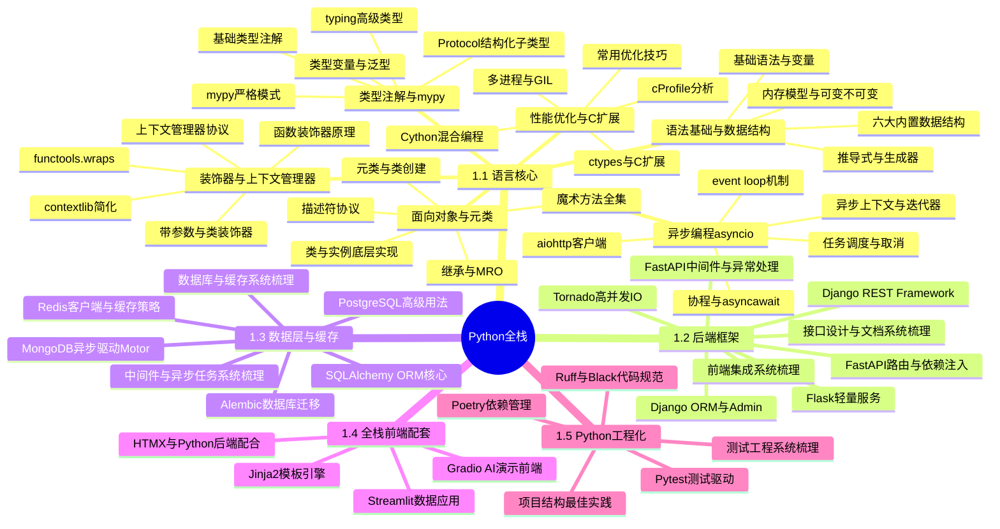

# 🐍 Python全栈技术栈 MOC

> 以 Python 为核心的全栈开发技术体系，覆盖后端框架、数据层、前端配套与工程化，是 AI 应用开发的主语言栈。
> **标签前缀**：`#Python全栈/`
> **枢纽核心笔记**：[[Python-全栈技术枢纽]]

---

## 🗺️ 四级知识体系全景


---

## 📐 知识层级总览

```text
一级：Python全栈技术栈
├── 二级：1.1 Python语言核心
│   ├── 三级：Python-语法基础与数据结构
│   │   ├── 四级：基础语法与变量
│   │   ├── 四级：六大内置数据结构
│   │   ├── 四级：推导式与生成器
│   │   └── 四级：内存模型与可变/不可变
│   ├── 三级：Python-面向对象与元类
│   ├── 三级：Python-装饰器与上下文管理器
│   ├── 三级：Python-异步编程asyncio
│   ├── 三级：Python-类型注解与mypy
│   └── 三级：Python-性能优化与C扩展
├── 二级：1.2 Python后端框架
├── 二级：1.3 数据层与缓存
├── 二级：1.4 全栈前端配套
└── 二级：1.5 Python工程化
```
> 💡 **深度讲解**：四级展开体系将Python全栈知识从宏观到微观逐层拆解。一级是领域总览，二级是五大板块（语言核心/后端框架/数据层/前端配套/工程化），三级是具体的原子笔记（每篇一个核心主题），四级是笔记内的子知识点。这种分层结构便于学习者按图索骥，也便于知识库维护者发现知识盲区。语言核心板块最厚，因为它是所有后续学习的基础；后端框架以FastAPI为核心，因为它是现代Python Web开发的事实标准；数据层强调SQLAlchemy+Redis组合；工程化板块虽薄但至关重要，决定了项目的可维护性。
>
> **📝 精简总结**：四级体系 = 一级领域 → 二级板块 → 三级笔记 → 四级子知识点，共5大板块、23篇原子笔记、约120个子知识点。

---

## 📚 1.1 Python 语言核心

### [[Python-语法基础与数据结构|语法基础与数据结构]]
> Python 语言地基，所有后续学习的前置

- **四级子知识点**：
  - 基础语法与变量类型
  - 六大内置数据结构（list/tuple/dict/set/str/bytes）
  - 推导式与生成器表达式
  - 内存模型与可变/不可变对象
  - 切片与高级索引
  - 常用内置函数速查
- **标签**：`#Python全栈/语言核心`
- **前置依赖**：无
- **后续延伸**：[[Python-面向对象与元类]]

### [[Python-面向对象与元类|面向对象与元类]]
> Python OOP 进阶，理解框架底层魔法

- **四级子知识点**：
  - 类与实例的底层实现（__dict__）
  - 继承与 MRO 方法解析顺序
  - 魔术方法全集（__init__/__new__/__call__等）
  - 描述符协议（property原理）
  - 元类（metaclass）与类创建过程
  - ABC 抽象基类与接口约束
- **标签**：`#Python全栈/语言核心`
- **前置依赖**：[[Python-语法基础与数据结构]]

### [[Python-装饰器与上下文管理器|装饰器与上下文管理器]]
> Python 最具特色的语法特性，框架大量使用

- **四级子知识点**：
  - 函数装饰器原理与实现
  - 带参数装饰器与类装饰器
  - functools.wraps 与装饰器副作用
  - 装饰器执行顺序（多层叠加）
  - 上下文管理器协议（__enter__/__exit__）
  - contextlib 简化写法
- **标签**：`#Python全栈/语言核心`

### [[Python-异步编程asyncio|异步编程 asyncio]]
> 高并发 IO 密集型应用的核心

- **四级子知识点**：
  - 协程概念与 async/await 语法
  - event loop 运行机制
  - asyncio 任务调度与取消
  - 异步上下文管理器与迭代器
  - aiohttp 异步 HTTP 客户端
  - 异步陷阱：阻塞调用与死锁
- **标签**：`#Python全栈/语言核心`
- **后续延伸**：[[FastAPI-路由与依赖注入]]（FastAPI 全异步）

### [[Python-类型注解与mypy|类型注解与 mypy]]
> 大型 Python 项目的工程化基础

- **四级子知识点**：
  - 基础类型注解语法
  - typing 模块高级类型（Union/Optional/Generic）
  - 类型变量与泛型函数
  - Protocol 结构化子类型
  - mypy 配置与严格模式
  - 类型注解在 FastAPI/Pydantic 中的应用
- **标签**：`#Python全栈/语言核心`

### [[Python-性能优化与C扩展|性能优化与 C 扩展]]
> 解决 Python 性能瓶颈的进阶手段

- **四级子知识点**：
  - cProfile 性能分析
  - 常用优化技巧（算法/数据结构/缓存）
  - Cython 混合编程
  - ctypes 与 C 扩展
  - 多进程 multiprocessing
  - GIL 原理与规避策略
- **标签**：`#Python全栈/语言核心`

> 💡 **深度讲解**：Python语言核心板块是整个全栈体系的地基。语法基础解决"能写代码"的问题，面向对象解决"组织代码"的问题，装饰器与上下文管理器是Python最具特色的语法糖（FastAPI的Depends、SQLAlchemy的session都依赖它们），异步编程是高并发IO的核心（FastAPI全异步架构的基础），类型注解是大型项目工程化的前提（Pydantic数据校验的基础），性能优化解决Python的先天短板。这六个主题环环相扣，掌握它们才能真正理解上层框架的设计原理。
>
> **📝 精简总结**：语言核心6大主题 = 语法+OOP+装饰器+异步+类型+性能，是理解所有上层框架的基础。

---

## 📚 1.2 Python 后端框架

### [[FastAPI-路由与依赖注入|FastAPI 路由与依赖注入]]
> 现代 Python Web 框架首选，AI 服务标配

- **四级子知识点**：
  - 路由定义与路径参数
  - 请求体与 Pydantic 模型校验
  - 依赖注入系统（Depends）
  - 依赖嵌套与作用域
  - 路由分组与 APIRouter
  - 响应模型与状态码
- **标签**：`#Python全栈/后端框架`
- **前置依赖**：[[Python-类型注解与mypy]]

### [[FastAPI-中间件与异常处理|FastAPI 中间件与异常处理]]
> 生产级 FastAPI 服务的横切关注点

- **四级子知识点**：
  - 全局中间件开发
  - CORS 跨域配置
  - 自定义异常处理器
  - 全局异常捕获与统一响应
  - 请求/响应日志中间件
  - 限流与认证中间件
- **标签**：`#Python全栈/后端框架`

### [[Django-ORM与Admin体系|Django ORM 与 Admin 体系]]
> 全能型 Web 框架，适合内容管理类项目

- **四级子知识点**：
  - Model 定义与字段类型
  - QuerySet API 与懒加载
  - 关联查询与 select_related/prefetch_related
  - 数据库迁移（migrations）
  - Admin 后台定制
  - Django 信号（signals）
- **标签**：`#Python全栈/后端框架`

### [[Django-Rest-Framework设计|Django REST Framework 设计]]
> Django 生态的 API 开发标准

- **四级子知识点**：
  - Serializer 序列化器
  - ViewSet 与 Router
  - 权限与认证体系
  - 过滤、搜索、排序
  - 分页与限流
  - ViewSet vs APIView 选型
- **标签**：`#Python全栈/后端框架`

### [[Flask-轻量服务架构|Flask 轻量服务架构]]
> 微框架，适合小型服务和微服务

- **四级子知识点**：
  - 路由与视图函数
  - Blueprint 模块化
  - 应用工厂模式
  - 扩展生态（Flask-SQLAlchemy等）
  - 请求上下文与应用上下文
  - Flask 与 FastAPI 对比选型
- **标签**：`#Python全栈/后端框架`

### [[Tornado-高并发IO模型|Tornado 高并发 IO 模型]]
> 异步 Web 框架，适合长连接场景

- **四级子知识点**：
  - Tornado 异步 IO 模型
  - RequestHandler 生命周期
  - 异步 HTTP 客户端
  - WebSocket 支持
  - 与 asyncio 集成
  - 适用场景与局限
- **标签**：`#Python全栈/后端框架`

### [[Python全栈前端集成知识点系统梳理_优化版|Python全栈前端集成知识点系统梳理]]
> Python全栈前端集成体系：模板引擎、前后端分离、静态资源、CORS、WebSocket、部署最佳实践

- **四级子知识点**：
  - 服务端渲染（Jinja2/Django Templates）
  - 前后端分离架构与API设计
  - 静态资源管理与打包集成
  - CORS跨域与安全配置
  - WebSocket/SSE实时通信
  - 部署与生产环境最佳实践
- **标签**：`#Python全栈/后端框架`
- **前置依赖**：[[FastAPI-路由与依赖注入]]

### [[Python接口设计与文档知识点系统梳理_优化版|Python接口设计与文档知识点系统梳理]]
> Python API设计完整体系：RESTful、OpenAPI/Swagger、版本管理、错误处理、认证、限流、文档自动化

- **四级子知识点**：
  - RESTful API设计原则与规范
  - OpenAPI/Swagger文档自动生成
  - API版本管理策略（URL/Header/Query）
  - 统一错误处理与响应格式
  - 认证授权（JWT/OAuth2/API Key）
  - 限流与接口文档最佳实践
- **标签**：`#Python全栈/后端框架`
- **前置依赖**：[[FastAPI-路由与依赖注入]]

> 💡 **深度讲解**：后端框架板块是Python全栈的应用入口。FastAPI是现代首选，它基于Starlette（ASGI）+Pydantic（类型校验），天生支持异步和自动文档，是AI服务封装的标配。Django是全能型框架，自带ORM、Admin、Auth，适合内容管理和快速交付，但异步支持较弱。Flask是微框架，灵活但需要自己组装生态，适合小型服务和微服务。Tornado是异步先驱，适合长连接WebSocket场景。选型原则：新项目优先FastAPI，需要Admin和全功能选Django，微服务选Flask，长连接选Tornado。
>
> **📝 精简总结**：后端框架4选1 — FastAPI（现代异步首选）、Django（全能全栈）、Flask（轻量微服务）、Tornado（长连接）。

---

## 📚 1.3 数据层与缓存

### [[Python中间件与异步任务知识点系统梳理_优化版|Python中间件与异步任务知识点系统梳理]]
> Python异步处理完整体系：中间件、异步任务、消息队列、Celery、定时任务、分布式任务、面试考点

- **四级子知识点**：
  - WSGI/ASGI中间件机制与开发
  - asyncio异步编程与事件循环
  - Celery异步任务队列（Broker/Worker/Beat）
  - 消息队列（RabbitMQ/Redis/Kafka）集成
  - 定时任务与分布式任务调度
  - 异步陷阱与最佳实践
- **标签**：`#Python全栈/后端框架`
- **前置依赖**：[[Python-异步编程asyncio]]

### [[SQLAlchemy-ORM核心原理|SQLAlchemy ORM 核心原理]]
> Python 最强大的 ORM，FastAPI 标配

- **四级子知识点**：
  - SQLAlchemy 架构（Core + ORM）
  - 声明式模型定义
  - Session 生命周期与事务
  - 关系映射（一对多/多对多）
  - 异步 SQLAlchemy（asyncpg）
  - N+1 查询问题与解决
- **标签**：`#Python全栈/数据层`

### [[Alembic-数据库迁移|Alembic 数据库迁移]]
> SQLAlchemy 配套的数据库版本管理

- **四级子知识点**：
  - 迁移脚本生成与执行
  - 自动生成迁移的局限
  - 版本回滚与分支
  - 多数据库配置
  - 迁移脚本自定义
  - CI/CD 中的迁移执行
- **标签**：`#Python全栈/数据层`

### [[Redis-Python客户端与缓存策略|Redis Python 客户端与缓存策略]]
> 缓存与高性能数据结构

- **四级子知识点**：
  - redis-py 同步客户端
  - aioredis 异步客户端
  - 缓存模式（Cache-Aside/Write-Through）
  - 缓存穿透/击穿/雪崩解决方案
  - 分布式锁实现
  - Redis 作为消息队列
- **标签**：`#Python全栈/数据层`

### [[MongoDB-异步驱动Motor|MongoDB 异步驱动 Motor]]
> 文档数据库，适合灵活数据模型

- **四级子知识点**：
  - Motor 异步 API
  - 文档建模与索引
  - 聚合管道
  - 事务支持
  - 与 SQL 数据库选型对比
  - GridFS 大文件存储
- **标签**：`#Python全栈/数据层`

### [[PostgreSQL-Python高级用法|PostgreSQL Python 高级用法]]
> 最强大的开源关系型数据库

- **四级子知识点**：
  - psycopg2/asyncpg 驱动
  - JSONB 字段操作
  - 全文检索
  - 窗口函数
  - 存储过程与触发器
  - 连接池管理（PgBouncer）
- **标签**：`#Python全栈/数据层`

### [[Python数据库与缓存知识点系统梳理_优化版|Python数据库与缓存知识点系统梳理]]
> Python数据层完整体系：SQL/NoSQL、ORM、连接池、事务、Redis、缓存策略、面试考点

- **四级子知识点**：
  - 关系型数据库（MySQL/PostgreSQL）与Python驱动
  - ORM框架（SQLAlchemy/Django ORM）核心原理
  - 数据库连接池管理与配置
  - 事务隔离级别与并发控制
  - Redis缓存策略（穿透/击穿/雪崩）
  - NoSQL（MongoDB/Redis）与缓存最佳实践
- **标签**：`#Python全栈/数据层`
- **前置依赖**：[[SQLAlchemy-ORM核心原理]]

> 💡 **深度讲解**：数据层是应用的基石。SQLAlchemy是Python ORM的事实标准，分为Core（SQL表达式）和ORM（对象映射）两层，Session管理事务生命周期，异步版本配合asyncpg性能优异。Alembic是SQLAlchemy的官方迁移工具，管理数据库schema版本。Redis是缓存和高性能数据结构的首选，解决缓存三大问题（穿透/击穿/雪崩）是面试高频考点。MongoDB适合灵活schema的文档存储，Motor提供异步驱动。PostgreSQL是最强大的开源关系型数据库，JSONB、全文检索、窗口函数是高级特性。选型原则：结构化数据选PostgreSQL+SQLAlchemy，缓存选Redis，灵活schema选MongoDB。
>
> **📝 精简总结**：数据层核心组合 = PostgreSQL + SQLAlchemy + Redis，MongoDB按需补充，Alembic管理迁移。

---

## 📚 1.4 全栈前端配套

### [[Jinja2-模板引擎|Jinja2 模板引擎]]
> 服务端渲染模板，Flask/Django 标配

- **四级子知识点**：
  - 模板语法与变量
  - 模板继承与包含
  - 自定义过滤器与全局函数
  - 模板安全与 XSS 防护
  - 国际化支持
  - 与前端框架的混合使用
- **标签**：`#Python全栈/前端配套`

### [[HTMX与Python后端配合|HTMX 与 Python 后端配合]]
> 无 JS 框架的现代交互方案

- **四级子知识点**：
  - HTMX 核心属性
  - 局部更新与轮询
  - WebSocket 与 SSE
  - 与 Flask/FastAPI 配合模式
  - 服务端组件化思路
  - 适用场景与局限
- **标签**：`#Python全栈/前端配套`

### [[Streamlit-数据应用快速搭建|Streamlit 数据应用快速搭建]]
> 数据科学家的全栈利器

- **四级子知识点**：
  - Streamlit 组件体系
  - 状态管理（session_state）
  - 缓存机制（@st.cache）
  - 表单与交互
  - 部署与多页面
  - 与 ML/AI 模型集成
- **标签**：`#Python全栈/前端配套`

### [[Gradio-AI演示前端|Gradio AI 演示前端]]
> AI 模型演示与 API 快速封装

- **四级子知识点**：
  - Gradio Interface 基础
  - Blocks 自定义布局
  - 多模态输入输出
  - 状态与流式输出
  - 共享与部署
  - 与 FastAPI 集成
- **标签**：`#Python全栈/前端配套`
- **跨板块关联**：[[MOC-AI工程化-四级展开|AI工程化]]

> 💡 **深度讲解**：前端配套板块解决Python后端的界面问题。Jinja2是服务端渲染模板，适合传统多页应用和邮件模板，与Flask/FastAPI集成简单。HTMX是新兴的"无JS框架"方案，通过HTML属性实现AJAX/WebSocket/SSE，让后端开发者也能构建现代交互界面，特别适合快速原型和内部工具。Streamlit是数据科学家的最爱，几行代码就能构建交互式数据应用，适合ML模型演示和数据分析。Gradio专注AI模型演示，支持多模态输入输出，与Hugging Face生态深度集成。选型原则：传统多页选Jinja2，快速交互选HTMX，数据应用选Streamlit，AI演示选Gradio。
>
> **📝 精简总结**：前端配套4工具 — Jinja2（SSR模板）、HTMX（无JS交互）、Streamlit（数据应用）、Gradio（AI演示）。

---

## 📚 1.5 Python 工程化

### [[Poetry-依赖与虚拟环境管理|Poetry 依赖与虚拟环境管理]]
> 现代 Python 项目管理标准

- **四级子知识点**：
  - pyproject.toml 配置
  - 依赖分组与锁文件
  - 虚拟环境管理
  - 包发布流程
  - 与 pip/conda 对比
  - monorepo 中的使用
- **标签**：`#Python全栈/工程化`

### [[Pytest-测试驱动开发|Pytest 测试驱动开发]]
> Python 测试框架事实标准

- **四级子知识点**：
  - fixture 体系与作用域
  - 参数化测试
  - 标记与选择性运行
  - 插件生态（pytest-asyncio等）
  - 覆盖率统计
  - Mock 与依赖注入测试
- **标签**：`#Python全栈/工程化`

### [[Ruff与Black-代码规范|Ruff 与 Black 代码规范]]
> 极速 Python lint 与格式化

- **四级子知识点**：
  - Ruff 规则配置
  - Black 格式化规范
  - isort 导入排序
  - pre-commit 集成
  - 与 mypy 配合
  - 性能对比（vs flake8/pylint）
- **标签**：`#Python全栈/工程化`

### [[Python-项目结构最佳实践|Python 项目结构最佳实践]]
> 可维护的 Python 项目布局

- **四级子知识点**：
  - 标准项目目录结构
  - src layout vs flat layout
  - 配置管理（pydantic-settings）
  - 日志规范（structlog）
  - 错误处理模式
  - 接口设计与版本化
- **标签**：`#Python全栈/工程化`

### [[Python测试工程知识点系统梳理_优化版|Python测试工程知识点系统梳理]]
> Python测试完整体系：单元测试、集成测试、E2E测试、Mock、TDD/BDD、覆盖率、CI/CD、面试考点

- **四级子知识点**：
  - 测试金字塔与测试策略
  - Pytest框架（fixture/参数化/标记/插件）
  - Mock与Stub（unittest.mock/pytest-mock）
  - 集成测试与E2E测试（API/数据库/UI）
  - 代码覆盖率与质量门禁
  - TDD/BDD与CI/CD集成最佳实践
- **标签**：`#Python全栈/工程化`
- **前置依赖**：[[Pytest-测试驱动开发]]

> 💡 **深度讲解**：工程化板块决定了Python项目的可维护性和团队协作效率。Poetry统一了依赖管理、虚拟环境和包发布，替代了pip+venv+setup.py的碎片化方案。Pytest是测试框架的事实标准，fixture体系比unittest的setUp/tearDown更灵活强大，参数化测试大幅减少重复代码。Ruff是用Rust编写的极速linter，性能是flake8的10-100倍，正在统一lint+format+import sort工具链。项目结构最佳实践强调src layout（源码与测试分离）、配置管理、日志规范和错误处理模式。工程化不是可选项，而是项目能否长期维护的关键。
>
> **📝 精简总结**：工程化4件套 — Poetry（依赖）、Pytest（测试）、Ruff+Black（规范）、标准项目结构，保障代码质量与可维护性。

---

## 🔗 学习依赖路径

```text
Python语言核心 → 后端框架 → 数据层 → 工程化 → 全栈整合
     ↓              ↓          ↓
  类型注解      FastAPI     SQLAlchemy
     ↓              ↓          ↓
     └────── AI 服务开发（→ 06 AI工程化）──────┘
```

| 阶段 | 知识点 | 预计耗时 | 前置条件 |
|------|--------|----------|----------|
| 入门 | 语法基础 + 数据结构 | 8h | 无 |
| 进阶 | OOP + 装饰器 + 异步 | 16h | 入门 |
| 框架 | FastAPI 全套 | 12h | 进阶 |
| 数据 | SQLAlchemy + Redis | 10h | 框架 |
| 工程 | Poetry + Pytest + Ruff | 6h | 框架 |
| 实战 | 完整 API 项目 | 20h | 全部 |

---

## 🌐 跨板块关联

| 关联板块 | 关联点 | 连接笔记 |
|----------|--------|----------|
| [[MOC-AI工程化-四级展开\|AI工程化]] | Python 是 LLM 应用主语言，FastAPI 封装 RAG/Agent | [[FastAPI-封装LLM流式接口\|FastAPI-封装LLM接口]] |
| [[MOC-Vue3TS-四级展开\|Vue3TS前端]] | FastAPI 提供 REST/SSE，Vue3 消费 | [[Vue3对接FastAPI-SSE]] |
| [[MOC-DevOps-四级展开\|DevOps]] | Python 服务容器化与 CI/CD | [[Python-Docker镜像优化]] |
| [[MOC-Java全栈-四级展开\|Java全栈]] | 多语言混合架构，网关统一路由 | [[Gateway-网关路由与鉴权]] |

---

## 🌱 持续扩充方向

- [ ] FastAPI v1 新特性与稳定性迁移
- [ ] Litestar 框架（Starlette 另一个分支）
- [ ] Python 3.13+ 无 GIL 实验
- [ ] Pydantic v3 迁移指南
- [ ] Trio 异步生态（asyncio 替代方案）
- [ ] Ruff 作为统一工具链（format + lint + import sort）
- [ ] Strawberry GraphQL 与 Python 全栈
- [ ] Python WASM 端侧运行

---

## 📊 板块统计

- 二级分类：5 个
- 三级知识点（原子笔记）：23 篇
- 四级子知识点：约 120 个
- 枢纽笔记：1 篇（Python-全栈技术枢纽）
- 跨板块关联：4 条

---

## 🔗 关联笔记

- [[Python-全栈技术枢纽]] — Python全栈技术枢纽，连接各领域核心节点
- [[MOC-Python全栈]] — Python全栈MOC主入口，六大领域文档索引
- [[MOC-综合导航]] — 全知识库综合导航入口

## 📖 前置知识

- 无（本MOC为领域入口，各子笔记有各自前置知识）

## 🏷️ 相关标签

`#MOC` `#Python` `#FastAPI` `#异步` `#SQLAlchemy` `#Redis` `#测试` `#学习路线` `#枢纽笔记`

---

[[四级框架总索引|← 返回四级框架总索引]] · [[Home|🏠 返回首页]]
