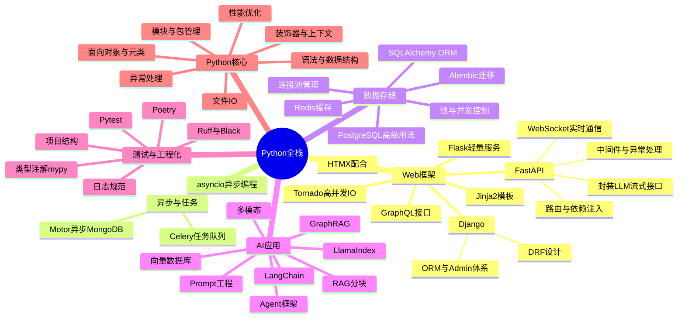

# 🐍 Python全栈 MOC

> 基于 Python 的现代全栈技术栈，覆盖 Web框架、异步与任务、数据存储、AI应用、测试与工程化、Python核心六大领域，共 68 篇文档。
>
> **学习建议**：先掌握 Python 核心，再深入 Web 框架（FastAPI/Django），然后学习异步与数据存储，最后探索 AI 应用和工程化。

---

## 🗺️ 知识体系全景


---

## 📚 学习路线

```text
入门阶段：Python基础 → 数据结构 → 面向对象 → 虚拟环境 → FastAPI入门
进阶阶段：FastAPI深入 → SQLAlchemy → Redis → asyncio异步 → Celery任务队列
高级阶段：Django/DRF → 数据库优化 → 性能调优 → 测试工程 → 部署运维
专家阶段：AI应用(LangChain/RAG/Agent) → 多模态 → 模型部署 → 架构设计 → 源码原理
```
> 💡 **深度讲解**：Python全栈的学习路线遵循"基础→框架→数据→异步→AI→工程化"的递进逻辑。Python核心是地基，FastAPI作为现代异步框架是Web开发的首选入口，数据层（SQLAlchemy+Redis）解决持久化与性能问题，异步编程（asyncio+Celery）处理高并发与耗时任务，AI应用是Python的差异化优势领域，工程化（测试+类型+规范）保障代码质量。这条路线不是线性的，实际项目中各领域交叉使用，建议在掌握FastAPI+SQLAlchemy后立即做一个完整项目，再回头深化各领域。
>
> **📝 精简总结**：学习路径为 Python核心 → FastAPI → 数据存储 → 异步任务 → AI应用 → 工程化，建议边学边做项目。

---

## 📂 文档索引

### 一、Web框架

| 文档 | 说明 | 难度 |
|------|------|------|
| [[Python Web开发框架知识点系统梳理_优化版\|Python Web开发框架知识点系统梳理]] | FastAPI/Django/Flask对比、路由、中间件、模板、ORM、认证、部署、面试考点 | 🟡进阶 |
| [[FastAPI-路由与依赖注入]] | FastAPI路由、路径操作、依赖注入、Depends、参数校验、Pydantic、响应模型 | 🟡进阶 |
| [[FastAPI-中间件与异常处理]] | FastAPI中间件、异常处理、自定义异常、全局异常、CORS、GZip、HTTPS重定向 | 🟡进阶 |
| [[FastAPI-WebSocket实时通信]] | FastAPI WebSocket、连接管理、消息收发、广播、房间、鉴权、心跳、断线重连 | 🟡进阶 |
| [[FastAPI-封装LLM流式接口]] | FastAPI封装LLM流式接口、统一抽象、多模型适配、降级、重试、限流、缓存、成本控制 | 🔴高级 |
| [[Django-ORM与Admin体系]] | Django ORM、模型、查询、迁移、Admin后台、自定义、权限、内联、最佳实践 | 🟡进阶 |
| [[Django-Rest-Framework设计]] | DRF设计、序列化、视图、路由、认证、权限、限流、过滤、分页、版本、最佳实践 | 🟡进阶 |
| [[Flask-轻量服务架构]] | Flask轻量框架、路由、蓝图、请求上下文、扩展、WSGI、部署、微服务、最佳实践 | 🟡进阶 |
| [[Tornado-高并发IO模型]] | Tornado高并发框架、IO模型、异步处理、WebSocket、长连接、性能优化、适用场景 | 🔴高级 |
| [[Python-GraphQL接口开发]] | GraphQL接口开发、Schema、Query/Mutation、Resolver、Strawberry/Graphene、订阅、性能优化 | 🟡进阶 |
| [[HTMX与Python后端配合]] | HTMX与Python后端配合、无JS交互、AJAX、WebSocket、SSE、服务器端渲染、快速原型 | 🟡进阶 |
| [[Jinja2-模板引擎]] | Jinja2模板引擎、模板继承、变量/过滤器/控制流、宏、模板加载、安全渲染、与Flask/FastAPI集成、最佳实践 | 🟢入门 |
| [[Python接口设计与文档知识点系统梳理_优化版\|Python接口设计与文档知识点系统梳理]] | RESTful API设计、OpenAPI/Swagger、版本管理、错误处理、认证、限流、文档、最佳实践 | 🟡进阶 |
| [[Python全栈前端集成知识点系统梳理_优化版\|Python全栈前端集成知识点系统梳理]] | Python全栈前端集成、模板引擎、前后端分离、静态资源、CORS、WebSocket、部署、最佳实践 | 🟡进阶 |

### 二、异步与任务

| 文档 | 说明 | 难度 |
|------|------|------|
| [[Python-异步编程asyncio]] | asyncio异步编程、协程、事件循环、Future/Task、async/await、并发控制、aiohttp、最佳实践 | 🔴高级 |
| [[Celery-异步任务队列]] | Celery异步任务队列、Broker、Worker、任务定义、调度、结果存储、重试、监控、最佳实践 | 🟡进阶 |
| [[MongoDB-异步驱动Motor]] | Motor异步MongoDB驱动、异步CRUD、聚合、索引、GridFS、连接池、与asyncio集成、最佳实践 | 🟡进阶 |
| [[Python中间件与异步任务知识点系统梳理_优化版\|Python中间件与异步任务知识点系统梳理]] | 中间件、异步任务、消息队列、Celery、RabbitMQ/Redis、定时任务、分布式任务、面试考点 | 🟡进阶 |

### 三、数据存储

| 文档 | 说明 | 难度 |
|------|------|------|
| [[SQLAlchemy-ORM核心原理]] | SQLAlchemy ORM核心原理、Engine、ConnectionPool、Session、模型、查询、关系、事务、迁移 | 🔴高级 |
| [[Alembic-数据库迁移]] | Alembic数据库迁移、迁移脚本、自动生成、升级降级、分支、合并、与SQLAlchemy集成、最佳实践 | 🟡进阶 |
| [[Redis-Python客户端与缓存策略]] | Redis Python客户端、redis-py、连接池、缓存策略、缓存穿透/击穿/雪崩、分布式锁、发布订阅、最佳实践 | 🟡进阶 |
| [[PostgreSQL-Python高级用法]] | PostgreSQL Python高级用法、psycopg2/asyncpg、JSONB、全文检索、数组、CTE、窗口函数、性能优化 | 🔴高级 |
| [[Python-数据库连接池管理]] | 数据库连接池管理、连接池原理、DBUtils、SQLAlchemy池、配置、监控、泄漏检测、最佳实践 | 🟡进阶 |
| [[Python-数据库锁与并发控制]] | 数据库锁与并发控制、行锁/表锁、乐观锁/悲观锁、隔离级别、死锁、分布式锁、最佳实践 | 🔴高级 |
| [[Python数据库与缓存知识点系统梳理_优化版\|Python数据库与缓存知识点系统梳理]] | 数据库与缓存、SQL/NoSQL、ORM、连接池、事务、Redis、Memcached、缓存策略、面试考点 | 🟡进阶 |

### 四、AI开发实战

| 文档 | 说明 | 难度 |
|------|------|------|
| [[Python-LangChain应用开发]] | LangChain应用开发、Chain、Agent、Tool、Memory、Prompt、Retriever、RAG、多Agent、最佳实践 | 🟡进阶 |
| [[Python-向量数据库客户端]] | 向量数据库客户端、Chroma/Milvus/Pinecone、向量CRUD、相似度搜索、过滤、嵌入、批量、最佳实践 | 🟡进阶 |
| [[Python-多模态AI应用开发]] | 多模态AI应用开发、文本/图像/语音/视频、模型调用、内容理解、生成、转换、最佳实践 | 🟡进阶 |
| [[RAG文本分块策略与实践]] | RAG文本分块策略、固定大小、语义分块、递归分块、父文档分块、分块评估、最佳实践 | 🟡进阶 |
| [[GraphRAG知识图谱增强检索]] | GraphRAG知识图谱增强检索、知识图谱构建、实体关系提取、图检索、混合检索、社区检测、最佳实践 | 🔴高级 |
| [[Agent记忆机制设计与实现]] | Agent记忆机制、短期记忆、长期记忆、向量记忆、摘要记忆、记忆管理、遗忘、最佳实践 | 🟡进阶 |
| [[Prompt工程与版本管理]] | Prompt工程、Few-shot、CoT、角色设定、Prompt模板、版本管理、A/B测试、评估、最佳实践 | 🟡进阶 |
| [[AI应用安全与Prompt注入防护]] | AI应用安全、Prompt注入、越狱攻击、数据泄露、输出过滤、输入验证、护栏、安全评估 | 🔴高级 |
| [[AI成本控制与Token计费优化]] | AI成本控制、Token计费、模型选型、缓存、批处理、降级、预算管理、成本监控、最佳实践 | 🟡进阶 |
| [[模型量化与本地部署实践]] | 模型量化、GGUF/GPTQ/AWQ、llama.cpp、Ollama、本地部署、推理优化、显存优化、最佳实践 | 🔴高级 |

### 五、测试与工程化

| 文档 | 说明 | 难度 |
|------|------|------|
| [[Pytest-测试驱动开发]] | Pytest测试框架、TDD、fixture、参数化、标记、Mock、覆盖率、插件、最佳实践 | 🟡进阶 |
| [[Python-集成测试与E2E测试]] | 集成测试与E2E测试、测试金字塔、API测试、数据库测试、Selenium/Playwright、测试环境、最佳实践 | 🟡进阶 |
| [[Python-代码覆盖率与质量门禁]] | 代码覆盖率、coverage.py、行覆盖/分支覆盖、质量门禁、CI/CD集成、报告、SonarQube、最佳实践 | 🟡进阶 |
| [[Python-类型注解与mypy]] | 类型注解、mypy静态检查、类型推断、泛型、Protocol、严格模式、渐进式类型、最佳实践 | 🟡进阶 |
| [[Ruff与Black-代码规范]] | Ruff与Black代码规范、格式化、Lint、规则配置、pre-commit、IDE集成、最佳实践 | 🟢入门 |
| [[Poetry-依赖与虚拟环境管理]] | Poetry依赖管理、pyproject.toml、虚拟环境、锁文件、依赖解析、发布、分组、最佳实践 | 🟢入门 |
| [[Python-项目结构最佳实践]] | 项目结构最佳实践、src布局、模块组织、配置管理、日志、测试、文档、打包、最佳实践 | 🟡进阶 |
| [[Python-日志规范与结构化日志]] | 日志规范、logging模块、结构化日志、JSON日志、日志级别、格式、轮转、集中式日志、最佳实践 | 🟡进阶 |
| [[Python-API版本化与文档]] | API版本化、URL/Header/Query版本、OpenAPI文档、Swagger UI、ReDoc、自动生成、最佳实践 | 🟡进阶 |
| [[Python-Sentry错误监控集成]] | Sentry错误监控集成、异常捕获、上下文、Release、性能监控、告警、采样、最佳实践 | 🟡进阶 |
| [[Python测试工程知识点系统梳理_优化版\|Python测试工程知识点系统梳理]] | 测试工程、单元测试、集成测试、E2E测试、Mock、TDD/BDD、覆盖率、CI/CD、面试考点 | 🟡进阶 |
| [[Python安全防护知识点系统梳理_优化版\|Python安全防护知识点系统梳理]] | 安全防护、XSS/CSRF/SQL注入、认证授权、加密、依赖漏洞、安全编码、审计、面试考点 | 🟡进阶 |
| [[Python部署运维知识点系统梳理_优化版\|Python部署运维知识点系统梳理]] | 部署运维、WSGI/ASGI、Gunicorn/Uvicorn、Docker、K8s、CI/CD、监控、日志、面试考点 | 🟡进阶 |

### 六、Python核心

| 文档 | 说明 | 难度 |
|------|------|------|
| [[Python语言核心整合大全_优化版\|Python语言核心整合大全]] | Python完整知识体系、语法、数据结构、面向对象、函数式、异步、标准库、高级特性、面试考点 | 🔴高级 |
| [[Python语言基础与进阶知识点系统梳理_优化版\|Python语言基础与进阶知识点系统梳理]] | Python基础与进阶、语法、数据类型、控制流、函数、模块、面向对象、异常、标准库、面试考点 | 🟡进阶 |
| [[Python-语法基础与数据结构]] | Python语法基础、变量、数据类型、列表/字典/集合、控制流、函数、推导式、迭代器、生成器 | 🟢入门 |
| [[Python-面向对象与元类]] | 面向对象、类/对象、继承、多态、封装、魔术方法、元类、描述符、property、最佳实践 | 🔴高级 |
| [[Python-装饰器与上下文管理器]] | 装饰器原理、函数/类装饰器、带参数装饰器、functools.wraps、上下文管理器、with语句、contextlib | 🟡进阶 |
| [[Python-模块与包管理原理]] | 模块与包管理、import机制、sys.path、命名空间包、相对导入、__init__.py、打包发布、最佳实践 | 🟡进阶 |
| [[Python-异常处理与错误体系]] | 异常处理、try/except/finally、异常层次、自定义异常、异常链、上下文管理器、最佳实践 | 🟡进阶 |
| [[Python-文件IO与序列化]] | 文件IO、读写、上下文管理器、路径处理、JSON/CSV/Pickle序列化、编码、大文件处理、最佳实践 | 🟡进阶 |
| [[Python-正则表达式与文本处理]] | 正则表达式、re模块、模式匹配、分组、贪婪/非贪婪、环视、替换、文本处理、最佳实践 | 🟡进阶 |
| [[Python性能优化知识点系统梳理_优化版\|Python性能优化知识点系统梳理]] | 性能优化、算法优化、数据结构、并发、C扩展、内存优化、 profiling、面试考点 | 🔴高级 |
| [[Python-性能优化与C扩展]] | 性能优化、C扩展、Cython、ctypes、cffi、Numba、PyPy、GIL、并发、profiling、最佳实践 | 🔴高级 |
| [[Python-性能测试与压测]] | 性能测试与压测、locust、pytest-benchmark、timeit、cProfile、压力测试、负载测试、最佳实践 | 🟡进阶 |
| [[Streamlit-数据应用快速搭建]] | Streamlit数据应用、快速搭建、交互组件、图表、缓存、部署、数据可视化、AI演示、最佳实践 | 🟢入门 |
| [[Gradio-AI演示前端]] | Gradio AI演示前端、快速搭建、界面组件、API、部署、Hugging Face Spaces、AI应用、最佳实践 | 🟢入门 |

> 💡 **深度讲解**：六大领域构成Python全栈的完整知识版图。Web框架是应用入口，FastAPI以异步+类型注解成为现代首选，Django适合需要Admin和全功能的项目，Flask适合微服务。异步与任务解决IO密集型并发问题，asyncio是基础，Celery处理分布式耗时任务。数据存储是应用基石，SQLAlchemy是ORM事实标准，Redis解决缓存与高性能数据结构。AI应用是Python的差异化优势，LangChain/LlamaIndex降低AI应用开发门槛。测试与工程化保障代码质量与可维护性。Python核心是所有领域的基础，需要持续深化。
>
> **📝 精简总结**：六大领域覆盖从语言基础到AI应用的全栈能力，FastAPI+SQLAlchemy+Redis是核心技术组合。

---

## 🔗 知识关联

```text
Python全栈体系
├── Python核心 ← 所有Python开发的基础
│   ├── 语法/数据结构 → 基础编程
│   ├── 面向对象/元类 → 高级特性
│   ├── 装饰器/上下文管理器 → 函数式编程
│   ├── 异步编程 → 高并发
│   └── 性能优化 → C扩展/Profiling
├── Web框架 ← Web开发核心
│   ├── FastAPI → 现代高性能
│   ├── Django → 全栈框架
│   ├── Flask → 轻量框架
│   └── 接口设计 → RESTful/GraphQL
├── 异步与任务 ← 异步处理
│   ├── asyncio → 异步编程
│   ├── Celery → 任务队列
│   └── 消息队列 → 异步解耦
├── 数据存储 ← 数据持久化
│   ├── SQLAlchemy → ORM
│   ├── Redis → 缓存
│   ├── PostgreSQL → 关系型数据库
│   └── MongoDB → 文档数据库
├── AI应用 ← AI应用开发
│   ├── LangChain → AI框架
│   ├── LlamaIndex → RAG框架
│   ├── Agent → 智能体
│   ├── RAG → 检索增强
│   ├── 向量数据库 → 语义检索
│   └── 多模态 → 文本/图像/语音
└── 测试与工程化 ← 质量保障
    ├── Pytest → 测试框架
    ├── 类型注解/mypy → 类型安全
    ├── Ruff/Black → 代码规范
    ├── Poetry → 依赖管理
    └── 部署运维 → 生产环境
```

- **Python核心** 是所有Python开发的基础，与 [[MOC-计算机基础|计算机基础]] 紧密关联
- **FastAPI** 是现代Python Web框架的首选，与 [[MOC-前端开发|前端开发]] 通过API交互
- **AI应用** 是Python的优势领域，与 [[MOC-AI与效率工具|AI与效率工具]] 紧密关联
- **数据存储** 与 [[MOC-数据库与缓存|数据库与缓存]] 紧密关联
- **测试与工程化** 与 [[MOC-通用工具|通用工具]] 紧密关联

---

## 📖 学习顺序

```text
1. **Python核心**：[[Python-语法基础与数据结构|Python基础]] → [[Python-面向对象与元类|面向对象]] → [[Python-装饰器与上下文管理器|装饰器]] → [[Python语言核心整合大全_优化版|Python大全]]
2. **Web框架**：[[FastAPI-路由与依赖注入|FastAPI路由]] → [[FastAPI-中间件与异常处理|中间件]] → [[Python Web开发框架知识点系统梳理_优化版|Web框架大全]]
3. **数据存储**：[[SQLAlchemy-ORM核心原理|SQLAlchemy]] → [[Redis-Python客户端与缓存策略|Redis]] → [[Alembic-数据库迁移|Alembic]]
4. **异步与任务**：[[Python-异步编程asyncio|asyncio]] → [[Celery-异步任务队列|Celery]]
5. **AI开发实战**：[[Python-LangChain应用开发|LangChain]] → [[RAG文本分块策略与实践|RAG]] → [[Python-多模态AI应用开发|多模态]]（LlamaIndex/Agent框架自研已并入 09-AI与效率工具 对应笔记）
6. **测试与工程化**：[[Pytest-测试驱动开发|Pytest]] → [[Python-类型注解与mypy|mypy]] → [[Ruff与Black-代码规范|Ruff/Black]] → [[Poetry-依赖与虚拟环境管理|Poetry]]
7. **性能优化**：[[Python性能优化知识点系统梳理_优化版|性能优化大全]] → [[Python-性能优化与C扩展|C扩展]]
8. **实战**：[[MOC-项目实战|全栈项目实战]]
```

---

## 🚀 知识域旗舰全集

- [[Python语言核心整合大全_优化版|Python语言核心整合大全]] — Python完整知识体系、语法、数据结构、面向对象、函数式、异步、标准库、高级特性、面试考点

## 🧩 排查与进阶手册

- [[Python部署运维知识点系统梳理_优化版|Python部署运维知识点系统梳理]] — WSGI/ASGI、Gunicorn/Uvicorn、Docker、K8s、CI/CD、监控、日志、面试考点

---

> 💡 **深度讲解**：本章介绍了进阶用法、生态工具、技术集成、行业应用和学习资源，为深入学习提供方向。技术的价值不仅在于自身功能，更在于与其他技术的组合使用所产生的协同效应。建议根据项目需求和个人兴趣，选择1-2个拓展方向深入学习，避免浅尝辄止。
>
> **📝 精简总结**：本章介绍了进阶特性、生态工具、技术集成、应用案例和学习资源，为深入学习和技术拓展提供方向。


## 🔗 关联笔记

- [[Python-全栈技术枢纽]] — Python全栈技术枢纽，连接各领域核心节点
- [[MOC-Python全栈-四级展开]] — Python全栈四级展开详细导航
- [[MOC-综合导航]] — 全知识库综合导航入口

## 📖 前置知识

- 无（本MOC为领域入口，各子笔记有各自前置知识）

## 🏷️ 相关标签

`#Python` `#FastAPI` `#异步` `#AI应用` `#MOC` `#后端` `#数据库` `#Redis` `#测试` `#性能优化`

---

[[Home|🏠 返回首页]] · [[MOC-综合导航|📚 综合导航]] · [[学习路线总览|🗺️ 学习路线]]
