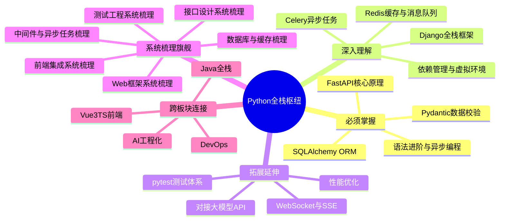

# 🐍 Python 全栈技术枢纽

> Python 全栈技术栈的核心知识节点，连接语言、后端、数据层、前端配套与工程化。
> **所属板块**：[[MOC-Python全栈-四级展开|Python全栈]]
> **标签前缀**：`#Python全栈/`

---

## 🗺️ 枢纽知识网络全景


---

## 📌 枢纽定位

| 维度 | 说明 |
|------|------|
| 定位 | Python 全栈开发的知识汇聚点 |
| 覆盖范围 | 语言核心 → 后端框架 → 数据层 → 前端配套 → 工程化 |
| 上游依赖 | [[CS-基础原理枢纽|CS基础]] |
| 下游延伸 | [[AI-工程化技术枢纽|AI工程化]]、[[项目实战-枢纽|项目实战]] |
| 核心能力 | 快速构建 Web 应用、API 服务、数据处理管道 |

> 💡 **深度讲解**：枢纽笔记是知识网络的"路由器"，它不深入某个具体技术点，而是建立各领域核心节点之间的连接关系。Python全栈枢纽的价值在于：①帮助学习者建立全局视野，理解各技术在整体架构中的位置；②提供分层学习路径（必须掌握→深入理解→拓展延伸）；③连接跨板块知识（前端、AI、DevOps、Java），避免知识孤岛；④作为快速检索入口，通过旗舰文档快速定位详细内容。枢纽笔记的核心是"连接"而非"深度"，每个节点都链接到详细的原子笔记。
>
> **📝 精简总结**：枢纽 = 知识路由器，分层连接Python全栈各领域核心节点，并跨板块关联前端/AI/DevOps。

---

## 🔑 核心知识节点

### 第一层：必须掌握

- [[Python-异步编程asyncio|语法进阶与异步编程]] — Python 现代语法基础，async/await 是高并发核心
- [[FastAPI-路由与依赖注入|FastAPI 核心原理]] — 异步 Web 框架标准，AI 服务封装首选
- [[SQLAlchemy-ORM核心原理|SQLAlchemy ORM]] — Python 数据层标准，ORM 事实标准
- [[Python-类型注解与mypy|数据校验与序列化]] — FastAPI 生态核心，Pydantic 基于类型注解

### 第二层：深入理解

- [[Django-ORM与Admin体系|Django 全栈框架]] — 重量级全栈方案，自带 Admin 和 Auth
- [[Redis-Python客户端与缓存策略|Redis 缓存与消息队列]] — 高性能中间件，缓存+分布式锁+消息队列
- [[Celery-异步任务队列|Celery 异步任务]] — 分布式任务处理，耗时任务异步化
- [[Poetry-依赖与虚拟环境管理|依赖管理]] — 工程化基础，统一依赖与虚拟环境

### 第三层：拓展延伸

- [[FastAPI-封装LLM流式接口|对接大模型 API]] — AI 应用集成，LLM 流式接口封装
- [[Pytest-测试驱动开发|pytest 测试体系]] — 质量保障，测试框架事实标准
- [[Python-性能优化与C扩展|性能优化]] — 高并发场景，C扩展与GIL优化
- [[FastAPI-WebSocket实时通信|WebSocket 与 SSE]] — 实时通信，长连接与流式响应

### 系统梳理旗舰文档

- [[Python Web开发框架知识点系统梳理_优化版|Python Web框架系统梳理]] — FastAPI/Django/Flask全框架对比与面试考点
- [[Python全栈前端集成知识点系统梳理_优化版|Python全栈前端集成系统梳理]] — 模板/前后端分离/CORS/WebSocket/部署
- [[Python接口设计与文档知识点系统梳理_优化版|Python接口设计与文档系统梳理]] — RESTful/OpenAPI/版本管理/认证/限流
- [[Python中间件与异步任务知识点系统梳理_优化版|Python中间件与异步任务系统梳理]] — 中间件/Celery/消息队列/定时任务
- [[Python数据库与缓存知识点系统梳理_优化版|Python数据库与缓存系统梳理]] — ORM/连接池/事务/Redis/缓存策略
- [[Python测试工程知识点系统梳理_优化版|Python测试工程系统梳理]] — Pytest/Mock/覆盖率/TDD/CI-CD

> 💡 **深度讲解**：三层知识节点体系遵循"80/20原则"。第一层（必须掌握）是日常开发中80%时间会用到的核心技能，掌握它们就能独立完成大部分API开发任务。第二层（深入理解）是解决复杂问题和性能瓶颈所需的进阶技能，比如Django的Admin定制、Redis的分布式锁、Celery的任务调度。第三层（拓展延伸）是面向特定场景的专项技能，AI应用、性能优化、实时通信等。旗舰文档是各领域的"百科全书"，整合了零散知识点并补充面试考点，适合系统复习和面试准备。建议学习顺序：第一层→做项目→第二层→优化项目→第三层→专项突破。
>
> **📝 精简总结**：三层节点 = 必须掌握（4个核心）→ 深入理解（4个进阶）→ 拓展延伸（4个专项），旗舰文档用于系统复习。

---

## 🕸️ 知识网络

```text
Python语言核心
    │
    ├── FastAPI ──── Pydantic
    │     │
    │     ├── SQLAlchemy ──── PostgreSQL/MySQL
    │     │
    │     ├── Redis ──── Celery
    │     │
    │     └── WebSocket/SSE ──── 前端(Vue3)
    │
    ├── Django ──── DRF
    │
    └── 工程化 ──── pytest / Docker / CI
```

---

## 🔗 上下游横向关联

### 入向依赖（需要先掌握）
- [[CS-基础原理枢纽|CS基础]] — 数据结构、网络、操作系统
- [[效率工具-枢纽|效率工具]] — VSCode、终端、Git

### 出向延伸（可以继续学）
- [[AI-工程化技术枢纽|AI工程化]] — Python 是 AI 主语言
- [[DevOps-工程化枢纽|DevOps]] — Python 服务部署
- [[项目实战-枢纽|项目实战]] — FastAPI + Vue3 全栈项目

---

## 🌐 跨板块枢纽连接

| 连接枢纽 | 关联点 | 关键笔记 |
|----------|--------|----------|
| [[Vue3TS-前端技术枢纽|Vue3TS前端]] | FastAPI 提供 API，Vue3 做前端 | [[FastAPI-路由与依赖注入]] |
| [[AI-工程化技术枢纽|AI工程化]] | Python 是 LLM 应用开发主语言 | [[FastAPI-封装LLM流式接口]] |
| [[DevOps-工程化枢纽|DevOps]] | Python 服务容器化部署 | [[Poetry-依赖与虚拟环境管理]] |
| [[Java-全栈技术枢纽|Java全栈]] | 多语言混合架构，Python 做 AI 服务 | [[Gateway-网关路由与鉴权]] |

> 💡 **深度讲解**：跨板块连接是枢纽笔记的核心价值之一。Python全栈不是孤立的技术体系，它与其他板块深度交互：①与Vue3TS前端通过REST API/SSE/WebSocket交互，FastAPI的自动文档让前后端协作更高效；②与AI工程化是"母语级"关联，Python是LLM应用开发的绝对主语言，LangChain/LlamaIndex等框架都是Python优先；③与DevOps通过容器化和CI/CD连接，Python服务的Docker镜像优化和Uvicorn/Gunicorn部署是常见话题；④与Java全栈在微服务架构中共存，Python做AI服务、Java做业务服务，通过API网关统一路由。理解这些跨板块连接，才能构建完整的全栈能力图谱。
>
> **📝 精简总结**：4大跨板块连接 — Vue3TS（API交互）、AI工程化（母语关联）、DevOps（部署）、Java全栈（混合架构）。

---

## 📝 维护日志

| 日期 | 变更 |
|------|------|
| 2026-08-13 | 初始创建，建立核心节点与跨板块连接 |
| 2026-09-08 | 优化结构，添加mindmap全景图和章节深度讲解，更新frontmatter |

---

## ⚠️ 知识边界

- 本枢纽聚焦 Python 后端与全栈，不包含 Python 数据分析（Pandas/NumPy）和机器学习（PyTorch/TensorFlow），这些归入 [[AI-工程化技术枢纽|AI工程化]]
- 前端详细知识归入 [[Vue3TS-前端技术枢纽|Vue3TS前端]]
- 部署运维归入 [[DevOps-工程化枢纽|DevOps]]

---

## 🔗 关联笔记

- [[MOC-Python全栈]] — Python全栈MOC主入口，六大领域文档索引
- [[MOC-Python全栈-四级展开]] — Python全栈四级展开详细导航
- [[MOC-综合导航]] — 全知识库综合导航入口

## 📖 前置知识

- [[CS-基础原理枢纽|CS基础]] — 数据结构、网络、操作系统
- [[效率工具-枢纽|效率工具]] — VSCode、终端、Git

## 🏷️ 相关标签

`#枢纽笔记` `#Python` `#FastAPI` `#后端` `#SQLAlchemy` `#Redis` `#异步` `#AI应用`

---

[[四级框架总索引|← 返回四级框架总索引]] · [[MOC-Python全栈-四级展开|📂 返回板块MOC]] · [[Home|🏠 返回首页]]
