# Agent 核心概念 - ReAct 规划

> **📖 文档说明**
>
> 本文档是「从零基础新手到实战老手」三部曲的完整指南，深入讲解 AI Agent 的核心推理范式 **ReAct（Reasoning + Acting）**。我们将从"ReAct 是什么"开始，一步步带你掌握 Thought-Action-Observation 循环、Prompt 设计、从零实现、LangChain/LangGraph 集成、循环控制、失败模式优化、评估体系，直到生产级架构设计。每个知识点都配有通俗比喻、原理图解、可运行代码示例和实战最佳实践。
>
> **👥 适用人群**
> - 想了解 Agent 工作原理的 AI 应用开发者
> - 需要构建自主 Agent 系统的全栈工程师
> - 正在学习 LangChain / LangGraph 的开发者
> - 准备 AI Agent 相关面试的求职者
>
> **📚 前置知识**
> - [[LLM大模型入门概念]]：了解大语言模型的基本原理
> - [[Agent工具调用FunctionCalling]]：了解工具调用协议（ReAct 的 Action 层基础）
> - 基础 Python 编程能力
>
> **🗺️ 学习路径**
> - **入门篇（第1-4章）**：理解 ReAct 核心概念，掌握循环机制，能从零写一个 ReAct Agent
> - **进阶篇（第5-9章）**：深入对比其他范式，掌握循环控制、工具结合、多步规划、失败优化
> - **实战篇（第10-14章）**：LangChain/LangGraph 生产级实现、评估体系、架构设计、面试指南

---

## 一、ReAct 概述与核心概念

### 1.1 什么是 ReAct

#### 概念解释：推理与行动的交响乐

**ReAct** 是 **Reasoning（推理）** 和 **Acting（行动）** 的组合词，由 Princeton University 和 Google Research 的 Shunyu Yao 等人于 2022 年 10 月在论文《ReAct: Synergizing Reasoning and Acting in Language Models》中正式提出。

> 💡 **通俗比喻**：想象你是一个侦探在破案。你不会坐在办公室里凭空推理出全部真相（那是 CoT 思维链），也不会盲目地到处跑收集证据（那是纯行动）。真正的侦探是这样工作的：先**思考**"我需要知道死者的死亡时间"→然后**行动**（去法医室拿报告）→拿到报告后**观察**结果→再**思考**"根据死亡时间，嫌疑人A有不在场证明，我需要查嫌疑人B"→再**行动**……直到破案。这个"思考→行动→观察→再思考"的循环，就是 ReAct。

ReAct 的核心思想极其简洁却极其强大：**让 LLM 在推理和行动之间交替进行，用行动获取的真实信息来指导推理，用推理来决定下一步行动。**

#### ReAct 解决了什么问题

纯 LLM（不使用任何工具）有两个致命缺陷：

| 缺陷 | 具体表现 | 现实类比 | ReAct 的解法 |
|------|----------|----------|-------------|
| **幻觉（Hallucination）** | 模型编造不存在的事实、数据、引用 | 一个从不查资料的人，凭记忆回答问题，经常记错 | 通过 Action 调用工具获取真实信息，推理基于 Observation 而非想象 |
| **知识截止（Knowledge Cutoff）** | 模型不知道训练数据之后发生的事 | 一个 2023 年毕业的学生，不知道 2024 年的新闻 | 每步 Action 后获取新 Observation，适应动态环境 |
| **无法执行操作** | 模型只能"说"不能"做" | 一个只会纸上谈兵的军师，不能亲自上战场 | Action 可以调用 API 发邮件、查数据库、操作设备 |
| **复杂任务能力弱** | 多步骤任务容易遗漏中间环节 | 一个人想一步登天，不懂得分解任务 | 每步只做一个 Action，逐步推进，可回溯可修正 |

> 🔍 **面试高频考点 1**：ReAct 论文的全称和发表时间？答：《ReAct: Synergizing Reasoning and Acting in Language Models》，2022 年 10 月，作者 Shunyu Yao 等，Princeton + Google Research。

#### ReAct 的核心循环可视化

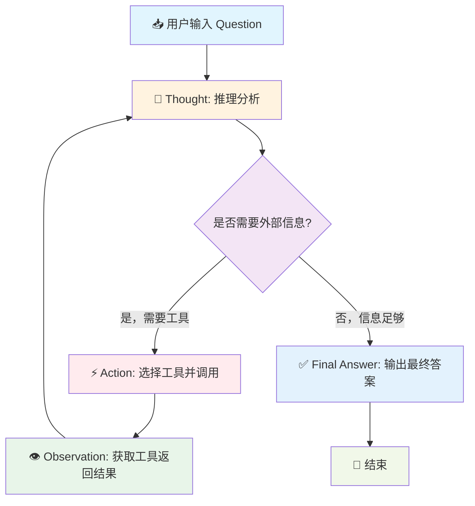

这个循环是 ReAct 的灵魂。注意几个关键点：
1. **Thought 是内部推理**，不产生外部副作用
2. **Action 是外部操作**，会调用真实工具/API
3. **Observation 是 Action 的结果**，作为下一轮 Thought 的输入
4. **循环终止条件**是输出 Final Answer，或达到最大步数

> 🔍 **面试高频考点 2**：ReAct 的核心循环包含哪几个阶段？答：Thought（推理）→ Action（行动）→ Observation（观察）→ 循环 → Final Answer（最终回答）。

---

### 1.2 ReAct 的诞生背景与演进

#### 从 CoT 到 ReAct：推理范式的进化

在 ReAct 出现之前，LLM 的推理主要依赖 **CoT（Chain-of-Thought，思维链）**，由 Wei 等人于 2022 年 1 月提出。CoT 的核心是"让模型一步一步想"，通过在 Prompt 中加入"Let's think step by step"或提供 few-shot 推理示例，引导模型输出中间推理步骤。

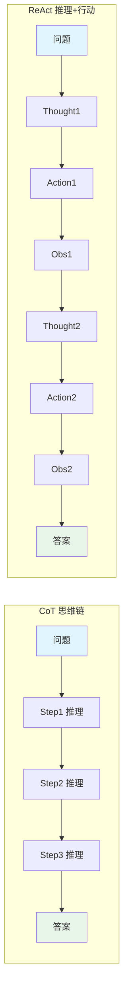

**CoT 的局限**：
- 所有推理都在模型"大脑"内完成，无法获取外部信息
- 推理过程中如果某一步错了，后面会越错越远（错误累积）
- 无法验证推理中引用的事实是否正确
- 对于需要实时数据或执行操作的任务完全无能为力

**ReAct 的突破**：
- 在推理中插入 Action 环节，可以获取外部真实信息
- Observation 为推理提供事实依据，减少幻觉
- 每步 Action 都有明确的 Observation 反馈，可验证可修正
- 支持需要执行操作的任务（发邮件、查数据库等）

#### ReAct 论文的实验结论

ReAct 论文在多个基准测试上验证了效果：

| 基准测试 | 任务类型 | ReAct 相比 CoT 的提升 |
|---------|---------|---------------------|
| **HotpotQA** | 多跳问答（需要跨文档推理） | 成功率提升显著，幻觉减少 |
| **FEVER** | 事实验证（判断声明是否被证据支持） | 准确率提升，证据可溯源 |
| **ALFWorld** | 文本游戏（需要在虚拟环境中完成任务） | 任务完成率大幅提升 |
| **WebShop** | 网购模拟（需要在网站上搜索并购买商品） | 购买成功率提升 |

论文的核心发现：**ReAct 在需要与外部环境交互的任务上显著优于 CoT，且推理过程更可解释、更可验证。**

> 🔍 **面试高频考点 3**：ReAct 论文在哪些基准测试上验证了效果？答：HotpotQA（多跳问答）、FEVER（事实验证）、ALFWorld（文本游戏）、WebShop（网购模拟）。

#### ReAct 之后的演进

ReAct 提出后，成为 Agent 系统的基础范式，并催生了一系列增强变体：

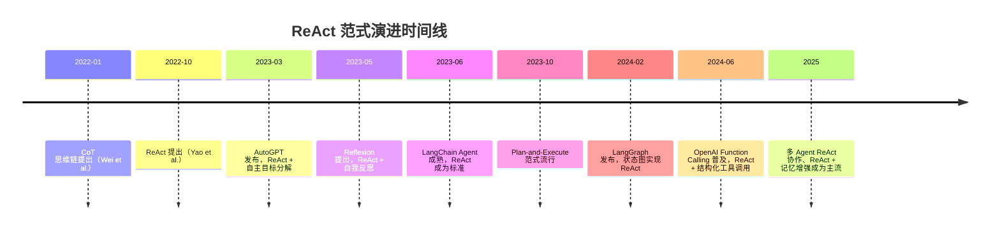

---

### 1.3 ReAct 的核心概念与术语

在深入学习之前，必须准确理解 ReAct 涉及的核心术语：

| 术语 | 英文 | 定义 | 通俗解释 |
|------|------|------|----------|
| **推理** | Reasoning / Thought | LLM 对当前状态的分析和下一步计划 | 侦探在脑子里分析案情 |
| **行动** | Acting / Action | LLM 决定调用的工具及其参数 | 侦探决定去法医室拿报告 |
| **观察** | Observation | Action 执行后返回的结果 | 侦探拿到法医报告后看到的内容 |
| **最终回答** | Final Answer | LLM 基于所有推理和观察给出的最终答案 | 侦探宣布破案结论 |
| **草稿板** | Scratchpad | 记录所有 Thought/Action/Observation 的上下文区域 | 侦探的笔记本，记录所有推理和证据 |
| **工具** | Tool | 可供 Action 调用的外部函数/API | 侦探可以使用的资源（法医室、数据库、证人） |
| **Agent 循环** | Agent Loop | 重复执行 Thought→Action→Observation 的外部程序 | 侦探的工作流程管理 |
| **最大步数** | Max Steps / Max Iterations | 防止无限循环的步数上限 | 侦探的办案期限，到期必须给结论 |
| **工具描述** | Tool Description | 告诉 LLM 工具做什么、何时用的文本 | 每个资源的使用说明书 |
| **解析器** | Parser | 从 LLM 输出中提取 Action 工具名和参数的程序 | 侦探的助手，负责把侦探的意图转化为具体行动指令 |

#### Scratchpad（草稿板）机制详解

Scratchpad 是 ReAct 实现中最关键的数据结构。它记录了从任务开始到当前的所有推理轨迹，每轮 LLM 调用时都会把完整的 Scratchpad 作为上下文传入。

```mermaid
sequenceDiagram
    participant User as 用户
    participant Loop as Agent Loop
    participant LLM as 大语言模型
    participant Tool as 工具

    User->>Loop: 输入问题
    Loop->>Loop: 初始化 Scratchpad = "问题：xxx\n"
    Loop->>LLM: 发送 System Prompt + Scratchpad + "Thought:"
    LLM-->>Loop: 返回 "我需要查天气\nAction: get_weather(北京)"
    Loop->>Loop: 解析 Action，追加到 Scratchpad
    Loop->>Tool: 调用 get_weather(北京)
    Tool-->>Loop: 返回 "晴，25°C"
    Loop->>Loop: 追加 Observation 到 Scratchpad
    Loop->>LLM: 发送更新后的 Scratchpad + "Thought:"
    LLM-->>Loop: 返回 "信息足够了\nFinal Answer: 北京今天晴，25°C"
    Loop->>Loop: 检测到 Final Answer，终止循环
    Loop-->>User: 返回最终答案
```

Scratchpad 的内容随循环不断增长，这也是为什么需要控制 max_steps 和截断 Observation——否则上下文窗口会被撑爆。

> 🔍 **面试高频考点 4**：什么是 Scratchpad？它在 ReAct 中的作用是什么？答：Scratchpad 是记录所有 Thought/Action/Observation 推理轨迹的上下文区域。作用是让 LLM 在每轮推理时能看到完整的历史，从而做出连贯的决策。

---

### 1.4 第一个 ReAct 示例：直观感受

在深入原理之前，先看一个完整的 ReAct 推理轨迹示例，建立直观感受。

**任务**："2026 年图灵奖得主是谁？他们的主要贡献是什么？计算 1234 * 5678 的结果。"

```text
问题：2026 年图灵奖得主是谁？他们的主要贡献是什么？计算 1234 * 5678 的结果。

Thought: 这个问题包含两个部分：①查询2026年图灵奖得主及其贡献 ②计算1234*5678。
第一部分需要实时信息，我的训练数据可能不包含2026年的信息，需要调用搜索工具。
第二部分是精确计算，应该使用计算器工具避免算错。
我先搜索图灵奖信息，同时可以并行计算数学题。

Action: search_web(query="2026年图灵奖得主 主要贡献")
Observation: 2026年ACM图灵奖授予了Yann LeCun、Yoshua Bengio和Geoffrey Hinton，
以表彰他们在深度学习领域的奠基性贡献。三人被称为"深度学习三巨头"，
他们的工作包括卷积神经网络(CNN)、反向传播算法、生成对抗网络(GAN)等，
为现代AI的发展奠定了基础。

Thought: 搜索结果已经给出了图灵奖得主和贡献信息。现在我需要计算1234*5678。
虽然我可以心算，但为了确保准确性，使用计算器工具。

Action: calculator(expression="1234 * 5678")
Observation: 7006652

Thought: 现在我有了所有需要的信息：
①2026年图灵奖得主：Yann LeCun、Yoshua Bengio、Geoffrey Hinton（深度学习三巨头）
②主要贡献：深度学习奠基性工作，包括CNN、反向传播、GAN等
③1234 * 5678 = 7006652
信息充分，可以给出最终答案。

Final Answer:
【2026年图灵奖】
得主：Yann LeCun、Yoshua Bengio、Geoffrey Hinton（被誉为"深度学习三巨头"）
主要贡献：在深度学习领域的奠基性贡献，包括卷积神经网络(CNN)、反向传播算法、
生成对抗网络(GAN)等开创性工作，为现代人工智能的发展奠定了基础。

【数学计算】
1234 × 5678 = 7,006,652
```

仔细观察这个轨迹：
1. **Thought 1** 分析了问题，识别出需要两个工具，并决定先搜索
2. **Action 1** 调用了搜索工具
3. **Observation 1** 返回了搜索结果
4. **Thought 2** 基于搜索结果，决定继续计算数学题
5. **Action 2** 调用了计算器
6. **Observation 2** 返回了计算结果
7. **Thought 3** 确认信息充分
8. **Final Answer** 给出了完整回答

这就是 ReAct 的完整工作流程。每一步 Thought 都基于之前的 Observation，每一步 Action 都由 Thought 决定。

> ⚠️ **常见坑点 1**：新手常误以为 Thought 是 LLM 的"内部思考"不可见。实际上在 ReAct 中，Thought 是 LLM 输出的文本，完全可见可记录。这也是 ReAct 可解释性强的原因。

> ⚠️ **常见坑点 2**：新手常把 Action 和 Observation 混为一谈。Action 是"要做什么"（LLM 决定的），Observation 是"做了之后得到什么"（工具返回的）。二者是因果关系，不能混淆。

---

> 💡 **深度讲解**：ReAct 的核心创新不在于技术多么复杂，而在于一个极其简洁的洞察——**推理和行动应该交替进行，而不是分开进行**。在 ReAct 之前，CoT 只做推理不做行动，工具调用只做行动不做推理（比如早期的搜索增强问答，先搜索再回答，搜索和回答是两个独立阶段）。ReAct 第一次将二者融合在一个循环中：推理指导行动，行动反馈推理，形成闭环。这种闭环模拟了人类解决问题的自然方式——我们不会先把所有问题想清楚再行动，而是想一步、做一步、看结果、再想下一步。ReAct 之所以成为 Agent 系统的基础范式，正是因为它抓住了"智能行为"的本质：**智能不是一次性的推理输出，而是与环境持续交互的动态过程**。
>
> **📝 精简总结**：
> 1. ReAct = Reasoning + Acting，让 LLM 在推理和行动之间交替进行
> 2. 核心循环：Thought（推理）→ Action（行动）→ Observation（观察）→ 循环 → Final Answer
> 3. 解决了纯 LLM 的两大问题：幻觉（通过工具获取真实信息）和知识截止（通过行动适应动态环境）
> 4. Scratchpad 记录完整推理轨迹，是每轮 LLM 调用的上下文基础
> 5. ReAct 由 Yao 等人 2022 年 10 月提出，在 HotpotQA/FEVER/ALFWorld/WebShop 上验证效果
> 6. 已成为 Agent 系统的基础范式，催生了 AutoGPT/Reflexion/LangGraph 等一系列增强和实现
>
> **🎯 梯度练习题**：
> - **基础 1**：用自己的话解释 ReAct 的核心循环，并举一个生活中的类比。
> - **基础 2**：ReAct 相比纯 CoT 推理，解决了哪两个核心问题？分别是如何解决的？
> - **基础 3**：什么是 Scratchpad？它为什么重要？
> - **进阶 1**：如果 ReAct 循环中某一步的 Observation 返回了错误信息（比如工具 bug），会对后续推理产生什么影响？如何缓解？
> - **进阶 2**：ReAct 论文在 ALFWorld（文本游戏）和 WebShop（网购模拟）上的表现优于 CoT，为什么这类任务特别适合 ReAct？
> - **实战 1**：选择一个你日常工作中需要多步完成的任务（如"调研某个技术方案并写报告"），写出完整的 ReAct 推理轨迹（Thought/Action/Observation/Final Answer），至少包含 3 轮循环。

---

## 二、Thought-Action-Observation 循环深度解析

### 2.1 Thought（推理）阶段详解

#### Thought 的本质：LLM 的"内心独白"

Thought 是 ReAct 循环中 LLM 对当前状态的分析和下一步计划。它是纯文本输出，不产生任何外部副作用，但决定了后续 Action 的方向。

> 💡 **通俗比喻**：Thought 就像下棋时棋手在落子前的思考——"对手刚才走了马，现在我的车在 a1，如果我走炮到 b2，可以将军……"。这个思考过程不直接改变棋盘状态，但决定了下一步走哪步棋。在 ReAct 中，Thought 就是 LLM 的"下棋思考"。

#### 一个高质量 Thought 应包含什么

| 要素 | 说明 | 示例 |
|------|------|------|
| **当前状态分析** | 回顾已有的信息和 Observation | "我已经搜索到了图灵奖得主信息，现在需要计算数学题" |
| **缺失信息识别** | 明确还需要什么信息才能继续 | "我还不知道北京今天的天气，需要调用天气工具" |
| **下一步计划** | 决定调用哪个工具，为什么 | "使用 search_web 搜索最新股价，因为这是实时信息" |
| **推理逻辑链** | 展示从已知到未知的推导过程 | "因为A，所以B，因此需要C" |
| **自我修正** | 发现之前的错误并调整方向 | "上一步搜索的关键词不对，应该用更精确的关键词重新搜索" |

**差的 Thought 示例**：
```text
Thought: 我需要搜索一下。
```
问题：没有分析当前状态，没有说明搜索什么、为什么搜索，信息量极低。

**好的 Thought 示例**：
```text
Thought: 用户问的是"2026年NBA总冠军是谁"。这是一个需要实时信息的问题，
我的训练数据截止到2025年初，不可能知道2026年的比赛结果。
我需要调用 search_web 工具搜索"2026 NBA champion"或"2026年NBA总冠军"。
搜索后我会根据结果给出答案，如果搜索结果不明确，可能需要进一步搜索。
```

#### Thought 的长度控制

Thought 不是越长越好。过长的 Thought 会：
- 消耗更多 token（增加成本和延迟）
- 可能包含无关的"废话推理"
- 增加上下文窗口压力

最佳实践：
- **简单任务**：Thought 1-3 句话即可
- **复杂任务**：Thought 可以 3-5 句话，但必须聚焦
- **在 Prompt 中引导**：在 System Prompt 中说明"Thought 应简洁，聚焦于下一步行动计划"

```python
# 在 System Prompt 中控制 Thought 长度
SYSTEM_PROMPT = """你是一个 ReAct Agent。请按照以下格式思考和行动：

Thought: 简洁分析当前状态（1-3句话），明确下一步需要做什么
Action: 工具名(参数)
Observation: 工具返回结果

...重复直到得出答案...

Thought: 信息已充分
Final Answer: 最终答案

规则：
- Thought 必须简洁，不要长篇大论
- 每步只决定一个 Action
- 如果信息足够，直接输出 Final Answer
"""
```

> 🔍 **面试高频考点 5**：Thought 在 ReAct 中的作用是什么？一个高质量的 Thought 应包含哪些要素？答：Thought 是 LLM 对当前状态的分析和下一步计划，决定 Action 方向。高质量 Thought 应包含：当前状态分析、缺失信息识别、下一步计划、推理逻辑链、必要时的自我修正。

---

### 2.2 Action（行动）阶段详解

#### Action 的本质：从"想"到"做"的跨越

Action 是 ReAct 循环中 LLM 决定执行的外部操作，通常表现为"工具名(参数)"的格式。Action 是 ReAct 与纯推理范式的根本区别——它让 LLM 从"只会说"变成"能做事"。

> 💡 **通俗比喻**：如果 Thought 是棋手的思考，Action 就是棋手实际落子的那一步。思考再精彩，不落子就不会改变棋局。Action 就是那一步"落子"——它调用真实的工具/API，产生实际的外部效果。

#### Action 的格式

在经典 ReAct（纯文本 Prompt）中，Action 的格式为：
```text
Action: 工具名(参数1=值1, 参数2=值2)
```

示例：
```text
Action: search_web(query="2026年图灵奖", num_results=5)
Action: get_weather(city="北京", unit="celsius")
Action: calculator(expression="1234 * 5678")
```

在现代 ReAct（结合 Function Calling）中，Action 不再是纯文本，而是结构化的 tool_call 对象：
```json
{
  "tool_calls": [
    {
      "id": "call_abc123",
      "type": "function",
      "function": {
        "name": "search_web",
        "arguments": "{\"query\": \"2026年图灵奖\", \"num_results\": 5}"
      }
    }
  ]
}
```

#### Action 解析机制

经典 ReAct 使用正则表达式从 LLM 输出中解析 Action：

```python
import re
from typing import Optional, Tuple

def parse_action_classic(text: str) -> Optional[Tuple[str, str]]:
    """
    从经典 ReAct 输出中解析 Action
    返回 (工具名, 参数字符串) 或 None
    """
    # 匹配 "Action: 工具名(参数)" 格式
    pattern = r"Action:\s*(\w+)\((.*?)\)"
    match = re.search(pattern, text, re.DOTALL)
    if match:
        tool_name = match.group(1)
        tool_args = match.group(2).strip()
        return tool_name, tool_args
    return None

# 测试
text1 = "Thought: 我需要搜索\nAction: search_web(query=\"图灵奖\")\n"
result1 = parse_action_classic(text1)
print(result1)  # ('search_web', 'query="图灵奖"')

text2 = "Thought: 信息足够\nFinal Answer: 答案是..."
result2 = parse_action_classic(text2)
print(result2)  # None
```

现代 ReAct 使用 Function Calling 原生解析，更稳定：

```python
import json
from typing import List, Dict

def parse_action_function_calling(message) -> List[Dict]:
    """
    从 Function Calling 输出中解析 Action 列表
    返回 [{"name": 工具名, "arguments": 参数字典}, ...]
    """
    actions = []
    if not hasattr(message, 'tool_calls') or not message.tool_calls:
        return actions
    for tool_call in message.tool_calls:
        try:
            args = json.loads(tool_call.function.arguments)
        except json.JSONDecodeError:
            args = {"_raw": tool_call.function.arguments}
        actions.append({
            "id": tool_call.id,
            "name": tool_call.function.name,
            "arguments": args
        })
    return actions
```

#### Action 的执行与错误处理

解析出 Action 后，需要执行对应的工具调用。执行过程中可能遇到各种错误，必须妥善处理：

```python
from typing import Any, Dict
import time

def execute_action(
    tool_name: str,
    tool_args: Dict[str, Any],
    tool_registry: Dict[str, callable],
    timeout: int = 30,
    max_retries: int = 2
) -> str:
    """
    安全执行 Action，包含错误处理和重试机制
    返回 Observation 字符串
    """
    # 1. 检查工具是否存在
    if tool_name not in tool_registry:
        available = ", ".join(tool_registry.keys())
        return f"错误：工具 '{tool_name}' 不存在。可用工具：{available}"

    tool_func = tool_registry[tool_name]

    # 2. 带重试的执行
    for attempt in range(max_retries + 1):
        try:
            # 执行工具调用（实际项目中应加入超时控制）
            start_time = time.time()
            result = tool_func(**tool_args)
            elapsed = time.time() - start_time

            # 结果序列化
            if isinstance(result, str):
                observation = result
            else:
                observation = json.dumps(result, ensure_ascii=False, default=str)

            return observation

        except TypeError as e:
            # 参数错误（参数名不匹配、类型错误等）
            return f"工具参数错误：{e}。请检查参数名称和类型是否正确。"
        except ValueError as e:
            # 参数值不合法
            return f"参数值不合法：{e}"
        except TimeoutError as e:
            if attempt < max_retries:
                time.sleep(1 * (attempt + 1))  # 指数退避
                continue
            return f"工具执行超时（{timeout}秒），已重试{max_retries}次仍失败。"
        except Exception as e:
            return f"工具执行失败：{type(e).__name__}: {str(e)}"

    return "工具执行失败：未知错误"
```

> ⚠️ **常见坑点 3**：Action 解析失败是经典 ReAct 最常见的问题。LLM 可能输出 `Action: search_web query="图灵奖"`（缺少括号）、`Action: search_web("图灵奖")`（缺少参数名）、甚至 `Actions: ...`（拼写错误）。解决方案：①使用更宽容的正则 ②在 Prompt 中提供 few-shot 示例 ③**迁移到 Function Calling**（最推荐，稳定性从 ~85% 提升到 ~98%）。

> ⚠️ **常见坑点 4**：工具执行异常时，如果直接把 Python 异常栈（traceback）返回给 LLM，会泄露内部实现细节，且 LLM 不一定能理解。应该将异常转化为友好的 Observation 错误信息，告诉 LLM 哪里出了问题、应该如何修正。

---

### 2.3 Observation（观察）阶段详解

#### Observation 的本质：行动的反馈

Observation 是 Action 执行后返回的结果，是连接"行动"和"下一轮推理"的桥梁。Observation 的质量直接决定了后续 Thought 的质量——垃圾进，垃圾出（Garbage In, Garbage Out）。

> 💡 **通俗比喻**：如果 Action 是棋手落子，Observation 就是落子后看到的棋盘新状态。棋手根据新的棋盘状态决定下一步。如果棋盘显示不清晰（Observation 质量差），棋手就可能做出错误判断。在 ReAct 中，Observation 就是工具返回的"新棋盘状态"。

#### Observation 的来源

| 来源类型 | 说明 | 示例 |
|---------|------|------|
| **工具正常返回** | 工具成功执行后的结果 | 搜索结果、天气数据、计算结果 |
| **工具错误返回** | 工具执行失败后的错误信息 | "参数错误：city 不能为空"、"API 调用超时" |
| **解析错误返回** | Action 解析失败时的反馈 | "无法解析 Action，请按照 '工具名(参数)' 格式输出" |
| **系统注入** | Agent Loop 主动注入的信息 | "已达到最大步数，请基于已有信息给出最终回答" |

#### Observation 的截断与摘要

工具返回结果可能非常长（搜索结果、网页内容、数据库查询等），如果全部放入 Scratchpad，会迅速撑爆上下文窗口。必须对 Observation 进行截断或摘要处理。

```python
import tiktoken
from typing import Optional

def count_tokens(text: str, model: str = "gpt-4o") -> int:
    """计算文本的 token 数"""
    try:
        encoder = tiktoken.encoding_for_model(model)
        return len(encoder.encode(text))
    except Exception:
        # 降级：粗略估算 1 token ≈ 4 字符
        return len(text) // 4

def truncate_observation(
    observation: str,
    max_tokens: int = 1000,
    model: str = "gpt-4o"
) -> str:
    """
    截断 Observation 到指定 token 数
    保留开头（通常包含最重要信息），末尾标注已截断
    """
    current_tokens = count_tokens(observation, model)
    if current_tokens <= max_tokens:
        return observation

    # 按字符粗略截断后再精确调整
    char_ratio = max_tokens / current_tokens
    estimated_chars = int(len(observation) * char_ratio * 0.95)
    truncated = observation[:estimated_chars]

    # 精确调整到 token 限制
    while count_tokens(truncated, model) > max_tokens - 20:  # 留余量给提示
        truncated = truncated[:-100]

    return truncated + f"\n\n...（结果已截断，原始长度 {current_tokens} tokens，仅显示前 {max_tokens} tokens）"

# 测试
long_text = "这是一段很长的搜索结果..." * 1000
result = truncate_observation(long_text, max_tokens=500)
print(f"截断后长度: {count_tokens(result)} tokens")
```

更高级的做法是使用 LLM 对 Observation 做摘要：

```python
def summarize_observation(
    observation: str,
    llm,
    max_tokens: int = 300,
    question: str = ""
) -> str:
    """
    使用 LLM 对 Observation 做摘要，保留与问题相关的关键信息
    """
    if count_tokens(observation) <= max_tokens * 3:
        return observation  # 不太长就不摘要

    summary_prompt = f"""请从以下工具返回结果中提取与问题相关的关键信息，生成简洁摘要。

问题：{question}

工具返回结果：
{observation[:8000]}  # 先截断再摘要

请输出摘要（不超过{max_tokens}字），保留关键数据、事实和结论："""

    response = llm.invoke(summary_prompt)
    return f"【工具结果摘要】{response}\n（原始结果已摘要，完整长度 {count_tokens(observation)} tokens）"
```

#### Observation 的格式规范

Observation 的格式对 LLM 的理解有重要影响。最佳实践：

```python
def format_observation(result, tool_name: str, success: bool = True) -> str:
    """
    格式化 Observation，使其结构清晰、易于 LLM 理解
    """
    if success:
        if isinstance(result, str):
            content = result
        else:
            content = json.dumps(result, ensure_ascii=False, indent=2, default=str)
        return f"【{tool_name} 返回结果】\n{content}"
    else:
        return f"【{tool_name} 执行失败】\n错误信息：{result}\n请检查参数或尝试其他方法。"
```

> 🔍 **面试高频考点 6**：为什么需要对 Observation 进行截断或摘要？如果不处理会有什么后果？答：工具返回结果可能很长（搜索结果、网页内容等），全部放入 Scratchpad 会迅速撑爆上下文窗口，导致 token 超限错误或成本急剧增加。不处理的后果：①API 调用失败（context length exceeded）②成本飙升 ③LLM 注意力被无关信息稀释，推理质量下降。

---

### 2.4 循环的完整状态机

ReAct 循环可以用状态机精确描述：

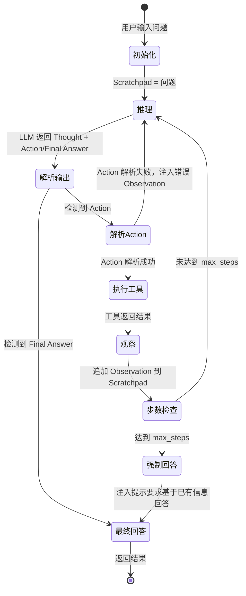

每个状态转换的详细说明：

| 状态转换 | 触发条件 | 处理逻辑 |
|---------|---------|---------|
| 初始化→推理 | 用户输入 | 初始化 Scratchpad，设置步数计数器=0 |
| 推理→解析输出 | LLM 调用完成 | 解析 LLM 输出，判断是 Final Answer 还是 Action |
| 解析输出→最终回答 | 包含 "Final Answer:" | 提取最终答案，终止循环 |
| 解析输出→解析Action | 包含 "Action:" | 用正则/Function Calling 解析工具名和参数 |
| 解析Action→执行工具 | 解析成功且工具存在 | 调用对应工具函数 |
| 解析Action→推理 | 解析失败或工具不存在 | 生成错误 Observation，追加到 Scratchpad，继续循环 |
| 执行工具→观察 | 工具执行完成（成功或失败） | 格式化结果为 Observation |
| 观察→步数检查 | Observation 追加到 Scratchpad | 步数计数器+1 |
| 步数检查→推理 | 步数 < max_steps | 继续下一轮 LLM 调用 |
| 步数检查→强制回答 | 步数 >= max_steps | 注入"请基于已有信息给出最终回答"，强制 LLM 输出 Final Answer |

#### 循环控制的关键参数

```python
from dataclasses import dataclass
from typing import Optional

@dataclass
class ReActConfig:
    """ReAct Agent 循环控制配置"""
    max_iterations: int = 10              # 最大循环步数
    max_execution_time: float = 120.0     # 最大执行时间（秒）
    early_stopping_keywords: list = None   # 提前终止关键词
    observation_max_tokens: int = 1000     # 单条 Observation 最大 token 数
    total_context_max_tokens: int = 8000   # 总上下文最大 token 数
    tool_timeout: int = 30                  # 单个工具超时时间（秒）
    tool_max_retries: int = 2               # 工具最大重试次数
    temperature: float = 0.0                # LLM 温度（ReAct 建议 0）
    enable_loop_detection: bool = True      # 是否启用循环检测
    loop_detection_threshold: int = 3       # 重复调用多少次判定为循环

    def __post_init__(self):
        if self.early_stopping_keywords is None:
            self.early_stopping_keywords = [
                "无法完成", "信息不足", "任务失败",
                "不需要更多信息", "已经有足够信息"
            ]
```

> ⚠️ **常见坑点 5**：新手常忽略 max_execution_time（最大执行时间），只设置 max_iterations。如果某个工具调用卡住了（比如 API 响应极慢），即使步数没到上限，总时间也可能超长。必须同时设置步数上限和时间上限。

> ⚠️ **常见坑点 6**：Observation 截断时，如果截断位置刚好在 JSON 结构中间，会导致 LLM 看到不完整的 JSON 而解析失败。最佳实践：①优先截断纯文本结果 ②对 JSON 结果，先解析提取关键字段再格式化 ③截断点尽量选择在句子边界（句号、换行处）。

---

> 💡 **深度讲解**：Thought-Action-Observation 循环看似简单，实则每个环节都有丰富的设计空间。Thought 阶段的核心挑战是"推理质量"——如何让 LLM 的分析既深入又简洁，既聚焦又不遗漏。Action 阶段的核心挑战是"解析稳定性"——经典 ReAct 用正则解析，LLM 输出格式稍有偏差就会失败，这也是为什么现代 ReAct 普遍迁移到 Function Calling。Observation 阶段的核心挑战是"信息密度"——工具返回的原始数据往往包含大量噪声，如何在有限的上下文窗口中保留最关键的信息，直接决定了后续推理的质量。三个阶段环环相扣：Thought 质量影响 Action 选择，Action 选择影响 Observation 内容，Observation 内容又影响下一轮 Thought。这是一个正反馈循环——任何一个环节出问题，都会在循环中被放大。生产级 ReAct Agent 必须对每个环节都做精细的控制和优化。
>
> **📝 精简总结**：
> 1. Thought 是 LLM 的推理分析，应包含状态分析、缺失信息识别、下一步计划，保持简洁
> 2. Action 是 LLM 决定的外部操作，经典格式为"工具名(参数)"，现代用 Function Calling 结构化输出
> 3. Action 解析是经典 ReAct 的痛点，正则解析稳定性约 85%，Function Calling 提升到 ~98%
> 4. Observation 是 Action 的结果，必须截断/摘要以控制上下文长度，格式要清晰易读
> 5. ReAct 循环可用状态机精确描述，包含初始化→推理→解析→执行→观察→步数检查→循环/终止
> 6. 循环控制需同时设置 max_iterations（步数）和 max_execution_time（时间），双保险
> 7. 三个阶段环环相扣，任何一个环节的问题都会在循环中被放大
>
> **🎯 梯度练习题**：
> - **基础 1**：分别解释 Thought、Action、Observation 三个阶段的作用，各举一个例子。
> - **基础 2**：为什么经典 ReAct 的 Action 解析容易失败？有哪些改进方案？
> - **基础 3**：Observation 为什么需要截断？如果不截断会有什么后果？
> - **进阶 1**：设计一个循环检测算法，当 Agent 重复调用相同工具+相同参数超过 N 次时，主动干预并引导 Agent 换一种方式。写出核心代码。
> - **进阶 2**：对比"简单截断 Observation"和"用 LLM 摘要 Observation"两种策略的优缺点，分别适用于什么场景？
> - **实战 1**：实现一个完整的 ReAct 循环状态机，包含 Thought/Action/Observation 三个阶段、max_iterations 控制、Observation 截断、错误处理。要求可运行，至少包含 2 个工具（搜索和计算器）。

---

## 三、ReAct Prompt 设计

### 3.1 Prompt 设计的核心原则

ReAct 的效果 80% 取决于 Prompt 设计。一个好的 ReAct Prompt 能让 LLM 稳定输出规范的 Thought/Action/Observation 序列，做出合理的工具选择；一个差的 Prompt 会导致格式混乱、工具选错、无限循环。

> 💡 **通俗比喻**：ReAct Prompt 就像给新员工的工作手册。手册写得好，新员工知道每一步该想什么、该做什么、做错了怎么修正；手册写得差，新员工就会胡思乱想、乱做事、犯了错也不知道。Prompt 就是 Agent 的"工作手册"。

#### 核心设计原则

| 原则 | 说明 | 具体做法 |
|------|------|---------|
| **角色明确** | 告诉 LLM 它是谁、要做什么 | "你是一个可以使用工具的智能助手，通过推理和行动交替来解决问题" |
| **格式清晰** | 明确规定 Thought/Action/Observation 的输出格式 | 用模板和示例展示精确格式 |
| **工具描述完整** | 每个工具说明"做什么+何时用+参数含义" | 工具描述包含使用场景和边界 |
| **示例引导** | 提供 1-2 个完整的 ReAct 轨迹示例（few-shot） | 示例覆盖正常流程和错误处理 |
| **规则约束** | 明确禁止的行为和必须遵守的规则 | "不要编造信息"、"每步只调用一个工具" |
| **终止引导** | 明确何时应该输出 Final Answer | "当你有足够信息回答问题时，输出 Final Answer" |

#### Prompt 的基本结构

一个完整的 ReAct Prompt 通常包含以下部分：

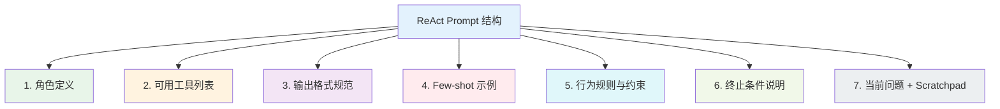

---

### 3.2 角色定义与工具列表

#### 角色定义（System Prompt）

角色定义告诉 LLM 它的身份和使命。好的角色定义应该简洁但信息丰富：

```python
# 基础版角色定义
ROLE_BASIC = """你是一个 ReAct Agent，能够通过推理（Thought）和行动（Action）交替来解决复杂问题。
你可以使用多种工具获取外部信息，然后基于观察结果继续推理，直到得出最终答案。"""

# 进阶版角色定义（更具体）
ROLE_ADVANCED = """你是一个专业的研究助手，擅长通过多步推理和工具调用来回答复杂问题。

你的工作方式：
1. 先思考（Thought）：分析问题，确定需要什么信息
2. 再行动（Action）：调用合适的工具获取信息
3. 观察结果（Observation）：基于工具返回的信息继续思考
4. 重复以上步骤，直到有足够信息给出最终答案（Final Answer）

重要规则：
- 对于事实性问题，必须通过工具验证，不要凭记忆回答
- 每步只调用一个工具，不要并行调用
- 如果工具返回错误，分析原因后调整参数重试或换用其他工具
- 当信息足够时，及时输出 Final Answer，不要做无用的工具调用"""
```

#### 工具列表的呈现方式

工具列表是 LLM 选择工具的唯一依据，必须精心设计。

**方式一：纯文本描述（经典 ReAct）**

```python
TOOLS_DESC_TEXT = """可用工具：

1. search_web(query: str, num_results: int = 5)
   描述：搜索互联网获取实时信息。当需要回答最新事件、事实核查、
   或获取训练数据之后的信息时使用。
   参数：query - 搜索关键词；num_results - 返回结果数量（1-10）

2. calculator(expression: str)
   描述：执行数学计算。当需要精确计算数学表达式时使用，避免心算错误。
   参数：expression - 数学表达式字符串，如 "23 * 45 + 10"

3. get_weather(city: str, unit: str = "celsius")
   描述：获取指定城市的当前天气。当用户询问天气情况时使用。
   参数：city - 城市名称；unit - 温度单位（celsius/fahrenheit）"""
```

**方式二：JSON Schema（Function Calling）**

```python
TOOLS_SCHEMA = [
    {
        "type": "function",
        "function": {
            "name": "search_web",
            "description": "搜索互联网获取实时信息。当需要回答最新事件、事实核查、或获取训练数据之后的信息时使用。",
            "parameters": {
                "type": "object",
                "properties": {
                    "query": {
                        "type": "string",
                        "description": "搜索关键词，应该简洁明确"
                    },
                    "num_results": {
                        "type": "integer",
                        "description": "返回结果数量",
                        "default": 5,
                        "minimum": 1,
                        "maximum": 10
                    }
                },
                "required": ["query"]
            }
        }
    },
    {
        "type": "function",
        "function": {
            "name": "calculator",
            "description": "执行数学计算。当需要精确计算数学表达式时使用，避免心算错误。",
            "parameters": {
                "type": "object",
                "properties": {
                    "expression": {
                        "type": "string",
                        "description": "数学表达式字符串，如 '23 * 45 + 10'"
                    }
                },
                "required": ["expression"]
            }
        }
    }
]
```

#### 工具描述的写作技巧

工具描述是 LLM 选择工具的关键。好的工具描述应包含：

| 要素 | 说明 | 差的例子 | 好的例子 |
|------|------|---------|---------|
| **做什么** | 工具的核心功能 | "搜索" | "搜索互联网获取实时信息" |
| **何时用** | 触发使用的场景 | （无） | "当需要回答最新事件、事实核查时使用" |
| **何时不用** | 不适用的场景（可选但推荐） | （无） | "不要用于计算数学题" |
| **参数说明** | 每个参数的含义和格式 | "query: 字符串" | "query - 搜索关键词，应简洁明确，如'2026图灵奖'" |
| **返回说明** | 返回结果的格式（可选） | （无） | "返回包含标题、URL、摘要的搜索结果列表" |

```python
# 工具描述模板
TOOL_DESC_TEMPLATE = """{tool_name}({params})
功能：{what_it_does}
使用场景：{when_to_use}
不适用场景：{when_not_to_use}
参数说明：{param_descriptions}
返回格式：{return_format}"""
```

> 🔍 **面试高频考点 7**：ReAct Prompt 中工具描述的质量为什么重要？一个好的工具描述应包含哪些要素？答：工具描述是 LLM 选择工具的唯一依据，描述质量直接影响工具选择准确率。好的工具描述应包含：做什么（核心功能）、何时用（触发场景）、何时不用（边界场景）、参数说明（含义和格式）、返回格式。

---

### 3.3 输出格式规范与 Few-shot 示例

#### 输出格式规范

必须在 Prompt 中精确规定输出格式，否则 LLM 可能输出各种变体：

```python
FORMAT_SPEC = """严格按照以下格式输出（每个标签占一行）：

Thought: 你对当前问题的分析和下一步计划（1-3句话）
Action: 工具名(参数1=值1, 参数2=值2)
Observation: 工具返回的结果（由系统填充，你不需要输出）

...（重复 Thought/Action/Observation 直到得出答案）...

Thought: 我现在有足够信息回答问题了
Final Answer: 你的最终答案

格式要求：
- Thought 必须以 "Thought: " 开头
- Action 必须以 "Action: " 开头，格式为 "工具名(参数)"
- Final Answer 必须以 "Final Answer: " 开头
- 不要在 Action 和 Final Answer 之间插入其他内容
- 不要使用 Markdown 代码块包裹输出"""
```

#### Few-shot 示例的设计

Few-shot 示例是提升 ReAct 稳定性的最有效手段之一。提供 1-2 个完整的推理轨迹示例，让 LLM 学习正确的格式和推理模式。

**示例 1：正常流程（单工具调用）**

```python
FEWSHOT_EXAMPLE_1 = """示例 1：

问题：北京今天天气怎么样？

Thought: 用户询问北京今天的天气，这是实时信息，我需要调用 get_weather 工具获取。
Action: get_weather(city="北京")
Observation: 北京今天晴，气温 25°C，湿度 40%，西北风 3 级。
Thought: 我已经获取了北京的天气信息，可以直接回答用户。
Final Answer: 北京今天晴，气温 25°C，湿度 40%，西北风 3 级。适合外出活动。"""
```

**示例 2：多步推理（多工具调用）**

```python
FEWSHOT_EXAMPLE_2 = """示例 2：

问题：2026年图灵奖得主是谁？他们的年龄分别是多少？

Thought: 这个问题需要两步：①先搜索2026年图灵奖得主是谁 ②再搜索他们的年龄。
我先搜索图灵奖得主信息。
Action: search_web(query="2026年图灵奖得主")
Observation: 2026年ACM图灵奖授予了Yann LeCun、Yoshua Bengio和Geoffrey Hinton，
表彰他们在深度学习领域的奠基性贡献。
Thought: 我已经知道了三位得主：Yann LeCun、Yoshua Bengio、Geoffrey Hinton。
现在需要搜索他们的年龄。我可以在一个搜索中查询三个人的年龄。
Action: search_web(query="Yann LeCun Yoshua Bengio Geoffrey Hinton 年龄 出生年份")
Observation: Yann LeCun 1960年出生（66岁），Yoshua Bengio 1964年出生（62岁），
Geoffrey Hinton 1947年出生（79岁）。
Thought: 我已经获取了所有需要的信息：三位得主及其年龄。可以给出最终答案。
Final Answer: 2026年图灵奖得主及年龄：
1. Yann LeCun - 1960年出生，66岁
2. Yoshua Bengio - 1964年出生，62岁
3. Geoffrey Hinton - 1947年出生，79岁
三人被誉为"深度学习三巨头"，因在深度学习领域的奠基性贡献获奖。"""
```

**示例 3：错误处理（工具返回错误后修正）**

```python
FEWSHOT_EXAMPLE_3 = """示例 3：

问题：计算 100 / 0 的结果

Thought: 用户要求计算 100/0，这是一个数学计算，使用 calculator 工具。
Action: calculator(expression="100 / 0")
Observation: 计算错误：ZeroDivisionError: division by zero
Thought: 计算器返回了除零错误。100 除以 0 在数学上是未定义的，
任何数除以 0 都没有意义。我应该向用户解释这一点。
Final Answer: 100 除以 0 是没有数学定义的。在数学中，任何数除以 0 都是未定义的，
因为不存在一个数乘以 0 等于 100。计算器也返回了 ZeroDivisionError。
如果你想计算 100 除以一个非零数，请提供有效的除数。"""
```

#### Few-shot 示例的选择策略

| 策略 | 说明 | 适用场景 |
|------|------|---------|
| **固定示例** | Prompt 中硬编码 1-2 个示例 | 简单场景、工具少 |
| **动态示例** | 根据用户问题从示例库中检索最相关的示例 | 复杂场景、工具多 |
| **错误示例** | 包含常见错误和修正过程的示例 | 新手模型、稳定性差 |
| **无示例（zero-shot）** | 只给格式规范不给完整示例 | 强模型（GPT-4/Claude）、简单任务 |

```python
def select_fewshot_examples(question: str, example_library: list, k: int = 2) -> list:
    """
    根据用户问题动态选择最相关的 few-shot 示例
    简单实现：基于关键词匹配
    """
    question_lower = question.lower()
    scored = []
    for ex in example_library:
        score = sum(1 for kw in ex["keywords"] if kw.lower() in question_lower)
        scored.append((score, ex))
    scored.sort(key=lambda x: x[0], reverse=True)
    return [ex for _, ex in scored[:k]]
```

> ⚠️ **常见坑点 7**：Few-shot 示例不是越多越好。太多示例会占用大量上下文 token，增加成本和延迟，且可能让 LLM 过度模仿示例而缺乏灵活性。一般 1-3 个示例足够，强模型（GPT-4 级别）甚至可以 zero-shot。

> ⚠️ **常见坑点 8**：Few-shot 示例中的工具调用如果与实际可用工具不一致，会严重误导 LLM。示例中使用的工具必须是实际注册的工具，参数格式也必须一致。维护示例库时要和工具注册表同步更新。

---

### 3.4 行为规则与终止条件

#### 行为规则

行为规则约束 LLM 的推理和行动方式，防止常见错误：

```python
BEHAVIOR_RULES = """行为规则：

1. 【事实验证】对于事实性问题（日期、数据、事件），必须通过工具验证，
   不要仅凭训练数据回答，尤其是涉及 2024 年之后的信息。

2. 【精确计算】数学计算必须使用 calculator 工具，不要心算，避免计算错误。

3. 【单步行动】每轮只调用一个工具，不要在一个 Action 中调用多个工具。
   如果需要多个工具，分多轮调用。

4. 【错误处理】如果工具返回错误，仔细分析错误原因：
   - 参数错误 → 修正参数后重试
   - 工具不存在 → 换用其他工具
   - 工具超时 → 简化参数或换用其他工具
   不要在同一个错误上重复超过 2 次。

5. 【信息充分即终止】当你已经有足够信息回答用户问题时，立即输出 Final Answer，
   不要做多余的工具调用。

6. 【诚实原则】如果经过多次尝试仍无法获取所需信息，如实告知用户，
   不要编造答案。可以说明已尝试的方法和遇到的困难。

7. 【参数规范】Action 中的参数必须符合工具定义，字符串参数用双引号包裹，
   如 Action: search_web(query="关键词")"""
```

#### 终止条件引导

明确告诉 LLM 何时应该终止循环输出 Final Answer：

```python
TERMINATION_GUIDE = """何时输出 Final Answer：

✅ 应该输出 Final Answer 的情况：
- 已经获取了回答问题所需的所有关键信息
- 用户的问题已经被完整回答
- 工具返回的信息已经足够支撑结论
- 进一步调用工具不会获得更多有价值的信息

❌ 不应该输出 Final Answer 的情况：
- 关键信息缺失，工具调用还未完成
- 工具返回了错误，还未尝试修正
- 答案中包含不确定的信息，还未验证
- 用户问题有多个部分，只回答了一部分

当你不确定是否该终止时，问自己："如果我现在回答，用户会满意吗？"
如果答案是"会"，就输出 Final Answer；如果是"不会"，就继续调用工具。"""
```

#### 完整 Prompt 组装

```python
def build_react_prompt(
    question: str,
    scratchpad: str,
    tools_desc: str,
    role: str = None,
    format_spec: str = None,
    fewshot_examples: list = None,
    behavior_rules: str = None,
    termination_guide: str = None
) -> str:
    """
    组装完整的 ReAct Prompt
    """
    parts = []

    # 1. 角色定义
    parts.append(role or ROLE_ADVANCED)

    # 2. 可用工具
    parts.append(f"可用工具：\n{tools_desc}")

    # 3. 输出格式
    parts.append(format_spec or FORMAT_SPEC)

    # 4. Few-shot 示例
    if fewshot_examples:
        parts.append("以下是几个示例：\n" + "\n\n".join(fewshot_examples))

    # 5. 行为规则
    parts.append(behavior_rules or BEHAVIOR_RULES)

    # 6. 终止条件
    parts.append(termination_guide or TERMINATION_GUIDE)

    # 7. 当前问题和 Scratchpad
    parts.append(f"现在开始处理新问题：\n\n问题：{question}\n{scratchpad}Thought:")

    return "\n\n".join(parts)
```

> 🔍 **面试高频考点 8**：ReAct Prompt 的基本结构包含哪几个部分？各部分的作用是什么？答：①角色定义（告诉 LLM 它是谁）②工具列表（可用工具及描述）③输出格式规范（Thought/Action/Final Answer 的格式）④Few-shot 示例（1-3个完整轨迹示例）⑤行为规则（约束推理和行动）⑥终止条件（何时输出 Final Answer）⑦当前问题+Scratchpad。

---

### 3.5 Prompt 调试与优化

#### Prompt 效果评估指标

| 指标 | 说明 | 理想值 |
|------|------|--------|
| **格式合规率** | LLM 输出符合 Thought/Action/Final Answer 格式的比例 | ≥95% |
| **工具选择准确率** | 选择了正确工具的比例 | ≥90% |
| **参数正确率** | 工具参数格式和值正确的比例 | ≥90% |
| **平均循环步数** | 完成任务平均需要多少轮 | 3-6 步 |
| **任务成功率** | 最终答案正确的比例 | ≥85% |
| **循环率** | 陷入无限循环的比例 | ≤2% |

#### 常见 Prompt 问题与修复

| 问题现象 | 可能原因 | 修复方案 |
|---------|---------|---------|
| LLM 不输出 Action，直接给答案 | 角色定义中没有强调必须使用工具；工具描述不吸引 | 在规则中添加"事实性问题必须先验证"；优化工具描述 |
| LLM 输出格式混乱（缺少标签、拼写错误） | 格式规范不清晰；缺少 Few-shot 示例 | 强化格式规范；添加 1-2 个格式规范的示例 |
| LLM 选错工具 | 工具描述重叠；工具数量太多 | 区分工具描述的使用场景；减少工具数量或动态加载 |
| LLM 无限循环调用同一工具 | Observation 没有提供新信息；缺少循环检测 | 优化 Observation 内容；在 Prompt 中禁止重复调用；加入循环检测 |
| LLM 参数格式错误 | 参数说明不清晰；缺少示例 | 为每个参数添加描述和示例值；在 Few-shot 中展示正确格式 |
| LLM 不终止，一直调用工具 | 终止条件不明确；Final Answer 引导不足 | 强化终止条件引导；在 Prompt 中添加"信息充分即终止"规则 |

#### A/B 测试 Prompt 优化

```python
import time
from dataclasses import dataclass
from typing import List, Dict

@dataclass
class PromptVersion:
    name: str
    system_prompt: str
    description: str

def evaluate_prompt(
    prompt_version: PromptVersion,
    test_cases: List[Dict],
    agent_runner: callable
) -> Dict:
    """
    评估一个 Prompt 版本在测试用例上的表现
    """
    results = []
    total_start = time.time()

    for case in test_cases:
        start = time.time()
        try:
            output = agent_runner(
                question=case["question"],
                system_prompt=prompt_version.system_prompt
            )
            elapsed = time.time() - start
            success = case["evaluator"](output) if "evaluator" in case else True
            results.append({
                "question": case["question"],
                "success": success,
                "elapsed": elapsed,
                "steps": output.get("steps", 0),
                "error": None
            })
        except Exception as e:
            results.append({
                "question": case["question"],
                "success": False,
                "elapsed": time.time() - start,
                "steps": 0,
                "error": str(e)
            })

    total_elapsed = time.time() - total_start
    success_rate = sum(r["success"] for r in results) / len(results)
    avg_steps = sum(r["steps"] for r in results) / len(results)
    avg_time = sum(r["elapsed"] for r in results) / len(results)

    return {
        "prompt_name": prompt_version.name,
        "total_cases": len(results),
        "success_rate": success_rate,
        "avg_steps": avg_steps,
        "avg_time": avg_time,
        "total_time": total_elapsed,
        "details": results
    }

# A/B 测试示例
prompt_v1 = PromptVersion("v1-basic", ROLE_BASIC, "基础角色定义")
prompt_v2 = PromptVersion("v2-advanced", ROLE_ADVANCED, "进阶角色定义+规则")

test_cases = [
    {"question": "2026年图灵奖得主是谁？"},
    {"question": "计算 1234 * 5678"},
    {"question": "北京今天天气怎么样？"},
]

# result_v1 = evaluate_prompt(prompt_v1, test_cases, runner)
# result_v2 = evaluate_prompt(prompt_v2, test_cases, runner)
# 比较 success_rate, avg_steps, avg_time
```

> ⚠️ **常见坑点 9**：Prompt 优化时只看最终答案正确率，忽略中间过程。有时候最终答案对了，但推理过程走了很多弯路（多余的工具调用、错误的工具选择后修正），这会增加延迟和成本。应该同时监控平均步数、工具选择准确率等过程指标。

> ⚠️ **常见坑点 10**：Prompt 优化过度拟合特定测试集。如果为了通过几个测试用例而在 Prompt 中添加大量特殊规则，可能会降低泛化能力。应该保持 Prompt 的通用性，用多样化的测试集评估。

---

> 💡 **深度讲解**：ReAct Prompt 设计是一门"精确制导"的艺术。与普通问答 Prompt 不同，ReAct Prompt 不仅要引导 LLM "回答什么"，还要引导它"怎么思考、怎么行动、什么时候停止"。这涉及三个层面的控制：**格式控制**（输出规范的 Thought/Action/Final Answer）、**决策控制**（选择正确的工具和参数）、**流程控制**（合理的步数和及时终止）。Few-shot 示例是最强大的控制手段——一个好的示例胜过千言万语的规则描述，因为 LLM 天生擅长模仿。但示例也有陷阱：示例中的推理模式会被 LLM 严格模仿，如果示例走了弯路，LLM 也会跟着走弯路。因此示例应该展示"最优路径"而非"任意路径"。生产级 Prompt 通常需要经过 10+ 轮的迭代优化，通过 A/B 测试在真实测试集上验证效果，而不是凭感觉调整。
>
> **📝 精简总结**：
> 1. ReAct Prompt 效果占整体效果的 80%，是重中之重
> 2. Prompt 基本结构：角色定义→工具列表→输出格式→Few-shot示例→行为规则→终止条件→问题+Scratchpad
> 3. 工具描述必须包含"做什么+何时用+何时不用+参数说明"，是工具选择准确率的关键
> 4. Few-shot 示例 1-3 个足够，应展示最优路径，强模型可 zero-shot
> 5. 行为规则约束推理方式，终止条件引导及时输出 Final Answer
> 6. Prompt 优化需通过 A/B 测试在多样化测试集上验证，监控格式合规率、工具选择准确率、平均步数、成功率
> 7. 常见问题：不调用工具、格式混乱、选错工具、无限循环、参数错误、不终止
>
> **🎯 梯度练习题**：
> - **基础 1**：ReAct Prompt 的基本结构包含哪几个部分？各部分的作用是什么？
> - **基础 2**：一个好的工具描述应包含哪些要素？分别举例说明。
> - **基础 3**：Few-shot 示例在 ReAct Prompt 中的作用是什么？是不是越多越好？
> - **进阶 1**：设计一个动态 Few-shot 示例选择机制，根据用户问题的关键词从示例库中检索最相关的 2 个示例。写出核心代码。
> - **进阶 2**：如果 LLM 频繁出现"不调用工具直接编造答案"的问题，从 Prompt 设计角度可以采取哪些措施？至少列出 3 种并说明原理。
> - **实战 1**：为一个包含 5 个工具（搜索、计算器、天气、数据库查询、发邮件）的 ReAct Agent 设计完整的 System Prompt，包含角色定义、工具描述、格式规范、2 个 Few-shot 示例、行为规则、终止条件。要求可直接用于生产环境。

---

## 四、从零实现 ReAct Agent

### 4.1 项目结构与依赖

在从零实现之前，先规划项目结构和依赖。我们将实现一个功能完整的 ReAct Agent，包含核心循环、工具管理、Prompt 构建、错误处理、循环检测等。

```text
react_agent/
├── __init__.py          # 包初始化
├── config.py            # 配置类
├── models.py            # 数据模型（Thought/Action/Observation）
├── prompt.py            # Prompt 构建
├── parser.py            # Action 解析器
├── tools/
│   ├── __init__.py      # 工具包
│   ├── base.py          # 工具基类
│   ├── registry.py      # 工具注册表
│   ├── search.py        # 搜索工具
│   ├── calculator.py    # 计算器工具
│   └── weather.py       # 天气工具
├── agent.py             # ReAct Agent 核心
├── loop_detector.py     # 循环检测器
└── utils.py             # 工具函数（token计数、截断等）
```

#### 依赖安装

```bash
# 核心依赖
pip install openai>=1.0.0 tiktoken>=0.5.0

# 可选：搜索工具
pip install duckduckgo-search>=4.0.0

# 可选：天气工具
pip install requests>=2.31.0

# 开发依赖
pip install pytest>=7.0.0 python-dotenv>=1.0.0
```

#### 配置文件

```python
# config.py
from dataclasses import dataclass, field
from typing import List, Optional
import os

@dataclass
class AgentConfig:
    """ReAct Agent 配置"""
    # LLM 配置
    model: str = "gpt-4o-mini"
    temperature: float = 0.0
    api_key: str = field(default_factory=lambda: os.getenv("OPENAI_API_KEY", ""))
    base_url: Optional[str] = None

    # 循环控制
    max_iterations: int = 10
    max_execution_time: float = 120.0

    # Observation 控制
    observation_max_tokens: int = 1000
    total_context_max_tokens: int = 12000

    # 工具配置
    tool_timeout: int = 30
    tool_max_retries: int = 2

    # 循环检测
    enable_loop_detection: bool = True
    loop_detection_threshold: int = 3

    # 调试
    verbose: bool = True
    log_level: str = "INFO"

@dataclass
class ToolConfig:
    """工具配置"""
    name: str
    description: str
    enabled: bool = True
    timeout: int = 30
    max_retries: int = 2
```

---

### 4.2 数据模型定义

```python
# models.py
from dataclasses import dataclass, field
from typing import Any, Dict, List, Optional
from enum import Enum
import time
import json

class StepType(Enum):
    """推理步骤类型"""
    THOUGHT = "thought"
    ACTION = "action"
    OBSERVATION = "observation"
    FINAL_ANSWER = "final_answer"

@dataclass
class Thought:
    """推理步骤"""
    content: str
    timestamp: float = field(default_factory=time.time)

@dataclass
class Action:
    """行动步骤"""
    tool_name: str
    tool_args: Dict[str, Any]
    raw_text: str = ""  # 原始文本（经典ReAct）
    tool_call_id: str = ""  # Function Calling 的 call_id
    timestamp: float = field(default_factory=time.time)

@dataclass
class Observation:
    """观察步骤"""
    content: str
    tool_name: str = ""
    success: bool = True
    error: Optional[str] = None
    execution_time: float = 0.0
    timestamp: float = field(default_factory=time.time)

@dataclass
class FinalAnswer:
    """最终回答"""
    content: str
    timestamp: float = field(default_factory=time.time)

@dataclass
class AgentStep:
    """完整的一步（Thought + Action + Observation）"""
    step_number: int
    thought: Thought
    action: Optional[Action] = None
    observation: Optional[Observation] = None

@dataclass
class AgentTrace:
    """Agent 完整推理轨迹"""
    question: str
    steps: List[AgentStep] = field(default_factory=list)
    final_answer: Optional[FinalAnswer] = None
    total_iterations: int = 0
    total_time: float = 0.0
    total_tokens: int = 0
    status: str = "running"  # running/success/failed/timeout/max_iterations

    def add_step(self, step: AgentStep):
        self.steps.append(step)

    def to_dict(self) -> Dict:
        return {
            "question": self.question,
            "steps": [
                {
                    "step_number": s.step_number,
                    "thought": s.thought.content,
                    "action": {
                        "tool_name": s.action.tool_name,
                        "tool_args": s.action.tool_args
                    } if s.action else None,
                    "observation": s.observation.content if s.observation else None,
                }
                for s in self.steps
            ],
            "final_answer": self.final_answer.content if self.final_answer else None,
            "total_iterations": self.total_iterations,
            "total_time": self.total_time,
            "total_tokens": self.total_tokens,
            "status": self.status,
        }

    def to_json(self, indent: int = 2) -> str:
        return json.dumps(self.to_dict(), ensure_ascii=False, indent=indent, default=str)
```

---

### 4.3 工具基类与注册表

```python
# tools/base.py
from abc import ABC, abstractmethod
from typing import Any, Dict
import time
import logging

logger = logging.getLogger(__name__)

class BaseTool(ABC):
    """工具基类"""

    name: str = ""
    description: str = ""
    parameters: Dict[str, Any] = {}

    def __init__(self, timeout: int = 30, max_retries: int = 2):
        self.timeout = timeout
        self.max_retries = max_retries

    @abstractmethod
    def execute(self, **kwargs) -> Any:
        """执行工具，返回结果"""
        pass

    def validate_args(self, **kwargs) -> Dict[str, str]:
        """
        验证参数，返回错误字典（空表示通过）
        子类可重写以添加自定义校验
        """
        errors = {}
        if "properties" not in self.parameters:
            return errors

        required = self.parameters.get("required", [])
        properties = self.parameters["properties"]

        # 检查必填参数
        for param in required:
            if param not in kwargs or kwargs[param] is None:
                errors[param] = f"必填参数 '{param}' 缺失"

        # 检查参数类型
        for param, value in kwargs.items():
            if param in properties:
                expected_type = properties[param].get("type")
                if expected_type == "string" and not isinstance(value, str):
                    errors[param] = f"参数 '{param}' 应为字符串类型"
                elif expected_type == "integer" and not isinstance(value, int):
                    errors[param] = f"参数 '{param}' 应为整数类型"
                elif expected_type == "number" and not isinstance(value, (int, float)):
                    errors[param] = f"参数 '{param}' 应为数字类型"

                # 检查枚举值
                if "enum" in properties[param]:
                    if value not in properties[param]["enum"]:
                        errors[param] = (
                            f"参数 '{param}' 值 '{value}' 不在允许范围内: "
                            f"{properties[param]['enum']}"
                        )

        return errors

    def safe_execute(self, **kwargs) -> Dict[str, Any]:
        """
        安全执行工具，包含参数校验、重试、超时、异常处理
        返回 {"success": bool, "result": Any, "error": str, "execution_time": float}
        """
        # 参数校验
        errors = self.validate_args(**kwargs)
        if errors:
            return {
                "success": False,
                "result": None,
                "error": f"参数校验失败: {errors}",
                "execution_time": 0.0
            }

        # 带重试执行
        last_error = None
        for attempt in range(self.max_retries + 1):
            try:
                start = time.time()
                result = self.execute(**kwargs)
                elapsed = time.time() - start
                logger.info(f"工具 {self.name} 执行成功，耗时 {elapsed:.2f}s")
                return {
                    "success": True,
                    "result": result,
                    "error": None,
                    "execution_time": elapsed
                }
            except Exception as e:
                last_error = e
                logger.warning(f"工具 {self.name} 第 {attempt+1} 次执行失败: {e}")
                if attempt < self.max_retries:
                    time.sleep(1 * (attempt + 1))  # 指数退避

        return {
            "success": False,
            "result": None,
            "error": f"{type(last_error).__name__}: {str(last_error)}",
            "execution_time": 0.0
        }

    def to_function_calling_schema(self) -> Dict[str, Any]:
        """转换为 OpenAI Function Calling 格式"""
        return {
            "type": "function",
            "function": {
                "name": self.name,
                "description": self.description,
                "parameters": self.parameters
            }
        }
```

```python
# tools/registry.py
from typing import Dict, List, Optional
from .base import BaseTool
import logging

logger = logging.getLogger(__name__)

class ToolRegistry:
    """工具注册表"""

    def __init__(self):
        self._tools: Dict[str, BaseTool] = {}

    def register(self, tool: BaseTool) -> None:
        """注册工具"""
        if tool.name in self._tools:
            logger.warning(f"工具 {tool.name} 已存在，将被覆盖")
        self._tools[tool.name] = tool
        logger.info(f"工具 {tool.name} 注册成功")

    def unregister(self, tool_name: str) -> None:
        """注销工具"""
        if tool_name in self._tools:
            del self._tools[tool_name]
            logger.info(f"工具 {tool_name} 注销成功")

    def get(self, tool_name: str) -> Optional[BaseTool]:
        """获取工具"""
        return self._tools.get(tool_name)

    def list_tools(self) -> List[str]:
        """列出所有工具名称"""
        return list(self._tools.keys())

    def get_all_tools(self) -> List[BaseTool]:
        """获取所有工具实例"""
        return list(self._tools.values())

    def to_function_calling_schemas(self) -> List[Dict]:
        """获取所有工具的 Function Calling Schema"""
        return [tool.to_function_calling_schema() for tool in self._tools.values()]

    def get_tools_description_text(self) -> str:
        """获取所有工具的文本描述（经典ReAct用）"""
        lines = []
        for name, tool in self._tools.items():
            params = []
            if "properties" in tool.parameters:
                for pname, pinfo in tool.parameters["properties"].items():
                    required = pname in tool.parameters.get("required", [])
                    req_mark = "必填" if required else "可选"
                    params.append(f"{pname}({pinfo.get('type','any')}, {req_mark})")
            param_str = ", ".join(params)
            lines.append(f"- {name}({param_str})\n  描述：{tool.description}")
        return "\n".join(lines)

    def execute(self, tool_name: str, **kwargs) -> Dict:
        """执行指定工具"""
        tool = self.get(tool_name)
        if tool is None:
            available = ", ".join(self.list_tools())
            return {
                "success": False,
                "result": None,
                "error": f"工具 '{tool_name}' 不存在。可用工具: {available}",
                "execution_time": 0.0
            }
        return tool.safe_execute(**kwargs)


# 全局工具注册表
_global_registry = ToolRegistry()

def get_global_registry() -> ToolRegistry:
    return _global_registry
```

---

### 4.4 具体工具实现

```python
# tools/calculator.py
from .base import BaseTool
import math
import ast
import operator

# 安全的数学计算（不使用 eval）
class CalculatorTool(BaseTool):
    """计算器工具：安全执行数学计算"""

    name = "calculator"
    description = (
        "执行数学计算。当需要精确计算数学表达式时使用，避免心算错误。"
        "支持加减乘除、幂运算、平方根、三角函数等基本数学运算。"
    )
    parameters = {
        "type": "object",
        "properties": {
            "expression": {
                "type": "string",
                "description": "数学表达式字符串，如 '23 * 45 + 10'、'sqrt(144)'、'sin(3.14/2)'"
            }
        },
        "required": ["expression"]
    }

    # 安全的运算符映射
    _operators = {
        ast.Add: operator.add,
        ast.Sub: operator.sub,
        ast.Mult: operator.mul,
        ast.Div: operator.truediv,
        ast.Pow: operator.pow,
        ast.USub: operator.neg,
        ast.UAdd: operator.pos,
    }

    # 安全的函数映射
    _functions = {
        "sqrt": math.sqrt,
        "sin": math.sin,
        "cos": math.cos,
        "tan": math.tan,
        "log": math.log,
        "log10": math.log10,
        "exp": math.exp,
        "abs": abs,
        "round": round,
        "max": max,
        "min": min,
        "pi": math.pi,
        "e": math.e,
    }

    def _eval_node(self, node):
        """递归安全求值 AST 节点"""
        if isinstance(node, ast.Expression):
            return self._eval_node(node.body)
        elif isinstance(node, ast.Constant):
            return node.value
        elif isinstance(node, ast.Num):  # Python 3.7 兼容
            return node.n
        elif isinstance(node, ast.BinOp):
            left = self._eval_node(node.left)
            right = self._eval_node(node.right)
            op_type = type(node.op)
            if op_type in self._operators:
                return self._operators[op_type](left, right)
            raise ValueError(f"不支持的运算符: {op_type}")
        elif isinstance(node, ast.UnaryOp):
            operand = self._eval_node(node.operand)
            op_type = type(node.op)
            if op_type in self._operators:
                return self._operators[op_type](operand)
            raise ValueError(f"不支持的一元运算符: {op_type}")
        elif isinstance(node, ast.Call):
            if isinstance(node.func, ast.Name):
                func_name = node.func.id
                if func_name in self._functions:
                    args = [self._eval_node(arg) for arg in node.args]
                    return self._functions[func_name](*args)
            raise ValueError(f"不支持的函数: {node.func.id if isinstance(node.func, ast.Name) else 'unknown'}")
        elif isinstance(node, ast.Name):
            if node.id in self._functions:
                return self._functions[node.id]
            raise ValueError(f"未定义的变量: {node.id}")
        else:
            raise ValueError(f"不支持的表达式类型: {type(node)}")

    def execute(self, expression: str) -> str:
        """执行数学计算"""
        try:
            tree = ast.parse(expression, mode='eval')
            result = self._eval_node(tree)
            # 格式化结果
            if isinstance(result, float):
                if result.is_integer():
                    result = int(result)
                else:
                    result = round(result, 10)
            return f"{expression} = {result}"
        except ZeroDivisionError:
            return "错误：除数不能为零"
        except Exception as e:
            return f"计算错误：{type(e).__name__}: {str(e)}"
```

```python
# tools/search.py
from .base import BaseTool
from typing import Optional
import json

class SearchWebTool(BaseTool):
    """搜索工具：搜索互联网获取实时信息"""

    name = "search_web"
    description = (
        "搜索互联网获取实时信息。当需要回答最新事件、事实核查、"
        "或获取训练数据之后的信息时使用。输入搜索关键词，返回相关搜索结果。"
    )
    parameters = {
        "type": "object",
        "properties": {
            "query": {
                "type": "string",
                "description": "搜索关键词，应该简洁明确，如'2026图灵奖得主'"
            },
            "num_results": {
                "type": "integer",
                "description": "返回结果数量",
                "default": 5,
                "minimum": 1,
                "maximum": 10
            }
        },
        "required": ["query"]
    }

    def execute(self, query: str, num_results: int = 5) -> str:
        """执行搜索"""
        try:
            from duckduckgo_search import DDGS
            results = []
            with DDGS() as ddgs:
                for r in ddgs.text(query, max_results=num_results):
                    results.append({
                        "title": r.get("title", ""),
                        "url": r.get("href", ""),
                        "snippet": r.get("body", "")
                    })

            if not results:
                return f"搜索 '{query}' 未找到相关结果"

            # 格式化输出
            output_lines = [f"搜索关键词：{query}", f"找到 {len(results)} 条结果："]
            for i, r in enumerate(results, 1):
                output_lines.append(f"\n[{i}] {r['title']}")
                output_lines.append(f"    URL: {r['url']}")
                output_lines.append(f"    摘要: {r['snippet']}")

            return "\n".join(output_lines)

        except ImportError:
            # 降级：返回模拟搜索结果（实际项目中应配置真实搜索API）
            return self._mock_search(query, num_results)
        except Exception as e:
            return f"搜索失败：{type(e).__name__}: {str(e)}"

    def _mock_search(self, query: str, num_results: int) -> str:
        """模拟搜索结果（用于演示和测试）"""
        return (
            f"【搜索结果 - 演示模式】\n"
            f"搜索关键词：{query}\n"
            f"（注：当前为演示模式，未配置真实搜索API。\n"
            f"实际使用时请安装 duckduckgo-search 或配置其他搜索服务）"
        )
```

```python
# tools/weather.py
from .base import BaseTool
import json

class GetWeatherTool(BaseTool):
    """天气工具：获取指定城市的当前天气"""

    name = "get_weather"
    description = (
        "获取指定城市的当前天气信息。当用户询问天气情况、温度、"
        "是否下雨等问题时使用。输入城市名称，返回天气详情。"
    )
    parameters = {
        "type": "object",
        "properties": {
            "city": {
                "type": "string",
                "description": "城市名称，如北京、上海、New York"
            },
            "unit": {
                "type": "string",
                "description": "温度单位",
                "enum": ["celsius", "fahrenheit"],
                "default": "celsius"
            }
        },
        "required": ["city"]
    }

    def execute(self, city: str, unit: str = "celsius") -> str:
        """获取天气"""
        # 演示模式：返回模拟数据
        # 实际项目中应调用真实天气 API（如 OpenWeatherMap、和风天气等）
        weather_data = {
            "北京": {"temp": 25, "condition": "晴", "humidity": 40, "wind": "西北风3级"},
            "上海": {"temp": 28, "condition": "多云", "humidity": 65, "wind": "东南风2级"},
            "广州": {"temp": 32, "condition": "雷阵雨", "humidity": 80, "wind": "南风3级"},
            "深圳": {"temp": 30, "condition": "多云转晴", "humidity": 70, "wind": "东风2级"},
        }

        data = weather_data.get(city, {
            "temp": 22, "condition": "未知", "humidity": 50, "wind": "无风"
        })

        temp = data["temp"]
        if unit == "fahrenheit":
            temp = temp * 9 / 5 + 32

        unit_symbol = "°C" if unit == "celsius" else "°F"

        return (
            f"{city}天气：\n"
            f"- 天气状况：{data['condition']}\n"
            f"- 温度：{temp}{unit_symbol}\n"
            f"- 湿度：{data['humidity']}%\n"
            f"- 风力：{data['wind']}"
        )
```

```python
# tools/__init__.py
from .base import BaseTool
from .registry import ToolRegistry, get_global_registry
from .calculator import CalculatorTool
from .search import SearchWebTool
from .weather import GetWeatherTool

__all__ = [
    "BaseTool",
    "ToolRegistry",
    "get_global_registry",
    "CalculatorTool",
    "SearchWebTool",
    "GetWeatherTool",
]
```

---

### 4.5 Prompt 构建器

```python
# prompt.py
from typing import List, Optional
from .models import AgentTrace

ROLE_DEFINITION = """你是一个 ReAct Agent，能够通过推理（Thought）和行动（Action）交替来解决复杂问题。

你的工作方式：
1. 思考（Thought）：分析当前状态，确定下一步需要做什么
2. 行动（Action）：调用合适的工具获取信息或执行操作
3. 观察（Observation）：基于工具返回的结果继续思考
4. 重复以上步骤，直到有足够信息给出最终答案（Final Answer）

重要规则：
- 对于事实性问题，必须通过工具验证，不要凭记忆回答
- 数学计算必须使用 calculator 工具，不要心算
- 每步只调用一个工具
- 如果工具返回错误，分析原因后修正参数重试或换用其他工具
- 当信息足够时，及时输出 Final Answer，不要做无用的工具调用
- 如果无法获取所需信息，如实告知，不要编造答案"""

FORMAT_SPECIFICATION = """严格按照以下格式输出：

Thought: 你对当前状态的分析和下一步计划（1-3句话）
Action: 工具名(参数1=值1, 参数2=值2)
Observation: 工具返回的结果（由系统填充）

...（重复 Thought/Action/Observation 直到得出答案）...

Thought: 我现在有足够信息回答问题了
Final Answer: 你的最终答案

格式要求：
- Thought 必须以 "Thought: " 开头
- Action 必须以 "Action: " 开头
- Final Answer 必须以 "Final Answer: " 开头
- 不要使用 Markdown 代码块包裹输出"""

FEWSHOT_EXAMPLES = [
    """示例1：

问题：北京今天天气怎么样？

Thought: 用户询问北京今天的天气，这是实时信息，需要调用 get_weather 工具。
Action: get_weather(city="北京")
Observation: 北京天气：晴，25°C，湿度40%，西北风3级。
Thought: 我已经获取了北京的天气信息，可以回答用户。
Final Answer: 北京今天晴，气温25°C，湿度40%，西北风3级。适合外出活动。""",

    """示例2：

问题：计算 1234 * 5678 的结果

Thought: 用户要求计算 1234 * 5678，这是数学计算，应该使用 calculator 工具确保准确。
Action: calculator(expression="1234 * 5678")
Observation: 1234 * 5678 = 7006652
Thought: 计算结果已得出，可以给出最终答案。
Final Answer: 1234 × 5678 = 7,006,652"""
]


class PromptBuilder:
    """ReAct Prompt 构建器"""

    def __init__(
        self,
        role: str = None,
        format_spec: str = None,
        fewshot_examples: List[str] = None,
        use_fewshot: bool = True
    ):
        self.role = role or ROLE_DEFINITION
        self.format_spec = format_spec or FORMAT_SPECIFICATION
        self.fewshot_examples = fewshot_examples or FEWSHOT_EXAMPLES
        self.use_fewshot = use_fewshot

    def build_system_prompt(self, tools_description: str) -> str:
        """构建系统提示词"""
        parts = [
            self.role,
            f"可用工具：\n{tools_description}",
            self.format_spec,
        ]

        if self.use_fewshot and self.fewshot_examples:
            parts.append("以下是几个示例：\n" + "\n\n".join(self.fewshot_examples))

        return "\n\n".join(parts)

    def build_scratchpad(self, trace: AgentTrace) -> str:
        """从推理轨迹构建 Scratchpad"""
        lines = [f"问题：{trace.question}"]

        for step in trace.steps:
            lines.append(f"\nThought: {step.thought.content}")
            if step.action:
                args_str = ", ".join(
                    f'{k}="{v}"' if isinstance(v, str) else f"{k}={v}"
                    for k, v in step.action.tool_args.items()
                )
                lines.append(f"Action: {step.action.tool_name}({args_str})")
            if step.observation:
                lines.append(f"Observation: {step.observation.content}")

        return "\n".join(lines)

    def build_messages(
        self,
        trace: AgentTrace,
        tools_description: str,
        mode: str = "classic"  # classic / function_calling
    ) -> list:
        """
        构建发送给 LLM 的消息列表
        mode: classic - 经典 ReAct 纯文本模式
              function_calling - Function Calling 模式
        """
        system_prompt = self.build_system_prompt(tools_description)
        scratchpad = self.build_scratchpad(trace)

        if mode == "classic":
            # 经典模式：所有内容放在 user 消息中
            return [
                {"role": "system", "content": system_prompt},
                {"role": "user", "content": f"{scratchpad}\nThought:"}
            ]
        else:
            # Function Calling 模式：使用结构化消息
            messages = [{"role": "system", "content": system_prompt}]
            messages.append({"role": "user", "content": trace.question})

            for step in trace.steps:
                # Assistant 消息（Thought + Action）
                if step.action and step.action.tool_call_id:
                    messages.append({
                        "role": "assistant",
                        "content": step.thought.content,
                        "tool_calls": [{
                            "id": step.action.tool_call_id,
                            "type": "function",
                            "function": {
                                "name": step.action.tool_name,
                                "arguments": json.dumps(step.action.tool_args, ensure_ascii=False)
                            }
                        }]
                    })
                    # Tool 消息（Observation）
                    if step.observation:
                        messages.append({
                            "role": "tool",
                            "tool_call_id": step.action.tool_call_id,
                            "content": step.observation.content
                        })
                else:
                    # 经典格式的 assistant 消息
                    content = f"Thought: {step.thought.content}"
                    if step.action:
                        args_str = ", ".join(f'{k}="{v}"' for k, v in step.action.tool_args.items())
                        content += f"\nAction: {step.action.tool_name}({args_str})"
                    messages.append({"role": "assistant", "content": content})
                    if step.observation:
                        messages.append({"role": "user", "content": f"Observation: {step.observation.content}"})

            return messages
```

---

### 4.6 Action 解析器

```python
# parser.py
import re
import json
from typing import Optional, Tuple, List, Dict
from .models import Action

class ActionParser:
    """Action 解析器：从 LLM 输出中解析 Thought 和 Action"""

    # 经典 ReAct 格式的正则
    THOUGHT_PATTERN = r"Thought:\s*(.+?)(?=\nAction:|\nFinal Answer:|$)"
    ACTION_PATTERN = r"Action:\s*(\w+)\((.*?)\)"
    FINAL_ANSWER_PATTERN = r"Final Answer:\s*(.+)"

    def parse_classic(self, text: str) -> Tuple[Optional[str], Optional[Action], Optional[str]]:
        """
        解析经典 ReAct 输出
        返回 (thought, action, final_answer)
        """
        # 提取 Thought
        thought_match = re.search(self.THOUGHT_PATTERN, text, re.DOTALL)
        thought = thought_match.group(1).strip() if thought_match else ""

        # 检查 Final Answer
        final_match = re.search(self.FINAL_ANSWER_PATTERN, text, re.DOTALL)
        if final_match:
            return thought, None, final_match.group(1).strip()

        # 解析 Action
        action_match = re.search(self.ACTION_PATTERN, text, re.DOTALL)
        if action_match:
            tool_name = action_match.group(1)
            args_str = action_match.group(2).strip()
            tool_args = self._parse_args(args_str)
            action = Action(
                tool_name=tool_name,
                tool_args=tool_args,
                raw_text=action_match.group(0)
            )
            return thought, action, None

        # 无法解析
        return thought, None, None

    def _parse_args(self, args_str: str) -> Dict:
        """
        解析参数字符串为字典
        支持格式：key="value", key=123, key=true
        """
        if not args_str:
            return {}

        args = {}
        # 匹配 key=value 对
        pattern = r'(\w+)\s*=\s*("(?:[^"\\]|\\.)*"|\'(?:[^\'\\]|\\.)*\'|[^,]+)'
        for match in re.finditer(pattern, args_str):
            key = match.group(1)
            value = match.group(2).strip()

            # 去除引号
            if (value.startswith('"') and value.endswith('"')) or \
               (value.startswith("'") and value.endswith("'")):
                value = value[1:-1]
            # 转换布尔值
            elif value.lower() == "true":
                value = True
            elif value.lower() == "false":
                value = False
            # 转换数字
            else:
                try:
                    value = int(value)
                except ValueError:
                    try:
                        value = float(value)
                    except ValueError:
                        pass  # 保持字符串

            args[key] = value

        return args

    def parse_function_calling(self, message) -> Tuple[Optional[str], List[Action], Optional[str]]:
        """
        解析 Function Calling 输出
        返回 (thought, actions, final_answer)
        """
        thought = message.content or ""

        # 检查是否有 Final Answer（在 content 中）
        final_match = re.search(self.FINAL_ANSWER_PATTERN, thought, re.DOTALL)
        if final_match and not message.tool_calls:
            return thought, [], final_match.group(1).strip()

        # 解析 tool_calls
        actions = []
        if hasattr(message, 'tool_calls') and message.tool_calls:
            for tool_call in message.tool_calls:
                try:
                    args = json.loads(tool_call.function.arguments)
                except json.JSONDecodeError:
                    args = {"_raw": tool_call.function.arguments}

                actions.append(Action(
                    tool_name=tool_call.function.name,
                    tool_args=args,
                    tool_call_id=tool_call.id
                ))

        return thought, actions, None


# 全局解析器
_global_parser = ActionParser()

def get_global_parser() -> ActionParser:
    return _global_parser
```

---

### 4.7 循环检测器

```python
# loop_detector.py
from typing import List, Tuple
from .models import AgentStep
from collections import Counter
import logging

logger = logging.getLogger(__name__)

class LoopDetector:
    """循环检测器：检测 Agent 是否陷入重复循环"""

    def __init__(self, threshold: int = 3):
        self.threshold = threshold

    def detect(self, steps: List[AgentStep]) -> Tuple[bool, str]:
        """
        检测是否存在循环
        返回 (is_looping, reason)
        """
        if len(steps) < self.threshold:
            return False, ""

        # 检测 1：连续相同的工具调用
        recent_actions = []
        for step in steps[-self.threshold:]:
            if step.action:
                action_key = f"{step.action.tool_name}:{self._args_to_key(step.action.tool_args)}"
                recent_actions.append(action_key)

        if len(recent_actions) >= self.threshold:
            if len(set(recent_actions)) == 1:
                return True, f"连续 {self.threshold} 次调用相同工具和参数：{recent_actions[0]}"

        # 检测 2：工具调用频率过高
        all_actions = []
        for step in steps:
            if step.action:
                all_actions.append(step.action.tool_name)

        if all_actions:
            counter = Counter(all_actions)
            most_common_tool, count = counter.most_common(1)[0]
            if count >= self.threshold * 2 and len(steps) >= self.threshold * 2:
                return True, f"工具 {most_common_tool} 被调用 {count} 次，可能陷入循环"

        # 检测 3：Observation 无新信息（相同的错误反复出现）
        recent_observations = []
        for step in steps[-self.threshold:]:
            if step.observation and not step.observation.success:
                recent_observations.append(step.observation.error or step.observation.content[:100])

        if len(recent_observations) >= self.threshold:
            if len(set(recent_observations)) == 1:
                return True, f"连续 {self.threshold} 次遇到相同的工具错误"

        return False, ""

    def _args_to_key(self, args: dict) -> str:
        """将参数转换为可比较的字符串键"""
        return str(sorted(args.items()))

    def generate_intervention_message(self, reason: str) -> str:
        """生成干预消息，注入到 Scratchpad 中引导 Agent 跳出循环"""
        return (
            f"【系统提示】检测到可能的循环：{reason}。\n"
            f"请重新分析问题，尝试以下方法：\n"
            f"1. 换用不同的工具或调整参数\n"
            f"2. 如果多次尝试失败，考虑问题是否可以用已有信息回答\n"
            f"3. 如果确实无法获取所需信息，请如实告知用户并输出 Final Answer\n"
            f"不要重复之前失败的尝试。"
        )
```

---

### 4.8 ReAct Agent 核心实现

```python
# agent.py
import time
import json
import logging
from typing import Optional, Dict, Any
from openai import OpenAI

from .config import AgentConfig
from .models import (
    AgentTrace, AgentStep, Thought, Action,
    Observation, FinalAnswer
)
from .prompt import PromptBuilder
from .parser import ActionParser
from .tools.registry import ToolRegistry
from .loop_detector import LoopDetector
from .utils import count_tokens, truncate_text

logger = logging.getLogger(__name__)


class ReActAgent:
    """ReAct Agent 核心实现"""

    def __init__(
        self,
        config: AgentConfig = None,
        tool_registry: ToolRegistry = None,
        prompt_builder: PromptBuilder = None,
        action_parser: ActionParser = None,
        mode: str = "function_calling"  # classic / function_calling
    ):
        self.config = config or AgentConfig()
        self.tool_registry = tool_registry or ToolRegistry()
        self.prompt_builder = prompt_builder or PromptBuilder()
        self.action_parser = action_parser or ActionParser()
        self.mode = mode

        # 初始化 OpenAI 客户端
        client_kwargs = {"api_key": self.config.api_key}
        if self.config.base_url:
            client_kwargs["base_url"] = self.config.base_url
        self.client = OpenAI(**client_kwargs)

        # 循环检测器
        self.loop_detector = LoopDetector(
            threshold=self.config.loop_detection_threshold
        )

    def register_tool(self, tool) -> None:
        """注册工具"""
        self.tool_registry.register(tool)

    def run(self, question: str) -> AgentTrace:
        """
        执行 ReAct 循环，返回完整推理轨迹
        """
        start_time = time.time()
        trace = AgentTrace(question=question)

        if self.config.verbose:
            print(f"\n{'='*60}")
            print(f"问题：{question}")
            print(f"{'='*60}")

        try:
            for iteration in range(self.config.max_iterations):
                # 检查总执行时间
                elapsed = time.time() - start_time
                if elapsed > self.config.max_execution_time:
                    trace.status = "timeout"
                    trace.final_answer = FinalAnswer(
                        content=f"任务执行超时（{self.config.max_execution_time}秒），"
                                f"已执行 {iteration} 步。请尝试简化问题或增加超时时间。"
                    )
                    break

                # 1. 构建 Prompt 并调用 LLM
                llm_response = self._call_llm(trace)

                # 2. 解析输出
                thought, actions, final_answer = self._parse_response(llm_response)

                if self.config.verbose:
                    print(f"\n[Step {iteration + 1}]")
                    print(f"Thought: {thought[:200]}...")

                # 3. 如果是 Final Answer，终止循环
                if final_answer:
                    step = AgentStep(
                        step_number=iteration + 1,
                        thought=Thought(content=thought)
                    )
                    trace.add_step(step)
                    trace.final_answer = FinalAnswer(content=final_answer)
                    trace.status = "success"

                    if self.config.verbose:
                        print(f"Final Answer: {final_answer[:200]}...")
                    break

                # 4. 执行 Action（支持并行工具调用）
                if not actions:
                    # 无法解析 Action，注入错误提示
                    observation = Observation(
                        content="无法解析你的输出。请按照格式输出 'Action: 工具名(参数)' 或 'Final Answer: 答案'",
                        success=False
                    )
                    step = AgentStep(
                        step_number=iteration + 1,
                        thought=Thought(content=thought),
                        observation=observation
                    )
                    trace.add_step(step)
                    continue

                # 取第一个 Action（经典 ReAct 单步模式）
                action = actions[0]

                if self.config.verbose:
                    print(f"Action: {action.tool_name}({action.tool_args})")

                # 执行工具
                exec_result = self.tool_registry.execute(
                    action.tool_name, **action.tool_args
                )

                # 构建 Observation
                if exec_result["success"]:
                    obs_content = self._format_tool_result(
                        action.tool_name, exec_result["result"]
                    )
                    observation = Observation(
                        content=obs_content,
                        tool_name=action.tool_name,
                        success=True,
                        execution_time=exec_result["execution_time"]
                    )
                else:
                    observation = Observation(
                        content=f"工具执行失败：{exec_result['error']}",
                        tool_name=action.tool_name,
                        success=False,
                        error=exec_result["error"]
                    )

                if self.config.verbose:
                    print(f"Observation: {observation.content[:200]}...")

                # 记录步骤
                step = AgentStep(
                    step_number=iteration + 1,
                    thought=Thought(content=thought),
                    action=action,
                    observation=observation
                )
                trace.add_step(step)

                # 5. 循环检测
                if self.config.enable_loop_detection:
                    is_looping, reason = self.loop_detector.detect(trace.steps)
                    if is_looping:
                        logger.warning(f"检测到循环：{reason}")
                        intervention = self.loop_detector.generate_intervention_message(reason)
                        # 注入干预消息作为 Observation
                        trace.steps[-1].observation.content += f"\n\n{intervention}"

            else:
                # 达到最大迭代次数
                trace.status = "max_iterations"
                trace.final_answer = self._force_final_answer(trace)

        except Exception as e:
            logger.error(f"Agent 执行异常：{e}", exc_info=True)
            trace.status = "failed"
            trace.final_answer = FinalAnswer(
                content=f"Agent 执行失败：{type(e).__name__}: {str(e)}"
            )

        trace.total_iterations = len(trace.steps)
        trace.total_time = time.time() - start_time

        if self.config.verbose:
            print(f"\n{'='*60}")
            print(f"状态：{trace.status}")
            print(f"迭代次数：{trace.total_iterations}")
            print(f"总耗时：{trace.total_time:.2f}秒")
            print(f"{'='*60}\n")

        return trace

    def _call_llm(self, trace: AgentTrace):
        """调用 LLM"""
        tools_desc = self.tool_registry.get_tools_description_text()

        if self.mode == "function_calling":
            messages = self.prompt_builder.build_messages(
                trace, tools_desc, mode="function_calling"
            )
            tools_schema = self.tool_registry.to_function_calling_schemas()
            response = self.client.chat.completions.create(
                model=self.config.model,
                messages=messages,
                tools=tools_schema if tools_schema else None,
                tool_choice="auto" if tools_schema else None,
                temperature=self.config.temperature,
            )
        else:
            messages = self.prompt_builder.build_messages(
                trace, tools_desc, mode="classic"
            )
            response = self.client.chat.completions.create(
                model=self.config.model,
                messages=messages,
                temperature=self.config.temperature,
            )

        return response.choices[0].message

    def _parse_response(self, message):
        """解析 LLM 响应"""
        if self.mode == "function_calling":
            return self.action_parser.parse_function_calling(message)
        else:
            text = message.content or ""
            thought, action, final = self.action_parser.parse_classic(text)
            actions = [action] if action else []
            return thought, actions, final

    def _format_tool_result(self, tool_name: str, result: Any) -> str:
        """格式化工具结果"""
        if isinstance(result, str):
            content = result
        else:
            content = json.dumps(result, ensure_ascii=False, indent=2, default=str)

        # 截断
        content = truncate_text(content, max_tokens=self.config.observation_max_tokens)
        return content

    def _force_final_answer(self, trace: AgentTrace) -> FinalAnswer:
        """强制生成最终回答（达到最大迭代次数时）"""
        tools_desc = self.tool_registry.get_tools_description_text()
        scratchpad = self.prompt_builder.build_scratchpad(trace)

        prompt = (
            f"{self.prompt_builder.build_system_prompt(tools_desc)}\n\n"
            f"{scratchpad}\n\n"
            f"【系统提示】已达到最大迭代次数（{self.config.max_iterations}步）。"
            f"请基于已有的观察信息，尽可能给出最佳答案。如果信息不足，请说明哪些信息缺失。\n"
            f"Final Answer:"
        )

        response = self.client.chat.completions.create(
            model=self.config.model,
            messages=[{"role": "user", "content": prompt}],
            temperature=self.config.temperature,
        )
        return FinalAnswer(content=response.choices[0].message.content.strip())
```

```python
# utils.py
import tiktoken
from typing import Optional

def count_tokens(text: str, model: str = "gpt-4o") -> int:
    """计算文本的 token 数"""
    try:
        encoder = tiktoken.encoding_for_model(model)
        return len(encoder.encode(text))
    except Exception:
        return len(text) // 4  # 粗略估算

def truncate_text(text: str, max_tokens: int = 1000, model: str = "gpt-4o") -> str:
    """截断文本到指定 token 数"""
    if count_tokens(text, model) <= max_tokens:
        return text

    char_ratio = max_tokens / max(count_tokens(text, model), 1)
    estimated_chars = int(len(text) * char_ratio * 0.95)
    truncated = text[:estimated_chars]

    while count_tokens(truncated, model) > max_tokens - 20:
        truncated = truncated[:-100]

    original_tokens = count_tokens(text, model)
    return truncated + f"\n...（结果已截断，原始长度 {original_tokens} tokens）"

def estimate_cost(
    input_tokens: int,
    output_tokens: int,
    model: str = "gpt-4o"
) -> float:
    """估算 API 调用成本（美元）"""
    pricing = {
        "gpt-4o": {"input": 0.0025, "output": 0.010},
        "gpt-4o-mini": {"input": 0.00015, "output": 0.0006},
        "gpt-4-turbo": {"input": 0.01, "output": 0.03},
    }
    model_pricing = pricing.get(model, {"input": 0.0025, "output": 0.010})
    return (input_tokens / 1_000_000 * model_pricing["input"] +
            output_tokens / 1_000_000 * model_pricing["output"])
```

```python
# __init__.py
from .config import AgentConfig, ToolConfig
from .models import (
    AgentTrace, AgentStep, Thought, Action,
    Observation, FinalAnswer, StepType
)
from .prompt import PromptBuilder
from .parser import ActionParser
from .agent import ReActAgent
from .loop_detector import LoopDetector
from .tools import (
    BaseTool, ToolRegistry, get_global_registry,
    CalculatorTool, SearchWebTool, GetWeatherTool
)
from .utils import count_tokens, truncate_text, estimate_cost

__version__ = "1.0.0"
__all__ = [
    "AgentConfig", "ToolConfig",
    "AgentTrace", "AgentStep", "Thought", "Action",
    "Observation", "FinalAnswer", "StepType",
    "PromptBuilder", "ActionParser", "ReActAgent",
    "LoopDetector",
    "BaseTool", "ToolRegistry", "get_global_registry",
    "CalculatorTool", "SearchWebTool", "GetWeatherTool",
    "count_tokens", "truncate_text", "estimate_cost",
]
```

---

### 4.9 使用示例与测试

```python
# examples/basic_usage.py
"""
基础使用示例：创建并运行 ReAct Agent
"""
import sys
import os
sys.path.insert(0, os.path.dirname(os.path.dirname(os.path.abspath(__file__))))

from react_agent import (
    ReActAgent, AgentConfig,
    CalculatorTool, SearchWebTool, GetWeatherTool
)

def main():
    # 1. 创建配置
    config = AgentConfig(
        model="gpt-4o-mini",
        max_iterations=8,
        verbose=True,
        temperature=0.0
    )

    # 2. 创建 Agent
    agent = ReActAgent(config=config, mode="function_calling")

    # 3. 注册工具
    agent.register_tool(CalculatorTool())
    agent.register_tool(SearchWebTool())
    agent.register_tool(GetWeatherTool())

    # 4. 运行任务
    question = "计算 1234 * 5678 的结果，然后告诉我北京今天的天气"
    trace = agent.run(question)

    # 5. 输出结果
    print("\n" + "="*60)
    print("最终答案：")
    print(trace.final_answer.content if trace.final_answer else "无")
    print("="*60)

    # 6. 保存完整轨迹
    with open("trace.json", "w", encoding="utf-8") as f:
        f.write(trace.to_json())
    print("\n完整轨迹已保存到 trace.json")

if __name__ == "__main__":
    main()
```

```python
# examples/classic_mode.py
"""
经典 ReAct 模式示例（纯文本 Prompt + 正则解析）
"""
from react_agent import ReActAgent, AgentConfig, CalculatorTool, GetWeatherTool

def main():
    config = AgentConfig(model="gpt-4o-mini", max_iterations=6, verbose=True)
    agent = ReActAgent(config=config, mode="classic")

    agent.register_tool(CalculatorTool())
    agent.register_tool(GetWeatherTool())

    question = "上海今天天气怎么样？温度是多少华氏度？"
    trace = agent.run(question)

    print(f"\n状态：{trace.status}")
    print(f"迭代次数：{trace.total_iterations}")
    print(f"最终答案：{trace.final_answer.content if trace.final_answer else '无'}")

if __name__ == "__main__":
    main()
```

```python
# tests/test_agent.py
"""
ReAct Agent 单元测试
"""
import pytest
from react_agent import (
    ReActAgent, AgentConfig, CalculatorTool,
    ActionParser, LoopDetector, AgentStep, Thought, Action, Observation
)


class TestCalculatorTool:
    """计算器工具测试"""

    def setup_method(self):
        self.tool = CalculatorTool()

    def test_basic_arithmetic(self):
        result = self.tool.execute(expression="2 + 3 * 4")
        assert "14" in result

    def test_division(self):
        result = self.tool.execute(expression="10 / 4")
        assert "2.5" in result

    def test_zero_division(self):
        result = self.tool.execute(expression="1 / 0")
        assert "除数不能为零" in result

    def test_complex_expression(self):
        result = self.tool.execute(expression="sqrt(144) + 2^3")
        assert "20" in result

    def test_invalid_expression(self):
        result = self.tool.execute(expression="abc + def")
        assert "错误" in result


class TestActionParser:
    """Action 解析器测试"""

    def setup_method(self):
        self.parser = ActionParser()

    def test_parse_simple_action(self):
        text = 'Thought: 需要搜索\nAction: search_web(query="test")'
        thought, action, final = self.parser.parse_classic(text)
        assert "需要搜索" in thought
        assert action.tool_name == "search_web"
        assert action.tool_args["query"] == "test"
        assert final is None

    def test_parse_final_answer(self):
        text = "Thought: 信息足够\nFinal Answer: 答案是42"
        thought, action, final = self.parser.parse_classic(text)
        assert final == "答案是42"
        assert action is None

    def test_parse_multiple_args(self):
        text = 'Action: get_weather(city="北京", unit="celsius")'
        _, action, _ = self.parser.parse_classic(text)
        assert action.tool_name == "get_weather"
        assert action.tool_args["city"] == "北京"
        assert action.tool_args["unit"] == "celsius"

    def test_parse_numeric_args(self):
        text = "Action: calculator(expression=123)"
        _, action, _ = self.parser.parse_classic(text)
        assert action.tool_args["expression"] == 123

    def test_parse_invalid_format(self):
        text = "这是一段没有格式的文本"
        thought, action, final = self.parser.parse_classic(text)
        assert action is None
        assert final is None


class TestLoopDetector:
    """循环检测器测试"""

    def setup_method(self):
        self.detector = LoopDetector(threshold=3)

    def _make_step(self, tool_name, tool_args, success=True):
        return AgentStep(
            step_number=1,
            thought=Thought(content="test"),
            action=Action(tool_name=tool_name, tool_args=tool_args),
            observation=Observation(content="result", success=success)
        )

    def test_no_loop_few_steps(self):
        steps = [self._make_step("search", {"query": "a"})]
        is_loop, _ = self.detector.detect(steps)
        assert not is_loop

    def test_detect_repeated_action(self):
        steps = [self._make_step("search", {"query": "test"}) for _ in range(3)]
        is_loop, reason = self.detector.detect(steps)
        assert is_loop
        assert "search" in reason

    def test_no_loop_different_actions(self):
        steps = [
            self._make_step("search", {"query": "a"}),
            self._make_step("calculator", {"expression": "1+1"}),
            self._make_step("get_weather", {"city": "北京"}),
        ]
        is_loop, _ = self.detector.detect(steps)
        assert not is_loop

    def test_intervention_message(self):
        msg = self.detector.generate_intervention_message("重复调用 search")
        assert "循环" in msg
        assert "换用不同的工具" in msg


if __name__ == "__main__":
    pytest.main([__file__, "-v"])
```

> 🔍 **面试高频考点 9**：从零实现一个 ReAct Agent 需要哪些核心模块？各模块的职责是什么？答：①配置模块（AgentConfig）：管理所有配置参数 ②数据模型（Thought/Action/Observation/AgentTrace）：定义推理轨迹的数据结构 ③工具模块（BaseTool/ToolRegistry/具体工具）：工具的定义、注册和执行 ④Prompt 构建器（PromptBuilder）：组装系统提示词和 Scratchpad ⑤Action 解析器（ActionParser）：从 LLM 输出中解析工具调用 ⑥循环检测器（LoopDetector）：检测并干预无限循环 ⑦Agent 核心（ReActAgent）：编排整个 ReAct 循环。

---

> 💡 **深度讲解**：从零实现 ReAct Agent 是理解其工作原理的最佳方式。在实现过程中，你会发现 ReAct 的核心循环本身并不复杂——就是一个 for 循环里调用 LLM、解析 Action、执行工具、追加 Observation。真正的复杂性在于周边的"基础设施"：工具的参数校验和异常处理、Observation 的截断和格式化、循环检测和干预、Prompt 的动态组装、推理轨迹的完整记录。这些周边设施决定了 Agent 的稳定性和可维护性。另一个重要发现是：经典 ReAct（纯文本+正则解析）和现代 ReAct（Function Calling）的核心循环完全相同，区别只在于 Action 的解析方式。这意味着你可以先实现经典版本理解原理，再平滑迁移到 Function Calling 版本提升稳定性。生产级实现还需要加入可观测性（日志、trace 记录）、成本控制（token 统计、模型分级）、降级策略（工具不可用时的处理）等，这些将在后续章节详细讲解。
>
> **📝 精简总结**：
> 1. 从零实现 ReAct Agent 需要 8 个核心模块：配置、数据模型、工具基类/注册表/具体工具、Prompt构建器、Action解析器、循环检测器、Agent核心、工具函数
> 2. 数据模型定义了 Thought/Action/Observation/FinalAnswer/AgentTrace，完整记录推理轨迹
> 3. 工具基类提供参数校验、重试、异常处理，具体工具只需实现 execute 方法
> 4. PromptBuilder 组装系统提示词（角色+工具+格式+示例+规则）和 Scratchpad
> 5. ActionParser 支持经典模式（正则解析）和 Function Calling 模式（结构化解析）
> 6. LoopDetector 检测连续相同工具调用、工具频率过高、重复错误三种循环模式
> 7. ReActAgent 核心编排整个循环，包含 LLM 调用、解析、执行、记录、循环检测、超时控制
> 8. 两种模式（classic/function_calling）的核心循环相同，区别只在于 Action 解析方式
>
> **🎯 梯度练习题**：
> - **基础 1**：ReAct Agent 的核心循环包含哪几个步骤？用伪代码写出主循环结构。
> - **基础 2**：工具基类 BaseTool 中 safe_execute 方法做了哪些事情？为什么需要这些处理？
> - **基础 3**：ActionParser 支持哪两种解析模式？各有什么优缺点？
> - **进阶 1**：为 ReAct Agent 添加一个新工具（如"获取当前时间"），写出完整的工具类代码，包含参数定义、execute 方法、错误处理。
> - **进阶 2**：扩展 LoopDetector，增加一种循环检测模式：当 Observation 内容与前 N 步高度相似（文本相似度 > 0.9）时判定为循环。写出核心实现。
> - **实战 1**：使用本章实现的 ReAct Agent 框架，完成一个"智能研究助手"任务：输入一个研究主题，Agent 自动搜索相关信息、计算关键数据、整理成结构化报告。要求至少注册 3 个工具，完整运行并输出推理轨迹。

---


## 五、ReAct 与其他推理范式深度对比

### 5.1 CoT（Chain-of-Thought）思维链

#### 概念与原理

**CoT（Chain-of-Thought，思维链）** 由 Wei 等人于 2022 年 1 月在论文《Chain-of-Thought Prompting Elicits Reasoning in Large Language Models》中提出。其核心思想是：通过让 LLM 输出中间推理步骤，提升复杂推理任务的表现。

> 💡 **通俗比喻**：CoT 就像一个学生在做数学题时，把每一步计算过程都写在草稿纸上，而不是直接写答案。写过程的同时，学生能发现自己哪里算错了，也能一步步推导到最终答案。CoT 就是让 LLM "把思考过程写出来"。

#### CoT 的三种形式

| 形式 | 说明 | 示例 |
|------|------|------|
| **Zero-shot CoT** | 在 Prompt 末尾加 "Let's think step by step" | "问题：... Let's think step by step" |
| **Few-shot CoT** | 提供 1-3 个带推理过程的示例 | 示例：问题→推理步骤→答案，然后新问题 |
| **Auto-CoT** | 自动生成多样化的推理示例 | 用 LLM 自动生成 CoT 示例，无需人工编写 |

```python
# Zero-shot CoT 示例
def zero_shot_cot(question: str) -> str:
    prompt = f"{question}\n\nLet's think step by step."
    return prompt

# Few-shot CoT 示例
FEWSHOT_COT_EXAMPLE = """问题：一个商店有23个苹果，卖出了17个，又进货了30个，现在有多少个苹果？
推理：
1. 初始有23个苹果
2. 卖出17个后，剩余 23 - 17 = 6 个
3. 又进货30个，现在有 6 + 30 = 36 个
答案：36个苹果

问题：{question}
推理："""
```

#### CoT vs ReAct 核心对比

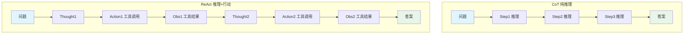

| 对比维度 | CoT 思维链 | ReAct 推理+行动 |
|---------|-----------|----------------|
| **核心机制** | 纯文本推理，无外部交互 | 推理与工具调用交替进行 |
| **信息来源** | 仅依赖模型训练数据 | 训练数据 + 工具获取的实时信息 |
| **幻觉风险** | 高（推理中可能编造事实） | 低（关键事实通过工具验证） |
| **适用任务** | 数学推理、逻辑题、符号推理 | 知识问答、任务执行、信息检索 |
| **可验证性** | 低（推理过程无法验证事实） | 高（每个 Action 都有 Observation 验证） |
| **延迟** | 低（单次 LLM 调用） | 高（多次 LLM 调用 + 工具调用） |
| **成本** | 低 | 高 |
| **实现复杂度** | 低（只需 Prompt） | 高（需要 Agent Loop + 工具管理） |
| **知识截止** | 受训练数据限制 | 可获取实时信息 |
| **执行操作** | 无法执行 | 可调用 API 执行操作 |

#### 何时用 CoT，何时用 ReAct

```python
def choose_reasoning_paradigm(task: dict) -> str:
    if task.get("needs_realtime_data"):
        return "ReAct"
    if task.get("needs_action"):
        return "ReAct"
    if task.get("type") in ["math", "logic", "symbolic"]:
        if task.get("model_capability") == "strong":
            return "CoT"
        else:
            return "CoT + 计算器工具（ReAct）"
    if task.get("type") == "factual_qa":
        return "ReAct"
    return "CoT" if task.get("complexity") == "low" else "ReAct"
```

> 🔍 **面试高频考点 10**：CoT 和 ReAct 的核心区别是什么？分别适用于什么场景？答：核心区别在于 CoT 是纯推理（无外部交互），ReAct 是推理+行动交替（有工具调用）。CoT 适用于数学推理、逻辑题等不需要外部信息的任务；ReAct 适用于需要实时信息、事实核查、执行操作的任务。CoT 延迟低成本低，ReAct 延迟高成本高但能力更强。

---

### 5.2 Plan-and-Execute 规划执行范式

#### 概念与原理

**Plan-and-Execute（规划-执行）** 是一种先制定完整计划、再逐步执行的 Agent 范式。与 ReAct 的"走一步看一步"不同，Plan-and-Execute 先对任务进行全局规划，分解为多个子任务，然后逐个执行。

> 💡 **通俗比喻**：ReAct 就像即兴旅行——走到哪算哪，到了一个地方再决定下一站去哪。Plan-and-Execute 就像精心规划的旅行——出发前就制定好完整的行程表（第一天去哪、第二天去哪、每天做什么），然后按行程表执行。当然，执行过程中也可以根据实际情况调整计划。

#### Plan-and-Execute 的工作流程

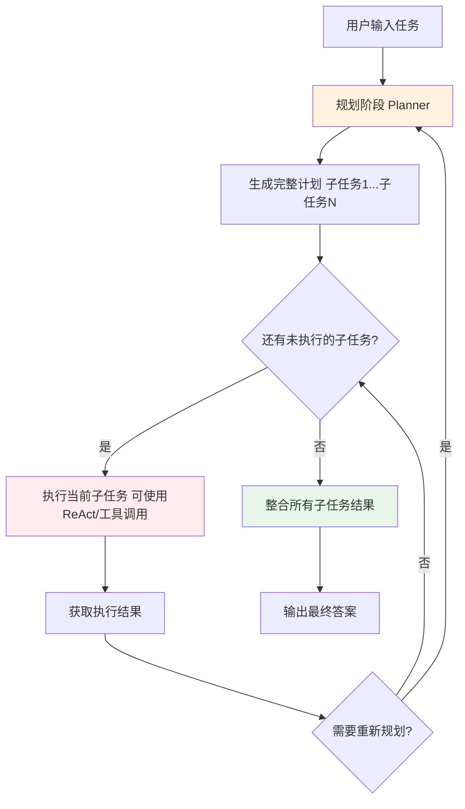

#### Plan-and-Execute vs ReAct 核心对比

| 对比维度 | ReAct | Plan-and-Execute |
|---------|-------|-----------------|
| **规划方式** | 隐式规划（每步 Thought 中隐含规划） | 显式规划（先生成完整计划） |
| **执行方式** | 走一步看一步，动态调整 | 按计划逐步执行，可中途重规划 |
| **全局视野** | 弱（关注当前步） | 强（先看全局再分解） |
| **复杂任务** | 容易迷失方向，步数多 | 分解清晰，适合多步骤任务 |
| **简单任务** | overhead 低，直接高效 | 规划 overhead 高，可能过度设计 |
| **动态适应性** | 强（每步都可调整） | 中（需触发重规划才调整） |
| **可解释性** | 中（推理轨迹即解释） | 高（有明确的计划和执行记录） |
| **实现复杂度** | 中 | 高（需要 Planner + Executor + 重规划） |
| **典型框架** | LangChain ReAct Agent, AutoGPT | LangChain Plan-and-Execute, BabyAGI |

#### Plan-and-Execute 的实现示例

```python
"""
Plan-and-Execute Agent 简化实现
"""
from typing import List, Dict
from openai import OpenAI

client = OpenAI()

class PlanAndExecuteAgent:
    def __init__(self, tools: Dict, model: str = "gpt-4o-mini"):
        self.tools = tools
        self.model = model
        self.plan = []
        self.execution_results = []

    def plan(self, task: str) -> List[str]:
        prompt = f"""你是一个任务规划专家。请将以下任务分解为具体的、可执行的子任务列表。
任务：{task}
可用工具：{', '.join(self.tools.keys())}
请输出子任务列表，每个子任务一行，格式为：1. 子任务描述
要求：子任务按执行顺序排列，每个明确可执行，数量控制在3-8个。"""
        response = client.chat.completions.create(
            model=self.model, messages=[{"role": "user", "content": prompt}], temperature=0
        )
        plan_text = response.choices[0].message.content
        subtasks = [
            line.strip().lstrip("0123456789. ")
            for line in plan_text.strip().split("\n")
            if line.strip() and line.strip()[0].isdigit()
        ]
        self.plan = subtasks
        return subtasks

    def execute_subtask(self, subtask: str, context: str = "") -> str:
        prompt = f"""请执行以下子任务。
子任务：{subtask}
已有上下文：{context}
可用工具：{', '.join(self.tools.keys())}
请直接执行并返回结果。"""
        response = client.chat.completions.create(
            model=self.model, messages=[{"role": "user", "content": prompt}], temperature=0
        )
        result = response.choices[0].message.content
        self.execution_results.append({"subtask": subtask, "result": result})
        return result

    def run(self, task: str) -> str:
        print("=== 规划阶段 ===")
        subtasks = self.plan(task)
        for i, st in enumerate(subtasks, 1):
            print(f"{i}. {st}")
        print("\n=== 执行阶段 ===")
        context = ""
        for i, subtask in enumerate(subtasks):
            print(f"\n执行子任务 {i+1}/{len(subtasks)}: {subtask}")
            result = self.execute_subtask(subtask, context)
            print(f"结果: {result[:100]}...")
            context += f"\n子任务{i+1}结果: {result}\n"
        print("\n=== 整合结果 ===")
        final_prompt = f"""请根据以下所有子任务的执行结果，给出最终答案。
原始任务：{task}
执行结果：{context}
请给出完整、结构化的最终答案："""
        response = client.chat.completions.create(
            model=self.model, messages=[{"role": "user", "content": final_prompt}], temperature=0
        )
        return response.choices[0].message.content
```

> 🔍 **面试高频考点 11**：Plan-and-Execute 和 ReAct 的核心区别是什么？答：核心区别在于 ReAct 是"走一步看一步"的隐式规划，Plan-and-Execute 是"先规划再执行"的显式规划。Plan-and-Execute 适用于多步骤复杂任务，全局视野更好，任务分解更清晰。但对于简单任务，Plan-and-Execute 的规划 overhead 过高，ReAct 更高效。

---

### 5.3 Reflexion 反思范式

#### 概念与原理

**Reflexion（反思）** 由 Shinn 等人于 2023 年 3 月提出，核心思想是让 Agent 在执行任务后进行自我反思，从失败中学习并调整策略，然后重试。

> 💡 **通俗比喻**：Reflexion 就像一个学生考完试后复盘——先做一遍题（执行），对答案发现错了（评估），分析错在哪里、为什么错（反思），然后重新做一遍（重试）。通过多次"执行→评估→反思→重试"的循环，最终得到正确答案。

#### Reflexion 的工作流程

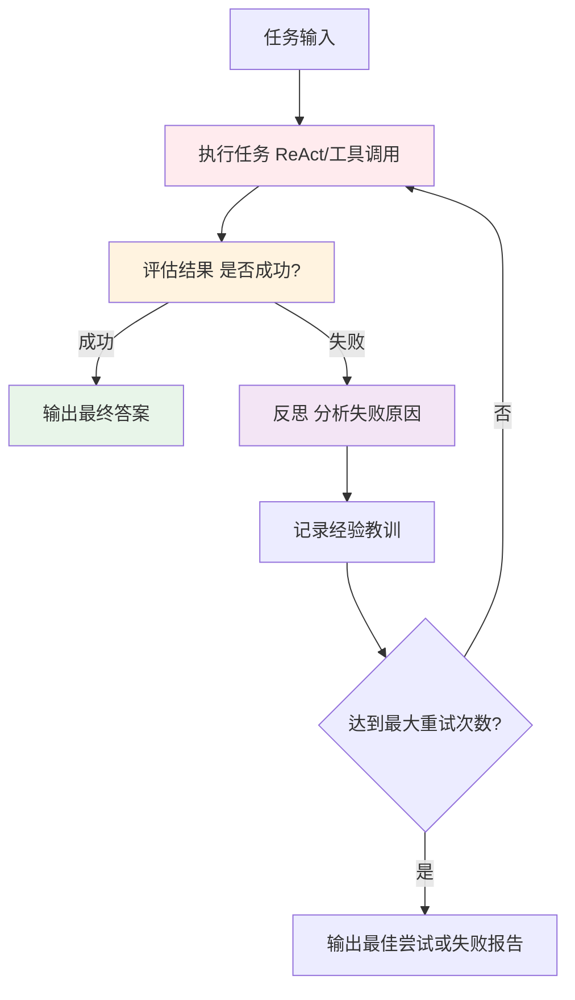

#### Reflexion vs ReAct 核心对比

| 对比维度 | ReAct | Reflexion |
|---------|-------|-----------|
| **核心机制** | 推理+行动交替 | 执行+评估+反思+重试 |
| **学习能力** | 无（单次任务内不积累经验） | 有（从失败中学习，调整策略） |
| **循环层级** | 单循环（Thought-Action-Observation） | 双循环（内层 ReAct + 外层反思重试） |
| **适用任务** | 通用任务 | 复杂推理、代码生成、需要多次尝试的任务 |
| **成功率** | 中等 | 高（通过重试提升） |
| **成本** | 中等 | 高（多次执行+反思） |
| **延迟** | 中等 | 高 |
| **记忆** | 无状态 | 有反思记忆（经验教训） |

#### Reflexion 的实现示例

```python
"""
Reflexion Agent 简化实现
"""
from typing import List, Dict
from openai import OpenAI
import json

client = OpenAI()

class ReflexionAgent:
    def __init__(self, tools: Dict, model: str = "gpt-4o-mini",
                 max_reflections: int = 3, max_react_steps: int = 8):
        self.tools = tools
        self.model = model
        self.max_reflections = max_reflections
        self.max_react_steps = max_react_steps
        self.reflections: List[str] = []
        self.traces: List[Dict] = []

    def execute_with_react(self, task: str, reflections: List[str]) -> Dict:
        reflection_text = "\n".join(f"- {r}" for r in reflections) if reflections else "（无）"
        prompt = f"""你是一个 ReAct Agent。请解决以下任务。
任务：{task}
之前的反思经验（请避免重复同样的错误）：{reflection_text}
可用工具：{', '.join(self.tools.keys())}
请按照 Thought → Action → Observation 的格式执行，最后输出 Final Answer。"""
        response = client.chat.completions.create(
            model=self.model, messages=[{"role": "user", "content": prompt}], temperature=0
        )
        output = response.choices[0].message.content
        if "Final Answer:" in output:
            answer = output.split("Final Answer:")[-1].strip()
        else:
            answer = output
        return {"answer": answer, "trace": output, "success": None}

    def evaluate(self, task: str, result: Dict) -> Dict:
        prompt = f"""请评估以下任务执行结果是否成功。
任务：{task}
执行结果：{result['answer'][:500]}
请评估：1.是否成功完成任务？2.如果失败，失败原因是什么？3.结果质量（1-10分）
请以JSON格式输出：{{"success": true/false, "reason": "原因", "score": 1-10}}"""
        response = client.chat.completions.create(
            model=self.model, messages=[{"role": "user", "content": prompt}], temperature=0
        )
        try:
            return json.loads(response.choices[0].message.content)
        except json.JSONDecodeError:
            return {"success": False, "reason": "评估解析失败", "score": 0}

    def reflect(self, task: str, result: Dict, eval_result: Dict) -> str:
        prompt = f"""请对以下失败的任务执行进行反思，总结经验教训。
任务：{task}
执行结果：{result['answer'][:500]}
失败原因：{eval_result.get('reason', '未知')}
之前的反思：{chr(10).join(f'- {r}' for r in self.reflections) if self.reflections else '（无）'}
请总结这次失败的经验教训（1-3条），重点说明：哪里做错了？为什么会做错？下次应该怎么做？"""
        response = client.chat.completions.create(
            model=self.model, messages=[{"role": "user", "content": prompt}], temperature=0
        )
        return response.choices[0].message.content.strip()

    def run(self, task: str) -> Dict:
        best_result = None
        best_score = 0
        for attempt in range(self.max_reflections + 1):
            print(f"\n=== 尝试 {attempt + 1}/{self.max_reflections + 1} ===")
            result = self.execute_with_react(task, self.reflections)
            self.traces.append(result)
            eval_result = self.evaluate(task, result)
            result["success"] = eval_result["success"]
            result["score"] = eval_result.get("score", 0)
            print(f"评估: success={eval_result['success']}, score={eval_result.get('score')}")
            if result["score"] > best_score:
                best_score = result["score"]
                best_result = result
            if eval_result["success"]:
                print("任务成功！")
                return {"answer": result["answer"], "attempts": attempt + 1,
                        "reflections": self.reflections, "success": True}
            if attempt < self.max_reflections:
                reflection = self.reflect(task, result, eval_result)
                self.reflections.append(reflection)
                print(f"反思: {reflection[:100]}...")
        print(f"达到最大反思次数，返回最佳结果（score={best_score}）")
        return {"answer": best_result["answer"] if best_result else "失败",
                "attempts": self.max_reflections + 1, "reflections": self.reflections, "success": False}
```

> 🔍 **面试高频考点 12**：Reflexion 的核心思想是什么？它与 ReAct 的关系是什么？答：Reflexion 的核心思想是"执行→评估→反思→重试"的循环，让 Agent 从失败中学习。Reflexion 与 ReAct 是互补关系：Reflexion 的内层执行通常使用 ReAct，外层是反思重试循环。Reflexion 适用于复杂推理、代码生成等需要多次尝试的任务。

---

### 5.4 四种范式综合对比与选择指南

#### 综合对比表

| 维度 | CoT | ReAct | Plan-and-Execute | Reflexion |
|------|-----|-------|-----------------|-----------|
| **提出时间** | 2022.01 | 2022.10 | 2023 | 2023.03 |
| **核心机制** | 逐步推理 | 推理+行动交替 | 先规划再执行 | 执行+反思+重试 |
| **工具调用** | 否 | 是 | 是 | 是 |
| **实时信息** | 否 | 是 | 是 | 是 |
| **全局规划** | 否 | 否（隐式） | 是（显式） | 否 |
| **自我修正** | 否 | 部分 | 部分（重规划） | 是（反思重试） |
| **经验积累** | 否 | 否 | 否 | 是（反思记忆） |
| **简单任务效率** | 很高 | 高 | 低 | 低 |
| **复杂任务能力** | 低 | 高 | 很高 | 很高 |
| **实现复杂度** | 低 | 中 | 高 | 高 |
| **成本** | 低 | 中 | 中高 | 高 |
| **延迟** | 低 | 中 | 中高 | 高 |
| **典型应用** | 数学题、逻辑题 | 通用Agent、问答 | 调研报告、多阶段任务 | 代码生成、复杂推理 |

#### 范式选择决策树

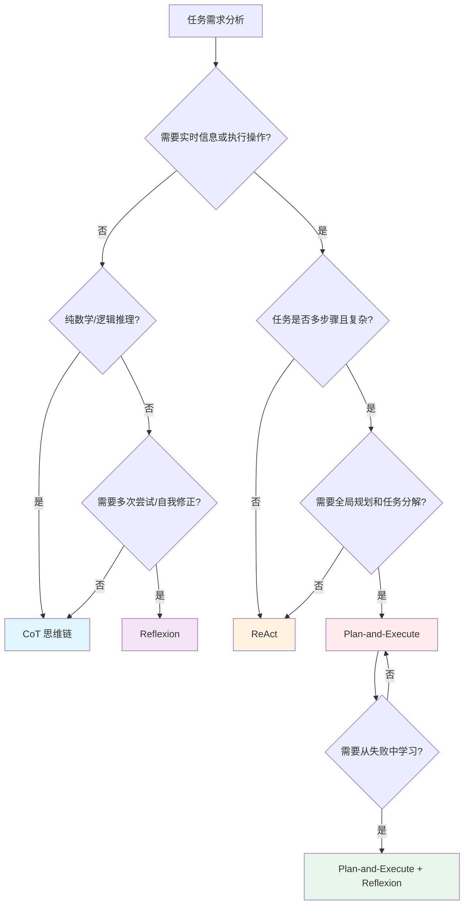

#### 范式组合使用

```python
"""
范式组合示例：ReAct + Reflexion + Plan-and-Execute
"""
class ProductionAgent:
    def __init__(self):
        self.mode = "auto"

    def run(self, task: str):
        paradigm = self._classify_task(task)
        if paradigm == "simple":
            return self._run_cot(task)
        elif paradigm == "medium":
            return self._run_react(task)
        elif paradigm == "complex":
            return self._run_plan_execute(task)
        elif paradigm == "hard":
            return self._run_full_pipeline(task)

    def _classify_task(self, task: str) -> str:
        return "medium"

    def _run_cot(self, task): pass
    def _run_react(self, task): pass
    def _run_plan_execute(self, task): pass
    def _run_full_pipeline(self, task): pass
```

> ⚠️ **常见坑点 11**：新手常认为"范式越复杂越好"，一上来就用 Plan-and-Execute + Reflexion 的组合。实际上对于简单任务，复杂范式的 overhead 远大于收益。应该根据任务复杂度选择合适的范式，简单任务用 CoT/ReAct 即可。

> ⚠️ **常见坑点 12**：Reflexion 的评估环节如果用同一个 LLM 做"执行+评估"，可能出现"自己评自己"的偏差。最佳实践是：①用更强的模型做评估 ②有客观标准的任务用程序评估 ③人工抽检评估结果。

---

> 💡 **深度讲解**：四种推理范式（CoT、ReAct、Plan-and-Execute、Reflexion）不是互斥的，而是代表了 Agent 能力的不同维度。CoT 解决"推理深度"问题，ReAct 解决"信息获取"问题，Plan-and-Execute 解决"任务分解"问题，Reflexion 解决"自我修正"问题。理解这四种范式的关键，是认识到它们各自解决了 Agent 能力的一个方面，实际生产中经常组合使用。范式选择的核心原则是"够用就好"——简单任务用最简单的范式，复杂任务才用复杂范式。过度设计会增加不必要的成本和延迟，这是新手最容易犯的错误。
>
> **📝 精简总结**：
> 1. CoT（思维链）：纯推理，无工具调用，适用于数学/逻辑题，低成本低延迟
> 2. ReAct（推理+行动）：Thought-Action-Observation 循环，适用于需要实时信息和执行操作的通用任务
> 3. Plan-and-Execute（规划-执行）：先显式规划再逐步执行，适用于多步骤复杂任务，全局视野好
> 4. Reflexion（反思）：执行→评估→反思→重试循环，适用于需要多次尝试的高难度任务
> 5. 四种范式不是互斥的，实际生产中经常组合使用
> 6. 范式选择原则：根据任务复杂度选择，简单任务用简单范式，避免过度设计
> 7. Reflexion 的评估环节应避免"自己评自己"，用更强模型或客观标准评估
>
> **🎯 梯度练习题**：
> - **基础 1**：分别用一句话概括 CoT、ReAct、Plan-and-Execute、Reflexion 的核心思想。
> - **基础 2**：CoT 和 ReAct 的核心区别是什么？各适用于什么场景？
> - **基础 3**：Plan-and-Execute 相比 ReAct 的优势和劣势分别是什么？
> - **进阶 1**：设计一个任务分类器，根据任务特征自动选择最合适的推理范式。写出分类逻辑和决策规则。
> - **进阶 2**：Reflexion 的反思质量直接决定重试效果。设计一个反思 Prompt，引导 LLM 从"错误定位、原因分析、改进策略"三个维度进行高质量反思。
> - **实战 1**：实现一个组合范式 Agent：对于复杂任务，先用 Plan-and-Execute 分解为子任务，每个子任务用 ReAct 执行，如果子任务失败则用 Reflexion 反思重试。

---

## 六、ReAct 循环控制

### 6.1 最大迭代次数（max_iterations）

#### 为什么需要 max_iterations

ReAct 循环理论上可以无限进行——LLM 可能陷入重复调用同一工具、在错误方向上越走越远、或者永远不输出 Final Answer。如果没有迭代次数限制，Agent 可能消耗大量 token 和时间却无法完成任务。

> 💡 **通俗比喻**：max_iterations 就像给侦探设定的办案期限。如果没有期限，侦探可能一直在查案，花了大量时间和资源却迟迟不结案。有了期限，侦探必须在规定时间内给出结论，避免无限消耗资源。

#### max_iterations 的设置策略

| 任务类型 | 推荐 max_iterations | 说明 |
|---------|-------------------|------|
| 简单问答（1-2步） | 3-5 | 搜索+回答即可 |
| 中等任务（3-5步） | 6-10 | 多轮工具调用 |
| 复杂任务（5-10步） | 10-15 | 多步骤推理和工具调用 |
| 极复杂任务 | 15-20 | 需要大量工具调用，配合其他控制机制 |

```python
def calculate_max_iterations(task_complexity: str, tool_count: int) -> int:
    base = {"simple": 4, "medium": 8, "complex": 12, "very_complex": 18}.get(task_complexity, 8)
    tool_factor = min(tool_count / 5, 1.5)
    result = int(base * tool_factor)
    return max(3, min(result, 25))
```

#### 达到 max_iterations 后的处理

```python
from openai import OpenAI
client = OpenAI()

def handle_max_iterations(scratchpad: str, question: str,
                           model: str = "gpt-4o-mini", max_iterations: int = 10) -> str:
    prompt = f"""你是一个 ReAct Agent，已经执行了 {max_iterations} 步推理，但仍未得出最终答案。
原始问题：{question}
已有的推理轨迹和观察结果：{scratchpad}
请基于已有的信息，尽可能给出最佳答案。
要求：1.如果已有信息足够回答，直接给出答案 2.如果信息不完整，给出部分答案并说明哪些信息缺失 3.如果完全无法回答，如实说明已尝试的方法和遇到的困难 4.不要编造未经验证的信息
Final Answer:"""
    response = client.chat.completions.create(
        model=model, messages=[{"role": "user", "content": prompt}], temperature=0
    )
    return response.choices[0].message.content.strip()
```

> 🔍 **面试高频考点 13**：为什么 ReAct Agent 必须设置 max_iterations？达到上限后应该如何处理？答：必须设置 max_iterations 是因为 LLM 可能陷入无限循环，导致 token 和时间无限消耗。达到上限后不应简单返回错误，而应强制 LLM 基于已有信息给出最佳答案，最大化利用已消耗的资源。

---

### 6.2 最大执行时间（max_execution_time）

#### 为什么需要时间限制

仅靠 max_iterations 不够——如果某一步的工具调用卡住了，即使步数没到上限，总执行时间也可能超长。时间限制确保 Agent 不会因为某个慢操作而挂起。

```python
import time
from typing import Optional

class TimeController:
    def __init__(self, max_time: float = 120.0):
        self.max_time = max_time
        self.start_time: Optional[float] = None
        self.checkpoints = []

    def start(self):
        self.start_time = time.time()

    def elapsed(self) -> float:
        if self.start_time is None:
            return 0.0
        return time.time() - self.start_time

    def remaining(self) -> float:
        return max(0, self.max_time - self.elapsed())

    def is_expired(self) -> bool:
        return self.elapsed() >= self.max_time

    def check(self, step_name: str = "") -> bool:
        elapsed = self.elapsed()
        self.checkpoints.append({"step": step_name, "elapsed": elapsed})
        return not self.is_expired()

    def get_time_budget(self) -> dict:
        elapsed = self.elapsed()
        remaining = self.remaining()
        return {
            "elapsed": elapsed, "remaining": remaining,
            "used_percentage": (elapsed / self.max_time * 100) if self.max_time > 0 else 0,
            "status": "normal" if remaining > 30 else ("warning" if remaining > 10 else "critical")
        }
```

#### 时间限制与步数限制的配合

```python
def should_continue(iteration: int, max_iterations: int,
                    time_controller: TimeController) -> tuple[bool, str]:
    if iteration >= max_iterations:
        return False, f"达到最大迭代次数 ({max_iterations})"
    if time_controller.is_expired():
        return False, f"达到最大执行时间 ({time_controller.max_time}秒)"
    budget = time_controller.get_time_budget()
    if budget["status"] == "critical":
        return True, "时间紧张，建议尽快输出 Final Answer"
    return True, "继续"
```

> ⚠️ **常见坑点 13**：只设置 max_iterations 不设置 max_execution_time。如果某个工具调用卡住，Agent 可能挂起几分钟。必须同时设置步数上限和时间上限，双保险。

> ⚠️ **常见坑点 14**：工具调用的超时时间设置过长。如果每个工具超时 60 秒，max_iterations 是 10，最坏情况需要 600 秒。应该合理设置工具超时（通常 10-30 秒），并确保 max_execution_time 大于 max_iterations × 平均工具时间。

---

### 6.3 提前终止（Early Stopping）

#### 提前终止的触发条件

| 触发条件 | 说明 | 处理方式 |
|---------|------|---------|
| **信息充分** | LLM 输出 Final Answer | 正常终止，返回答案 |
| **任务不可行** | 多次尝试后确认无法完成 | 终止，返回失败说明 |
| **循环检测** | 重复调用相同工具+参数 | 干预或终止 |
| **Observation 无新信息** | 工具返回结果与之前高度相似 | 提示换方法或终止 |
| **用户中断** | 用户主动取消 | 终止，返回中间结果 |
| **成本超限** | token 消耗超过预算 | 终止，返回部分结果 |

#### 任务不可行性检测

```python
from typing import List, Tuple
from .models import AgentStep

def is_task_feasible(steps: List[AgentStep],
                      consecutive_failures_threshold: int = 3) -> Tuple[bool, str]:
    if len(steps) < consecutive_failures_threshold:
        return True, ""
    recent_failures = 0
    for step in reversed(steps):
        if step.observation and not step.observation.success:
            recent_failures += 1
        else:
            break
    if recent_failures >= consecutive_failures_threshold:
        last_error = steps[-1].observation.error or "未知错误"
        return False, f"连续 {recent_failures} 次工具调用失败，最后错误：{last_error}"
    not_found_count = sum(
        1 for s in steps
        if s.observation and "不存在" in (s.observation.error or "")
    )
    if not_found_count >= 2:
        return False, "多次调用不存在的工具，可能任务需要的工具未注册"
    return True, ""
```

---

### 6.4 循环检测与干预

#### 循环的类型与检测

| 循环类型 | 表现 | 检测方法 |
|---------|------|---------|
| **完全重复** | 相同工具+相同参数反复调用 | 比较最近 N 步的 Action 是否完全相同 |
| **语义重复** | 不同参数但语义相同的调用 | 文本相似度比较 |
| **Observation 循环** | 工具返回相似结果，LLM 反复尝试 | 比较 Observation 内容相似度 |
| **错误循环** | 反复犯同样的参数错误 | 比较错误信息 |
| **思维循环** | Thought 内容反复重复 | 比较 Thought 文本相似度 |

```python
from typing import List
from difflib import SequenceMatcher
from .models import AgentStep

class AdvancedLoopDetector:
    def __init__(self, threshold: int = 3, similarity_threshold: float = 0.85):
        self.threshold = threshold
        self.similarity_threshold = similarity_threshold

    def detect_all(self, steps: List[AgentStep]) -> List[dict]:
        loops = []
        exact_loop = self._detect_exact_repetition(steps)
        if exact_loop:
            loops.append(exact_loop)
        semantic_loop = self._detect_semantic_repetition(steps)
        if semantic_loop:
            loops.append(semantic_loop)
        obs_loop = self._detect_observation_loop(steps)
        if obs_loop:
            loops.append(obs_loop)
        error_loop = self._detect_error_loop(steps)
        if error_loop:
            loops.append(error_loop)
        return loops

    def _detect_exact_repetition(self, steps: List[AgentStep]) -> dict:
        if len(steps) < self.threshold:
            return None
        recent_actions = []
        for step in steps[-self.threshold:]:
            if step.action:
                key = f"{step.action.tool_name}:{sorted(step.action.tool_args.items())}"
                recent_actions.append(key)
        if len(recent_actions) >= self.threshold and len(set(recent_actions)) == 1:
            return {"type": "exact_repetition", "severity": "high",
                    "message": f"连续 {self.threshold} 次完全相同的工具调用",
                    "action": recent_actions[0]}
        return None

    def _detect_semantic_repetition(self, steps: List[AgentStep]) -> dict:
        if len(steps) < self.threshold:
            return None
        recent_queries = []
        for step in steps[-self.threshold:]:
            if step.action and step.action.tool_name == steps[-1].action.tool_name:
                main_arg = list(step.action.tool_args.values())[0] if step.action.tool_args else ""
                recent_queries.append(str(main_arg))
        if len(recent_queries) >= self.threshold:
            similarities = []
            for i in range(len(recent_queries) - 1):
                sim = SequenceMatcher(None, recent_queries[i], recent_queries[i+1]).ratio()
                similarities.append(sim)
            if similarities and all(s > self.similarity_threshold for s in similarities):
                return {"type": "semantic_repetition", "severity": "medium",
                        "message": f"连续 {self.threshold} 次语义相似的查询",
                        "similarity": sum(similarities) / len(similarities)}
        return None

    def _detect_observation_loop(self, steps: List[AgentStep]) -> dict:
        if len(steps) < self.threshold:
            return None
        recent_obs = []
        for step in steps[-self.threshold:]:
            if step.observation and step.observation.success:
                recent_obs.append(step.observation.content[:500])
        if len(recent_obs) >= self.threshold:
            similarities = []
            for i in range(len(recent_obs) - 1):
                sim = SequenceMatcher(None, recent_obs[i], recent_obs[i+1]).ratio()
                similarities.append(sim)
            if similarities and all(s > 0.9 for s in similarities):
                return {"type": "observation_loop", "severity": "medium",
                        "message": "工具返回结果高度相似，可能在原地打转"}
        return None

    def _detect_error_loop(self, steps: List[AgentStep]) -> dict:
        if len(steps) < self.threshold:
            return None
        recent_errors = []
        for step in steps[-self.threshold:]:
            if step.observation and not step.observation.success:
                recent_errors.append(step.observation.error or step.observation.content[:200])
        if len(recent_errors) >= self.threshold and len(set(recent_errors)) == 1:
            return {"type": "error_loop", "severity": "high",
                    "message": f"连续 {self.threshold} 次相同的工具错误",
                    "error": recent_errors[0]}
        return None
```

#### 循环干预策略

```python
from typing import List, Tuple
from .models import AgentStep

class LoopInterceptor:
    def __init__(self, max_interventions: int = 2):
        self.max_interventions = max_interventions
        self.intervention_count = 0

    def intervene(self, loops: List[dict],
                  steps: List[AgentStep]) -> Tuple[str, bool]:
        if not loops:
            return "", False
        self.intervention_count += 1
        if self.intervention_count > self.max_interventions:
            return ("【系统】多次检测到循环且干预无效，强制终止任务。请基于已有信息给出最佳答案。", True)
        messages = []
        should_terminate = False
        for loop in loops:
            if loop["type"] == "exact_repetition":
                messages.append(
                    f"【系统提示】检测到你在重复调用相同的工具和参数：{loop.get('action', '')}。"
                    f"这不会获得新信息。请尝试：①换用不同的参数 ②使用其他工具 ③如果信息已足够，直接输出 Final Answer。"
                )
            elif loop["type"] == "semantic_repetition":
                messages.append("【系统提示】检测到你在反复进行语义相似的查询。请尝试更具体或不同角度的查询，或者换用其他工具。")
            elif loop["type"] == "observation_loop":
                messages.append("【系统提示】工具返回的结果与之前高度相似，继续调用可能无法获得新信息。请尝试：①调整查询关键词 ②使用不同的工具 ③基于已有信息输出答案。")
            elif loop["type"] == "error_loop":
                messages.append(
                    f"【系统提示】检测到反复出现相同的工具错误：{loop.get('error', '')}。"
                    f"请仔细检查参数格式和工具使用方法，或换用其他工具。如果该工具确实无法使用，请如实说明。"
                )
                if loop.get("severity") == "high" and self.intervention_count >= 2:
                    should_terminate = True
        return "\n\n".join(messages), should_terminate

    def reset(self):
        self.intervention_count = 0
```

> 🔍 **面试高频考点 14**：ReAct Agent 可能出现哪些类型的循环？如何检测和干预？答：常见循环类型：①完全重复 ②语义重复 ③Observation 循环 ④错误循环 ⑤思维循环。检测方法：完全重复用精确匹配，语义/Observation 用文本相似度比较，错误循环用错误信息匹配。干预策略：注入系统提示引导换方法，干预无效后强制终止。

---

### 6.5 上下文窗口管理

#### 上下文膨胀问题

随着 ReAct 循环进行，Scratchpad 不断增长，可能导致上下文窗口溢出。必须主动管理上下文长度。

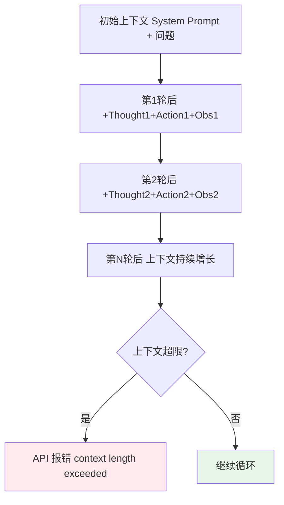

#### 上下文管理策略

| 策略 | 说明 | 适用场景 |
|------|------|---------|
| **Observation 截断** | 单条 Observation 限制最大长度 | 所有场景（基础策略） |
| **历史摘要** | 对较早的推理轨迹做摘要，保留关键信息 | 长任务、多轮循环 |
| **滑动窗口** | 只保留最近 N 轮的完整轨迹，更早的丢弃或摘要 | 中等长度任务 |
| **关键信息提取** | 从历史中提取关键事实，丢弃推理过程 | 事实性任务 |
| **分层上下文** | System Prompt 常驻，近期轨迹完整，早期轨迹摘要 | 生产级 Agent |

```python
from typing import List, Optional
from .models import AgentStep, AgentTrace
from .utils import count_tokens, truncate_text

class ContextManager:
    def __init__(self, max_total_tokens: int = 12000,
                 max_observation_tokens: int = 1000,
                 recent_steps_full: int = 3,
                 summary_model: str = "gpt-4o-mini"):
        self.max_total_tokens = max_total_tokens
        self.max_observation_tokens = max_observation_tokens
        self.recent_steps_full = recent_steps_full
        self.summary_model = summary_model

    def build_scratchpad(self, trace: AgentTrace, llm=None) -> str:
        steps = trace.steps
        if not steps:
            return f"问题：{trace.question}"
        for step in steps:
            if step.observation:
                step.observation.content = truncate_text(
                    step.observation.content, max_tokens=self.max_observation_tokens)
        if len(steps) <= self.recent_steps_full:
            return self._format_full_scratchpad(trace.question, steps)
        early_steps = steps[:-self.recent_steps_full]
        recent_steps = steps[-self.recent_steps_full:]
        if llm and len(early_steps) > 2:
            summary = self._summarize_steps(early_steps, trace.question, llm)
        else:
            summary = self._compress_steps(early_steps)
        recent_text = self._format_steps(recent_steps)
        return (f"问题：{trace.question}\n\n【早期推理摘要】\n{summary}\n\n【近期推理详情】\n{recent_text}")

    def _format_full_scratchpad(self, question: str, steps: List[AgentStep]) -> str:
        return f"问题：{question}\n\n{self._format_steps(steps)}"

    def _format_steps(self, steps: List[AgentStep]) -> str:
        lines = []
        for step in steps:
            lines.append(f"Thought: {step.thought.content}")
            if step.action:
                args_str = ", ".join(
                    f'{k}="{v}"' if isinstance(v, str) else f"{k}={v}"
                    for k, v in step.action.tool_args.items())
                lines.append(f"Action: {step.action.tool_name}({args_str})")
            if step.observation:
                lines.append(f"Observation: {step.observation.content}")
            lines.append("")
        return "\n".join(lines)

    def _summarize_steps(self, steps: List[AgentStep], question: str, llm) -> str:
        steps_text = self._format_steps(steps)
        prompt = f"""请摘要以下 ReAct 推理轨迹的关键信息，保留重要的观察结果和结论，省略推理过程。
原始问题：{question}
推理轨迹：{steps_text[:6000]}
请输出摘要（不超过500字），重点保留：1.已经获取的关键信息和事实 2.已经排除的方向 3.当前的进展状态"""
        return llm.invoke(prompt)

    def _compress_steps(self, steps: List[AgentStep]) -> str:
        lines = []
        for step in steps:
            if step.action and step.observation:
                lines.append(f"- 调用 {step.action.tool_name}，结果：{step.observation.content[:150]}")
        return "\n".join(lines) if lines else "（无早期记录）"

    def estimate_tokens(self, trace: AgentTrace) -> int:
        scratchpad = self.build_scratchpad(trace)
        return count_tokens(scratchpad)
```

> ⚠️ **常见坑点 15**：上下文管理时只截断 Observation，不处理 Thought 和历史轨迹。对于长任务（10+ 步），即使每条 Observation 都截断，Thought 和 Action 的累积也可能导致上下文溢出。应该采用分层策略：近期轨迹完整保留，早期轨迹摘要或压缩。

> ⚠️ **常见坑点 16**：摘要早期轨迹时丢失了关键信息。如果摘要质量差，LLM 可能忘记之前已经获取的重要事实，导致重复调用工具。摘要时应明确要求保留"已获取的关键信息和事实"，并定期验证摘要的完整性。

---

> 💡 **深度讲解**：ReAct 循环控制的本质是"在有限资源内最大化任务成功率"。资源包括三个维度：步数（max_iterations）、时间（max_execution_time）、上下文窗口（token 限制）。这三个维度相互关联——步数越多时间越长，步数越多上下文越长。循环控制的挑战在于：限制太松会浪费资源，限制太紧会导致任务无法完成。最佳实践是"动态控制"：根据任务复杂度调整 max_iterations，根据工具平均响应时间调整 max_execution_time，根据当前上下文使用情况调整 Observation 截断策略。循环检测和干预是另一个重要维度——Agent 可能在资源耗尽前就陷入无意义的循环，此时主动干预比被动等待资源耗尽更高效。生产级循环控制应该是一个综合系统，整合步数限制、时间限制、上下文管理、循环检测、提前终止等多种机制。
>
> **📝 精简总结**：
> 1. max_iterations 防止无限循环，简单任务 3-5，复杂任务 10-15，达到上限后强制生成最佳答案
> 2. max_execution_time 防止工具调用卡住，必须与 max_iterations 双保险，工具超时通常 10-30 秒
> 3. 提前终止触发条件：信息充分、任务不可行、循环检测、Observation 无新信息、用户中断、成本超限
> 4. 循环类型：完全重复、语义重复、Observation 循环、错误循环、思维循环，用精确匹配+文本相似度检测
> 5. 循环干预：注入系统提示引导换方法，干预无效后强制终止
> 6. 上下文管理：Observation 截断（基础）、历史摘要（长任务）、滑动窗口、分层上下文
> 7. 循环控制应是综合系统，整合多种机制，而非单一参数
>
> **🎯 梯度练习题**：
> - **基础 1**：ReAct 循环控制需要哪些维度的限制？各自解决什么问题？
> - **基础 2**：达到 max_iterations 后应该如何处理？为什么不能直接返回错误？
> - **基础 3**：列举至少 3 种 ReAct 循环类型，并说明检测方法。
> - **进阶 1**：设计一个动态 max_iterations 调整器，根据任务预估复杂度和当前已用步数/时间，动态调整剩余步数预算。
> - **进阶 2**：实现一个上下文管理器，采用"近期完整+早期摘要"的分层策略，摘要中必须保留关键事实和已排除的方向。
> - **实战 1**：为第四章实现的 ReAct Agent 添加完整的循环控制模块，包含 max_iterations、max_execution_time、循环检测（至少3种类型）、循环干预、上下文管理。

---


## 七、ReAct 与工具调用（Function Calling）结合

### 7.1 经典 ReAct vs Function Calling ReAct

#### 两种模式的本质区别

经典 ReAct 使用纯文本 Prompt 引导 LLM 输出 `Action: 工具名(参数)` 格式，然后用正则表达式解析。Function Calling ReAct 使用模型原生的工具调用能力，LLM 直接输出结构化的 `tool_calls` 对象，无需正则解析。

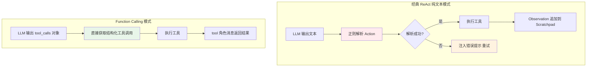

| 对比维度 | 经典 ReAct（纯文本） | Function Calling ReAct |
|---------|---------------------|----------------------|
| **Action 格式** | `Action: 工具名(参数)` 纯文本 | 结构化 `tool_calls` 对象 |
| **解析方式** | 正则表达式 | 模型原生输出，直接读取 |
| **解析稳定性** | ~85%（格式稍有偏差就失败） | ~98%（模型原生支持） |
| **参数类型** | 全部解析为字符串，需手动转换 | 原生支持 JSON 类型（string/number/boolean/array/object） |
| **多工具并行** | 不支持（每轮只能一个 Action） | 原生支持（一次返回多个 tool_call） |
| **工具描述格式** | 自由文本 | 标准化 JSON Schema |
| **模型兼容性** | 所有模型（只要能输出文本） | 仅支持 Function Calling 的模型 |
| **调试难度** | 高（需要看正则匹配过程） | 低（结构化数据一目了然） |
| **推荐场景** | 学习原理、不支持 FC 的模型 | 生产环境、所有主流模型 |

#### 从经典 ReAct 迁移到 Function Calling

```python
"""
从经典 ReAct 迁移到 Function Calling 的关键改动
"""

# ========== 经典 ReAct ==========
class ClassicReActAgent:
    def _call_llm(self, scratchpad: str):
        # 纯文本模式：所有内容放在 messages 中
        messages = [
            {"role": "system", "content": self.system_prompt},
            {"role": "user", "content": f"{scratchpad}\nThought:"}
        ]
        response = self.client.chat.completions.create(
            model=self.model,
            messages=messages,
            temperature=0
            # 没有 tools 参数
        )
        return response.choices[0].message.content

    def _parse_action(self, text: str):
        # 正则解析
        import re
        match = re.search(r"Action:\s*(\w+)\((.*?)\)", text, re.DOTALL)
        if match:
            return match.group(1), self._parse_args(match.group(2))
        return None, None

# ========== Function Calling ReAct ==========
class FCReActAgent:
    def _call_llm(self, messages: list):
        # FC 模式：传入 tools 参数
        response = self.client.chat.completions.create(
            model=self.model,
            messages=messages,
            tools=self.tool_schemas,  # 关键：传入工具定义
            tool_choice="auto",
            temperature=0
        )
        return response.choices[0].message

    def _parse_action(self, message):
        # 直接读取结构化 tool_calls
        if not message.tool_calls:
            return []
        actions = []
        for tc in message.tool_calls:
            import json
            args = json.loads(tc.function.arguments)
            actions.append({
                "id": tc.id,
                "name": tc.function.name,
                "arguments": args
            })
        return actions

    def _build_tool_result_message(self, tool_call_id: str, result: str):
        # FC 模式：使用 tool 角色消息
        return {
            "role": "tool",
            "tool_call_id": tool_call_id,
            "content": result
        }
```

> 🔍 **面试高频考点 15**：经典 ReAct 和 Function Calling ReAct 的核心区别是什么？为什么生产环境推荐使用 Function Calling？答：核心区别在于 Action 的输出和解析方式：经典 ReAct 用纯文本+正则解析，稳定性约 85%；Function Calling 用模型原生结构化输出，稳定性约 98%。Function Calling 还原生支持参数类型、多工具并行、标准化 JSON Schema。生产环境推荐 FC 是因为稳定性更高、调试更容易、功能更丰富。

---

### 7.2 Function Calling 模式下的 ReAct 完整实现

```python
"""
Function Calling 模式下的 ReAct Agent 完整实现
基于 OpenAI SDK 1.x
"""
import json
import time
from typing import List, Dict, Any, Optional
from openai import OpenAI

class FCReActAgent:
    """Function Calling 模式 ReAct Agent"""

    def __init__(
        self,
        model: str = "gpt-4o-mini",
        api_key: str = None,
        base_url: str = None,
        max_iterations: int = 10,
        temperature: float = 0.0,
        verbose: bool = True
    ):
        client_kwargs = {}
        if api_key:
            client_kwargs["api_key"] = api_key
        if base_url:
            client_kwargs["base_url"] = base_url
        self.client = OpenAI(**client_kwargs)
        self.model = model
        self.max_iterations = max_iterations
        self.temperature = temperature
        self.verbose = verbose
        self.tools: List[Dict] = []
        self.tool_functions: Dict[str, callable] = {}
        self.trace = []

    def register_tool(self, name: str, description: str, parameters: Dict, func: callable):
        """注册工具"""
        self.tools.append({
            "type": "function",
            "function": {
                "name": name,
                "description": description,
                "parameters": parameters
            }
        })
        self.tool_functions[name] = func
        if self.verbose:
            print(f"[注册工具] {name}")

    def run(self, question: str, system_prompt: str = None) -> str:
        """执行 ReAct 循环"""
        if system_prompt is None:
            system_prompt = (
                "你是一个有用的助手，可以使用工具来回答问题。"
                "对于需要实时信息或精确计算的问题，请使用工具。"
                "当你有足够信息时，直接给出最终答案。"
            )

        messages = [
            {"role": "system", "content": system_prompt},
            {"role": "user", "content": question}
        ]

        start_time = time.time()

        for iteration in range(self.max_iterations):
            if self.verbose:
                print(f"\n--- 第 {iteration + 1} 轮 ---")

            # 1. 调用 LLM
            response = self.client.chat.completions.create(
                model=self.model,
                messages=messages,
                tools=self.tools if self.tools else None,
                tool_choice="auto" if self.tools else None,
                temperature=self.temperature
            )
            message = response.choices[0].message
            messages.append(message)

            # 2. 检查是否有工具调用
            if not message.tool_calls:
                # 没有工具调用，返回最终答案
                if self.verbose:
                    print(f"[最终答案] {message.content[:200]}")
                self.trace.append({
                    "iteration": iteration + 1,
                    "type": "final_answer",
                    "content": message.content
                })
                elapsed = time.time() - start_time
                if self.verbose:
                    print(f"\n[完成] 共 {iteration + 1} 轮，耗时 {elapsed:.2f}s")
                return message.content

            # 3. 执行所有工具调用（支持并行）
            for tool_call in message.tool_calls:
                tool_name = tool_call.function.name
                try:
                    tool_args = json.loads(tool_call.function.arguments)
                except json.JSONDecodeError:
                    tool_args = {}

                if self.verbose:
                    print(f"[工具调用] {tool_name}({tool_args})")

                # 执行工具
                if tool_name in self.tool_functions:
                    try:
                        result = self.tool_functions[tool_name](**tool_args)
                        tool_content = str(result) if not isinstance(result, str) else result
                    except Exception as e:
                        tool_content = f"工具执行错误: {type(e).__name__}: {str(e)}"
                else:
                    tool_content = f"错误: 工具 '{tool_name}' 不存在"

                if self.verbose:
                    print(f"[工具结果] {tool_content[:200]}")

                # 4. 将工具结果加入消息（tool 角色）
                messages.append({
                    "role": "tool",
                    "tool_call_id": tool_call.id,
                    "content": tool_content
                })

                self.trace.append({
                    "iteration": iteration + 1,
                    "type": "tool_call",
                    "tool_name": tool_name,
                    "tool_args": tool_args,
                    "result": tool_content[:500]
                })

        # 5. 达到最大迭代次数，强制生成答案
        if self.verbose:
            print("\n[达到最大迭代次数，强制生成答案]")
        messages.append({
            "role": "user",
            "content": "请基于已有的信息给出最终答案。如果信息不足，请说明哪些信息缺失。"
        })
        response = self.client.chat.completions.create(
            model=self.model,
            messages=messages,
            temperature=self.temperature
        )
        final_answer = response.choices[0].message.content
        self.trace.append({
            "iteration": self.max_iterations + 1,
            "type": "forced_final_answer",
            "content": final_answer
        })
        return final_answer


# ========== 使用示例 ==========
if __name__ == "__main__":
    # 1. 创建 Agent
    agent = FCReActAgent(model="gpt-4o-mini", verbose=True)

    # 2. 注册工具
    def calculator(expression: str) -> str:
        """数学计算器"""
        try:
            result = eval(expression, {"__builtins__": {}}, {})
            return f"{expression} = {result}"
        except Exception as e:
            return f"计算错误: {e}"

    def get_current_time() -> str:
        """获取当前时间"""
        from datetime import datetime
        return datetime.now().strftime("%Y-%m-%d %H:%M:%S %A")

    agent.register_tool(
        name="calculator",
        description="执行数学计算。当需要精确计算数学表达式时使用。",
        parameters={
            "type": "object",
            "properties": {
                "expression": {"type": "string", "description": "数学表达式，如 '23 * 45 + 10'"}
            },
            "required": ["expression"]
        },
        func=calculator
    )

    agent.register_tool(
        name="get_current_time",
        description="获取当前日期和时间。当用户询问现在几点、今天日期等问题时使用。",
        parameters={"type": "object", "properties": {}},
        func=get_current_time
    )

    # 3. 运行
    result = agent.run("现在是什么时间？计算 1234 * 5678 等于多少？")
    print(f"\n最终结果: {result}")
```

---

### 7.3 并行工具调用

#### 并行调用的原理

Function Calling 模式下，LLM 可以在一次回复中返回多个 `tool_call`，这些工具调用之间没有依赖关系，可以并行执行，显著减少延迟。

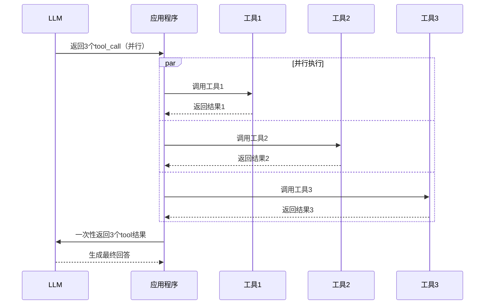

#### 并行工具调用的实现

```python
import asyncio
import json
from typing import List, Dict, Any
from openai import AsyncOpenAI

class ParallelFCReActAgent:
    """支持并行工具调用的 ReAct Agent"""

    def __init__(self, model: str = "gpt-4o-mini"):
        self.client = AsyncOpenAI()
        self.model = model
        self.tools: List[Dict] = []
        self.tool_functions: Dict[str, callable] = {}

    def register_tool(self, name, description, parameters, func):
        self.tools.append({
            "type": "function",
            "function": {"name": name, "description": description, "parameters": parameters}
        })
        self.tool_functions[name] = func

    async def execute_tool_async(self, tool_name: str, tool_args: Dict) -> str:
        """异步执行单个工具"""
        if tool_name not in self.tool_functions:
            return f"错误: 工具 '{tool_name}' 不存在"
        try:
            func = self.tool_functions[tool_name]
            if asyncio.iscoroutinefunction(func):
                result = await func(**tool_args)
            else:
                # 同步函数在线程池中执行
                result = await asyncio.to_thread(func, **tool_args)
            return str(result) if not isinstance(result, str) else result
        except Exception as e:
            return f"工具执行错误: {type(e).__name__}: {str(e)}"

    async def execute_parallel_tools(self, tool_calls: list) -> List[Dict]:
        """并行执行多个工具调用"""
        tasks = []
        for tc in tool_calls:
            tool_name = tc.function.name
            try:
                tool_args = json.loads(tc.function.arguments)
            except json.JSONDecodeError:
                tool_args = {}
            tasks.append(self.execute_tool_async(tool_name, tool_args))

        # 并行执行所有工具
        results = await asyncio.gather(*tasks)

        # 构建 tool 消息列表
        tool_messages = []
        for tc, result in zip(tool_calls, results):
            tool_messages.append({
                "role": "tool",
                "tool_call_id": tc.id,
                "content": result
            })
        return tool_messages

    async def run(self, question: str) -> str:
        messages = [
            {"role": "system", "content": "你是一个有用的助手，可以使用工具回答问题。"},
            {"role": "user", "content": question}
        ]

        for iteration in range(10):
            response = await self.client.chat.completions.create(
                model=self.model,
                messages=messages,
                tools=self.tools,
                tool_choice="auto"
            )
            message = response.choices[0].message
            messages.append(message)

            if not message.tool_calls:
                return message.content

            # 并行执行所有工具调用
            tool_messages = await self.execute_parallel_tools(message.tool_calls)
            messages.extend(tool_messages)

        return "达到最大迭代次数"


# 使用示例
async def main():
    agent = ParallelFCReActAgent()

    # 注册工具（示例）
    async def get_weather(city: str) -> str:
        await asyncio.sleep(0.5)  # 模拟API延迟
        return f"{city}: 晴, 25°C"

    async def get_news(topic: str) -> str:
        await asyncio.sleep(0.8)
        return f"{topic}新闻: ..."

    agent.register_tool("get_weather", "获取天气", {"type":"object","properties":{"city":{"type":"string"}},"required":["city"]}, get_weather)
    agent.register_tool("get_news", "获取新闻", {"type":"object","properties":{"topic":{"type":"string"}},"required":["topic"]}, get_news)

    # 这个问题会触发并行调用（天气和新闻无依赖）
    result = await agent.run("北京今天天气怎么样？最新的AI新闻有哪些？")
    print(result)

# asyncio.run(main())
```

#### 并行调用的注意事项

| 注意事项 | 说明 |
|---------|------|
| **工具间无依赖** | 并行调用的工具之间不能有依赖关系，否则必须串行执行 |
| **tool_call_id 匹配** | 每个 tool_call 有唯一 id，tool 结果消息必须用相同的 tool_call_id 对应 |
| **错误隔离** | 一个工具失败不应影响其他工具的执行，用 try/except 隔离 |
| **超时控制** | 并行执行时要设置整体超时，避免某个慢工具拖慢全部 |
| **结果顺序** | asyncio.gather 返回结果顺序与输入顺序一致，但 tool_call_id 才是正确的匹配依据 |

> ⚠️ **常见坑点 17**：并行工具调用时，如果工具之间有依赖关系（如工具B的输入需要工具A的输出），强行并行会导致参数错误。必须在 Prompt 中引导 LLM："如果工具调用之间有依赖关系，请分多轮调用；如果没有依赖关系，可以在一轮中并行调用。"

> ⚠️ **常见坑点 18**：并行调用时忘记用 tool_call_id 匹配结果。如果简单按顺序匹配，当某个工具调用失败或返回顺序变化时，结果会错乱。必须严格使用 tool_call_id 进行匹配。

---

### 7.4 工具结果处理与错误重试

#### 工具结果的标准化处理

```python
import json
from typing import Any, Dict
from datetime import datetime

class ToolResultHandler:
    """工具结果处理器：标准化、截断、错误处理"""

    def __init__(self, max_result_length: int = 2000):
        self.max_result_length = max_result_length

    def process(self, tool_name: str, result: Any, success: bool = True) -> str:
        """处理工具结果，返回标准化的字符串"""
        if not success:
            return self._format_error(tool_name, result)

        # 序列化
        if isinstance(result, str):
            content = result
        elif isinstance(result, (dict, list)):
            content = json.dumps(result, ensure_ascii=False, indent=2, default=str)
        else:
            content = str(result)

        # 截断
        if len(content) > self.max_result_length:
            content = content[:self.max_result_length] + "\n...（结果已截断）"

        return content

    def _format_error(self, tool_name: str, error: Any) -> str:
        """格式化错误信息"""
        error_str = str(error) if not isinstance(error, str) else error
        return (
            f"【工具执行失败】\n"
            f"工具: {tool_name}\n"
            f"错误类型: {type(error).__name__ if not isinstance(error, str) else 'Error'}\n"
            f"错误信息: {error_str}\n"
            f"建议: 请检查参数是否正确，或尝试其他方法。"
        )

    def add_metadata(self, content: str, tool_name: str,
                     execution_time: float, success: bool) -> str:
        """添加元数据到结果"""
        status = "成功" if success else "失败"
        return (
            f"【{tool_name} - {status} | 耗时 {execution_time:.2f}s】\n"
            f"{content}"
        )
```

#### 工具调用的重试机制

```python
import time
import random
from typing import Any, Callable, Tuple

class ToolRetryHandler:
    """工具调用重试处理器"""

    def __init__(
        self,
        max_retries: int = 2,
        base_delay: float = 1.0,
        max_delay: float = 30.0,
        backoff_factor: float = 2.0,
        retryable_exceptions: Tuple = (TimeoutError, ConnectionError, OSError)
    ):
        self.max_retries = max_retries
        self.base_delay = base_delay
        self.max_delay = max_delay
        self.backoff_factor = backoff_factor
        self.retryable_exceptions = retryable_exceptions

    def execute_with_retry(self, func: Callable, **kwargs) -> Tuple[Any, int]:
        """
        带重试的工具执行
        返回 (结果, 实际尝试次数)
        """
        last_exception = None

        for attempt in range(self.max_retries + 1):
            try:
                result = func(**kwargs)
                return result, attempt + 1
            except self.retryable_exceptions as e:
                last_exception = e
                if attempt < self.max_retries:
                    delay = self._calculate_delay(attempt)
                    print(f"工具调用第 {attempt+1} 次失败: {e}，{delay:.1f}s 后重试...")
                    time.sleep(delay)
                else:
                    print(f"工具调用重试 {self.max_retries} 次后仍失败: {e}")
            except Exception as e:
                # 非可重试异常，直接抛出
                raise e

        raise last_exception

    def _calculate_delay(self, attempt: int) -> float:
        """计算指数退避延迟（带抖动）"""
        delay = min(self.base_delay * (self.backoff_factor ** attempt), self.max_delay)
        # 添加随机抖动，避免惊群效应
        jitter = random.uniform(0, delay * 0.1)
        return delay + jitter


# 使用示例
def api_call_with_retry():
    handler = ToolRetryHandler(max_retries=3, base_delay=1.0)
    result, attempts = handler.execute_with_retry(
        some_external_api, url="https://example.com", timeout=10
    )
    return result
```

> 🔍 **面试高频考点 16**：Function Calling 模式下如何处理工具执行错误？重试策略应该如何设计？答：工具执行错误时，应将错误信息以友好的 Observation 格式返回给 LLM，说明错误类型和建议，让 LLM 决定是修正参数重试还是换用其他工具。重试策略应采用指数退避（exponential backoff）+ 随机抖动（jitter），只对可重试异常（超时、连接错误）重试，对不可重试异常（参数错误、权限不足）直接返回错误。重试次数通常 2-3 次，避免无限重试。

---

> 💡 **深度讲解**：ReAct 与 Function Calling 的结合是现代 Agent 系统的标准架构。经典 ReAct 的纯文本+正则解析方式在原理上更易理解，但在生产环境中稳定性不足——LLM 输出格式的微小偏差都会导致解析失败。Function Calling 将工具调用从"Prompt 技巧"升级为"模型原生能力"，通过在训练阶段引入专门的工具调用格式学习，将调用准确率从 60-85% 提升到 95% 以上。Function Calling 还带来了三个重要能力：①结构化参数（原生支持 JSON 类型，无需手动转换字符串）②并行工具调用（一次返回多个 tool_call，无依赖的工具可并行执行，显著减少延迟）③标准化工具定义（JSON Schema 统一描述工具，便于工具注册和发现）。在实际开发中，应该直接使用 Function Calling 模式，经典 ReAct 只作为学习原理的参考。工具结果处理和错误重试是生产级实现的必要组件——工具执行失败是常态而非异常，必须有完善的错误处理和重试机制，确保 Agent 的鲁棒性。
>
> **📝 精简总结**：
> 1. 经典 ReAct 用纯文本+正则解析，稳定性约 85%；Function Calling 用模型原生结构化输出，稳定性约 98%
> 2. Function Calling 原生支持参数类型、多工具并行、标准化 JSON Schema，是生产环境推荐方案
> 3. 迁移到 FC 模式的关键改动：传入 tools 参数、读取 message.tool_calls、用 tool 角色消息返回结果
> 4. 并行工具调用适用于无依赖的工具，用 asyncio.gather 并行执行，必须用 tool_call_id 匹配结果
> 5. 工具结果需要标准化处理：序列化、截断、添加元数据、错误格式化
> 6. 重试策略采用指数退避+随机抖动，只对可重试异常重试，非可重试异常直接返回错误
> 7. 工具执行失败是常态，必须有完善的错误处理和重试机制确保鲁棒性
>
> **🎯 梯度练习题**：
> - **基础 1**：经典 ReAct 和 Function Calling ReAct 的核心区别是什么？各有什么优缺点？
> - **基础 2**：Function Calling 模式下，工具结果应该用什么角色的消息返回？为什么需要 tool_call_id？
> - **基础 3**：并行工具调用适用于什么场景？有哪些注意事项？
> - **进阶 1**：实现一个智能并行/串行调度器：分析 LLM 返回的多个 tool_call，判断它们之间是否有依赖关系（通过参数匹配），有依赖的串行执行，无依赖的并行执行。
> - **进阶 2**：设计一个工具结果缓存机制：对相同工具+相同参数的调用结果进行缓存，设置合理的过期时间，避免重复调用。需要考虑缓存失效、缓存大小限制等问题。
> - **实战 1**：使用 Function Calling 模式实现一个完整的 ReAct Agent，包含至少 5 个工具（搜索、计算器、天气、数据库查询、发邮件），支持并行调用、错误重试、结果截断、循环检测。要求能处理"帮我调研某公司最新财报并发送邮件总结"类复杂任务。

---

## 八、多步推理与规划增强

### 8.1 ReAct 的多步推理能力

#### 单步 vs 多步推理

ReAct 的核心优势之一是支持多步推理——通过多轮 Thought-Action-Observation 循环，逐步积累信息，最终解决复杂问题。

| 推理类型 | 说明 | 示例 | ReAct 支持 |
|---------|------|------|-----------|
| **单步推理** | 一次工具调用即可解决 | "北京今天天气怎么样？" | ✅ 1 轮循环 |
| **两步推理** | 需要两次工具调用，第二步依赖第一步结果 | "图灵奖得主的年龄是多少？"（先查得主，再查年龄） | ✅ 2 轮循环 |
| **多跳推理** | 需要跨多个信息源，逐步推导 | "A公司的CEO的毕业院校的排名是多少？" | ✅ 3+ 轮循环 |
| **条件推理** | 根据中间结果决定下一步方向 | "如果A则查X，如果B则查Y" | ✅ 动态分支 |
| **迭代优化** | 多次尝试不同方法，逐步逼近答案 | "找到最优解"（尝试→评估→调整→再尝试） | ✅ 迭代循环 |

#### 多步推理的轨迹示例

**任务**："2026年图灵奖得主的主要贡献是什么？他们的年龄分别是多少？谁最年长？"

```text
问题：2026年图灵奖得主的主要贡献是什么？他们的年龄分别是多少？谁最年长？

Thought: 这个问题需要多步推理：
1. 首先搜索2026年图灵奖得主是谁
2. 然后搜索他们的主要贡献
3. 再搜索他们的年龄
4. 最后比较谁最年长
我先搜索图灵奖得主信息。

Action: search_web(query="2026年图灵奖得主")
Observation: 2026年ACM图灵奖授予了Yann LeCun、Yoshua Bengio和Geoffrey Hinton，
表彰他们在深度学习领域的奠基性贡献。

Thought: 我已经知道了三位得主：Yann LeCun、Yoshua Bengio、Geoffrey Hinton。
搜索结果中提到了他们的贡献是"深度学习领域的奠基性贡献"，但不够详细。
我需要搜索更详细的贡献信息，同时可以搜索他们的年龄。
我先搜索详细贡献。

Action: search_web(query="Yann LeCun Yoshua Bengio Geoffrey Hinton 深度学习 主要贡献 CNN 反向传播 GAN")
Observation: Yann LeCun：卷积神经网络(CNN)的发明者，提出了LeNet架构，
在图像识别领域做出了开创性贡献。
Yoshua Bengio：在深度学习理论、序列建模、注意力机制方面有重要贡献，
推动了深度学习的学术发展。
Geoffrey Hinton：反向传播算法的先驱，深度信念网络(DBN)的提出者，
被誉为"深度学习之父"。

Thought: 我已经获取了三位得主的详细贡献。现在需要搜索他们的年龄。
我可以在一个搜索中查询三个人的出生年份。

Action: search_web(query="Yann LeCun 1960 Yoshua Bengio 1964 Geoffrey Hinton 1947 出生年份 年龄")
Observation: Yann LeCun 1960年出生，Yoshua Bengio 1964年出生，
Geoffrey Hinton 1947年出生。当前年份2026年。

Thought: 我已经获取了所有需要的信息：
- 三位得主及贡献：LeCun(CNN)、Bengio(深度学习理论)、Hinton(反向传播/DBN)
- 出生年份：LeCun 1960、Bengio 1964、Hinton 1947
- 2026年年龄：LeCun 66岁、Bengio 62岁、Hinton 79岁
- 最年长的是 Geoffrey Hinton（79岁）
信息充分，可以给出最终答案。

Final Answer:
【2026年图灵奖得主及贡献】
1. Yann LeCun（1960年生，66岁）- 卷积神经网络(CNN)发明者，LeNet架构提出者
2. Yoshua Bengio（1964年生，62岁）- 深度学习理论、序列建模、注意力机制专家
3. Geoffrey Hinton（1947年生，79岁）- 反向传播算法先驱，深度信念网络提出者，"深度学习之父"

【最年长得主】Geoffrey Hinton，79岁。
三人被誉为"深度学习三巨头"，因在深度学习领域的奠基性贡献共同获奖。
```

这个示例展示了 4 轮循环的多步推理：搜索得主→搜索贡献→搜索年龄→整合答案。每一步都基于前一步的 Observation 决定下一步。

---

### 8.2 ReAct 与规划结合（Plan-and-ReAct）

#### 先规划再执行的增强模式

纯 ReAct 的"走一步看一步"在复杂任务中容易迷失方向。Plan-and-ReAct 结合了 Plan-and-Execute 的全局规划和 ReAct 的动态执行：先制定整体计划，然后按计划逐步执行，执行过程中可以动态调整。

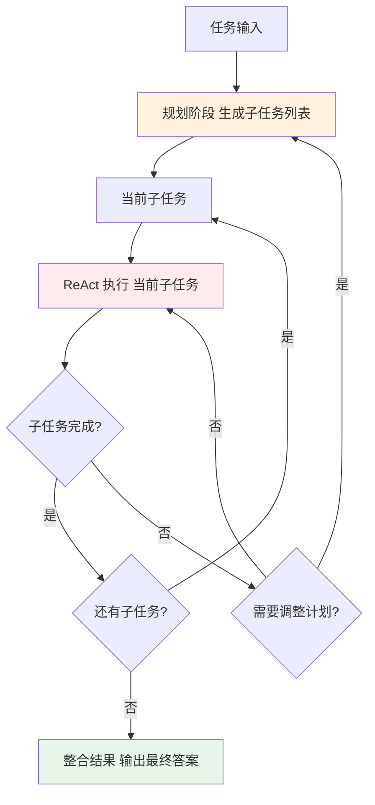

#### Plan-and-ReAct 的实现

```python
"""
Plan-and-ReAct：先规划再执行的增强 ReAct 模式
"""
from typing import List, Dict
from openai import OpenAI
import json

client = OpenAI()

class PlanAndReActAgent:
    def __init__(self, model: str = "gpt-4o-mini", max_iterations_per_task: int = 5):
        self.model = model
        self.max_iterations_per_task = max_iterations_per_task
        self.tools: List[Dict] = []
        self.tool_functions: Dict[str, callable] = {}

    def register_tool(self, name, description, parameters, func):
        self.tools.append({
            "type": "function",
            "function": {"name": name, "description": description, "parameters": parameters}
        })
        self.tool_functions[name] = func

    def plan(self, task: str) -> List[str]:
        """规划阶段：将任务分解为子任务"""
        prompt = f"""你是一个任务规划专家。请将以下任务分解为有序的子任务列表。

任务：{task}

可用工具：{', '.join(t['function']['name'] for t in self.tools)}

请输出 JSON 格式的子任务列表：
{{"subtasks": ["子任务1", "子任务2", "子任务3"]}}

要求：
- 子任务按执行顺序排列
- 每个子任务明确可执行
- 子任务数量 2-8 个
- 子任务之间可以有依赖关系"""

        response = client.chat.completions.create(
            model=self.model,
            messages=[{"role": "user", "content": prompt}],
            temperature=0
        )
        try:
            result = json.loads(response.choices[0].message.content)
            return result.get("subtasks", [task])
        except json.JSONDecodeError:
            return [task]

    def execute_subtask(self, subtask: str, context: str) -> str:
        """用 ReAct 执行单个子任务"""
        messages = [
            {"role": "system", "content": f"你是一个任务执行者。请完成以下子任务。\n\n已有上下文：\n{context}"},
            {"role": "user", "content": f"子任务：{subtask}"}
        ]

        for iteration in range(self.max_iterations_per_task):
            response = client.chat.completions.create(
                model=self.model,
                messages=messages,
                tools=self.tools,
                tool_choice="auto"
            )
            message = response.choices[0].message
            messages.append(message)

            if not message.tool_calls:
                return message.content

            for tc in message.tool_calls:
                tool_name = tc.function.name
                try:
                    args = json.loads(tc.function.arguments)
                except json.JSONDecodeError:
                    args = {}
                if tool_name in self.tool_functions:
                    try:
                        result = self.tool_functions[tool_name](**args)
                        content = str(result)
                    except Exception as e:
                        content = f"错误: {e}"
                else:
                    content = f"错误: 工具不存在"
                messages.append({"role": "tool", "tool_call_id": tc.id, "content": content})

        return "子任务执行超时"

    def replan(self, completed: List[str], remaining: List[str], context: str) -> List[str]:
        """重新规划：根据执行结果调整剩余计划"""
        prompt = f"""根据已完成的子任务结果，评估是否需要调整剩余计划。

已完成的子任务：
{chr(10).join(f'- {s}' for s in completed)}

执行上下文：
{context[:2000]}

剩余子任务：
{chr(10).join(f'- {s}' for s in remaining)}

如果原计划合理，保持不变；如果需要调整，输出新的子任务列表。
输出 JSON 格式：{{"subtasks": [...]}}"""

        response = client.chat.completions.create(
            model=self.model,
            messages=[{"role": "user", "content": prompt}],
            temperature=0
        )
        try:
            result = json.loads(response.choices[0].message.content)
            return result.get("subtasks", remaining)
        except json.JSONDecodeError:
            return remaining

    def run(self, task: str, replan_interval: int = 3) -> str:
        """完整执行：规划→执行→重规划→整合"""
        print("=== 规划阶段 ===")
        subtasks = self.plan(task)
        for i, st in enumerate(subtasks, 1):
            print(f"{i}. {st}")

        print("\n=== 执行阶段 ===")
        context = ""
        completed = []

        for i, subtask in enumerate(subtasks):
            print(f"\n执行子任务 {i+1}/{len(subtasks)}: {subtask}")
            result = self.execute_subtask(subtask, context)
            print(f"结果: {result[:150]}...")
            context += f"\n子任务{i+1}: {subtask}\n结果: {result}\n"
            completed.append(subtask)

            # 定期重规划
            if (i + 1) % replan_interval == 0 and i < len(subtasks) - 1:
                print("\n=== 重规划 ===")
                remaining = subtasks[i+1:]
                subtasks[i+1:] = self.replan(completed, remaining, context)

        print("\n=== 整合结果 ===")
        final_prompt = f"""请根据以下所有子任务的执行结果，给出最终答案。

原始任务：{task}

执行结果：
{context}

请给出完整、结构化的最终答案："""

        response = client.chat.completions.create(
            model=self.model,
            messages=[{"role": "user", "content": final_prompt}],
            temperature=0
        )
        return response.choices[0].message.content
```

> 🔍 **面试高频考点 17**：Plan-and-ReAct 相比纯 ReAct 的优势是什么？适用于什么场景？答：Plan-and-ReAct 先制定整体计划再逐步执行，相比纯 ReAct 的"走一步看一步"，具有更好的全局视野和任务分解能力，在多步骤复杂任务中更不容易迷失方向。适用于调研报告、多阶段项目、复杂分析等需要全局规划的任务。但对于简单任务，规划的 overhead 过高，纯 ReAct 更高效。

---

### 8.3 思维树（Tree of Thoughts）与 ReAct 结合

#### 思维树的概念

**思维树（Tree of Thoughts, ToT）** 由 Yao 等人于 2023 年 5 月提出，核心思想是将推理过程建模为树结构：每个节点是一个思维状态，分支代表不同的推理路径，可以探索多条路径、评估每条路径的价值、选择最优路径继续探索。

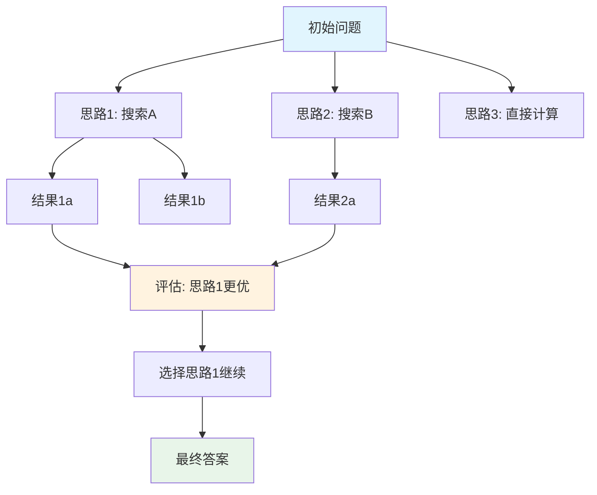

#### ToT + ReAct 的实现思路

```python
"""
Tree of Thoughts + ReAct 结合的简化实现
探索多条推理路径，评估后选择最优路径
"""
from typing import List, Dict, Optional
from openai import OpenAI
import json

client = OpenAI()

class ThoughtNode:
    """思维树节点"""
    def __init__(self, thought: str, action: Dict = None,
                 observation: str = None, parent=None):
        self.thought = thought
        self.action = action
        self.observation = observation
        self.parent = parent
        self.children: List[ThoughtNode] = []
        self.value: float = 0.0  # 评估价值

    def get_path(self) -> List['ThoughtNode']:
        """获取从根到当前节点的路径"""
        path = []
        node = self
        while node:
            path.append(node)
            node = node.parent
        return list(reversed(path))

    def get_scratchpad(self) -> str:
        """从路径构建 Scratchpad"""
        lines = []
        for node in self.get_path():
            if node.thought:
                lines.append(f"Thought: {node.thought}")
            if node.action:
                lines.append(f"Action: {node.action}")
            if node.observation:
                lines.append(f"Observation: {node.observation}")
        return "\n".join(lines)


class ToTReActAgent:
    """Tree of Thoughts + ReAct Agent"""

    def __init__(self, model: str = "gpt-4o-mini",
                 branching_factor: int = 3,
                 max_depth: int = 5,
                 beam_width: int = 2):
        self.model = model
        self.branching_factor = branching_factor  # 每步探索的分支数
        self.max_depth = max_depth
        self.beam_width = beam_width  # 保留的最优路径数
        self.tools: List[Dict] = []
        self.tool_functions: Dict[str, callable] = {}

    def register_tool(self, name, description, parameters, func):
        self.tools.append({
            "type": "function",
            "function": {"name": name, "description": description, "parameters": parameters}
        })
        self.tool_functions[name] = func

    def generate_thoughts(self, node: ThoughtNode, question: str) -> List[str]:
        """为当前节点生成多个可能的下一步思维"""
        scratchpad = node.get_scratchpad()
        prompt = f"""你是一个 ReAct Agent。请针对以下问题，提出 {self.branching_factor} 种不同的下一步推理思路。

问题：{question}

已有推理轨迹：
{scratchpad}

请输出 {self.branching_factor} 种不同的 Thought，每种一行，格式为：
1. Thought: ...
2. Thought: ...
3. Thought: ...

要求：
- 每种思路应该不同（探索不同方向）
- 每种思路应该具体可执行（说明下一步做什么）
- 考虑多种可能性（搜索、计算、换角度等）"""

        response = client.chat.completions.create(
            model=self.model,
            messages=[{"role": "user", "content": prompt}],
            temperature=0.7  # 较高温度增加多样性
        )
        text = response.choices[0].message.content
        # 解析多个 Thought
        thoughts = []
        for line in text.strip().split("\n"):
            line = line.strip()
            if line and line[0].isdigit():
                thought = line.split(".", 1)[-1].strip()
                if thought.startswith("Thought:"):
                    thought = thought[8:].strip()
                thoughts.append(thought)
        return thoughts[:self.branching_factor]

    def evaluate_node(self, node: ThoughtNode, question: str) -> float:
        """评估节点的价值（0-1分）"""
        scratchpad = node.get_scratchpad()
        prompt = f"""请评估以下推理路径的价值，即它有多大可能最终解决问题。

问题：{question}

推理路径：
{scratchpad}

请输出 0 到 1 之间的分数（保留2位小数）：
- 0.0-0.3：方向错误，不太可能解决问题
- 0.4-0.6：有一定可能，但需要更多探索
- 0.7-0.8：很有希望，方向正确
- 0.9-1.0：已经解决或非常接近解决

只输出分数数字。"""

        response = client.chat.completions.create(
            model=self.model,
            messages=[{"role": "user", "content": prompt}],
            temperature=0
        )
        try:
            score = float(response.choices[0].message.content.strip())
            return max(0.0, min(1.0, score))
        except ValueError:
            return 0.5

    def execute_action(self, thought: str, question: str,
                       parent_scratchpad: str) -> Optional[Dict]:
        """根据 Thought 执行 Action，返回 (action, observation)"""
        prompt = f"""你是一个 ReAct Agent。基于以下思考，决定下一步 Action。

问题：{question}
已有推理：{parent_scratchpad}
当前思考：{thought}

请输出 Action，格式为：
Action: 工具名(参数)

或者如果信息已足够，输出：
Final Answer: 答案"""

        response = client.chat.completions.create(
            model=self.model,
            messages=[{"role": "user", "content": prompt}],
            tools=self.tools,
            tool_choice="auto",
            temperature=0
        )
        message = response.choices[0].message

        if not message.tool_calls:
            return None  # 没有 Action，可能是 Final Answer

        tc = message.tool_calls[0]
        tool_name = tc.function.name
        try:
            args = json.loads(tc.function.arguments)
        except json.JSONDecodeError:
            args = {}

        # 执行工具
        if tool_name in self.tool_functions:
            try:
                result = self.tool_functions[tool_name](**args)
                observation = str(result)
            except Exception as e:
                observation = f"错误: {e}"
        else:
            observation = "错误: 工具不存在"

        return {"action": f"{tool_name}({args})", "observation": observation}

    def run(self, question: str) -> str:
        """ToT + ReAct 主循环：Beam Search 探索思维树"""
        # 初始化根节点
        root = ThoughtNode(thought=f"开始解决问题：{question}")
        current_nodes = [root]

        for depth in range(self.max_depth):
            print(f"\n=== 深度 {depth + 1}/{self.max_depth} ===")
            next_nodes = []

            for node in current_nodes:
                # 为每个节点生成多个 Thought
                thoughts = self.generate_thoughts(node, question)
                print(f"节点生成 {len(thoughts)} 个思路")

                for thought in thoughts:
                    # 执行 Action
                    result = self.execute_action(thought, question, node.get_scratchpad())
                    if result is None:
                        # Final Answer，直接返回
                        print("找到 Final Answer！")
                        return self._extract_final_answer(node, thought, question)

                    child = ThoughtNode(
                        thought=thought,
                        action=result["action"],
                        observation=result["observation"],
                        parent=node
                    )
                    child.value = self.evaluate_node(child, question)
                    node.children.append(child)
                    next_nodes.append(child)
                    print(f"  思路价值: {child.value:.2f}")

            # Beam Search：保留价值最高的 N 个节点
            next_nodes.sort(key=lambda n: n.value, reverse=True)
            current_nodes = next_nodes[:self.beam_width]
            print(f"保留 Top {self.beam_width} 路径，最高价值: {current_nodes[0].value:.2f}")

            # 如果最优节点价值很高，提前终止
            if current_nodes[0].value > 0.9:
                print("最优路径价值 > 0.9，提前终止")
                break

        # 从最优路径生成最终答案
        best_node = current_nodes[0]
        return self._generate_final_from_path(best_node, question)

    def _extract_final_answer(self, node, thought, question):
        return thought

    def _generate_final_from_path(self, node, question):
        scratchpad = node.get_scratchpad()
        prompt = f"""基于以下推理轨迹，给出最终答案。

问题：{question}

推理轨迹：
{scratchpad}

Final Answer:"""
        response = client.chat.completions.create(
            model=self.model,
            messages=[{"role": "user", "content": prompt}],
            temperature=0
        )
        return response.choices[0].message.content
```

> ⚠️ **常见坑点 19**：ToT 的分支数和深度设置过大导致成本爆炸。ToT 每增加一个分支，就需要多一次 LLM 调用（生成 Thought）+ 一次工具调用 + 一次评估调用。如果 branching_factor=3, max_depth=5，最坏情况需要 3^5=243 条路径，成本极高。实际使用中 branching_factor 通常 2-3，max_depth 3-5，并配合 Beam Search 限制同时探索的路径数。

> ⚠️ **常见坑点 20**：评估节点价值时使用同一个 LLM，导致评估偏差。LLM 倾向于给更长、更复杂的推理路径更高的评价，即使方向是错的。最佳实践是：①用更强的模型做评估 ②评估时明确要求"只看解决问题的可能性，不看推理长度" ③对评估结果做校准。

---

> 💡 **深度讲解**：多步推理是 ReAct 的核心能力，也是其区别于单轮问答的关键。纯 ReAct 的"走一步看一步"在简单任务中高效灵活，但在复杂任务中容易迷失方向——LLM 可能在某个局部最优解上打转，或者忽略了更优的推理路径。规划增强（Plan-and-ReAct）通过先制定全局计划来解决这个问题，确保 Agent 不会遗漏重要步骤。思维树（ToT）则更进一步，不仅规划一条路径，而是同时探索多条推理路径，评估每条路径的价值，用 Beam Search 保留最优路径，这在需要创造性思维或多解问题中特别有效。但这些增强范式都有一个共同的代价——成本。Plan-and-ReAct 需要额外的规划 LLM 调用，ToT 的成本是纯 ReAct 的数倍甚至数十倍。在实际应用中，应该根据任务复杂度选择合适的增强级别：简单任务用纯 ReAct，中等复杂任务用 Plan-and-ReAct，只有高难度推理任务才用 ToT。这也是"够用就好"原则在推理范式选择中的体现。
>
> **📝 精简总结**：
> 1. ReAct 支持单步、两步、多跳、条件、迭代优化等多种多步推理类型
> 2. 多步推理的关键是每步 Thought 都基于前一步的 Observation，逐步积累信息
> 3. Plan-and-ReAct 先规划全局计划再逐步执行，适合多步骤复杂任务，可中途重规划
> 4. 思维树（ToT）同时探索多条推理路径，评估价值后用 Beam Search 保留最优路径
> 5. ToT + ReAct 结合：每个树节点是一个 ReAct 状态，分支代表不同推理方向
> 6. 增强范式的代价是成本：Plan-and-ReAct 需要额外规划调用，ToT 成本是纯 ReAct 的数倍
> 7. 选择原则：简单任务纯 ReAct，中等任务 Plan-and-ReAct，高难度任务才用 ToT
>
> **🎯 梯度练习题**：
> - **基础 1**：纯 ReAct 的多步推理是如何工作的？每一步的输入是什么？
> - **基础 2**：Plan-and-ReAct 相比纯 ReAct 的优势和代价分别是什么？
> - **基础 3**：思维树（ToT）的核心思想是什么？Beam Search 在其中起什么作用？
> - **进阶 1**：设计一个动态规划深度调整器：在 Plan-and-ReAct 执行过程中，如果某个子任务执行顺利（工具调用成功率高、Observation 信息丰富），则减少后续子任务的 max_iterations；如果执行困难，则增加预算。
> - **进阶 2**：ToT 的评估函数质量直接决定 Beam Search 的效果。设计一个更精细的评估 Prompt，从"信息增益、方向正确性、剩余距离、风险"四个维度综合评估节点价值，并输出加权分数。
> - **实战 1**：实现一个混合推理 Agent：根据任务复杂度自动选择推理范式——简单问题用纯 ReAct（1-3步），中等问题用 Plan-and-ReAct，复杂问题用 ToT。要求包含任务分类器、三种范式的实现、统一的输出接口。

---


## 九、ReAct 失败模式与优化策略

### 9.1 常见失败模式分类

ReAct Agent 在实际运行中可能遇到各种失败模式。理解这些失败模式的根因和表现，是优化 Agent 的前提。

| 失败模式 | 表现 | 根因 | 严重程度 |
|---------|------|------|---------|
| **工具选择错误** | 选了不合适的工具 | 工具描述不清晰、工具数量过多、LLM 能力不足 | 高 |
| **参数构造错误** | 参数名/类型/值错误 | 参数描述不清、缺少示例、LLM 理解偏差 | 高 |
| **无限循环** | 重复调用相同工具 | Observation 无新信息、缺少循环检测、Prompt 引导不足 | 高 |
| **不调用工具** | 直接编造答案 | 工具描述不吸引、Prompt 未强制、LLM 过于自信 | 中 |
| **过早终止** | 信息不足就输出 Final Answer | 终止条件引导不足、LLM 急于结束 | 中 |
| **过晚终止** | 信息足够还继续调用工具 | 终止条件不明确、缺少"信息充分"判断 | 低 |
| **上下文溢出** | API 报错 context length exceeded | Observation 过长、步数过多、缺少截断 | 高 |
| **解析失败** | 无法解析 Action/tool_call | 格式不规范、正则不匹配、模型输出异常 | 中 |
| **工具执行失败** | 工具返回错误 | 工具 bug、外部 API 不可用、参数不合法 | 中 |
| **推理逻辑错误** | Thought 逻辑混乱 | LLM 能力不足、任务过于复杂、缺少引导 | 高 |
| **幻觉** | 编造不存在的事实 | 未经验证就输出、缺少事实验证机制 | 高 |
| **任务理解偏差** | 答非所问 | Prompt 不清晰、LLM 理解偏差 | 中 |

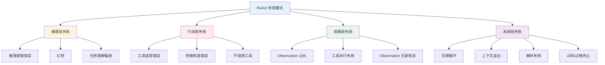

---

### 9.2 工具选择错误的优化

#### 根因分析

工具选择错误是 ReAct 最常见的失败模式之一。LLM 可能选择了错误的工具，或者在多个相似工具之间犹豫不决。

**常见根因**：
1. **工具描述模糊**：描述只说了"做什么"，没说"何时用"和"何时不用"
2. **工具描述重叠**：多个工具的功能描述相似，LLM 难以区分
3. **工具数量过多**：一次提供 20+ 个工具，LLM 注意力分散
4. **缺少使用示例**：没有 few-shot 示例展示工具的正确使用场景
5. **LLM 能力不足**：弱模型（如 gpt-3.5）在复杂工具选择上表现差

#### 优化策略

```python
"""
工具选择错误的优化策略
"""

# 策略1：优化工具描述，明确使用场景和边界
TOOL_DESCRIPTION_TEMPLATE = """{tool_name}
功能：{what_it_does}
何时使用：{when_to_use}
何时不使用：{when_not_to_use}
参数说明：{param_descriptions}
返回格式：{return_format}
使用示例：{example}"""

# 好的工具描述示例
GOOD_SEARCH_DESC = {
    "name": "search_web",
    "description": (
        "搜索互联网获取实时信息。"
        "当需要回答最新事件、事实核查、获取训练数据（2025年）之后的信息时使用。"
        "不要用于数学计算（用calculator）、天气查询（用get_weather）。"
    ),
    "parameters": {
        "type": "object",
        "properties": {
            "query": {
                "type": "string",
                "description": "搜索关键词，应简洁明确，如'2026图灵奖得主'。不要用完整句子作为查询。"
            }
        },
        "required": ["query"]
    }
}

# 策略2：动态工具加载，减少同时提供的工具数量
class DynamicToolLoader:
    """根据用户查询动态选择相关工具"""

    def __init__(self, all_tools: list, tool_keywords: dict):
        self.all_tools = all_tools
        self.tool_keywords = tool_keywords  # {tool_name: [keyword1, keyword2]}

    def get_relevant_tools(self, query: str, top_k: int = 8) -> list:
        """根据查询关键词选择相关工具"""
        query_lower = query.lower()
        scored_tools = []

        for tool in self.all_tools:
            name = tool["function"]["name"]
            keywords = self.tool_keywords.get(name, [])
            score = sum(1 for kw in keywords if kw.lower() in query_lower)
            # 描述匹配也加分
            desc = tool["function"].get("description", "")
            score += sum(1 for kw in keywords if kw.lower() in desc.lower())
            scored_tools.append((score, tool))

        # 按分数排序，取 top_k
        scored_tools.sort(key=lambda x: x[0], reverse=True)
        relevant = [tool for score, tool in scored_tools[:top_k] if score > 0]

        # 如果没有匹配到，返回所有工具（降级）
        if not relevant:
            return self.all_tools[:top_k]
        return relevant

# 策略3：工具分组，按类别提供
TOOL_CATEGORIES = {
    "信息检索": ["search_web", "search_knowledge_base", "get_weather"],
    "计算处理": ["calculator", "code_executor", "data_analyzer"],
    "通信操作": ["send_email", "send_message", "create_calendar_event"],
    "文件操作": ["read_file", "write_file", "list_directory"],
}

def get_tools_by_category(category: str) -> list:
    """按类别获取工具"""
    tool_names = TOOL_CATEGORIES.get(category, [])
    return [t for t in ALL_TOOLS if t["function"]["name"] in tool_names]

# 策略4：使用更强的模型做工具选择
def route_to_model(task_complexity: str) -> str:
    """根据任务复杂度选择模型"""
    if task_complexity == "simple":
        return "gpt-4o-mini"  # 简单任务用小模型
    elif task_complexity == "medium":
        return "gpt-4o-mini"
    else:
        return "gpt-4o"  # 复杂工具选择用大模型
```

> 🔍 **面试高频考点 18**：ReAct Agent 工具选择错误的常见原因有哪些？如何优化？答：常见原因：①工具描述模糊（只说做什么，不说何时用）②工具描述重叠（多个工具功能相似）③工具数量过多（注意力分散）④缺少使用示例 ⑤LLM 能力不足。优化策略：①优化工具描述，明确使用场景和边界 ②动态工具加载，根据查询预选相关工具 ③工具分组，按类别提供 ④添加 few-shot 示例 ⑤复杂任务用更强的模型。

---

### 9.3 无限循环的优化

#### 循环的根因

无限循环是 ReAct 最危险的失败模式——它会持续消耗 token 和时间，直到达到上限。

**常见根因**：
1. **Observation 无新信息**：工具返回的结果与之前相同或高度相似，LLM 无法推进
2. **参数错误反复重试**：LLM 反复用错误的参数调用工具，每次都返回相同错误
3. **工具不存在**：LLM 反复调用未注册的工具
4. **思维定式**：LLM 陷入某种思维模式，反复尝试相同思路
5. **缺少终止引导**：Prompt 中没有明确"何时应该停止"
6. **任务确实无法完成**：工具能力不足以完成任务，但 LLM 不知道放弃

#### 优化策略

```python
"""
无限循环的优化策略
"""

# 策略1：多层循环检测
class MultiLayerLoopDetector:
    """多层循环检测器"""

    def __init__(self):
        self.exact_repeat_threshold = 3
        self.semantic_similarity_threshold = 0.85
        self.error_repeat_threshold = 3
        self.no_progress_threshold = 5

    def detect(self, steps: list) -> dict:
        """综合检测多种循环模式"""
        detections = []

        # 层1：精确重复检测
        if self._detect_exact_repeat(steps):
            detections.append({
                "type": "exact_repeat",
                "severity": "high",
                "message": "检测到完全相同的工具调用重复"
            })

        # 层2：语义重复检测
        if self._detect_semantic_repeat(steps):
            detections.append({
                "type": "semantic_repeat",
                "severity": "medium",
                "message": "检测到语义相似的工具调用重复"
            })

        # 层3：错误重复检测
        if self._detect_error_repeat(steps):
            detections.append({
                "type": "error_repeat",
                "severity": "high",
                "message": "检测到相同的工具错误重复"
            })

        # 层4：无进展检测
        if self._detect_no_progress(steps):
            detections.append({
                "type": "no_progress",
                "severity": "medium",
                "message": "检测到多步无实质进展"
            })

        return {"is_looping": len(detections) > 0, "detections": detections}

    def _detect_exact_repeat(self, steps):
        if len(steps) < self.exact_repeat_threshold:
            return False
        recent = []
        for s in steps[-self.exact_repeat_threshold:]:
            if s.get("action"):
                recent.append(f"{s['action']['tool_name']}:{s['action']['tool_args']}")
        return len(recent) >= self.exact_repeat_threshold and len(set(recent)) == 1

    def _detect_semantic_repeat(self, steps):
        from difflib import SequenceMatcher
        if len(steps) < 3:
            return False
        recent_queries = []
        for s in steps[-3:]:
            if s.get("action") and s["action"]["tool_args"]:
                recent_queries.append(str(list(s["action"]["tool_args"].values())[0]))
        if len(recent_queries) < 2:
            return False
        similarities = [
            SequenceMatcher(None, recent_queries[i], recent_queries[i+1]).ratio()
            for i in range(len(recent_queries)-1)
        ]
        return all(s > self.semantic_similarity_threshold for s in similarities)

    def _detect_error_repeat(self, steps):
        if len(steps) < self.error_repeat_threshold:
            return False
        recent_errors = []
        for s in steps[-self.error_repeat_threshold:]:
            if s.get("observation") and not s["observation"].get("success", True):
                recent_errors.append(s["observation"].get("error", ""))
        return len(recent_errors) >= self.error_repeat_threshold and len(set(recent_errors)) == 1

    def _detect_no_progress(self, steps):
        """检测多步无实质进展（Observation 信息量没有增加）"""
        if len(steps) < self.no_progress_threshold:
            return False
        # 简单实现：检查最近 N 步的 Observation 长度是否都很短（可能是错误或空结果）
        recent_obs_lengths = [
            len(s.get("observation", {}).get("content", ""))
            for s in steps[-self.no_progress_threshold:]
            if s.get("observation")
        ]
        if not recent_obs_lengths:
            return False
        avg_length = sum(recent_obs_lengths) / len(recent_obs_lengths)
        return avg_length < 50  # 平均 Observation 长度小于50字符，可能没有实质进展


# 策略2：智能干预 - 检测到循环后主动引导
class LoopInterceptor:
    """循环拦截器"""

    def __init__(self, max_interventions: int = 2):
        self.max_interventions = max_interventions
        self.intervention_count = 0

    def intervene(self, detections: list, steps: list) -> tuple:
        """生成干预消息"""
        if not detections:
            return "", False

        self.intervention_count += 1

        if self.intervention_count > self.max_interventions:
            return ("【系统】多次检测到循环且干预无效，强制终止。请基于已有信息给出最佳答案。", True)

        messages = []
        for d in detections:
            if d["type"] == "exact_repeat":
                messages.append(
                    "【系统提示】你在重复调用相同的工具和参数，这不会获得新信息。"
                    "请尝试：①换用不同的参数或查询方式 ②使用其他工具 ③如果信息已足够，直接输出 Final Answer。"
                )
            elif d["type"] == "error_repeat":
                messages.append(
                    "【系统提示】你反复遇到相同的工具错误。请仔细检查："
                    "①参数名称和类型是否正确 ②工具是否存在 ③是否需要换用其他方法。"
                    "如果该工具确实无法使用，请如实说明并尝试其他途径。"
                )
            elif d["type"] == "no_progress":
                messages.append(
                    "【系统提示】最近几步没有获得实质进展。请重新评估："
                    "①当前方向是否正确 ②是否需要换一种思路 ③是否可以基于已有信息给出答案。"
                    "不要在没有进展的方向上继续浪费时间。"
                )

        return "\n\n".join(messages), False


# 策略3：在 Prompt 中明确禁止循环
LOOP_PREVENTION_RULES = """
【循环预防规则】
1. 不要重复调用相同的工具和参数，如果第一次没有获得有用信息，换一种方式
2. 如果工具返回错误，仔细分析错误原因，修正后再重试，不要用相同参数反复调用
3. 如果连续 2 次调用同一工具都没有获得新信息，换用其他工具或方法
4. 如果你发现自己在原地打转，停下来重新思考，可能需要换一个完全不同的思路
5. 如果经过多次尝试仍无法获取所需信息，如实告知用户，不要无限尝试
"""
```

> ⚠️ **常见坑点 21**：循环检测只检测"完全相同的工具调用"，忽略了"语义相同但参数不同"的循环。比如 LLM 先用"北京天气"搜索，再用"Beijing weather"搜索，再用"北京市今天气温"搜索——参数不同但语义完全相同，简单的精确匹配检测不到。必须加入语义相似度检测。

> ⚠️ **常见坑点 22**：干预消息只是简单地说"不要循环"，没有给出具体的替代方案。LLM 收到"不要循环"的提示后，可能不知道该怎么做，继续在原地打转。好的干预消息应该给出具体的替代建议：换参数、换工具、换思路、或者直接输出答案。

---

### 9.4 幻觉的优化

#### 幻觉在 ReAct 中的表现

幻觉（Hallucination）是指 LLM 编造不存在的事实、数据、引用。在 ReAct 中，幻觉可能出现在：
1. **Thought 中的幻觉**：推理过程中编造不存在的事实
2. **Action 中的幻觉**：调用不存在的工具，或编造工具参数
3. **Final Answer 中的幻觉**：最终答案中编造未经验证的事实

#### 优化策略

```python
"""
幻觉的优化策略
"""

# 策略1：强制事实验证 - 事实性问题必须先搜索
FACT_VERIFICATION_PROMPT = """
【事实验证规则】
1. 对于涉及具体事实的问题（日期、数据、事件、人物、地点），必须先通过工具验证
2. 不要凭记忆回答事实性问题，尤其是 2025 年之后的信息
3. 如果搜索结果不明确，说明"根据搜索结果..."，不要编造确定的答案
4. 引用数据时必须说明来源（来自哪个工具的返回结果）
5. 如果无法验证某个事实，明确说明"该信息无法验证"，不要编造
"""

# 策略2：答案溯源 - 最终答案中的每个事实都要能追溯到 Observation
class AnswerVerifier:
    """答案溯源验证器"""

    def verify(self, final_answer: str, observations: list) -> dict:
        """
        验证最终答案中的事实是否都能在 Observation 中找到
        返回验证结果
        """
        # 简单实现：检查答案中的关键数字和专有名词是否出现在 Observation 中
        import re

        # 提取答案中的数字
        numbers_in_answer = re.findall(r'\d+(?:\.\d+)?', final_answer)
        # 提取答案中的日期
        dates_in_answer = re.findall(r'\d{4}年\d{1,2}月\d{1,2}日|\d{4}-\d{2}-\d{2}', final_answer)
        # 合并所有 Observation 文本
        all_obs_text = " ".join(
            obs.get("content", "") for obs in observations if obs
        )

        # 检查每个数字是否在 Observation 中出现
        unverified_numbers = [
            n for n in numbers_in_answer
            if n not in all_obs_text
        ]
        unverified_dates = [
            d for d in dates_in_answer
            if d not in all_obs_text
        ]

        return {
            "is_verified": len(unverified_numbers) == 0 and len(unverified_dates) == 0,
            "unverified_numbers": unverified_numbers,
            "unverified_dates": unverified_dates,
            "total_numbers": len(numbers_in_answer),
            "total_dates": len(dates_in_answer)
        }

# 策略3：置信度标注 - 让 LLM 标注答案中各部分的置信度
CONFIDENCE_ANNOTATION_PROMPT = """
【置信度标注】
在给出最终答案时，请对每个关键事实标注置信度：
- [已验证]：该事实来自工具返回结果，可以确认
- [高置信]：该事实基于可靠推理，很可能正确
- [中置信]：该事实基于部分信息，可能存在不确定性
- [低置信]：该信息无法验证，仅供参考

示例：
Final Answer:
- 2026年图灵奖得主是 Yann LeCun 等三人 [已验证]
- 他们的主要贡献是深度学习 [已验证]
- Yann LeCun 出生于法国 [高置信]
- 三人中最年长的是 Hinton [中置信，年龄数据来自搜索但未完全确认]
"""

# 策略4：多轮验证 - 对关键事实进行二次验证
def verify_key_fact(fact: str, search_tool) -> bool:
    """对关键事实进行二次验证"""
    # 用不同的关键词重新搜索
    verification_query = f"{fact} 验证 确认"
    result = search_tool(query=verification_query)
    # 检查搜索结果中是否包含该事实
    return fact.lower() in result.lower()
```

> 🔍 **面试高频考点 19**：ReAct Agent 如何减少幻觉？有哪些具体策略？答：减少幻觉的策略包括：①强制事实验证——事实性问题必须先通过工具验证，不要凭记忆回答 ②答案溯源——最终答案中的每个事实都要能追溯到 Observation ③置信度标注——让 LLM 标注答案中各部分的置信度（已验证/高置信/中置信/低置信）④多轮验证——对关键事实进行二次验证 ⑤在 Prompt 中明确禁止编造，要求无法验证时如实说明。

---

### 9.5 综合优化框架

```python
"""
ReAct Agent 综合优化框架
整合所有优化策略
"""
from typing import List, Dict, Optional
from dataclasses import dataclass, field

@dataclass
class OptimizationConfig:
    """优化配置"""
    # 工具选择优化
    enable_dynamic_tool_loading: bool = True
    max_tools_per_request: int = 8
    enable_tool_category_routing: bool = True

    # 循环优化
    enable_loop_detection: bool = True
    loop_detection_threshold: int = 3
    max_loop_interventions: int = 2

    # 幻觉优化
    enable_fact_verification: bool = True
    enable_confidence_annotation: bool = False
    enable_answer_source_tracing: bool = True

    # 上下文优化
    enable_observation_truncation: bool = True
    max_observation_tokens: int = 1000
    enable_history_summarization: bool = True
    recent_steps_full: int = 3

    # 终止优化
    enable_early_stopping: bool = True
    enable_information_sufficiency_check: bool = True


class OptimizedReActAgent:
    """综合优化的 ReAct Agent"""

    def __init__(self, config: OptimizationConfig = None):
        self.config = config or OptimizationConfig()
        self.loop_detector = MultiLayerLoopDetector()
        self.loop_interceptor = LoopInterceptor(
            max_interventions=self.config.max_loop_interventions
        )
        self.answer_verifier = AnswerVerifier()
        self.intervention_count = 0

    def run(self, question: str) -> dict:
        """运行优化后的 ReAct 循环"""
        trace = []
        messages = self._init_messages(question)

        for iteration in range(15):
            # 1. 动态工具加载
            tools = self._get_relevant_tools(question, trace)

            # 2. 调用 LLM
            response = self._call_llm(messages, tools)
            message = response.choices[0].message
            messages.append(message)

            # 3. 检查 Final Answer
            if not message.tool_calls:
                final_answer = message.content
                # 答案验证
                verification = self._verify_answer(final_answer, trace)
                return {
                    "answer": final_answer,
                    "trace": trace,
                    "verification": verification,
                    "iterations": iteration + 1
                }

            # 4. 执行工具
            for tc in message.tool_calls:
                tool_result = self._execute_tool(tc)
                messages.append(tool_result)
                trace.append({
                    "iteration": iteration + 1,
                    "tool_call": tc,
                    "result": tool_result
                })

            # 5. 循环检测
            if self.config.enable_loop_detection:
                loop_result = self.loop_detector.detect(trace)
                if loop_result["is_looping"]:
                    intervention, should_terminate = self.loop_interceptor.intervene(
                        loop_result["detections"], trace
                    )
                    if should_terminate:
                        # 强制终止
                        final_answer = self._force_final_answer(messages, question)
                        return {
                            "answer": final_answer,
                            "trace": trace,
                            "terminated_reason": "loop_intervention",
                            "iterations": iteration + 1
                        }
                    # 注入干预消息
                    messages.append({"role": "user", "content": intervention})

        # 达到最大迭代次数
        final_answer = self._force_final_answer(messages, question)
        return {
            "answer": final_answer,
            "trace": trace,
            "terminated_reason": "max_iterations",
            "iterations": 15
        }

    def _get_relevant_tools(self, question, trace):
        if not self.config.enable_dynamic_tool_loading:
            return ALL_TOOLS
        loader = DynamicToolLoader(ALL_TOOLS, TOOL_KEYWORDS)
        return loader.get_relevant_tools(question, self.config.max_tools_per_request)

    def _verify_answer(self, answer, trace):
        if not self.config.enable_answer_source_tracing:
            return {"is_verified": True, "note": "verification_disabled"}
        observations = [t.get("result", {}) for t in trace]
        return self.answer_verifier.verify(answer, observations)

    def _call_llm(self, messages, tools):
        from openai import OpenAI
        client = OpenAI()
        return client.chat.completions.create(
            model="gpt-4o-mini",
            messages=messages,
            tools=tools,
            tool_choice="auto",
            temperature=0
        )

    def _execute_tool(self, tool_call):
        import json
        tool_name = tool_call.function.name
        try:
            args = json.loads(tool_call.function.arguments)
        except json.JSONDecodeError:
            args = {}
        # 执行工具...
        result = f"工具 {tool_name} 执行结果"
        return {"role": "tool", "tool_call_id": tool_call.id, "content": result}

    def _force_final_answer(self, messages, question):
        messages.append({
            "role": "user",
            "content": "请基于已有信息给出最终答案。如果信息不足，请说明哪些信息缺失。"
        })
        from openai import OpenAI
        client = OpenAI()
        response = client.chat.completions.create(
            model="gpt-4o-mini", messages=messages, temperature=0
        )
        return response.choices[0].message.content
```

---

> 💡 **深度讲解**：ReAct 的失败模式优化是一个系统性工程，没有银弹。每种失败模式都有其特定的根因和优化策略，但这些策略之间往往相互关联——比如优化工具描述既能减少工具选择错误，也能减少参数构造错误；循环检测既能防止无限循环，也能间接减少 token 消耗。生产级 ReAct Agent 的优化应该是分层的：①基础层——完善的工具描述、合理的 max_iterations、Observation 截断，这些是必须的基础配置 ②进阶层——动态工具加载、循环检测与干预、上下文管理，这些能显著提升稳定性 ③高级层——答案溯源验证、置信度标注、多轮事实验证，这些能提升答案质量和可信度。优化的优先级应该是"先稳定后质量"——先确保 Agent 不会崩溃、不会无限循环、不会上下文溢出，再追求答案的准确性和可信度。另外，所有优化策略都应该是可配置的，可以根据任务特点灵活开关，避免过度优化。
>
> **📝 精简总结**：
> 1. ReAct 常见失败模式分为四层：推理层（逻辑错误/幻觉/理解偏差）、行动层（工具选择/参数错误/不调用工具）、观察层（Observation过长/工具失败/无新信息）、系统层（无限循环/上下文溢出/解析失败/过早过晚终止）
> 2. 工具选择错误的优化：优化工具描述（明确何时用/何时不用）、动态工具加载、工具分组、few-shot示例、复杂任务用强模型
> 3. 无限循环的优化：多层循环检测（精确重复/语义重复/错误重复/无进展）、智能干预（给出具体替代方案）、Prompt中明确禁止循环
> 4. 幻觉的优化：强制事实验证、答案溯源（事实可追溯到Observation）、置信度标注、多轮验证
> 5. 综合优化框架应分层：基础层（工具描述/max_iterations/截断）、进阶层（动态加载/循环检测/上下文管理）、高级层（答案验证/置信度/多轮验证）
> 6. 优化优先级：先稳定后质量——先确保不崩溃不循环不溢出，再追求答案准确性
> 7. 所有优化策略应可配置，根据任务特点灵活开关
>
> **🎯 梯度练习题**：
> - **基础 1**：列举至少 5 种 ReAct 失败模式，并说明各自的表现和根因。
> - **基础 2**：工具选择错误的常见原因有哪些？至少列出 3 种优化策略。
> - **基础 3**：无限循环有哪些检测方法？干预消息应该包含什么内容？
> - **进阶 1**：设计一个答案溯源验证系统，能够自动检测最终答案中哪些事实无法在 Observation 中找到，并对这些事实进行标注或二次验证。
> - **进阶 2**：实现一个自适应循环检测器，能够根据 Agent 的历史表现动态调整检测阈值——如果 Agent 历史上很少循环，则放宽阈值减少误报；如果经常循环，则收紧阈值提前干预。
> - **实战 1**：为第四章实现的 ReAct Agent 添加完整的失败模式优化模块，包含工具选择优化（动态加载）、循环优化（多层检测+智能干预）、幻觉优化（答案溯源验证）。要求通过测试用例验证各优化策略能正确检测和处理对应的失败模式。

---

## 十、LangChain 中的 ReAct 实现

### 10.1 LangChain Agent 概述

#### LangChain Agent 的演进

LangChain 是最流行的 LLM 应用开发框架之一，其 Agent 模块经历了多次演进：

| 版本 | Agent 实现方式 | 说明 |
|------|--------------|------|
| **LangChain 0.0.x** | `initialize_agent` + `AgentType` | 经典方式，通过 AgentType 枚举选择 ReAct 等类型 |
| **LangChain 0.1.x** | `create_react_agent` / `create_openai_tools_agent` | 新的函数式 API，更灵活 |
| **LangChain 0.2.x+** | LangGraph 状态图 | 推荐生产环境使用 LangGraph，更可控 |

> ⚠️ **注意**：`initialize_agent` 在 LangChain 0.2+ 中已被标记为 deprecated，推荐使用 `create_react_agent` 或迁移到 LangGraph。

#### LangChain Agent 的核心组件

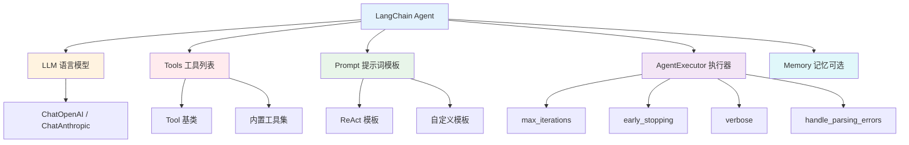

---

### 10.2 经典方式：initialize_agent

```python
"""
LangChain 经典 ReAct Agent 实现（initialize_agent）
注意：此方式在 LangChain 0.2+ 中已 deprecated
"""
from langchain.agents import AgentType, initialize_agent, Tool
from langchain_openai import ChatOpenAI
from langchain_community.tools import DuckDuckGoSearchRun

# 1. 初始化 LLM
llm = ChatOpenAI(model="gpt-4o-mini", temperature=0)

# 2. 定义工具
search = DuckDuckGoSearchRun()

tools = [
    Tool(
        name="Search",
        func=search.run,
        description=(
            "用于搜索互联网上的实时信息。"
            "当需要回答最新事件、事实核查、或获取训练数据之后的信息时使用。"
        ),
    ),
    Tool(
        name="Calculator",
        func=lambda x: str(eval(x)),  # 生产环境用安全计算库
        description="用于执行数学计算。输入数学表达式字符串，如 '23 * 45 + 10'。",
    ),
]

# 3. 初始化 ReAct Agent
agent = initialize_agent(
    tools,
    llm,
    agent=AgentType.ZERO_SHOT_REACT_DESCRIPTION,  # ReAct 类型
    verbose=True,                # 打印 Thought/Action/Observation 过程
    max_iterations=8,            # 最大迭代次数
    max_execution_time=60,       # 最大执行时间（秒）
    early_stopping_method="generate",  # 达到上限时强制生成答案
    handle_parsing_errors=True,   # 自动处理解析错误
    return_intermediate_steps=True,  # 返回中间步骤（用于调试）
)

# 4. 运行
result = agent.run("2026年图灵奖得主是谁？计算 1234 * 5678 的结果。")
print(result)

# 5. 带中间步骤的运行
result_with_steps = agent("2026年图灵奖得主是谁？")
print("最终答案:", result_with_steps["output"])
print("中间步骤数:", len(result_with_steps["intermediate_steps"]))
for i, step in enumerate(result_with_steps["intermediate_steps"]):
    action, observation = step
    print(f"\n步骤 {i+1}:")
    print(f"  Thought: {action.log}")
    print(f"  Action: {action.tool}({action.tool_input})")
    print(f"  Observation: {observation[:100]}...")
```

#### AgentType 枚举说明

| AgentType | 说明 | 适用场景 |
|-----------|------|---------|
| `ZERO_SHOT_REACT_DESCRIPTION` | 经典 ReAct，纯文本 Prompt | 通用场景，不需要 Function Calling |
| `REACT_DOCSTORE` | ReAct + 文档存储交互 | 文档问答、信息检索 |
| `SELF_ASK_WITH_SEARCH` | 自我提问 + 搜索 | 多跳问答 |
| `OPENAI_FUNCTIONS` | OpenAI Function Calling | 支持 FC 的模型，更稳定 |
| `OPENAI_MULTI_FUNCTIONS` | 支持并行多工具调用 | 需要并行调用多个工具 |
| `CHAT_ZERO_SHOT_REACT_DESCRIPTION` | 聊天模型版 ReAct | 聊天模型 |

---

### 10.3 新方式：create_react_agent

```python
"""
LangChain 新方式：create_react_agent（LangChain 0.1+ 推荐）
"""
from langchain import hub
from langchain.agents import AgentExecutor, create_react_agent
from langchain_openai import ChatOpenAI
from langchain_core.tools import tool
from langchain_community.tools import DuckDuckGoSearchRun

# 1. 定义工具（使用 @tool 装饰器）
@tool
def calculator(expression: str) -> str:
    """执行数学计算。当需要精确计算数学表达式时使用。
    Args:
        expression: 数学表达式字符串，如 '23 * 45 + 10'
    """
    try:
        result = eval(expression, {"__builtins__": {}}, {})
        return f"{expression} = {result}"
    except Exception as e:
        return f"计算错误: {e}"

@tool
def get_current_time() -> str:
    """获取当前日期和时间。当用户询问现在几点、今天日期时使用。"""
    from datetime import datetime
    return datetime.now().strftime("%Y-%m-%d %H:%M:%S %A")

search = DuckDuckGoSearchRun()
search.name = "search_web"
search.description = "搜索互联网获取实时信息。当需要回答最新事件、事实核查时使用。"

tools = [calculator, get_current_time, search]

# 2. 初始化 LLM
llm = ChatOpenAI(model="gpt-4o-mini", temperature=0)

# 3. 获取 ReAct Prompt（从 LangChain Hub 拉取官方模板）
prompt = hub.pull("hwchase17/react")

# 查看 Prompt 结构
print("Prompt 变量:", prompt.input_variables)
print("Prompt 模板:", prompt.template[:500])

# 4. 创建 ReAct Agent
agent = create_react_agent(llm, tools, prompt)

# 5. 创建 AgentExecutor
agent_executor = AgentExecutor(
    agent=agent,
    tools=tools,
    verbose=True,
    max_iterations=8,
    max_execution_time=60,
    handle_parsing_errors=True,
    return_intermediate_steps=True,
)

# 6. 运行
result = agent_executor.invoke({"input": "现在是什么时间？计算 1234 * 5678 等于多少？"})
print("\n最终答案:", result["output"])
```

#### 自定义 ReAct Prompt

```python
"""
自定义 ReAct Prompt 模板
"""
from langchain_core.prompts import PromptTemplate

# 自定义 ReAct Prompt
custom_react_prompt = PromptTemplate.from_template("""你是一个专业的研究助手，擅长通过多步推理和工具调用来回答复杂问题。

可用工具：
{tools}

使用格式：
Question: 用户的问题
Thought: 你对当前问题的分析和下一步计划
Action: 要使用的工具，必须是 [{tool_names}] 中的一个
Action Input: 工具的输入参数
Observation: 工具返回的结果
...（重复 Thought/Action/Action Input/Observation）
Thought: 我现在有足够信息回答问题了
Final Answer: 最终答案

注意事项：
1. 对于事实性问题，必须先搜索验证，不要凭记忆回答
2. 数学计算必须使用 calculator 工具
3. 不要重复调用相同的工具和参数
4. 如果信息足够，及时输出 Final Answer

开始！
Question: {input}
Thought: {agent_scratchpad}""")

# 使用自定义 Prompt
agent = create_react_agent(llm, tools, custom_react_prompt)
```

---

### 10.4 OpenAI Tools Agent（Function Calling）

```python
"""
LangChain OpenAI Tools Agent（基于 Function Calling）
这是生产环境推荐的方式，稳定性更高
"""
from langchain import hub
from langchain.agents import AgentExecutor, create_openai_tools_agent
from langchain_openai import ChatOpenAI
from langchain_core.tools import tool
from langchain_core.prompts import ChatPromptTemplate, MessagesPlaceholder

# 1. 定义工具
@tool
def search_web(query: str) -> str:
    """搜索互联网获取实时信息。
    Args:
        query: 搜索关键词，如 '2026年图灵奖得主'
    """
    # 实际实现中调用搜索 API
    return f"搜索结果: {query}"

@tool
def calculator(expression: str) -> str:
    """执行数学计算。
    Args:
        expression: 数学表达式，如 '1234 * 5678'
    """
    try:
        result = eval(expression, {"__builtins__": {}}, {})
        return f"{expression} = {result}"
    except Exception as e:
        return f"错误: {e}"

tools = [search_web, calculator]

# 2. 初始化 LLM
llm = ChatOpenAI(model="gpt-4o-mini", temperature=0)

# 3. 创建 Prompt（OpenAI Tools Agent 使用聊天模板）
prompt = ChatPromptTemplate.from_messages([
    ("system", "你是一个有用的助手，可以使用工具来回答问题。对于事实性问题，请先搜索验证。"),
    ("user", "{input}"),
    MessagesPlaceholder(variable_name="agent_scratchpad"),
])

# 4. 创建 OpenAI Tools Agent
agent = create_openai_tools_agent(llm, tools, prompt)

# 5. 创建 AgentExecutor
agent_executor = AgentExecutor(
    agent=agent,
    tools=tools,
    verbose=True,
    max_iterations=10,
    max_execution_time=120,
    handle_parsing_errors=True,
)

# 6. 运行
result = agent_executor.invoke({"input": "2026年图灵奖得主是谁？计算 1234 * 5678。"})
print(result["output"])
```

---

### 10.5 LangChain Agent 的高级配置

```python
"""
LangChain Agent 高级配置
"""
from langchain.agents import AgentExecutor
from langchain_core.callbacks import BaseCallbackHandler
from typing import Dict, Any, List

# 1. 自定义回调处理器 - 用于日志记录和监控
class AgentTraceCallback(BaseCallbackHandler):
    """Agent 执行轨迹回调"""

    def __init__(self):
        self.trace = []
        self.current_thought = ""

    def on_agent_action(self, action, **kwargs):
        """Agent 决定 Action 时触发"""
        self.current_thought = action.log
        print(f"[Action] {action.tool}({action.tool_input})")

    def on_tool_end(self, output: str, **kwargs):
        """工具执行完成时触发"""
        self.trace.append({
            "thought": self.current_thought,
            "observation": output[:200]
        })
        print(f"[Observation] {output[:100]}...")

    def on_agent_finish(self, finish, **kwargs):
        """Agent 完成时触发"""
        print(f"[Final Answer] {finish.return_values['output'][:200]}")


# 使用回调
callback = AgentTraceCallback()
result = agent_executor.invoke(
    {"input": "问题"},
    config={"callbacks": [callback]}
)
print(f"总步骤数: {len(callback.trace)}")


# 2. 自定义解析错误处理
def custom_parse_error_handler(error: Exception) -> str:
    """
    自定义解析错误处理
    返回的字符串会作为 Observation 注入，引导 LLM 修正
    """
    return (
        f"输出格式解析错误: {error}。"
        f"请严格按照格式输出：Thought: ... Action: 工具名(参数) Observation: ..."
        f"或者直接输出 Final Answer: 答案"
    )

agent_executor = AgentExecutor(
    agent=agent,
    tools=tools,
    handle_parsing_errors=custom_parse_error_handler,  # 自定义错误处理
)


# 3. 流式输出
for chunk in agent_executor.stream({"input": "问题"}):
    if "actions" in chunk:
        for action in chunk["actions"]:
            print(f"Action: {action.tool}")
    elif "steps" in chunk:
        for step in chunk["steps"]:
            print(f"Observation: {step.observation[:100]}")
    elif "output" in chunk:
        print(f"Final Answer: {chunk['output']}")


# 4. 带记忆的 Agent
from langchain.memory import ConversationBufferMemory

memory = ConversationBufferMemory(memory_key="chat_history", return_messages=True)

prompt_with_memory = ChatPromptTemplate.from_messages([
    ("system", "你是一个有用的助手。"),
    MessagesPlaceholder(variable_name="chat_history"),
    ("user", "{input}"),
    MessagesPlaceholder(variable_name="agent_scratchpad"),
])

agent = create_openai_tools_agent(llm, tools, prompt_with_memory)
agent_executor = AgentExecutor(agent=agent, tools=tools, memory=memory, verbose=True)

# 多轮对话
agent_executor.invoke({"input": "我叫张三"})
agent_executor.invoke({"input": "我叫什么名字？"})  # 能记住之前的对话
```

> 🔍 **面试高频考点 20**：LangChain 中 `initialize_agent` 和 `create_react_agent` 有什么区别？生产环境推荐用哪个？答：`initialize_agent` 是旧的 API，通过 AgentType 枚举选择 Agent 类型，在 LangChain 0.2+ 中已 deprecated。`create_react_agent` 是新的函数式 API，更灵活，支持自定义 Prompt 和工具。生产环境推荐使用 `create_openai_tools_agent`（基于 Function Calling，稳定性更高），或者迁移到 LangGraph 获得更好的可控性和可观测性。

---

> 💡 **深度讲解**：LangChain 的 Agent 模块是学习 ReAct 实现的优秀参考，但也是最容易让人困惑的部分——它经历了多次 API 变更，从 `initialize_agent` 到 `create_react_agent` 再到 LangGraph，旧文档和新文档混杂。理解 LangChain Agent 的关键是抓住其核心抽象：①Tool（工具）——封装外部功能，有 name/description/args_schema ②Agent（代理）——决定下一步做什么，本质是一个 LLM 调用 + 输出解析 ③AgentExecutor（执行器）——编排 Agent 循环，处理工具执行、错误处理、循环控制。这三个抽象与我们第四章从零实现的 ReAct Agent 完全对应：Tool 对应工具注册表，Agent 对应 LLM 调用 + Action 解析，AgentExecutor 对应 ReAct 循环。LangChain 的 `create_react_agent` 使用经典 ReAct（纯文本+正则解析），`create_openai_tools_agent` 使用 Function Calling，后者稳定性更高，是生产环境推荐。对于需要更精细控制的场景（持久化、人机交互、复杂状态管理），LangGraph 是更好的选择，下一章将详细讲解。
>
> **📝 精简总结**：
> 1. LangChain Agent 核心组件：LLM、Tools、Prompt、AgentExecutor、Memory（可选）
> 2. 经典方式 `initialize_agent` 通过 AgentType 选择 ReAct 类型，已 deprecated
> 3. 新方式 `create_react_agent` 是函数式 API，支持自定义 Prompt，使用经典 ReAct（纯文本+正则）
> 4. `create_openai_tools_agent` 基于 Function Calling，稳定性更高，是生产环境推荐
> 5. AgentExecutor 配置：max_iterations、max_execution_time、handle_parsing_errors、return_intermediate_steps、verbose
> 6. 高级功能：自定义回调（日志/监控）、自定义解析错误处理、流式输出、对话记忆
> 7. 对于需要更精细控制的场景，推荐迁移到 LangGraph
>
> **🎯 梯度练习题**：
> - **基础 1**：LangChain Agent 的核心组件有哪些？各自的作用是什么？
> - **基础 2**：`create_react_agent` 和 `create_openai_tools_agent` 有什么区别？
> - **基础 3**：AgentExecutor 的 `handle_parsing_errors` 参数有什么作用？
> - **进阶 1**：使用 LangChain 实现一个带对话记忆的 ReAct Agent，支持多轮对话，每轮对话都能记住之前的工具调用结果和用户偏好。
> - **进阶 2**：实现一个自定义回调处理器，记录 Agent 每一步的完整信息（Thought/Action/Observation/token用量/耗时），并将 trace 保存为 JSON 文件用于后续分析。
> - **实战 1**：使用 LangChain `create_openai_tools_agent` 实现一个完整的智能助手，包含至少 5 个工具（搜索、计算器、天气、数据库查询、发邮件），支持多轮对话、流式输出、完整的 trace 记录。要求能处理"帮我调研某公司最新财报并发送邮件总结"类复杂任务。

---

